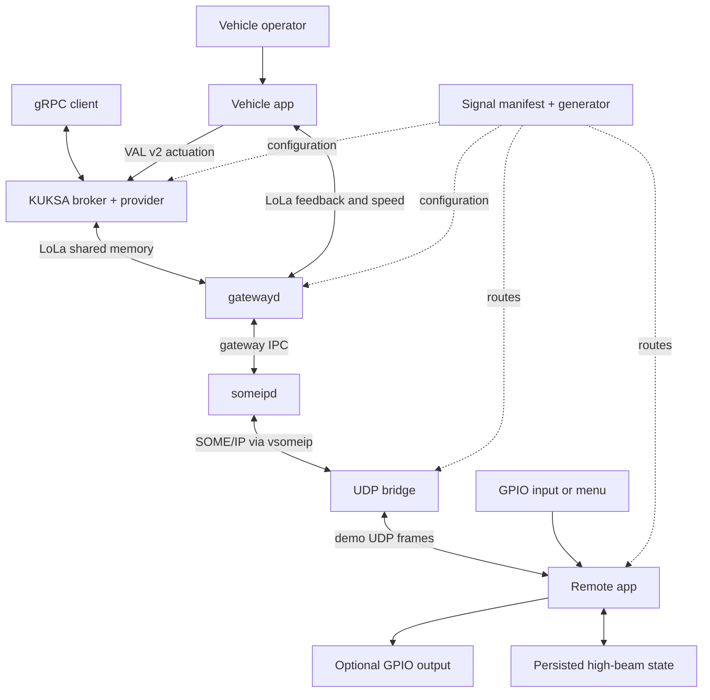
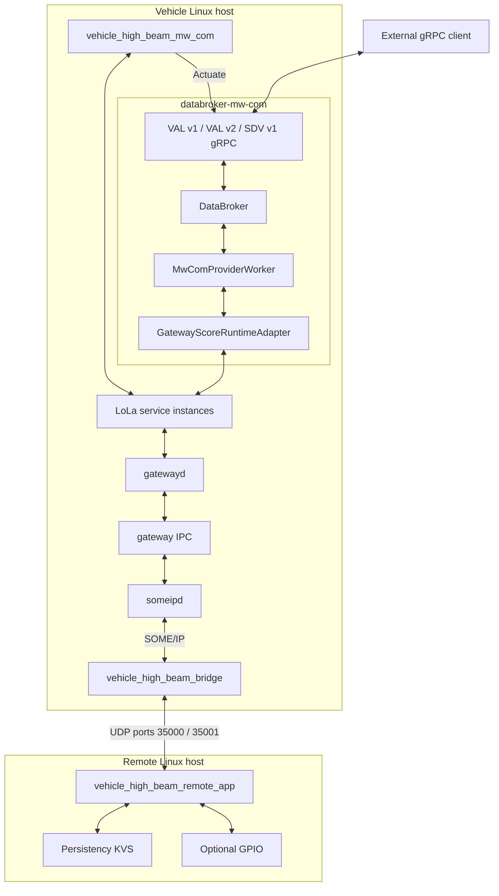
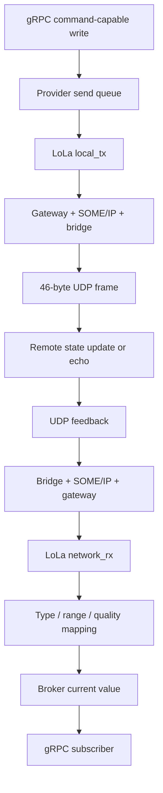
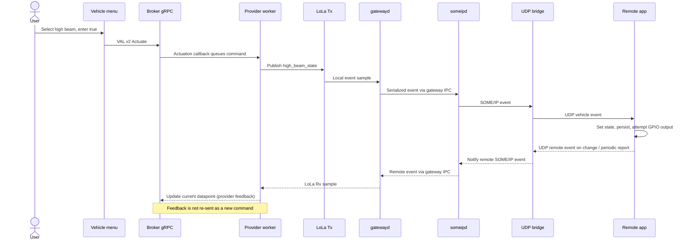

# S-CORE SDV Integration: Definitive Local Handbook

This handbook documents the local `sdv-hackathon` checkout at `0842972`. It separates code-observed behavior, earlier fork inheritance, branch changes, and explicitly unverified runtime behavior. The same chapters form the MkDocs Material site.

Preview setup and limitations are in [Build, Run and Deploy](#chapter-build-run-deploy). Regenerate this document with `python3 -B docs/tools/handbook.py generate`; edit chapter sources under `docs/handbook/`, not this generated copy.

## Contents

- [Component Map](#chapter-index)
- [Overview](#chapter-overview)
- [Architecture](#chapter-architecture)
- [Repository Tour](#chapter-repository-tour)
- [Integration Workspace](#chapter-workspace)
- [Signal Model and Generation](#chapter-signals)
- [Vehicle Applications](#chapter-vehicle)
- [SOME/IP Gateway](#chapter-gateway)
- [Serializer Adapter](#chapter-serializer)
- [UDP Bridge and Frame Protocol](#chapter-bridge)
- [Remote Application](#chapter-remote)
- [S-CORE Libraries and Communication](#chapter-score)
- [KUKSA Broker and mw::com Provider](#chapter-kuksa)
- [Optional SDV Runtime Patch](#chapter-runtime)
- [Platform Images, Runners and Showcases](#chapter-platforms)
- [Build, Run and Deploy](#chapter-build-run-deploy)
- [Configuration Reference](#chapter-configuration)
- [Testing and CI](#chapter-testing-ci)
- [Changes in this Fork — sdv-hackathon](#chapter-fork-changes)
- [Contributing and Debugging](#chapter-contributing-debugging)
- [Glossary](#chapter-glossary)
- [FAQ and Gotchas](#chapter-faq)
- [Verification, Open Questions and Improvements](#chapter-verification)
- [Complete Branch File Changes](#chapter-changed-files)
- [Configuration File Inventory](#chapter-configuration-files)
- [Static Environment and Flag Inventory](#chapter-environment-flags)

---

<a id="chapter-index"></a>

## Component Map

This handbook explains the checked-out `sdv-hackathon` integration workspace, not a hypothetical production vehicle platform. Start with the map, follow the command/feedback path, then use the component chapters when changing code; implementation evidence comes from local files at `0842972`.

### Read this first

**Source citations:** Markdown source links open local repository files in an editor. The site rewrites existing repository citations to pinned GitHub URLs without querying GitHub; those remote URLs have not been independently checked. New handbook support files are offered as local text downloads. Internal handbook navigation and source-file existence are checked locally by [handbook.py](tools/handbook.py), `validate`/`validate_site`, and [site_hooks.py](tools/site_hooks.py), `on_page_markdown`.

**Provenance:** “Inherited integration” means code already present at the shared ancestor with local `origin/main`, not proof of unchanged Eclipse upstream code. “Branch change” means a change after that ancestor. See [Changes in this Fork](#chapter-fork-changes).

### Component map

| Component | Purpose | Location in repo | Key files / symbols | Depends on | Used by | Doc page link |
| --- | --- | --- | --- | --- | --- | --- |
| Integration workspace | Select build dependencies and toolchains | [root](../MODULE.bazel), [bazel_common](../bazel_common) | `MODULE.bazel`, `BUILD`, `known_good.json` | Bazel rules, module repositories | All builds | [Workspace](#chapter-workspace) |
| Signal model | Generate aligned routes and bindings | [demo configuration](../sdv-hack-demo/config) | `body_signals.json`; `configure_signals.py:configure` | JSON manifest, existing snapshots | Apps, gateway, provider | [Signals](#chapter-signals) |
| Vehicle apps | Submit commands and inspect/test feedback | [vehicle_app](../sdv-hack-demo/vehicle_app) | `VehicleHighBeamApplication`, `SignalTestApplication` | mw::com, gRPC, logging | Operator, signal test rig | [Vehicle Apps](#chapter-vehicle) |
| Gateway | Bridge mw::com and SOME/IP | [gateway source](../inc_someip_gateway/score) | `gatewayd/main.cpp`, `someipd/main.cpp` | Communication, IPC, vsomeip, serializer | Vehicle transport | [Gateway](#chapter-gateway) |
| Serializer adapter | Canonicalize the dynamics Rx type name | [serializer](../sdv-hack-demo/serializer) | `serializer_shim.cpp:CanonicalName` | Base serializer, `libdl` | gatewayd | [Serializer](#chapter-serializer) |
| UDP bridge | Relay SOME/IP payloads to/from the remote | [bridge](../sdv-hack-demo/bridge) | `main.cpp`, `RegisterServices`, `Encode`, `Decode` | vsomeip, route table, UDP sockets | someipd, remote app | [UDP Bridge](#chapter-bridge) |
| Remote endpoint | Store/apply high-beam state; echo other routes | [remote_app](../sdv-hack-demo/remote_app) | `main`, `GpioOutput`, `SetOutboundState` | Persistency, logging, GPIO, UDP | Bridge, operator | [Remote App](#chapter-remote) |
| S-CORE foundations | Provide common libraries and LoLa transport | [baselibs](../baselibs), [communication](../communication) | `GenericProxy`, `GenericSkeleton`, Rust `score_com` | POSIX/shared memory, toolchains | Gateway, apps, provider | [S-CORE](#chapter-score) |
| KUKSA integration | Expose signal state and commands through gRPC | [broker workspace](../kuksa-databroker) | `databroker-mw-com/main.rs`, `MwComProviderWorker` | Tokio, tonic/protobuf, score_com | Vehicle menu, external clients | [KUKSA](#chapter-kuksa) |
| Optional runtime patch | Connect container syncer to the external broker | [runtime patch](../sdv-hack-demo/sdv-runtime/sdv-runtime-mw-com.patch) | Dockerfile, syncer, service supervisor hunks | Container runtime, broker, kit service | Optional playground integration | [SDV Runtime](#chapter-runtime) |
| Platform integration | Package examples into platform images | [images](../images), [runners](../runners), [showcases](../showcases) | `score_starter`, image `:run` targets | Docker/QEMU, platform SDKs | Integration demonstrations | [Platforms](#chapter-platforms) |
| Engineering tooling | Manage pins, tests, reports and documentation | [scripts](../scripts), [test harness](../feature_integration_tests), [CI](../.github/workflows) | `quality_runners.py`, `FitScenario`, workflow jobs | Bazel, Python, test frameworks | Contributors and CI | [Testing and CI](#chapter-testing-ci) |

These are documentation boundaries, not claims that each directory is a separately deployable service. Build targets and source entry points are cited in each chapter.

### Architecture at a glance



Evidence: [vehicle `Run`](../sdv-hack-demo/vehicle_app/main.cc), [provider worker](../kuksa-databroker/mw_com_provider/src/provider.rs), [gateway entry points](../inc_someip_gateway/score/gatewayd/main.cpp), [bridge `main`](../sdv-hack-demo/bridge/main.cpp), [remote `main`](../sdv-hack-demo/remote_app/main.cpp), [generator `configure`](../sdv-hack-demo/configure_signals.py).

### How to use this handbook

1. Read [Overview](#chapter-overview), [Architecture](#chapter-architecture), and [Repository Tour](#chapter-repository-tour).
2. Before running anything, read the side-effect warnings in [Build, Run and Deploy](#chapter-build-run-deploy).
3. Before editing a signal, read [Signals](#chapter-signals) and [Configuration](#chapter-configuration).
4. Use [Verification](#chapter-verification) to distinguish executed checks from source-derived expectations.

### Related pages

[Overview](#chapter-overview) | [Architecture](#chapter-architecture) | [Build, Run and Deploy](#chapter-build-run-deploy) | [Verification](#chapter-verification)


---

<a id="chapter-overview"></a>

## Overview

This repository combines an S-CORE reference-integration workspace with a two-endpoint vehicle-signal demonstration and a KUKSA middleware provider. The branch extends an earlier fork demo with more signals, compatible shared-memory bindings, broker command forwarding and an optional container-runtime patch; it is not a production deployment specification.

### Problem and boundary

The concrete problem is to move typed vehicle signals between local shared-memory middleware, SOME/IP gateway processes, a remote UDP endpoint and gRPC clients. The implementation is visible in the [vehicle application](../sdv-hack-demo/vehicle_app/main.cc), [bridge](../sdv-hack-demo/bridge/main.cpp), [remote application](../sdv-hack-demo/remote_app/main.cpp), and [broker composition](../kuksa-databroker/databroker-mw-com/src/main.rs).

The inherited reference-integration layer also builds platform images, packages showcases, selects compatible module revisions and runs integration checks. Its entry points are [MODULE.bazel](../MODULE.bazel), [known_good.json](../known_good.json), [showcases/BUILD](../showcases/BUILD), and [score_starter](../score_starter), `main`.

**Not established by this code:** production safety qualification of this demo, authenticated UDP transport, guaranteed end-to-end command delivery, physical actuation for all listed signals, or deployment to a real vehicle. In particular, the [remote receive loop](../sdv-hack-demo/remote_app/main.cpp) echoes most non-high-beam payloads rather than driving matching hardware.

### Five-minute mental model

1. **A model is not a live signal.** [body_signals.json](../sdv-hack-demo/config/body_signals.json) lists 44 body/door/powertrain signals. [configure_signals.py](../sdv-hack-demo/configure_signals.py), `configure`, derives route and middleware snapshots; [gateway_provider_codegen.py](../sdv-hack-demo/gateway_provider_codegen.py) derives provider mappings and Rust bindings.
2. **Local data is shared memory.** Apps use `GenericSkeleton` to offer events and `GenericProxy` to subscribe. The provider uses Rust `score_com`; see [vehicle source](../sdv-hack-demo/vehicle_app/main.cc), `OfferLocalService`, and [gateway adapter](../kuksa-databroker/mw_com_provider/src/gateway_adapter.rs).
3. **Two daemons split the gateway boundary.** [gatewayd](../inc_someip_gateway/score/gatewayd/main.cpp) owns the middleware side; [someipd](../inc_someip_gateway/score/someipd/main.cpp) owns network-facing routing. They exchange messages through gateway IPC.
4. **The bridge is another process.** [bridge `main`](../sdv-hack-demo/bridge/main.cpp) subscribes/offers SOME/IP events using vsomeip and relays their payloads in fixed-size UDP frames. It is not the remote GPIO driver.
5. **Current value and command are different concepts.** [provider `start_command_forwarder`](../kuksa-databroker/mw_com_provider/src/provider.rs) forwards broker target/current-value writes for command-capable mappings, ignores provider feedback to prevent loops, and skips the initial state snapshot.
6. **One publisher owns the body Tx instance.** In default combined mode KUKSA owns it; direct mode selects the legacy vehicle publisher and disables the provider's body Tx offer. See [launcher](../sdv-hack-demo/deploy/start-vehicle.sh) and [gateway adapter](../kuksa-databroker/mw_com_provider/src/gateway_adapter.rs).

### What this branch changes

Local history identifies a communication-source refresh (`9f314a1`), gateway-source update (`f6f27c0`), body and engine/powertrain additions (`c9b1317`, `525caf3`, `932552f`, `a2b367c`), legacy VAL v1 support (`2723d0a`), current-value command forwarding (`91d2f50`), and runtime patch updates (`c125277`, `b048870`, `0842972`). See the complete generated [file table](#chapter-changed-files) and the evidence-based [interpretation](#chapter-fork-changes).

**Unverified:** an exact pristine Eclipse upstream baseline. Only the local `origin/main` history and shared ancestor were available. Earlier fork additions already include the basic demo and vendored trees, as shown by `git ls-tree origin/main` and the shared-ancestor history.

### Why these choices exist

| Choice | Visible reason | Evidence |
| --- | --- | --- |
| Same Communication checkout for LoLa users | All processes must agree on shared-memory layout | [module override comments](../bazel_common/score_modules_target_sw.MODULE.bazel), [gateway override](../inc_someip_gateway/user.bazelrc) |
| Separate Rx and Tx mappings | Receive current state without making competing body Tx publishers | [provider generator](../sdv-hack-demo/gateway_provider_codegen.py), [composition mode logic](../kuksa-databroker/databroker-mw-com/src/main.rs) |
| Serializer shim | Gateway service-type naming collision requires a distinct dynamics Rx name, while base serializer knows the canonical name | [serializer_shim.cpp](../sdv-hack-demo/serializer/serializer_shim.cpp), leading design comment |
| Dedicated provider worker runtime | Native LoLa state/calls are isolated from the main broker runtime | [start_provider_worker](../kuksa-databroker/databroker-mw-com/src/main.rs) |
| Compact UDP remote transport | Code implements a 32-byte payload bound; why UDP was selected over a complete remote SOME/IP endpoint is not established | [protocol](../sdv-hack-demo/include/high_beam_udp_protocol.h), `kMaxPayloadSize`; **Unverified: transport selection rationale** |

### Related pages

[Component Map](#chapter-index) | [Architecture](#chapter-architecture) | [Changes in this Fork](#chapter-fork-changes) | [Glossary](#chapter-glossary)


---

<a id="chapter-architecture"></a>

## Architecture

The main runtime is a chain of independent processes with explicit configuration, shared-memory and socket boundaries. The diagrams describe default combined mode; direct mode and all-signal testing intentionally change publisher ownership.

### Components and trust boundaries



Evidence: [composition `main`](../kuksa-databroker/databroker-mw-com/src/main.rs) registers exactly the three illustrated APIs; [gatewayd](../inc_someip_gateway/score/gatewayd/main.cpp) creates the IPC client; [someipd](../inc_someip_gateway/score/someipd/main.cpp) creates the IPC server; [remote `main`](../sdv-hack-demo/remote_app/main.cpp) opens the KVS and GPIO handles.

The composition server uses `Authorization::Disabled` and the launcher binds it to `0.0.0.0:55555`. Do not infer standalone broker TLS/JWT settings apply to this binary: [composition source](../kuksa-databroker/databroker-mw-com/src/main.rs), `serve_tcp`; [launcher](../sdv-hack-demo/deploy/start-vehicle.sh), `start_kuksa`.

### Data flow: feedback and commands



The mapping and feedback-loop boundaries are implemented by [provider.rs](../kuksa-databroker/mw_com_provider/src/provider.rs), `start_command_forwarder`, `publish_message`, and [mapper.rs](../kuksa-databroker/mw_com_provider/src/mapper.rs), `message_to_update`/`actuation_to_message`. The remote's high-beam feedback is a reported state; non-high-beam echo is not evidence of physical hardware actuation ([remote receive loop](../sdv-hack-demo/remote_app/main.cpp)).

### Main sequence: high-beam command



Evidence: [vehicle `PublishLocalState`](../sdv-hack-demo/vehicle_app/main.cc), [provider worker](../kuksa-databroker/mw_com_provider/src/provider.rs), [gateway local service implementation](../inc_someip_gateway/score/gatewayd/impl/local_service_instance.cpp), [bridge handlers](../sdv-hack-demo/bridge/main.cpp), [remote `SetOutboundState`](../sdv-hack-demo/remote_app/main.cpp).

### Startup and failure control

The [vehicle launcher](../sdv-hack-demo/deploy/start-vehicle.sh) takes a lock, configures library paths, attempts stale-process/shared-memory cleanup, starts both daemons, retries their IPC connection, starts the bridge, waits for gateway resources and launches the selected app. Its KUKSA subprocess retries up to five times; broker-mode readiness probes use `VDB_ADDRESS`.

The [composition](../kuksa-databroker/databroker-mw-com/src/main.rs) seeds broker metadata, rewrites model signal IDs to runtime IDs, starts a worker thread and serves gRPC. Its `tokio::select!` coordinates server failure, worker completion and Ctrl-C. The worker readiness signal follows registration; it does **not** prove remote hardware connectivity.

| Mode | Body Tx owner | Broker | Primary foreground process |
| --- | --- | --- | --- |
| `VEHICLE_APP_MODE=combined`, `HIGH_BEAM_COMMAND_MODE=kuksa` | Provider | Started | Vehicle menu |
| `combined`, `direct` | Vehicle application | Started with body actuation disabled | Vehicle menu |
| `signals` | Signal tester | Not started | `body_signal_test_app` |

Evidence: [launcher case statement](../sdv-hack-demo/deploy/start-vehicle.sh), [vehicle `Run`](../sdv-hack-demo/vehicle_app/main.cc), [adapter `connect`](../kuksa-databroker/mw_com_provider/src/gateway_adapter.rs).

### Constraints

- UDP framing carries no command identifier, delivery acknowledgement protocol, checksum beyond transport, or sender authentication in its `Frame`; the receiver matches route IDs, not sender identity ([protocol](../sdv-hack-demo/include/high_beam_udp_protocol.h), [bridge receive loop](../sdv-hack-demo/bridge/main.cpp)).
- A source-language type name is not enough to establish shared-memory compatibility. Sample size, alignment and binding IDs must match ([gateway_samples.rs](../kuksa-databroker/mw_com_provider/src/gateway_samples.rs), [generated binding metadata](../kuksa-databroker/mw_com_provider/generated/gateway_bindings.rs)).
- **Unverified:** timing guarantees, packet-loss behavior under load, and physical-device behavior. No multi-device scenario was run while producing this handbook.

### Related pages

[Component Map](#chapter-index) | [Signals](#chapter-signals) | [KUKSA](#chapter-kuksa) | [Build, Run and Deploy](#chapter-build-run-deploy)


---

<a id="chapter-repository-tour"></a>

## Repository Tour

The repository is an integration workspace containing complete vendored source trees, build metadata, tests and a fork-specific demonstration. Treat the top-level build graph and each vendored module's own workspace as separate build contexts; similarly named targets and configuration names are not interchangeable.

### Annotated top-level tree

```text
reference_integration_fork/
  .devcontainer/              Development-container setup
  .github/                   CI, CodeQL configuration, helper tools, agent material
  .llm_tmp/                  Checked-in/local experimental artifacts, not runtime entry points
  .vscode/                   Editor settings and formatting helper
  baselibs/                  Vendored C++/Rust foundational libraries
  bazel/toolchains/          Integration-specific toolchain registration
  bazel_common/             Module includes, bundles, packaging helpers
  ci/                        Showcase target list
  communication/             Vendored middleware, shared memory, Rust/C++ bindings
  docs/                      Existing Sphinx docs plus this additive handbook
  feature_integration_tests/ Python orchestration and C++/Rust scenarios
  images/                    Platform image assembly
  inc_someip_gateway/        Gateway daemons, serializer, IPC, configs and tests
  kuksa-databroker/           Rust broker workspace and mw::com provider
  patches/                   Patches applied to externally resolved modules
  platform_integration_tests/Reserved placeholder, not an implemented test suite
  runners/                   Docker/QEMU launch rules and scripts
  rust_coverage/             Rust coverage support target
  scripts/                   Pin management, tooling CLI, build/report automation
  sdv-hack-demo/             Two-endpoint signal demonstration
  showcases/                Packaged CLI, lifecycle and standalone examples
```

Evidence: each location is present locally; entry definitions are [MODULE.bazel](../MODULE.bazel), [BUILD](../BUILD), [showcases/BUILD](../showcases/BUILD), and [tooling BUILD](../scripts/tooling/BUILD). The [platform test placeholder](../platform_integration_tests/.gitkeep) is empty. Generated `bazel-*` symlinks are outputs/cache entry points, not source directories.

### Demo directories

| Folder | What belongs here | Evidence |
| --- | --- | --- |
| [bridge](../sdv-hack-demo/bridge) | vsomeip/UDP relay and registration-order test | `main.cpp`, `service_registration.h`, `BUILD.bazel` |
| [config](../sdv-hack-demo/config) | Source signal manifest plus gateway/provider snapshots | `body_signals.json`, `mw_someip_config.json`, `gateway_provider_config.json` |
| [deploy](../sdv-hack-demo/deploy) | Installed launchers and network defaults | `start-vehicle.sh`, `start-remote.sh`, `network.env` |
| [include](../sdv-hack-demo/include) | UDP framing and speed codec | `high_beam_udp_protocol.h`, `speed_payload.h` |
| [remote_app](../sdv-hack-demo/remote_app) | Remote menu/GPIO/state and protocol helpers | `main.cpp`, local protocol header |
| [serializer](../sdv-hack-demo/serializer) | Forwarding shim and exported ABI | `serializer_shim.cpp`, `exported_symbols.lds` |
| [vehicle_app](../sdv-hack-demo/vehicle_app) | Vehicle menu and all-signal tester | `main.cc`, `body_signal_test_app.cpp`, `signal_test_values.h` |
| [sdv-runtime](../sdv-hack-demo/sdv-runtime) | Tracked patch for another runtime repository | `sdv-runtime-mw-com.patch`; nested checkout and backup are untracked |

The root-level demo scripts build/package the above; [signal_routes.json](../sdv-hack-demo/signal_routes.json) is a synchronized runtime snapshot. [architecture.drawio](../sdv-hack-demo/architecture.drawio) is an existing diagram asset, not the authority when it disagrees with executable code.

### Vendored library organization

**Baselibs:** [score](../baselibs/score) contains allocator, analysis/tracing, bit manipulation, concurrency, containers, Rust containers, datetime conversion, filesystem, FlatBuffers, hash, JSON, language support, Rust logging, memory, middleware helpers, network, OS/PAL wrappers, quality, result, scope exit, static reflection/serialization, strings, synchronization, testing macros, threads and utilities. [src](../baselibs/src) retains compatibility aliases; [examples](../baselibs/examples), [third_party](../baselibs/third_party), [tools](../baselibs/tools), [patches](../baselibs/patches), [docs](../baselibs/docs), [licenses](../baselibs/licenses), and [bazel](../baselibs/bazel) serve the named module-local concerns. See [AGENTS.md](../baselibs/AGENTS.md), “Repository Layout,” and the corresponding subdirectory BUILD files.

**Communication:** [score](../communication/score) separates shared memory, message passing and middleware; [score/mw/com](../communication/score/mw/com) holds public APIs, implementation, Rust bindings and examples. [bazel](../communication/bazel), [third_party](../communication/third_party), [quality](../communication/quality), [module_integration_test](../communication/module_integration_test), [tools](../communication/tools), and [docs](../communication/docs) contain module build infrastructure, dependencies, verification and design material. Evidence: [MODULE.bazel](../communication/MODULE.bazel), [BUILD](../communication/BUILD).

**Gateway:** [score](../inc_someip_gateway/score) contains `config`, `gateway_ipc_binding`, `gatewayd`, `serializer`, `socom`, `someip`, and `someipd`. [config](../inc_someip_gateway/config) and [deployment](../inc_someip_gateway/deployment) contain deployment inputs; [tests](../inc_someip_gateway/tests) includes integration, benchmarks and TC8 material; [quality](../inc_someip_gateway/quality), [bazel](../inc_someip_gateway/bazel), [third_party](../inc_someip_gateway/third_party), [tools](../inc_someip_gateway/tools), [docs](../inc_someip_gateway/docs), and [LICENSES](../inc_someip_gateway/LICENSES) provide supporting infrastructure. See [gateway instructions](../inc_someip_gateway/AGENTS.md).

**KUKSA:** [databroker](../kuksa-databroker/databroker), [databroker-cli](../kuksa-databroker/databroker-cli), [databroker-proto](../kuksa-databroker/databroker-proto), [databroker-mw-com](../kuksa-databroker/databroker-mw-com), and [mw_com_provider](../kuksa-databroker/mw_com_provider) are Cargo workspace members. [proto](../kuksa-databroker/proto), [lib](../kuksa-databroker/lib), [data](../kuksa-databroker/data), [integration_test](../kuksa-databroker/integration_test), [scripts](../kuksa-databroker/scripts), [doc](../kuksa-databroker/doc), [certificates](../kuksa-databroker/certificates), and [jwt](../kuksa-databroker/jwt) support APIs, examples, tests and standalone broker operation. Membership/exclusions are defined in [Cargo.toml](../kuksa-databroker/Cargo.toml).

### Integration infrastructure

- [feature_integration_tests](../feature_integration_tests) separates `configs`, `itf`, `test_cases`, and `test_scenarios/{cpp,rust}`; see [README](../feature_integration_tests/README.md).
- [images](../images) contains AutoSD, Elektrobit corbos Linux for Safety Applications, Linux x86_64, QNX AArch64 and QNX x86_64 image definitions. [runners](../runners) supplies Docker x86_64 and QEMU AArch64/x86_64 support. See each image BUILD and [score_starter](../score_starter).
- [patches](../patches) groups baselibs, communication, configuration-management, kyron, logging, persistency, platform, time and tooling patches. A patch file's presence does not mean it is applied; inspect the matching [bazel_common module include](../bazel_common).
- [scripts/known_good](../scripts/known_good) owns dependency models/generation/tests; [scripts/tooling](../scripts/tooling) owns CLI/library/tests; [scripts/models](../scripts/models) contains build configuration data structures.
- Existing [Sphinx documentation](index.rst) groups integration process, modules, process/tools, S-CORE version-one roadmap/releases, verification reports and assets. This handbook has independent [MkDocs configuration](mkdocs.yml).

### Root files and hidden support

| Files | Meaning |
| --- | --- |
| [MODULE.bazel](../MODULE.bazel), [lockfile](../MODULE.bazel.lock), [BUILD](../BUILD) | Dependency graph, resolved versions, aggregate targets |
| [.bazelrc](../.bazelrc), [.bazelversion](../.bazelversion), [.bazelignore](../.bazelignore) | Platform/config flags, Bazel version, package exclusions |
| [known_good.json](../known_good.json) | Module pins, patches, documentation/test metadata |
| [pyproject.toml](../pyproject.toml), [.pre-commit-config.yaml](../.pre-commit-config.yaml) | Python test/lint rules and copyright hook |
| [README.md](../README.md), [LICENSE](../LICENSE), [NOTICE](../NOTICE) | Existing guide and legal metadata |
| [inc_someip_gateway.patch](../inc_someip_gateway.patch) | Standalone gateway patch artifact; not automatically applied by the demo build |
| [.gitignore](../.gitignore), [.devcontainer](../.devcontainer), [.vscode](../.vscode), [.github](../.github) | Ignore rules, development environment, editor and automation |

**Unverified:** this annotated tour is not a hand-audit of every nested vendored directory. The [configuration inventory](#chapter-configuration-files) and [branch file inventory](#chapter-changed-files) supply exact deep paths; component chapters identify the modification surfaces used by this integration.

### Related pages

[Component Map](#chapter-index) | [Workspace](#chapter-workspace) | [Configuration File Inventory](#chapter-configuration-files) | [Changes in this Fork](#chapter-fork-changes)


---

<a id="chapter-workspace"></a>

## Integration Workspace

The root Bazel workspace assembles modules rather than containing one monolithic application. Its dependency declarations, generated includes and configuration flags determine which implementations are actually compiled; a nearby vendored folder is not automatically selected.

### Purpose and boundaries

Responsibilities are module selection, common toolchain/platform configuration, aggregate documentation/SBOM targets and demo gRPC code generation. Runtime signal handling belongs to apps and libraries, not this layer ([MODULE.bazel](../MODULE.bazel), [BUILD](../BUILD)).

Locations: [bazel_common](../bazel_common), [bazel/toolchains](../bazel/toolchains), [patches](../patches), [known_good.json](../known_good.json).

### Implementation

The root module selects the local gateway explicitly:

```starlark
bazel_dep(name = "score_someip_gateway", version = "0.0.0")
local_path_override(
    module_name = "score_someip_gateway",
    path = "inc_someip_gateway",
)
```

Source: [MODULE.bazel](../MODULE.bazel). The target-software include similarly selects local Communication but resolves baselibs, persistency, kyron, lifecycle, logging, time and configuration management through `git_override` declarations ([score_modules_target_sw.MODULE.bazel](../bazel_common/score_modules_target_sw.MODULE.bazel)).

This distinction matters: the local [baselibs tree](../baselibs) is used by Cargo path dependencies in the KUKSA build, while the root Bazel graph declares a pinned baselibs dependency. Do not assume both builds consume identical paths; inspect [the KUKSA build helper](../kuksa-databroker/scripts/build-rpi-aarch64.sh) and the target-software include.

Key root targets in [BUILD](../BUILD):

| Target | Role |
| --- | --- |
| `//:kuksa_val_types_proto`, `//:kuksa_val_proto` | VAL v2 protobuf inputs |
| `//:kuksa_val_grpc_codegen`, `//:kuksa_val_client` | Generate/build C++ gRPC client |
| `//:docs`, `//:docs_shim` | Existing Sphinx/docs-as-code build and stable alias |
| `//:sbom`, `//:product_sbom` | Product software bill of materials |
| `//:build_tools_sbom` | Separate qualification inventory for build tools |
| `//:starpls_server` | Starlark editor tooling |

The SBOM split is intentional: build-time Python/Java dependencies are not treated as product/runtime dependencies (comments in [BUILD](../BUILD)).

### Inputs, configuration and dependencies

[MODULE.bazel](../MODULE.bazel) includes common basic rules, GCC/QNX/Rust/LLVM/Python support, tooling, target software, images and test-artifact versions. It also declares nlohmann JSON, gRPC, protobuf and Rust crate-universe inputs for the demo.

[.bazelrc](../.bazelrc) defines `linux-x86_64`, `aarch64-linux`, `sdv-demo`, QNX, AutoSD, Elektrobit, coverage and integration-test configurations. `sdv-demo` adds a GNU C11 host-tool flag; it is not itself a target-platform selector. Optional root `user.bazelrc` is imported with `try-import`.

The [pin generator](../scripts/known_good/update_module_from_known_good.py) derives common includes and documentation bundle metadata from [known_good.json](../known_good.json). **Branch caveat:** the Communication local override is hand-adapted relative to the generated header; regeneration can replace the intentional integration choice.

### Errors and edge cases

- Module visibility and transitive repository resolution can fail before source compilation; the [pre-commit configuration](../.pre-commit-config.yaml) explains why copyright checking bypasses one problematic aggregate Bazel graph.
- The root [MODULE.bazel](../MODULE.bazel) references a JSON-schema validator build label whose availability was not verified through a full build.
- Pin metadata and the active local override are different sources of information; a stale pinned Communication hash in [known_good.json](../known_good.json) does not identify the active local source tree.

### Testing and modification

Use the tooling/pin tests named in [internal_tests.yml](../.github/workflows/internal_tests.yml):

```bash
bazel test --lockfile_mode=error \
  //scripts/tooling:tooling_tests //scripts/known_good:known_good_tests
```

**Unverified:** command not run; it may resolve/download module dependencies. Add a module through the [existing integration process](integration_process/step_1_add_module.rst), update the metadata and generated includes together, and inspect overrides before rebuilding.

### Limitations

Several external module implementations are absent as first-class source directories; this handbook can document their integration contracts, not unseen internals. Exact toolchain availability and a clean full-workspace build remain **Unverified**.

### Related pages

[Repository Tour](#chapter-repository-tour) | [Build, Run and Deploy](#chapter-build-run-deploy) | [Configuration](#chapter-configuration) | [Platforms](#chapter-platforms)


---

<a id="chapter-signals"></a>

## Signal Model and Generation

The demo has one primary 44-signal manifest and several synchronized runtime views of it. Change the model first, then regenerate and test the views together; changing one JSON file by hand can create a configuration that parses but does not communicate.

### Purpose, location and boundaries

[body_signals.json](../sdv-hack-demo/config/body_signals.json) records names, VSS paths, wire event IDs, datatypes and optional sensor/actuator metadata. [configure_signals.py](../sdv-hack-demo/configure_signals.py) and [gateway_provider_codegen.py](../sdv-hack-demo/gateway_provider_codegen.py) synchronize integration snapshots; they do not compile binaries or operate the network.

### Implementation and outputs

`configure` preserves unrelated services, removes old body routes and reconstructs body event entries. Its route construction includes:

```python
route = {
    "name": signal["name"],
    "apiName": signal["apiName"],
    "ackApiName": signal["apiName"],
    "datatype": signal["datatype"],
    "eventName": event_name,
    "maxPayloadSize": payload_size,
    "service": 17152,
    "vehicleInstance": 4096,
    "remoteInstance": 4097,
    "vehicleEvent": event_id,
    "remoteEvent": event_id + 1,
}
```

Source: [configure_signals.py](../sdv-hack-demo/configure_signals.py), `configure`.

| Output | Consumer |
| --- | --- |
| [signal_routes.json](../sdv-hack-demo/signal_routes.json) | Bridge, remote app and signal tester |
| [demo gateway JSON](../sdv-hack-demo/config/mw_someip_config.json) | `//sdv-hack-demo:gateway_config` produces binary config |
| [gateway source JSON](../inc_someip_gateway/score/config/mw_someip_config.json) | Gateway module configuration |
| [gateway LoLa manifest](../inc_someip_gateway/score/gatewayd/etc/mw_com_config.json) | gatewayd and demo apps/provider |
| [vsomeip snapshot](../inc_someip_gateway/tests/integration/vsomeip-gateway-services.json) | Network event/service declarations |
| [Communication example manifest](../communication/score/mw/com/example/vehicle-dynamics-example/etc/mw_com_config.json) | Shared integration example |
| [provider mapping](../sdv-hack-demo/config/gateway_provider_config.json) | Composed broker |
| [gateway_bindings.rs](../kuksa-databroker/mw_com_provider/generated/gateway_bindings.rs), [gateway_runtime.rs](../kuksa-databroker/mw_com_provider/generated/gateway_runtime.rs) | Rust gateway adapter |

`body_signal_declarations` also emits the Communication example's body-event declaration include; its destination is constructed in [generator `main`](../sdv-hack-demo/configure_signals.py). Why synchronize across repositories? The same logical event must agree on service instance, event ID and native sample layout before it can traverse the transport.

### Interfaces and payload types

There are **45 routes and provider mappings**: 44 model signals plus the dynamics speed route. The generated mapping classifies 37 as bidirectional, seven as datapoints and one as actuator ([provider mapping](../sdv-hack-demo/config/gateway_provider_config.json)).

| Model datatype | Transport payload | Middleware representation |
| --- | --- | --- |
| `boolean` | One byte, `0`/`1` | Tx pre-serialized; Rx native boolean |
| `uint8` | One byte | Pre-serialized; generated percent bounds 0..100 |
| `int16` | Two bytes, big-endian | Pre-serialized |
| `float` | IEEE-754 float32, big-endian | Pre-serialized |
| `float_array` | At most eight big-endian float32 values | Up to 32 bytes |
| `string` | UTF-8 bytes, no terminating NUL | Up to 32 bytes |

Evidence: [generator payload-size/type selection](../sdv-hack-demo/configure_signals.py), [gateway samples encode/decode](../kuksa-databroker/mw_com_provider/src/gateway_samples.rs), [signal test values](../sdv-hack-demo/vehicle_app/signal_test_values.h). Dynamics speed is a separate **double plus quality byte** wire contract, not the four-byte model `float` ([speed_payload.h](../sdv-hack-demo/include/speed_payload.h)).

### Configuration and errors

Default invocation checks snapshots; `--write` modifies them. Parse errors and missing dictionary fields propagate, while stale snapshots make the check fail. The [six generator tests](../sdv-hack-demo/configure_signals_test.py), `SignalConfigurationTest`, check cardinality, uniqueness, manifest alignment and generated provider contracts.

```bash
python3 -B sdv-hack-demo/configure_signals.py
python3 -B sdv-hack-demo/configure_signals_test.py
```

Both passed during documentation preparation. The following is **Unverified and intentionally not executed**, because it edits existing tracked files:

```bash
python3 -B sdv-hack-demo/configure_signals.py --write
```

### Extending the signal set

1. Select the datatype, VSS path, Tx event ID, event name and direction in [the manifest](../sdv-hack-demo/config/body_signals.json).
2. Verify uniqueness and paired remote IDs; add actual hardware handling if echo is insufficient.
3. Regenerate on a development branch, review **all** changed snapshots and bindings, run the generator tests and relevant codec/provider tests.
4. Rebuild gateway config, apps and provider; deploy matching route/config snapshots to both endpoints ([build script](../sdv-hack-demo/build-aarch64.sh), [packager](../sdv-hack-demo/package-aarch64.sh)).

### Limitations and debt

Signal counts and interface declarations are repeated in tests/output messages. A new datatype needs coordinated changes to generator type maps, codec, Rust samples, metadata and test-value generation; it is not only a JSON edit. **Unverified:** enum/domain semantics beyond the values explicitly encoded in the model and test helpers.

### Related pages

[Configuration](#chapter-configuration) | [Vehicle Apps](#chapter-vehicle) | [KUKSA](#chapter-kuksa) | [UDP Bridge](#chapter-bridge)


---

<a id="chapter-vehicle"></a>

## Vehicle Applications

The vehicle side has an interactive demonstration application and a separate all-signal round-trip tester. They share the middleware transport but have different roles and must not compete for the same body Tx instance.

### Purpose and location

[main.cc](../sdv-hack-demo/vehicle_app/main.cc), `VehicleHighBeamApplication`, provides a high-beam/speed menu and subscribes to returned events. [body_signal_test_app.cpp](../sdv-hack-demo/vehicle_app/body_signal_test_app.cpp), `SignalTestApplication`, sends a configured value sweep and checks matching Rx payloads; neither implements the remote hardware.

Build targets are `//sdv-hack-demo/vehicle_app:vehicle_high_beam_mw_com`, `:body_signal_test_app`, and `:signal_test_values_test` in [BUILD](../sdv-hack-demo/vehicle_app/BUILD).

### Implementation

Publisher selection is explicit:

```cpp
const char* command_mode = std::getenv("HIGH_BEAM_COMMAND_MODE");
broker_commands_ = command_mode != nullptr && std::string_view{command_mode} == "kuksa";
if ((!broker_commands_ && !OfferLocalService()) || !SubscribeToRemoteService() || !OfferDynamicsService() ||
    !SubscribeToDynamicsService()) {
    Cleanup();
    return EXIT_FAILURE;
}
```

Source: [main.cc](../sdv-hack-demo/vehicle_app/main.cc), `Run`. A bare binary without the launcher's environment uses direct high-beam publishing; the launcher defaults to `kuksa`. In broker mode, `PublishLocalState` builds a VAL v2 `ActuateRequest`; in direct mode it sends a one-byte pre-serialized middleware sample. Speed continues through its own dynamics skeleton.

The C++ app uses generic middleware events and native metadata. Its dynamics `SpeedSample` contains a `double` and a quality byte; the metadata uses native `sizeof`/alignment rather than the nine-byte wire size ([main.cc](../sdv-hack-demo/vehicle_app/main.cc)).

### Inputs and outputs

| Interface | Contract |
| --- | --- |
| `/vehicle_high_beam/local_tx` | Body high-beam Tx service, direct mode only |
| `/vehicle_high_beam/network_rx` | Remote high-beam feedback |
| `/Vehicle/Service1/Instance` | Local dynamics service |
| `/Vehicle/Service2/Instance` | Remote dynamics service |
| `VDB_ADDRESS` | gRPC target used for broker commands |
| Menu | `1`: high beam, `2`: speed, `q`: exit |

Evidence: constants and `PublishLocalState` in [main.cc](../sdv-hack-demo/vehicle_app/main.cc). Input is read from `/dev/tty` when available, falling back to stdin; logs and menu output can therefore behave differently when redirected.

The tester consumes route metadata from [signal_routes.json](../sdv-hack-demo/signal_routes.json) and uses [signal_test_values.h](../sdv-hack-demo/vehicle_app/signal_test_values.h), `LoadSignals`, `TestValues` and `DisplayValue`. Only its `--list` mode avoids middleware initialization and publishing.

### Configuration and edge cases

- Tester defaults: `mw_com_config.json`, `signal_routes.json`, value timeout 3000 ms, startup timeout 20000 ms; both timeout flags accept 1..60000 ms ([tester `Options` and `main`](../sdv-hack-demo/vehicle_app/body_signal_test_app.cpp)).
- `CreateProxyWithRetry` retries creation up to 40 times with 300 ms delays because service discovery can precede shared-memory readiness ([main.cc](../sdv-hack-demo/vehicle_app/main.cc)).
- Invalid menu values are logged; failed service setup exits nonzero and calls cleanup. The tester prints per-signal `PASS`/`FAIL` and fails the process if any signal fails.
- A matching feedback value does not identify a unique command: frames have no sequence/correlation field ([protocol](../sdv-hack-demo/include/high_beam_udp_protocol.h)).

### Dependencies and modification

The menu links root `kuksa_val_client`, gRPC, Communication, lifecycle, logging and the gateway's pre-serialized-data ABI. The tester links Communication plus the signal-value helper and ABI header ([BUILD](../sdv-hack-demo/vehicle_app/BUILD)).

For a new menu option, reuse existing parse/publish helpers and select the correct ownership path. For a new signal-test datatype, change `LoadSignals`, test-value encoding/formatting and generated sample metadata together.

```bash
## Unverified: Bazel execution not performed.
bazel test --lockfile_mode=error --config=sdv-demo \
  //sdv-hack-demo/vehicle_app:signal_test_values_test
```

Run the actuator sweep only on an isolated test rig. The [tester](../sdv-hack-demo/vehicle_app/body_signal_test_app.cpp) does not provide an interruption-safe restoration transaction.

### Limitations

The menu covers high beam and speed, not all 44 model signals. The tester establishes application-level round trips, not physical actuation or deterministic delivery; some service-setup failures return little context compared with explicit tester errors.

### Related pages

[Architecture](#chapter-architecture) | [Signals](#chapter-signals) | [Testing and CI](#chapter-testing-ci) | [Remote App](#chapter-remote)


---

<a id="chapter-gateway"></a>

## SOME/IP Gateway

The gateway translates between middleware service instances and SOME/IP network services using two cooperating daemons. This integration builds the gateway as its own Bazel workspace and supplies demo-specific binary configuration and a serializer adapter.

### Purpose, location and non-responsibilities

[gatewayd](../inc_someip_gateway/score/gatewayd) owns middleware-facing local/remote service instances; [someipd](../inc_someip_gateway/score/someipd) owns network-facing services and routing. Their IPC transport lives in [gateway_ipc_binding](../inc_someip_gateway/score/gateway_ipc_binding); they do not parse the demo's compact remote UDP frame—that belongs to the bridge.

### Implementation

`someipd` creates the server side of the daemon connection:

```cpp
message_passing::ServiceProtocolConfig const proto{ipc_channel_name, someip::kMaxIpcMessageSize,
                                                   someip::kMaxIpcMessageSize,
                                                   someip::kMaxIpcMessageSize};

auto ipc_server = message_passing::ServerFactory{}.Create(proto, {10, 1, 10});
```

Source: [someipd/main.cpp](../inc_someip_gateway/score/someipd/main.cpp), `main`. It builds a gateway binding server, starts routing, and constructs local and remote network services from configuration. [gatewayd/main.cpp](../inc_someip_gateway/score/gatewayd/main.cpp) creates the corresponding client and middleware-facing services.

Gateway `event_slot_size` queries the serializer for each event's maximum size and adds the SOME/IP header. If any maximum is unavailable it uses the transport maximum rather than shrinking shared-memory slots unsafely ([gatewayd `event_slot_size`](../inc_someip_gateway/score/gatewayd/main.cpp)).

### Interfaces and configuration

| Input / output | Meaning |
| --- | --- |
| `--configuration` / `-c` | Required compiled FlatBuffers gateway config, both daemons |
| `--service_instance_manifest` / `-s` | Required LoLa manifest, gatewayd |
| `--ipc_channel` / `-i` | Optional daemon IPC channel; same name on both sides |
| `VSOMEIP_CONFIGURATION` | vsomeip network configuration supplied by launcher |
| Serializer ABI | Functions in [serializer.h](../inc_someip_gateway/score/serializer/serializer.h) |
| IPC service constants | [constants.h](../inc_someip_gateway/score/someip/constants.h) |

The [demo BUILD](../sdv-hack-demo/BUILD.bazel), `gateway_config`, compiles [demo JSON](../sdv-hack-demo/config/mw_someip_config.json) to `mw_someip_config.bin` using the gateway's generation rule. The [packager](../sdv-hack-demo/package-aarch64.sh) combines this binary with the gateway LoLa/vsomeip snapshots and both serializer libraries.

### Dependencies and consumers

Dependencies include Communication for middleware, message-passing/IPC helpers, vsomeip through network wrappers, and the serializer ABI. Consumers are the vehicle app/provider on the middleware side and the UDP bridge on the SOME/IP side ([gateway MODULE](../inc_someip_gateway/MODULE.bazel), [gatewayd BUILD](../inc_someip_gateway/score/gatewayd/BUILD.bazel), [someipd BUILD](../inc_someip_gateway/score/someipd/BUILD.bazel)).

The [gateway override](../inc_someip_gateway/user.bazelrc) points Communication at `../communication` and disables lockfile rewriting during resolution. This deliberately aligns LoLa with the KUKSA build; it does not pin the entire vendored gateway to pristine upstream.

### Errors and shutdown

Both entry points validate required options, reject unreadable/empty binary config files, register SIGINT/SIGTERM handlers and report fatal initialization errors. SOME/IP/IPC startup can fail independently of a successful executable build ([gatewayd/main.cpp](../inc_someip_gateway/score/gatewayd/main.cpp), [someipd/main.cpp](../inc_someip_gateway/score/someipd/main.cpp)).

The [launcher](../sdv-hack-demo/deploy/start-vehicle.sh) retries a suspected stuck IPC connection by restarting both daemons. This is launcher-level recovery, not proof that the daemon connection reconnects automatically in every case.

### Testing and extension

Module-local test commands are recorded in [AGENTS.md](../inc_someip_gateway/AGENTS.md):

```bash
## Unverified: execute from inc_someip_gateway/, not the root workspace.
bazel test //score/...
bazel test --config=qemu-integration //tests/integration_test/...
```

For new events, prefer the existing signal generator. For transport changes, add tests at the daemon/IPC boundary and in [integration tests](../inc_someip_gateway/tests/integration_test), then check both directions and serializer metadata.

### Limitations / debt

The integration's service naming workaround and launcher retry/cleanup behavior are tightly coupled to current gateway behavior. **Unverified:** complete SOME/IP conformance, ASIL separation guarantees of this fork, and performance at the full signal rate; the presence of conformance test directories is not a passed result.

### Related pages

[Serializer](#chapter-serializer) | [UDP Bridge](#chapter-bridge) | [S-CORE](#chapter-score) | [Build, Run and Deploy](#chapter-build-run-deploy)


---

<a id="chapter-serializer"></a>

## Serializer Adapter

The demo serializer is a small ABI-preserving forwarding library, not a second implementation of every codec. It translates one dynamics Rx service-type name and delegates to a separately packaged gateway serializer.

### Purpose and source

[serializer_shim.cpp](../sdv-hack-demo/serializer/serializer_shim.cpp) explains the reason: gateway connectors are keyed by service type name, so local and remote instances can collide. The demo gives the Rx type a distinct name; the base serializer still expects its canonical name.

Location: [serializer directory](../sdv-hack-demo/serializer). Targets `serializer_shim` and `base_serializer`, shared-library filenames and export handling are in [BUILD.bazel](../sdv-hack-demo/serializer/BUILD.bazel) and [exported_symbols.lds](../sdv-hack-demo/serializer/exported_symbols.lds).

### Implementation

```cpp
constexpr std::array<std::pair<std::string_view, std::string_view>, 1> kNameAliases{{
    {"vehicle::VehicleDynamicsService_rx", "vehicle::VehicleDynamicsService"},
}};

constexpr char kBaseLibraryName[] = "score_com_serializer_base.so";
```

Source: [serializer_shim.cpp](../sdv-hack-demo/serializer/serializer_shim.cpp). `OpenBaseLibrary` first uses `dladdr` to locate the shim's directory and tries the base library next to it, then falls back to the dynamic loader's search path. `Base` caches the resolved function table; `CanonicalName` applies the alias before `score_com_serializer_get`.

### Interfaces and dependencies

Exported functions cover initialization/deinitialization, serializer lookup, serialize/deserialize, maximum serialized size, native type size and alignment. The signatures are inherited from [serializer.h](../inc_someip_gateway/score/serializer/serializer.h).

Dependency direction is **gatewayd → shim → base library**. The shim uses `dlopen`/`dlsym`; the [packager](../sdv-hack-demo/package-aarch64.sh) ships `score_com_serializer.so` and `score_com_serializer_base.so` together, and the [launcher](../sdv-hack-demo/deploy/start-vehicle.sh) adds the package directory to `LD_LIBRARY_PATH`.

There are no shim-specific environment settings or CLI flags. Configuration consists of the hard-coded alias table, library filename and process loader path ([source](../sdv-hack-demo/serializer/serializer_shim.cpp)).

### Errors and edge cases

Missing library/symbol errors are printed to stderr with `[serializer shim]`. Forwarding functions return a general failure or zero metadata size if the base API is invalid; a null service-type pointer is rejected by lookup ([`Base` and exported functions](../sdv-hack-demo/serializer/serializer_shim.cpp)).

The fallback lookup is useful when the libraries are not adjacent, but also makes loader-path correctness important. A new alias must be compatible with the original service's serialized and native data contracts; renaming alone cannot make unrelated layouts safe.

### Testing and modification

**Unverified:** no dedicated shim test target was identified in [its BUILD](../sdv-hack-demo/serializer/BUILD.bazel), and no runtime load test was executed. Validate changes by building both libraries, inspecting exported symbols and running a dedicated gateway integration rig with both speed directions.

```bash
## Unverified: root-workspace build.
bazel build --lockfile_mode=error --config=sdv-demo \
  //sdv-hack-demo/serializer:serializer_shim \
  //sdv-hack-demo/serializer:base_serializer
```

Keep the ABI header authoritative; do not independently change a function signature. Limitations include the single hard-coded alias and integration dependence on dynamic loading rather than a statically enforced package relationship.

### Related pages

[Gateway](#chapter-gateway) | [Signals](#chapter-signals) | [Configuration](#chapter-configuration) | [FAQ](#chapter-faq)


---

<a id="chapter-bridge"></a>

## UDP Bridge and Frame Protocol

The bridge connects configured SOME/IP events on the vehicle host to a compact UDP protocol used by the remote demo application. Payload bytes are forwarded rather than converted to VSS values; interpretation happens at the endpoint/provider boundaries.

### Purpose and location

[bridge/main.cpp](../sdv-hack-demo/bridge/main.cpp), `main`, creates one vsomeip application, registers configured services/events, receives local SOME/IP events and runs a UDP receive thread. [service_registration.h](../sdv-hack-demo/bridge/service_registration.h), `RegisterServices`, centralizes event/service registration order and deduplicates service pairs.

Non-responsibilities: GPIO access, broker authentication, model generation and native LoLa serialization. The build target is `//sdv-hack-demo/bridge:vehicle_high_beam_bridge` ([BUILD.bazel](../sdv-hack-demo/bridge/BUILD.bazel)).

### Frame layout

The codec in [high_beam_udp_protocol.h](../sdv-hack-demo/include/high_beam_udp_protocol.h), `Encode`/`Decode`, uses a **46-byte datagram**:

| Offset | Size | Meaning |
| --- | --- | --- |
| 0 | 4 | Magic `0x48424731` |
| 4 | 1 | Version `1` |
| 5 | 1 | Reserved, encoder zero-initializes |
| 6 | 2 | Service ID, big-endian |
| 8 | 2 | Instance ID, big-endian |
| 10 | 2 | Event ID, big-endian |
| 12 | 1 | Actual payload length, 0..32 |
| 13 | 1 | Reserved, encoder zero-initializes |
| 14 | 32 | Payload storage, zero-filled beyond written bytes |

```cpp
constexpr std::uint32_t kMagic = 0x48424731U;
constexpr std::uint8_t kVersion = 1U;
constexpr std::size_t kHeaderSize = 14U;
constexpr std::size_t kMaxPayloadSize = 32U;
constexpr std::size_t kFrameSize = kHeaderSize + kMaxPayloadSize;
```

Source: [protocol header](../sdv-hack-demo/include/high_beam_udp_protocol.h). Decode rejects wrong length, magic, version or payload length; it does not require reserved bytes to be zero. `Encode` assumes the caller respects the payload bound.

There are separate copies in [bridge](../sdv-hack-demo/bridge/high_beam_udp_protocol.h), [include](../sdv-hack-demo/include/high_beam_udp_protocol.h) and an extended [remote header](../sdv-hack-demo/remote_app/high_beam_udp_protocol.h). Do not assume modifying one updates the others.

### Control flow and interfaces

`LoadRoutes` reads service, vehicle/remote instance and vehicle/remote event IDs. On vsomeip registration, `RegisterServices` offers remote events/services and requests vehicle services. Availability callbacks subscribe to vehicle events. A vehicle-event handler bounds payload size, encodes the vehicle IDs and sends to the remote; the UDP thread decodes remote IDs, matches a route and calls `notify` ([main.cpp](../sdv-hack-demo/bridge/main.cpp)).

Configuration: `SIGNAL_ROUTE_CONFIG` defaults to `signal_routes.json`; `VEHICLE_DOMAIN_CONFIG` falls back to `VSOMEIP_CONFIGURATION`, then the integration example path. UDP defaults are bind `0.0.0.0:35000` and destination `127.0.0.1:35001` ([resolver functions](../sdv-hack-demo/bridge/main.cpp)).

Dependencies are vsomeip, nlohmann JSON, logging/lifecycle and the speed codec; the bridge is consumed by someipd and the remote app ([BUILD.bazel](../sdv-hack-demo/bridge/BUILD.bazel)).

### Error behavior and limitations

Config/open/initialization/bind errors terminate startup; malformed incoming frames and unknown route IDs are logged and skipped. Some `sendto` results are ignored, and the UDP receive loop continues on receive failures. Its loop has no explicit stop flag, unlike the remote application ([main.cpp](../sdv-hack-demo/bridge/main.cpp)).

**Unverified:** delivery guarantees, congestion behavior and sender authenticity. The frame has no sequence number, cryptographic integrity field or replay detection. A successful send/log statement is not proof of receipt.

### Testing and extension

[service_registration_test.cpp](../sdv-hack-demo/bridge/service_registration_test.cpp) tests registration ordering/deduplication against a fake application and reversed route order; its synthetic fixture has 38 events, not the production 45-route inventory. It was compiled and executed natively successfully.

```bash
## Unverified Bazel form; standalone native form was executed.
bazel test --lockfile_mode=error --config=sdv-demo \
  //sdv-hack-demo/bridge:service_registration_test
```

Add routes through the generator. A protocol change requires matching codecs on both endpoints and tests for malformed lengths, unknown versions and maximum payloads; it cannot safely be deployed to one endpoint alone.

### Related pages

[Signals](#chapter-signals) | [Remote App](#chapter-remote) | [Gateway](#chapter-gateway) | [Testing and CI](#chapter-testing-ci)


---

<a id="chapter-remote"></a>

## Remote Application

The remote endpoint is a Linux C++ application that maintains high-beam state, optionally reads/writes GPIO, and communicates with the bridge over UDP. Most other configured signals are echoed for application-level testing rather than connected to physical actuators.

### Purpose and location

[remote_app/main.cpp](../sdv-hack-demo/remote_app/main.cpp) owns the menu, GPIO I/O, persistence and receive/report loops. The extended [protocol header](../sdv-hack-demo/remote_app/high_beam_udp_protocol.h) supplies command/test-payload helpers; [BUILD.bazel](../sdv-hack-demo/remote_app/BUILD.bazel) declares `vehicle_high_beam_remote_app` and `high_beam_command_test`.

Non-responsibilities: providing a complete remote SOME/IP ECU stack, hosting KUKSA, validating all VSS semantics, or driving every modeled actuator.

### Implementation and state

At startup `main` loads routes, requires a `high_beam` route, creates a Persistency KVS instance and restores a Boolean `high_beam_state` if present:

```cpp
const auto stored_command = sensor_store->get_value(kSensorStateKey);
if (stored_command.has_value() &&
    stored_command.value().getType() == score::mw::per::kvs::KvsValue::Type::Boolean) {
    initial_output = std::get<bool>(stored_command.value().getValue());
}
std::atomic<bool> outbound_state{initial_output};
```

Source: [main.cpp](../sdv-hack-demo/remote_app/main.cpp), `main`.

The app then creates separate input, receive and optional GPIO-monitor threads. `SetOutboundState` coordinates persistence/output/state changes and wakes reporting; the main reporting loop sends when the state generation changes and otherwise at a two-second period. SIGINT/SIGTERM set a lock-free atomic stop flag; the UDP receive timeout is 200 ms ([main.cpp](../sdv-hack-demo/remote_app/main.cpp)).

GPIO input uses a pull-up request, five-millisecond sampling and 30-millisecond debounce. `GpioOutput` initializes the output from restored state and attempts to turn it off on destruction. GPIO setup failure is logged but nonfatal so menu/network operation can continue off-device ([OpenGpioInput, MonitorGpio, GpioOutput](../sdv-hack-demo/remote_app/main.cpp)).

### Interfaces and defaults

| Input/output | Default / behavior |
| --- | --- |
| UDP listen | `HIGH_BEAM_BIND_IP=0.0.0.0`, port 35001 |
| Bridge destination | `HIGH_BEAM_BRIDGE_IP=127.0.0.1`, port 35000 |
| Routes | `SIGNAL_ROUTE_CONFIG`, else `signal_routes.json` |
| Persistent state | `HIGH_BEAM_KVS_DIR`, else `/tmp/score_high_beam_sensor` |
| GPIO input | Detected chip, line 17 |
| GPIO output | Output chip override or input chip, line 27 |
| Terminal menu | High beam, speed, parking lights, all-signal sample sweep, quit |

Evidence: [main.cpp](../sdv-hack-demo/remote_app/main.cpp), resolver functions, `OpenGpioInput`, `GpioOutput::Open`, `PrintRemoteMenu`. The [installed launcher](../sdv-hack-demo/deploy/start-remote.sh) changes persistence to package-local `state`, destination to the configured vehicle IP and library search paths.

The receive loop matches IDs against vehicle-side routes. High beam requires exactly one byte with value 0 or 1; parking lights has a similar check. Other routes produce an acknowledgement with remote instance/event IDs and unchanged payload. Parking state, once known, is also periodically reported ([receive and reporting loops](../sdv-hack-demo/remote_app/main.cpp)).

### Dependencies and consumers

The app depends on Persistency's C++ KVS API, logging, lifecycle reporting, JSON, socket/GPIO APIs and the demo speed codec. The bridge consumes remote reports; the operator and GPIO input can also change the remote state ([BUILD.bazel](../sdv-hack-demo/remote_app/BUILD.bazel)).

### Errors and edge cases

Missing routes, persistence-directory/KVS setup failure, socket bind failure and invalid destination IP fail startup. GPIO errors degrade to software operation. Output and input cannot use the same line on the same chip. Some reporting/echo sends ignore return values; restored state is not proof of actual output success ([main.cpp](../sdv-hack-demo/remote_app/main.cpp)).

**Unverified:** actual pin mapping, electrical setup and physical state. This documentation does not recommend wiring actuators or running an all-signal sweep on a vehicle.

### Testing and modification

The native [high_beam_command_test.cpp](../sdv-hack-demo/remote_app/high_beam_command_test.cpp) passed. It covers helper command application, malformed Boolean payloads, unavailable output, failed output callback, frame round trips and test-payload generation. It does **not** exercise the full threaded `main` or real GPIO.

To extend hardware behavior, add explicit per-route handling and failure reporting rather than interpreting the existing generic echo as actuation. Preserve synchronization between persistence, GPIO state and outbound generation, and add tests for GPIO-unavailable operation.

### Limitations

Linux GPIO character-device APIs make this a Linux endpoint, not an Arduino firmware implementation. Header duplication, unchecked UDP sends, generic echo semantics and limited integration tests remain modification risks.

### Related pages

[UDP Bridge](#chapter-bridge) | [Vehicle Apps](#chapter-vehicle) | [Configuration](#chapter-configuration) | [FAQ](#chapter-faq)


---

<a id="chapter-score"></a>

## S-CORE Libraries and Communication

This integration consumes S-CORE foundations, shared-memory communication and several externally resolved modules. The locally visible source trees explain concrete middleware/sample contracts; the presence of a module name in dependency metadata is not evidence that every module feature is exercised by this demo.

### Purpose, boundaries and locations

- [baselibs/score](../baselibs/score) supplies reusable C++/Rust libraries; it is not the application entry point.
- [communication/score/mw/com](../communication/score/mw/com) supplies middleware service APIs and LoLa bindings; it is not a network gateway.
- [target module include](../bazel_common/score_modules_target_sw.MODULE.bazel) declares persistency, kyron, lifecycle, logging, time and configuration-management dependencies; their full root-level source trees are not checked in here.

### Public contracts used here

The vehicle application's [main.cc](../sdv-hack-demo/vehicle_app/main.cc) uses:

```cpp
score::mw::com::runtime::InitializeRuntime(
    score::mw::com::runtime::RuntimeConfiguration{manifest});
```

It then constructs `InstanceSpecifier`, `GenericSkeleton`, `GenericProxy`, event metadata and subscriptions. The underlying public entry headers are [runtime.h](../communication/score/mw/com/runtime.h) and [types.h](../communication/score/mw/com/types.h); implementation is under [impl](../communication/score/mw/com/impl).

The Rust adapter uses `score_com` traits including `RuntimeBuilder`, `Producer`, `Subscriber`, `Subscription` and `SampleContainer`. Its concrete runtime is `LolaRuntimeImpl`; typed interfaces are generated in [gateway_runtime.rs](../kuksa-databroker/mw_com_provider/generated/gateway_runtime.rs) and consumed by [gateway_adapter.rs](../kuksa-databroker/mw_com_provider/src/gateway_adapter.rs).

### Why native layout matters

LoLa shares native sample storage rather than treating every sample as a generic byte stream. [gateway_samples.rs](../kuksa-databroker/mw_com_provider/src/gateway_samples.rs) uses `#[repr(C)]`, explicit 16-byte alignment for pre-serialized payload containers, and types corresponding to gateway serializer layouts.

The checked-in [generated metadata](../kuksa-databroker/mw_com_provider/generated/gateway_bindings.rs) records sample size and alignment. The [vehicle C++ app](../sdv-hack-demo/vehicle_app/main.cc) asserts pre-serialized-data alignment/data offset; the root [module override](../bazel_common/score_modules_target_sw.MODULE.bazel) and [gateway user configuration](../inc_someip_gateway/user.bazelrc) explain the need to use the same Communication layout.

The reason for each individual underlying allocator/concurrency implementation is outside this integration trace. **Unverified:** design rationale not established merely from their directory names; consult each module's requirements/design docs.

### Dependencies and use sites

| Module | Observable integration use |
| --- | --- |
| Communication | Vehicle/gateway services; Rust provider transport |
| Baselibs | Middleware/support dependencies; local Rust logging path in KUKSA build |
| Persistency | Remote high-beam KVS through `KvsBuilder` |
| Logging | C++ `score::mw::log` calls throughout demo |
| Lifecycle | `report_running()` when `PROCESSIDENTIFIER` exists |
| Kyron, Time, Config Management | Packaged standalone showcases and aggregate build/test metadata |

Evidence: [remote BUILD](../sdv-hack-demo/remote_app/BUILD.bazel), [bridge BUILD](../sdv-hack-demo/bridge/BUILD.bazel), [vehicle BUILD](../sdv-hack-demo/vehicle_app/BUILD), [showcases BUILD](../showcases/BUILD), [standalone BUILD](../showcases/standalone/BUILD).

### Configuration and error handling

The LoLa JSON manifest contains service types, bindings, event IDs, sample slots/subscriber limits and instance specifiers ([gateway manifest](../inc_someip_gateway/score/gatewayd/etc/mw_com_config.json)). Generated body events use ten sample slots and three maximum subscribers in [configure_signals.py](../sdv-hack-demo/configure_signals.py), `configure`.

Most demo middleware calls return `score::Result`; the app checks `has_value()` rather than assuming success. Runtime discovery may race resource readiness, which is why the [vehicle proxy retry helper](../sdv-hack-demo/vehicle_app/main.cc) exists.

### Testing and modification

```bash
## Unverified: run inside baselibs/.
bazel test --config=bl-x86_64-linux //score/...

## Unverified: run inside communication/.
bazel build --config=linux_aarch64_score_gcc_12_2_0_posix \
  //score/mw/com/example/vehicle-dynamics-example:vehicle-dynamics-example
```

The baselibs config is required by its [module instructions](../baselibs/AGENTS.md); the Communication command is taken from the [KUKSA cross-build helper](../kuksa-databroker/scripts/build-rpi-aarch64.sh). Do not transpose root config names into module-local commands.

When modifying shared sample metadata, rebuild all consuming processes and test both Tx/Rx directions with a coordinated deployment. Do not repair a layout mismatch by casting an incompatible sample to a convenient type.

### Limitations / debt

The vendored Communication refresh is much larger than the demo change itself. Module-level safety/conformance claims and full library behavior remain **Unverified** in this handbook; it documents integration use, not a substitute for thousands of library unit tests and module design documents.

### Related pages

[Workspace](#chapter-workspace) | [Gateway](#chapter-gateway) | [KUKSA](#chapter-kuksa) | [Repository Tour](#chapter-repository-tour)


---

<a id="chapter-kuksa"></a>

## KUKSA Broker and mw::com Provider

The composed broker hosts KUKSA gRPC services and an in-process middleware provider. It seeds signal metadata from a mapping file, translates middleware values into broker datapoints, and forwards command-capable writes through the matching Tx bindings.

### Components and non-responsibilities

The [Cargo workspace](../kuksa-databroker/Cargo.toml) contains `databroker`, `databroker-proto`, `databroker-cli`, `databroker-mw-com` and `mw_com_provider`. The composed binary is not the standalone `databroker` executable: its CLI, authentication setup and metadata initialization differ.

Key locations:

| Source | Responsibility |
| --- | --- |
| [composition main](../kuksa-databroker/databroker-mw-com/src/main.rs) | Args, seed IDs, worker/server lifecycle |
| [config.rs](../kuksa-databroker/mw_com_provider/src/config.rs) | Mapping schema and validation |
| [provider.rs](../kuksa-databroker/mw_com_provider/src/provider.rs) | Broker registration, queues, command forwarding |
| [mapper.rs](../kuksa-databroker/mw_com_provider/src/mapper.rs) | Quality/range/type/scaling conversion |
| [score_bindings.rs](../kuksa-databroker/mw_com_provider/src/score_bindings.rs) | Generated-binding validation and transport adapter boundary |
| [gateway_adapter.rs](../kuksa-databroker/mw_com_provider/src/gateway_adapter.rs) | Live gateway-compatible LoLa producer/subscribers |
| [gateway_samples.rs](../kuksa-databroker/mw_com_provider/src/gateway_samples.rs) | Native sample layouts and payload codecs |
| [generated sources](../kuksa-databroker/mw_com_provider/generated) | Gateway and standalone BCM binding profiles |

### Startup and implementation

`main` loads the provider config, optionally filters mappings, validates bindings, creates `DataBroker`, registers metadata and replaces generated signal IDs with actual broker IDs. `start_provider_worker` isolates native transport work on a named thread and dedicated Tokio runtime; `run_provider_worker` selects `GatewayScoreRuntimeAdapter` when the mapping set matches gateway metadata, otherwise the standalone adapter.

The composition explicitly enables:

```rust
let apis = [
    grpc::server::Api::KuksaValV1,
    grpc::server::Api::KuksaValV2,
    grpc::server::Api::SdvDatabrokerV1,
];
```

Source: [composition main](../kuksa-databroker/databroker-mw-com/src/main.rs). It serves with `Authorization::Disabled`; standalone broker JWT/TLS flags are not implicitly available here.

#### State and command paths

`MwComMapper::message_to_update` selects the exact service/instance/member, checks quality/age, converts datatypes/scaling and produces a broker update. `actuation_to_message` uses an optional separate `actuation_binding` and reverses the value conversion ([mapper.rs](../kuksa-databroker/mw_com_provider/src/mapper.rs)).

`MwComProviderWorker::register_with_broker` registers signal providers and actuation callbacks. `start_command_forwarder` subscribes to both actuator target and current datapoint fields, skips the initial snapshot, ignores `provider_feedback`, prefers an explicit target in a combined write, and queues mapped messages. This supports legacy VAL v1 writes without turning incoming middleware feedback into an infinite command loop ([provider.rs](../kuksa-databroker/mw_com_provider/src/provider.rs)).

### Interfaces and configuration

The default demo mapping has 45 entries: 37 bidirectional, seven sensor datapoints and one actuator. `Vehicle.Speed` is currently mapped as **`double`**, unit km/h, from `VehicleDynamicsService/network_rx/speed` ([gateway_provider_config.json](../sdv-hack-demo/config/gateway_provider_config.json)). This differs from older float-oriented prose in the root README.

Body booleans arrive as native Boolean samples; body numeric/text values use pre-serialized containers. The adapter translates dynamics quality codes 0..3 to invalid/stale/degraded/valid and rejects other codes ([gateway_adapter.rs](../kuksa-databroker/mw_com_provider/src/gateway_adapter.rs), `SubscriptionEntry::poll`).

Configuration defaults include queue capacity 256, stale threshold 1000 ms, cycle time 100 ms and reconnect delays 100..5000 ms with multiplier 2.0 ([config.rs](../kuksa-databroker/mw_com_provider/src/config.rs), [lifecycle.rs](../kuksa-databroker/mw_com_provider/src/lifecycle.rs)). See the full [configuration table](#chapter-configuration).

Setting `KUKSA_HIGH_BEAM_ACTUATION=0` removes separate body actuation bindings and makes the adapter decline the entire body Tx offer. The name understates its scope because all body events share an instance ([composition mode logic](../kuksa-databroker/databroker-mw-com/src/main.rs), [adapter](../kuksa-databroker/mw_com_provider/src/gateway_adapter.rs)).

### Errors and edge cases

Config validation rejects empty mappings, empty paths/bindings, duplicate IDs/bindings, zero cycles, invalid array bounds, nonfinite scales/ranges and reversed min/max. Provider registration also checks broker metadata compatibility ([config.rs](../kuksa-databroker/mw_com_provider/src/config.rs), [provider.rs](../kuksa-databroker/mw_com_provider/src/provider.rs), `validate_mapping_metadata`).

Malformed payloads become transport errors; unacceptable samples can be rejected without treating every bad value as a permanent worker failure. Command subscription lag logs possible lost updates; the initial snapshot is deliberately not replayed as a startup command ([provider.rs](../kuksa-databroker/mw_com_provider/src/provider.rs)).

### Dependencies, testing and extension

The provider depends on the local broker/protobuf crates, async-trait, serde, Tokio, tracing and optional `score_com`; `score-lola` enables the native transport and default `mock-transport` enables a software test surface ([Cargo.toml](../kuksa-databroker/mw_com_provider/Cargo.toml)).

```bash
## Unverified: run inside kuksa-databroker/; dependencies/build scripts may run.
cargo test --locked -p mw_com_provider
```

Tests exist in module sources and [tests](../kuksa-databroker/mw_com_provider/tests), including gateway compatibility, stubbed end-to-end mapping, command forwarding, feedback suppression and startup-snapshot behavior. For new signals, regenerate bindings rather than hand-editing generated Rust; for a new native type, update sample representation, binding metadata and conversion tests together.

### Limitations / debt

Native integration spans Cargo and Bazel link artifacts, so a successful mock test does not establish a correct live LoLa link. There is no verified remote-command correlation or production authorization configuration for this composition. Standalone BCM and gateway-compatible profiles coexist; using the wrong profile can parse successfully while naming incompatible middleware instances.

### Related pages

[Signals](#chapter-signals) | [S-CORE](#chapter-score) | [Configuration](#chapter-configuration) | [SDV Runtime](#chapter-runtime)


---

<a id="chapter-runtime"></a>

## Optional SDV Runtime Patch

The committed runtime integration is a patch for another repository, not a tracked application checkout in this branch. This chapter documents only what its hunks establish; the local untracked runtime checkout and backup are not treated as delivered source.

### Purpose, location and boundaries

[sdv-runtime-mw-com.patch](../sdv-hack-demo/sdv-runtime/sdv-runtime-mw-com.patch) changes container defaults, syncer signal writes, broker selection and service supervision. It connects a containerized playground/kit runtime to the externally running broker; it does not replace gatewayd, the UDP bridge or remote hardware handling.

The patch modifies Dockerfile, README, `kuksa-syncer/syncer.py`, middleware/provider configuration snapshots, `start_services.sh`, and `test/test_signal_writes.py`. These are **patch target paths**, not independent tracked runtime source files.

### Implementation and visible rationale

The patch adds broker host/port configuration to the syncer:

```python
BORKER_IP = os.environ.get('KUKSA_DATABROKER_HOST', '127.0.0.1')
BROKER_PORT = int(os.environ.get('KUKSA_DATABROKER_PORT', '55555'))
```

Source: [runtime patch](../sdv-hack-demo/sdv-runtime/sdv-runtime-mw-com.patch), `kuksa-syncer/syncer.py` hunk. The spelling `BORKER_IP` is preserved from the code; it is not a separate user environment variable.

`writeSignalsValue` and associated command handling publish current values for writable signal types. With `MOCK_SIGNAL` empty, signal-watch writes go directly to the broker rather than starting mock behavior; with a mock file configured, mock configuration remains available. The added regression tests cover successful writes and failure replies.

Dockerfile hunks disable the bundled broker by default for the patched external-broker use case. `start_services.sh` selects `databroker` or `databroker-mw-com` (legacy alias `mw-com-dem-bin`) and reports/terminates sibling processes when a required child exits. Why: avoid leaving a superficially running container after its kit/broker process fails, as explained in the patch's README/supervision changes.

### Inputs, outputs and configuration

| Setting | Patch-defined role |
| --- | --- |
| `KUKSA_DATABROKER_HOST`, `KUKSA_DATABROKER_PORT` | External syncer broker destination |
| `DATABROKER_BACKEND` | Ordinary broker or composed middleware broker |
| `DISABLE_DATABROKER` | Skip bundled broker |
| `DATABROKER_ARGS` | Selected broker argument string |
| `KUKSA_DATABROKER_ADDR` | Bind address when building composed-broker default arguments |
| `MOCK_SIGNAL` | Empty means direct signal writes; filename retains mock mode |
| `RUNTIME_NAME`, `RUNTIME_PREFIX` | Runtime identification described by README hunks |
| `SYNCER_SERVER_URL` | Kit service destination described by README hunks |

Evidence: [Dockerfile, syncer, supervisor and README patch hunks](../sdv-hack-demo/sdv-runtime/sdv-runtime-mw-com.patch). The **full unchanged base runtime environment/configuration is Unverified** because an exact tracked base revision is not recorded here.

### Dependencies and users

The patch assumes a compatible SDV runtime tree, Python KUKSA client dependencies, container tooling and reachable broker/API. The downstream KUKSA provider must support forwarding command-capable current-value writes; that behavior exists in [provider `start_command_forwarder`](../kuksa-databroker/mw_com_provider/src/provider.rs).

The patch is not applied or built by [the demo ARM64 build script](../sdv-hack-demo/build-aarch64.sh). The untracked runtime directories should not be mistaken for automatic build inputs.

### Testing and extension

**Unverified:** patch applicability against a clean upstream revision, container builds, syncer networking and the patch's Python test execution. Do not apply it blindly to the main integration worktree.

On a separately prepared matching runtime tree, inspect/apply the patch with a reviewable workflow, then run its new test:

```bash
## Unverified: only in the matching external runtime checkout after applying the patch.
python3 -m unittest discover -s test -p test_signal_writes.py
```

Add write-path tests whenever changing sensor/actuator semantics. Preserve explicit failure replies for invalid paths/values instead of acknowledging a command that the broker rejected.

### Limitations / debt

A patch without a pinned base is not a reproducible vendored component. The branch also carries provider/config snapshots in that patch, so runtime compatibility must be reviewed separately from the active demo snapshots.

### Related pages

[KUKSA](#chapter-kuksa) | [Configuration](#chapter-configuration) | [Changes in this Fork](#chapter-fork-changes) | [Verification](#chapter-verification)


---

<a id="chapter-platforms"></a>

## Platform Images, Runners and Showcases

The inherited platform integration packages examples into Linux/QNX-oriented images and supplies Docker/QEMU launchers. It is a parallel integration surface to the Raspberry Pi demo, not an automatic production deployment path for that demo.

### Purpose and location

[images](../images) contains image assembly definitions; [runners](../runners) contains execution helpers; [showcases](../showcases) contains packaged applications/configuration. [score_starter](../score_starter), `main`, is an interactive or `--run` dispatcher into the platform `:run` targets.

These components do not manage the demo's route-generation model or broker command ownership.

### Implementation and entry points

The dispatcher stores description/command/name triples:

```python
(
    "Run Linux x86_64 Docker",
    "bazel --output_base=build/linux-x86_64 run --config linux-x86_64  //images/linux_x86_64:run",
    "linux-x86_64",
),
```

Source: [score_starter](../score_starter), `mEntries`. `run_entry` executes the selected command and returns its exit status; the interactive loop restores terminal state after key reads.

| Platform | Target/config source | Runner |
| --- | --- | --- |
| Linux x86_64 | [images/linux_x86_64/BUILD](../images/linux_x86_64/BUILD) | [Docker runner](../runners/docker_x86_64) |
| AutoSD x86_64 | [images/autosd/BUILD.bazel](../images/autosd/BUILD.bazel) | Docker-oriented image run target |
| QNX x86_64 | [images/qnx_x86_64/BUILD](../images/qnx_x86_64/BUILD) | [QEMU x86_64](../runners/qemu_x86_64) |
| QNX AArch64 | [images/qnx_aarch64/BUILD](../images/qnx_aarch64/BUILD) | [QEMU AArch64](../runners/qemu_aarch64) |
| Elektrobit corbos Linux for Safety Applications AArch64 | [images/ebclfsa_aarch64/BUILD](../images/ebclfsa_aarch64/BUILD) | AArch64 QEMU/image helper scripts |

The [showcases bundle](../showcases/BUILD), `showcases`, includes CLI, demo vehicle app and standalone communication/kyron/time/logging/config-management/lifecycle package inputs. Example configuration and lifecycle signal scripts live alongside the corresponding [simple_lifecycle](../showcases/simple_lifecycle) and [standalone](../showcases/standalone) targets.

### Inputs, dependencies and outputs

Inputs include external platform modules, OS image/toolchain artifacts, packaged binaries and configuration overlays. Outputs and runtime commands are defined per-image BUILD; runners use Docker/QEMU and platform networking helpers rather than the two-Pi UDP launcher ([image definitions](../images), [runner scripts](../runners)).

Configuration comes from root [.bazelrc](../.bazelrc), platform-specific image configs and optional SDK credentials/toolchain setup. QNX-specific credential helper wiring is present in `.bazelrc`; credentials are not documented or printed here.

### Error behavior and edge cases

`score_starter` requires terminal behavior for interactive mode and exits with the subprocess status. SDK/image resolution, container privileges and QEMU networking can fail before an app starts. **Unverified:** actual platform image buildability or host prerequisites beyond source-defined tool/config references.

Why separate output bases? The dispatcher explicitly uses one `build/<platform>` path per selected platform. Isolation is observable; a stronger performance/correctness rationale is **Unverified** because the dispatcher does not explain it.

### Testing and modification

```bash
## Unverified: may build/download artifacts and start containers.
./score_starter --run linux-x86_64
```

Do not execute platform launch commands in a shared host without reviewing network/privilege effects. For a new platform, follow [the existing platform integration process](integration_process/step_4_platforms.rst), add image and runner rules, wire the dispatcher/CI, and test the resulting packaged showcase rather than only compiling its source.

The [feature integration framework](../feature_integration_tests/README.md) includes QEMU-based tests and remote-logging/SSH/showcase checks; they were not run for this documentation task.

### Limitations / debt

Platform targets mix proprietary SDK requirements and public dependencies. The exact platform/container images were not executed; do not treat an existing `:run` target or historical verification report as evidence of this branch passing on that platform.

### Related pages

[Workspace](#chapter-workspace) | [Repository Tour](#chapter-repository-tour) | [Build, Run and Deploy](#chapter-build-run-deploy) | [Testing and CI](#chapter-testing-ci)


---

<a id="chapter-build-run-deploy"></a>

## Build, Run and Deploy

There are three distinct workflows: preview this handbook, build the two-endpoint demo, and build inherited platform images. Only documentation builds and narrowly scoped non-actuating checks were executed here; other commands below are explicitly marked **Unverified**.

### Documentation preview

From the repository root, create a local virtual environment and install the isolated documentation dependency:

```bash
python3 -m venv docs/.venv-handbook
docs/.venv-handbook/bin/python -m pip install -r docs/requirements-handbook.txt
npm ci --prefix docs --ignore-scripts --no-audit --no-fund
python3 -B docs/tools/handbook.py check
docs/.venv-handbook/bin/python -m mkdocs serve -f docs/mkdocs.yml -a 127.0.0.1:8000
```

Open `http://127.0.0.1:8000/`. The dependency installation and site build were verified using the docs-local virtual environment above. No global installation is needed.

```bash
## Build only, including internal-site link validation.
docs/.venv-handbook/bin/python -m mkdocs build --strict -f docs/mkdocs.yml
python3 -B docs/tools/handbook.py site

## After editing chapter sources, regenerate the consolidated document/appendices.
python3 -B docs/tools/handbook.py generate
```

Configuration: [mkdocs.yml](mkdocs.yml), [requirements-handbook.txt](requirements-handbook.txt), [package.json](package.json), [handbook.py](tools/handbook.py). Output is `docs/_handbook_site`; this new output directory is ignored by [docs/.gitignore](.gitignore). Existing Sphinx configuration and targets are unchanged.

The top tabs persist during scrolling and have purpose tooltips; the sidebar integrates page sections, breadcrumbs precede the page, and search is local. Mermaid source is embedded in the pages; [site_hooks.py](tools/site_hooks.py), `on_files`, copies the pinned local renderer and its license into site assets so rendering does not require the default Mermaid CDN. Building the site requires Node/npm for the docs-local dependency installation. The license is published at `assets/mermaid-LICENSE.txt`, and upstream bundled dependency notices remain in the unmodified browser script.

### Demo prerequisites

| Requirement | Source-defined expectation |
| --- | --- |
| Build host | x86_64 Linux for the KUKSA cross-build helper |
| Bazel | Root and gateway selectors: 8.6.0; Communication selector: 8.7.0 |
| Rust | Stable 1.96+ checked by the KUKSA script; AArch64 GNU target |
| Native tools | Bash, `file`, GNU cross C/C++ compiler and archiver; scripts also use common Linux utilities |
| Toolchain/sysroot | Executable `AARCH64_CC`, `AARCH64_CXX`, `AARCH64_AR` or helper defaults |
| Sources | Local gateway, Communication, baselibs and KUKSA trees |
| Devices | Compatible AArch64 Linux environment for packaged binaries; GPIO is optional in the remote app |

Evidence: [version selectors](../.bazelversion), [gateway selector](../inc_someip_gateway/.bazelversion), [Communication selector](../communication/.bazelversion), [KUKSA cross-build helper](../kuksa-databroker/scripts/build-rpi-aarch64.sh), [remote GPIO fallback](../sdv-hack-demo/remote_app/main.cpp).

**Unverified:** installed cross-toolchain/sysroot suitability, Rust target availability, full external dependency resolution, target OS/libc compatibility and hardware connectivity. The helper's toolchain creation instructions involve downloads, SSH and installing prerequisites; they were not run.

### Build the demo

**Unverified; not executed because it regenerates existing source/configuration files and may download build dependencies.** Review your worktree before using this documented build:

```bash
bash sdv-hack-demo/build-aarch64.sh
```

Actual steps in [build-aarch64.sh](../sdv-hack-demo/build-aarch64.sh):

1. Run `configure_signals.py --write`.
2. In the gateway workspace, build `//score/gatewayd` and `//score/someipd` with `--config=aarch64-linux`.
3. In the root workspace, build gateway config, both serializers, vehicle menu, signal tester, bridge and remote app with `aarch64-linux` and `sdv-demo`.
4. Run [build-rpi-aarch64.sh](../kuksa-databroker/scripts/build-rpi-aarch64.sh).

The KUKSA helper builds the Communication vehicle-dynamics target, exports Bazel link-artifact locations to Cargo, builds broker/protobuf/CLI/provider/composition binaries and checks executable architecture using `file`. Its final expected line is:

```text
All requested Raspberry Pi targets built successfully.
```

This is a **source-derived expected output**, not an observed full-build success. Both helpers use `set -euo pipefail`.

### Package and deploy

**Unverified; not executed.**

```bash
bash sdv-hack-demo/package-aarch64.sh
```

The [packager](../sdv-hack-demo/package-aarch64.sh) requires existing AArch64 Bazel binaries/runfiles and Cargo release artifacts. It creates `sdv-hack-demo/dist/vehicle-aarch64.tar.gz` and `remote-aarch64.tar.gz`, including matched routes/network defaults and libraries. Its staging cleanup removes its temporary directory; review the script before execution.

On two **dedicated, isolated test hosts**, extract each archive into its own empty deployment directory using a non-overwriting extraction policy, then edit the extracted `network.env`. File transfer, extraction and device paths are **Unverified** because no hosts were accessed.

The packaged vehicle launcher expects `${root}/databroker-mw-com-demo`, but the current packager copies `databroker-mw-com` under its original name. **This is a source-visible deployment mismatch, not a verified working command.** Compare [package-aarch64.sh](../sdv-hack-demo/package-aarch64.sh) and [start-vehicle.sh](../sdv-hack-demo/deploy/start-vehicle.sh), `start_kuksa`; reconcile the package/launcher contract in a separate code change before combined-mode deployment.

#### Launcher side effects

The launchers are **not safe validation commands for a shared development host**:

- [start-vehicle.sh](../sdv-hack-demo/deploy/start-vehicle.sh) kills processes by name/pattern, removes vsomeip lock/socket artifacts and LoLa shared-memory files, rewrites an extracted vsomeip config and starts background daemons.
- [start-remote.sh](../sdv-hack-demo/deploy/start-remote.sh) kills matching remote app processes and starts an app that may access GPIO and persist state.
- `VEHICLE_APP_MODE=signals` publishes horn/lighting/lock/window/wiper and other test values. It is not a read-only smoke test ([tester source](../sdv-hack-demo/vehicle_app/body_signal_test_app.cpp)).

After reviewing those side effects and fixing the package mismatch, the intended installed commands are:

```bash
## Unverified: run only on the dedicated remote test host.
./run/start-remote.sh

## Unverified: run only on the dedicated vehicle test host.
./run/start-vehicle.sh
```

The vehicle launcher binds the broker to all interfaces on TCP 55555 with authorization disabled in the composed server. Restrict connectivity to the test network; do not infer production access controls exist ([composition](../kuksa-databroker/databroker-mw-com/src/main.rs)).

### Expected observation and common failures

| Symptom | Check and action | Source |
| --- | --- | --- |
| Missing ARM compiler | Check executable toolchain environment paths; prepare a compatible sysroot separately | [cross-build helper](../kuksa-databroker/scripts/build-rpi-aarch64.sh) |
| Rust version rejected | Use the helper's required stable version/target; do not assume the provider's Rust edition establishes the whole workspace MSRV | [version guard](../kuksa-databroker/scripts/build-rpi-aarch64.sh) |
| Missing package artifact/runfiles | Build the exact targets and architecture before packaging | [copy_target](../sdv-hack-demo/package-aarch64.sh) |
| Broker launcher says binary missing | Check the `databroker-mw-com` versus `databroker-mw-com-demo` mismatch | [packager](../sdv-hack-demo/package-aarch64.sh), [launcher](../sdv-hack-demo/deploy/start-vehicle.sh) |
| Duplicate publisher/service failures | Ensure one owner per body Tx instance; use consistent command mode | [vehicle Run](../sdv-hack-demo/vehicle_app/main.cc), [adapter](../kuksa-databroker/mw_com_provider/src/gateway_adapter.rs) |
| Broker listening but no datapoints | Check gateway IPC, service discovery, shared-memory readiness, mapping profile and remote routes—not only the TCP port | [launcher](../sdv-hack-demo/deploy/start-vehicle.sh), [provider](../kuksa-databroker/mw_com_provider/src/provider.rs) |
| Serializer load failure | Keep both libraries together; inspect loader paths and stderr | [serializer Base](../sdv-hack-demo/serializer/serializer_shim.cpp) |
| GPIO unavailable off-Pi | Expected logged fallback; menu/network can still run | [remote main](../sdv-hack-demo/remote_app/main.cpp) |
| Signal round-trip timeout | Check matching routes/event IDs and remote process; service subscription alone is insufficient | [tester](../sdv-hack-demo/vehicle_app/body_signal_test_app.cpp) |

### Related pages

[Configuration](#chapter-configuration) | [Testing and CI](#chapter-testing-ci) | [Contributing and Debugging](#chapter-contributing-debugging) | [Verification](#chapter-verification)


---

<a id="chapter-configuration"></a>

## Configuration Reference

Configuration is split between build selection, generated signal contracts and process-launch settings. The table below defines the operational integration surfaces; the generated appendices separately inventory recognized tracked configuration files and literal environment/flag references across vendored code.

### Precedence and scope

- The launchers **source `network.env`**, which assigns the network defaults, then export additional process settings. An inherited shell value is not necessarily preserved ([vehicle launcher](../sdv-hack-demo/deploy/start-vehicle.sh), [remote launcher](../sdv-hack-demo/deploy/start-remote.sh), [network.env](../sdv-hack-demo/deploy/network.env)).
- Bare binary defaults can differ from launcher defaults, particularly command mode, broker profile, bind address and state directory.
- “Default” means source fallback, not proof of effective configuration on a deployed host.
- Standalone `databroker` flags do not automatically apply to `databroker-mw-com`. Runtime-patch settings below describe patch target behavior, not a tracked runtime checkout.

### Operational configuration table

| Kind / scope | Name or file | Default / allowed values | Meaning and evidence |
| --- | --- | --- | --- |
| File / build | [MODULE.bazel](../MODULE.bazel) | Root module `score_ref_int` | Includes rules/toolchains/dependencies and local gateway |
| File / build | [MODULE.bazel.lock](../MODULE.bazel.lock) | Checked-in resolved graph | Dependency lock; do not regenerate incidentally |
| File / build | [.bazelversion](../.bazelversion) | `8.6.0` | Root Bazel version |
| File / build | [.bazelrc](../.bazelrc) | Platform/test/coverage configs | Root Bazel settings and optional `user.bazelrc` import |
| File / build | [.bazelignore](../.bazelignore) | File contents | Bazel package exclusion list |
| File / build | [bazel_common](../bazel_common) module includes | Generated/pinned metadata plus local overrides | Rules, toolchains, modules, images |
| File / build | [known_good.json](../known_good.json) | Target/tooling module groups | Hashes, patch lists, test exclusions, docs metadata |
| File / gateway build | [user.bazelrc](../inc_someip_gateway/user.bazelrc) | Communication `../communication`; lockfile mode off | Align gateway LoLa with local build |
| File / Cargo | [Cargo.toml](../kuksa-databroker/Cargo.toml), [Cargo.lock](../kuksa-databroker/Cargo.lock) | Workspace members and resolved crates | Rust dependency/profile selection |
| File / Python | [pyproject.toml](../pyproject.toml) | Pytest/Ruff settings | Test roots, Python paths, markers, lint rules |
| File / tooling Python | [requirements.in](../scripts/tooling/requirements.in), [requirements.txt](../scripts/tooling/requirements.txt) | Declared and locked requirements | Tooling dependencies |
| File / model | [body_signals.json](../sdv-hack-demo/config/body_signals.json) | 44 signals | Primary body/door/powertrain model |
| File / routes | [signal_routes.json](../sdv-hack-demo/signal_routes.json) | 45 routes | IDs/names/datatype/payload limits |
| File / gateway | [demo mw_someip_config.json](../sdv-hack-demo/config/mw_someip_config.json) | Generated snapshot | Compiled by `gateway_config` |
| File / gateway | [gateway source config](../inc_someip_gateway/score/config/mw_someip_config.json) | Synchronized body events | Module-side gateway configuration |
| File / middleware | [gateway mw_com_config.json](../inc_someip_gateway/score/gatewayd/etc/mw_com_config.json) | Service types/bindings/instances | Native middleware instance contract |
| File / network | [vsomeip-gateway-services.json](../inc_someip_gateway/tests/integration/vsomeip-gateway-services.json) | Service/event/group definitions | Launcher makes an installed unicast-adjusted copy |
| File / provider | [gateway_provider_config.json](../sdv-hack-demo/config/gateway_provider_config.json) | 45 demo mappings | Gateway-compatible profile |
| File / provider | [standalone provider config](../kuksa-databroker/mw_com_provider/generated/mw_com_provider_config.json) | Generated BCM profile | Composition's bare default, not demo launcher mapping |
| File / provider | [bcm_config_lola_config.json](../kuksa-databroker/mw_com_provider/generated/bcm_config_lola_config.json) | Standalone LoLa profile | Bare composition SCORE default |
| File / example | [Communication example manifest](../communication/score/mw/com/example/vehicle-dynamics-example/etc/mw_com_config.json) | Generated body additions | Cross-build/sample contract |
| File / deploy | [network.env](../sdv-hack-demo/deploy/network.env) | Two test-host IPs and UDP ports | Edit installed copy for the test network |
| Env / network | `HIGH_BEAM_VEHICLE_IP` | Launcher file: `10.56.121.101` | Vehicle address/unicast and remote bridge destination ([network file](../sdv-hack-demo/deploy/network.env)) |
| Env / network | `HIGH_BEAM_REMOTE_IP` | Launcher file: `10.56.121.79`; bare bridge `127.0.0.1` | Remote UDP destination ([bridge](../sdv-hack-demo/bridge/main.cpp)) |
| Env / network | `HIGH_BEAM_BIND_IP` | Bare `0.0.0.0`; launchers force `0.0.0.0` | UDP bind address ([bridge](../sdv-hack-demo/bridge/main.cpp), [remote](../sdv-hack-demo/remote_app/main.cpp)) |
| Env / network | `HIGH_BEAM_BRIDGE_IP` | Bare remote `127.0.0.1`; launcher uses vehicle IP | Remote report destination ([remote](../sdv-hack-demo/remote_app/main.cpp)) |
| Env / network | `HIGH_BEAM_BRIDGE_UDP_PORT` | `35000` | Bridge bind/remote destination ([bridge](../sdv-hack-demo/bridge/main.cpp)) |
| Env / network | `HIGH_BEAM_REMOTE_UDP_PORT` | `35001` | Remote bind/bridge destination ([remote](../sdv-hack-demo/remote_app/main.cpp)) |
| Env / routes | `SIGNAL_ROUTE_CONFIG` | `signal_routes.json`; launchers use package absolute path | Route snapshot path ([bridge](../sdv-hack-demo/bridge/main.cpp), [tester](../sdv-hack-demo/vehicle_app/body_signal_test_app.cpp)) |
| Env / network | `VEHICLE_DOMAIN_CONFIG` | `VSOMEIP_CONFIGURATION`, then `tests/integration/vsomeip-gateway-services.json` | Bridge vsomeip domain config ([ResolveConfigPath](../sdv-hack-demo/bridge/main.cpp)) |
| Env / network | `VSOMEIP_CONFIGURATION` | Set to installed `vsomeip-vehicle.json` | Network library config ([launcher](../sdv-hack-demo/deploy/start-vehicle.sh)) |
| Env / modes | `VEHICLE_APP_MODE` | `combined` or `signals` | Vehicle launcher case selection ([launcher](../sdv-hack-demo/deploy/start-vehicle.sh)) |
| Env / modes | `HIGH_BEAM_COMMAND_MODE` | Launcher `kuksa`; allowed `kuksa`/`direct`; bare app defaults direct | Publisher ownership ([vehicle Run](../sdv-hack-demo/vehicle_app/main.cc)) |
| Env / modes | `KUKSA_HIGH_BEAM_ACTUATION` | Launcher `1`; direct sets `0` | Disables body actuation/Tx offer when exactly `0` ([composition](../kuksa-databroker/databroker-mw-com/src/main.rs)) |
| Env / broker client | `VDB_ADDRESS` | `127.0.0.1:55555` | Menu gRPC target and readiness probe; does not change launcher's broker bind ([vehicle](../sdv-hack-demo/vehicle_app/main.cc), [launcher](../sdv-hack-demo/deploy/start-vehicle.sh)) |
| Env / remote state | `HIGH_BEAM_KVS_DIR` | Bare `/tmp/score_high_beam_sensor`; launcher package `state` | Persistent high-beam state ([remote main](../sdv-hack-demo/remote_app/main.cpp)) |
| Env / GPIO | `HIGH_BEAM_GPIO_CHIP` | Autodetection | Input chip and fallback output chip ([OpenGpioInput](../sdv-hack-demo/remote_app/main.cpp)) |
| Env / GPIO | `HIGH_BEAM_GPIO_LINE` | `17` | Pull-up input line ([OpenGpioInput](../sdv-hack-demo/remote_app/main.cpp)) |
| Env / GPIO | `HIGH_BEAM_GPIO_OUTPUT_CHIP` | Input chip/autodetection | Output device ([GpioOutput::Open](../sdv-hack-demo/remote_app/main.cpp)) |
| Env / GPIO | `HIGH_BEAM_GPIO_OUTPUT_LINE` | `27` | Output line; cannot equal input line on same chip ([GpioOutput::Open](../sdv-hack-demo/remote_app/main.cpp)) |
| Env / lifecycle | `PROCESSIDENTIFIER` | Unset | Presence enables lifecycle `report_running` ([vehicle](../sdv-hack-demo/vehicle_app/main.cc), [bridge](../sdv-hack-demo/bridge/main.cpp), [remote](../sdv-hack-demo/remote_app/main.cpp)) |
| Env / loader | `LD_LIBRARY_PATH` | Launcher prepends package/runfiles library dirs | vsomeip and serializer discovery ([launchers](../sdv-hack-demo/deploy)) |
| Env / Bazel runfiles | `TEST_SRCDIR`, `RUNFILES_DIR` | Runtime/test environment | Vehicle manifest fallback lookup ([ResolveConfigurationPath](../sdv-hack-demo/vehicle_app/main.cc)) |
| Env / logging | `RUST_LOG` | Logging initializer's environment filter | Rust diagnostics ([databroker lib](../kuksa-databroker/databroker/src/lib.rs), `init_logging`) |
| Env / example logging | `MW_LOG_CONFIG_FILE` | Communication target's `etc/logging.json` | Rust example logger ([example BUILD](../communication/score/mw/com/example/vehicle-dynamics-example/BUILD)) |
| Env / cross-build | `COMMUNICATION_ROOT` | Workspace Communication, fallback `$HOME/communication` | KUKSA build source location ([build helper](../kuksa-databroker/scripts/build-rpi-aarch64.sh)) |
| Env / cross-build | `AARCH64_TOOLCHAIN_ROOT` | `$HOME/aarch64_toolchain` | Compiler root ([build helper](../kuksa-databroker/scripts/build-rpi-aarch64.sh)) |
| Env / cross-build | `AARCH64_CC`, `AARCH64_CXX`, `AARCH64_AR` | Root's `toolchain/bin/aarch64-none-linux-gnu-*` | Compiler/linker/archiver override ([build helper](../kuksa-databroker/scripts/build-rpi-aarch64.sh)) |
| Env / native link | `SCORE_COM_BAZEL_BIN`, `SCORE_COM_LINK_PARAMS` | Exported by cross-build helper; build-script fallbacks exist | Bazel native link artifact paths ([composition build.rs](../kuksa-databroker/databroker-mw-com/build.rs)) |
| Env / native link | `SCORE_COM_VEHICLE_GEN_LIB_DIR` | Generated example `com-api-gen` directory | Native generated library path ([build helper](../kuksa-databroker/scripts/build-rpi-aarch64.sh)) |
| Env / native link | `SCORE_COM_LINK_OWNER` | Composition build invocation sets `databroker-mw-com` | Native link ownership ([build helper](../kuksa-databroker/scripts/build-rpi-aarch64.sh)) |
| Env / native link | `SCORE_COM_BAZEL_CACHE_ROOTS`, `XDG_CACHE_HOME`, `HOME` | Explicit roots or home/cache fallbacks | Build-script cache discovery ([build.rs](../kuksa-databroker/databroker-mw-com/build.rs)) |
| Env / cross-build | `CARGO_TARGET_AARCH64_UNKNOWN_LINUX_GNU_LINKER`, `CC_aarch64_unknown_linux_gnu`, `AR_aarch64_unknown_linux_gnu` | Exported compiler selections | Cargo/native toolchain wiring ([build helper](../kuksa-databroker/scripts/build-rpi-aarch64.sh)) |
| Env / build host | `PATH` | Helper prepends `$HOME/.cargo/bin` | Rust tooling discovery ([build helper](../kuksa-databroker/scripts/build-rpi-aarch64.sh)) |
| Env / Bazel repo | `ANDROID_HOME` | Root .bazelrc forces empty | Avoid incomplete transitive Android SDK discovery ([.bazelrc](../.bazelrc)) |
| CLI / generator | `--write` | Off | Update existing snapshots rather than check ([main](../sdv-hack-demo/configure_signals.py)) |
| CLI / gatewayd | `-c`, `--configuration` | Required | Compiled binary config ([gatewayd main](../inc_someip_gateway/score/gatewayd/main.cpp)) |
| CLI / gatewayd | `-s`, `--service_instance_manifest` | Required | Middleware manifest ([gatewayd main](../inc_someip_gateway/score/gatewayd/main.cpp)) |
| CLI / daemons | `-i`, `--ipc_channel` | `someipd_gatewayd_ipc` | Matching channel on both daemons ([constants](../inc_someip_gateway/score/someip/constants.h)) |
| CLI / someipd | `-c`, `--configuration` | Required | Binary config ([someipd main](../inc_someip_gateway/score/someipd/main.cpp)) |
| CLI / daemons | `-h`, `--help` | Off | Usage and exit ([gatewayd](../inc_someip_gateway/score/gatewayd/main.cpp), [someipd](../inc_someip_gateway/score/someipd/main.cpp)) |
| CLI / vehicle menu | `--configuration` | `score/gatewayd/etc/mw_com_config.json` | Runtime manifest ([main.cc](../sdv-hack-demo/vehicle_app/main.cc)) |
| CLI / signal tester | `--configuration` | `mw_com_config.json` | Runtime manifest ([Options](../sdv-hack-demo/vehicle_app/body_signal_test_app.cpp)) |
| CLI / signal tester | `--routes` | `SIGNAL_ROUTE_CONFIG` or `signal_routes.json` | Route manifest ([tester main](../sdv-hack-demo/vehicle_app/body_signal_test_app.cpp)) |
| CLI / signal tester | `--timeout-ms` | `3000`; 1..60000 | Per-value timeout ([tester main](../sdv-hack-demo/vehicle_app/body_signal_test_app.cpp)) |
| CLI / signal tester | `--startup-timeout-ms` | `20000`; 1..60000 | Discovery/subscription timeout ([tester main](../sdv-hack-demo/vehicle_app/body_signal_test_app.cpp)) |
| CLI / signal tester | `--list`, `--help` | Off | List routes without publishing, or usage ([tester main](../sdv-hack-demo/vehicle_app/body_signal_test_app.cpp)) |
| CLI / composition | `--address`, `--addr` | `127.0.0.1:55555`; launcher `0.0.0.0:55555` | Socket address including port ([DemoArgs](../kuksa-databroker/databroker-mw-com/src/main.rs)) |
| CLI / composition | `--provider-config` | `mw_com_provider/generated/mw_com_provider_config.json` | Mapping JSON; launcher selects gateway profile ([DemoArgs](../kuksa-databroker/databroker-mw-com/src/main.rs)) |
| CLI / composition | `--score-config` | `mw_com_provider/generated/bcm_config_lola_config.json` | LoLa config; launcher selects gateway manifest ([DemoArgs](../kuksa-databroker/databroker-mw-com/src/main.rs)) |
| CLI / composition | `--include-vss-path` | All mappings; repeatable | Filter before assigning runtime IDs; empty result fails ([DemoArgs](../kuksa-databroker/databroker-mw-com/src/main.rs)) |
| CLI / composition | `-h`, `--help` | Off | Usage and exit ([DemoArgs](../kuksa-databroker/databroker-mw-com/src/main.rs)) |
| CLI / provider executable | `--provider-config`, `--score-config`, `--provider-name`, `--seed-databroker-metadata`, `-h`/`--help` | Provider JSON default; optional SCORE path; name `mw_com_provider`; seed off | Separate standalone provider CLI ([RuntimeArgs](../kuksa-databroker/mw_com_provider/src/bin/mw_com_provider.rs)) |
| Env / standalone provider | `SCORE_CONFIG_PATH` | Used if score config argument absent | LoLa manifest fallback ([provider executable](../kuksa-databroker/mw_com_provider/src/bin/mw_com_provider.rs)) |
| JSON / provider | `provider_name`, `queue_capacity`, `stale_after_ms` | `mw_com_provider`, `256`, `1000` | Provider identity, queue size, freshness threshold ([config.rs](../kuksa-databroker/mw_com_provider/src/config.rs)) |
| JSON / provider | `reconnect.initial_delay_ms`, `max_delay_ms`, `backoff_multiplier` | `100`, `5000`, `2.0` | Reconnection backoff ([lifecycle.rs](../kuksa-databroker/mw_com_provider/src/lifecycle.rs)) |
| JSON / mapping | `signal_id`, `vss_path`, `datatype`, `service`, `instance`, `member` | Required | Model ID and exact broker/middleware binding ([SignalMapping](../kuksa-databroker/mw_com_provider/src/config.rs)) |
| JSON / mapping | `direction` | `datapoint`; supports `actuator`, `bidirectional` | Read/write capability ([Direction](../kuksa-databroker/mw_com_provider/src/config.rs)) |
| JSON / mapping | `actuation_binding` | None | Optional separate service/instance/member for commands ([ActuationBinding](../kuksa-databroker/mw_com_provider/src/config.rs)) |
| JSON / mapping | `scale`, `offset` | `1.0`, `0.0` | Numeric conversion ([config.rs](../kuksa-databroker/mw_com_provider/src/config.rs), [mapper.rs](../kuksa-databroker/mw_com_provider/src/mapper.rs)) |
| JSON / mapping | `min`, `max`, `unit`, `field` | None | Bounds/unit and optional generated field mapping ([SignalMapping](../kuksa-databroker/mw_com_provider/src/config.rs)) |
| JSON / mapping | `max_elements` | None; float arrays require 1..8 | Bound arrays ([validate](../kuksa-databroker/mw_com_provider/src/config.rs)) |
| JSON / mapping | `cycle_time_ms`, `required_quality` | `100`, `valid` | Subscription interval and quality floor ([config.rs](../kuksa-databroker/mw_com_provider/src/config.rs), [quality.rs](../kuksa-databroker/mw_com_provider/src/quality.rs)) |
| JSON / LoLa body events | `numberOfSampleSlots`, `maxSubscribers` | Generated `10`, `3` | Sample storage/subscriber capacity ([configure](../sdv-hack-demo/configure_signals.py)) |
| CLI+env / standalone broker | `--address`/`--addr`, `KUKSA_DATABROKER_ADDR` | `127.0.0.1` | IP only, unlike composition CLI ([broker main](../kuksa-databroker/databroker/src/main.rs)) |
| CLI+env / standalone broker | `--port`, `KUKSA_DATABROKER_PORT` | `55555` | TCP port ([broker main](../kuksa-databroker/databroker/src/main.rs)) |
| CLI+env / standalone broker | `--enable-unix-socket`, `KUKSA_DATABROKER_ENABLE_UNIX_SOCKET` | Off | Enable Unix-domain socket ([broker main](../kuksa-databroker/databroker/src/main.rs)) |
| CLI+env / standalone broker | `--unix-socket`, `KUKSA_DATABROKER_UNIX_SOCKET` | `/run/kuksa/databroker.sock` when enabled | Socket path ([broker main](../kuksa-databroker/databroker/src/main.rs)) |
| CLI+env / standalone broker | `--vss`/`--metadata`, `KUKSA_DATABROKER_METADATA_FILE` | None | Comma-separated metadata files ([broker main](../kuksa-databroker/databroker/src/main.rs)) |
| CLI / standalone broker | `--jwt-public-key`, `--disable-authorization` | No key; disable flag off | Authorization initialization ([broker main](../kuksa-databroker/databroker/src/main.rs)) |
| CLI / standalone broker | `--insecure`, `--tls-cert`, `--tls-private-key` | Feature-dependent; no TLS if unconfigured | TLS behavior only with compiled support ([broker main](../kuksa-databroker/databroker/src/main.rs)) |
| CLI+env / standalone broker | `--worker-threads`, `KUKSA_WORKER_THREADS` | Available core count | Tokio workers ([broker main](../kuksa-databroker/databroker/src/main.rs)) |
| CLI+env / standalone broker | `--enable-viss`, `--viss-address`, `--viss-port`; `KUKSA_DATABROKER_VISS_ADDR`, `KUKSA_DATABROKER_VISS_PORT` | Feature-dependent; address follows main bind; port `8090` | Optional VISS server ([broker main](../kuksa-databroker/databroker/src/main.rs)) |
| CLI / platform dispatcher | `-r`, `--run` | Interactive if absent | Select platform name from `mEntries` ([score_starter](../score_starter)) |
| Env / runtime patch | `DATABROKER_BACKEND`, `DISABLE_DATABROKER` | Dockerfile `databroker`, `1` | External-broker image defaults ([patch](../sdv-hack-demo/sdv-runtime/sdv-runtime-mw-com.patch)) |
| Env / runtime patch | `KUKSA_DATABROKER_HOST`, `KUKSA_DATABROKER_PORT` | `127.0.0.1`, `55555` | Syncer broker destination ([patch](../sdv-hack-demo/sdv-runtime/sdv-runtime-mw-com.patch)) |
| Env / runtime patch | `DATABROKER_ARGS`, `KUKSA_DATABROKER_ADDR` | Ordinary broker empty args; composed backend synthesizes bind/profile args with address `0.0.0.0` | Child broker launch ([patch](../sdv-hack-demo/sdv-runtime/sdv-runtime-mw-com.patch)) |
| Env / runtime patch | `MOCK_SIGNAL` | Dockerfile empty; supervisor fallback depends on backend | Empty selects direct writes ([patch](../sdv-hack-demo/sdv-runtime/sdv-runtime-mw-com.patch)) |
| Env / runtime patch | `SITE_PACKAGES_DIR`, `GEN_MODEL_DIR`, `PYTHONPATH` | `/home/dev/python-packages`; model dir follows it; paths prepended | Python runtime package/model lookup ([patch](../sdv-hack-demo/sdv-runtime/sdv-runtime-mw-com.patch)) |
| Env / runtime patch | `RUNTIME_NAME`, `RUNTIME_PREFIX`, `SYNCER_SERVER_URL` | Name user-supplied; prefix/server described in README hunks | Kit runtime identity/server; unchanged base details Unverified ([patch](../sdv-hack-demo/sdv-runtime/sdv-runtime-mw-com.patch)) |
| File / handbook | [mkdocs.yml](mkdocs.yml), [requirements-handbook.txt](requirements-handbook.txt) | Separate docs root/output and Material pin | This site only |
| File / handbook diagrams | [package.json](package.json), [package-lock.json](package-lock.json) | Pinned Mermaid and resolved package dependencies | Docs-local renderer, copied into static site |
| CLI / handbook | `handbook.py generate` / `check` / `site` | Required explicit command | Generate book/inventories, validate source links, or validate rendered links/assets/anchors ([helper](tools/handbook.py)) |

### Limits of exhaustiveness

The [configuration file inventory](#chapter-configuration-files) enumerates recognized tracked manifests/configuration/data/schema/tool files. The [static variable/flag index](#chapter-environment-flags) includes module examples and test references, not just active demo settings.

**Unverified:** computed variable names, implicit third-party flags, all semantics of vendored/test fixture configuration, and untracked local settings. The scanner records its exact rules; it is not evidence that every arbitrary string in every library is a supported public option. Do not treat these inventories as a substitute for source review when enabling a new subsystem.

### Related pages

[Signals](#chapter-signals) | [Build, Run and Deploy](#chapter-build-run-deploy) | [Configuration File Inventory](#chapter-configuration-files) | [Static Environment and Flag Inventory](#chapter-environment-flags)


---

<a id="chapter-testing-ci"></a>

## Testing and CI

Tests exist at codec, model-generation, provider, library and integration-framework levels. A passed unit test establishes only its own contract; it does not demonstrate two-host operation, actual GPIO output or a passing CI run on this branch.

### Engineering tooling responsibilities

[scripts](../scripts) manages dependency metadata, tooling commands, builds and report generation; [.github/workflows](../.github/workflows) defines automation. These tools consume [known_good.json](../known_good.json), Bazel target lists and test results, and produce generated includes, build logs, coverage and documentation reports—not runtime vehicle events.

The [tooling BUILD](../scripts/tooling/BUILD) separates `lib`, `cli`, `tooling`, workflow executables and `tooling_tests`. [quality_runners.py](../scripts/quality_runners.py), `run_unit_test_with_coverage`, invokes Bazel coverage with module-specific code roots/configuration/exclusions; `cpp_coverage` and `rust_coverage` build reports.

### Tests and exact targets

| Layer | Location / target | What it checks | Authoring result |
| --- | --- | --- | --- |
| Signal snapshots | [configure_signals.py](../sdv-hack-demo/configure_signals.py), default check | Generated views match committed snapshots | Passed |
| Generator contracts | [configure_signals_test.py](../sdv-hack-demo/configure_signals_test.py) | Six tests for signal/route/provider consistency | 6 passed |
| Speed codec | [speed_payload_test.cpp](../sdv-hack-demo/include/speed_payload_test.cpp), `//sdv-hack-demo:speed_payload_test` | Endian encoding and positive/zero/negative double round trips | Native standalone passed |
| Service registration | [service_registration_test.cpp](../sdv-hack-demo/bridge/service_registration_test.cpp), `//sdv-hack-demo/bridge:service_registration_test` | Event-first ordering and service deduplication | Native standalone passed |
| Remote helpers | [high_beam_command_test.cpp](../sdv-hack-demo/remote_app/high_beam_command_test.cpp), `//sdv-hack-demo/remote_app:high_beam_command_test` | Command validation, output callbacks, codec/test samples | Native standalone passed |
| Signal test values | [signal_test_values_test.cpp](../sdv-hack-demo/vehicle_app/signal_test_values_test.cpp), `//sdv-hack-demo/vehicle_app:signal_test_values_test` | 44 routes, payload bounds, malformed model rejection | Unverified: not run |
| Provider | [provider source](../kuksa-databroker/mw_com_provider/src/provider.rs), [tests](../kuksa-databroker/mw_com_provider/tests) | Mapping/quality/metadata/command/feedback contracts | Unverified: not run |
| Tooling/pins | [tooling tests](../scripts/tooling/tests), [pin tests](../scripts/known_good/tests) | CLI/model/generation/report behavior | Unverified: not run |
| Feature integration | [test_cases](../feature_integration_tests/test_cases), [scenarios](../feature_integration_tests/test_scenarios) | Python assertions over C++/Rust scenarios | Unverified: not run |
| Gateway | [gateway tests](../inc_someip_gateway/tests), module-local tests | IPC, network and gateway behaviors | Unverified: not run |
| Platform integration | [ITF tests](../feature_integration_tests/itf) | QEMU showcase/logging/SSH checks | Unverified: not run |
| Shell scripts | Five demo/cross-build scripts | `bash -n` parsing only | Passed; no launch/build execution |

### Reproduce the safe subset

```bash
python3 -B sdv-hack-demo/configure_signals.py
python3 -B sdv-hack-demo/configure_signals_test.py
bash -n sdv-hack-demo/build-aarch64.sh sdv-hack-demo/package-aarch64.sh \
  sdv-hack-demo/deploy/start-vehicle.sh sdv-hack-demo/deploy/start-remote.sh \
  kuksa-databroker/scripts/build-rpi-aarch64.sh
```

The three C++ tests were built with `g++ -std=c++17 -Wall -Wextra -pedantic -I.` and executed from session storage outside the repository. This avoids Bazel dependency downloads but does **not** validate the Bazel graph or target toolchain.

For normal development, use their actual Bazel targets together:

```bash
## Unverified: Bazel execution may resolve/download dependencies.
bazel test --lockfile_mode=error --config=sdv-demo \
  //sdv-hack-demo:speed_payload_test \
  //sdv-hack-demo/bridge:service_registration_test \
  //sdv-hack-demo/remote_app:high_beam_command_test \
  //sdv-hack-demo/vehicle_app:signal_test_values_test
```

### Feature integration framework

[FitScenario](../feature_integration_tests/test_cases/fit_scenario.py) wraps subprocess results and rejects unexpected success/failure/hangs. C++ and Rust scenario binaries have their own entry points, and Python fixtures provide build/run/log assertions. Pytest roots, language markers and Python paths are configured in [pyproject.toml](../pyproject.toml).

```bash
## Unverified: root-workspace scenario suite.
bazel test --lockfile_mode=error --config=linux-x86_64 \
  //feature_integration_tests/test_cases:fit
```

The real all-signal test is different: it publishes values and waits for feedback. Its matching-value success criterion has no packet correlation or physical-output verification ([SignalTestApplication](../sdv-hack-demo/vehicle_app/body_signal_test_app.cpp)). Run it only on an isolated rig with explicit ownership of the body Tx instance.

### What CI declares

| Workflow | Source-visible behavior |
| --- | --- |
| [test_and_docs.yml](../.github/workflows/test_and_docs.yml) | Docs preflight, module coverage, feature integration, build-tool SBOM, reports, documentation artifacts/deployment |
| [internal_tests.yml](../.github/workflows/internal_tests.yml) | Reusable tests workflow for tooling/pin test targets |
| [build_and_test_linux.yml](../.github/workflows/build_and_test_linux.yml) | Linux platform workflow |
| [build_and_test_qnx.yml](../.github/workflows/build_and_test_qnx.yml) | QNX platform workflow |
| [build_and_test_autosd.yml](../.github/workflows/build_and_test_autosd.yml) | AutoSD platform workflow |
| [build_and_test_ebclfsa.yml](../.github/workflows/build_and_test_ebclfsa.yml) | Elektrobit platform workflow |
| [reusable_integration-build.yml](../.github/workflows/reusable_integration-build.yml) | Generate supplied known-good metadata, invoke integration build, upload `_logs` |
| [test_integration.yml](../.github/workflows/test_integration.yml) | Latest-main integration job explicitly disabled with `if: false` |
| [format.yml](../.github/workflows/format.yml), [copyright.yml](../.github/workflows/copyright.yml) | Formatting/legal-header automation |
| [known_good_correct.yml](../.github/workflows/known_good_correct.yml), [bzlmod-lock.yml](../.github/workflows/bzlmod-lock.yml) | Dependency metadata/lock maintenance |
| [check_release_approvals.yml](../.github/workflows/check_release_approvals.yml) | Release-approval workflow |
| [codeql-multiple-repo-scan.yml](../.github/workflows/codeql-multiple-repo-scan.yml) | Static-analysis workflow |
| [docs_cleanup.yml](../.github/workflows/docs_cleanup.yml), [reusable_smoke-test.yml](../.github/workflows/reusable_smoke-test.yml) | Documentation cleanup and reusable smoke-test infrastructure |

These are configured jobs, **not observed CI outcomes**. No GitHub status/logs were accessed.

### Side effects, errors and modification

Do not run [quality_runners.py](../scripts/quality_runners.py) as an innocent read-only check: `configure_aslr_for_sanitizers` attempts `sudo sysctl -w vm.mmap_rnd_bits=28`, and report generation writes existing documentation/report paths. The source explains a sanitizer-shadow-memory workaround; changing a host kernel setting is still a shared-environment side effect.

Add focused tests beside the changed helper/module, then run the nearest target before broad suites. For new metadata formats, extend [pin tests](../scripts/known_good/tests); for new application behavior, test serialization, mapping and the actual delivery/ownership scenario rather than just a JSON count.

### Limitations

The demo has no verified dedicated CI job covering its full two-endpoint flow. Existing report files are historical artifacts; all full builds, Rust suites, platform tests and hardware tests remain **Unverified** here.

### Related pages

[Build, Run and Deploy](#chapter-build-run-deploy) | [Vehicle Apps](#chapter-vehicle) | [KUKSA](#chapter-kuksa) | [Verification](#chapter-verification)


---

<a id="chapter-fork-changes"></a>

## Changes in this Fork — sdv-hackathon

This chapter separates the earlier integration/fork baseline from branch-only changes using local Git history. It does not label all vendored source as original hackathon work, and it does not claim an exact pristine upstream comparison that the available remotes cannot establish.

### Comparison method

Observed local refs during authoring:

| Ref / comparison | Value |
| --- | --- |
| Branch HEAD | `0842972` |
| Local `origin/main` | `2460f06` |
| Shared ancestor | `2e786d61244a66d35227fad9b117c7d1c8958673` |
| Branch-only commits | 17 |
| Three-dot tracked diff | 1,654 files, 114,523 insertions, 28,279 deletions |
| Upstream remote | Absent |

Commands used: `git merge-base origin/main HEAD`, `git log origin/main..HEAD`, `git diff --stat origin/main...HEAD`, and local file/diff reads. A three-dot diff compares the shared ancestor to this branch, **not** a direct latest-main-to-HEAD content subtraction.

### What is inherited

- The reference-integration structure, root dependency metadata, image/runners, tests, Sphinx docs and engineering tooling predate these 17 branch commits.
- The basic high-beam demo, gateway/KUKSA/Communication/baselibs directories and earlier speed/high-beam work also existed at the shared ancestor.
- Local history has earlier demo commits such as `2e786d6`, `bd42489`, `af73011` and `e78a4b6`. Therefore “present in the fork” does not mean “introduced on sdv-hackathon.”

Evidence: local `git ls-tree origin/main`, shared-ancestor tree, and history affecting [the root README](../README.md), [demo](../sdv-hack-demo), [module selections](../bazel_common/score_modules_target_sw.MODULE.bazel). **Unverified:** exact upstream commit attribution for every baseline file.

### Branch changes and reasons

| Added/modified files | Branch change | Visible reason / confidence |
| --- | --- | --- |
| [Communication source tree](../communication) | Large refresh, recorded by `9f314a1` | Commit says verified/working; [module override](../bazel_common/score_modules_target_sw.MODULE.bazel) explains layout compatibility. Individual upstream algorithm rationale Unverified. |
| [gateway source tree](../inc_someip_gateway) | Gateway update, recorded by `f6f27c0` | Commit says verified/working; two-daemon IPC/config/serializer behavior visible in source. Individual refresh rationale Unverified. |
| [gateway user.bazelrc](../inc_someip_gateway/user.bazelrc), [target module include](../bazel_common/score_modules_target_sw.MODULE.bazel) | Local Communication dependency alignment | Comments explicitly require consistent LoLa layout across processes |
| [body_signals.json](../sdv-hack-demo/config/body_signals.json), [configure_signals.py](../sdv-hack-demo/configure_signals.py), [generator tests](../sdv-hack-demo/configure_signals_test.py) | Body/door/engine/powertrain model and synchronized configuration | Keep routes, middleware config and generated interfaces consistent |
| [gateway_provider_codegen.py](../sdv-hack-demo/gateway_provider_codegen.py), [provider JSON](../sdv-hack-demo/config/gateway_provider_config.json), [generated Rust](../kuksa-databroker/mw_com_provider/generated) | Gateway-specific provider bindings alongside standalone BCM profile | Gateway contract differs from standalone profile; explicit sample metadata |
| [body_signal_test_app.cpp](../sdv-hack-demo/vehicle_app/body_signal_test_app.cpp), [signal_test_values.h](../sdv-hack-demo/vehicle_app/signal_test_values.h), [tests](../sdv-hack-demo/vehicle_app/signal_test_values_test.cpp) | All-signal payload sweep | Verify matching application-level Tx/Rx values |
| [service_registration.h](../sdv-hack-demo/bridge/service_registration.h), [test](../sdv-hack-demo/bridge/service_registration_test.cpp), [bridge main](../sdv-hack-demo/bridge/main.cpp) | Registration helper/order and bridge updates | Test enforces events before offers/requests and deduplicated services |
| [serializer_shim.cpp](../sdv-hack-demo/serializer/serializer_shim.cpp), [serializer BUILD](../sdv-hack-demo/serializer/BUILD.bazel) | New forwarding shim/base packaging | Source comment explains service-type name collision and Rx alias |
| [vehicle main](../sdv-hack-demo/vehicle_app/main.cc), [root BUILD](../BUILD), [MODULE.bazel](../MODULE.bazel) | gRPC client generation and broker high-beam command mode | Route commands through sole provider Tx owner rather than competing skeleton |
| [remote main](../sdv-hack-demo/remote_app/main.cpp), [remote protocol](../sdv-hack-demo/remote_app/high_beam_udp_protocol.h), [helper test](../sdv-hack-demo/remote_app/high_beam_command_test.cpp) | GPIO/output/reporting and test payload changes | State reporting and helper validation visible in code; not proof of hardware operation |
| [databroker-mw-com](../kuksa-databroker/databroker-mw-com) | Added composition crate | Host broker and provider in one process with coordinated lifecycle |
| [gateway_adapter.rs](../kuksa-databroker/mw_com_provider/src/gateway_adapter.rs), [gateway_samples.rs](../kuksa-databroker/mw_com_provider/src/gateway_samples.rs), [compatibility tests](../kuksa-databroker/mw_com_provider/tests/gateway_compatibility.rs) | Live native gateway profile | Match actual gateway sample layout and generated binding contract |
| [provider.rs](../kuksa-databroker/mw_com_provider/src/provider.rs), broker update sources | Legacy/current-value command forwarding (`2723d0a`, `91d2f50`) | Accept target/current writes without re-forwarding provider feedback |
| [build-aarch64.sh](../sdv-hack-demo/build-aarch64.sh), [package-aarch64.sh](../sdv-hack-demo/package-aarch64.sh), [vehicle launcher](../sdv-hack-demo/deploy/start-vehicle.sh) | Updated artifact/config packaging and startup modes | Keep generated config and processes aligned; current binary-name mismatch remains |
| [runtime patch](../sdv-hack-demo/sdv-runtime/sdv-runtime-mw-com.patch) | Added/updated runtime Docker/syncer/supervisor changes | External-broker runtime and VAL v1 write integration |
| [.bazelrc](../.bazelrc), [.vscode/settings.json](../.vscode/settings.json), lockfiles, [root README](../README.md) | Build/environment/docs updates | Specific changes visible in diff; not all design reasons recorded |
| [.llm_tmp](../.llm_tmp), [gateway patch artifact](../inc_someip_gateway.patch) | Checked-in experimental/patch artifacts | Individual rationale and regeneration contract Unverified |

This table groups changes by coherent contract. The [complete per-file table](#chapter-changed-files) enumerates **every tracked destination/status** in the branch diff, with the latest branch commit subject and an explicit confidence limitation. Renames retain their original path; deletions are shown without dead current-file links.

### Chronological branch history

```text
ee994fb  check
5f999e7  e2e commit
da31f97  build issue is fixed
f6f27c0  inc_someip commit verified and working
9f314a1  communication verified and working
cebbb36  Record gateway dependency config and restore vendored modes
c9b1317  New BCM signals added
525caf3  Latest signal for ECM app is added
932552f  New Signal Engine ON-OFF is added
7c59343  Remove unnecessary cd command from script
a2b367c  Power Train mode signal is added
52af8f2  Latest changes
2723d0a  Legacy version of KUKSA-V1 is supported
91d2f50  added publish for actuator
c125277  sdv-runtime patch is added
b048870  sdv-runtime support for amd86
0842972  updated patch with syner for kuksa_val_v1
```

These are recorded commit subjects, including their original terminology/spelling, not independently validated release claims.

### Untracked content and this documentation

At orientation an empty root `DOCUMENT.md`, the runtime checkout and runtime backup were untracked. The root file was no longer present at validation; this task did not delete it. The runtime trees were not edited. This handbook is additive work under [docs](.), separate from the compared committed branch.

### Related pages

[Complete Branch File Changes](#chapter-changed-files) | [Overview](#chapter-overview) | [Repository Tour](#chapter-repository-tour) | [Verification](#chapter-verification)


---

<a id="chapter-contributing-debugging"></a>

## Contributing and Debugging

Start a change at the contract that owns the behavior: model for signal identity, provider for broker mapping, bridge for framing, and endpoint for physical/software state. Debug one boundary at a time rather than restarting an entire shared machine or treating a listening TCP port as proof of end-to-end success.

### Add a component or module

1. Follow [the existing module integration process](integration_process/step_1_add_module.rst).
2. Declare the module/version/patch/docs/test metadata in [known_good.json](../known_good.json); inspect [the pin generator](../scripts/known_good/update_module_from_known_good.py) before regenerating includes.
3. Preserve deliberate local overrides in [the target-software include](../bazel_common/score_modules_target_sw.MODULE.bazel) and [gateway user.bazelrc](../inc_someip_gateway/user.bazelrc).
4. Add exact build/test targets and package inputs; wire image/showcase targets only if the new component is actually deployed there.
5. Add focused tests and documentation describing inputs, outputs, failure behavior and ownership. Do not claim a new dependency is exercised merely because it resolves.

For a signal rather than a module, use the [signal-specific workflow](#chapter-signals); metadata changes can affect native sample layout, not only routes.

### Logging and observability

| Where | Output / mechanism | Evidence |
| --- | --- | --- |
| Installed vehicle package | `someipd.log`, `gatewayd.log`, `bridge.log`, `kuksa.log` | [vehicle launcher redirections](../sdv-hack-demo/deploy/start-vehicle.sh) |
| Vehicle foreground app | Menu plus middleware log calls; input may use `/dev/tty` | [vehicle Run](../sdv-hack-demo/vehicle_app/main.cc) |
| Remote foreground app | Console/log output; menu attempts terminal output separately | [remote Say/main](../sdv-hack-demo/remote_app/main.cpp) |
| Serializer shim | stderr with `[serializer shim]` | [serializer Base](../sdv-hack-demo/serializer/serializer_shim.cpp) |
| Rust broker/provider | tracing subscriber; non-OTel default `info`, configurable by `RUST_LOG` | [init_logging](../kuksa-databroker/databroker/src/lib.rs) |
| Integration builds | `_logs` artifacts and generated summaries | [reusable build workflow](../.github/workflows/reusable_integration-build.yml), [integration_test.py](../scripts/integration_test.py) |
| Bazel tests | Test logs under Bazel output symlinks | Targets in [test BUILD](../feature_integration_tests/test_cases/BUILD) and [CI](../.github/workflows/test_and_docs.yml) |

Do not print secrets, access tokens or environment dumps when sharing diagnostics. These log locations are source-defined, not proof that any launcher was run during handbook authoring.

### Non-actuating troubleshooting checklist

1. **Identify the build context.** Root, gateway and Communication have separate Bazel versions/config names ([selectors](../.bazelversion), [gateway selector](../inc_someip_gateway/.bazelversion), [Communication selector](../communication/.bazelversion)).
2. **Check generated alignment.** Run the read-only generator check and its tests; do not jump directly to `--write`.
3. **Check package contracts.** Confirm the broker filename expected by the launcher actually exists; current packaging and launcher names differ ([build/deploy guide](#chapter-build-run-deploy)).
4. **Inspect configured listeners.** On an authorized test host, `ss -Hltnp 'sport = :55555'` and `ss -Hlun` are observational commands; they do not prove a usable provider.
5. **Inspect daemon IPC.** The launcher expects `someipd_gatewayd_ipc`; inspect logs and `/proc/net/unix` before changing anything ([launcher](../sdv-hack-demo/deploy/start-vehicle.sh)).
6. **Check service identity/layout.** Match instance specifiers, event names, sample sizes/alignment and the active provider profile ([gateway metadata](../kuksa-databroker/mw_com_provider/generated/gateway_bindings.rs)).
7. **Trace an existing sample.** Compare remote/bridge/gateway/provider logs without issuing commands. Service discovery, notification arrival and broker datapoint update are different observations.
8. **Separate UI from hardware.** GPIO errors are nonfatal; generic route echo is not physical output ([remote source](../sdv-hack-demo/remote_app/main.cpp)).

**Unverified:** the observational commands against a deployed host were not executed here. Never use broad process-kill or shared-memory deletion commands as a generic troubleshooting step on a shared system.

### Extension recipes

#### Change broker mapping or add a datatype

Update the source manifest/generator, Rust sample codec, mapper and generated metadata together. Test rejected quality, stale data, range/array bounds, command direction and provider feedback suppression ([config.rs](../kuksa-databroker/mw_com_provider/src/config.rs), [mapper.rs](../kuksa-databroker/mw_com_provider/src/mapper.rs), [provider tests](../kuksa-databroker/mw_com_provider/src/provider.rs)).

#### Change UDP framing

Change both active endpoint codecs and the shared copy; version the frame contract and add malformed-frame/maximum-payload tests. The three copies are documented in [UDP Bridge](#chapter-bridge). Rebuild/deploy both peers together.

#### Change startup behavior

Preserve one body Tx publisher, explicit failure reporting and consistent broker/profile paths. Test lock contention, occupied ports, missing artifacts, failed daemons and unavailable remote state—not only successful startup ([launchers](../sdv-hack-demo/deploy)).

### Documentation maintenance

Edit the chapter sources listed in [the Component Map](#chapter-index), regenerate [document.md](document.md) with `python3 -B docs/tools/handbook.py generate`, run its `check`, build MkDocs with `--strict`, then run `python3 -B docs/tools/handbook.py site`. New major components need a navigation entry and purpose tooltip in [navigation.js](handbook/assets/navigation.js); a page not in navigation is not discoverable merely because it exists.

The handbook helper tests run with `docs/.venv-handbook/bin/python -B -m unittest discover -s docs/tools -p 'test_*.py'`. They exercise link extraction, missing-anchor rejection, consolidated chapter/source-link rewriting and pinned citation generation ([test_handbook.py](tools/test_handbook.py)).

The existing Sphinx documentation is independent. This handbook is not automatically included in the repository's Sphinx CI target ([root BUILD](../BUILD), [MkDocs config](mkdocs.yml)).

### Related pages

[Signals](#chapter-signals) | [Testing and CI](#chapter-testing-ci) | [Build, Run and Deploy](#chapter-build-run-deploy) | [FAQ](#chapter-faq)


---

<a id="chapter-glossary"></a>

## Glossary

This glossary defines the domain and tooling vocabulary used in the handbook. Project-specific meanings are tied to the cited interfaces; the expansions do not imply that every named standard or platform has been fully implemented or qualified by this fork.

### Vehicle and middleware terms

| Term | Meaning in this repository | Evidence / context |
| --- | --- | --- |
| S-CORE / SCORE | Eclipse automotive middleware/library ecosystem integrated here; spelling varies in identifiers | [MODULE.bazel](../MODULE.bazel) |
| SDV | Software-defined vehicle; this demo's signal-oriented software integration context | [demo README](../sdv-hack-demo/README.md) |
| ECU | Electronic control unit; here a conceptual vehicle endpoint, not proof of an automotive-qualified device | [gateway docs](../inc_someip_gateway/docs) |
| BCM | Body control module; standalone provider model/profile name | [BCM_Config.json](../kuksa-databroker/mw_com_provider/models/BCM_Config.json) |
| ECM | Engine control module; used in branch commit wording for added engine/powertrain signals | [fork history](#chapter-fork-changes) |
| VSS | Vehicle Signal Specification; hierarchical names such as `Vehicle.Speed` | [provider mapping](../sdv-hack-demo/config/gateway_provider_config.json) |
| KUKSA | Vehicle-data broker/API project vendored here | [broker README](../kuksa-databroker/README.md) |
| VAL | Vehicle Abstraction Layer; KUKSA API namespaces v1/v2 | [protobuf APIs](../kuksa-databroker/proto/kuksa/val) |
| VISS | Vehicle Information Service Specification; optional standalone broker service | [broker main](../kuksa-databroker/databroker/src/main.rs) |
| mw::com / MW::COM | S-CORE middleware communication API | [public headers](../communication/score/mw/com) |
| LoLa | Name of the local shared-memory communication binding/runtime; no expansion assumed | [LoLa implementation](../communication/score/mw/com/impl/bindings/lola) |
| SOME/IP | Scalable service-oriented middleware over IP; network event/service boundary used by the gateway | [someipd](../inc_someip_gateway/score/someipd) |
| vsomeip | SOME/IP implementation/library consumed by gateway and bridge | [bridge BUILD](../sdv-hack-demo/bridge/BUILD.bazel) |
| SOCom / socom | Gateway service/connector runtime abstraction; no undocumented expansion assumed | [socom](../inc_someip_gateway/score/socom) |
| Proxy | Consumer-side middleware service handle | [vehicle subscription code](../sdv-hack-demo/vehicle_app/main.cc) |
| Skeleton | Producer-side middleware service handle | [vehicle OfferLocalService](../sdv-hack-demo/vehicle_app/main.cc) |
| Service type | Interface definition shared by service instances | [middleware manifest](../inc_someip_gateway/score/gatewayd/etc/mw_com_config.json) |
| Instance specifier | Path-like identity used to discover/offer a middleware instance | [generated bindings](../kuksa-databroker/mw_com_provider/generated/gateway_bindings.rs) |
| Event / event group | SOME/IP notification member and subscription grouping identity | [route registration](../sdv-hack-demo/bridge/service_registration.h) |
| Tx / Rx | Transmit / receive, relative to the named local endpoint | [signal generator](../sdv-hack-demo/configure_signals.py) |
| Datapoint / current value | Broker's current sample/state, distinct from an actuator target | [provider.rs](../kuksa-databroker/mw_com_provider/src/provider.rs) |
| Actuator target | Requested command value; not confirmation of physical application | [provider actuation](../kuksa-databroker/mw_com_provider/src/provider.rs) |
| Bidirectional mapping | Receives datapoints and accepts actuation, optionally through distinct bindings | [Direction](../kuksa-databroker/mw_com_provider/src/config.rs) |
| Provider feedback | Broker update marked as arriving from the provider, skipped by the command forwarder | [start_command_forwarder](../kuksa-databroker/mw_com_provider/src/provider.rs) |
| Quality | Ordered invalid/stale/degraded/valid signal status | [quality.rs](../kuksa-databroker/mw_com_provider/src/quality.rs) |
| ACK / NACK | Positive / negative subscription acknowledgement in bridge logs | [subscription handler](../sdv-hack-demo/bridge/main.cpp) |
| Wire format | Bytes carried across a transport, distinct from native memory layout | [speed codec](../sdv-hack-demo/include/speed_payload.h) |
| Big-endian | Most significant byte first, used for frame IDs and numeric wire encodings | [protocol](../sdv-hack-demo/include/high_beam_udp_protocol.h) |
| GPIO | General-purpose input/output; Linux character-device pins used by the remote | [remote GPIO code](../sdv-hack-demo/remote_app/main.cpp) |
| Debounce | Wait for input stability before accepting a switch-state change | [MonitorGpio](../sdv-hack-demo/remote_app/main.cpp) |
| KVS | Key-value store; persists remote high-beam state | [remote KvsBuilder](../sdv-hack-demo/remote_app/main.cpp) |
| SHM | Shared memory; native LoLa samples and gateway resources | [Communication shared-memory code](../communication/score/memory/shared) |
| IPC | Inter-process communication; specifically daemon transport between gatewayd and someipd | [gateway IPC binding](../inc_someip_gateway/score/gateway_ipc_binding) |
| UDP / TCP | Datagram / stream Internet transports; demo peer transport versus gRPC listener | [bridge](../sdv-hack-demo/bridge/main.cpp), [composition](../kuksa-databroker/databroker-mw-com/src/main.rs) |
| IP | Internet Protocol address context for configured endpoints | [network.env](../sdv-hack-demo/deploy/network.env) |
| gRPC | RPC framework used by KUKSA APIs and vehicle commands | [root client target](../BUILD) |
| API / ABI | Application programming / application binary interface; call contract versus native representation/link boundary | [serializer.h](../inc_someip_gateway/score/serializer/serializer.h) |
| FFI | Foreign-function interface between Rust and native components | [score_com_cargo](../kuksa-databroker/mw_com_provider/score_com_cargo) |
| CDR | Common Data Representation; not assumed for the demo's compact raw payloads | [serializer implementations](../inc_someip_gateway/score/serializer) |
| IEEE-754 | Floating-point representation used by the numeric wire codecs | [payload codec](../kuksa-databroker/mw_com_provider/src/gateway_samples.rs) |
| UTF-8 / NUL | Text encoding / zero byte; string payloads are bounded UTF-8 without a terminator | [BodySignalText](../kuksa-databroker/mw_com_provider/src/gateway_samples.rs) |

### Build, platform and verification terms

| Term | Meaning / context | Evidence |
| --- | --- | --- |
| Bazel / Bzlmod / Starlark | Build engine / module system / build-definition language | [MODULE.bazel](../MODULE.bazel) |
| Target / label | Named build/test output such as `//sdv-hack-demo:gateway_config` | [demo BUILD](../sdv-hack-demo/BUILD.bazel) |
| Runfiles | Runtime data/library tree emitted beside Bazel binaries | [packager copy_target](../sdv-hack-demo/package-aarch64.sh) |
| Cargo / crate | Rust package/build tooling / package unit | [Cargo workspace](../kuksa-databroker/Cargo.toml) |
| Feature | Cargo compile-time option such as `score-lola`; not necessarily an end-user product feature | [provider Cargo.toml](../kuksa-databroker/mw_com_provider/Cargo.toml) |
| Tokio / tonic / prost | Async Rust runtime / gRPC library / protobuf support | [workspace dependencies](../kuksa-databroker/Cargo.toml) |
| Protobuf | Protocol Buffers schemas/code generation for KUKSA RPC messages | [proto](../kuksa-databroker/proto) |
| FlatBuffers | Schema/binary representation used for gateway configuration | [gateway config](../inc_someip_gateway/score/config) |
| JSON / YAML / TOML / RST | Configuration/data/document formats present in the workspace | [file inventory](#chapter-configuration-files), [Sphinx index](index.rst) |
| CMake | Native build tooling used by dependency/toolchain workflows; not the root build system | [toolchain helper](../inc_someip_gateway/tools/make_local_aarch64_toolchain.sh) |
| Lockfile | Recorded dependency resolution, not a guarantee of build success | [MODULE lock](../MODULE.bazel.lock), [Cargo lock](../kuksa-databroker/Cargo.lock) |
| Sysroot | Target headers/libraries used by a cross-compiler | [toolchain helper](../inc_someip_gateway/tools/make_local_aarch64_toolchain.sh) |
| SDK / SSH | Software development kit / Secure Shell; build prerequisites and remote sysroot acquisition context | [toolchain helper](../inc_someip_gateway/tools/make_local_aarch64_toolchain.sh) |
| AArch64 / ARM64 | 64-bit ARM target architecture used by demo packaging | [build helper](../kuksa-databroker/scripts/build-rpi-aarch64.sh) |
| x86_64 / AMD64 | 64-bit x86 build-host/platform architecture | [platform dispatcher](../score_starter) |
| Pi / RPi | Raspberry Pi; intended Linux demo host/device context | [demo README](../sdv-hack-demo/README.md) |
| POSIX / PAL / OSAL | Portable OS interface context / platform abstraction / OS abstraction layer | [baselibs instructions](../baselibs/AGENTS.md), [score/os](../baselibs/score/os) |
| QNX / SDP | QNX operating system / Software Development Platform toolchain context | [QNX config](../.bazelrc) |
| QEMU | Emulator used by platform runners | [runners](../runners) |
| AutoSD | Named automotive Linux platform integration | [AutoSD image](../images/autosd/BUILD.bazel) |
| Docker / Podman | Container engines named by platform/runtime workflows | [Docker runner](../runners/docker_x86_64), [runtime patch](../sdv-hack-demo/sdv-runtime/sdv-runtime-mw-com.patch) |
| CI/CD | Continuous integration/delivery automation; configured workflows are not observed successes | [workflows](../.github/workflows) |
| FIT / ITF | Feature integration tests / integration test framework | [test README](../feature_integration_tests/README.md) |
| UT | Unit test | [quality runner](../scripts/quality_runners.py) |
| ASLR / ASan / ThreadSanitizer | Address-space layout randomization / address sanitizer / thread sanitizer | [configure_aslr_for_sanitizers](../scripts/quality_runners.py) |
| SBOM / SPDX | Software bill of materials / output/license metadata standard | [root SBOM targets](../BUILD) |
| DLT | Diagnostic Log and Trace protocol context for remote logging | [FIT configs](../feature_integration_tests/configs/datarouter) |
| JWT / TLS | JSON Web Token / Transport Layer Security; standalone broker options, not composed-server defaults | [broker main](../kuksa-databroker/databroker/src/main.rs) |
| OTel | OpenTelemetry; feature-gated telemetry/log initialization | [broker lib](../kuksa-databroker/databroker/src/lib.rs) |
| ASIL / QM | Automotive Safety Integrity Level / quality-management context in library metadata; not demo qualification claims | [baselibs instructions](../baselibs/AGENTS.md) |
| MSRV | Minimum supported Rust version; edition alone does not determine it | [cross-build version check](../kuksa-databroker/scripts/build-rpi-aarch64.sh) |
| SIGINT / SIGTERM / SIGABRT | Interrupt / termination / abort signals | [daemon handlers](../inc_someip_gateway/score/gatewayd/main.cpp), [FIT result codes](../feature_integration_tests/test_cases/fit_scenario.py) |
| CDN | Content delivery network; possible source for browser Mermaid assets | [site setup](#chapter-build-run-deploy) |
| MkDocs / Material / Sphinx | New handbook generator/theme / existing repository docs generator | [MkDocs config](mkdocs.yml), [Sphinx config](conf.py) |
| Mermaid | Diagram syntax embedded in handbook architecture pages | [Architecture](#chapter-architecture) |
| Shared ancestor / three-dot diff | Git comparison base versus branch-tip changes, not direct latest-main subtraction | [fork comparison](#chapter-fork-changes) |

### Related pages

[Overview](#chapter-overview) | [Architecture](#chapter-architecture) | [Configuration](#chapter-configuration) | [FAQ](#chapter-faq)


---

<a id="chapter-faq"></a>

## FAQ and Gotchas

Most surprising behavior comes from mismatched ownership, native-layout assumptions or confusing a configured target with a working deployment. These answers point to executable contracts and distinguish source-visible behavior from untested runtime expectations.

### Why are there 44 signals but 45 mappings?

The body/door/powertrain manifest has 44 entries; the provider generator appends `Vehicle.Speed`. Routes retain the separate dynamics route as well ([body model](../sdv-hack-demo/config/body_signals.json), [gateway_provider_documents](../sdv-hack-demo/gateway_provider_codegen.py)).

### Is speed a float or a double?

The active gateway-provider mapping says `double`; its native sample is an `f64`/double plus quality, and the UDP speed payload is nine bytes. Older root README float statements do not describe the active mapping ([provider config](../sdv-hack-demo/config/gateway_provider_config.json), [gateway_samples.rs](../kuksa-databroker/mw_com_provider/src/gateway_samples.rs), [speed codec](../sdv-hack-demo/include/speed_payload.h)).

Also distinguish VSS `Vehicle.Speed` from the legacy menu label `Vehicle.speed`; identifiers and case are not freely interchangeable ([vehicle constants](../sdv-hack-demo/vehicle_app/main.cc)).

### Can I build only one LoLa process from a different Communication version?

Not safely assumed. The integration explicitly selects one Communication tree because native shared-memory layout must agree. Update/rebuild/deploy all consumers together ([root override](../bazel_common/score_modules_target_sw.MODULE.bazel), [gateway override](../inc_someip_gateway/user.bazelrc)).

### Why not run every app simultaneously?

The body Tx instance has one intended publisher: KUKSA in combined broker mode, the menu in direct mode, or the standalone tester in signals mode. Competing skeletons violate that ownership model ([vehicle Run](../sdv-hack-demo/vehicle_app/main.cc), [launcher cases](../sdv-hack-demo/deploy/start-vehicle.sh)).

### Does disabling “high-beam actuation” affect only high beam?

No. `KUKSA_HIGH_BEAM_ACTUATION=0` affects the shared body Tx offer and associated command mappings. The variable name is historical/narrower than its actual integration scope ([composition](../kuksa-databroker/databroker-mw-com/src/main.rs), [gateway adapter](../kuksa-databroker/mw_com_provider/src/gateway_adapter.rs)).

### Why does a current-value write sometimes become a command?

The provider subscribes to datapoint and actuator-target updates for command-capable mappings to support legacy clients. It ignores startup state and provider feedback to avoid re-sending existing/received values ([start_command_forwarder](../kuksa-databroker/mw_com_provider/src/provider.rs)). Sensor-only mappings are not automatically command-capable.

### Is `PASS 44/44` proof that hardware worked?

No. The tester checks matching application payloads; the remote echoes most non-high-beam routes. There is no unique command correlation, and GPIO output may be unavailable ([SignalTestApplication](../sdv-hack-demo/vehicle_app/body_signal_test_app.cpp), [remote receive loop](../sdv-hack-demo/remote_app/main.cpp)).

### Is the remote firmware for an Arduino?

No. The tracked implementation uses Linux sockets, threads, files and GPIO ioctls. Comments/README future plans do not establish another implementation ([remote source](../sdv-hack-demo/remote_app/main.cpp)).

### Is `build-aarch64.sh` read-only?

No. It starts with `configure_signals.py --write` and can install a Rust target through its helper. Packaging and deployment have additional filesystem/process side effects ([build script](../sdv-hack-demo/build-aarch64.sh), [cross-build helper](../kuksa-databroker/scripts/build-rpi-aarch64.sh), [launchers](../sdv-hack-demo/deploy)).

### Why does the freshly packaged vehicle launcher fail to find the broker?

The packager copies `databroker-mw-com`, but the launcher calls `databroker-mw-com-demo`. That inconsistency is source-visible and was left unfixed because this task forbids existing source changes ([packager](../sdv-hack-demo/package-aarch64.sh), [start_kuksa](../sdv-hack-demo/deploy/start-vehicle.sh)).

### Is TCP port 55555 enough to prove the system is ready?

No. It proves at most that a listener exists. Provider registration, gateway IPC, LoLa resources, remote routes and feedback are separate checks ([composition worker startup](../kuksa-databroker/databroker-mw-com/src/main.rs), [launcher](../sdv-hack-demo/deploy/start-vehicle.sh)).

### Do standalone broker security flags secure the demo composition?

No. The composition uses its own argument parser and `Authorization::Disabled`; the launcher binds all interfaces. Standalone TLS/JWT options belong to a different executable ([composition](../kuksa-databroker/databroker-mw-com/src/main.rs), [standalone broker](../kuksa-databroker/databroker/src/main.rs)).

### Does the root build use every local library folder?

No. Explicit module overrides and Cargo path dependencies determine selection. In particular root Bazel pins baselibs while the KUKSA build references local baselibs paths ([target module include](../bazel_common/score_modules_target_sw.MODULE.bazel), [KUKSA helper](../kuksa-databroker/scripts/build-rpi-aarch64.sh)).

### Why is there both MkDocs and Sphinx?

The repository already had Sphinx/Bazel documentation. The requested handbook is additive and isolated, with its own dependencies/config/output; it does not replace existing CI documentation ([Sphinx config](conf.py), [MkDocs config](mkdocs.yml)).

### Does the committed runtime patch mean the runtime checkout is tracked?

No. The patch is tracked, while the local runtime and backup were untracked at orientation. An exact upstream patch base and reproducible application remain **Unverified** ([runtime patch](../sdv-hack-demo/sdv-runtime/sdv-runtime-mw-com.patch), [runtime chapter](#chapter-runtime)).

### Related pages

[Build, Run and Deploy](#chapter-build-run-deploy) | [Architecture](#chapter-architecture) | [Verification](#chapter-verification) | [Glossary](#chapter-glossary)


---

<a id="chapter-verification"></a>

## Verification, Open Questions and Improvements

This page records the limits of the handbook's evidence rather than presenting plausible build commands as successful results. All implementation descriptions come from local files/history; no repository cloning, fetching, GitHub browsing or service deployment was used.

### Executed checks

| Check | Result | What it does not prove |
| --- | --- | --- |
| Orientation: pwd, listing, Git status/branches/remotes/history, three-dot diff and directory tree | `sdv-hackathon`, HEAD `0842972`, no upstream remote | Pristine upstream provenance |
| JSON/model inspection | 44 manifest signals, 45 routes/mappings; 37 bidirectional, seven datapoints, one actuator | Runtime registration/delivery |
| `python3 -B sdv-hack-demo/configure_signals.py` | Passed | Generated binary config matches a deployed image |
| `python3 -B sdv-hack-demo/configure_signals_test.py` | Six tests passed | Actual transport/physical output |
| Native standalone speed codec test | Passed | Target-platform ABI or full Bazel graph |
| Native standalone service-registration test | Passed | Live vsomeip discovery |
| Native standalone high-beam helper test | Passed | Full remote receive loop, GPIO or persistence |
| `bash -n` on build/package/two launchers/KUKSA helper | Passed | Runtime behavior or safe side effects |
| Isolated docs dependency install | Passed; no global packages installed | Existing Sphinx dependency environment |
| Local Mermaid lockfile restore | `npm ci --prefix docs --ignore-scripts --no-audit --no-fund` passed | Application/container build |
| Source citation checks | All repository-relative Markdown targets exist; source line references checked | Remote GitHub URL availability |
| MkDocs Material `--strict` build | Passed with all 26 handbook chapters | Existing Sphinx build/CI |
| Rendered-site check | All local HTML links, assets and fragment targets passed | External websites |
| Handbook helper tests | Four tests passed; navigation JavaScript syntax check passed | Arbitrary future helper changes |
| Browser checks | Search returned matching documents for keyboard-entered `actuation`; all 13 top tabs have purpose tooltips; sticky tabs/breadcrumbs verified at 390px mobile width; eight in-page section links present in the desktop KUKSA sidebar | Every browser/device |
| Mermaid rendering | Diagram sources rendered to SVG using local Mermaid; architecture component/data-flow/sequence sources all rendered successfully with no external asset requests | Domain behavior at runtime |

Material places rendered diagrams in closed shadow roots, so a plain DOM query for `.mermaid svg` is not a valid rendering test. Verification used the bundled renderer's SVG output and rendered-element dimensions, in addition to the local asset/network checks.

### Unverified items

1. **Upstream provenance:** exact pristine Eclipse baselines and upstream contribution attribution for every vendored file. Checked local remotes/history/tree; only `origin` is configured.
2. **Full build:** root/gateway/Communication Bazel graph, Cargo native link, proprietary SDKs, target Rust/cross-compilers/sysroot and all external dependencies. Checked manifests/helpers/selectors, not full compilation.
3. **Runtime:** two-host networking, native LoLa interoperability at runtime, discovery races, IPC recovery and clean shutdown. Checked entry points/launchers and mapping/sample code; did not launch.
4. **Physical behavior:** GPIO detection/wiring, restored output state, debounce timing and actual actuators. Checked remote source/helper tests; no hardware accessed.
5. **Delivery guarantees:** loss/reordering/congestion, duplicates, latency/performance and command correlation. Checked frame/receive loops; no stress or network-fault testing performed.
6. **Security/conformance/safety:** full SOME/IP conformance, authorization deployment and safety qualification. Checked relevant code/defaults and test locations; no audit/certification claim is made.
7. **Full test suites/CI:** Rust/provider/library/integration/platform tests and CI outcomes. Read targets/workflows; did not query CI or run broad suites.
8. **Runtime patch:** clean application against a pinned external base, image builds and patch-target regression tests. Checked committed patch; excluded untracked runtime checkouts.
9. **Configuration exhaustiveness:** computed environment names, third-party implicit settings and all semantics of vendored/test fixture configs. Checked operational paths and scanner-visible literal declarations; dynamic paths remain explicit limits.
10. **Remote source links:** site source URLs are generated from locally existing paths and pinned revision; no GitHub request checked them.
11. **Broader browser support:** diagrams are served using the pinned local Mermaid asset rather than Material's default CDN. Browser smoke results are recorded below; compatibility across every browser/device remains Unverified.
12. **All library internals:** a complete hand-audit of thousands of vendored files, APIs and subfolders is outside the verified integration trace. The tour and inventories identify locations; module-specific design documents remain necessary for deep library changes.

### Confusing or underdocumented code

| Finding | Evidence | Consequence |
| --- | --- | --- |
| Packager/launcher broker filename mismatch | [packager](../sdv-hack-demo/package-aarch64.sh) versus [launcher](../sdv-hack-demo/deploy/start-vehicle.sh) | Default combined launch cannot use the copied binary name without reconciliation |
| Speed prose says float while active mapping says double | [root README](../README.md), [mapping](../sdv-hack-demo/config/gateway_provider_config.json) | Engineers may select the wrong wire/native representation |
| GPIO comments and generic echo can be mistaken for actuator coverage | [remote source](../sdv-hack-demo/remote_app/main.cpp) | A successful value round trip is not physical validation |
| Launcher cleanup/recovery is broad and process-name based | [launchers](../sdv-hack-demo/deploy) | Unsafe to use as an unreviewed shared-host smoke test |
| Model generation edits multiple vendored trees | [configure_signals.py](../sdv-hack-demo/configure_signals.py) | Build command can dirty source/configuration unexpectedly |
| `known_good.json` pins coexist with active local override | [metadata](../known_good.json), [include](../bazel_common/score_modules_target_sw.MODULE.bazel) | Metadata hash does not identify active Communication source |
| Historic variable name affects whole body Tx instance | [gateway adapter](../kuksa-databroker/mw_com_provider/src/gateway_adapter.rs) | “Disable high beam” has wider ownership implications |
| Protocol has multiple local copies | [bridge header](../sdv-hack-demo/bridge/high_beam_udp_protocol.h), [shared header](../sdv-hack-demo/include/high_beam_udp_protocol.h), [remote header](../sdv-hack-demo/remote_app/high_beam_udp_protocol.h) | One-sided edits can drift |
| Runtime patch lacks a recorded exact base | [patch](../sdv-hack-demo/sdv-runtime/sdv-runtime-mw-com.patch) | Reproducibility and application remain uncertain |
| Platform-test directory is a placeholder | [platform_integration_tests](../platform_integration_tests) | Do not assume a platform suite exists there; active ITF tests are elsewhere |
| Some checked-in tooling README target spelling differs from BUILD | [README](../scripts/tooling/README.md) versus [BUILD](../scripts/tooling/BUILD) | Use `//scripts/tooling:tooling_tests`, as CI does |

### Suggested improvements — not implemented

1. Fix package/launcher artifact-name agreement and add a non-actuating package-contract test.
2. Add a README “build contexts” table showing root/gateway/Communication versions, selected dependency paths and exact target names.
3. Separate generation from compilation so builds can check snapshots without rewriting tracked source.
4. Replace broad launcher cleanup with explicit process ownership and scoped resource lifetimes.
5. Deduplicate frame definitions and add protocol/version compatibility tests.
6. Add a dedicated isolated demo CI job covering generated config, codecs, provider mapping and a software-only round trip.
7. Pin and record external runtime patch bases; distinguish patches, generated files, vendored revisions and local checkouts.
8. Correct stale README datatype/profile descriptions and clearly distinguish generic echo from hardware support.
9. Keep historical coverage reports separate from current-run verification; make disabled jobs visible in contributor docs.
10. Expand this handbook's inventories into schema-aware references if comprehensive vendored-module configuration semantics become a requirement.

These are recommendations, not new components or behavior.

### Related pages

[Testing and CI](#chapter-testing-ci) | [Changes in this Fork](#chapter-fork-changes) | [Build, Run and Deploy](#chapter-build-run-deploy) | [FAQ](#chapter-faq)


---

<a id="chapter-changed-files"></a>

## Complete Branch File Changes

This is the complete tracked change list from the locally available shared ancestor `2e786d61244a66d35227fad9b117c7d1c8958673` to HEAD `0842972`. Commit subjects are evidence of recorded intent, not proof of each file's design rationale; removed files have no current source link.

Generated by [handbook.py](tools/handbook.py), `write_appendices`; the main interpretation is in [Changes in this Fork](#chapter-fork-changes).

| Status | File | Latest branch commit touching destination | Reason confidence |
| --- | --- | --- | --- |
| M | [.bazelrc](../.bazelrc) | c9b1317 New BCM signals added | Unverified: individual design rationale; see commit subject and component analysis. |
| A | [.llm_tmp/beam_command_test](../.llm_tmp/beam_command_test) | ee994fb check | Unverified: individual design rationale; see commit subject and component analysis. |
| A | [.llm_tmp/inc_someip_gateway_patch_base](../.llm_tmp/inc_someip_gateway_patch_base) | ee994fb check | Unverified: individual design rationale; see commit subject and component analysis. |
| A | [.llm_tmp/inc_someip_gateway_patch_test](../.llm_tmp/inc_someip_gateway_patch_test) | ee994fb check | Unverified: individual design rationale; see commit subject and component analysis. |
| A | [.llm_tmp/kuksa_databroker_patch_base](../.llm_tmp/kuksa_databroker_patch_base) | ee994fb check | Unverified: individual design rationale; see commit subject and component analysis. |
| A | [.llm_tmp/kuksa_databroker_patch_test](../.llm_tmp/kuksa_databroker_patch_test) | ee994fb check | Unverified: individual design rationale; see commit subject and component analysis. |
| A | [.llm_tmp/kuksa_databroker_patch_test2](../.llm_tmp/kuksa_databroker_patch_test2) | ee994fb check | Unverified: individual design rationale; see commit subject and component analysis. |
| M | [.vscode/settings.json](../.vscode/settings.json) | f6f27c0 inc_someip commit verified and working | Unverified: individual design rationale; see commit subject and component analysis. |
| M | [BUILD](../BUILD) | ee994fb check | Unverified: individual design rationale; see commit subject and component analysis. |
| M | [MODULE.bazel](../MODULE.bazel) | ee994fb check | Unverified: individual design rationale; see commit subject and component analysis. |
| M | [MODULE.bazel.lock](../MODULE.bazel.lock) | 9f314a1 communication verified and working | Unverified: individual design rationale; see commit subject and component analysis. |
| M | [README.md](../README.md) | 525caf3 Latest signal for ECM app is added | Unverified: individual design rationale; see commit subject and component analysis. |
| M | [bazel_common/score_modules_target_sw.MODULE.bazel](../bazel_common/score_modules_target_sw.MODULE.bazel) | 9f314a1 communication verified and working | Unverified: individual design rationale; see commit subject and component analysis. |
| M | [communication/.bazelrc](../communication/.bazelrc) | 9f314a1 communication verified and working | Unverified: individual design rationale; see commit subject and component analysis. |
| M | [communication/.clang-tidy](../communication/.clang-tidy) | 9f314a1 communication verified and working | Unverified: individual design rationale; see commit subject and component analysis. |
| M | [communication/.devcontainer/devcontainer.json](../communication/.devcontainer/devcontainer.json) | 9f314a1 communication verified and working | Unverified: individual design rationale; see commit subject and component analysis. |
| D | `communication/.devcontainer/install_certs.py` (removed) | 9f314a1 communication verified and working | Unverified: individual design rationale; see commit subject and component analysis. |
| D | `communication/.devcontainer/prepare_workspace.sh` (removed) | 9f314a1 communication verified and working | Unverified: individual design rationale; see commit subject and component analysis. |
| M | [communication/.github/ISSUE_TEMPLATE/1-bugfix.yml](../communication/.github/ISSUE_TEMPLATE/1-bugfix.yml) | 9f314a1 communication verified and working | Unverified: individual design rationale; see commit subject and component analysis. |
| M | [communication/.github/RELEASE_TEMPLATE.md](../communication/.github/RELEASE_TEMPLATE.md) | 9f314a1 communication verified and working | Unverified: individual design rationale; see commit subject and component analysis. |
| M | [communication/.github/actions/00_infrastructure/merge_sarif_reports/action.yml](../communication/.github/actions/00_infrastructure/merge_sarif_reports/action.yml) | 9f314a1 communication verified and working | Unverified: individual design rationale; see commit subject and component analysis. |
| M | [communication/.github/actions/00_infrastructure/setup_bazel_cache/action.yml](../communication/.github/actions/00_infrastructure/setup_bazel_cache/action.yml) | 9f314a1 communication verified and working | Unverified: individual design rationale; see commit subject and component analysis. |
| M | [communication/.github/actions/00_infrastructure/setup_bazel_cache/package-lock.json](../communication/.github/actions/00_infrastructure/setup_bazel_cache/package-lock.json) | 9f314a1 communication verified and working | Unverified: individual design rationale; see commit subject and component analysis. |
| M | [communication/.github/actions/00_infrastructure/setup_qnx_environment/action.yml](../communication/.github/actions/00_infrastructure/setup_qnx_environment/action.yml) | 9f314a1 communication verified and working | Unverified: individual design rationale; see commit subject and component analysis. |
| M | [communication/.github/actions/00_infrastructure/upload_bazel_testlogs_on_failure/action.yml](../communication/.github/actions/00_infrastructure/upload_bazel_testlogs_on_failure/action.yml) | 9f314a1 communication verified and working | Unverified: individual design rationale; see commit subject and component analysis. |
| M | [communication/.github/cache-strategy.md](../communication/.github/cache-strategy.md) | 9f314a1 communication verified and working | Unverified: individual design rationale; see commit subject and component analysis. |
| A | [communication/.github/skills/create-release-notes/README.md](../communication/.github/skills/create-release-notes/README.md) | 9f314a1 communication verified and working | Unverified: individual design rationale; see commit subject and component analysis. |
| R079 | [communication/.github/skills/create-release-notes/SKILL.md](../communication/.github/skills/create-release-notes/SKILL.md) (from `communication/.github/skills/release-notes/SKILL.md`) | 9f314a1 communication verified and working | Unverified: individual design rationale; see commit subject and component analysis. |
| D | `communication/.github/skills/release-notes/README.md` (removed) | 9f314a1 communication verified and working | Unverified: individual design rationale; see commit subject and component analysis. |
| M | [communication/.github/skills/score-architecture/SKILL.md](../communication/.github/skills/score-architecture/SKILL.md) | 9f314a1 communication verified and working | Unverified: individual design rationale; see commit subject and component analysis. |
| M | [communication/.github/skills/score-requirements/SKILL.md](../communication/.github/skills/score-requirements/SKILL.md) | 9f314a1 communication verified and working | Unverified: individual design rationale; see commit subject and component analysis. |
| M | [communication/.github/skills/score-safety-analysis/SKILL.md](../communication/.github/skills/score-safety-analysis/SKILL.md) | 9f314a1 communication verified and working | Unverified: individual design rationale; see commit subject and component analysis. |
| M | [communication/.github/workflows/_codeql.yml](../communication/.github/workflows/_codeql.yml) | 9f314a1 communication verified and working | Unverified: individual design rationale; see commit subject and component analysis. |
| M | [communication/.github/workflows/_linter.yml](../communication/.github/workflows/_linter.yml) | 9f314a1 communication verified and working | Unverified: individual design rationale; see commit subject and component analysis. |
| M | [communication/.github/workflows/_nightly_flaky_detection_runner.yml](../communication/.github/workflows/_nightly_flaky_detection_runner.yml) | 9f314a1 communication verified and working | Unverified: individual design rationale; see commit subject and component analysis. |
| M | [communication/.github/workflows/nightly_flaky_detection.yml](../communication/.github/workflows/nightly_flaky_detection.yml) | 9f314a1 communication verified and working | Unverified: individual design rationale; see commit subject and component analysis. |
| M | [communication/.github/workflows/nightly_quality.yml](../communication/.github/workflows/nightly_quality.yml) | 9f314a1 communication verified and working | Unverified: individual design rationale; see commit subject and component analysis. |
| A | [communication/.github/workflows/release_postprocessing.yml](../communication/.github/workflows/release_postprocessing.yml) | 9f314a1 communication verified and working | Unverified: individual design rationale; see commit subject and component analysis. |
| M | [communication/.github/workflows/test_dependency_version_combinations.yml](../communication/.github/workflows/test_dependency_version_combinations.yml) | 9f314a1 communication verified and working | Unverified: individual design rationale; see commit subject and component analysis. |
| M | [communication/BUILD](../communication/BUILD) | 9f314a1 communication verified and working | Unverified: individual design rationale; see commit subject and component analysis. |
| M | [communication/CI.md](../communication/CI.md) | 9f314a1 communication verified and working | Unverified: individual design rationale; see commit subject and component analysis. |
| A | [communication/CODE_OF_CONDUCT.md](../communication/CODE_OF_CONDUCT.md) | 9f314a1 communication verified and working | Unverified: individual design rationale; see commit subject and component analysis. |
| M | [communication/CONTRIBUTING.md](../communication/CONTRIBUTING.md) | 9f314a1 communication verified and working | Unverified: individual design rationale; see commit subject and component analysis. |
| M | [communication/MODULE.bazel](../communication/MODULE.bazel) | 9f314a1 communication verified and working | Unverified: individual design rationale; see commit subject and component analysis. |
| M | [communication/MODULE.bazel.lock](../communication/MODULE.bazel.lock) | 9f314a1 communication verified and working | Unverified: individual design rationale; see commit subject and component analysis. |
| M | [communication/README.md](../communication/README.md) | 9f314a1 communication verified and working | Unverified: individual design rationale; see commit subject and component analysis. |
| A | [communication/RELEASING.md](../communication/RELEASING.md) | 9f314a1 communication verified and working | Unverified: individual design rationale; see commit subject and component analysis. |
| M | [communication/bazel/toolchains/template/conf.template.py](../communication/bazel/toolchains/template/conf.template.py) | 9f314a1 communication verified and working | Unverified: individual design rationale; see commit subject and component analysis. |
| M | [communication/bazel/tools/json_schema_validator_test.bzl](../communication/bazel/tools/json_schema_validator_test.bzl) | 9f314a1 communication verified and working | Unverified: individual design rationale; see commit subject and component analysis. |
| D | `communication/certs/rb_rootca_ecc_g01.crt` (removed) | 9f314a1 communication verified and working | Unverified: individual design rationale; see commit subject and component analysis. |
| D | `communication/certs/rb_rootca_rsa_g01.crt` (removed) | 9f314a1 communication verified and working | Unverified: individual design rationale; see commit subject and component analysis. |
| T | [communication/coding-standards.yaml](../communication/quality/static_analysis/coding-standards.yaml) | cebbb36 Record gateway dependency config and restore vendored modes | Unverified: individual design rationale; see commit subject and component analysis. |
| M | [communication/docs/sphinx/conf.py](../communication/docs/sphinx/conf.py) | 9f314a1 communication verified and working | Unverified: individual design rationale; see commit subject and component analysis. |
| M | [communication/module_integration_test/.bazelrc](../communication/module_integration_test/.bazelrc) | 9f314a1 communication verified and working | Unverified: individual design rationale; see commit subject and component analysis. |
| M | [communication/module_integration_test/MODULE.bazel](../communication/module_integration_test/MODULE.bazel) | 9f314a1 communication verified and working | Unverified: individual design rationale; see commit subject and component analysis. |
| M | [communication/module_integration_test/MODULE.bazel.lock](../communication/module_integration_test/MODULE.bazel.lock) | 9f314a1 communication verified and working | Unverified: individual design rationale; see commit subject and component analysis. |
| M | [communication/quality/README_flaky_detection.md](../communication/quality/README_flaky_detection.md) | 9f314a1 communication verified and working | Unverified: individual design rationale; see commit subject and component analysis. |
| M | [communication/quality/api_surface/api_surface.bzl](../communication/quality/api_surface/api_surface.bzl) | 9f314a1 communication verified and working | Unverified: individual design rationale; see commit subject and component analysis. |
| M | [communication/quality/api_surface/diff_api.py](../communication/quality/api_surface/diff_api.py) | 9f314a1 communication verified and working | Unverified: individual design rationale; see commit subject and component analysis. |
| M | [communication/quality/api_surface/tests/BUILD](../communication/quality/api_surface/tests/BUILD) | 9f314a1 communication verified and working | Unverified: individual design rationale; see commit subject and component analysis. |
| M | [communication/quality/api_surface/tests/test_diff_api.py](../communication/quality/api_surface/tests/test_diff_api.py) | 9f314a1 communication verified and working | Unverified: individual design rationale; see commit subject and component analysis. |
| M | [communication/quality/compiler_warnings/BUILD](../communication/quality/compiler_warnings/BUILD) | 9f314a1 communication verified and working | Unverified: individual design rationale; see commit subject and component analysis. |
| R060 | [communication/quality/compiler_warnings/README.md](../communication/quality/compiler_warnings/README.md) (from `communication/quality/compiler_warnings/test/README.md`) | 9f314a1 communication verified and working | Unverified: individual design rationale; see commit subject and component analysis. |
| M | [communication/quality/compiler_warnings/clang/BUILD](../communication/quality/compiler_warnings/clang/BUILD) | 9f314a1 communication verified and working | Unverified: individual design rationale; see commit subject and component analysis. |
| M | [communication/quality/compiler_warnings/gcc/BUILD](../communication/quality/compiler_warnings/gcc/BUILD) | 9f314a1 communication verified and working | Unverified: individual design rationale; see commit subject and component analysis. |
| M | [communication/quality/compiler_warnings/test/BUILD](../communication/quality/compiler_warnings/test/BUILD) | 9f314a1 communication verified and working | Unverified: individual design rationale; see commit subject and component analysis. |
| M | [communication/quality/compiler_warnings/test/no_warnings/clean.cpp](../communication/quality/compiler_warnings/test/no_warnings/clean.cpp) | 9f314a1 communication verified and working | Unverified: individual design rationale; see commit subject and component analysis. |
| M | [communication/quality/coverage/coverage_justifications.yaml](../communication/quality/coverage/coverage_justifications.yaml) | 9f314a1 communication verified and working | Unverified: individual design rationale; see commit subject and component analysis. |
| M | [communication/quality/coverage/coverage_scope.bzl](../communication/quality/coverage/coverage_scope.bzl) | 9f314a1 communication verified and working | Unverified: individual design rationale; see commit subject and component analysis. |
| M | [communication/quality/coverage/generate_coverage_html.sh](../communication/quality/coverage/generate_coverage_html.sh) | cebbb36 Record gateway dependency config and restore vendored modes | Unverified: individual design rationale; see commit subject and component analysis. |
| M | [communication/quality/coverage/llvm_cov/reporter.py](../communication/quality/coverage/llvm_cov/reporter.py) | 9f314a1 communication verified and working | Unverified: individual design rationale; see commit subject and component analysis. |
| M | [communication/quality/dependency_compatibility_checker/config.yaml](../communication/quality/dependency_compatibility_checker/config.yaml) | 9f314a1 communication verified and working | Unverified: individual design rationale; see commit subject and component analysis. |
| M | [communication/quality/integration_testing/environments/dual_qemu/__init__.py](../communication/quality/integration_testing/environments/dual_qemu/__init__.py) | 9f314a1 communication verified and working | Unverified: individual design rationale; see commit subject and component analysis. |
| M | [communication/quality/integration_testing/environments/dual_qemu/dual_qemu_process.py](../communication/quality/integration_testing/environments/dual_qemu/dual_qemu_process.py) | 9f314a1 communication verified and working | Unverified: individual design rationale; see commit subject and component analysis. |
| M | [communication/quality/integration_testing/environments/dual_qemu/ivshmem_qemu.py](../communication/quality/integration_testing/environments/dual_qemu/ivshmem_qemu.py) | 9f314a1 communication verified and working | Unverified: individual design rationale; see commit subject and component analysis. |
| M | [communication/quality/integration_testing/environments/qnx8_qemu/init_x86_64.build](../communication/quality/integration_testing/environments/qnx8_qemu/init_x86_64.build) | 9f314a1 communication verified and working | Unverified: individual design rationale; see commit subject and component analysis. |
| M | [communication/quality/integration_testing/integration_testing.bzl](../communication/quality/integration_testing/integration_testing.bzl) | 9f314a1 communication verified and working | Unverified: individual design rationale; see commit subject and component analysis. |
| M | [communication/quality/integration_testing/test/BUILD](../communication/quality/integration_testing/test/BUILD) | 9f314a1 communication verified and working | Unverified: individual design rationale; see commit subject and component analysis. |
| M | [communication/quality/static_analysis/BUILD](../communication/quality/static_analysis/BUILD) | 9f314a1 communication verified and working | Unverified: individual design rationale; see commit subject and component analysis. |
| M | [communication/quality/static_analysis/codeql_lint.py](../communication/quality/static_analysis/codeql_lint.py) | 9f314a1 communication verified and working | Unverified: individual design rationale; see commit subject and component analysis. |
| M | [communication/quality/static_analysis/coding-standards.yaml](../communication/quality/static_analysis/coding-standards.yaml) | 9f314a1 communication verified and working | Unverified: individual design rationale; see commit subject and component analysis. |
| M | [communication/quality/static_analysis/misra_gep.md](../communication/quality/static_analysis/misra_gep.md) | 9f314a1 communication verified and working | Unverified: individual design rationale; see commit subject and component analysis. |
| M | [communication/quality/unit_testing/unit_testing.bzl](../communication/quality/unit_testing/unit_testing.bzl) | 9f314a1 communication verified and working | Unverified: individual design rationale; see commit subject and component analysis. |
| M | [communication/quality/visibility_guard/public_targets.golden](../communication/quality/visibility_guard/public_targets.golden) | 9f314a1 communication verified and working | Unverified: individual design rationale; see commit subject and component analysis. |
| M | [communication/requirements.in](../communication/requirements.in) | 9f314a1 communication verified and working | Unverified: individual design rationale; see commit subject and component analysis. |
| M | [communication/requirements_lock.txt](../communication/requirements_lock.txt) | 9f314a1 communication verified and working | Unverified: individual design rationale; see commit subject and component analysis. |
| M | [communication/score/memory/shared/BUILD](../communication/score/memory/shared/BUILD) | 9f314a1 communication verified and working | Unverified: individual design rationale; see commit subject and component analysis. |
| A | [communication/score/memory/shared/dependability/BUILD](../communication/score/memory/shared/dependability/BUILD) | 9f314a1 communication verified and working | Unverified: individual design rationale; see commit subject and component analysis. |
| A | [communication/score/memory/shared/dependability/public_api.puml](../communication/score/memory/shared/dependability/public_api.puml) | 9f314a1 communication verified and working | Unverified: individual design rationale; see commit subject and component analysis. |
| A | [communication/score/memory/shared/dependability/public_test_api.puml](../communication/score/memory/shared/dependability/public_test_api.puml) | 9f314a1 communication verified and working | Unverified: individual design rationale; see commit subject and component analysis. |
| M | [communication/score/memory/shared/design/OffsetPtrDesign.md](../communication/score/memory/shared/design/OffsetPtrDesign.md) | 9f314a1 communication verified and working | Unverified: individual design rationale; see commit subject and component analysis. |
| M | [communication/score/memory/shared/design/generate_diagrams.sh](../communication/score/memory/shared/design/generate_diagrams.sh) | cebbb36 Record gateway dependency config and restore vendored modes | Unverified: individual design rationale; see commit subject and component analysis. |
| M | [communication/score/memory/shared/design/offset_ptr_problems.md](../communication/score/memory/shared/design/offset_ptr_problems.md) | 9f314a1 communication verified and working | Unverified: individual design rationale; see commit subject and component analysis. |
| M | [communication/score/memory/shared/fake/BUILD](../communication/score/memory/shared/fake/BUILD) | 9f314a1 communication verified and working | Unverified: individual design rationale; see commit subject and component analysis. |
| M | [communication/score/memory/shared/fake/my_bounded_memory_resource.cpp](../communication/score/memory/shared/fake/my_bounded_memory_resource.cpp) | 9f314a1 communication verified and working | Unverified: individual design rationale; see commit subject and component analysis. |
| M | [communication/score/memory/shared/flock/flock_mutex.cpp](../communication/score/memory/shared/flock/flock_mutex.cpp) | 9f314a1 communication verified and working | Unverified: individual design rationale; see commit subject and component analysis. |
| M | [communication/score/memory/shared/i_shared_memory_factory.h](../communication/score/memory/shared/i_shared_memory_factory.h) | 9f314a1 communication verified and working | Unverified: individual design rationale; see commit subject and component analysis. |
| M | [communication/score/memory/shared/i_shared_memory_resource.h](../communication/score/memory/shared/i_shared_memory_resource.h) | 9f314a1 communication verified and working | Unverified: individual design rationale; see commit subject and component analysis. |
| M | [communication/score/memory/shared/managed_memory_resource.h](../communication/score/memory/shared/managed_memory_resource.h) | 9f314a1 communication verified and working | Unverified: individual design rationale; see commit subject and component analysis. |
| M | [communication/score/memory/shared/memory_region_bounds.cpp](../communication/score/memory/shared/memory_region_bounds.cpp) | 9f314a1 communication verified and working | Unverified: individual design rationale; see commit subject and component analysis. |
| M | [communication/score/memory/shared/memory_region_map.cpp](../communication/score/memory/shared/memory_region_map.cpp) | 9f314a1 communication verified and working | Unverified: individual design rationale; see commit subject and component analysis. |
| M | [communication/score/memory/shared/memory_region_map.h](../communication/score/memory/shared/memory_region_map.h) | 9f314a1 communication verified and working | Unverified: individual design rationale; see commit subject and component analysis. |
| M | [communication/score/memory/shared/memory_resource_proxy.cpp](../communication/score/memory/shared/memory_resource_proxy.cpp) | 9f314a1 communication verified and working | Unverified: individual design rationale; see commit subject and component analysis. |
| M | [communication/score/memory/shared/memory_resource_proxy.h](../communication/score/memory/shared/memory_resource_proxy.h) | 9f314a1 communication verified and working | Unverified: individual design rationale; see commit subject and component analysis. |
| M | [communication/score/memory/shared/memory_resource_proxy_test.cpp](../communication/score/memory/shared/memory_resource_proxy_test.cpp) | 9f314a1 communication verified and working | Unverified: individual design rationale; see commit subject and component analysis. |
| M | [communication/score/memory/shared/memory_resource_registry.cpp](../communication/score/memory/shared/memory_resource_registry.cpp) | 9f314a1 communication verified and working | Unverified: individual design rationale; see commit subject and component analysis. |
| M | [communication/score/memory/shared/memory_resource_registry.h](../communication/score/memory/shared/memory_resource_registry.h) | 9f314a1 communication verified and working | Unverified: individual design rationale; see commit subject and component analysis. |
| M | [communication/score/memory/shared/new_delete_delegate_resource.cpp](../communication/score/memory/shared/new_delete_delegate_resource.cpp) | 9f314a1 communication verified and working | Unverified: individual design rationale; see commit subject and component analysis. |
| M | [communication/score/memory/shared/offset_ptr.cpp](../communication/score/memory/shared/offset_ptr.cpp) | 9f314a1 communication verified and working | Unverified: individual design rationale; see commit subject and component analysis. |
| M | [communication/score/memory/shared/offset_ptr.h](../communication/score/memory/shared/offset_ptr.h) | 9f314a1 communication verified and working | Unverified: individual design rationale; see commit subject and component analysis. |
| M | [communication/score/memory/shared/offset_ptr_bounds_check.cpp](../communication/score/memory/shared/offset_ptr_bounds_check.cpp) | 9f314a1 communication verified and working | Unverified: individual design rationale; see commit subject and component analysis. |
| R092 | [communication/score/memory/shared/offset_ref.cpp](../communication/score/memory/shared/offset_ref.cpp) (from `communication/score/mw/service/proxy_data.cpp`) | 9f314a1 communication verified and working | Unverified: individual design rationale; see commit subject and component analysis. |
| A | [communication/score/memory/shared/offset_ref.h](../communication/score/memory/shared/offset_ref.h) | 9f314a1 communication verified and working | Unverified: individual design rationale; see commit subject and component analysis. |
| M | [communication/score/memory/shared/pointer_arithmetic_util.cpp](../communication/score/memory/shared/pointer_arithmetic_util.cpp) | 9f314a1 communication verified and working | Unverified: individual design rationale; see commit subject and component analysis. |
| M | [communication/score/memory/shared/polymorphic_offset_ptr_allocator.h](../communication/score/memory/shared/polymorphic_offset_ptr_allocator.h) | 9f314a1 communication verified and working | Unverified: individual design rationale; see commit subject and component analysis. |
| M | [communication/score/memory/shared/shared_memory_error.h](../communication/score/memory/shared/shared_memory_error.h) | 9f314a1 communication verified and working | Unverified: individual design rationale; see commit subject and component analysis. |
| M | [communication/score/memory/shared/shared_memory_factory.cpp](../communication/score/memory/shared/shared_memory_factory.cpp) | 9f314a1 communication verified and working | Unverified: individual design rationale; see commit subject and component analysis. |
| M | [communication/score/memory/shared/shared_memory_factory_impl.cpp](../communication/score/memory/shared/shared_memory_factory_impl.cpp) | 9f314a1 communication verified and working | Unverified: individual design rationale; see commit subject and component analysis. |
| M | [communication/score/memory/shared/shared_memory_factory_impl.h](../communication/score/memory/shared/shared_memory_factory_impl.h) | 9f314a1 communication verified and working | Unverified: individual design rationale; see commit subject and component analysis. |
| M | [communication/score/memory/shared/shared_memory_resource.cpp](../communication/score/memory/shared/shared_memory_resource.cpp) | 9f314a1 communication verified and working | Unverified: individual design rationale; see commit subject and component analysis. |
| M | [communication/score/memory/shared/shared_memory_resource.h](../communication/score/memory/shared/shared_memory_resource.h) | 9f314a1 communication verified and working | Unverified: individual design rationale; see commit subject and component analysis. |
| M | [communication/score/memory/shared/shared_memory_test_resources.cpp](../communication/score/memory/shared/shared_memory_test_resources.cpp) | 9f314a1 communication verified and working | Unverified: individual design rationale; see commit subject and component analysis. |
| A | [communication/score/memory/shared/test/BUILD](../communication/score/memory/shared/test/BUILD) | 9f314a1 communication verified and working | Unverified: individual design rationale; see commit subject and component analysis. |
| R070 | [communication/score/memory/shared/test/bounds_check_memory_pool.cpp](../communication/score/memory/shared/test/bounds_check_memory_pool.cpp) (from `communication/score/memory/shared/test_offset_ptr/bounds_check_memory_pool.cpp`) | 9f314a1 communication verified and working | Unverified: individual design rationale; see commit subject and component analysis. |
| R099 | [communication/score/memory/shared/test/bounds_check_memory_pool.h](../communication/score/memory/shared/test/bounds_check_memory_pool.h) (from `communication/score/memory/shared/test_offset_ptr/bounds_check_memory_pool.h`) | 9f314a1 communication verified and working | Unverified: individual design rationale; see commit subject and component analysis. |
| R088 | [communication/score/memory/shared/test/offset_ptr_test_resources.cpp](../communication/score/memory/shared/test/offset_ptr_test_resources.cpp) (from `communication/score/memory/shared/test_offset_ptr/offset_ptr_test_resources.cpp`) | 9f314a1 communication verified and working | Unverified: individual design rationale; see commit subject and component analysis. |
| R100 | [communication/score/memory/shared/test/offset_ptr_test_resources.h](../communication/score/memory/shared/test/offset_ptr_test_resources.h) (from `communication/score/memory/shared/test_offset_ptr/offset_ptr_test_resources.h`) | 9f314a1 communication verified and working | Unverified: individual design rationale; see commit subject and component analysis. |
| R055 | [communication/score/memory/shared/test/test_offset_ptr/BUILD](../communication/score/memory/shared/test/test_offset_ptr/BUILD) (from `communication/score/memory/shared/test_offset_ptr/BUILD`) | 9f314a1 communication verified and working | Unverified: individual design rationale; see commit subject and component analysis. |
| R098 | [communication/score/memory/shared/test/test_offset_ptr/arithmetic_test.cpp](../communication/score/memory/shared/test/test_offset_ptr/arithmetic_test.cpp) (from `communication/score/memory/shared/test_offset_ptr/arithmetic_test.cpp`) | 9f314a1 communication verified and working | Unverified: individual design rationale; see commit subject and component analysis. |
| R099 | [communication/score/memory/shared/test/test_offset_ptr/assignment_test.cpp](../communication/score/memory/shared/test/test_offset_ptr/assignment_test.cpp) (from `communication/score/memory/shared/test_offset_ptr/assignment_test.cpp`) | 9f314a1 communication verified and working | Unverified: individual design rationale; see commit subject and component analysis. |
| R095 | [communication/score/memory/shared/test/test_offset_ptr/bool_ops_test.cpp](../communication/score/memory/shared/test/test_offset_ptr/bool_ops_test.cpp) (from `communication/score/memory/shared/test_offset_ptr/bool_ops_test.cpp`) | 9f314a1 communication verified and working | Unverified: individual design rationale; see commit subject and component analysis. |
| R099 | [communication/score/memory/shared/test/test_offset_ptr/bounds_check_test.cpp](../communication/score/memory/shared/test/test_offset_ptr/bounds_check_test.cpp) (from `communication/score/memory/shared/test_offset_ptr/bounds_check_test.cpp`) | 9f314a1 communication verified and working | Unverified: individual design rationale; see commit subject and component analysis. |
| R098 | [communication/score/memory/shared/test/test_offset_ptr/compare_test.cpp](../communication/score/memory/shared/test/test_offset_ptr/compare_test.cpp) (from `communication/score/memory/shared/test_offset_ptr/compare_test.cpp`) | 9f314a1 communication verified and working | Unverified: individual design rationale; see commit subject and component analysis. |
| R099 | [communication/score/memory/shared/test/test_offset_ptr/construction_test.cpp](../communication/score/memory/shared/test/test_offset_ptr/construction_test.cpp) (from `communication/score/memory/shared/test_offset_ptr/construction_test.cpp`) | 9f314a1 communication verified and working | Unverified: individual design rationale; see commit subject and component analysis. |
| R099 | [communication/score/memory/shared/test/test_offset_ptr/copying_offset_ptr_bounds_check_test.cpp](../communication/score/memory/shared/test/test_offset_ptr/copying_offset_ptr_bounds_check_test.cpp) (from `communication/score/memory/shared/test_offset_ptr/copying_offset_ptr_bounds_check_test.cpp`) | 9f314a1 communication verified and working | Unverified: individual design rationale; see commit subject and component analysis. |
| R098 | [communication/score/memory/shared/test/test_offset_ptr/index_dereference_test.cpp](../communication/score/memory/shared/test/test_offset_ptr/index_dereference_test.cpp) (from `communication/score/memory/shared/test_offset_ptr/index_dereference_test.cpp`) | 9f314a1 communication verified and working | Unverified: individual design rationale; see commit subject and component analysis. |
| R099 | [communication/score/memory/shared/test/test_offset_ptr/misc_test.cpp](../communication/score/memory/shared/test/test_offset_ptr/misc_test.cpp) (from `communication/score/memory/shared/test_offset_ptr/misc_test.cpp`) | 9f314a1 communication verified and working | Unverified: individual design rationale; see commit subject and component analysis. |
| A | [communication/score/memory/shared/test/test_offset_ref/BUILD](../communication/score/memory/shared/test/test_offset_ref/BUILD) | 9f314a1 communication verified and working | Unverified: individual design rationale; see commit subject and component analysis. |
| A | [communication/score/memory/shared/test/test_offset_ref/offset_ref_bounds_check_test.cpp](../communication/score/memory/shared/test/test_offset_ref/offset_ref_bounds_check_test.cpp) | 9f314a1 communication verified and working | Unverified: individual design rationale; see commit subject and component analysis. |
| A | [communication/score/memory/shared/test/test_offset_ref/offset_ref_test.cpp](../communication/score/memory/shared/test/test_offset_ref/offset_ref_test.cpp) | 9f314a1 communication verified and working | Unverified: individual design rationale; see commit subject and component analysis. |
| M | [communication/score/message_passing/BUILD](../communication/score/message_passing/BUILD) | 9f314a1 communication verified and working | Unverified: individual design rationale; see commit subject and component analysis. |
| M | [communication/score/message_passing/client_connection.cpp](../communication/score/message_passing/client_connection.cpp) | 9f314a1 communication verified and working | Unverified: individual design rationale; see commit subject and component analysis. |
| M | [communication/score/message_passing/dependability/assumed_system/aous.trlc](../communication/score/message_passing/dependability/assumed_system/aous.trlc) | 9f314a1 communication verified and working | Unverified: individual design rationale; see commit subject and component analysis. |
| M | [communication/score/message_passing/dependability/assumed_system/assumed_system_requirements.trlc](../communication/score/message_passing/dependability/assumed_system/assumed_system_requirements.trlc) | 9f314a1 communication verified and working | Unverified: individual design rationale; see commit subject and component analysis. |
| M | [communication/score/message_passing/dependability/safety_analysis/BUILD](../communication/score/message_passing/dependability/safety_analysis/BUILD) | 9f314a1 communication verified and working | Unverified: individual design rationale; see commit subject and component analysis. |
| D | `communication/score/message_passing/dependability/safety_analysis/control_measures.trlc` (removed) | 9f314a1 communication verified and working | Unverified: individual design rationale; see commit subject and component analysis. |
| M | [communication/score/message_passing/dependability/safety_analysis/fta_connection_context_data_wrong.puml](../communication/score/message_passing/dependability/safety_analysis/fta_connection_context_data_wrong.puml) | 9f314a1 communication verified and working | Unverified: individual design rationale; see commit subject and component analysis. |
| M | [communication/score/message_passing/dependability/safety_analysis/fta_ipc_api_misuse_or_lifecycle_violation.puml](../communication/score/message_passing/dependability/safety_analysis/fta_ipc_api_misuse_or_lifecycle_violation.puml) | 9f314a1 communication verified and working | Unverified: individual design rationale; see commit subject and component analysis. |
| M | [communication/score/message_passing/dependability/safety_analysis/fta_ipc_channel_unavailable.puml](../communication/score/message_passing/dependability/safety_analysis/fta_ipc_channel_unavailable.puml) | 9f314a1 communication verified and working | Unverified: individual design rationale; see commit subject and component analysis. |
| M | [communication/score/message_passing/dependability/safety_analysis/fta_message_not_delivered_correctly.puml](../communication/score/message_passing/dependability/safety_analysis/fta_message_not_delivered_correctly.puml) | 9f314a1 communication verified and working | Unverified: individual design rationale; see commit subject and component analysis. |
| M | [communication/score/message_passing/dependability/safety_analysis/fta_message_timing_violated.puml](../communication/score/message_passing/dependability/safety_analysis/fta_message_timing_violated.puml) | 9f314a1 communication verified and working | Unverified: individual design rationale; see commit subject and component analysis. |
| M | [communication/score/message_passing/dependability/safety_analysis/fta_notification_not_delivered.puml](../communication/score/message_passing/dependability/safety_analysis/fta_notification_not_delivered.puml) | 9f314a1 communication verified and working | Unverified: individual design rationale; see commit subject and component analysis. |
| M | [communication/score/message_passing/dependability/safety_analysis/fta_server_message_handling_failure.puml](../communication/score/message_passing/dependability/safety_analysis/fta_server_message_handling_failure.puml) | 9f314a1 communication verified and working | Unverified: individual design rationale; see commit subject and component analysis. |
| M | [communication/score/message_passing/dependability/safety_analysis/fta_state_machine_error.puml](../communication/score/message_passing/dependability/safety_analysis/fta_state_machine_error.puml) | 9f314a1 communication verified and working | Unverified: individual design rationale; see commit subject and component analysis. |
| A | [communication/score/message_passing/dependability/safety_analysis/safetymeasures.trlc](../communication/score/message_passing/dependability/safety_analysis/safetymeasures.trlc) | 9f314a1 communication verified and working | Unverified: individual design rationale; see commit subject and component analysis. |
| M | [communication/score/message_passing/dependability/software_architectural_design/public_api.puml](../communication/score/message_passing/dependability/software_architectural_design/public_api.puml) | 9f314a1 communication verified and working | Unverified: individual design rationale; see commit subject and component analysis. |
| M | [communication/score/message_passing/i_client_connection.h](../communication/score/message_passing/i_client_connection.h) | 9f314a1 communication verified and working | Unverified: individual design rationale; see commit subject and component analysis. |
| M | [communication/score/message_passing/i_client_factory.h](../communication/score/message_passing/i_client_factory.h) | 9f314a1 communication verified and working | Unverified: individual design rationale; see commit subject and component analysis. |
| M | [communication/score/message_passing/i_server.h](../communication/score/message_passing/i_server.h) | 9f314a1 communication verified and working | Unverified: individual design rationale; see commit subject and component analysis. |
| M | [communication/score/message_passing/i_server_connection.h](../communication/score/message_passing/i_server_connection.h) | 9f314a1 communication verified and working | Unverified: individual design rationale; see commit subject and component analysis. |
| M | [communication/score/message_passing/i_server_factory.h](../communication/score/message_passing/i_server_factory.h) | 9f314a1 communication verified and working | Unverified: individual design rationale; see commit subject and component analysis. |
| M | [communication/score/message_passing/i_shared_resource_engine.h](../communication/score/message_passing/i_shared_resource_engine.h) | 9f314a1 communication verified and working | Unverified: individual design rationale; see commit subject and component analysis. |
| M | [communication/score/message_passing/log/logging_callback.cpp](../communication/score/message_passing/log/logging_callback.cpp) | 9f314a1 communication verified and working | Unverified: individual design rationale; see commit subject and component analysis. |
| M | [communication/score/message_passing/log/logging_callback_test.cpp](../communication/score/message_passing/log/logging_callback_test.cpp) | 9f314a1 communication verified and working | Unverified: individual design rationale; see commit subject and component analysis. |
| M | [communication/score/message_passing/qnx_dispatch/qnx_resource_path.cpp](../communication/score/message_passing/qnx_dispatch/qnx_resource_path.cpp) | 9f314a1 communication verified and working | Unverified: individual design rationale; see commit subject and component analysis. |
| M | [communication/score/message_passing/qnx_dispatch_server_to_client_test.cpp](../communication/score/message_passing/qnx_dispatch_server_to_client_test.cpp) | 9f314a1 communication verified and working | Unverified: individual design rationale; see commit subject and component analysis. |
| M | [communication/score/message_passing/resource_manager_fixture_base.h](../communication/score/message_passing/resource_manager_fixture_base.h) | 9f314a1 communication verified and working | Unverified: individual design rationale; see commit subject and component analysis. |
| M | [communication/score/message_passing/timed_command_queue.cpp](../communication/score/message_passing/timed_command_queue.cpp) | 9f314a1 communication verified and working | Unverified: individual design rationale; see commit subject and component analysis. |
| M | [communication/score/message_passing/unix_domain/unix_domain_client_factory.cpp](../communication/score/message_passing/unix_domain/unix_domain_client_factory.cpp) | 9f314a1 communication verified and working | Unverified: individual design rationale; see commit subject and component analysis. |
| M | [communication/score/message_passing/unix_domain/unix_domain_engine.cpp](../communication/score/message_passing/unix_domain/unix_domain_engine.cpp) | 9f314a1 communication verified and working | Unverified: individual design rationale; see commit subject and component analysis. |
| M | [communication/score/message_passing/unix_domain/unix_domain_engine.h](../communication/score/message_passing/unix_domain/unix_domain_engine.h) | 9f314a1 communication verified and working | Unverified: individual design rationale; see commit subject and component analysis. |
| M | [communication/score/message_passing/unix_domain/unix_domain_server.cpp](../communication/score/message_passing/unix_domain/unix_domain_server.cpp) | 9f314a1 communication verified and working | Unverified: individual design rationale; see commit subject and component analysis. |
| M | [communication/score/message_passing/unix_domain/unix_domain_server.h](../communication/score/message_passing/unix_domain/unix_domain_server.h) | 9f314a1 communication verified and working | Unverified: individual design rationale; see commit subject and component analysis. |
| M | [communication/score/message_passing/unix_domain/unix_domain_server_factory.cpp](../communication/score/message_passing/unix_domain/unix_domain_server_factory.cpp) | 9f314a1 communication verified and working | Unverified: individual design rationale; see commit subject and component analysis. |
| M | [communication/score/mw/com/BUILD](../communication/score/mw/com/BUILD) | 9f314a1 communication verified and working | Unverified: individual design rationale; see commit subject and component analysis. |
| M | [communication/score/mw/com/README.md](../communication/score/mw/com/README.md) | 9f314a1 communication verified and working | Unverified: individual design rationale; see commit subject and component analysis. |
| M | [communication/score/mw/com/api_surface.lock.json](../communication/score/mw/com/api_surface.lock.json) | 9f314a1 communication verified and working | Unverified: individual design rationale; see commit subject and component analysis. |
| M | [communication/score/mw/com/dependability/BUILD](../communication/score/mw/com/dependability/BUILD) | 9f314a1 communication verified and working | Unverified: individual design rationale; see commit subject and component analysis. |
| R080 | [communication/score/mw/com/dependability/architectural_design/BUILD](../communication/score/mw/com/dependability/architectural_design/BUILD) (from `communication/score/mw/com/dependability/software_architectural_design/static_design/BUILD`) | 9f314a1 communication verified and working | Unverified: individual design rationale; see commit subject and component analysis. |
| A | [communication/score/mw/com/dependability/architectural_design/static_design/binding_independent.puml](../communication/score/mw/com/dependability/architectural_design/static_design/binding_independent.puml) | 9f314a1 communication verified and working | Unverified: individual design rationale; see commit subject and component analysis. |
| A | [communication/score/mw/com/dependability/architectural_design/static_design/lola_binding.puml](../communication/score/mw/com/dependability/architectural_design/static_design/lola_binding.puml) | 9f314a1 communication verified and working | Unverified: individual design rationale; see commit subject and component analysis. |
| A | [communication/score/mw/com/dependability/architectural_design/static_design/mock_binding.puml](../communication/score/mw/com/dependability/architectural_design/static_design/mock_binding.puml) | 9f314a1 communication verified and working | Unverified: individual design rationale; see commit subject and component analysis. |
| R055 | [communication/score/mw/com/dependability/architectural_design/static_design/overall.puml](../communication/score/mw/com/dependability/architectural_design/static_design/overall.puml) (from `communication/score/mw/com/dependability/software_architectural_design/static_design/overall.puml`) | 9f314a1 communication verified and working | Unverified: individual design rationale; see commit subject and component analysis. |
| A | [communication/score/mw/com/dependability/architectural_design/static_design/someip_binding.puml](../communication/score/mw/com/dependability/architectural_design/static_design/someip_binding.puml) | 9f314a1 communication verified and working | Unverified: individual design rationale; see commit subject and component analysis. |
| M | [communication/score/mw/com/dependability/assumed_system/README.md](../communication/score/mw/com/dependability/assumed_system/README.md) | 9f314a1 communication verified and working | Unverified: individual design rationale; see commit subject and component analysis. |
| M | [communication/score/mw/com/dependability/assumed_system/assumed_system_requirements.trlc](../communication/score/mw/com/dependability/assumed_system/assumed_system_requirements.trlc) | 9f314a1 communication verified and working | Unverified: individual design rationale; see commit subject and component analysis. |
| M | [communication/score/mw/com/dependability/requirements/component_requirements/BUILD](../communication/score/mw/com/dependability/requirements/component_requirements/BUILD) | 9f314a1 communication verified and working | Unverified: individual design rationale; see commit subject and component analysis. |
| A | [communication/score/mw/com/dependability/requirements/component_requirements/GenericProxyAndServiceElements/component_requirements_ipc_generic_proxy.trlc](../communication/score/mw/com/dependability/requirements/component_requirements/GenericProxyAndServiceElements/component_requirements_ipc_generic_proxy.trlc) | 9f314a1 communication verified and working | Unverified: individual design rationale; see commit subject and component analysis. |
| A | [communication/score/mw/com/dependability/requirements/component_requirements/GenericProxyAndServiceElements/component_requirements_ipc_generic_proxy_event.trlc](../communication/score/mw/com/dependability/requirements/component_requirements/GenericProxyAndServiceElements/component_requirements_ipc_generic_proxy_event.trlc) | 9f314a1 communication verified and working | Unverified: individual design rationale; see commit subject and component analysis. |
| A | [communication/score/mw/com/dependability/requirements/component_requirements/GenericProxyAndServiceElements/component_requirements_ipc_generic_proxy_field.trlc](../communication/score/mw/com/dependability/requirements/component_requirements/GenericProxyAndServiceElements/component_requirements_ipc_generic_proxy_field.trlc) | 9f314a1 communication verified and working | Unverified: individual design rationale; see commit subject and component analysis. |
| A | [communication/score/mw/com/dependability/requirements/component_requirements/GenericSkeletonAndServiceElements/component_requirements_ipc_generic_skeleton.trlc](../communication/score/mw/com/dependability/requirements/component_requirements/GenericSkeletonAndServiceElements/component_requirements_ipc_generic_skeleton.trlc) | 9f314a1 communication verified and working | Unverified: individual design rationale; see commit subject and component analysis. |
| A | [communication/score/mw/com/dependability/requirements/component_requirements/GenericSkeletonAndServiceElements/component_requirements_ipc_generic_skeleton_event.trlc](../communication/score/mw/com/dependability/requirements/component_requirements/GenericSkeletonAndServiceElements/component_requirements_ipc_generic_skeleton_event.trlc) | 9f314a1 communication verified and working | Unverified: individual design rationale; see commit subject and component analysis. |
| A | [communication/score/mw/com/dependability/requirements/component_requirements/GenericSkeletonAndServiceElements/component_requirements_ipc_generic_skeleton_field.trlc](../communication/score/mw/com/dependability/requirements/component_requirements/GenericSkeletonAndServiceElements/component_requirements_ipc_generic_skeleton_field.trlc) | 9f314a1 communication verified and working | Unverified: individual design rationale; see commit subject and component analysis. |
| A | [communication/score/mw/com/dependability/requirements/component_requirements/SkeletonAndServiceElements/component_requirements_ipc_skeleton.trlc](../communication/score/mw/com/dependability/requirements/component_requirements/SkeletonAndServiceElements/component_requirements_ipc_skeleton.trlc) | 9f314a1 communication verified and working | Unverified: individual design rationale; see commit subject and component analysis. |
| A | [communication/score/mw/com/dependability/requirements/component_requirements/SkeletonAndServiceElements/component_requirements_ipc_skeleton_event.trlc](../communication/score/mw/com/dependability/requirements/component_requirements/SkeletonAndServiceElements/component_requirements_ipc_skeleton_event.trlc) | 9f314a1 communication verified and working | Unverified: individual design rationale; see commit subject and component analysis. |
| A | [communication/score/mw/com/dependability/requirements/component_requirements/SkeletonAndServiceElements/component_requirements_ipc_skeleton_field.trlc](../communication/score/mw/com/dependability/requirements/component_requirements/SkeletonAndServiceElements/component_requirements_ipc_skeleton_field.trlc) | 9f314a1 communication verified and working | Unverified: individual design rationale; see commit subject and component analysis. |
| A | [communication/score/mw/com/dependability/requirements/component_requirements/binding_independent/proxy_and_service_elements/component_requirements_ipc_proxy.trlc](../communication/score/mw/com/dependability/requirements/component_requirements/binding_independent/proxy_and_service_elements/component_requirements_ipc_proxy.trlc) | 9f314a1 communication verified and working | Unverified: individual design rationale; see commit subject and component analysis. |
| A | [communication/score/mw/com/dependability/requirements/component_requirements/binding_independent/proxy_and_service_elements/component_requirements_ipc_proxy_event.trlc](../communication/score/mw/com/dependability/requirements/component_requirements/binding_independent/proxy_and_service_elements/component_requirements_ipc_proxy_event.trlc) | 9f314a1 communication verified and working | Unverified: individual design rationale; see commit subject and component analysis. |
| A | [communication/score/mw/com/dependability/requirements/component_requirements/binding_independent/proxy_and_service_elements/component_requirements_ipc_proxy_field.trlc](../communication/score/mw/com/dependability/requirements/component_requirements/binding_independent/proxy_and_service_elements/component_requirements_ipc_proxy_field.trlc) | 9f314a1 communication verified and working | Unverified: individual design rationale; see commit subject and component analysis. |
| M | [communication/score/mw/com/dependability/requirements/component_requirements/component_requirements_ipc.trlc](../communication/score/mw/com/dependability/requirements/component_requirements/component_requirements_ipc.trlc) | 9f314a1 communication verified and working | Unverified: individual design rationale; see commit subject and component analysis. |
| M | [communication/score/mw/com/dependability/requirements/component_requirements/component_requirements_ipc_fields.trlc](../communication/score/mw/com/dependability/requirements/component_requirements/component_requirements_ipc_fields.trlc) | 9f314a1 communication verified and working | Unverified: individual design rationale; see commit subject and component analysis. |
| D | `communication/score/mw/com/dependability/requirements/component_requirements/component_requirements_ipc_generic_proxy.trlc` (removed) | 9f314a1 communication verified and working | Unverified: individual design rationale; see commit subject and component analysis. |
| D | `communication/score/mw/com/dependability/requirements/component_requirements/component_requirements_ipc_generic_skeleton.trlc` (removed) | 9f314a1 communication verified and working | Unverified: individual design rationale; see commit subject and component analysis. |
| M | [communication/score/mw/com/dependability/requirements/component_requirements/component_requirements_ipc_methods.trlc](../communication/score/mw/com/dependability/requirements/component_requirements/component_requirements_ipc_methods.trlc) | 9f314a1 communication verified and working | Unverified: individual design rationale; see commit subject and component analysis. |
| M | [communication/score/mw/com/dependability/requirements/component_requirements/component_requirements_ipc_partial_restart.trlc](../communication/score/mw/com/dependability/requirements/component_requirements/component_requirements_ipc_partial_restart.trlc) | 9f314a1 communication verified and working | Unverified: individual design rationale; see commit subject and component analysis. |
| D | `communication/score/mw/com/dependability/requirements/component_requirements/component_requirements_ipc_proxy.trlc` (removed) | 9f314a1 communication verified and working | Unverified: individual design rationale; see commit subject and component analysis. |
| D | `communication/score/mw/com/dependability/requirements/component_requirements/component_requirements_ipc_skeleton.trlc` (removed) | 9f314a1 communication verified and working | Unverified: individual design rationale; see commit subject and component analysis. |
| M | [communication/score/mw/com/dependability/requirements/component_requirements/component_requirements_ipc_tracing.trlc](../communication/score/mw/com/dependability/requirements/component_requirements/component_requirements_ipc_tracing.trlc) | 9f314a1 communication verified and working | Unverified: individual design rationale; see commit subject and component analysis. |
| M | [communication/score/mw/com/dependability/requirements/feature_requirements/feature_requirements_ipc.trlc](../communication/score/mw/com/dependability/requirements/feature_requirements/feature_requirements_ipc.trlc) | 9f314a1 communication verified and working | Unverified: individual design rationale; see commit subject and component analysis. |
| M | [communication/score/mw/com/dependability/safety_analysis/BUILD](../communication/score/mw/com/dependability/safety_analysis/BUILD) | 9f314a1 communication verified and working | Unverified: individual design rationale; see commit subject and component analysis. |
| M | [communication/score/mw/com/dependability/safety_analysis/aou.trlc](../communication/score/mw/com/dependability/safety_analysis/aou.trlc) | 9f314a1 communication verified and working | Unverified: individual design rationale; see commit subject and component analysis. |
| M | [communication/score/mw/com/dependability/safety_analysis/failure_modes.trlc](../communication/score/mw/com/dependability/safety_analysis/failure_modes.trlc) | 9f314a1 communication verified and working | Unverified: individual design rationale; see commit subject and component analysis. |
| M | [communication/score/mw/com/dependability/safety_analysis/root_causes/BUILD](../communication/score/mw/com/dependability/safety_analysis/root_causes/BUILD) | 9f314a1 communication verified and working | Unverified: individual design rationale; see commit subject and component analysis. |
| A | [communication/score/mw/com/dependability/safety_analysis/root_causes/any_function_blocks_longer_than_expected_fta.puml](../communication/score/mw/com/dependability/safety_analysis/root_causes/any_function_blocks_longer_than_expected_fta.puml) | 9f314a1 communication verified and working | Unverified: individual design rationale; see commit subject and component analysis. |
| A | [communication/score/mw/com/dependability/safety_analysis/root_causes/function_called_from_multiple_threads_fta.puml](../communication/score/mw/com/dependability/safety_analysis/root_causes/function_called_from_multiple_threads_fta.puml) | 9f314a1 communication verified and working | Unverified: individual design rationale; see commit subject and component analysis. |
| M | [communication/score/mw/com/dependability/safety_analysis/root_causes/in_memory_configuration_wrong_fta.puml](../communication/score/mw/com/dependability/safety_analysis/root_causes/in_memory_configuration_wrong_fta.puml) | 9f314a1 communication verified and working | Unverified: individual design rationale; see commit subject and component analysis. |
| A | [communication/score/mw/com/dependability/safety_analysis/root_causes/misused_apis_fta.puml](../communication/score/mw/com/dependability/safety_analysis/root_causes/misused_apis_fta.puml) | 9f314a1 communication verified and working | Unverified: individual design rationale; see commit subject and component analysis. |
| M | [communication/score/mw/com/dependability/safety_analysis/root_causes/proxy/BUILD](../communication/score/mw/com/dependability/safety_analysis/root_causes/proxy/BUILD) | 9f314a1 communication verified and working | Unverified: individual design rationale; see commit subject and component analysis. |
| M | [communication/score/mw/com/dependability/safety_analysis/root_causes/proxy/call_method/call_blocks_fta.puml](../communication/score/mw/com/dependability/safety_analysis/root_causes/proxy/call_method/call_blocks_fta.puml) | 9f314a1 communication verified and working | Unverified: individual design rationale; see commit subject and component analysis. |
| M | [communication/score/mw/com/dependability/safety_analysis/root_causes/proxy/call_method/wrong_in_args_provided_fta.puml](../communication/score/mw/com/dependability/safety_analysis/root_causes/proxy/call_method/wrong_in_args_provided_fta.puml) | 9f314a1 communication verified and working | Unverified: individual design rationale; see commit subject and component analysis. |
| M | [communication/score/mw/com/dependability/safety_analysis/root_causes/proxy/call_method/wrong_results_used_fta.puml](../communication/score/mw/com/dependability/safety_analysis/root_causes/proxy/call_method/wrong_results_used_fta.puml) | 9f314a1 communication verified and working | Unverified: individual design rationale; see commit subject and component analysis. |
| M | [communication/score/mw/com/dependability/safety_analysis/root_causes/proxy/construction/service_is_found_but_does_not_exist_fta.puml](../communication/score/mw/com/dependability/safety_analysis/root_causes/proxy/construction/service_is_found_but_does_not_exist_fta.puml) | 9f314a1 communication verified and working | Unverified: individual design rationale; see commit subject and component analysis. |
| M | [communication/score/mw/com/dependability/safety_analysis/root_causes/proxy/find_service/service_not_found_fta.puml](../communication/score/mw/com/dependability/safety_analysis/root_causes/proxy/find_service/service_not_found_fta.puml) | 9f314a1 communication verified and working | Unverified: individual design rationale; see commit subject and component analysis. |
| M | [communication/score/mw/com/dependability/safety_analysis/root_causes/proxy/find_service/wrong_service_found_fta.puml](../communication/score/mw/com/dependability/safety_analysis/root_causes/proxy/find_service/wrong_service_found_fta.puml) | 9f314a1 communication verified and working | Unverified: individual design rationale; see commit subject and component analysis. |
| R100 | [communication/score/mw/com/dependability/safety_analysis/root_causes/proxy/generic_proxy/generic_proxy_event/getdatatypedizeinfo_from_generic_proxy_event/BUILD](../communication/score/mw/com/dependability/safety_analysis/root_causes/proxy/generic_proxy/generic_proxy_event/getdatatypedizeinfo_from_generic_proxy_event/BUILD) (from `communication/score/mw/com/dependability/safety_analysis/root_causes/proxy/generic_proxy/generic_proxy_event/getsamplesize_from_generic_proxy_event/BUILD`) | 9f314a1 communication verified and working | Unverified: individual design rationale; see commit subject and component analysis. |
| R062 | [communication/score/mw/com/dependability/safety_analysis/root_causes/proxy/generic_proxy/generic_proxy_event/getdatatypedizeinfo_from_generic_proxy_event/the_size_returned_is_bigger_then_actual_value_fta.puml](../communication/score/mw/com/dependability/safety_analysis/root_causes/proxy/generic_proxy/generic_proxy_event/getdatatypedizeinfo_from_generic_proxy_event/the_size_returned_is_bigger_then_actual_value_fta.puml) (from `communication/score/mw/com/dependability/safety_analysis/root_causes/proxy/generic_proxy/generic_proxy_event/getsamplesize_from_generic_proxy_event/the_size_returned_is_bigger_then_actual_value_fta.puml`) | 9f314a1 communication verified and working | Unverified: individual design rationale; see commit subject and component analysis. |
| A | [communication/score/mw/com/dependability/safety_analysis/root_causes/proxy/generic_proxy/generic_proxy_event/has_serialized_format/BUILD](../communication/score/mw/com/dependability/safety_analysis/root_causes/proxy/generic_proxy/generic_proxy_event/has_serialized_format/BUILD) | 9f314a1 communication verified and working | Unverified: individual design rationale; see commit subject and component analysis. |
| A | [communication/score/mw/com/dependability/safety_analysis/root_causes/proxy/generic_proxy/generic_proxy_event/has_serialized_format/wrong_indication_if_format_is_serialized_fta.puml](../communication/score/mw/com/dependability/safety_analysis/root_causes/proxy/generic_proxy/generic_proxy_event/has_serialized_format/wrong_indication_if_format_is_serialized_fta.puml) | 9f314a1 communication verified and working | Unverified: individual design rationale; see commit subject and component analysis. |
| M | [communication/score/mw/com/dependability/safety_analysis/root_causes/proxy/generic_proxy/getting_access_to_generic_proxy_events/map_containing_nonexistent_events_fta.puml](../communication/score/mw/com/dependability/safety_analysis/root_causes/proxy/generic_proxy/getting_access_to_generic_proxy_events/map_containing_nonexistent_events_fta.puml) | 9f314a1 communication verified and working | Unverified: individual design rationale; see commit subject and component analysis. |
| A | [communication/score/mw/com/dependability/safety_analysis/root_causes/proxy/get_free_sample_count_for_an_event/BUILD](../communication/score/mw/com/dependability/safety_analysis/root_causes/proxy/get_free_sample_count_for_an_event/BUILD) | 9f314a1 communication verified and working | Unverified: individual design rationale; see commit subject and component analysis. |
| A | [communication/score/mw/com/dependability/safety_analysis/root_causes/proxy/get_free_sample_count_for_an_event/returns_wrong_free_sample_count_fta.puml](../communication/score/mw/com/dependability/safety_analysis/root_causes/proxy/get_free_sample_count_for_an_event/returns_wrong_free_sample_count_fta.puml) | 9f314a1 communication verified and working | Unverified: individual design rationale; see commit subject and component analysis. |
| M | [communication/score/mw/com/dependability/safety_analysis/root_causes/proxy/get_new_samples_on_an_event/BUILD](../communication/score/mw/com/dependability/safety_analysis/root_causes/proxy/get_new_samples_on_an_event/BUILD) | 9f314a1 communication verified and working | Unverified: individual design rationale; see commit subject and component analysis. |
| M | [communication/score/mw/com/dependability/safety_analysis/root_causes/proxy/get_new_samples_on_an_event/callback_invoked_with_wrong_data_fta.puml](../communication/score/mw/com/dependability/safety_analysis/root_causes/proxy/get_new_samples_on_an_event/callback_invoked_with_wrong_data_fta.puml) | 9f314a1 communication verified and working | Unverified: individual design rationale; see commit subject and component analysis. |
| M | [communication/score/mw/com/dependability/safety_analysis/root_causes/proxy/get_new_samples_on_an_event/callback_not_invoked_despite_samples_available_fta.puml](../communication/score/mw/com/dependability/safety_analysis/root_causes/proxy/get_new_samples_on_an_event/callback_not_invoked_despite_samples_available_fta.puml) | 9f314a1 communication verified and working | Unverified: individual design rationale; see commit subject and component analysis. |
| A | [communication/score/mw/com/dependability/safety_analysis/root_causes/proxy/get_new_samples_on_an_event/returns_wrong_sample_count_fta.puml](../communication/score/mw/com/dependability/safety_analysis/root_causes/proxy/get_new_samples_on_an_event/returns_wrong_sample_count_fta.puml) | 9f314a1 communication verified and working | Unverified: individual design rationale; see commit subject and component analysis. |
| A | [communication/score/mw/com/dependability/safety_analysis/root_causes/proxy/get_new_samples_on_an_event/succeeds_despite_an_error_fta.puml](../communication/score/mw/com/dependability/safety_analysis/root_causes/proxy/get_new_samples_on_an_event/succeeds_despite_an_error_fta.puml) | 9f314a1 communication verified and working | Unverified: individual design rationale; see commit subject and component analysis. |
| A | [communication/score/mw/com/dependability/safety_analysis/root_causes/proxy/get_new_samples_on_an_event/uses_too_many_sampleptr_fta.puml](../communication/score/mw/com/dependability/safety_analysis/root_causes/proxy/get_new_samples_on_an_event/uses_too_many_sampleptr_fta.puml) | 9f314a1 communication verified and working | Unverified: individual design rationale; see commit subject and component analysis. |
| A | [communication/score/mw/com/dependability/safety_analysis/root_causes/proxy/set_receive_handler_for_an_event/BUILD](../communication/score/mw/com/dependability/safety_analysis/root_causes/proxy/set_receive_handler_for_an_event/BUILD) | 9f314a1 communication verified and working | Unverified: individual design rationale; see commit subject and component analysis. |
| A | [communication/score/mw/com/dependability/safety_analysis/root_causes/proxy/set_receive_handler_for_an_event/receive_handler_invoked_multiple_times_fta.puml](../communication/score/mw/com/dependability/safety_analysis/root_causes/proxy/set_receive_handler_for_an_event/receive_handler_invoked_multiple_times_fta.puml) | 9f314a1 communication verified and working | Unverified: individual design rationale; see commit subject and component analysis. |
| A | [communication/score/mw/com/dependability/safety_analysis/root_causes/proxy/set_receive_handler_for_an_event/receive_handler_invoked_with_wrong_event_fta.puml](../communication/score/mw/com/dependability/safety_analysis/root_causes/proxy/set_receive_handler_for_an_event/receive_handler_invoked_with_wrong_event_fta.puml) | 9f314a1 communication verified and working | Unverified: individual design rationale; see commit subject and component analysis. |
| A | [communication/score/mw/com/dependability/safety_analysis/root_causes/proxy/set_receive_handler_for_an_event/receive_handler_invoked_without_event_notification_fta.puml](../communication/score/mw/com/dependability/safety_analysis/root_causes/proxy/set_receive_handler_for_an_event/receive_handler_invoked_without_event_notification_fta.puml) | 9f314a1 communication verified and working | Unverified: individual design rationale; see commit subject and component analysis. |
| A | [communication/score/mw/com/dependability/safety_analysis/root_causes/proxy/set_receive_handler_for_an_event/receive_handler_not_invoked_fta.puml](../communication/score/mw/com/dependability/safety_analysis/root_causes/proxy/set_receive_handler_for_an_event/receive_handler_not_invoked_fta.puml) | 9f314a1 communication verified and working | Unverified: individual design rationale; see commit subject and component analysis. |
| M | [communication/score/mw/com/dependability/safety_analysis/root_causes/proxy/start_find_service_construction/start_find_service_callback_is_redundantly_called_fta.puml](../communication/score/mw/com/dependability/safety_analysis/root_causes/proxy/start_find_service_construction/start_find_service_callback_is_redundantly_called_fta.puml) | 9f314a1 communication verified and working | Unverified: individual design rationale; see commit subject and component analysis. |
| A | [communication/score/mw/com/dependability/safety_analysis/root_causes/proxy/stop_find_service/BUILD](../communication/score/mw/com/dependability/safety_analysis/root_causes/proxy/stop_find_service/BUILD) | 9f314a1 communication verified and working | Unverified: individual design rationale; see commit subject and component analysis. |
| A | [communication/score/mw/com/dependability/safety_analysis/root_causes/proxy/stop_find_service/wrong_startfindservice_is_stopped_fta.puml](../communication/score/mw/com/dependability/safety_analysis/root_causes/proxy/stop_find_service/wrong_startfindservice_is_stopped_fta.puml) | 9f314a1 communication verified and working | Unverified: individual design rationale; see commit subject and component analysis. |
| M | [communication/score/mw/com/dependability/safety_analysis/root_causes/proxy/subscribe_for_an_event/BUILD](../communication/score/mw/com/dependability/safety_analysis/root_causes/proxy/subscribe_for_an_event/BUILD) | 9f314a1 communication verified and working | Unverified: individual design rationale; see commit subject and component analysis. |
| A | [communication/score/mw/com/dependability/safety_analysis/root_causes/proxy/subscribe_for_an_event/does_not_subscribe_fta.puml](../communication/score/mw/com/dependability/safety_analysis/root_causes/proxy/subscribe_for_an_event/does_not_subscribe_fta.puml) | 9f314a1 communication verified and working | Unverified: individual design rationale; see commit subject and component analysis. |
| M | [communication/score/mw/com/dependability/safety_analysis/root_causes/proxy/subscribe_for_an_event/subscribe_to_wrong_event_fta.puml](../communication/score/mw/com/dependability/safety_analysis/root_causes/proxy/subscribe_for_an_event/subscribe_to_wrong_event_fta.puml) | 9f314a1 communication verified and working | Unverified: individual design rationale; see commit subject and component analysis. |
| M | [communication/score/mw/com/dependability/safety_analysis/root_causes/proxy/subscribe_for_an_event/subscribe_with_wrong_max_sample_count_fta.puml](../communication/score/mw/com/dependability/safety_analysis/root_causes/proxy/subscribe_for_an_event/subscribe_with_wrong_max_sample_count_fta.puml) | 9f314a1 communication verified and working | Unverified: individual design rationale; see commit subject and component analysis. |
| M | [communication/score/mw/com/dependability/safety_analysis/root_causes/proxy/unsubscribe_for_an_event/BUILD](../communication/score/mw/com/dependability/safety_analysis/root_causes/proxy/unsubscribe_for_an_event/BUILD) | 9f314a1 communication verified and working | Unverified: individual design rationale; see commit subject and component analysis. |
| A | [communication/score/mw/com/dependability/safety_analysis/root_causes/proxy/unsubscribe_for_an_event/does_not_implicit_remove_receive_handler_fta.puml](../communication/score/mw/com/dependability/safety_analysis/root_causes/proxy/unsubscribe_for_an_event/does_not_implicit_remove_receive_handler_fta.puml) | 9f314a1 communication verified and working | Unverified: individual design rationale; see commit subject and component analysis. |
| M | [communication/score/mw/com/dependability/safety_analysis/root_causes/proxy/unsubscribe_for_an_event/does_not_unsubscribe_fta.puml](../communication/score/mw/com/dependability/safety_analysis/root_causes/proxy/unsubscribe_for_an_event/does_not_unsubscribe_fta.puml) | 9f314a1 communication verified and working | Unverified: individual design rationale; see commit subject and component analysis. |
| M | [communication/score/mw/com/dependability/safety_analysis/root_causes/skeleton/BUILD](../communication/score/mw/com/dependability/safety_analysis/root_causes/skeleton/BUILD) | 9f314a1 communication verified and working | Unverified: individual design rationale; see commit subject and component analysis. |
| M | [communication/score/mw/com/dependability/safety_analysis/root_causes/skeleton/allocate_an_event_or_field/BUILD](../communication/score/mw/com/dependability/safety_analysis/root_causes/skeleton/allocate_an_event_or_field/BUILD) | 9f314a1 communication verified and working | Unverified: individual design rationale; see commit subject and component analysis. |
| M | [communication/score/mw/com/dependability/safety_analysis/root_causes/skeleton/allocate_an_event_or_field/allocate_in_wrong_memory_fta.puml](../communication/score/mw/com/dependability/safety_analysis/root_causes/skeleton/allocate_an_event_or_field/allocate_in_wrong_memory_fta.puml) | 9f314a1 communication verified and working | Unverified: individual design rationale; see commit subject and component analysis. |
| A | [communication/score/mw/com/dependability/safety_analysis/root_causes/skeleton/allocate_an_event_or_field/allocates_already_allocated_memory_fta.puml](../communication/score/mw/com/dependability/safety_analysis/root_causes/skeleton/allocate_an_event_or_field/allocates_already_allocated_memory_fta.puml) | 9f314a1 communication verified and working | Unverified: individual design rationale; see commit subject and component analysis. |
| M | [communication/score/mw/com/dependability/safety_analysis/root_causes/skeleton/allocate_an_event_or_field/to_few_memory_allocated_fta.puml](../communication/score/mw/com/dependability/safety_analysis/root_causes/skeleton/allocate_an_event_or_field/to_few_memory_allocated_fta.puml) | 9f314a1 communication verified and working | Unverified: individual design rationale; see commit subject and component analysis. |
| A | [communication/score/mw/com/dependability/safety_analysis/root_causes/skeleton/allocate_an_event_or_field/too_much_memory_allocated_fta.puml](../communication/score/mw/com/dependability/safety_analysis/root_causes/skeleton/allocate_an_event_or_field/too_much_memory_allocated_fta.puml) | 9f314a1 communication verified and working | Unverified: individual design rationale; see commit subject and component analysis. |
| A | [communication/score/mw/com/dependability/safety_analysis/root_causes/skeleton/allocate_an_event_or_field/wrongly_alligned_memory_allocated_fta.puml](../communication/score/mw/com/dependability/safety_analysis/root_causes/skeleton/allocate_an_event_or_field/wrongly_alligned_memory_allocated_fta.puml) | 9f314a1 communication verified and working | Unverified: individual design rationale; see commit subject and component analysis. |
| M | [communication/score/mw/com/dependability/safety_analysis/root_causes/skeleton/creation/creation_of_skeleton_not_possible_fta.puml](../communication/score/mw/com/dependability/safety_analysis/root_causes/skeleton/creation/creation_of_skeleton_not_possible_fta.puml) | 9f314a1 communication verified and working | Unverified: individual design rationale; see commit subject and component analysis. |
| M | [communication/score/mw/com/dependability/safety_analysis/root_causes/skeleton/destruction/no_resources_freed_fta.puml](../communication/score/mw/com/dependability/safety_analysis/root_causes/skeleton/destruction/no_resources_freed_fta.puml) | 9f314a1 communication verified and working | Unverified: individual design rationale; see commit subject and component analysis. |
| M | [communication/score/mw/com/dependability/safety_analysis/root_causes/skeleton/destruction/wrong_resources_freed_fta.puml](../communication/score/mw/com/dependability/safety_analysis/root_causes/skeleton/destruction/wrong_resources_freed_fta.puml) | 9f314a1 communication verified and working | Unverified: individual design rationale; see commit subject and component analysis. |
| M | [communication/score/mw/com/dependability/safety_analysis/root_causes/skeleton/handle_method_call/wrong_in_args_used_fta.puml](../communication/score/mw/com/dependability/safety_analysis/root_causes/skeleton/handle_method_call/wrong_in_args_used_fta.puml) | 9f314a1 communication verified and working | Unverified: individual design rationale; see commit subject and component analysis. |
| M | [communication/score/mw/com/dependability/safety_analysis/root_causes/skeleton/handle_method_call/wrong_method_called_fta.puml](../communication/score/mw/com/dependability/safety_analysis/root_causes/skeleton/handle_method_call/wrong_method_called_fta.puml) | 9f314a1 communication verified and working | Unverified: individual design rationale; see commit subject and component analysis. |
| M | [communication/score/mw/com/dependability/safety_analysis/root_causes/skeleton/handle_method_call/wrong_results_provided_fta.puml](../communication/score/mw/com/dependability/safety_analysis/root_causes/skeleton/handle_method_call/wrong_results_provided_fta.puml) | 9f314a1 communication verified and working | Unverified: individual design rationale; see commit subject and component analysis. |
| M | [communication/score/mw/com/dependability/safety_analysis/root_causes/skeleton/offer_a_service/offers_already_offered_service_fta.puml](../communication/score/mw/com/dependability/safety_analysis/root_causes/skeleton/offer_a_service/offers_already_offered_service_fta.puml) | 9f314a1 communication verified and working | Unverified: individual design rationale; see commit subject and component analysis. |
| M | [communication/score/mw/com/dependability/safety_analysis/root_causes/skeleton/offer_a_service/only_partially_offered_fta.puml](../communication/score/mw/com/dependability/safety_analysis/root_causes/skeleton/offer_a_service/only_partially_offered_fta.puml) | 9f314a1 communication verified and working | Unverified: individual design rationale; see commit subject and component analysis. |
| M | [communication/score/mw/com/dependability/safety_analysis/root_causes/skeleton/offer_a_service/service_offered_under_wrong_id_fta.puml](../communication/score/mw/com/dependability/safety_analysis/root_causes/skeleton/offer_a_service/service_offered_under_wrong_id_fta.puml) | 9f314a1 communication verified and working | Unverified: individual design rationale; see commit subject and component analysis. |
| M | [communication/score/mw/com/dependability/safety_analysis/root_causes/skeleton/offer_a_service/skeleton_not_offered_fta.puml](../communication/score/mw/com/dependability/safety_analysis/root_causes/skeleton/offer_a_service/skeleton_not_offered_fta.puml) | 9f314a1 communication verified and working | Unverified: individual design rationale; see commit subject and component analysis. |
| M | [communication/score/mw/com/dependability/safety_analysis/root_causes/skeleton/offer_a_service/skeleton_not_offered_without_initial_fieled_value_fta.puml](../communication/score/mw/com/dependability/safety_analysis/root_causes/skeleton/offer_a_service/skeleton_not_offered_without_initial_fieled_value_fta.puml) | 9f314a1 communication verified and working | Unverified: individual design rationale; see commit subject and component analysis. |
| M | [communication/score/mw/com/dependability/safety_analysis/root_causes/skeleton/offer_a_service/skeleton_offered_wrong_binding_fta.puml](../communication/score/mw/com/dependability/safety_analysis/root_causes/skeleton/offer_a_service/skeleton_offered_wrong_binding_fta.puml) | 9f314a1 communication verified and working | Unverified: individual design rationale; see commit subject and component analysis. |
| M | [communication/score/mw/com/dependability/safety_analysis/root_causes/skeleton/send_an_event_or_field/BUILD](../communication/score/mw/com/dependability/safety_analysis/root_causes/skeleton/send_an_event_or_field/BUILD) | 9f314a1 communication verified and working | Unverified: individual design rationale; see commit subject and component analysis. |
| M | [communication/score/mw/com/dependability/safety_analysis/root_causes/skeleton/send_an_event_or_field/changes_user_data_fta.puml](../communication/score/mw/com/dependability/safety_analysis/root_causes/skeleton/send_an_event_or_field/changes_user_data_fta.puml) | 9f314a1 communication verified and working | Unverified: individual design rationale; see commit subject and component analysis. |
| A | [communication/score/mw/com/dependability/safety_analysis/root_causes/skeleton/send_an_event_or_field/data_only_partially_sent_fta.puml](../communication/score/mw/com/dependability/safety_analysis/root_causes/skeleton/send_an_event_or_field/data_only_partially_sent_fta.puml) | 9f314a1 communication verified and working | Unverified: individual design rationale; see commit subject and component analysis. |
| M | [communication/score/mw/com/dependability/safety_analysis/root_causes/skeleton/send_an_event_or_field/does_not_free_resources_after_usage_fta.puml](../communication/score/mw/com/dependability/safety_analysis/root_causes/skeleton/send_an_event_or_field/does_not_free_resources_after_usage_fta.puml) | 9f314a1 communication verified and working | Unverified: individual design rationale; see commit subject and component analysis. |
| M | [communication/score/mw/com/dependability/safety_analysis/root_causes/skeleton/send_an_event_or_field/only_partially_notifies_user_fta.puml](../communication/score/mw/com/dependability/safety_analysis/root_causes/skeleton/send_an_event_or_field/only_partially_notifies_user_fta.puml) | 9f314a1 communication verified and working | Unverified: individual design rationale; see commit subject and component analysis. |
| A | [communication/score/mw/com/dependability/safety_analysis/root_causes/skeleton/send_an_event_or_field/sends_sample_n_times_fta.puml](../communication/score/mw/com/dependability/safety_analysis/root_causes/skeleton/send_an_event_or_field/sends_sample_n_times_fta.puml) | 9f314a1 communication verified and working | Unverified: individual design rationale; see commit subject and component analysis. |
| M | [communication/score/mw/com/dependability/safety_analysis/root_causes/skeleton/send_an_event_or_field/sends_to_wrong_consumer_fta.puml](../communication/score/mw/com/dependability/safety_analysis/root_causes/skeleton/send_an_event_or_field/sends_to_wrong_consumer_fta.puml) | 9f314a1 communication verified and working | Unverified: individual design rationale; see commit subject and component analysis. |
| M | [communication/score/mw/com/dependability/safety_analysis/root_causes/skeleton/stop_offer_a_service/BUILD](../communication/score/mw/com/dependability/safety_analysis/root_causes/skeleton/stop_offer_a_service/BUILD) | 9f314a1 communication verified and working | Unverified: individual design rationale; see commit subject and component analysis. |
| A | [communication/score/mw/com/dependability/safety_analysis/root_causes/skeleton/stop_offer_a_service/offer_not_stopped_in_sd_fta.puml](../communication/score/mw/com/dependability/safety_analysis/root_causes/skeleton/stop_offer_a_service/offer_not_stopped_in_sd_fta.puml) | 9f314a1 communication verified and working | Unverified: individual design rationale; see commit subject and component analysis. |
| A | [communication/score/mw/com/dependability/safety_analysis/root_causes/skeleton/stop_offer_a_service/offer_stopped_for_wrong_instance_in_sd_fta.puml](../communication/score/mw/com/dependability/safety_analysis/root_causes/skeleton/stop_offer_a_service/offer_stopped_for_wrong_instance_in_sd_fta.puml) | 9f314a1 communication verified and working | Unverified: individual design rationale; see commit subject and component analysis. |
| A | [communication/score/mw/com/dependability/safety_analysis/root_causes/skeleton/stop_offer_a_service/shm_objects_unlink_failure_fta.puml](../communication/score/mw/com/dependability/safety_analysis/root_causes/skeleton/stop_offer_a_service/shm_objects_unlink_failure_fta.puml) | 9f314a1 communication verified and working | Unverified: individual design rationale; see commit subject and component analysis. |
| D | `communication/score/mw/com/dependability/safety_analysis/root_causes/skeleton/stop_offer_a_service/stop_offer_on_wrong_ids_fta.puml` (removed) | 9f314a1 communication verified and working | Unverified: individual design rationale; see commit subject and component analysis. |
| A | [communication/score/mw/com/dependability/safety_analysis/root_causes/skeleton/stop_offer_a_service/stop_offer_state_inconsistent_fta.puml](../communication/score/mw/com/dependability/safety_analysis/root_causes/skeleton/stop_offer_a_service/stop_offer_state_inconsistent_fta.puml) | 9f314a1 communication verified and working | Unverified: individual design rationale; see commit subject and component analysis. |
| M | [communication/score/mw/com/dependability/safety_analysis/root_causes/smart_pointer/method_signature_element_ptr/failure_freeing_resources_on_destruction_fta.puml](../communication/score/mw/com/dependability/safety_analysis/root_causes/smart_pointer/method_signature_element_ptr/failure_freeing_resources_on_destruction_fta.puml) | 9f314a1 communication verified and working | Unverified: individual design rationale; see commit subject and component analysis. |
| M | [communication/score/mw/com/dependability/safety_analysis/root_causes/smart_pointer/method_signature_element_ptr/points_to_wrong_data_fta.puml](../communication/score/mw/com/dependability/safety_analysis/root_causes/smart_pointer/method_signature_element_ptr/points_to_wrong_data_fta.puml) | 9f314a1 communication verified and working | Unverified: individual design rationale; see commit subject and component analysis. |
| M | [communication/score/mw/com/dependability/safety_analysis/root_causes/smart_pointer/sample_ptr_sample_allocate_ptr/BUILD](../communication/score/mw/com/dependability/safety_analysis/root_causes/smart_pointer/sample_ptr_sample_allocate_ptr/BUILD) | 9f314a1 communication verified and working | Unverified: individual design rationale; see commit subject and component analysis. |
| M | [communication/score/mw/com/dependability/safety_analysis/root_causes/smart_pointer/sample_ptr_sample_allocate_ptr/does_not_free_resources_on_destruction_fta.puml](../communication/score/mw/com/dependability/safety_analysis/root_causes/smart_pointer/sample_ptr_sample_allocate_ptr/does_not_free_resources_on_destruction_fta.puml) | 9f314a1 communication verified and working | Unverified: individual design rationale; see commit subject and component analysis. |
| R064 | [communication/score/mw/com/dependability/safety_analysis/root_causes/smart_pointer/sample_ptr_sample_allocate_ptr/does_not_update_free_sample_count_correctly_fta.puml](../communication/score/mw/com/dependability/safety_analysis/root_causes/smart_pointer/sample_ptr_sample_allocate_ptr/does_not_update_free_sample_count_correctly_fta.puml) (from `communication/score/mw/com/dependability/safety_analysis/root_causes/skeleton/stop_offer_a_service/only_partially_stop_offer_fta.puml`) | 9f314a1 communication verified and working | Unverified: individual design rationale; see commit subject and component analysis. |
| M | [communication/score/mw/com/dependability/safety_analysis/root_causes/smart_pointer/sample_ptr_sample_allocate_ptr/returns_wrong_data_fta.puml](../communication/score/mw/com/dependability/safety_analysis/root_causes/smart_pointer/sample_ptr_sample_allocate_ptr/returns_wrong_data_fta.puml) | 9f314a1 communication verified and working | Unverified: individual design rationale; see commit subject and component analysis. |
| M | [communication/score/mw/com/dependability/software_architectural_design/generalized_gateway/assets/Variant_ECU_SOMEIP2SOMEIP.svg](../communication/score/mw/com/dependability/software_architectural_design/generalized_gateway/assets/Variant_ECU_SOMEIP2SOMEIP.svg) | cebbb36 Record gateway dependency config and restore vendored modes | Unverified: individual design rationale; see commit subject and component analysis. |
| M | [communication/score/mw/com/dependability/software_architectural_design/generalized_gateway/assets/Variant_Hypervisor_GuestVM2GuestVM.svg](../communication/score/mw/com/dependability/software_architectural_design/generalized_gateway/assets/Variant_Hypervisor_GuestVM2GuestVM.svg) | cebbb36 Record gateway dependency config and restore vendored modes | Unverified: individual design rationale; see commit subject and component analysis. |
| M | [communication/score/mw/com/dependability/software_architectural_design/generalized_gateway/assets/Variant_Hypervisor_GuestVM2Host.svg](../communication/score/mw/com/dependability/software_architectural_design/generalized_gateway/assets/Variant_Hypervisor_GuestVM2Host.svg) | cebbb36 Record gateway dependency config and restore vendored modes | Unverified: individual design rationale; see commit subject and component analysis. |
| M | [communication/score/mw/com/dependability/software_architectural_design/generalized_gateway/assets/Variant_SoC2SoC_PCIe.svg](../communication/score/mw/com/dependability/software_architectural_design/generalized_gateway/assets/Variant_SoC2SoC_PCIe.svg) | cebbb36 Record gateway dependency config and restore vendored modes | Unverified: individual design rationale; see commit subject and component analysis. |
| M | [communication/score/mw/com/dependability/software_architectural_design/generalized_gateway/assets/Variant_SoC2SoC_USB4.svg](../communication/score/mw/com/dependability/software_architectural_design/generalized_gateway/assets/Variant_SoC2SoC_USB4.svg) | cebbb36 Record gateway dependency config and restore vendored modes | Unverified: individual design rationale; see commit subject and component analysis. |
| M | [communication/score/mw/com/dependability/software_architectural_design/generalized_gateway/transport_layer/assets/Gateway_API_mirroring.svg](../communication/score/mw/com/dependability/software_architectural_design/generalized_gateway/transport_layer/assets/Gateway_API_mirroring.svg) | cebbb36 Record gateway dependency config and restore vendored modes | Unverified: individual design rationale; see commit subject and component analysis. |
| M | [communication/score/mw/com/dependability/software_architectural_design/generalized_gateway/transport_layer/assets/Gateway_forward_receive_separation.svg](../communication/score/mw/com/dependability/software_architectural_design/generalized_gateway/transport_layer/assets/Gateway_forward_receive_separation.svg) | cebbb36 Record gateway dependency config and restore vendored modes | Unverified: individual design rationale; see commit subject and component analysis. |
| M | [communication/score/mw/com/dependability/software_architectural_design/method/README.md](../communication/score/mw/com/dependability/software_architectural_design/method/README.md) | 9f314a1 communication verified and working | Unverified: individual design rationale; see commit subject and component analysis. |
| M | [communication/score/mw/com/dependability/software_architectural_design/mw_com_dii/README.md](../communication/score/mw/com/dependability/software_architectural_design/mw_com_dii/README.md) | 9f314a1 communication verified and working | Unverified: individual design rationale; see commit subject and component analysis. |
| M | [communication/score/mw/com/dependability/software_architectural_design/partial_restart/README.md](../communication/score/mw/com/dependability/software_architectural_design/partial_restart/README.md) | 9f314a1 communication verified and working | Unverified: individual design rationale; see commit subject and component analysis. |
| M | [communication/score/mw/com/dependability/software_architectural_design/pci_e_gateway/README.md](../communication/score/mw/com/dependability/software_architectural_design/pci_e_gateway/README.md) | 9f314a1 communication verified and working | Unverified: individual design rationale; see commit subject and component analysis. |
| M | [communication/score/mw/com/dependability/software_architectural_design/pci_e_gateway/assets/pcie_gateway_overview.svg](../communication/score/mw/com/dependability/software_architectural_design/pci_e_gateway/assets/pcie_gateway_overview.svg) | cebbb36 Record gateway dependency config and restore vendored modes | Unverified: individual design rationale; see commit subject and component analysis. |
| D | `communication/score/mw/com/dependability/software_architectural_design/static_design/binding_independent.puml` (removed) | 9f314a1 communication verified and working | Unverified: individual design rationale; see commit subject and component analysis. |
| D | `communication/score/mw/com/dependability/software_architectural_design/static_design/lola_binding.puml` (removed) | 9f314a1 communication verified and working | Unverified: individual design rationale; see commit subject and component analysis. |
| D | `communication/score/mw/com/dependability/software_architectural_design/static_design/mock_binding.puml` (removed) | 9f314a1 communication verified and working | Unverified: individual design rationale; see commit subject and component analysis. |
| D | `communication/score/mw/com/dependability/software_architectural_design/static_design/someip_binding.puml` (removed) | 9f314a1 communication verified and working | Unverified: individual design rationale; see commit subject and component analysis. |
| M | [communication/score/mw/com/design/README.md](../communication/score/mw/com/design/README.md) | 9f314a1 communication verified and working | Unverified: individual design rationale; see commit subject and component analysis. |
| M | [communication/score/mw/com/design/events_fields/README.md](../communication/score/mw/com/design/events_fields/README.md) | 9f314a1 communication verified and working | Unverified: individual design rationale; see commit subject and component analysis. |
| M | [communication/score/mw/com/design/events_fields/event_poll_lola_seq.puml](../communication/score/mw/com/design/events_fields/event_poll_lola_seq.puml) | 9f314a1 communication verified and working | Unverified: individual design rationale; see commit subject and component analysis. |
| M | [communication/score/mw/com/design/extensions/README.md](../communication/score/mw/com/design/extensions/README.md) | 9f314a1 communication verified and working | Unverified: individual design rationale; see commit subject and component analysis. |
| D | `communication/score/mw/com/design/skeleton_proxy/README.md` (removed) | 9f314a1 communication verified and working | Unverified: individual design rationale; see commit subject and component analysis. |
| M | [communication/score/mw/com/design/skeleton_proxy/generic_proxy/README.md](../communication/score/mw/com/design/skeleton_proxy/generic_proxy/README.md) | 9f314a1 communication verified and working | Unverified: individual design rationale; see commit subject and component analysis. |
| M | [communication/score/mw/com/design/skeleton_proxy/generic_proxy/generic_proxy_model.puml](../communication/score/mw/com/design/skeleton_proxy/generic_proxy/generic_proxy_model.puml) | 9f314a1 communication verified and working | Unverified: individual design rationale; see commit subject and component analysis. |
| M | [communication/score/mw/com/design/skeleton_proxy/skeleton_create_offer_seq.puml](../communication/score/mw/com/design/skeleton_proxy/skeleton_create_offer_seq.puml) | 9f314a1 communication verified and working | Unverified: individual design rationale; see commit subject and component analysis. |
| M | [communication/score/mw/com/doc/error_handling_guide.md](../communication/score/mw/com/doc/error_handling_guide.md) | 9f314a1 communication verified and working | Unverified: individual design rationale; see commit subject and component analysis. |
| M | [communication/score/mw/com/doc/tutorial/README.rst](../communication/score/mw/com/doc/tutorial/README.rst) | 9f314a1 communication verified and working | Unverified: individual design rationale; see commit subject and component analysis. |
| M | [communication/score/mw/com/doc/tutorial/chapter_1/README.rst](../communication/score/mw/com/doc/tutorial/chapter_1/README.rst) | 9f314a1 communication verified and working | Unverified: individual design rationale; see commit subject and component analysis. |
| M | [communication/score/mw/com/doc/tutorial/chapter_1/consumer.cpp](../communication/score/mw/com/doc/tutorial/chapter_1/consumer.cpp) | 9f314a1 communication verified and working | Unverified: individual design rationale; see commit subject and component analysis. |
| M | [communication/score/mw/com/doc/tutorial/chapter_1/hello_world_service.h](../communication/score/mw/com/doc/tutorial/chapter_1/hello_world_service.h) | 9f314a1 communication verified and working | Unverified: individual design rationale; see commit subject and component analysis. |
| M | [communication/score/mw/com/doc/tutorial/chapter_1/provider.cpp](../communication/score/mw/com/doc/tutorial/chapter_1/provider.cpp) | 9f314a1 communication verified and working | Unverified: individual design rationale; see commit subject and component analysis. |
| M | [communication/score/mw/com/doc/tutorial/chapter_10/consumer/consumer.cpp](../communication/score/mw/com/doc/tutorial/chapter_10/consumer/consumer.cpp) | 9f314a1 communication verified and working | Unverified: individual design rationale; see commit subject and component analysis. |
| M | [communication/score/mw/com/doc/tutorial/chapter_10/provider/provider.cpp](../communication/score/mw/com/doc/tutorial/chapter_10/provider/provider.cpp) | 9f314a1 communication verified and working | Unverified: individual design rationale; see commit subject and component analysis. |
| M | [communication/score/mw/com/doc/tutorial/chapter_12/README.rst](../communication/score/mw/com/doc/tutorial/chapter_12/README.rst) | 9f314a1 communication verified and working | Unverified: individual design rationale; see commit subject and component analysis. |
| M | [communication/score/mw/com/doc/tutorial/chapter_12/consumer/consumer.cpp](../communication/score/mw/com/doc/tutorial/chapter_12/consumer/consumer.cpp) | 9f314a1 communication verified and working | Unverified: individual design rationale; see commit subject and component analysis. |
| M | [communication/score/mw/com/doc/tutorial/chapter_12/provider/provider.cpp](../communication/score/mw/com/doc/tutorial/chapter_12/provider/provider.cpp) | 9f314a1 communication verified and working | Unverified: individual design rationale; see commit subject and component analysis. |
| M | [communication/score/mw/com/doc/tutorial/chapter_12/provider/skeleton_component.cpp](../communication/score/mw/com/doc/tutorial/chapter_12/provider/skeleton_component.cpp) | 9f314a1 communication verified and working | Unverified: individual design rationale; see commit subject and component analysis. |
| M | [communication/score/mw/com/doc/tutorial/chapter_13/README.rst](../communication/score/mw/com/doc/tutorial/chapter_13/README.rst) | 9f314a1 communication verified and working | Unverified: individual design rationale; see commit subject and component analysis. |
| M | [communication/score/mw/com/doc/tutorial/chapter_2/README.rst](../communication/score/mw/com/doc/tutorial/chapter_2/README.rst) | 9f314a1 communication verified and working | Unverified: individual design rationale; see commit subject and component analysis. |
| M | [communication/score/mw/com/doc/tutorial/chapter_2/consumer/consumer.cpp](../communication/score/mw/com/doc/tutorial/chapter_2/consumer/consumer.cpp) | 9f314a1 communication verified and working | Unverified: individual design rationale; see commit subject and component analysis. |
| M | [communication/score/mw/com/doc/tutorial/chapter_2/provider/provider.cpp](../communication/score/mw/com/doc/tutorial/chapter_2/provider/provider.cpp) | 9f314a1 communication verified and working | Unverified: individual design rationale; see commit subject and component analysis. |
| M | [communication/score/mw/com/doc/tutorial/chapter_3/README.rst](../communication/score/mw/com/doc/tutorial/chapter_3/README.rst) | 9f314a1 communication verified and working | Unverified: individual design rationale; see commit subject and component analysis. |
| M | [communication/score/mw/com/doc/tutorial/chapter_3/consumer/consumer.cpp](../communication/score/mw/com/doc/tutorial/chapter_3/consumer/consumer.cpp) | 9f314a1 communication verified and working | Unverified: individual design rationale; see commit subject and component analysis. |
| M | [communication/score/mw/com/doc/tutorial/chapter_3/provider/provider.cpp](../communication/score/mw/com/doc/tutorial/chapter_3/provider/provider.cpp) | 9f314a1 communication verified and working | Unverified: individual design rationale; see commit subject and component analysis. |
| M | [communication/score/mw/com/doc/tutorial/chapter_4/README.rst](../communication/score/mw/com/doc/tutorial/chapter_4/README.rst) | 9f314a1 communication verified and working | Unverified: individual design rationale; see commit subject and component analysis. |
| M | [communication/score/mw/com/doc/tutorial/chapter_4/consumer/consumer.cpp](../communication/score/mw/com/doc/tutorial/chapter_4/consumer/consumer.cpp) | 9f314a1 communication verified and working | Unverified: individual design rationale; see commit subject and component analysis. |
| M | [communication/score/mw/com/doc/tutorial/chapter_4/provider/provider.cpp](../communication/score/mw/com/doc/tutorial/chapter_4/provider/provider.cpp) | 9f314a1 communication verified and working | Unverified: individual design rationale; see commit subject and component analysis. |
| M | [communication/score/mw/com/doc/tutorial/chapter_5/README.rst](../communication/score/mw/com/doc/tutorial/chapter_5/README.rst) | 9f314a1 communication verified and working | Unverified: individual design rationale; see commit subject and component analysis. |
| M | [communication/score/mw/com/doc/tutorial/chapter_5/consumer/consumer.cpp](../communication/score/mw/com/doc/tutorial/chapter_5/consumer/consumer.cpp) | 9f314a1 communication verified and working | Unverified: individual design rationale; see commit subject and component analysis. |
| M | [communication/score/mw/com/doc/tutorial/chapter_5/provider/provider.cpp](../communication/score/mw/com/doc/tutorial/chapter_5/provider/provider.cpp) | 9f314a1 communication verified and working | Unverified: individual design rationale; see commit subject and component analysis. |
| M | [communication/score/mw/com/doc/tutorial/chapter_6/BUILD](../communication/score/mw/com/doc/tutorial/chapter_6/BUILD) | 9f314a1 communication verified and working | Unverified: individual design rationale; see commit subject and component analysis. |
| M | [communication/score/mw/com/doc/tutorial/chapter_6/README.rst](../communication/score/mw/com/doc/tutorial/chapter_6/README.rst) | 9f314a1 communication verified and working | Unverified: individual design rationale; see commit subject and component analysis. |
| M | [communication/score/mw/com/doc/tutorial/chapter_6/consumer/consumer.cpp](../communication/score/mw/com/doc/tutorial/chapter_6/consumer/consumer.cpp) | 9f314a1 communication verified and working | Unverified: individual design rationale; see commit subject and component analysis. |
| M | [communication/score/mw/com/doc/tutorial/chapter_6/provider/provider.cpp](../communication/score/mw/com/doc/tutorial/chapter_6/provider/provider.cpp) | 9f314a1 communication verified and working | Unverified: individual design rationale; see commit subject and component analysis. |
| M | [communication/score/mw/com/doc/tutorial/chapter_7/README.rst](../communication/score/mw/com/doc/tutorial/chapter_7/README.rst) | 9f314a1 communication verified and working | Unverified: individual design rationale; see commit subject and component analysis. |
| M | [communication/score/mw/com/doc/tutorial/chapter_7/consumer/consumer.cpp](../communication/score/mw/com/doc/tutorial/chapter_7/consumer/consumer.cpp) | 9f314a1 communication verified and working | Unverified: individual design rationale; see commit subject and component analysis. |
| M | [communication/score/mw/com/doc/tutorial/chapter_7/provider/provider.cpp](../communication/score/mw/com/doc/tutorial/chapter_7/provider/provider.cpp) | 9f314a1 communication verified and working | Unverified: individual design rationale; see commit subject and component analysis. |
| M | [communication/score/mw/com/doc/tutorial/chapter_8/README.rst](../communication/score/mw/com/doc/tutorial/chapter_8/README.rst) | 9f314a1 communication verified and working | Unverified: individual design rationale; see commit subject and component analysis. |
| M | [communication/score/mw/com/doc/tutorial/chapter_8/consumer/consumer.cpp](../communication/score/mw/com/doc/tutorial/chapter_8/consumer/consumer.cpp) | 9f314a1 communication verified and working | Unverified: individual design rationale; see commit subject and component analysis. |
| M | [communication/score/mw/com/doc/tutorial/chapter_8/provider/provider.cpp](../communication/score/mw/com/doc/tutorial/chapter_8/provider/provider.cpp) | 9f314a1 communication verified and working | Unverified: individual design rationale; see commit subject and component analysis. |
| M | [communication/score/mw/com/doc/tutorial/chapter_9/README.rst](../communication/score/mw/com/doc/tutorial/chapter_9/README.rst) | 9f314a1 communication verified and working | Unverified: individual design rationale; see commit subject and component analysis. |
| M | [communication/score/mw/com/doc/tutorial/chapter_9/consumer/consumer.cpp](../communication/score/mw/com/doc/tutorial/chapter_9/consumer/consumer.cpp) | 9f314a1 communication verified and working | Unverified: individual design rationale; see commit subject and component analysis. |
| M | [communication/score/mw/com/doc/tutorial/chapter_9/provider/provider.cpp](../communication/score/mw/com/doc/tutorial/chapter_9/provider/provider.cpp) | 9f314a1 communication verified and working | Unverified: individual design rationale; see commit subject and component analysis. |
| M | [communication/score/mw/com/doc/user_facing_API_examples.md](../communication/score/mw/com/doc/user_facing_API_examples.md) | 9f314a1 communication verified and working | Unverified: individual design rationale; see commit subject and component analysis. |
| M | [communication/score/mw/com/example/com-api-example/BUILD](../communication/score/mw/com/example/com-api-example/BUILD) | 9f314a1 communication verified and working | Unverified: individual design rationale; see commit subject and component analysis. |
| M | [communication/score/mw/com/example/com-api-example/com-api-gen/BUILD](../communication/score/mw/com/example/com-api-example/com-api-gen/BUILD) | 9f314a1 communication verified and working | Unverified: individual design rationale; see commit subject and component analysis. |
| M | [communication/score/mw/com/example/com-api-example/main.rs](../communication/score/mw/com/example/com-api-example/main.rs) | 9f314a1 communication verified and working | Unverified: individual design rationale; see commit subject and component analysis. |
| M | [communication/score/mw/com/example/com-api-example/src/consumer.rs](../communication/score/mw/com/example/com-api-example/src/consumer.rs) | 9f314a1 communication verified and working | Unverified: individual design rationale; see commit subject and component analysis. |
| M | [communication/score/mw/com/example/com-api-example/src/lib.rs](../communication/score/mw/com/example/com-api-example/src/lib.rs) | 9f314a1 communication verified and working | Unverified: individual design rationale; see commit subject and component analysis. |
| M | [communication/score/mw/com/example/com-api-example/src/producer.rs](../communication/score/mw/com/example/com-api-example/src/producer.rs) | 9f314a1 communication verified and working | Unverified: individual design rationale; see commit subject and component analysis. |
| M | [communication/score/mw/com/example/com-api-example/tests_using_tokio_runtime.rs](../communication/score/mw/com/example/com-api-example/tests_using_tokio_runtime.rs) | 9f314a1 communication verified and working | Unverified: individual design rationale; see commit subject and component analysis. |
| M | [communication/score/mw/com/example/vehicle-dynamics-example/BUILD](../communication/score/mw/com/example/vehicle-dynamics-example/BUILD) | 9f314a1 communication verified and working | Unverified: individual design rationale; see commit subject and component analysis. |
| M | [communication/score/mw/com/example/vehicle-dynamics-example/USAGE.md](../communication/score/mw/com/example/vehicle-dynamics-example/USAGE.md) | c9b1317 New BCM signals added | Unverified: individual design rationale; see commit subject and component analysis. |
| M | [communication/score/mw/com/example/vehicle-dynamics-example/com-api-gen/BUILD](../communication/score/mw/com/example/vehicle-dynamics-example/com-api-gen/BUILD) | c9b1317 New BCM signals added | Unverified: individual design rationale; see commit subject and component analysis. |
| A | [communication/score/mw/com/example/vehicle-dynamics-example/com-api-gen/body_signal_events.inc](../communication/score/mw/com/example/vehicle-dynamics-example/com-api-gen/body_signal_events.inc) | a2b367c Power Train mode signal is added | Unverified: individual design rationale; see commit subject and component analysis. |
| A | [communication/score/mw/com/example/vehicle-dynamics-example/com-api-gen/body_signal_interface_test.cpp](../communication/score/mw/com/example/vehicle-dynamics-example/com-api-gen/body_signal_interface_test.cpp) | c9b1317 New BCM signals added | Unverified: individual design rationale; see commit subject and component analysis. |
| M | [communication/score/mw/com/example/vehicle-dynamics-example/com-api-gen/vehicle_gen.cpp](../communication/score/mw/com/example/vehicle-dynamics-example/com-api-gen/vehicle_gen.cpp) | 525caf3 Latest signal for ECM app is added | Unverified: individual design rationale; see commit subject and component analysis. |
| M | [communication/score/mw/com/example/vehicle-dynamics-example/com-api-gen/vehicle_gen.h](../communication/score/mw/com/example/vehicle-dynamics-example/com-api-gen/vehicle_gen.h) | 525caf3 Latest signal for ECM app is added | Unverified: individual design rationale; see commit subject and component analysis. |
| M | [communication/score/mw/com/example/vehicle-dynamics-example/etc/mw_com_config.json](../communication/score/mw/com/example/vehicle-dynamics-example/etc/mw_com_config.json) | a2b367c Power Train mode signal is added | Unverified: individual design rationale; see commit subject and component analysis. |
| A | [communication/score/mw/com/flags/BUILD](../communication/score/mw/com/flags/BUILD) | 9f314a1 communication verified and working | Unverified: individual design rationale; see commit subject and component analysis. |
| M | [communication/score/mw/com/gateway/README.md](../communication/score/mw/com/gateway/README.md) | 9f314a1 communication verified and working | Unverified: individual design rationale; see commit subject and component analysis. |
| M | [communication/score/mw/com/gateway/gateway_application/BUILD](../communication/score/mw/com/gateway/gateway_application/BUILD) | 9f314a1 communication verified and working | Unverified: individual design rationale; see commit subject and component analysis. |
| M | [communication/score/mw/com/gateway/gateway_application/configuration/BUILD](../communication/score/mw/com/gateway/gateway_application/configuration/BUILD) | 9f314a1 communication verified and working | Unverified: individual design rationale; see commit subject and component analysis. |
| M | [communication/score/mw/com/gateway/gateway_application/configuration/gateway_config_parser.cpp](../communication/score/mw/com/gateway/gateway_application/configuration/gateway_config_parser.cpp) | 9f314a1 communication verified and working | Unverified: individual design rationale; see commit subject and component analysis. |
| M | [communication/score/mw/com/gateway/gateway_application/gateway_application.cpp](../communication/score/mw/com/gateway/gateway_application/gateway_application.cpp) | 9f314a1 communication verified and working | Unverified: individual design rationale; see commit subject and component analysis. |
| M | [communication/score/mw/com/gateway/gateway_application/gateway_application.h](../communication/score/mw/com/gateway/gateway_application/gateway_application.h) | 9f314a1 communication verified and working | Unverified: individual design rationale; see commit subject and component analysis. |
| M | [communication/score/mw/com/gateway/gateway_application/gateway_application_test.cpp](../communication/score/mw/com/gateway/gateway_application/gateway_application_test.cpp) | 9f314a1 communication verified and working | Unverified: individual design rationale; see commit subject and component analysis. |
| M | [communication/score/mw/com/gateway/transport_layer/BUILD](../communication/score/mw/com/gateway/transport_layer/BUILD) | 9f314a1 communication verified and working | Unverified: individual design rationale; see commit subject and component analysis. |
| A | [communication/score/mw/com/gateway/transport_layer/qemu/BUILD](../communication/score/mw/com/gateway/transport_layer/qemu/BUILD) | 9f314a1 communication verified and working | Unverified: individual design rationale; see commit subject and component analysis. |
| A | [communication/score/mw/com/gateway/transport_layer/qemu/README.md](../communication/score/mw/com/gateway/transport_layer/qemu/README.md) | 9f314a1 communication verified and working | Unverified: individual design rationale; see commit subject and component analysis. |
| A | [communication/score/mw/com/gateway/transport_layer/qemu/configuration/BUILD](../communication/score/mw/com/gateway/transport_layer/qemu/configuration/BUILD) | 9f314a1 communication verified and working | Unverified: individual design rationale; see commit subject and component analysis. |
| A | [communication/score/mw/com/gateway/transport_layer/qemu/configuration/example/mw_com_gateway_qemu_transport_config.json](../communication/score/mw/com/gateway/transport_layer/qemu/configuration/example/mw_com_gateway_qemu_transport_config.json) | 9f314a1 communication verified and working | Unverified: individual design rationale; see commit subject and component analysis. |
| A | [communication/score/mw/com/gateway/transport_layer/qemu/configuration/qemu_transport_config_parser.cpp](../communication/score/mw/com/gateway/transport_layer/qemu/configuration/qemu_transport_config_parser.cpp) | 9f314a1 communication verified and working | Unverified: individual design rationale; see commit subject and component analysis. |
| A | [communication/score/mw/com/gateway/transport_layer/qemu/configuration/qemu_transport_config_parser.h](../communication/score/mw/com/gateway/transport_layer/qemu/configuration/qemu_transport_config_parser.h) | 9f314a1 communication verified and working | Unverified: individual design rationale; see commit subject and component analysis. |
| A | [communication/score/mw/com/gateway/transport_layer/qemu/configuration/qemu_transport_config_parser_test.cpp](../communication/score/mw/com/gateway/transport_layer/qemu/configuration/qemu_transport_config_parser_test.cpp) | 9f314a1 communication verified and working | Unverified: individual design rationale; see commit subject and component analysis. |
| A | [communication/score/mw/com/gateway/transport_layer/qemu/configuration/qemu_transport_configuration.h](../communication/score/mw/com/gateway/transport_layer/qemu/configuration/qemu_transport_configuration.h) | 9f314a1 communication verified and working | Unverified: individual design rationale; see commit subject and component analysis. |
| A | [communication/score/mw/com/gateway/transport_layer/qemu/ivshmem/BUILD](../communication/score/mw/com/gateway/transport_layer/qemu/ivshmem/BUILD) | 9f314a1 communication verified and working | Unverified: individual design rationale; see commit subject and component analysis. |
| A | [communication/score/mw/com/gateway/transport_layer/qemu/ivshmem/ivshmem_bar_discovery.cpp](../communication/score/mw/com/gateway/transport_layer/qemu/ivshmem/ivshmem_bar_discovery.cpp) | 9f314a1 communication verified and working | Unverified: individual design rationale; see commit subject and component analysis. |
| A | [communication/score/mw/com/gateway/transport_layer/qemu/ivshmem/ivshmem_bar_discovery.h](../communication/score/mw/com/gateway/transport_layer/qemu/ivshmem/ivshmem_bar_discovery.h) | 9f314a1 communication verified and working | Unverified: individual design rationale; see commit subject and component analysis. |
| A | [communication/score/mw/com/gateway/transport_layer/qemu/ivshmem/ivshmem_bar_discovery_test.cpp](../communication/score/mw/com/gateway/transport_layer/qemu/ivshmem/ivshmem_bar_discovery_test.cpp) | 9f314a1 communication verified and working | Unverified: individual design rationale; see commit subject and component analysis. |
| A | [communication/score/mw/com/gateway/transport_layer/qemu/ivshmem/ivshmem_typed_memory_provider.cpp](../communication/score/mw/com/gateway/transport_layer/qemu/ivshmem/ivshmem_typed_memory_provider.cpp) | 9f314a1 communication verified and working | Unverified: individual design rationale; see commit subject and component analysis. |
| A | [communication/score/mw/com/gateway/transport_layer/qemu/ivshmem/ivshmem_typed_memory_provider.h](../communication/score/mw/com/gateway/transport_layer/qemu/ivshmem/ivshmem_typed_memory_provider.h) | 9f314a1 communication verified and working | Unverified: individual design rationale; see commit subject and component analysis. |
| A | [communication/score/mw/com/gateway/transport_layer/qemu/ivshmem/ivshmem_typed_memory_provider_mock.cpp](../communication/score/mw/com/gateway/transport_layer/qemu/ivshmem/ivshmem_typed_memory_provider_mock.cpp) | 9f314a1 communication verified and working | Unverified: individual design rationale; see commit subject and component analysis. |
| A | [communication/score/mw/com/gateway/transport_layer/qemu/ivshmem/ivshmem_typed_memory_provider_mock.h](../communication/score/mw/com/gateway/transport_layer/qemu/ivshmem/ivshmem_typed_memory_provider_mock.h) | 9f314a1 communication verified and working | Unverified: individual design rationale; see commit subject and component analysis. |
| A | [communication/score/mw/com/gateway/transport_layer/qemu/ivshmem/ivshmem_typed_memory_provider_test.cpp](../communication/score/mw/com/gateway/transport_layer/qemu/ivshmem/ivshmem_typed_memory_provider_test.cpp) | 9f314a1 communication verified and working | Unverified: individual design rationale; see commit subject and component analysis. |
| A | [communication/score/mw/com/gateway/transport_layer/qemu/qemu_hypervisor_transport.cpp](../communication/score/mw/com/gateway/transport_layer/qemu/qemu_hypervisor_transport.cpp) | 9f314a1 communication verified and working | Unverified: individual design rationale; see commit subject and component analysis. |
| A | [communication/score/mw/com/gateway/transport_layer/qemu/qemu_hypervisor_transport.h](../communication/score/mw/com/gateway/transport_layer/qemu/qemu_hypervisor_transport.h) | 9f314a1 communication verified and working | Unverified: individual design rationale; see commit subject and component analysis. |
| A | [communication/score/mw/com/gateway/transport_layer/qemu/qemu_hypervisor_transport_test.cpp](../communication/score/mw/com/gateway/transport_layer/qemu/qemu_hypervisor_transport_test.cpp) | 9f314a1 communication verified and working | Unverified: individual design rationale; see commit subject and component analysis. |
| A | [communication/score/mw/com/gateway/transport_layer/qemu/test/BUILD](../communication/score/mw/com/gateway/transport_layer/qemu/test/BUILD) | 9f314a1 communication verified and working | Unverified: individual design rationale; see commit subject and component analysis. |
| A | [communication/score/mw/com/gateway/transport_layer/qemu/test/app1_main.cpp](../communication/score/mw/com/gateway/transport_layer/qemu/test/app1_main.cpp) | 9f314a1 communication verified and working | Unverified: individual design rationale; see commit subject and component analysis. |
| A | [communication/score/mw/com/gateway/transport_layer/qemu/test/app2_main.cpp](../communication/score/mw/com/gateway/transport_layer/qemu/test/app2_main.cpp) | 9f314a1 communication verified and working | Unverified: individual design rationale; see commit subject and component analysis. |
| A | [communication/score/mw/com/gateway/transport_layer/qemu/test/integration_test/BUILD](../communication/score/mw/com/gateway/transport_layer/qemu/test/integration_test/BUILD) | 9f314a1 communication verified and working | Unverified: individual design rationale; see commit subject and component analysis. |
| A | [communication/score/mw/com/gateway/transport_layer/qemu/test/integration_test/dual_qemu_transport_config.json](../communication/score/mw/com/gateway/transport_layer/qemu/test/integration_test/dual_qemu_transport_config.json) | 9f314a1 communication verified and working | Unverified: individual design rationale; see commit subject and component analysis. |
| A | [communication/score/mw/com/gateway/transport_layer/qemu/test/integration_test/test_qemu_transport.py](../communication/score/mw/com/gateway/transport_layer/qemu/test/integration_test/test_qemu_transport.py) | 9f314a1 communication verified and working | Unverified: individual design rationale; see commit subject and component analysis. |
| A | [communication/score/mw/com/gateway/transport_layer/qemu/test/qemu_integration_test_helpers.h](../communication/score/mw/com/gateway/transport_layer/qemu/test/qemu_integration_test_helpers.h) | 9f314a1 communication verified and working | Unverified: individual design rationale; see commit subject and component analysis. |
| M | [communication/score/mw/com/gateway/transport_layer/sample/BUILD](../communication/score/mw/com/gateway/transport_layer/sample/BUILD) | 9f314a1 communication verified and working | Unverified: individual design rationale; see commit subject and component analysis. |
| M | [communication/score/mw/com/gateway/transport_layer/sample/bidirectional_transport.cpp](../communication/score/mw/com/gateway/transport_layer/sample/bidirectional_transport.cpp) | 9f314a1 communication verified and working | Unverified: individual design rationale; see commit subject and component analysis. |
| M | [communication/score/mw/com/gateway/transport_layer/sample/configuration/sample_transport_config_parser.cpp](../communication/score/mw/com/gateway/transport_layer/sample/configuration/sample_transport_config_parser.cpp) | 9f314a1 communication verified and working | Unverified: individual design rationale; see commit subject and component analysis. |
| M | [communication/score/mw/com/gateway/transport_layer/sample/message_framer.cpp](../communication/score/mw/com/gateway/transport_layer/sample/message_framer.cpp) | 9f314a1 communication verified and working | Unverified: individual design rationale; see commit subject and component analysis. |
| M | [communication/score/mw/com/gateway/transport_layer/sample/message_framer_test.cpp](../communication/score/mw/com/gateway/transport_layer/sample/message_framer_test.cpp) | 9f314a1 communication verified and working | Unverified: individual design rationale; see commit subject and component analysis. |
| M | [communication/score/mw/com/gateway/transport_layer/sample/messages/BUILD](../communication/score/mw/com/gateway/transport_layer/sample/messages/BUILD) | 9f314a1 communication verified and working | Unverified: individual design rationale; see commit subject and component analysis. |
| M | [communication/score/mw/com/gateway/transport_layer/sample/messages/gateway_messages.cpp](../communication/score/mw/com/gateway/transport_layer/sample/messages/gateway_messages.cpp) | 9f314a1 communication verified and working | Unverified: individual design rationale; see commit subject and component analysis. |
| M | [communication/score/mw/com/gateway/transport_layer/sample/messages/gateway_messages.h](../communication/score/mw/com/gateway/transport_layer/sample/messages/gateway_messages.h) | 9f314a1 communication verified and working | Unverified: individual design rationale; see commit subject and component analysis. |
| M | [communication/score/mw/com/gateway/transport_layer/sample/messages/gateway_messages_test.cpp](../communication/score/mw/com/gateway/transport_layer/sample/messages/gateway_messages_test.cpp) | 9f314a1 communication verified and working | Unverified: individual design rationale; see commit subject and component analysis. |
| M | [communication/score/mw/com/gateway/transport_layer/sample/sample_hypervisor_transport.cpp](../communication/score/mw/com/gateway/transport_layer/sample/sample_hypervisor_transport.cpp) | 9f314a1 communication verified and working | Unverified: individual design rationale; see commit subject and component analysis. |
| M | [communication/score/mw/com/gateway/transport_layer/sample/sample_hypervisor_transport_test.cpp](../communication/score/mw/com/gateway/transport_layer/sample/sample_hypervisor_transport_test.cpp) | 9f314a1 communication verified and working | Unverified: individual design rationale; see commit subject and component analysis. |
| M | [communication/score/mw/com/gateway/transport_layer/sample/test/BUILD](../communication/score/mw/com/gateway/transport_layer/sample/test/BUILD) | 9f314a1 communication verified and working | Unverified: individual design rationale; see commit subject and component analysis. |
| M | [communication/score/mw/com/gateway/transport_layer/sample/test/app1_main.cpp](../communication/score/mw/com/gateway/transport_layer/sample/test/app1_main.cpp) | 9f314a1 communication verified and working | Unverified: individual design rationale; see commit subject and component analysis. |
| M | [communication/score/mw/com/gateway/transport_layer/sample/test/app2_main.cpp](../communication/score/mw/com/gateway/transport_layer/sample/test/app2_main.cpp) | 9f314a1 communication verified and working | Unverified: individual design rationale; see commit subject and component analysis. |
| M | [communication/score/mw/com/gateway/transport_layer/transport_factory.cpp](../communication/score/mw/com/gateway/transport_layer/transport_factory.cpp) | 9f314a1 communication verified and working | Unverified: individual design rationale; see commit subject and component analysis. |
| M | [communication/score/mw/com/impl/BUILD](../communication/score/mw/com/impl/BUILD) | 9f314a1 communication verified and working | Unverified: individual design rationale; see commit subject and component analysis. |
| M | [communication/score/mw/com/impl/bindings/BUILD](../communication/score/mw/com/impl/bindings/BUILD) | 9f314a1 communication verified and working | Unverified: individual design rationale; see commit subject and component analysis. |
| M | [communication/score/mw/com/impl/bindings/lola/BUILD](../communication/score/mw/com/impl/bindings/lola/BUILD) | 9f314a1 communication verified and working | Unverified: individual design rationale; see commit subject and component analysis. |
| M | [communication/score/mw/com/impl/bindings/lola/application_id_pid_mapping.cpp](../communication/score/mw/com/impl/bindings/lola/application_id_pid_mapping.cpp) | 9f314a1 communication verified and working | Unverified: individual design rationale; see commit subject and component analysis. |
| M | [communication/score/mw/com/impl/bindings/lola/application_id_pid_mapping.h](../communication/score/mw/com/impl/bindings/lola/application_id_pid_mapping.h) | 9f314a1 communication verified and working | Unverified: individual design rationale; see commit subject and component analysis. |
| M | [communication/score/mw/com/impl/bindings/lola/consumer_event_data_control_local_view.h](../communication/score/mw/com/impl/bindings/lola/consumer_event_data_control_local_view.h) | 9f314a1 communication verified and working | Unverified: individual design rationale; see commit subject and component analysis. |
| A | [communication/score/mw/com/impl/bindings/lola/dependability/event_data_control/BUILD](../communication/score/mw/com/impl/bindings/lola/dependability/event_data_control/BUILD) | 9f314a1 communication verified and working | Unverified: individual design rationale; see commit subject and component analysis. |
| R100 | [communication/score/mw/com/impl/bindings/lola/dependability/event_data_control/lola_coherent_set_writing_activity.puml](../communication/score/mw/com/impl/bindings/lola/dependability/event_data_control/lola_coherent_set_writing_activity.puml) (from `communication/score/mw/com/design/events_fields/lola_coherent_set_writing_activity.puml`) | 9f314a1 communication verified and working | Unverified: individual design rationale; see commit subject and component analysis. |
| R100 | [communication/score/mw/com/impl/bindings/lola/dependability/event_data_control/lola_event_allocate_activity.puml](../communication/score/mw/com/impl/bindings/lola/dependability/event_data_control/lola_event_allocate_activity.puml) (from `communication/score/mw/com/design/events_fields/lola_event_allocate_activity.puml`) | 9f314a1 communication verified and working | Unverified: individual design rationale; see commit subject and component analysis. |
| R100 | [communication/score/mw/com/impl/bindings/lola/dependability/event_data_control/lola_event_allocate_mixed_critical_activity.puml](../communication/score/mw/com/impl/bindings/lola/dependability/event_data_control/lola_event_allocate_mixed_critical_activity.puml) (from `communication/score/mw/com/design/events_fields/lola_event_allocate_mixed_critical_activity.puml`) | 9f314a1 communication verified and working | Unverified: individual design rationale; see commit subject and component analysis. |
| R100 | [communication/score/mw/com/impl/bindings/lola/dependability/event_data_control/lola_reference_next_event_activity.puml](../communication/score/mw/com/impl/bindings/lola/dependability/event_data_control/lola_reference_next_event_activity.puml) (from `communication/score/mw/com/design/events_fields/lola_reference_next_event_activity.puml`) | 9f314a1 communication verified and working | Unverified: individual design rationale; see commit subject and component analysis. |
| A | [communication/score/mw/com/impl/bindings/lola/dependability/lola_binding_component_design.md](../communication/score/mw/com/impl/bindings/lola/dependability/lola_binding_component_design.md) | 9f314a1 communication verified and working | Unverified: individual design rationale; see commit subject and component analysis. |
| A | [communication/score/mw/com/impl/bindings/lola/dependability/mocks/BUILD](../communication/score/mw/com/impl/bindings/lola/dependability/mocks/BUILD) | 9f314a1 communication verified and working | Unverified: individual design rationale; see commit subject and component analysis. |
| A | [communication/score/mw/com/impl/bindings/lola/dependability/mocks/class_diagram_lola_mocks.puml](../communication/score/mw/com/impl/bindings/lola/dependability/mocks/class_diagram_lola_mocks.puml) | 9f314a1 communication verified and working | Unverified: individual design rationale; see commit subject and component analysis. |
| A | [communication/score/mw/com/impl/bindings/lola/dependability/partial_restart/BUILD](../communication/score/mw/com/impl/bindings/lola/dependability/partial_restart/BUILD) | 9f314a1 communication verified and working | Unverified: individual design rationale; see commit subject and component analysis. |
| R100 | [communication/score/mw/com/impl/bindings/lola/dependability/partial_restart/README.md](../communication/score/mw/com/impl/bindings/lola/dependability/partial_restart/README.md) (from `communication/score/mw/com/design/partial_restart/README.md`) | 9f314a1 communication verified and working | Unverified: individual design rationale; see commit subject and component analysis. |
| R100 | [communication/score/mw/com/impl/bindings/lola/dependability/partial_restart/proxy_restart_sequence.puml](../communication/score/mw/com/impl/bindings/lola/dependability/partial_restart/proxy_restart_sequence.puml) (from `communication/score/mw/com/design/partial_restart/proxy_restart_sequence.puml`) | 9f314a1 communication verified and working | Unverified: individual design rationale; see commit subject and component analysis. |
| R100 | [communication/score/mw/com/impl/bindings/lola/dependability/partial_restart/skeleton_restart_sequence.puml](../communication/score/mw/com/impl/bindings/lola/dependability/partial_restart/skeleton_restart_sequence.puml) (from `communication/score/mw/com/design/partial_restart/skeleton_restart_sequence.puml`) | 9f314a1 communication verified and working | Unverified: individual design rationale; see commit subject and component analysis. |
| R100 | [communication/score/mw/com/impl/bindings/lola/dependability/partial_restart/transaction_log_model.puml](../communication/score/mw/com/impl/bindings/lola/dependability/partial_restart/transaction_log_model.puml) (from `communication/score/mw/com/design/partial_restart/transaction_log_model.puml`) | 9f314a1 communication verified and working | Unverified: individual design rationale; see commit subject and component analysis. |
| A | [communication/score/mw/com/impl/bindings/lola/dependability/proxy_and_service_elements/BUILD](../communication/score/mw/com/impl/bindings/lola/dependability/proxy_and_service_elements/BUILD) | 9f314a1 communication verified and working | Unverified: individual design rationale; see commit subject and component analysis. |
| A | [communication/score/mw/com/impl/bindings/lola/dependability/proxy_and_service_elements/lola_proxy_and_service_elements_component_design.md](../communication/score/mw/com/impl/bindings/lola/dependability/proxy_and_service_elements/lola_proxy_and_service_elements_component_design.md) | 9f314a1 communication verified and working | Unverified: individual design rationale; see commit subject and component analysis. |
| R100 | [communication/score/mw/com/impl/bindings/lola/dependability/proxy_and_service_elements/proxy_event_state_machine.puml](../communication/score/mw/com/impl/bindings/lola/dependability/proxy_and_service_elements/proxy_event_state_machine.puml) (from `communication/score/mw/com/design/events_fields/proxy_event_state_machine.puml`) | 9f314a1 communication verified and working | Unverified: individual design rationale; see commit subject and component analysis. |
| R100 | [communication/score/mw/com/impl/bindings/lola/dependability/proxy_and_service_elements/proxy_event_state_machine_model.puml](../communication/score/mw/com/impl/bindings/lola/dependability/proxy_and_service_elements/proxy_event_state_machine_model.puml) (from `communication/score/mw/com/design/events_fields/proxy_event_state_machine_model.puml`) | 9f314a1 communication verified and working | Unverified: individual design rationale; see commit subject and component analysis. |
| A | [communication/score/mw/com/impl/bindings/lola/dependability/runtime/BUILD](../communication/score/mw/com/impl/bindings/lola/dependability/runtime/BUILD) | 9f314a1 communication verified and working | Unverified: individual design rationale; see commit subject and component analysis. |
| A | [communication/score/mw/com/impl/bindings/lola/dependability/runtime/class_diagram_lola_runtime.puml](../communication/score/mw/com/impl/bindings/lola/dependability/runtime/class_diagram_lola_runtime.puml) | 9f314a1 communication verified and working | Unverified: individual design rationale; see commit subject and component analysis. |
| A | [communication/score/mw/com/impl/bindings/lola/dependability/skeleton_and_service_elements/BUILD](../communication/score/mw/com/impl/bindings/lola/dependability/skeleton_and_service_elements/BUILD) | 9f314a1 communication verified and working | Unverified: individual design rationale; see commit subject and component analysis. |
| A | [communication/score/mw/com/impl/bindings/lola/dependability/skeleton_and_service_elements/class_diagram_lola_skeleton_and_service_elements.puml](../communication/score/mw/com/impl/bindings/lola/dependability/skeleton_and_service_elements/class_diagram_lola_skeleton_and_service_elements.puml) | 9f314a1 communication verified and working | Unverified: individual design rationale; see commit subject and component analysis. |
| A | [communication/score/mw/com/impl/bindings/lola/dependability/skeleton_and_service_elements/lola_skeleton_and_service_elements_component_design.md](../communication/score/mw/com/impl/bindings/lola/dependability/skeleton_and_service_elements/lola_skeleton_and_service_elements_component_design.md) | 9f314a1 communication verified and working | Unverified: individual design rationale; see commit subject and component analysis. |
| M | [communication/score/mw/com/impl/bindings/lola/element_fq_id.cpp](../communication/score/mw/com/impl/bindings/lola/element_fq_id.cpp) | 9f314a1 communication verified and working | Unverified: individual design rationale; see commit subject and component analysis. |
| M | [communication/score/mw/com/impl/bindings/lola/event_data_control_composite.cpp](../communication/score/mw/com/impl/bindings/lola/event_data_control_composite.cpp) | 9f314a1 communication verified and working | Unverified: individual design rationale; see commit subject and component analysis. |
| M | [communication/score/mw/com/impl/bindings/lola/event_data_storage.cpp](../communication/score/mw/com/impl/bindings/lola/event_data_storage.cpp) | 9f314a1 communication verified and working | Unverified: individual design rationale; see commit subject and component analysis. |
| M | [communication/score/mw/com/impl/bindings/lola/event_data_storage.h](../communication/score/mw/com/impl/bindings/lola/event_data_storage.h) | 9f314a1 communication verified and working | Unverified: individual design rationale; see commit subject and component analysis. |
| M | [communication/score/mw/com/impl/bindings/lola/event_data_storage_test.cpp](../communication/score/mw/com/impl/bindings/lola/event_data_storage_test.cpp) | 9f314a1 communication verified and working | Unverified: individual design rationale; see commit subject and component analysis. |
| M | [communication/score/mw/com/impl/bindings/lola/event_meta_info.h](../communication/score/mw/com/impl/bindings/lola/event_meta_info.h) | 9f314a1 communication verified and working | Unverified: individual design rationale; see commit subject and component analysis. |
| M | [communication/score/mw/com/impl/bindings/lola/event_slot_status.cpp](../communication/score/mw/com/impl/bindings/lola/event_slot_status.cpp) | 9f314a1 communication verified and working | Unverified: individual design rationale; see commit subject and component analysis. |
| M | [communication/score/mw/com/impl/bindings/lola/event_slot_status.h](../communication/score/mw/com/impl/bindings/lola/event_slot_status.h) | 9f314a1 communication verified and working | Unverified: individual design rationale; see commit subject and component analysis. |
| M | [communication/score/mw/com/impl/bindings/lola/event_subscription_control.cpp](../communication/score/mw/com/impl/bindings/lola/event_subscription_control.cpp) | 9f314a1 communication verified and working | Unverified: individual design rationale; see commit subject and component analysis. |
| D | `communication/score/mw/com/impl/bindings/lola/generic_proxy_event.cpp` (removed) | 9f314a1 communication verified and working | Unverified: individual design rationale; see commit subject and component analysis. |
| D | `communication/score/mw/com/impl/bindings/lola/generic_proxy_event.h` (removed) | 9f314a1 communication verified and working | Unverified: individual design rationale; see commit subject and component analysis. |
| D | `communication/score/mw/com/impl/bindings/lola/generic_proxy_event_test.cpp` (removed) | 9f314a1 communication verified and working | Unverified: individual design rationale; see commit subject and component analysis. |
| D | `communication/score/mw/com/impl/bindings/lola/generic_skeleton_event.cpp` (removed) | 9f314a1 communication verified and working | Unverified: individual design rationale; see commit subject and component analysis. |
| D | `communication/score/mw/com/impl/bindings/lola/generic_skeleton_event.h` (removed) | 9f314a1 communication verified and working | Unverified: individual design rationale; see commit subject and component analysis. |
| D | `communication/score/mw/com/impl/bindings/lola/generic_skeleton_event_test.cpp` (removed) | 9f314a1 communication verified and working | Unverified: individual design rationale; see commit subject and component analysis. |
| M | [communication/score/mw/com/impl/bindings/lola/i_runtime.h](../communication/score/mw/com/impl/bindings/lola/i_runtime.h) | 9f314a1 communication verified and working | Unverified: individual design rationale; see commit subject and component analysis. |
| M | [communication/score/mw/com/impl/bindings/lola/linear_search_map.h](../communication/score/mw/com/impl/bindings/lola/linear_search_map.h) | 9f314a1 communication verified and working | Unverified: individual design rationale; see commit subject and component analysis. |
| M | [communication/score/mw/com/impl/bindings/lola/messaging/BUILD](../communication/score/mw/com/impl/bindings/lola/messaging/BUILD) | 9f314a1 communication verified and working | Unverified: individual design rationale; see commit subject and component analysis. |
| A | [communication/score/mw/com/impl/bindings/lola/messaging/dependability/BUILD](../communication/score/mw/com/impl/bindings/lola/messaging/dependability/BUILD) | 9f314a1 communication verified and working | Unverified: individual design rationale; see commit subject and component analysis. |
| R094 | [communication/score/mw/com/impl/bindings/lola/messaging/dependability/lola_message_passing_model.puml](../communication/score/mw/com/impl/bindings/lola/messaging/dependability/lola_message_passing_model.puml) (from `communication/score/mw/com/design/events_fields/lola_message_passing_model.puml`) | 9f314a1 communication verified and working | Unverified: individual design rationale; see commit subject and component analysis. |
| R100 | [communication/score/mw/com/impl/bindings/lola/messaging/dependability/lola_msg_pass_event_notify.puml](../communication/score/mw/com/impl/bindings/lola/messaging/dependability/lola_msg_pass_event_notify.puml) (from `communication/score/mw/com/design/events_fields/lola_msg_pass_event_notify.puml`) | 9f314a1 communication verified and working | Unverified: individual design rationale; see commit subject and component analysis. |
| R100 | [communication/score/mw/com/impl/bindings/lola/messaging/dependability/lola_msg_pass_initialize_seq.puml](../communication/score/mw/com/impl/bindings/lola/messaging/dependability/lola_msg_pass_initialize_seq.puml) (from `communication/score/mw/com/design/events_fields/lola_msg_pass_initialize_seq.puml`) | 9f314a1 communication verified and working | Unverified: individual design rationale; see commit subject and component analysis. |
| R100 | [communication/score/mw/com/impl/bindings/lola/messaging/dependability/lola_msg_pass_subscribe_seq.puml](../communication/score/mw/com/impl/bindings/lola/messaging/dependability/lola_msg_pass_subscribe_seq.puml) (from `communication/score/mw/com/design/events_fields/lola_msg_pass_subscribe_seq.puml`) | 9f314a1 communication verified and working | Unverified: individual design rationale; see commit subject and component analysis. |
| M | [communication/score/mw/com/impl/bindings/lola/messaging/message_passing_service.cpp](../communication/score/mw/com/impl/bindings/lola/messaging/message_passing_service.cpp) | 9f314a1 communication verified and working | Unverified: individual design rationale; see commit subject and component analysis. |
| M | [communication/score/mw/com/impl/bindings/lola/messaging/message_passing_service_instance.cpp](../communication/score/mw/com/impl/bindings/lola/messaging/message_passing_service_instance.cpp) | 9f314a1 communication verified and working | Unverified: individual design rationale; see commit subject and component analysis. |
| M | [communication/score/mw/com/impl/bindings/lola/messaging/message_passing_service_instance.h](../communication/score/mw/com/impl/bindings/lola/messaging/message_passing_service_instance.h) | 9f314a1 communication verified and working | Unverified: individual design rationale; see commit subject and component analysis. |
| M | [communication/score/mw/com/impl/bindings/lola/messaging/message_passing_service_instance_test.cpp](../communication/score/mw/com/impl/bindings/lola/messaging/message_passing_service_instance_test.cpp) | 9f314a1 communication verified and working | Unverified: individual design rationale; see commit subject and component analysis. |
| M | [communication/score/mw/com/impl/bindings/lola/messaging/mw_log_logger.cpp](../communication/score/mw/com/impl/bindings/lola/messaging/mw_log_logger.cpp) | 9f314a1 communication verified and working | Unverified: individual design rationale; see commit subject and component analysis. |
| M | [communication/score/mw/com/impl/bindings/lola/messaging/node_identifier_copier.h](../communication/score/mw/com/impl/bindings/lola/messaging/node_identifier_copier.h) | 9f314a1 communication verified and working | Unverified: individual design rationale; see commit subject and component analysis. |
| M | [communication/score/mw/com/impl/bindings/lola/methods/BUILD](../communication/score/mw/com/impl/bindings/lola/methods/BUILD) | 9f314a1 communication verified and working | Unverified: individual design rationale; see commit subject and component analysis. |
| A | [communication/score/mw/com/impl/bindings/lola/methods/dependability/BUILD](../communication/score/mw/com/impl/bindings/lola/methods/dependability/BUILD) | 9f314a1 communication verified and working | Unverified: individual design rationale; see commit subject and component analysis. |
| A | [communication/score/mw/com/impl/bindings/lola/methods/dependability/class_diagram_lola_method_data_and_control.puml](../communication/score/mw/com/impl/bindings/lola/methods/dependability/class_diagram_lola_method_data_and_control.puml) | 9f314a1 communication verified and working | Unverified: individual design rationale; see commit subject and component analysis. |
| M | [communication/score/mw/com/impl/bindings/lola/methods/method_error.h](../communication/score/mw/com/impl/bindings/lola/methods/method_error.h) | 9f314a1 communication verified and working | Unverified: individual design rationale; see commit subject and component analysis. |
| M | [communication/score/mw/com/impl/bindings/lola/methods/type_erased_call_queue.cpp](../communication/score/mw/com/impl/bindings/lola/methods/type_erased_call_queue.cpp) | 9f314a1 communication verified and working | Unverified: individual design rationale; see commit subject and component analysis. |
| M | [communication/score/mw/com/impl/bindings/lola/methods/type_erased_call_queue.h](../communication/score/mw/com/impl/bindings/lola/methods/type_erased_call_queue.h) | 9f314a1 communication verified and working | Unverified: individual design rationale; see commit subject and component analysis. |
| M | [communication/score/mw/com/impl/bindings/lola/methods/unique_method_identifier.cpp](../communication/score/mw/com/impl/bindings/lola/methods/unique_method_identifier.cpp) | 9f314a1 communication verified and working | Unverified: individual design rationale; see commit subject and component analysis. |
| M | [communication/score/mw/com/impl/bindings/lola/path_builder.h](../communication/score/mw/com/impl/bindings/lola/path_builder.h) | 9f314a1 communication verified and working | Unverified: individual design rationale; see commit subject and component analysis. |
| M | [communication/score/mw/com/impl/bindings/lola/provider_event_data_control_local_view.cpp](../communication/score/mw/com/impl/bindings/lola/provider_event_data_control_local_view.cpp) | 9f314a1 communication verified and working | Unverified: individual design rationale; see commit subject and component analysis. |
| M | [communication/score/mw/com/impl/bindings/lola/proxy.cpp](../communication/score/mw/com/impl/bindings/lola/proxy.cpp) | 9f314a1 communication verified and working | Unverified: individual design rationale; see commit subject and component analysis. |
| M | [communication/score/mw/com/impl/bindings/lola/proxy.h](../communication/score/mw/com/impl/bindings/lola/proxy.h) | 9f314a1 communication verified and working | Unverified: individual design rationale; see commit subject and component analysis. |
| M | [communication/score/mw/com/impl/bindings/lola/proxy_event.cpp](../communication/score/mw/com/impl/bindings/lola/proxy_event.cpp) | 9f314a1 communication verified and working | Unverified: individual design rationale; see commit subject and component analysis. |
| M | [communication/score/mw/com/impl/bindings/lola/proxy_event.h](../communication/score/mw/com/impl/bindings/lola/proxy_event.h) | 9f314a1 communication verified and working | Unverified: individual design rationale; see commit subject and component analysis. |
| D | `communication/score/mw/com/impl/bindings/lola/proxy_event_common.cpp` (removed) | 9f314a1 communication verified and working | Unverified: individual design rationale; see commit subject and component analysis. |
| D | `communication/score/mw/com/impl/bindings/lola/proxy_event_common.h` (removed) | 9f314a1 communication verified and working | Unverified: individual design rationale; see commit subject and component analysis. |
| D | `communication/score/mw/com/impl/bindings/lola/proxy_event_common_test.cpp` (removed) | 9f314a1 communication verified and working | Unverified: individual design rationale; see commit subject and component analysis. |
| A | [communication/score/mw/com/impl/bindings/lola/proxy_event_get_new_samples_test.cpp](../communication/score/mw/com/impl/bindings/lola/proxy_event_get_new_samples_test.cpp) | 9f314a1 communication verified and working | Unverified: individual design rationale; see commit subject and component analysis. |
| A | [communication/score/mw/com/impl/bindings/lola/proxy_event_subscription_test.cpp](../communication/score/mw/com/impl/bindings/lola/proxy_event_subscription_test.cpp) | 9f314a1 communication verified and working | Unverified: individual design rationale; see commit subject and component analysis. |
| M | [communication/score/mw/com/impl/bindings/lola/proxy_event_test.cpp](../communication/score/mw/com/impl/bindings/lola/proxy_event_test.cpp) | 9f314a1 communication verified and working | Unverified: individual design rationale; see commit subject and component analysis. |
| M | [communication/score/mw/com/impl/bindings/lola/proxy_instance_identifier.cpp](../communication/score/mw/com/impl/bindings/lola/proxy_instance_identifier.cpp) | 9f314a1 communication verified and working | Unverified: individual design rationale; see commit subject and component analysis. |
| M | [communication/score/mw/com/impl/bindings/lola/proxy_method_handling_test.cpp](../communication/score/mw/com/impl/bindings/lola/proxy_method_handling_test.cpp) | 9f314a1 communication verified and working | Unverified: individual design rationale; see commit subject and component analysis. |
| M | [communication/score/mw/com/impl/bindings/lola/proxy_test.cpp](../communication/score/mw/com/impl/bindings/lola/proxy_test.cpp) | 9f314a1 communication verified and working | Unverified: individual design rationale; see commit subject and component analysis. |
| M | [communication/score/mw/com/impl/bindings/lola/runtime.cpp](../communication/score/mw/com/impl/bindings/lola/runtime.cpp) | 9f314a1 communication verified and working | Unverified: individual design rationale; see commit subject and component analysis. |
| M | [communication/score/mw/com/impl/bindings/lola/sample_allocatee_ptr.cpp](../communication/score/mw/com/impl/bindings/lola/sample_allocatee_ptr.cpp) | 9f314a1 communication verified and working | Unverified: individual design rationale; see commit subject and component analysis. |
| M | [communication/score/mw/com/impl/bindings/lola/sample_allocatee_ptr.h](../communication/score/mw/com/impl/bindings/lola/sample_allocatee_ptr.h) | 9f314a1 communication verified and working | Unverified: individual design rationale; see commit subject and component analysis. |
| M | [communication/score/mw/com/impl/bindings/lola/sample_allocatee_ptr_test.cpp](../communication/score/mw/com/impl/bindings/lola/sample_allocatee_ptr_test.cpp) | 9f314a1 communication verified and working | Unverified: individual design rationale; see commit subject and component analysis. |
| M | [communication/score/mw/com/impl/bindings/lola/sample_ptr.h](../communication/score/mw/com/impl/bindings/lola/sample_ptr.h) | 9f314a1 communication verified and working | Unverified: individual design rationale; see commit subject and component analysis. |
| M | [communication/score/mw/com/impl/bindings/lola/sample_ptr_test.cpp](../communication/score/mw/com/impl/bindings/lola/sample_ptr_test.cpp) | 9f314a1 communication verified and working | Unverified: individual design rationale; see commit subject and component analysis. |
| M | [communication/score/mw/com/impl/bindings/lola/service_data_control.cpp](../communication/score/mw/com/impl/bindings/lola/service_data_control.cpp) | 9f314a1 communication verified and working | Unverified: individual design rationale; see commit subject and component analysis. |
| M | [communication/score/mw/com/impl/bindings/lola/service_data_storage.cpp](../communication/score/mw/com/impl/bindings/lola/service_data_storage.cpp) | 9f314a1 communication verified and working | Unverified: individual design rationale; see commit subject and component analysis. |
| M | [communication/score/mw/com/impl/bindings/lola/service_data_storage.h](../communication/score/mw/com/impl/bindings/lola/service_data_storage.h) | 9f314a1 communication verified and working | Unverified: individual design rationale; see commit subject and component analysis. |
| M | [communication/score/mw/com/impl/bindings/lola/service_data_storage_test.cpp](../communication/score/mw/com/impl/bindings/lola/service_data_storage_test.cpp) | 9f314a1 communication verified and working | Unverified: individual design rationale; see commit subject and component analysis. |
| M | [communication/score/mw/com/impl/bindings/lola/service_discovery/BUILD](../communication/score/mw/com/impl/bindings/lola/service_discovery/BUILD) | 9f314a1 communication verified and working | Unverified: individual design rationale; see commit subject and component analysis. |
| M | [communication/score/mw/com/impl/bindings/lola/service_discovery/client/service_discovery_client.cpp](../communication/score/mw/com/impl/bindings/lola/service_discovery/client/service_discovery_client.cpp) | 9f314a1 communication verified and working | Unverified: individual design rationale; see commit subject and component analysis. |
| M | [communication/score/mw/com/impl/bindings/lola/service_discovery/client/service_discovery_client.h](../communication/score/mw/com/impl/bindings/lola/service_discovery/client/service_discovery_client.h) | 9f314a1 communication verified and working | Unverified: individual design rationale; see commit subject and component analysis. |
| M | [communication/score/mw/com/impl/bindings/lola/service_discovery/client/service_discovery_client_stop_find_service_test.cpp](../communication/score/mw/com/impl/bindings/lola/service_discovery/client/service_discovery_client_stop_find_service_test.cpp) | 9f314a1 communication verified and working | Unverified: individual design rationale; see commit subject and component analysis. |
| A | [communication/score/mw/com/impl/bindings/lola/service_discovery/dependability/BUILD](../communication/score/mw/com/impl/bindings/lola/service_discovery/dependability/BUILD) | 9f314a1 communication verified and working | Unverified: individual design rationale; see commit subject and component analysis. |
| A | [communication/score/mw/com/impl/bindings/lola/service_discovery/dependability/README.md](../communication/score/mw/com/impl/bindings/lola/service_discovery/dependability/README.md) | 9f314a1 communication verified and working | Unverified: individual design rationale; see commit subject and component analysis. |
| A | [communication/score/mw/com/impl/bindings/lola/service_discovery/dependability/class_diagram_lola_service_discovery.puml](../communication/score/mw/com/impl/bindings/lola/service_discovery/dependability/class_diagram_lola_service_discovery.puml) | 9f314a1 communication verified and working | Unverified: individual design rationale; see commit subject and component analysis. |
| M | [communication/score/mw/com/impl/bindings/lola/service_discovery/flag_file_crawler.cpp](../communication/score/mw/com/impl/bindings/lola/service_discovery/flag_file_crawler.cpp) | 9f314a1 communication verified and working | Unverified: individual design rationale; see commit subject and component analysis. |
| M | [communication/score/mw/com/impl/bindings/lola/service_discovery/flag_file_crawler.h](../communication/score/mw/com/impl/bindings/lola/service_discovery/flag_file_crawler.h) | 9f314a1 communication verified and working | Unverified: individual design rationale; see commit subject and component analysis. |
| M | [communication/score/mw/com/impl/bindings/lola/service_discovery/flag_file_crawler_test.cpp](../communication/score/mw/com/impl/bindings/lola/service_discovery/flag_file_crawler_test.cpp) | 9f314a1 communication verified and working | Unverified: individual design rationale; see commit subject and component analysis. |
| M | [communication/score/mw/com/impl/bindings/lola/service_discovery/lola_service_instance_identifier.cpp](../communication/score/mw/com/impl/bindings/lola/service_discovery/lola_service_instance_identifier.cpp) | 9f314a1 communication verified and working | Unverified: individual design rationale; see commit subject and component analysis. |
| M | [communication/score/mw/com/impl/bindings/lola/service_discovery/test/service_discovery_client_test_fixtures.h](../communication/score/mw/com/impl/bindings/lola/service_discovery/test/service_discovery_client_test_fixtures.h) | 9f314a1 communication verified and working | Unverified: individual design rationale; see commit subject and component analysis. |
| M | [communication/score/mw/com/impl/bindings/lola/service_discovery/test/service_discovery_client_test_resources.cpp](../communication/score/mw/com/impl/bindings/lola/service_discovery/test/service_discovery_client_test_resources.cpp) | 9f314a1 communication verified and working | Unverified: individual design rationale; see commit subject and component analysis. |
| M | [communication/score/mw/com/impl/bindings/lola/shm_path_builder.cpp](../communication/score/mw/com/impl/bindings/lola/shm_path_builder.cpp) | 9f314a1 communication verified and working | Unverified: individual design rationale; see commit subject and component analysis. |
| M | [communication/score/mw/com/impl/bindings/lola/skeleton.cpp](../communication/score/mw/com/impl/bindings/lola/skeleton.cpp) | 9f314a1 communication verified and working | Unverified: individual design rationale; see commit subject and component analysis. |
| M | [communication/score/mw/com/impl/bindings/lola/skeleton.h](../communication/score/mw/com/impl/bindings/lola/skeleton.h) | 9f314a1 communication verified and working | Unverified: individual design rationale; see commit subject and component analysis. |
| M | [communication/score/mw/com/impl/bindings/lola/skeleton_event.cpp](../communication/score/mw/com/impl/bindings/lola/skeleton_event.cpp) | 9f314a1 communication verified and working | Unverified: individual design rationale; see commit subject and component analysis. |
| M | [communication/score/mw/com/impl/bindings/lola/skeleton_event.h](../communication/score/mw/com/impl/bindings/lola/skeleton_event.h) | 9f314a1 communication verified and working | Unverified: individual design rationale; see commit subject and component analysis. |
| D | `communication/score/mw/com/impl/bindings/lola/skeleton_event_common.cpp` (removed) | 9f314a1 communication verified and working | Unverified: individual design rationale; see commit subject and component analysis. |
| D | `communication/score/mw/com/impl/bindings/lola/skeleton_event_common.h` (removed) | 9f314a1 communication verified and working | Unverified: individual design rationale; see commit subject and component analysis. |
| D | `communication/score/mw/com/impl/bindings/lola/skeleton_event_common_test.cpp` (removed) | 9f314a1 communication verified and working | Unverified: individual design rationale; see commit subject and component analysis. |
| M | [communication/score/mw/com/impl/bindings/lola/skeleton_event_properties.h](../communication/score/mw/com/impl/bindings/lola/skeleton_event_properties.h) | 9f314a1 communication verified and working | Unverified: individual design rationale; see commit subject and component analysis. |
| M | [communication/score/mw/com/impl/bindings/lola/skeleton_event_test.cpp](../communication/score/mw/com/impl/bindings/lola/skeleton_event_test.cpp) | 9f314a1 communication verified and working | Unverified: individual design rationale; see commit subject and component analysis. |
| M | [communication/score/mw/com/impl/bindings/lola/skeleton_event_tracing_test.cpp](../communication/score/mw/com/impl/bindings/lola/skeleton_event_tracing_test.cpp) | 9f314a1 communication verified and working | Unverified: individual design rationale; see commit subject and component analysis. |
| M | [communication/score/mw/com/impl/bindings/lola/skeleton_instance_identifier.cpp](../communication/score/mw/com/impl/bindings/lola/skeleton_instance_identifier.cpp) | 9f314a1 communication verified and working | Unverified: individual design rationale; see commit subject and component analysis. |
| M | [communication/score/mw/com/impl/bindings/lola/skeleton_memory_manager.cpp](../communication/score/mw/com/impl/bindings/lola/skeleton_memory_manager.cpp) | 9f314a1 communication verified and working | Unverified: individual design rationale; see commit subject and component analysis. |
| M | [communication/score/mw/com/impl/bindings/lola/skeleton_memory_manager.h](../communication/score/mw/com/impl/bindings/lola/skeleton_memory_manager.h) | 9f314a1 communication verified and working | Unverified: individual design rationale; see commit subject and component analysis. |
| M | [communication/score/mw/com/impl/bindings/lola/skeleton_method.cpp](../communication/score/mw/com/impl/bindings/lola/skeleton_method.cpp) | 9f314a1 communication verified and working | Unverified: individual design rationale; see commit subject and component analysis. |
| M | [communication/score/mw/com/impl/bindings/lola/skeleton_method.h](../communication/score/mw/com/impl/bindings/lola/skeleton_method.h) | 9f314a1 communication verified and working | Unverified: individual design rationale; see commit subject and component analysis. |
| M | [communication/score/mw/com/impl/bindings/lola/skeleton_method_test.cpp](../communication/score/mw/com/impl/bindings/lola/skeleton_method_test.cpp) | 9f314a1 communication verified and working | Unverified: individual design rationale; see commit subject and component analysis. |
| M | [communication/score/mw/com/impl/bindings/lola/skeleton_test.cpp](../communication/score/mw/com/impl/bindings/lola/skeleton_test.cpp) | 9f314a1 communication verified and working | Unverified: individual design rationale; see commit subject and component analysis. |
| M | [communication/score/mw/com/impl/bindings/lola/slot_decrementer.h](../communication/score/mw/com/impl/bindings/lola/slot_decrementer.h) | 9f314a1 communication verified and working | Unverified: individual design rationale; see commit subject and component analysis. |
| M | [communication/score/mw/com/impl/bindings/lola/subscription_helpers.cpp](../communication/score/mw/com/impl/bindings/lola/subscription_helpers.cpp) | 9f314a1 communication verified and working | Unverified: individual design rationale; see commit subject and component analysis. |
| M | [communication/score/mw/com/impl/bindings/lola/subscription_not_subscribed_states.cpp](../communication/score/mw/com/impl/bindings/lola/subscription_not_subscribed_states.cpp) | 9f314a1 communication verified and working | Unverified: individual design rationale; see commit subject and component analysis. |
| M | [communication/score/mw/com/impl/bindings/lola/subscription_state_machine.cpp](../communication/score/mw/com/impl/bindings/lola/subscription_state_machine.cpp) | 9f314a1 communication verified and working | Unverified: individual design rationale; see commit subject and component analysis. |
| M | [communication/score/mw/com/impl/bindings/lola/subscription_state_machine.h](../communication/score/mw/com/impl/bindings/lola/subscription_state_machine.h) | 9f314a1 communication verified and working | Unverified: individual design rationale; see commit subject and component analysis. |
| M | [communication/score/mw/com/impl/bindings/lola/subscription_state_machine_events_test.cpp](../communication/score/mw/com/impl/bindings/lola/subscription_state_machine_events_test.cpp) | 9f314a1 communication verified and working | Unverified: individual design rationale; see commit subject and component analysis. |
| M | [communication/score/mw/com/impl/bindings/lola/subscription_subscribed_states.cpp](../communication/score/mw/com/impl/bindings/lola/subscription_subscribed_states.cpp) | 9f314a1 communication verified and working | Unverified: individual design rationale; see commit subject and component analysis. |
| M | [communication/score/mw/com/impl/bindings/lola/subscription_subscription_pending_states.cpp](../communication/score/mw/com/impl/bindings/lola/subscription_subscription_pending_states.cpp) | 9f314a1 communication verified and working | Unverified: individual design rationale; see commit subject and component analysis. |
| M | [communication/score/mw/com/impl/bindings/lola/test/BUILD](../communication/score/mw/com/impl/bindings/lola/test/BUILD) | 9f314a1 communication verified and working | Unverified: individual design rationale; see commit subject and component analysis. |
| A | [communication/score/mw/com/impl/bindings/lola/test/proxy_event_fixture.h](../communication/score/mw/com/impl/bindings/lola/test/proxy_event_fixture.h) | 9f314a1 communication verified and working | Unverified: individual design rationale; see commit subject and component analysis. |
| M | [communication/score/mw/com/impl/bindings/lola/test/proxy_event_test_resources.cpp](../communication/score/mw/com/impl/bindings/lola/test/proxy_event_test_resources.cpp) | 9f314a1 communication verified and working | Unverified: individual design rationale; see commit subject and component analysis. |
| M | [communication/score/mw/com/impl/bindings/lola/test/proxy_event_test_resources.h](../communication/score/mw/com/impl/bindings/lola/test/proxy_event_test_resources.h) | 9f314a1 communication verified and working | Unverified: individual design rationale; see commit subject and component analysis. |
| M | [communication/score/mw/com/impl/bindings/lola/test/service_discovery_test_resources.cpp](../communication/score/mw/com/impl/bindings/lola/test/service_discovery_test_resources.cpp) | 9f314a1 communication verified and working | Unverified: individual design rationale; see commit subject and component analysis. |
| M | [communication/score/mw/com/impl/bindings/lola/test/skeleton_component_test.cpp](../communication/score/mw/com/impl/bindings/lola/test/skeleton_component_test.cpp) | 9f314a1 communication verified and working | Unverified: individual design rationale; see commit subject and component analysis. |
| M | [communication/score/mw/com/impl/bindings/lola/test/skeleton_event_component_test.cpp](../communication/score/mw/com/impl/bindings/lola/test/skeleton_event_component_test.cpp) | 9f314a1 communication verified and working | Unverified: individual design rationale; see commit subject and component analysis. |
| M | [communication/score/mw/com/impl/bindings/lola/test/skeleton_event_test_resources.cpp](../communication/score/mw/com/impl/bindings/lola/test/skeleton_event_test_resources.cpp) | 9f314a1 communication verified and working | Unverified: individual design rationale; see commit subject and component analysis. |
| M | [communication/score/mw/com/impl/bindings/lola/test/skeleton_event_test_resources.h](../communication/score/mw/com/impl/bindings/lola/test/skeleton_event_test_resources.h) | 9f314a1 communication verified and working | Unverified: individual design rationale; see commit subject and component analysis. |
| M | [communication/score/mw/com/impl/bindings/lola/test/skeleton_test_resources.cpp](../communication/score/mw/com/impl/bindings/lola/test/skeleton_test_resources.cpp) | 9f314a1 communication verified and working | Unverified: individual design rationale; see commit subject and component analysis. |
| M | [communication/score/mw/com/impl/bindings/lola/test/skeleton_test_resources.h](../communication/score/mw/com/impl/bindings/lola/test/skeleton_test_resources.h) | 9f314a1 communication verified and working | Unverified: individual design rationale; see commit subject and component analysis. |
| M | [communication/score/mw/com/impl/bindings/lola/test/transaction_log_test_resources.cpp](../communication/score/mw/com/impl/bindings/lola/test/transaction_log_test_resources.cpp) | 9f314a1 communication verified and working | Unverified: individual design rationale; see commit subject and component analysis. |
| M | [communication/score/mw/com/impl/bindings/lola/test_doubles/BUILD](../communication/score/mw/com/impl/bindings/lola/test_doubles/BUILD) | 9f314a1 communication verified and working | Unverified: individual design rationale; see commit subject and component analysis. |
| M | [communication/score/mw/com/impl/bindings/lola/test_doubles/fake_mocked_service_data.cpp](../communication/score/mw/com/impl/bindings/lola/test_doubles/fake_mocked_service_data.cpp) | 9f314a1 communication verified and working | Unverified: individual design rationale; see commit subject and component analysis. |
| M | [communication/score/mw/com/impl/bindings/lola/test_doubles/fake_mocked_service_data.h](../communication/score/mw/com/impl/bindings/lola/test_doubles/fake_mocked_service_data.h) | 9f314a1 communication verified and working | Unverified: individual design rationale; see commit subject and component analysis. |
| M | [communication/score/mw/com/impl/bindings/lola/test_doubles/fake_service_data.cpp](../communication/score/mw/com/impl/bindings/lola/test_doubles/fake_service_data.cpp) | 9f314a1 communication verified and working | Unverified: individual design rationale; see commit subject and component analysis. |
| M | [communication/score/mw/com/impl/bindings/lola/test_doubles/fake_service_data.h](../communication/score/mw/com/impl/bindings/lola/test_doubles/fake_service_data.h) | 9f314a1 communication verified and working | Unverified: individual design rationale; see commit subject and component analysis. |
| M | [communication/score/mw/com/impl/bindings/lola/tracing/tracing_runtime.cpp](../communication/score/mw/com/impl/bindings/lola/tracing/tracing_runtime.cpp) | 9f314a1 communication verified and working | Unverified: individual design rationale; see commit subject and component analysis. |
| M | [communication/score/mw/com/impl/bindings/lola/tracing/tracing_runtime.h](../communication/score/mw/com/impl/bindings/lola/tracing/tracing_runtime.h) | 9f314a1 communication verified and working | Unverified: individual design rationale; see commit subject and component analysis. |
| M | [communication/score/mw/com/impl/bindings/lola/tracing/tracing_runtime_test.cpp](../communication/score/mw/com/impl/bindings/lola/tracing/tracing_runtime_test.cpp) | 9f314a1 communication verified and working | Unverified: individual design rationale; see commit subject and component analysis. |
| M | [communication/score/mw/com/impl/bindings/lola/transaction_log_id.h](../communication/score/mw/com/impl/bindings/lola/transaction_log_id.h) | 9f314a1 communication verified and working | Unverified: individual design rationale; see commit subject and component analysis. |
| M | [communication/score/mw/com/impl/bindings/lola/transaction_log_id_test.cpp](../communication/score/mw/com/impl/bindings/lola/transaction_log_id_test.cpp) | 9f314a1 communication verified and working | Unverified: individual design rationale; see commit subject and component analysis. |
| M | [communication/score/mw/com/impl/bindings/lola/transaction_log_local_view.cpp](../communication/score/mw/com/impl/bindings/lola/transaction_log_local_view.cpp) | 9f314a1 communication verified and working | Unverified: individual design rationale; see commit subject and component analysis. |
| M | [communication/score/mw/com/impl/bindings/lola/transaction_log_local_view.h](../communication/score/mw/com/impl/bindings/lola/transaction_log_local_view.h) | 9f314a1 communication verified and working | Unverified: individual design rationale; see commit subject and component analysis. |
| M | [communication/score/mw/com/impl/bindings/lola/transaction_log_registration_guard.cpp](../communication/score/mw/com/impl/bindings/lola/transaction_log_registration_guard.cpp) | 9f314a1 communication verified and working | Unverified: individual design rationale; see commit subject and component analysis. |
| M | [communication/score/mw/com/impl/bindings/lola/transaction_log_rollback_executor.cpp](../communication/score/mw/com/impl/bindings/lola/transaction_log_rollback_executor.cpp) | 9f314a1 communication verified and working | Unverified: individual design rationale; see commit subject and component analysis. |
| M | [communication/score/mw/com/impl/bindings/lola/transaction_log_set.cpp](../communication/score/mw/com/impl/bindings/lola/transaction_log_set.cpp) | 9f314a1 communication verified and working | Unverified: individual design rationale; see commit subject and component analysis. |
| M | [communication/score/mw/com/impl/bindings/lola/transaction_log_set_test.cpp](../communication/score/mw/com/impl/bindings/lola/transaction_log_set_test.cpp) | 9f314a1 communication verified and working | Unverified: individual design rationale; see commit subject and component analysis. |
| M | [communication/score/mw/com/impl/bindings/mock_binding/BUILD](../communication/score/mw/com/impl/bindings/mock_binding/BUILD) | 9f314a1 communication verified and working | Unverified: individual design rationale; see commit subject and component analysis. |
| A | [communication/score/mw/com/impl/bindings/mock_binding/dependability/generic_proxy_and_service_elements/BUILD](../communication/score/mw/com/impl/bindings/mock_binding/dependability/generic_proxy_and_service_elements/BUILD) | 9f314a1 communication verified and working | Unverified: individual design rationale; see commit subject and component analysis. |
| A | [communication/score/mw/com/impl/bindings/mock_binding/dependability/generic_proxy_and_service_elements/class_diagram_mock_binding_generic_proxy_and_service_elements.puml](../communication/score/mw/com/impl/bindings/mock_binding/dependability/generic_proxy_and_service_elements/class_diagram_mock_binding_generic_proxy_and_service_elements.puml) | 9f314a1 communication verified and working | Unverified: individual design rationale; see commit subject and component analysis. |
| A | [communication/score/mw/com/impl/bindings/mock_binding/dependability/generic_skeleton_and_service_elements/BUILD](../communication/score/mw/com/impl/bindings/mock_binding/dependability/generic_skeleton_and_service_elements/BUILD) | 9f314a1 communication verified and working | Unverified: individual design rationale; see commit subject and component analysis. |
| A | [communication/score/mw/com/impl/bindings/mock_binding/dependability/generic_skeleton_and_service_elements/class_diagram_mock_binding_generic_skeleton_and_service_elements.puml](../communication/score/mw/com/impl/bindings/mock_binding/dependability/generic_skeleton_and_service_elements/class_diagram_mock_binding_generic_skeleton_and_service_elements.puml) | 9f314a1 communication verified and working | Unverified: individual design rationale; see commit subject and component analysis. |
| A | [communication/score/mw/com/impl/bindings/mock_binding/dependability/proxy_and_service_elements/BUILD](../communication/score/mw/com/impl/bindings/mock_binding/dependability/proxy_and_service_elements/BUILD) | 9f314a1 communication verified and working | Unverified: individual design rationale; see commit subject and component analysis. |
| A | [communication/score/mw/com/impl/bindings/mock_binding/dependability/proxy_and_service_elements/class_diagram_mock_binding_proxy_and_service_elements.puml](../communication/score/mw/com/impl/bindings/mock_binding/dependability/proxy_and_service_elements/class_diagram_mock_binding_proxy_and_service_elements.puml) | 9f314a1 communication verified and working | Unverified: individual design rationale; see commit subject and component analysis. |
| A | [communication/score/mw/com/impl/bindings/mock_binding/dependability/skeleton_and_service_elements/BUILD](../communication/score/mw/com/impl/bindings/mock_binding/dependability/skeleton_and_service_elements/BUILD) | 9f314a1 communication verified and working | Unverified: individual design rationale; see commit subject and component analysis. |
| A | [communication/score/mw/com/impl/bindings/mock_binding/dependability/skeleton_and_service_elements/class_diagram_mock_binding_skeleton_and_service_elements.puml](../communication/score/mw/com/impl/bindings/mock_binding/dependability/skeleton_and_service_elements/class_diagram_mock_binding_skeleton_and_service_elements.puml) | 9f314a1 communication verified and working | Unverified: individual design rationale; see commit subject and component analysis. |
| M | [communication/score/mw/com/impl/bindings/mock_binding/generic_proxy_event.cpp](../communication/score/mw/com/impl/bindings/mock_binding/generic_proxy_event.cpp) | 9f314a1 communication verified and working | Unverified: individual design rationale; see commit subject and component analysis. |
| M | [communication/score/mw/com/impl/bindings/mock_binding/generic_proxy_event.h](../communication/score/mw/com/impl/bindings/mock_binding/generic_proxy_event.h) | 9f314a1 communication verified and working | Unverified: individual design rationale; see commit subject and component analysis. |
| M | [communication/score/mw/com/impl/bindings/mock_binding/generic_skeleton_event.h](../communication/score/mw/com/impl/bindings/mock_binding/generic_skeleton_event.h) | 9f314a1 communication verified and working | Unverified: individual design rationale; see commit subject and component analysis. |
| M | [communication/score/mw/com/impl/bindings/mock_binding/proxy_event.cpp](../communication/score/mw/com/impl/bindings/mock_binding/proxy_event.cpp) | 9f314a1 communication verified and working | Unverified: individual design rationale; see commit subject and component analysis. |
| M | [communication/score/mw/com/impl/bindings/mock_binding/proxy_event.h](../communication/score/mw/com/impl/bindings/mock_binding/proxy_event.h) | 9f314a1 communication verified and working | Unverified: individual design rationale; see commit subject and component analysis. |
| M | [communication/score/mw/com/impl/bindings/mock_binding/sample_allocatee_ptr.h](../communication/score/mw/com/impl/bindings/mock_binding/sample_allocatee_ptr.h) | 9f314a1 communication verified and working | Unverified: individual design rationale; see commit subject and component analysis. |
| M | [communication/score/mw/com/impl/bindings/mock_binding/sample_ptr.h](../communication/score/mw/com/impl/bindings/mock_binding/sample_ptr.h) | 9f314a1 communication verified and working | Unverified: individual design rationale; see commit subject and component analysis. |
| M | [communication/score/mw/com/impl/bindings/mock_binding/skeleton_event.h](../communication/score/mw/com/impl/bindings/mock_binding/skeleton_event.h) | 9f314a1 communication verified and working | Unverified: individual design rationale; see commit subject and component analysis. |
| M | [communication/score/mw/com/impl/bindings/mock_binding/tracing/tracing_runtime.h](../communication/score/mw/com/impl/bindings/mock_binding/tracing/tracing_runtime.h) | 9f314a1 communication verified and working | Unverified: individual design rationale; see commit subject and component analysis. |
| A | [communication/score/mw/com/impl/bindings/someip/BUILD](../communication/score/mw/com/impl/bindings/someip/BUILD) | 9f314a1 communication verified and working | Unverified: individual design rationale; see commit subject and component analysis. |
| A | [communication/score/mw/com/impl/bindings/someip/element_fq_id.cpp](../communication/score/mw/com/impl/bindings/someip/element_fq_id.cpp) | 9f314a1 communication verified and working | Unverified: individual design rationale; see commit subject and component analysis. |
| A | [communication/score/mw/com/impl/bindings/someip/element_fq_id.h](../communication/score/mw/com/impl/bindings/someip/element_fq_id.h) | 9f314a1 communication verified and working | Unverified: individual design rationale; see commit subject and component analysis. |
| A | [communication/score/mw/com/impl/bindings/someip/event_data_storage.cpp](../communication/score/mw/com/impl/bindings/someip/event_data_storage.cpp) | 9f314a1 communication verified and working | Unverified: individual design rationale; see commit subject and component analysis. |
| A | [communication/score/mw/com/impl/bindings/someip/event_data_storage.h](../communication/score/mw/com/impl/bindings/someip/event_data_storage.h) | 9f314a1 communication verified and working | Unverified: individual design rationale; see commit subject and component analysis. |
| A | [communication/score/mw/com/impl/bindings/someip/runtime.h](../communication/score/mw/com/impl/bindings/someip/runtime.h) | 9f314a1 communication verified and working | Unverified: individual design rationale; see commit subject and component analysis. |
| A | [communication/score/mw/com/impl/bindings/someip/sample_allocatee_ptr.cpp](../communication/score/mw/com/impl/bindings/someip/sample_allocatee_ptr.cpp) | 9f314a1 communication verified and working | Unverified: individual design rationale; see commit subject and component analysis. |
| A | [communication/score/mw/com/impl/bindings/someip/sample_allocatee_ptr.h](../communication/score/mw/com/impl/bindings/someip/sample_allocatee_ptr.h) | 9f314a1 communication verified and working | Unverified: individual design rationale; see commit subject and component analysis. |
| A | [communication/score/mw/com/impl/bindings/someip/service_discovery_client.cpp](../communication/score/mw/com/impl/bindings/someip/service_discovery_client.cpp) | 9f314a1 communication verified and working | Unverified: individual design rationale; see commit subject and component analysis. |
| A | [communication/score/mw/com/impl/bindings/someip/service_discovery_client.h](../communication/score/mw/com/impl/bindings/someip/service_discovery_client.h) | 9f314a1 communication verified and working | Unverified: individual design rationale; see commit subject and component analysis. |
| A | [communication/score/mw/com/impl/bindings/someip/skeleton.cpp](../communication/score/mw/com/impl/bindings/someip/skeleton.cpp) | 9f314a1 communication verified and working | Unverified: individual design rationale; see commit subject and component analysis. |
| A | [communication/score/mw/com/impl/bindings/someip/skeleton.h](../communication/score/mw/com/impl/bindings/someip/skeleton.h) | 9f314a1 communication verified and working | Unverified: individual design rationale; see commit subject and component analysis. |
| A | [communication/score/mw/com/impl/bindings/someip/skeleton_event.cpp](../communication/score/mw/com/impl/bindings/someip/skeleton_event.cpp) | 9f314a1 communication verified and working | Unverified: individual design rationale; see commit subject and component analysis. |
| A | [communication/score/mw/com/impl/bindings/someip/skeleton_event.h](../communication/score/mw/com/impl/bindings/someip/skeleton_event.h) | 9f314a1 communication verified and working | Unverified: individual design rationale; see commit subject and component analysis. |
| A | [communication/score/mw/com/impl/bindings/someip/skeleton_event_properties.h](../communication/score/mw/com/impl/bindings/someip/skeleton_event_properties.h) | 9f314a1 communication verified and working | Unverified: individual design rationale; see commit subject and component analysis. |
| A | [communication/score/mw/com/impl/bindings/someip/slot_allocation_control.cpp](../communication/score/mw/com/impl/bindings/someip/slot_allocation_control.cpp) | 9f314a1 communication verified and working | Unverified: individual design rationale; see commit subject and component analysis. |
| A | [communication/score/mw/com/impl/bindings/someip/slot_allocation_control.h](../communication/score/mw/com/impl/bindings/someip/slot_allocation_control.h) | 9f314a1 communication verified and working | Unverified: individual design rationale; see commit subject and component analysis. |
| A | [communication/score/mw/com/impl/bindings/someip/test/BUILD](../communication/score/mw/com/impl/bindings/someip/test/BUILD) | 9f314a1 communication verified and working | Unverified: individual design rationale; see commit subject and component analysis. |
| A | [communication/score/mw/com/impl/bindings/someip/test/event_data_storage_test.cpp](../communication/score/mw/com/impl/bindings/someip/test/event_data_storage_test.cpp) | 9f314a1 communication verified and working | Unverified: individual design rationale; see commit subject and component analysis. |
| A | [communication/score/mw/com/impl/bindings/someip/test/skeleton_event_stub_test.cpp](../communication/score/mw/com/impl/bindings/someip/test/skeleton_event_stub_test.cpp) | 9f314a1 communication verified and working | Unverified: individual design rationale; see commit subject and component analysis. |
| A | [communication/score/mw/com/impl/bindings/someip/test/slot_allocation_control_test.cpp](../communication/score/mw/com/impl/bindings/someip/test/slot_allocation_control_test.cpp) | 9f314a1 communication verified and working | Unverified: individual design rationale; see commit subject and component analysis. |
| M | [communication/score/mw/com/impl/com_error.h](../communication/score/mw/com/impl/com_error.h) | 9f314a1 communication verified and working | Unverified: individual design rationale; see commit subject and component analysis. |
| M | [communication/score/mw/com/impl/com_error_test.cpp](../communication/score/mw/com/impl/com_error_test.cpp) | 9f314a1 communication verified and working | Unverified: individual design rationale; see commit subject and component analysis. |
| M | [communication/score/mw/com/impl/configuration/BUILD](../communication/score/mw/com/impl/configuration/BUILD) | 9f314a1 communication verified and working | Unverified: individual design rationale; see commit subject and component analysis. |
| M | [communication/score/mw/com/impl/configuration/binding_service_type_deployment.h](../communication/score/mw/com/impl/configuration/binding_service_type_deployment.h) | 9f314a1 communication verified and working | Unverified: individual design rationale; see commit subject and component analysis. |
| M | [communication/score/mw/com/impl/configuration/binding_service_type_deployment_impl.h](../communication/score/mw/com/impl/configuration/binding_service_type_deployment_impl.h) | 9f314a1 communication verified and working | Unverified: individual design rationale; see commit subject and component analysis. |
| M | [communication/score/mw/com/impl/configuration/config_validate.cpp](../communication/score/mw/com/impl/configuration/config_validate.cpp) | 9f314a1 communication verified and working | Unverified: individual design rationale; see commit subject and component analysis. |
| M | [communication/score/mw/com/impl/configuration/config_validate.h](../communication/score/mw/com/impl/configuration/config_validate.h) | 9f314a1 communication verified and working | Unverified: individual design rationale; see commit subject and component analysis. |
| M | [communication/score/mw/com/impl/configuration/configuration.cpp](../communication/score/mw/com/impl/configuration/configuration.cpp) | 9f314a1 communication verified and working | Unverified: individual design rationale; see commit subject and component analysis. |
| M | [communication/score/mw/com/impl/configuration/configuration.h](../communication/score/mw/com/impl/configuration/configuration.h) | 9f314a1 communication verified and working | Unverified: individual design rationale; see commit subject and component analysis. |
| M | [communication/score/mw/com/impl/configuration/configuration_error.h](../communication/score/mw/com/impl/configuration/configuration_error.h) | 9f314a1 communication verified and working | Unverified: individual design rationale; see commit subject and component analysis. |
| M | [communication/score/mw/com/impl/configuration/configuration_error_test.cpp](../communication/score/mw/com/impl/configuration/configuration_error_test.cpp) | 9f314a1 communication verified and working | Unverified: individual design rationale; see commit subject and component analysis. |
| M | [communication/score/mw/com/impl/configuration/configuration_json_parsing_strategy.cpp](../communication/score/mw/com/impl/configuration/configuration_json_parsing_strategy.cpp) | 9f314a1 communication verified and working | Unverified: individual design rationale; see commit subject and component analysis. |
| M | [communication/score/mw/com/impl/configuration/configuration_json_parsing_strategy_test.cpp](../communication/score/mw/com/impl/configuration/configuration_json_parsing_strategy_test.cpp) | 9f314a1 communication verified and working | Unverified: individual design rationale; see commit subject and component analysis. |
| M | [communication/score/mw/com/impl/configuration/configuration_test.cpp](../communication/score/mw/com/impl/configuration/configuration_test.cpp) | 9f314a1 communication verified and working | Unverified: individual design rationale; see commit subject and component analysis. |
| A | [communication/score/mw/com/impl/configuration/converter/BUILD](../communication/score/mw/com/impl/configuration/converter/BUILD) | 9f314a1 communication verified and working | Unverified: individual design rationale; see commit subject and component analysis. |
| A | [communication/score/mw/com/impl/configuration/converter/json_to_flatbuffer.py](../communication/score/mw/com/impl/configuration/converter/json_to_flatbuffer.py) | 9f314a1 communication verified and working | Unverified: individual design rationale; see commit subject and component analysis. |
| A | [communication/score/mw/com/impl/configuration/converter/json_to_flatbuffer_rule.bzl](../communication/score/mw/com/impl/configuration/converter/json_to_flatbuffer_rule.bzl) | 9f314a1 communication verified and working | Unverified: individual design rationale; see commit subject and component analysis. |
| A | [communication/score/mw/com/impl/configuration/dependability/BUILD](../communication/score/mw/com/impl/configuration/dependability/BUILD) | 9f314a1 communication verified and working | Unverified: individual design rationale; see commit subject and component analysis. |
| R088 | [communication/score/mw/com/impl/configuration/dependability/README.md](../communication/score/mw/com/impl/configuration/dependability/README.md) (from `communication/score/mw/com/design/configuration/README.md`) | 9f314a1 communication verified and working | Unverified: individual design rationale; see commit subject and component analysis. |
| R100 | [communication/score/mw/com/impl/configuration/dependability/configuration_refactoring_concept.md](../communication/score/mw/com/impl/configuration/dependability/configuration_refactoring_concept.md) (from `communication/score/mw/com/design/configuration/configuration_refactoring_concept.md`) | 9f314a1 communication verified and working | Unverified: individual design rationale; see commit subject and component analysis. |
| R098 | [communication/score/mw/com/impl/configuration/dependability/sequence_parsing_view.puml](../communication/score/mw/com/impl/configuration/dependability/sequence_parsing_view.puml) (from `communication/score/mw/com/design/configuration/sequence_parsing_view.puml`) | 9f314a1 communication verified and working | Unverified: individual design rationale; see commit subject and component analysis. |
| R096 | [communication/score/mw/com/impl/configuration/dependability/sequence_startup_view.puml](../communication/score/mw/com/impl/configuration/dependability/sequence_startup_view.puml) (from `communication/score/mw/com/design/configuration/sequence_startup_view.puml`) | 9f314a1 communication verified and working | Unverified: individual design rationale; see commit subject and component analysis. |
| R096 | [communication/score/mw/com/impl/configuration/dependability/sequence_view.puml](../communication/score/mw/com/impl/configuration/dependability/sequence_view.puml) (from `communication/score/mw/com/design/configuration/sequence_view.puml`) | 9f314a1 communication verified and working | Unverified: individual design rationale; see commit subject and component analysis. |
| R095 | [communication/score/mw/com/impl/configuration/dependability/structural_view.puml](../communication/score/mw/com/impl/configuration/dependability/structural_view.puml) (from `communication/score/mw/com/design/configuration/structural_view.puml`) | 9f314a1 communication verified and working | Unverified: individual design rationale; see commit subject and component analysis. |
| R100 | [communication/score/mw/com/impl/configuration/dependability/structural_view_refactored.puml](../communication/score/mw/com/impl/configuration/dependability/structural_view_refactored.puml) (from `communication/score/mw/com/design/configuration/structural_view_refactored.puml`) | 9f314a1 communication verified and working | Unverified: individual design rationale; see commit subject and component analysis. |
| A | [communication/score/mw/com/impl/configuration/example/mw_com_config_to_merge.json](../communication/score/mw/com/impl/configuration/example/mw_com_config_to_merge.json) | 9f314a1 communication verified and working | Unverified: individual design rationale; see commit subject and component analysis. |
| A | [communication/score/mw/com/impl/configuration/example/mw_com_config_to_merge_second.json](../communication/score/mw/com/impl/configuration/example/mw_com_config_to_merge_second.json) | 9f314a1 communication verified and working | Unverified: individual design rationale; see commit subject and component analysis. |
| A | [communication/score/mw/com/impl/configuration/generate_schema.py](../communication/score/mw/com/impl/configuration/generate_schema.py) | 9f314a1 communication verified and working | Unverified: individual design rationale; see commit subject and component analysis. |
| M | [communication/score/mw/com/impl/configuration/lola_event_instance_deployment.cpp](../communication/score/mw/com/impl/configuration/lola_event_instance_deployment.cpp) | 9f314a1 communication verified and working | Unverified: individual design rationale; see commit subject and component analysis. |
| M | [communication/score/mw/com/impl/configuration/lola_service_instance_deployment.cpp](../communication/score/mw/com/impl/configuration/lola_service_instance_deployment.cpp) | 9f314a1 communication verified and working | Unverified: individual design rationale; see commit subject and component analysis. |
| M | [communication/score/mw/com/impl/configuration/lola_service_instance_deployment.h](../communication/score/mw/com/impl/configuration/lola_service_instance_deployment.h) | 9f314a1 communication verified and working | Unverified: individual design rationale; see commit subject and component analysis. |
| M | [communication/score/mw/com/impl/configuration/lola_service_instance_deployment_test.cpp](../communication/score/mw/com/impl/configuration/lola_service_instance_deployment_test.cpp) | 9f314a1 communication verified and working | Unverified: individual design rationale; see commit subject and component analysis. |
| M | [communication/score/mw/com/impl/configuration/lola_service_instance_id.cpp](../communication/score/mw/com/impl/configuration/lola_service_instance_id.cpp) | 9f314a1 communication verified and working | Unverified: individual design rationale; see commit subject and component analysis. |
| M | [communication/score/mw/com/impl/configuration/lola_service_type_deployment.h](../communication/score/mw/com/impl/configuration/lola_service_type_deployment.h) | 9f314a1 communication verified and working | Unverified: individual design rationale; see commit subject and component analysis. |
| M | [communication/score/mw/com/impl/configuration/lola_service_type_deployment_test.cpp](../communication/score/mw/com/impl/configuration/lola_service_type_deployment_test.cpp) | 9f314a1 communication verified and working | Unverified: individual design rationale; see commit subject and component analysis. |
| A | [communication/score/mw/com/impl/configuration/mw_com_config.fbs](../communication/score/mw/com/impl/configuration/mw_com_config.fbs) | 9f314a1 communication verified and working | Unverified: individual design rationale; see commit subject and component analysis. |
| M | [communication/score/mw/com/impl/configuration/mw_com_config_schema.json](../communication/score/mw/com/impl/configuration/mw_com_config_schema.json) | 9f314a1 communication verified and working | Unverified: individual design rationale; see commit subject and component analysis. |
| M | [communication/score/mw/com/impl/configuration/quality_type.cpp](../communication/score/mw/com/impl/configuration/quality_type.cpp) | 9f314a1 communication verified and working | Unverified: individual design rationale; see commit subject and component analysis. |
| M | [communication/score/mw/com/impl/configuration/quality_type.h](../communication/score/mw/com/impl/configuration/quality_type.h) | 9f314a1 communication verified and working | Unverified: individual design rationale; see commit subject and component analysis. |
| A | [communication/score/mw/com/impl/configuration/schema_drift_test.py](../communication/score/mw/com/impl/configuration/schema_drift_test.py) | 9f314a1 communication verified and working | Unverified: individual design rationale; see commit subject and component analysis. |
| M | [communication/score/mw/com/impl/configuration/service_identifier_type.cpp](../communication/score/mw/com/impl/configuration/service_identifier_type.cpp) | 9f314a1 communication verified and working | Unverified: individual design rationale; see commit subject and component analysis. |
| M | [communication/score/mw/com/impl/configuration/service_identifier_type_test.cpp](../communication/score/mw/com/impl/configuration/service_identifier_type_test.cpp) | 9f314a1 communication verified and working | Unverified: individual design rationale; see commit subject and component analysis. |
| M | [communication/score/mw/com/impl/configuration/service_instance_deployment.cpp](../communication/score/mw/com/impl/configuration/service_instance_deployment.cpp) | 9f314a1 communication verified and working | Unverified: individual design rationale; see commit subject and component analysis. |
| M | [communication/score/mw/com/impl/configuration/service_instance_deployment.h](../communication/score/mw/com/impl/configuration/service_instance_deployment.h) | 9f314a1 communication verified and working | Unverified: individual design rationale; see commit subject and component analysis. |
| M | [communication/score/mw/com/impl/configuration/service_instance_deployment_test.cpp](../communication/score/mw/com/impl/configuration/service_instance_deployment_test.cpp) | 9f314a1 communication verified and working | Unverified: individual design rationale; see commit subject and component analysis. |
| M | [communication/score/mw/com/impl/configuration/service_instance_id.cpp](../communication/score/mw/com/impl/configuration/service_instance_id.cpp) | 9f314a1 communication verified and working | Unverified: individual design rationale; see commit subject and component analysis. |
| M | [communication/score/mw/com/impl/configuration/service_instance_id.h](../communication/score/mw/com/impl/configuration/service_instance_id.h) | 9f314a1 communication verified and working | Unverified: individual design rationale; see commit subject and component analysis. |
| M | [communication/score/mw/com/impl/configuration/service_type_deployment.cpp](../communication/score/mw/com/impl/configuration/service_type_deployment.cpp) | 9f314a1 communication verified and working | Unverified: individual design rationale; see commit subject and component analysis. |
| M | [communication/score/mw/com/impl/configuration/service_type_deployment.h](../communication/score/mw/com/impl/configuration/service_type_deployment.h) | 9f314a1 communication verified and working | Unverified: individual design rationale; see commit subject and component analysis. |
| R090 | [communication/score/mw/com/impl/configuration/someip_event_id.cpp](../communication/score/mw/com/impl/configuration/someip_event_id.cpp) (from `communication/score/mw/service/provided_service.cpp`) | 9f314a1 communication verified and working | Unverified: individual design rationale; see commit subject and component analysis. |
| A | [communication/score/mw/com/impl/configuration/someip_event_id.h](../communication/score/mw/com/impl/configuration/someip_event_id.h) | 9f314a1 communication verified and working | Unverified: individual design rationale; see commit subject and component analysis. |
| A | [communication/score/mw/com/impl/configuration/someip_event_instance_deployment.cpp](../communication/score/mw/com/impl/configuration/someip_event_instance_deployment.cpp) | 9f314a1 communication verified and working | Unverified: individual design rationale; see commit subject and component analysis. |
| A | [communication/score/mw/com/impl/configuration/someip_event_instance_deployment.h](../communication/score/mw/com/impl/configuration/someip_event_instance_deployment.h) | 9f314a1 communication verified and working | Unverified: individual design rationale; see commit subject and component analysis. |
| R090 | [communication/score/mw/com/impl/configuration/someip_field_id.cpp](../communication/score/mw/com/impl/configuration/someip_field_id.cpp) (from `communication/score/mw/service/provided_service_container.cpp`) | 9f314a1 communication verified and working | Unverified: individual design rationale; see commit subject and component analysis. |
| A | [communication/score/mw/com/impl/configuration/someip_field_id.h](../communication/score/mw/com/impl/configuration/someip_field_id.h) | 9f314a1 communication verified and working | Unverified: individual design rationale; see commit subject and component analysis. |
| A | [communication/score/mw/com/impl/configuration/someip_field_instance_deployment.cpp](../communication/score/mw/com/impl/configuration/someip_field_instance_deployment.cpp) | 9f314a1 communication verified and working | Unverified: individual design rationale; see commit subject and component analysis. |
| A | [communication/score/mw/com/impl/configuration/someip_field_instance_deployment.h](../communication/score/mw/com/impl/configuration/someip_field_instance_deployment.h) | 9f314a1 communication verified and working | Unverified: individual design rationale; see commit subject and component analysis. |
| R089 | [communication/score/mw/com/impl/configuration/someip_method_id.cpp](../communication/score/mw/com/impl/configuration/someip_method_id.cpp) (from `communication/score/mw/service/backend/mw_com/provided_service_builder.cpp`) | 9f314a1 communication verified and working | Unverified: individual design rationale; see commit subject and component analysis. |
| A | [communication/score/mw/com/impl/configuration/someip_method_id.h](../communication/score/mw/com/impl/configuration/someip_method_id.h) | 9f314a1 communication verified and working | Unverified: individual design rationale; see commit subject and component analysis. |
| A | [communication/score/mw/com/impl/configuration/someip_service_element_id.cpp](../communication/score/mw/com/impl/configuration/someip_service_element_id.cpp) | 9f314a1 communication verified and working | Unverified: individual design rationale; see commit subject and component analysis. |
| A | [communication/score/mw/com/impl/configuration/someip_service_element_id.h](../communication/score/mw/com/impl/configuration/someip_service_element_id.h) | 9f314a1 communication verified and working | Unverified: individual design rationale; see commit subject and component analysis. |
| A | [communication/score/mw/com/impl/configuration/someip_service_id.cpp](../communication/score/mw/com/impl/configuration/someip_service_id.cpp) | 9f314a1 communication verified and working | Unverified: individual design rationale; see commit subject and component analysis. |
| A | [communication/score/mw/com/impl/configuration/someip_service_id.h](../communication/score/mw/com/impl/configuration/someip_service_id.h) | 9f314a1 communication verified and working | Unverified: individual design rationale; see commit subject and component analysis. |
| A | [communication/score/mw/com/impl/configuration/someip_service_instance_deployment.cpp](../communication/score/mw/com/impl/configuration/someip_service_instance_deployment.cpp) | 9f314a1 communication verified and working | Unverified: individual design rationale; see commit subject and component analysis. |
| A | [communication/score/mw/com/impl/configuration/someip_service_instance_deployment.h](../communication/score/mw/com/impl/configuration/someip_service_instance_deployment.h) | 9f314a1 communication verified and working | Unverified: individual design rationale; see commit subject and component analysis. |
| A | [communication/score/mw/com/impl/configuration/someip_service_instance_deployment_test.cpp](../communication/score/mw/com/impl/configuration/someip_service_instance_deployment_test.cpp) | 9f314a1 communication verified and working | Unverified: individual design rationale; see commit subject and component analysis. |
| A | [communication/score/mw/com/impl/configuration/someip_service_instance_id.cpp](../communication/score/mw/com/impl/configuration/someip_service_instance_id.cpp) | 9f314a1 communication verified and working | Unverified: individual design rationale; see commit subject and component analysis. |
| A | [communication/score/mw/com/impl/configuration/someip_service_instance_id.h](../communication/score/mw/com/impl/configuration/someip_service_instance_id.h) | 9f314a1 communication verified and working | Unverified: individual design rationale; see commit subject and component analysis. |
| R088 | [communication/score/mw/com/impl/configuration/someip_service_type_deployment.cpp](../communication/score/mw/com/impl/configuration/someip_service_type_deployment.cpp) (from `communication/score/mw/service/backend/mw_com/provided_service_decorator.cpp`) | 9f314a1 communication verified and working | Unverified: individual design rationale; see commit subject and component analysis. |
| A | [communication/score/mw/com/impl/configuration/someip_service_type_deployment.h](../communication/score/mw/com/impl/configuration/someip_service_type_deployment.h) | 9f314a1 communication verified and working | Unverified: individual design rationale; see commit subject and component analysis. |
| M | [communication/score/mw/com/impl/configuration/test/configuration_store.cpp](../communication/score/mw/com/impl/configuration/test/configuration_store.cpp) | 9f314a1 communication verified and working | Unverified: individual design rationale; see commit subject and component analysis. |
| M | [communication/score/mw/com/impl/configuration/test/configuration_store.h](../communication/score/mw/com/impl/configuration/test/configuration_store.h) | 9f314a1 communication verified and working | Unverified: individual design rationale; see commit subject and component analysis. |
| M | [communication/score/mw/com/impl/configuration/test/configuration_test_resources.cpp](../communication/score/mw/com/impl/configuration/test/configuration_test_resources.cpp) | 9f314a1 communication verified and working | Unverified: individual design rationale; see commit subject and component analysis. |
| M | [communication/score/mw/com/impl/configuration/test/configuration_test_resources.h](../communication/score/mw/com/impl/configuration/test/configuration_test_resources.h) | 9f314a1 communication verified and working | Unverified: individual design rationale; see commit subject and component analysis. |
| M | [communication/score/mw/com/impl/configuration/tracing_configuration.cpp](../communication/score/mw/com/impl/configuration/tracing_configuration.cpp) | 9f314a1 communication verified and working | Unverified: individual design rationale; see commit subject and component analysis. |
| A | [communication/score/mw/com/impl/dependability/binding_independent_component_design.md](../communication/score/mw/com/impl/dependability/binding_independent_component_design.md) | 9f314a1 communication verified and working | Unverified: individual design rationale; see commit subject and component analysis. |
| A | [communication/score/mw/com/impl/dependability/generic_proxy_and_service_elements/BUILD](../communication/score/mw/com/impl/dependability/generic_proxy_and_service_elements/BUILD) | 9f314a1 communication verified and working | Unverified: individual design rationale; see commit subject and component analysis. |
| A | [communication/score/mw/com/impl/dependability/generic_proxy_and_service_elements/class_diagram_generic_proxy_and_service_elements.puml](../communication/score/mw/com/impl/dependability/generic_proxy_and_service_elements/class_diagram_generic_proxy_and_service_elements.puml) | 9f314a1 communication verified and working | Unverified: individual design rationale; see commit subject and component analysis. |
| A | [communication/score/mw/com/impl/dependability/generic_skeleton_and_service_elements/BUILD](../communication/score/mw/com/impl/dependability/generic_skeleton_and_service_elements/BUILD) | 9f314a1 communication verified and working | Unverified: individual design rationale; see commit subject and component analysis. |
| A | [communication/score/mw/com/impl/dependability/generic_skeleton_and_service_elements/class_diagram_generic_skeleton_and_service_elements.puml](../communication/score/mw/com/impl/dependability/generic_skeleton_and_service_elements/class_diagram_generic_skeleton_and_service_elements.puml) | 9f314a1 communication verified and working | Unverified: individual design rationale; see commit subject and component analysis. |
| A | [communication/score/mw/com/impl/dependability/proxy_and_service_elements/BUILD](../communication/score/mw/com/impl/dependability/proxy_and_service_elements/BUILD) | 9f314a1 communication verified and working | Unverified: individual design rationale; see commit subject and component analysis. |
| R072 | [communication/score/mw/com/impl/dependability/proxy_and_service_elements/binding_independent_proxy_and_service_elements_component_design.md](../communication/score/mw/com/impl/dependability/proxy_and_service_elements/binding_independent_proxy_and_service_elements_component_design.md) (from `communication/score/mw/com/design/methods/README.md`) | 9f314a1 communication verified and working | Unverified: individual design rationale; see commit subject and component analysis. |
| A | [communication/score/mw/com/impl/dependability/proxy_and_service_elements/class_diagram_proxy_and_service_elements.puml](../communication/score/mw/com/impl/dependability/proxy_and_service_elements/class_diagram_proxy_and_service_elements.puml) | 9f314a1 communication verified and working | Unverified: individual design rationale; see commit subject and component analysis. |
| R100 | [communication/score/mw/com/impl/dependability/proxy_and_service_elements/sampleptr_ref_counting.puml](../communication/score/mw/com/impl/dependability/proxy_and_service_elements/sampleptr_ref_counting.puml) (from `communication/score/mw/com/design/events_fields/sampleptr_ref_counting.puml`) | 9f314a1 communication verified and working | Unverified: individual design rationale; see commit subject and component analysis. |
| A | [communication/score/mw/com/impl/dependability/runtime/BUILD](../communication/score/mw/com/impl/dependability/runtime/BUILD) | 9f314a1 communication verified and working | Unverified: individual design rationale; see commit subject and component analysis. |
| R095 | [communication/score/mw/com/impl/dependability/runtime/README.md](../communication/score/mw/com/impl/dependability/runtime/README.md) (from `communication/score/mw/com/design/runtime/README.md`) | 9f314a1 communication verified and working | Unverified: individual design rationale; see commit subject and component analysis. |
| R100 | [communication/score/mw/com/impl/dependability/runtime/runtime_sequence_view.puml](../communication/score/mw/com/impl/dependability/runtime/runtime_sequence_view.puml) (from `communication/score/mw/com/design/runtime/runtime_sequence_view.puml`) | 9f314a1 communication verified and working | Unverified: individual design rationale; see commit subject and component analysis. |
| R100 | [communication/score/mw/com/impl/dependability/runtime/runtime_structural_view.puml](../communication/score/mw/com/impl/dependability/runtime/runtime_structural_view.puml) (from `communication/score/mw/com/design/runtime/runtime_structural_view.puml`) | 9f314a1 communication verified and working | Unverified: individual design rationale; see commit subject and component analysis. |
| A | [communication/score/mw/com/impl/dependability/service_discovery/BUILD](../communication/score/mw/com/impl/dependability/service_discovery/BUILD) | 9f314a1 communication verified and working | Unverified: individual design rationale; see commit subject and component analysis. |
| R057 | [communication/score/mw/com/impl/dependability/service_discovery/class_diagram_service_discovery.md](../communication/score/mw/com/impl/dependability/service_discovery/class_diagram_service_discovery.md) (from `communication/score/mw/com/design/service_discovery/README.md`) | 9f314a1 communication verified and working | Unverified: individual design rationale; see commit subject and component analysis. |
| R100 | [communication/score/mw/com/impl/dependability/service_discovery/sequence_view.puml](../communication/score/mw/com/impl/dependability/service_discovery/sequence_view.puml) (from `communication/score/mw/com/design/service_discovery/sequence_view.puml`) | 9f314a1 communication verified and working | Unverified: individual design rationale; see commit subject and component analysis. |
| R100 | [communication/score/mw/com/impl/dependability/service_discovery/structural_view.puml](../communication/score/mw/com/impl/dependability/service_discovery/structural_view.puml) (from `communication/score/mw/com/design/service_discovery/structural_view.puml`) | 9f314a1 communication verified and working | Unverified: individual design rationale; see commit subject and component analysis. |
| A | [communication/score/mw/com/impl/dependability/skeleton_and_service_elements/BUILD](../communication/score/mw/com/impl/dependability/skeleton_and_service_elements/BUILD) | 9f314a1 communication verified and working | Unverified: individual design rationale; see commit subject and component analysis. |
| A | [communication/score/mw/com/impl/dependability/skeleton_and_service_elements/binding_independent_skeleton_and_service_elements_component_design.md](../communication/score/mw/com/impl/dependability/skeleton_and_service_elements/binding_independent_skeleton_and_service_elements_component_design.md) | 9f314a1 communication verified and working | Unverified: individual design rationale; see commit subject and component analysis. |
| A | [communication/score/mw/com/impl/dependability/skeleton_and_service_elements/class_diagram_skeleton_and_service_elements.puml](../communication/score/mw/com/impl/dependability/skeleton_and_service_elements/class_diagram_skeleton_and_service_elements.puml) | 9f314a1 communication verified and working | Unverified: individual design rationale; see commit subject and component analysis. |
| M | [communication/score/mw/com/impl/enriched_instance_identifier.h](../communication/score/mw/com/impl/enriched_instance_identifier.h) | 9f314a1 communication verified and working | Unverified: individual design rationale; see commit subject and component analysis. |
| M | [communication/score/mw/com/impl/error_serializer.cpp](../communication/score/mw/com/impl/error_serializer.cpp) | 9f314a1 communication verified and working | Unverified: individual design rationale; see commit subject and component analysis. |
| M | [communication/score/mw/com/impl/error_serializer.h](../communication/score/mw/com/impl/error_serializer.h) | 9f314a1 communication verified and working | Unverified: individual design rationale; see commit subject and component analysis. |
| M | [communication/score/mw/com/impl/generic_proxy.cpp](../communication/score/mw/com/impl/generic_proxy.cpp) | 9f314a1 communication verified and working | Unverified: individual design rationale; see commit subject and component analysis. |
| M | [communication/score/mw/com/impl/generic_proxy.h](../communication/score/mw/com/impl/generic_proxy.h) | 9f314a1 communication verified and working | Unverified: individual design rationale; see commit subject and component analysis. |
| M | [communication/score/mw/com/impl/generic_proxy_event.cpp](../communication/score/mw/com/impl/generic_proxy_event.cpp) | 9f314a1 communication verified and working | Unverified: individual design rationale; see commit subject and component analysis. |
| M | [communication/score/mw/com/impl/generic_proxy_event.h](../communication/score/mw/com/impl/generic_proxy_event.h) | 9f314a1 communication verified and working | Unverified: individual design rationale; see commit subject and component analysis. |
| M | [communication/score/mw/com/impl/generic_proxy_event_binding.cpp](../communication/score/mw/com/impl/generic_proxy_event_binding.cpp) | 9f314a1 communication verified and working | Unverified: individual design rationale; see commit subject and component analysis. |
| M | [communication/score/mw/com/impl/generic_proxy_event_binding.h](../communication/score/mw/com/impl/generic_proxy_event_binding.h) | 9f314a1 communication verified and working | Unverified: individual design rationale; see commit subject and component analysis. |
| M | [communication/score/mw/com/impl/generic_proxy_event_test.cpp](../communication/score/mw/com/impl/generic_proxy_event_test.cpp) | 9f314a1 communication verified and working | Unverified: individual design rationale; see commit subject and component analysis. |
| M | [communication/score/mw/com/impl/generic_proxy_test.cpp](../communication/score/mw/com/impl/generic_proxy_test.cpp) | 9f314a1 communication verified and working | Unverified: individual design rationale; see commit subject and component analysis. |
| M | [communication/score/mw/com/impl/generic_skeleton.cpp](../communication/score/mw/com/impl/generic_skeleton.cpp) | 9f314a1 communication verified and working | Unverified: individual design rationale; see commit subject and component analysis. |
| M | [communication/score/mw/com/impl/generic_skeleton_event.cpp](../communication/score/mw/com/impl/generic_skeleton_event.cpp) | 9f314a1 communication verified and working | Unverified: individual design rationale; see commit subject and component analysis. |
| M | [communication/score/mw/com/impl/generic_skeleton_event.h](../communication/score/mw/com/impl/generic_skeleton_event.h) | 9f314a1 communication verified and working | Unverified: individual design rationale; see commit subject and component analysis. |
| M | [communication/score/mw/com/impl/generic_skeleton_event_binding.cpp](../communication/score/mw/com/impl/generic_skeleton_event_binding.cpp) | 9f314a1 communication verified and working | Unverified: individual design rationale; see commit subject and component analysis. |
| M | [communication/score/mw/com/impl/generic_skeleton_event_binding.h](../communication/score/mw/com/impl/generic_skeleton_event_binding.h) | 9f314a1 communication verified and working | Unverified: individual design rationale; see commit subject and component analysis. |
| A | [communication/score/mw/com/impl/generic_skeleton_event_binding_test.cpp](../communication/score/mw/com/impl/generic_skeleton_event_binding_test.cpp) | 9f314a1 communication verified and working | Unverified: individual design rationale; see commit subject and component analysis. |
| M | [communication/score/mw/com/impl/generic_skeleton_event_test.cpp](../communication/score/mw/com/impl/generic_skeleton_event_test.cpp) | 9f314a1 communication verified and working | Unverified: individual design rationale; see commit subject and component analysis. |
| M | [communication/score/mw/com/impl/generic_skeleton_test.cpp](../communication/score/mw/com/impl/generic_skeleton_test.cpp) | 9f314a1 communication verified and working | Unverified: individual design rationale; see commit subject and component analysis. |
| M | [communication/score/mw/com/impl/handle_type.cpp](../communication/score/mw/com/impl/handle_type.cpp) | 9f314a1 communication verified and working | Unverified: individual design rationale; see commit subject and component analysis. |
| M | [communication/score/mw/com/impl/handle_type_test.cpp](../communication/score/mw/com/impl/handle_type_test.cpp) | 9f314a1 communication verified and working | Unverified: individual design rationale; see commit subject and component analysis. |
| R090 | [communication/score/mw/com/impl/initialize_sample_callback.cpp](../communication/score/mw/com/impl/initialize_sample_callback.cpp) (from `communication/score/mw/com/impl/tracing/type_erased_sample_ptr.cpp`) | 9f314a1 communication verified and working | Unverified: individual design rationale; see commit subject and component analysis. |
| A | [communication/score/mw/com/impl/initialize_sample_callback.h](../communication/score/mw/com/impl/initialize_sample_callback.h) | 9f314a1 communication verified and working | Unverified: individual design rationale; see commit subject and component analysis. |
| M | [communication/score/mw/com/impl/instance_identifier.cpp](../communication/score/mw/com/impl/instance_identifier.cpp) | 9f314a1 communication verified and working | Unverified: individual design rationale; see commit subject and component analysis. |
| M | [communication/score/mw/com/impl/instance_specifier.cpp](../communication/score/mw/com/impl/instance_specifier.cpp) | 9f314a1 communication verified and working | Unverified: individual design rationale; see commit subject and component analysis. |
| M | [communication/score/mw/com/impl/instance_specifier_test.cpp](../communication/score/mw/com/impl/instance_specifier_test.cpp) | 9f314a1 communication verified and working | Unverified: individual design rationale; see commit subject and component analysis. |
| M | [communication/score/mw/com/impl/methods/BUILD](../communication/score/mw/com/impl/methods/BUILD) | 9f314a1 communication verified and working | Unverified: individual design rationale; see commit subject and component analysis. |
| M | [communication/score/mw/com/impl/methods/method_traits_checker_test.cpp](../communication/score/mw/com/impl/methods/method_traits_checker_test.cpp) | 9f314a1 communication verified and working | Unverified: individual design rationale; see commit subject and component analysis. |
| M | [communication/score/mw/com/impl/methods/proxy_method_base.h](../communication/score/mw/com/impl/methods/proxy_method_base.h) | 9f314a1 communication verified and working | Unverified: individual design rationale; see commit subject and component analysis. |
| M | [communication/score/mw/com/impl/methods/skeleton_method.h](../communication/score/mw/com/impl/methods/skeleton_method.h) | 9f314a1 communication verified and working | Unverified: individual design rationale; see commit subject and component analysis. |
| M | [communication/score/mw/com/impl/methods/skeleton_method_base.h](../communication/score/mw/com/impl/methods/skeleton_method_base.h) | 9f314a1 communication verified and working | Unverified: individual design rationale; see commit subject and component analysis. |
| M | [communication/score/mw/com/impl/mocking/BUILD](../communication/score/mw/com/impl/mocking/BUILD) | 9f314a1 communication verified and working | Unverified: individual design rationale; see commit subject and component analysis. |
| A | [communication/score/mw/com/impl/mocking/dependability/BUILD](../communication/score/mw/com/impl/mocking/dependability/BUILD) | 9f314a1 communication verified and working | Unverified: individual design rationale; see commit subject and component analysis. |
| A | [communication/score/mw/com/impl/mocking/dependability/class_diagram_mocks.puml](../communication/score/mw/com/impl/mocking/dependability/class_diagram_mocks.puml) | 9f314a1 communication verified and working | Unverified: individual design rationale; see commit subject and component analysis. |
| M | [communication/score/mw/com/impl/mocking/proxy_event_mock_test.cpp](../communication/score/mw/com/impl/mocking/proxy_event_mock_test.cpp) | 9f314a1 communication verified and working | Unverified: individual design rationale; see commit subject and component analysis. |
| M | [communication/score/mw/com/impl/mocking/skeleton_base_mock_test.cpp](../communication/score/mw/com/impl/mocking/skeleton_base_mock_test.cpp) | 9f314a1 communication verified and working | Unverified: individual design rationale; see commit subject and component analysis. |
| M | [communication/score/mw/com/impl/mocking/skeleton_event_mock_test.cpp](../communication/score/mw/com/impl/mocking/skeleton_event_mock_test.cpp) | 9f314a1 communication verified and working | Unverified: individual design rationale; see commit subject and component analysis. |
| M | [communication/score/mw/com/impl/mocking/skeleton_field_mock_test.cpp](../communication/score/mw/com/impl/mocking/skeleton_field_mock_test.cpp) | 9f314a1 communication verified and working | Unverified: individual design rationale; see commit subject and component analysis. |
| M | [communication/score/mw/com/impl/mocking/skeleton_wrapper_class_test_view.h](../communication/score/mw/com/impl/mocking/skeleton_wrapper_class_test_view.h) | 9f314a1 communication verified and working | Unverified: individual design rationale; see commit subject and component analysis. |
| M | [communication/score/mw/com/impl/mocking/test_type_utilities.cpp](../communication/score/mw/com/impl/mocking/test_type_utilities.cpp) | 9f314a1 communication verified and working | Unverified: individual design rationale; see commit subject and component analysis. |
| M | [communication/score/mw/com/impl/mocking/test_type_utilities.h](../communication/score/mw/com/impl/mocking/test_type_utilities.h) | 9f314a1 communication verified and working | Unverified: individual design rationale; see commit subject and component analysis. |
| M | [communication/score/mw/com/impl/mocking/test_type_utilities_test.cpp](../communication/score/mw/com/impl/mocking/test_type_utilities_test.cpp) | 9f314a1 communication verified and working | Unverified: individual design rationale; see commit subject and component analysis. |
| M | [communication/score/mw/com/impl/plumbing/BUILD](../communication/score/mw/com/impl/plumbing/BUILD) | 9f314a1 communication verified and working | Unverified: individual design rationale; see commit subject and component analysis. |
| M | [communication/score/mw/com/impl/plumbing/binding_factory_error.h](../communication/score/mw/com/impl/plumbing/binding_factory_error.h) | 9f314a1 communication verified and working | Unverified: individual design rationale; see commit subject and component analysis. |
| M | [communication/score/mw/com/impl/plumbing/binding_runtime_factory.cpp](../communication/score/mw/com/impl/plumbing/binding_runtime_factory.cpp) | 9f314a1 communication verified and working | Unverified: individual design rationale; see commit subject and component analysis. |
| A | [communication/score/mw/com/impl/plumbing/dependability/BUILD](../communication/score/mw/com/impl/plumbing/dependability/BUILD) | 9f314a1 communication verified and working | Unverified: individual design rationale; see commit subject and component analysis. |
| A | [communication/score/mw/com/impl/plumbing/dependability/class_diagram_binding_factories.puml](../communication/score/mw/com/impl/plumbing/dependability/class_diagram_binding_factories.puml) | 9f314a1 communication verified and working | Unverified: individual design rationale; see commit subject and component analysis. |
| D | `communication/score/mw/com/impl/plumbing/generic_skeleton_event_binding_factory.cpp` (removed) | 9f314a1 communication verified and working | Unverified: individual design rationale; see commit subject and component analysis. |
| D | `communication/score/mw/com/impl/plumbing/generic_skeleton_event_binding_factory.h` (removed) | 9f314a1 communication verified and working | Unverified: individual design rationale; see commit subject and component analysis. |
| D | `communication/score/mw/com/impl/plumbing/generic_skeleton_event_binding_factory_impl.cpp` (removed) | 9f314a1 communication verified and working | Unverified: individual design rationale; see commit subject and component analysis. |
| D | `communication/score/mw/com/impl/plumbing/generic_skeleton_event_binding_factory_impl.h` (removed) | 9f314a1 communication verified and working | Unverified: individual design rationale; see commit subject and component analysis. |
| D | `communication/score/mw/com/impl/plumbing/generic_skeleton_event_binding_factory_mock.cpp` (removed) | 9f314a1 communication verified and working | Unverified: individual design rationale; see commit subject and component analysis. |
| D | `communication/score/mw/com/impl/plumbing/generic_skeleton_event_binding_factory_mock.h` (removed) | 9f314a1 communication verified and working | Unverified: individual design rationale; see commit subject and component analysis. |
| D | `communication/score/mw/com/impl/plumbing/i_generic_skeleton_event_binding_factory.cpp` (removed) | 9f314a1 communication verified and working | Unverified: individual design rationale; see commit subject and component analysis. |
| D | `communication/score/mw/com/impl/plumbing/i_generic_skeleton_event_binding_factory.h` (removed) | 9f314a1 communication verified and working | Unverified: individual design rationale; see commit subject and component analysis. |
| M | [communication/score/mw/com/impl/plumbing/i_proxy_event_binding_factory.h](../communication/score/mw/com/impl/plumbing/i_proxy_event_binding_factory.h) | 9f314a1 communication verified and working | Unverified: individual design rationale; see commit subject and component analysis. |
| M | [communication/score/mw/com/impl/plumbing/i_proxy_field_binding_factory.h](../communication/score/mw/com/impl/plumbing/i_proxy_field_binding_factory.h) | 9f314a1 communication verified and working | Unverified: individual design rationale; see commit subject and component analysis. |
| M | [communication/score/mw/com/impl/plumbing/i_skeleton_event_binding_factory.h](../communication/score/mw/com/impl/plumbing/i_skeleton_event_binding_factory.h) | 9f314a1 communication verified and working | Unverified: individual design rationale; see commit subject and component analysis. |
| M | [communication/score/mw/com/impl/plumbing/i_skeleton_field_binding_factory.h](../communication/score/mw/com/impl/plumbing/i_skeleton_field_binding_factory.h) | 9f314a1 communication verified and working | Unverified: individual design rationale; see commit subject and component analysis. |
| M | [communication/score/mw/com/impl/plumbing/lola_proxy_element_building_blocks.cpp](../communication/score/mw/com/impl/plumbing/lola_proxy_element_building_blocks.cpp) | 9f314a1 communication verified and working | Unverified: individual design rationale; see commit subject and component analysis. |
| M | [communication/score/mw/com/impl/plumbing/proxy_binding_factory_impl.cpp](../communication/score/mw/com/impl/plumbing/proxy_binding_factory_impl.cpp) | 9f314a1 communication verified and working | Unverified: individual design rationale; see commit subject and component analysis. |
| M | [communication/score/mw/com/impl/plumbing/proxy_event_binding_factory.h](../communication/score/mw/com/impl/plumbing/proxy_event_binding_factory.h) | 9f314a1 communication verified and working | Unverified: individual design rationale; see commit subject and component analysis. |
| M | [communication/score/mw/com/impl/plumbing/proxy_event_binding_factory_impl.cpp](../communication/score/mw/com/impl/plumbing/proxy_event_binding_factory_impl.cpp) | 9f314a1 communication verified and working | Unverified: individual design rationale; see commit subject and component analysis. |
| M | [communication/score/mw/com/impl/plumbing/proxy_event_binding_factory_impl.h](../communication/score/mw/com/impl/plumbing/proxy_event_binding_factory_impl.h) | 9f314a1 communication verified and working | Unverified: individual design rationale; see commit subject and component analysis. |
| M | [communication/score/mw/com/impl/plumbing/proxy_event_binding_factory_mock.h](../communication/score/mw/com/impl/plumbing/proxy_event_binding_factory_mock.h) | 9f314a1 communication verified and working | Unverified: individual design rationale; see commit subject and component analysis. |
| M | [communication/score/mw/com/impl/plumbing/proxy_event_field_binding_factory_test.cpp](../communication/score/mw/com/impl/plumbing/proxy_event_field_binding_factory_test.cpp) | 9f314a1 communication verified and working | Unverified: individual design rationale; see commit subject and component analysis. |
| M | [communication/score/mw/com/impl/plumbing/proxy_field_binding_factory.h](../communication/score/mw/com/impl/plumbing/proxy_field_binding_factory.h) | 9f314a1 communication verified and working | Unverified: individual design rationale; see commit subject and component analysis. |
| M | [communication/score/mw/com/impl/plumbing/proxy_field_binding_factory_impl.h](../communication/score/mw/com/impl/plumbing/proxy_field_binding_factory_impl.h) | 9f314a1 communication verified and working | Unverified: individual design rationale; see commit subject and component analysis. |
| M | [communication/score/mw/com/impl/plumbing/proxy_field_binding_factory_mock.h](../communication/score/mw/com/impl/plumbing/proxy_field_binding_factory_mock.h) | 9f314a1 communication verified and working | Unverified: individual design rationale; see commit subject and component analysis. |
| M | [communication/score/mw/com/impl/plumbing/proxy_method_binding_factory.h](../communication/score/mw/com/impl/plumbing/proxy_method_binding_factory.h) | 9f314a1 communication verified and working | Unverified: individual design rationale; see commit subject and component analysis. |
| M | [communication/score/mw/com/impl/plumbing/proxy_method_binding_factory_impl.cpp](../communication/score/mw/com/impl/plumbing/proxy_method_binding_factory_impl.cpp) | 9f314a1 communication verified and working | Unverified: individual design rationale; see commit subject and component analysis. |
| M | [communication/score/mw/com/impl/plumbing/proxy_method_binding_factory_impl.h](../communication/score/mw/com/impl/plumbing/proxy_method_binding_factory_impl.h) | 9f314a1 communication verified and working | Unverified: individual design rationale; see commit subject and component analysis. |
| M | [communication/score/mw/com/impl/plumbing/rust/sample_allocatee_ptr.rs](../communication/score/mw/com/impl/plumbing/rust/sample_allocatee_ptr.rs) | 9f314a1 communication verified and working | Unverified: individual design rationale; see commit subject and component analysis. |
| M | [communication/score/mw/com/impl/plumbing/rust/sample_ptr.rs](../communication/score/mw/com/impl/plumbing/rust/sample_ptr.rs) | 9f314a1 communication verified and working | Unverified: individual design rationale; see commit subject and component analysis. |
| M | [communication/score/mw/com/impl/plumbing/rust/test_support/test_helper_size_provider.cpp](../communication/score/mw/com/impl/plumbing/rust/test_support/test_helper_size_provider.cpp) | 9f314a1 communication verified and working | Unverified: individual design rationale; see commit subject and component analysis. |
| M | [communication/score/mw/com/impl/plumbing/sample_allocatee_ptr.h](../communication/score/mw/com/impl/plumbing/sample_allocatee_ptr.h) | 9f314a1 communication verified and working | Unverified: individual design rationale; see commit subject and component analysis. |
| M | [communication/score/mw/com/impl/plumbing/sample_allocatee_ptr_test.cpp](../communication/score/mw/com/impl/plumbing/sample_allocatee_ptr_test.cpp) | 9f314a1 communication verified and working | Unverified: individual design rationale; see commit subject and component analysis. |
| M | [communication/score/mw/com/impl/plumbing/sample_ptr.cpp](../communication/score/mw/com/impl/plumbing/sample_ptr.cpp) | 9f314a1 communication verified and working | Unverified: individual design rationale; see commit subject and component analysis. |
| M | [communication/score/mw/com/impl/plumbing/sample_ptr.h](../communication/score/mw/com/impl/plumbing/sample_ptr.h) | 9f314a1 communication verified and working | Unverified: individual design rationale; see commit subject and component analysis. |
| M | [communication/score/mw/com/impl/plumbing/sample_ptr_test.cpp](../communication/score/mw/com/impl/plumbing/sample_ptr_test.cpp) | 9f314a1 communication verified and working | Unverified: individual design rationale; see commit subject and component analysis. |
| M | [communication/score/mw/com/impl/plumbing/skeleton_binding_factory_impl.cpp](../communication/score/mw/com/impl/plumbing/skeleton_binding_factory_impl.cpp) | 9f314a1 communication verified and working | Unverified: individual design rationale; see commit subject and component analysis. |
| M | [communication/score/mw/com/impl/plumbing/skeleton_event_binding_factory.cpp](../communication/score/mw/com/impl/plumbing/skeleton_event_binding_factory.cpp) | 9f314a1 communication verified and working | Unverified: individual design rationale; see commit subject and component analysis. |
| M | [communication/score/mw/com/impl/plumbing/skeleton_event_binding_factory.h](../communication/score/mw/com/impl/plumbing/skeleton_event_binding_factory.h) | 9f314a1 communication verified and working | Unverified: individual design rationale; see commit subject and component analysis. |
| M | [communication/score/mw/com/impl/plumbing/skeleton_event_binding_factory_impl.cpp](../communication/score/mw/com/impl/plumbing/skeleton_event_binding_factory_impl.cpp) | 9f314a1 communication verified and working | Unverified: individual design rationale; see commit subject and component analysis. |
| M | [communication/score/mw/com/impl/plumbing/skeleton_event_binding_factory_impl.h](../communication/score/mw/com/impl/plumbing/skeleton_event_binding_factory_impl.h) | 9f314a1 communication verified and working | Unverified: individual design rationale; see commit subject and component analysis. |
| M | [communication/score/mw/com/impl/plumbing/skeleton_event_binding_factory_mock.h](../communication/score/mw/com/impl/plumbing/skeleton_event_binding_factory_mock.h) | 9f314a1 communication verified and working | Unverified: individual design rationale; see commit subject and component analysis. |
| M | [communication/score/mw/com/impl/plumbing/skeleton_event_binding_factory_test.cpp](../communication/score/mw/com/impl/plumbing/skeleton_event_binding_factory_test.cpp) | 9f314a1 communication verified and working | Unverified: individual design rationale; see commit subject and component analysis. |
| M | [communication/score/mw/com/impl/plumbing/skeleton_field_binding_factory.cpp](../communication/score/mw/com/impl/plumbing/skeleton_field_binding_factory.cpp) | 9f314a1 communication verified and working | Unverified: individual design rationale; see commit subject and component analysis. |
| M | [communication/score/mw/com/impl/plumbing/skeleton_field_binding_factory.h](../communication/score/mw/com/impl/plumbing/skeleton_field_binding_factory.h) | 9f314a1 communication verified and working | Unverified: individual design rationale; see commit subject and component analysis. |
| M | [communication/score/mw/com/impl/plumbing/skeleton_field_binding_factory_impl.cpp](../communication/score/mw/com/impl/plumbing/skeleton_field_binding_factory_impl.cpp) | 9f314a1 communication verified and working | Unverified: individual design rationale; see commit subject and component analysis. |
| M | [communication/score/mw/com/impl/plumbing/skeleton_field_binding_factory_impl.h](../communication/score/mw/com/impl/plumbing/skeleton_field_binding_factory_impl.h) | 9f314a1 communication verified and working | Unverified: individual design rationale; see commit subject and component analysis. |
| M | [communication/score/mw/com/impl/plumbing/skeleton_field_binding_factory_mock.h](../communication/score/mw/com/impl/plumbing/skeleton_field_binding_factory_mock.h) | 9f314a1 communication verified and working | Unverified: individual design rationale; see commit subject and component analysis. |
| M | [communication/score/mw/com/impl/plumbing/skeleton_field_binding_factory_test.cpp](../communication/score/mw/com/impl/plumbing/skeleton_field_binding_factory_test.cpp) | 9f314a1 communication verified and working | Unverified: individual design rationale; see commit subject and component analysis. |
| M | [communication/score/mw/com/impl/plumbing/skeleton_method_binding_factory_impl.cpp](../communication/score/mw/com/impl/plumbing/skeleton_method_binding_factory_impl.cpp) | 9f314a1 communication verified and working | Unverified: individual design rationale; see commit subject and component analysis. |
| M | [communication/score/mw/com/impl/plumbing/skeleton_service_element_binding_factory_impl.h](../communication/score/mw/com/impl/plumbing/skeleton_service_element_binding_factory_impl.h) | 9f314a1 communication verified and working | Unverified: individual design rationale; see commit subject and component analysis. |
| M | [communication/score/mw/com/impl/plumbing/skeleton_service_element_binding_factory_test.cpp](../communication/score/mw/com/impl/plumbing/skeleton_service_element_binding_factory_test.cpp) | 9f314a1 communication verified and working | Unverified: individual design rationale; see commit subject and component analysis. |
| M | [communication/score/mw/com/impl/proxy_base.h](../communication/score/mw/com/impl/proxy_base.h) | 9f314a1 communication verified and working | Unverified: individual design rationale; see commit subject and component analysis. |
| M | [communication/score/mw/com/impl/proxy_base_test.cpp](../communication/score/mw/com/impl/proxy_base_test.cpp) | 9f314a1 communication verified and working | Unverified: individual design rationale; see commit subject and component analysis. |
| M | [communication/score/mw/com/impl/proxy_binding.h](../communication/score/mw/com/impl/proxy_binding.h) | 9f314a1 communication verified and working | Unverified: individual design rationale; see commit subject and component analysis. |
| M | [communication/score/mw/com/impl/proxy_event.h](../communication/score/mw/com/impl/proxy_event.h) | 9f314a1 communication verified and working | Unverified: individual design rationale; see commit subject and component analysis. |
| M | [communication/score/mw/com/impl/proxy_event_base.cpp](../communication/score/mw/com/impl/proxy_event_base.cpp) | 9f314a1 communication verified and working | Unverified: individual design rationale; see commit subject and component analysis. |
| M | [communication/score/mw/com/impl/proxy_event_base.h](../communication/score/mw/com/impl/proxy_event_base.h) | 9f314a1 communication verified and working | Unverified: individual design rationale; see commit subject and component analysis. |
| M | [communication/score/mw/com/impl/proxy_event_base_test.cpp](../communication/score/mw/com/impl/proxy_event_base_test.cpp) | 9f314a1 communication verified and working | Unverified: individual design rationale; see commit subject and component analysis. |
| M | [communication/score/mw/com/impl/proxy_event_binding.cpp](../communication/score/mw/com/impl/proxy_event_binding.cpp) | 9f314a1 communication verified and working | Unverified: individual design rationale; see commit subject and component analysis. |
| M | [communication/score/mw/com/impl/proxy_event_binding.h](../communication/score/mw/com/impl/proxy_event_binding.h) | 9f314a1 communication verified and working | Unverified: individual design rationale; see commit subject and component analysis. |
| D | `communication/score/mw/com/impl/proxy_event_binding_base.cpp` (removed) | 9f314a1 communication verified and working | Unverified: individual design rationale; see commit subject and component analysis. |
| D | `communication/score/mw/com/impl/proxy_event_binding_base.h` (removed) | 9f314a1 communication verified and working | Unverified: individual design rationale; see commit subject and component analysis. |
| R085 | [communication/score/mw/com/impl/proxy_event_binding_test.cpp](../communication/score/mw/com/impl/proxy_event_binding_test.cpp) (from `communication/score/mw/com/impl/proxy_event_binding_base_test.cpp`) | 9f314a1 communication verified and working | Unverified: individual design rationale; see commit subject and component analysis. |
| M | [communication/score/mw/com/impl/proxy_event_test.cpp](../communication/score/mw/com/impl/proxy_event_test.cpp) | 9f314a1 communication verified and working | Unverified: individual design rationale; see commit subject and component analysis. |
| M | [communication/score/mw/com/impl/proxy_field.h](../communication/score/mw/com/impl/proxy_field.h) | 9f314a1 communication verified and working | Unverified: individual design rationale; see commit subject and component analysis. |
| M | [communication/score/mw/com/impl/proxy_field_base.h](../communication/score/mw/com/impl/proxy_field_base.h) | 9f314a1 communication verified and working | Unverified: individual design rationale; see commit subject and component analysis. |
| M | [communication/score/mw/com/impl/proxy_field_test.cpp](../communication/score/mw/com/impl/proxy_field_test.cpp) | 9f314a1 communication verified and working | Unverified: individual design rationale; see commit subject and component analysis. |
| M | [communication/score/mw/com/impl/runtime.cpp](../communication/score/mw/com/impl/runtime.cpp) | 9f314a1 communication verified and working | Unverified: individual design rationale; see commit subject and component analysis. |
| M | [communication/score/mw/com/impl/runtime.h](../communication/score/mw/com/impl/runtime.h) | 9f314a1 communication verified and working | Unverified: individual design rationale; see commit subject and component analysis. |
| M | [communication/score/mw/com/impl/runtime_single_exec_test.cpp](../communication/score/mw/com/impl/runtime_single_exec_test.cpp) | 9f314a1 communication verified and working | Unverified: individual design rationale; see commit subject and component analysis. |
| M | [communication/score/mw/com/impl/rust/com-api/com-api-ffi-lola/BUILD](../communication/score/mw/com/impl/rust/com-api/com-api-ffi-lola/BUILD) | 9f314a1 communication verified and working | Unverified: individual design rationale; see commit subject and component analysis. |
| M | [communication/score/mw/com/impl/rust/com-api/com-api-ffi-lola/bridge_ffi.rs](../communication/score/mw/com/impl/rust/com-api/com-api-ffi-lola/bridge_ffi.rs) | 9f314a1 communication verified and working | Unverified: individual design rationale; see commit subject and component analysis. |
| M | [communication/score/mw/com/impl/rust/com-api/com-api-ffi-lola/bridge_ffi_lola.rs](../communication/score/mw/com/impl/rust/com-api/com-api-ffi-lola/bridge_ffi_lola.rs) | 9f314a1 communication verified and working | Unverified: individual design rationale; see commit subject and component analysis. |
| M | [communication/score/mw/com/impl/rust/com-api/com-api-ffi-lola/bridge_ffi_mock.rs](../communication/score/mw/com/impl/rust/com-api/com-api-ffi-lola/bridge_ffi_mock.rs) | 9f314a1 communication verified and working | Unverified: individual design rationale; see commit subject and component analysis. |
| M | [communication/score/mw/com/impl/rust/com-api/com-api-ffi-lola/common.rs](../communication/score/mw/com/impl/rust/com-api/com-api-ffi-lola/common.rs) | 9f314a1 communication verified and working | Unverified: individual design rationale; see commit subject and component analysis. |
| M | [communication/score/mw/com/impl/rust/com-api/com-api-ffi-lola/registry_bridge_macro.cpp](../communication/score/mw/com/impl/rust/com-api/com-api-ffi-lola/registry_bridge_macro.cpp) | 9f314a1 communication verified and working | Unverified: individual design rationale; see commit subject and component analysis. |
| M | [communication/score/mw/com/impl/rust/com-api/com-api-ffi-lola/registry_bridge_macro.h](../communication/score/mw/com/impl/rust/com-api/com-api-ffi-lola/registry_bridge_macro.h) | 9f314a1 communication verified and working | Unverified: individual design rationale; see commit subject and component analysis. |
| M | [communication/score/mw/com/impl/rust/com-api/com-api-runtime-lola/BUILD](../communication/score/mw/com/impl/rust/com-api/com-api-runtime-lola/BUILD) | 9f314a1 communication verified and working | Unverified: individual design rationale; see commit subject and component analysis. |
| M | [communication/score/mw/com/impl/rust/com-api/com-api-runtime-lola/consumer.rs](../communication/score/mw/com/impl/rust/com-api/com-api-runtime-lola/consumer.rs) | 9f314a1 communication verified and working | Unverified: individual design rationale; see commit subject and component analysis. |
| M | [communication/score/mw/com/impl/rust/com-api/com-api-runtime-lola/lib.rs](../communication/score/mw/com/impl/rust/com-api/com-api-runtime-lola/lib.rs) | 9f314a1 communication verified and working | Unverified: individual design rationale; see commit subject and component analysis. |
| M | [communication/score/mw/com/impl/rust/com-api/com-api-runtime-lola/producer.rs](../communication/score/mw/com/impl/rust/com-api/com-api-runtime-lola/producer.rs) | 9f314a1 communication verified and working | Unverified: individual design rationale; see commit subject and component analysis. |
| M | [communication/score/mw/com/impl/rust/com-api/com-api-runtime-lola/runtime.rs](../communication/score/mw/com/impl/rust/com-api/com-api-runtime-lola/runtime.rs) | 9f314a1 communication verified and working | Unverified: individual design rationale; see commit subject and component analysis. |
| M | [communication/score/mw/com/impl/rust/com-api/com-api-runtime-mock/BUILD](../communication/score/mw/com/impl/rust/com-api/com-api-runtime-mock/BUILD) | 9f314a1 communication verified and working | Unverified: individual design rationale; see commit subject and component analysis. |
| M | [communication/score/mw/com/impl/rust/com-api/com-api-runtime-mock/runtime.rs](../communication/score/mw/com/impl/rust/com-api/com-api-runtime-mock/runtime.rs) | 9f314a1 communication verified and working | Unverified: individual design rationale; see commit subject and component analysis. |
| M | [communication/score/mw/com/impl/sample_reference_tracker.cpp](../communication/score/mw/com/impl/sample_reference_tracker.cpp) | 9f314a1 communication verified and working | Unverified: individual design rationale; see commit subject and component analysis. |
| M | [communication/score/mw/com/impl/service_discovery.cpp](../communication/score/mw/com/impl/service_discovery.cpp) | 9f314a1 communication verified and working | Unverified: individual design rationale; see commit subject and component analysis. |
| M | [communication/score/mw/com/impl/service_discovery_test.cpp](../communication/score/mw/com/impl/service_discovery_test.cpp) | 9f314a1 communication verified and working | Unverified: individual design rationale; see commit subject and component analysis. |
| M | [communication/score/mw/com/impl/service_element_map_view_test.cpp](../communication/score/mw/com/impl/service_element_map_view_test.cpp) | 9f314a1 communication verified and working | Unverified: individual design rationale; see commit subject and component analysis. |
| M | [communication/score/mw/com/impl/skeleton_base.cpp](../communication/score/mw/com/impl/skeleton_base.cpp) | 9f314a1 communication verified and working | Unverified: individual design rationale; see commit subject and component analysis. |
| M | [communication/score/mw/com/impl/skeleton_base.h](../communication/score/mw/com/impl/skeleton_base.h) | 9f314a1 communication verified and working | Unverified: individual design rationale; see commit subject and component analysis. |
| M | [communication/score/mw/com/impl/skeleton_base_test.cpp](../communication/score/mw/com/impl/skeleton_base_test.cpp) | 9f314a1 communication verified and working | Unverified: individual design rationale; see commit subject and component analysis. |
| M | [communication/score/mw/com/impl/skeleton_binding.h](../communication/score/mw/com/impl/skeleton_binding.h) | 9f314a1 communication verified and working | Unverified: individual design rationale; see commit subject and component analysis. |
| M | [communication/score/mw/com/impl/skeleton_event.h](../communication/score/mw/com/impl/skeleton_event.h) | 9f314a1 communication verified and working | Unverified: individual design rationale; see commit subject and component analysis. |
| M | [communication/score/mw/com/impl/skeleton_event_base.h](../communication/score/mw/com/impl/skeleton_event_base.h) | 9f314a1 communication verified and working | Unverified: individual design rationale; see commit subject and component analysis. |
| M | [communication/score/mw/com/impl/skeleton_event_base_test.cpp](../communication/score/mw/com/impl/skeleton_event_base_test.cpp) | 9f314a1 communication verified and working | Unverified: individual design rationale; see commit subject and component analysis. |
| M | [communication/score/mw/com/impl/skeleton_event_binding.cpp](../communication/score/mw/com/impl/skeleton_event_binding.cpp) | 9f314a1 communication verified and working | Unverified: individual design rationale; see commit subject and component analysis. |
| M | [communication/score/mw/com/impl/skeleton_event_binding.h](../communication/score/mw/com/impl/skeleton_event_binding.h) | 9f314a1 communication verified and working | Unverified: individual design rationale; see commit subject and component analysis. |
| M | [communication/score/mw/com/impl/skeleton_event_binding_test.cpp](../communication/score/mw/com/impl/skeleton_event_binding_test.cpp) | 9f314a1 communication verified and working | Unverified: individual design rationale; see commit subject and component analysis. |
| M | [communication/score/mw/com/impl/skeleton_event_test.cpp](../communication/score/mw/com/impl/skeleton_event_test.cpp) | 9f314a1 communication verified and working | Unverified: individual design rationale; see commit subject and component analysis. |
| M | [communication/score/mw/com/impl/skeleton_field.h](../communication/score/mw/com/impl/skeleton_field.h) | 9f314a1 communication verified and working | Unverified: individual design rationale; see commit subject and component analysis. |
| M | [communication/score/mw/com/impl/skeleton_field_base.h](../communication/score/mw/com/impl/skeleton_field_base.h) | 9f314a1 communication verified and working | Unverified: individual design rationale; see commit subject and component analysis. |
| M | [communication/score/mw/com/impl/skeleton_field_base_test.cpp](../communication/score/mw/com/impl/skeleton_field_base_test.cpp) | 9f314a1 communication verified and working | Unverified: individual design rationale; see commit subject and component analysis. |
| M | [communication/score/mw/com/impl/skeleton_field_test.cpp](../communication/score/mw/com/impl/skeleton_field_test.cpp) | 9f314a1 communication verified and working | Unverified: individual design rationale; see commit subject and component analysis. |
| M | [communication/score/mw/com/impl/test/BUILD](../communication/score/mw/com/impl/test/BUILD) | 9f314a1 communication verified and working | Unverified: individual design rationale; see commit subject and component analysis. |
| M | [communication/score/mw/com/impl/test/binding_factory_resources.h](../communication/score/mw/com/impl/test/binding_factory_resources.h) | 9f314a1 communication verified and working | Unverified: individual design rationale; see commit subject and component analysis. |
| R095 | [communication/score/mw/com/impl/test/check_values_created_from_config/BUILD](../communication/score/mw/com/impl/test/check_values_created_from_config/BUILD) (from `communication/score/mw/com/test/check_values_created_from_config/BUILD`) | 9f314a1 communication verified and working | Unverified: individual design rationale; see commit subject and component analysis. |
| R098 | [communication/score/mw/com/impl/test/check_values_created_from_config/check_values_created_from_config_application.cpp](../communication/score/mw/com/impl/test/check_values_created_from_config/check_values_created_from_config_application.cpp) (from `communication/score/mw/com/test/check_values_created_from_config/check_values_created_from_config_application.cpp`) | 9f314a1 communication verified and working | Unverified: individual design rationale; see commit subject and component analysis. |
| R100 | [communication/score/mw/com/impl/test/check_values_created_from_config/check_values_created_from_config_application.h](../communication/score/mw/com/impl/test/check_values_created_from_config/check_values_created_from_config_application.h) (from `communication/score/mw/com/test/check_values_created_from_config/check_values_created_from_config_application.h`) | 9f314a1 communication verified and working | Unverified: individual design rationale; see commit subject and component analysis. |
| R087 | [communication/score/mw/com/impl/test/check_values_created_from_config/integration_test/BUILD](../communication/score/mw/com/impl/test/check_values_created_from_config/integration_test/BUILD) (from `communication/score/mw/com/test/check_values_created_from_config/integration_test/BUILD`) | 9f314a1 communication verified and working | Unverified: individual design rationale; see commit subject and component analysis. |
| R100 | [communication/score/mw/com/impl/test/check_values_created_from_config/integration_test/test_check_values_created_from_config.py](../communication/score/mw/com/impl/test/check_values_created_from_config/integration_test/test_check_values_created_from_config.py) (from `communication/score/mw/com/test/check_values_created_from_config/integration_test/test_check_values_created_from_config.py`) | 9f314a1 communication verified and working | Unverified: individual design rationale; see commit subject and component analysis. |
| R100 | [communication/score/mw/com/impl/test/check_values_created_from_config/logging.json](../communication/score/mw/com/impl/test/check_values_created_from_config/logging.json) (from `communication/score/mw/com/test/check_values_created_from_config/logging.json`) | 9f314a1 communication verified and working | Unverified: individual design rationale; see commit subject and component analysis. |
| R100 | [communication/score/mw/com/impl/test/check_values_created_from_config/mw_com_config.json](../communication/score/mw/com/impl/test/check_values_created_from_config/mw_com_config.json) (from `communication/score/mw/com/test/check_values_created_from_config/mw_com_config.json`) | 9f314a1 communication verified and working | Unverified: individual design rationale; see commit subject and component analysis. |
| R094 | [communication/score/mw/com/impl/test/methods/semi_dynamic_methods/BUILD](../communication/score/mw/com/impl/test/methods/semi_dynamic_methods/BUILD) (from `communication/score/mw/com/test/methods/semi_dynamic_methods/BUILD`) | 9f314a1 communication verified and working | Unverified: individual design rationale; see commit subject and component analysis. |
| R100 | [communication/score/mw/com/impl/test/methods/semi_dynamic_methods/config/logging.json](../communication/score/mw/com/impl/test/methods/semi_dynamic_methods/config/logging.json) (from `communication/score/mw/com/test/methods/semi_dynamic_methods/config/logging.json`) | 9f314a1 communication verified and working | Unverified: individual design rationale; see commit subject and component analysis. |
| R100 | [communication/score/mw/com/impl/test/methods/semi_dynamic_methods/config/mw_com_config.json](../communication/score/mw/com/impl/test/methods/semi_dynamic_methods/config/mw_com_config.json) (from `communication/score/mw/com/test/methods/semi_dynamic_methods/config/mw_com_config.json`) | 9f314a1 communication verified and working | Unverified: individual design rationale; see commit subject and component analysis. |
| R096 | [communication/score/mw/com/impl/test/methods/semi_dynamic_methods/consumer.cpp](../communication/score/mw/com/impl/test/methods/semi_dynamic_methods/consumer.cpp) (from `communication/score/mw/com/test/methods/semi_dynamic_methods/consumer.cpp`) | 9f314a1 communication verified and working | Unverified: individual design rationale; see commit subject and component analysis. |
| R100 | [communication/score/mw/com/impl/test/methods/semi_dynamic_methods/consumer.h](../communication/score/mw/com/impl/test/methods/semi_dynamic_methods/consumer.h) (from `communication/score/mw/com/test/methods/semi_dynamic_methods/consumer.h`) | 9f314a1 communication verified and working | Unverified: individual design rationale; see commit subject and component analysis. |
| R080 | [communication/score/mw/com/impl/test/methods/semi_dynamic_methods/integration_test/BUILD](../communication/score/mw/com/impl/test/methods/semi_dynamic_methods/integration_test/BUILD) (from `communication/score/mw/com/test/methods/semi_dynamic_methods/integration_test/BUILD`) | 9f314a1 communication verified and working | Unverified: individual design rationale; see commit subject and component analysis. |
| R100 | [communication/score/mw/com/impl/test/methods/semi_dynamic_methods/integration_test/semi_dynamic_methods_different_processes_test.py](../communication/score/mw/com/impl/test/methods/semi_dynamic_methods/integration_test/semi_dynamic_methods_different_processes_test.py) (from `communication/score/mw/com/test/methods/semi_dynamic_methods/integration_test/semi_dynamic_methods_different_processes_test.py`) | 9f314a1 communication verified and working | Unverified: individual design rationale; see commit subject and component analysis. |
| R100 | [communication/score/mw/com/impl/test/methods/semi_dynamic_methods/integration_test/semi_dynamic_methods_same_process_test.py](../communication/score/mw/com/impl/test/methods/semi_dynamic_methods/integration_test/semi_dynamic_methods_same_process_test.py) (from `communication/score/mw/com/test/methods/semi_dynamic_methods/integration_test/semi_dynamic_methods_same_process_test.py`) | 9f314a1 communication verified and working | Unverified: individual design rationale; see commit subject and component analysis. |
| R093 | [communication/score/mw/com/impl/test/methods/semi_dynamic_methods/main_consumer.cpp](../communication/score/mw/com/impl/test/methods/semi_dynamic_methods/main_consumer.cpp) (from `communication/score/mw/com/test/methods/semi_dynamic_methods/main_consumer.cpp`) | 9f314a1 communication verified and working | Unverified: individual design rationale; see commit subject and component analysis. |
| R081 | [communication/score/mw/com/impl/test/methods/semi_dynamic_methods/main_consumer_and_provider.cpp](../communication/score/mw/com/impl/test/methods/semi_dynamic_methods/main_consumer_and_provider.cpp) (from `communication/score/mw/com/test/methods/semi_dynamic_methods/main_consumer_and_provider.cpp`) | 9f314a1 communication verified and working | Unverified: individual design rationale; see commit subject and component analysis. |
| R095 | [communication/score/mw/com/impl/test/methods/semi_dynamic_methods/main_provider.cpp](../communication/score/mw/com/impl/test/methods/semi_dynamic_methods/main_provider.cpp) (from `communication/score/mw/com/test/methods/semi_dynamic_methods/main_provider.cpp`) | 9f314a1 communication verified and working | Unverified: individual design rationale; see commit subject and component analysis. |
| R093 | [communication/score/mw/com/impl/test/methods/semi_dynamic_methods/provider.cpp](../communication/score/mw/com/impl/test/methods/semi_dynamic_methods/provider.cpp) (from `communication/score/mw/com/test/methods/semi_dynamic_methods/provider.cpp`) | 9f314a1 communication verified and working | Unverified: individual design rationale; see commit subject and component analysis. |
| R100 | [communication/score/mw/com/impl/test/methods/semi_dynamic_methods/provider.h](../communication/score/mw/com/impl/test/methods/semi_dynamic_methods/provider.h) (from `communication/score/mw/com/test/methods/semi_dynamic_methods/provider.h`) | 9f314a1 communication verified and working | Unverified: individual design rationale; see commit subject and component analysis. |
| R087 | [communication/score/mw/com/impl/test/methods/semi_dynamic_methods/runtime_sized_array.cpp](../communication/score/mw/com/impl/test/methods/semi_dynamic_methods/runtime_sized_array.cpp) (from `communication/score/mw/com/test/methods/semi_dynamic_methods/runtime_sized_array.cpp`) | 9f314a1 communication verified and working | Unverified: individual design rationale; see commit subject and component analysis. |
| R100 | [communication/score/mw/com/impl/test/methods/semi_dynamic_methods/runtime_sized_array.h](../communication/score/mw/com/impl/test/methods/semi_dynamic_methods/runtime_sized_array.h) (from `communication/score/mw/com/test/methods/semi_dynamic_methods/runtime_sized_array.h`) | 9f314a1 communication verified and working | Unverified: individual design rationale; see commit subject and component analysis. |
| R097 | [communication/score/mw/com/impl/test/methods/semi_dynamic_methods/runtime_sized_array_test.cpp](../communication/score/mw/com/impl/test/methods/semi_dynamic_methods/runtime_sized_array_test.cpp) (from `communication/score/mw/com/test/methods/semi_dynamic_methods/runtime_sized_array_test.cpp`) | 9f314a1 communication verified and working | Unverified: individual design rationale; see commit subject and component analysis. |
| R085 | [communication/score/mw/com/impl/test/methods/semi_dynamic_methods/semi_dynamic_method_datatype.cpp](../communication/score/mw/com/impl/test/methods/semi_dynamic_methods/semi_dynamic_method_datatype.cpp) (from `communication/score/mw/com/test/methods/semi_dynamic_methods/semi_dynamic_method_datatype.cpp`) | 9f314a1 communication verified and working | Unverified: individual design rationale; see commit subject and component analysis. |
| R095 | [communication/score/mw/com/impl/test/methods/semi_dynamic_methods/semi_dynamic_method_datatype.h](../communication/score/mw/com/impl/test/methods/semi_dynamic_methods/semi_dynamic_method_datatype.h) (from `communication/score/mw/com/test/methods/semi_dynamic_methods/semi_dynamic_method_datatype.h`) | 9f314a1 communication verified and working | Unverified: individual design rationale; see commit subject and component analysis. |
| M | [communication/score/mw/com/impl/test/proxy_resources.h](../communication/score/mw/com/impl/test/proxy_resources.h) | 9f314a1 communication verified and working | Unverified: individual design rationale; see commit subject and component analysis. |
| R095 | [communication/score/mw/com/impl/test/reserving_skeleton_slots/BUILD](../communication/score/mw/com/impl/test/reserving_skeleton_slots/BUILD) (from `communication/score/mw/com/test/reserving_skeleton_slots/BUILD`) | 9f314a1 communication verified and working | Unverified: individual design rationale; see commit subject and component analysis. |
| R088 | [communication/score/mw/com/impl/test/reserving_skeleton_slots/integration_test/BUILD](../communication/score/mw/com/impl/test/reserving_skeleton_slots/integration_test/BUILD) (from `communication/score/mw/com/test/reserving_skeleton_slots/integration_test/BUILD`) | 9f314a1 communication verified and working | Unverified: individual design rationale; see commit subject and component analysis. |
| R100 | [communication/score/mw/com/impl/test/reserving_skeleton_slots/integration_test/test_reserving_skeleton_slots.py](../communication/score/mw/com/impl/test/reserving_skeleton_slots/integration_test/test_reserving_skeleton_slots.py) (from `communication/score/mw/com/test/reserving_skeleton_slots/integration_test/test_reserving_skeleton_slots.py`) | 9f314a1 communication verified and working | Unverified: individual design rationale; see commit subject and component analysis. |
| R100 | [communication/score/mw/com/impl/test/reserving_skeleton_slots/logging.json](../communication/score/mw/com/impl/test/reserving_skeleton_slots/logging.json) (from `communication/score/mw/com/test/reserving_skeleton_slots/logging.json`) | 9f314a1 communication verified and working | Unverified: individual design rationale; see commit subject and component analysis. |
| R100 | [communication/score/mw/com/impl/test/reserving_skeleton_slots/mw_com_config.json](../communication/score/mw/com/impl/test/reserving_skeleton_slots/mw_com_config.json) (from `communication/score/mw/com/test/reserving_skeleton_slots/mw_com_config.json`) | 9f314a1 communication verified and working | Unverified: individual design rationale; see commit subject and component analysis. |
| R095 | [communication/score/mw/com/impl/test/reserving_skeleton_slots/reserving_skeleton_slots_application.cpp](../communication/score/mw/com/impl/test/reserving_skeleton_slots/reserving_skeleton_slots_application.cpp) (from `communication/score/mw/com/test/reserving_skeleton_slots/reserving_skeleton_slots_application.cpp`) | 9f314a1 communication verified and working | Unverified: individual design rationale; see commit subject and component analysis. |
| R100 | [communication/score/mw/com/impl/test/reserving_skeleton_slots/reserving_skeleton_slots_application.h](../communication/score/mw/com/impl/test/reserving_skeleton_slots/reserving_skeleton_slots_application.h) (from `communication/score/mw/com/test/reserving_skeleton_slots/reserving_skeleton_slots_application.h`) | 9f314a1 communication verified and working | Unverified: individual design rationale; see commit subject and component analysis. |
| R058 | [communication/score/mw/com/impl/test/shared_memory_storage/BUILD](../communication/score/mw/com/impl/test/shared_memory_storage/BUILD) (from `communication/score/mw/com/test/separate_reception_threads/BUILD`) | 9f314a1 communication verified and working | Unverified: individual design rationale; see commit subject and component analysis. |
| R089 | [communication/score/mw/com/impl/test/shared_memory_storage/integration_test/BUILD](../communication/score/mw/com/impl/test/shared_memory_storage/integration_test/BUILD) (from `communication/score/mw/com/test/shared_memory_storage/integration_test/BUILD`) | 9f314a1 communication verified and working | Unverified: individual design rationale; see commit subject and component analysis. |
| R100 | [communication/score/mw/com/impl/test/shared_memory_storage/integration_test/test_shared_memory_storage.py](../communication/score/mw/com/impl/test/shared_memory_storage/integration_test/test_shared_memory_storage.py) (from `communication/score/mw/com/test/shared_memory_storage/integration_test/test_shared_memory_storage.py`) | 9f314a1 communication verified and working | Unverified: individual design rationale; see commit subject and component analysis. |
| R100 | [communication/score/mw/com/impl/test/shared_memory_storage/logging.json](../communication/score/mw/com/impl/test/shared_memory_storage/logging.json) (from `communication/score/mw/com/test/shared_memory_storage/logging.json`) | 9f314a1 communication verified and working | Unverified: individual design rationale; see commit subject and component analysis. |
| R100 | [communication/score/mw/com/impl/test/shared_memory_storage/mw_com_config.json](../communication/score/mw/com/impl/test/shared_memory_storage/mw_com_config.json) (from `communication/score/mw/com/test/shared_memory_storage/mw_com_config.json`) | 9f314a1 communication verified and working | Unverified: individual design rationale; see commit subject and component analysis. |
| R095 | [communication/score/mw/com/impl/test/shared_memory_storage/shared_memory_storage_application.cpp](../communication/score/mw/com/impl/test/shared_memory_storage/shared_memory_storage_application.cpp) (from `communication/score/mw/com/test/shared_memory_storage/shared_memory_storage_application.cpp`) | 9f314a1 communication verified and working | Unverified: individual design rationale; see commit subject and component analysis. |
| R100 | [communication/score/mw/com/impl/test/shared_memory_storage/shared_memory_storage_application.h](../communication/score/mw/com/impl/test/shared_memory_storage/shared_memory_storage_application.h) (from `communication/score/mw/com/test/shared_memory_storage/shared_memory_storage_application.h`) | 9f314a1 communication verified and working | Unverified: individual design rationale; see commit subject and component analysis. |
| M | [communication/score/mw/com/impl/tracing/BUILD](../communication/score/mw/com/impl/tracing/BUILD) | 9f314a1 communication verified and working | Unverified: individual design rationale; see commit subject and component analysis. |
| M | [communication/score/mw/com/impl/tracing/common_event_tracing.cpp](../communication/score/mw/com/impl/tracing/common_event_tracing.cpp) | 9f314a1 communication verified and working | Unverified: individual design rationale; see commit subject and component analysis. |
| M | [communication/score/mw/com/impl/tracing/common_event_tracing.h](../communication/score/mw/com/impl/tracing/common_event_tracing.h) | 9f314a1 communication verified and working | Unverified: individual design rationale; see commit subject and component analysis. |
| M | [communication/score/mw/com/impl/tracing/common_event_tracing_test.cpp](../communication/score/mw/com/impl/tracing/common_event_tracing_test.cpp) | 9f314a1 communication verified and working | Unverified: individual design rationale; see commit subject and component analysis. |
| M | [communication/score/mw/com/impl/tracing/configuration/BUILD](../communication/score/mw/com/impl/tracing/configuration/BUILD) | 9f314a1 communication verified and working | Unverified: individual design rationale; see commit subject and component analysis. |
| M | [communication/score/mw/com/impl/tracing/configuration/service_element_identifier_test.cpp](../communication/score/mw/com/impl/tracing/configuration/service_element_identifier_test.cpp) | 9f314a1 communication verified and working | Unverified: individual design rationale; see commit subject and component analysis. |
| M | [communication/score/mw/com/impl/tracing/configuration/service_element_identifier_view_test.cpp](../communication/score/mw/com/impl/tracing/configuration/service_element_identifier_view_test.cpp) | 9f314a1 communication verified and working | Unverified: individual design rationale; see commit subject and component analysis. |
| M | [communication/score/mw/com/impl/tracing/configuration/service_element_instance_identifier_view_test.cpp](../communication/score/mw/com/impl/tracing/configuration/service_element_instance_identifier_view_test.cpp) | 9f314a1 communication verified and working | Unverified: individual design rationale; see commit subject and component analysis. |
| M | [communication/score/mw/com/impl/tracing/configuration/trace_point_key.cpp](../communication/score/mw/com/impl/tracing/configuration/trace_point_key.cpp) | 9f314a1 communication verified and working | Unverified: individual design rationale; see commit subject and component analysis. |
| M | [communication/score/mw/com/impl/tracing/configuration/trace_point_key_test.cpp](../communication/score/mw/com/impl/tracing/configuration/trace_point_key_test.cpp) | 9f314a1 communication verified and working | Unverified: individual design rationale; see commit subject and component analysis. |
| M | [communication/score/mw/com/impl/tracing/configuration/tracing_filter_config.cpp](../communication/score/mw/com/impl/tracing/configuration/tracing_filter_config.cpp) | 9f314a1 communication verified and working | Unverified: individual design rationale; see commit subject and component analysis. |
| M | [communication/score/mw/com/impl/tracing/configuration/tracing_filter_config_parser.cpp](../communication/score/mw/com/impl/tracing/configuration/tracing_filter_config_parser.cpp) | 9f314a1 communication verified and working | Unverified: individual design rationale; see commit subject and component analysis. |
| A | [communication/score/mw/com/impl/tracing/dependability/BUILD](../communication/score/mw/com/impl/tracing/dependability/BUILD) | 9f314a1 communication verified and working | Unverified: individual design rationale; see commit subject and component analysis. |
| R099 | [communication/score/mw/com/impl/tracing/dependability/README.md](../communication/score/mw/com/impl/tracing/dependability/README.md) (from `communication/score/mw/com/design/ipc_tracing/README.md`) | 9f314a1 communication verified and working | Unverified: individual design rationale; see commit subject and component analysis. |
| R100 | [communication/score/mw/com/impl/tracing/dependability/sequence_api_trace_setup.puml](../communication/score/mw/com/impl/tracing/dependability/sequence_api_trace_setup.puml) (from `communication/score/mw/com/design/ipc_tracing/sequence_api_trace_setup.puml`) | 9f314a1 communication verified and working | Unverified: individual design rationale; see commit subject and component analysis. |
| R100 | [communication/score/mw/com/impl/tracing/dependability/sequence_layer_interaction_sample.puml](../communication/score/mw/com/impl/tracing/dependability/sequence_layer_interaction_sample.puml) (from `communication/score/mw/com/design/ipc_tracing/sequence_layer_interaction_sample.puml`) | 9f314a1 communication verified and working | Unverified: individual design rationale; see commit subject and component analysis. |
| R100 | [communication/score/mw/com/impl/tracing/dependability/structural_event_field_extensions.puml](../communication/score/mw/com/impl/tracing/dependability/structural_event_field_extensions.puml) (from `communication/score/mw/com/design/ipc_tracing/structural_event_field_extensions.puml`) | 9f314a1 communication verified and working | Unverified: individual design rationale; see commit subject and component analysis. |
| R100 | [communication/score/mw/com/impl/tracing/dependability/structural_view.puml](../communication/score/mw/com/impl/tracing/dependability/structural_view.puml) (from `communication/score/mw/com/design/ipc_tracing/structural_view.puml`) | 9f314a1 communication verified and working | Unverified: individual design rationale; see commit subject and component analysis. |
| M | [communication/score/mw/com/impl/tracing/i_binding_tracing_runtime.h](../communication/score/mw/com/impl/tracing/i_binding_tracing_runtime.h) | 9f314a1 communication verified and working | Unverified: individual design rationale; see commit subject and component analysis. |
| M | [communication/score/mw/com/impl/tracing/i_tracing_runtime.h](../communication/score/mw/com/impl/tracing/i_tracing_runtime.h) | 9f314a1 communication verified and working | Unverified: individual design rationale; see commit subject and component analysis. |
| M | [communication/score/mw/com/impl/tracing/proxy_event_tracing.cpp](../communication/score/mw/com/impl/tracing/proxy_event_tracing.cpp) | 9f314a1 communication verified and working | Unverified: individual design rationale; see commit subject and component analysis. |
| M | [communication/score/mw/com/impl/tracing/proxy_event_tracing.h](../communication/score/mw/com/impl/tracing/proxy_event_tracing.h) | 9f314a1 communication verified and working | Unverified: individual design rationale; see commit subject and component analysis. |
| M | [communication/score/mw/com/impl/tracing/proxy_event_tracing_test.cpp](../communication/score/mw/com/impl/tracing/proxy_event_tracing_test.cpp) | 9f314a1 communication verified and working | Unverified: individual design rationale; see commit subject and component analysis. |
| M | [communication/score/mw/com/impl/tracing/service_element_tracing_data.h](../communication/score/mw/com/impl/tracing/service_element_tracing_data.h) | 9f314a1 communication verified and working | Unverified: individual design rationale; see commit subject and component analysis. |
| M | [communication/score/mw/com/impl/tracing/skeleton_event_tracing.cpp](../communication/score/mw/com/impl/tracing/skeleton_event_tracing.cpp) | 9f314a1 communication verified and working | Unverified: individual design rationale; see commit subject and component analysis. |
| M | [communication/score/mw/com/impl/tracing/skeleton_event_tracing.h](../communication/score/mw/com/impl/tracing/skeleton_event_tracing.h) | 9f314a1 communication verified and working | Unverified: individual design rationale; see commit subject and component analysis. |
| M | [communication/score/mw/com/impl/tracing/skeleton_event_tracing_data_test.cpp](../communication/score/mw/com/impl/tracing/skeleton_event_tracing_data_test.cpp) | 9f314a1 communication verified and working | Unverified: individual design rationale; see commit subject and component analysis. |
| M | [communication/score/mw/com/impl/tracing/skeleton_event_tracing_test.cpp](../communication/score/mw/com/impl/tracing/skeleton_event_tracing_test.cpp) | 9f314a1 communication verified and working | Unverified: individual design rationale; see commit subject and component analysis. |
| M | [communication/score/mw/com/impl/tracing/skeleton_tracing_test.cpp](../communication/score/mw/com/impl/tracing/skeleton_tracing_test.cpp) | 9f314a1 communication verified and working | Unverified: individual design rationale; see commit subject and component analysis. |
| M | [communication/score/mw/com/impl/tracing/test/BUILD](../communication/score/mw/com/impl/tracing/test/BUILD) | 9f314a1 communication verified and working | Unverified: individual design rationale; see commit subject and component analysis. |
| M | [communication/score/mw/com/impl/tracing/test/proxy_event_tracing_test.cpp](../communication/score/mw/com/impl/tracing/test/proxy_event_tracing_test.cpp) | 9f314a1 communication verified and working | Unverified: individual design rationale; see commit subject and component analysis. |
| M | [communication/score/mw/com/impl/tracing/test/skeleton_event_tracing_test.cpp](../communication/score/mw/com/impl/tracing/test/skeleton_event_tracing_test.cpp) | 9f314a1 communication verified and working | Unverified: individual design rationale; see commit subject and component analysis. |
| M | [communication/score/mw/com/impl/tracing/test/skeleton_field_tracing_test.cpp](../communication/score/mw/com/impl/tracing/test/skeleton_field_tracing_test.cpp) | 9f314a1 communication verified and working | Unverified: individual design rationale; see commit subject and component analysis. |
| M | [communication/score/mw/com/impl/tracing/test/skeleton_tracing_test.cpp](../communication/score/mw/com/impl/tracing/test/skeleton_tracing_test.cpp) | 9f314a1 communication verified and working | Unverified: individual design rationale; see commit subject and component analysis. |
| M | [communication/score/mw/com/impl/tracing/tracing_runtime.cpp](../communication/score/mw/com/impl/tracing/tracing_runtime.cpp) | 9f314a1 communication verified and working | Unverified: individual design rationale; see commit subject and component analysis. |
| M | [communication/score/mw/com/impl/tracing/tracing_runtime.h](../communication/score/mw/com/impl/tracing/tracing_runtime.h) | 9f314a1 communication verified and working | Unverified: individual design rationale; see commit subject and component analysis. |
| M | [communication/score/mw/com/impl/tracing/tracing_runtime_mock.h](../communication/score/mw/com/impl/tracing/tracing_runtime_mock.h) | 9f314a1 communication verified and working | Unverified: individual design rationale; see commit subject and component analysis. |
| M | [communication/score/mw/com/impl/tracing/tracing_runtime_trace_test.cpp](../communication/score/mw/com/impl/tracing/tracing_runtime_trace_test.cpp) | 9f314a1 communication verified and working | Unverified: individual design rationale; see commit subject and component analysis. |
| D | `communication/score/mw/com/impl/tracing/type_erased_sample_ptr.h` (removed) | 9f314a1 communication verified and working | Unverified: individual design rationale; see commit subject and component analysis. |
| D | `communication/score/mw/com/impl/tracing/type_erased_sample_ptr_test.cpp` (removed) | 9f314a1 communication verified and working | Unverified: individual design rationale; see commit subject and component analysis. |
| M | [communication/score/mw/com/impl/traits.h](../communication/score/mw/com/impl/traits.h) | 9f314a1 communication verified and working | Unverified: individual design rationale; see commit subject and component analysis. |
| M | [communication/score/mw/com/impl/traits_test.cpp](../communication/score/mw/com/impl/traits_test.cpp) | 9f314a1 communication verified and working | Unverified: individual design rationale; see commit subject and component analysis. |
| M | [communication/score/mw/com/performance_benchmarks/api_microbenchmarks/lola_allocate_send_benchmarks.cpp](../communication/score/mw/com/performance_benchmarks/api_microbenchmarks/lola_allocate_send_benchmarks.cpp) | 9f314a1 communication verified and working | Unverified: individual design rationale; see commit subject and component analysis. |
| M | [communication/score/mw/com/performance_benchmarks/api_microbenchmarks/lola_get_new_samples_benchmarks.cpp](../communication/score/mw/com/performance_benchmarks/api_microbenchmarks/lola_get_new_samples_benchmarks.cpp) | 9f314a1 communication verified and working | Unverified: individual design rationale; see commit subject and component analysis. |
| M | [communication/score/mw/com/performance_benchmarks/api_microbenchmarks/lola_get_num_new_samples_benchmarks.cpp](../communication/score/mw/com/performance_benchmarks/api_microbenchmarks/lola_get_num_new_samples_benchmarks.cpp) | 9f314a1 communication verified and working | Unverified: individual design rationale; see commit subject and component analysis. |
| M | [communication/score/mw/com/performance_benchmarks/api_microbenchmarks/lola_public_api_benchmarks.cpp](../communication/score/mw/com/performance_benchmarks/api_microbenchmarks/lola_public_api_benchmarks.cpp) | 9f314a1 communication verified and working | Unverified: individual design rationale; see commit subject and component analysis. |
| M | [communication/score/mw/com/performance_benchmarks/macro_benchmark/config_generator/config_generator_rule.bzl](../communication/score/mw/com/performance_benchmarks/macro_benchmark/config_generator/config_generator_rule.bzl) | 9f314a1 communication verified and working | Unverified: individual design rationale; see commit subject and component analysis. |
| M | [communication/score/mw/com/performance_benchmarks/macro_benchmark/lola_benchmarking_client.cpp](../communication/score/mw/com/performance_benchmarks/macro_benchmark/lola_benchmarking_client.cpp) | 9f314a1 communication verified and working | Unverified: individual design rationale; see commit subject and component analysis. |
| M | [communication/score/mw/com/performance_benchmarks/macro_benchmark/lola_benchmarking_service.cpp](../communication/score/mw/com/performance_benchmarks/macro_benchmark/lola_benchmarking_service.cpp) | 9f314a1 communication verified and working | Unverified: individual design rationale; see commit subject and component analysis. |
| M | [communication/score/mw/com/runtime.cpp](../communication/score/mw/com/runtime.cpp) | 9f314a1 communication verified and working | Unverified: individual design rationale; see commit subject and component analysis. |
| M | [communication/score/mw/com/runtime.h](../communication/score/mw/com/runtime.h) | 9f314a1 communication verified and working | Unverified: individual design rationale; see commit subject and component analysis. |
| M | [communication/score/mw/com/runtime_configuration.cpp](../communication/score/mw/com/runtime_configuration.cpp) | 9f314a1 communication verified and working | Unverified: individual design rationale; see commit subject and component analysis. |
| M | [communication/score/mw/com/rust/BUILD](../communication/score/mw/com/rust/BUILD) | 9f314a1 communication verified and working | Unverified: individual design rationale; see commit subject and component analysis. |
| M | [communication/score/mw/com/rust/design/architecture.puml](../communication/score/mw/com/rust/design/architecture.puml) | 9f314a1 communication verified and working | Unverified: individual design rationale; see commit subject and component analysis. |
| M | [communication/score/mw/com/rust/design/architecture.svg](../communication/score/mw/com/rust/design/architecture.svg) | 9f314a1 communication verified and working | Unverified: individual design rationale; see commit subject and component analysis. |
| M | [communication/score/mw/com/rust/score_com.rs](../communication/score/mw/com/rust/score_com.rs) | 9f314a1 communication verified and working | Unverified: individual design rationale; see commit subject and component analysis. |
| M | [communication/score/mw/com/rust/score_com_concept/BUILD](../communication/score/mw/com/rust/score_com_concept/BUILD) | 9f314a1 communication verified and working | Unverified: individual design rationale; see commit subject and component analysis. |
| M | [communication/score/mw/com/rust/score_com_concept/concept.rs](../communication/score/mw/com/rust/score_com_concept/concept.rs) | 9f314a1 communication verified and working | Unverified: individual design rationale; see commit subject and component analysis. |
| M | [communication/score/mw/com/rust/score_com_concept/error.rs](../communication/score/mw/com/rust/score_com_concept/error.rs) | 9f314a1 communication verified and working | Unverified: individual design rationale; see commit subject and component analysis. |
| M | [communication/score/mw/com/rust/score_com_concept/interface_macros.rs](../communication/score/mw/com/rust/score_com_concept/interface_macros.rs) | 9f314a1 communication verified and working | Unverified: individual design rationale; see commit subject and component analysis. |
| M | [communication/score/mw/com/rust/score_com_concept/lib.rs](../communication/score/mw/com/rust/score_com_concept/lib.rs) | 9f314a1 communication verified and working | Unverified: individual design rationale; see commit subject and component analysis. |
| M | [communication/score/mw/com/rust/score_com_macros/lib.rs](../communication/score/mw/com/rust/score_com_macros/lib.rs) | 9f314a1 communication verified and working | Unverified: individual design rationale; see commit subject and component analysis. |
| M | [communication/score/mw/com/rust/score_com_mock.rs](../communication/score/mw/com/rust/score_com_mock.rs) | 9f314a1 communication verified and working | Unverified: individual design rationale; see commit subject and component analysis. |
| A | [communication/score/mw/com/test/all_service_elements/BUILD](../communication/score/mw/com/test/all_service_elements/BUILD) | 9f314a1 communication verified and working | Unverified: individual design rationale; see commit subject and component analysis. |
| A | [communication/score/mw/com/test/all_service_elements/all_service_elements_datatype.cpp](../communication/score/mw/com/test/all_service_elements/all_service_elements_datatype.cpp) | 9f314a1 communication verified and working | Unverified: individual design rationale; see commit subject and component analysis. |
| A | [communication/score/mw/com/test/all_service_elements/all_service_elements_datatype.h](../communication/score/mw/com/test/all_service_elements/all_service_elements_datatype.h) | 9f314a1 communication verified and working | Unverified: individual design rationale; see commit subject and component analysis. |
| A | [communication/score/mw/com/test/all_service_elements/config/logging.json](../communication/score/mw/com/test/all_service_elements/config/logging.json) | 9f314a1 communication verified and working | Unverified: individual design rationale; see commit subject and component analysis. |
| A | [communication/score/mw/com/test/all_service_elements/config/mw_com_config.json](../communication/score/mw/com/test/all_service_elements/config/mw_com_config.json) | 9f314a1 communication verified and working | Unverified: individual design rationale; see commit subject and component analysis. |
| A | [communication/score/mw/com/test/all_service_elements/consumer.cpp](../communication/score/mw/com/test/all_service_elements/consumer.cpp) | 9f314a1 communication verified and working | Unverified: individual design rationale; see commit subject and component analysis. |
| A | [communication/score/mw/com/test/all_service_elements/consumer.h](../communication/score/mw/com/test/all_service_elements/consumer.h) | 9f314a1 communication verified and working | Unverified: individual design rationale; see commit subject and component analysis. |
| A | [communication/score/mw/com/test/all_service_elements/integration_test/BUILD](../communication/score/mw/com/test/all_service_elements/integration_test/BUILD) | 9f314a1 communication verified and working | Unverified: individual design rationale; see commit subject and component analysis. |
| A | [communication/score/mw/com/test/all_service_elements/integration_test/all_service_elements_different_processes_test.py](../communication/score/mw/com/test/all_service_elements/integration_test/all_service_elements_different_processes_test.py) | 9f314a1 communication verified and working | Unverified: individual design rationale; see commit subject and component analysis. |
| A | [communication/score/mw/com/test/all_service_elements/integration_test/all_service_elements_same_process_test.py](../communication/score/mw/com/test/all_service_elements/integration_test/all_service_elements_same_process_test.py) | 9f314a1 communication verified and working | Unverified: individual design rationale; see commit subject and component analysis. |
| A | [communication/score/mw/com/test/all_service_elements/main_consumer.cpp](../communication/score/mw/com/test/all_service_elements/main_consumer.cpp) | 9f314a1 communication verified and working | Unverified: individual design rationale; see commit subject and component analysis. |
| A | [communication/score/mw/com/test/all_service_elements/main_consumer_and_provider.cpp](../communication/score/mw/com/test/all_service_elements/main_consumer_and_provider.cpp) | 9f314a1 communication verified and working | Unverified: individual design rationale; see commit subject and component analysis. |
| A | [communication/score/mw/com/test/all_service_elements/main_provider.cpp](../communication/score/mw/com/test/all_service_elements/main_provider.cpp) | 9f314a1 communication verified and working | Unverified: individual design rationale; see commit subject and component analysis. |
| A | [communication/score/mw/com/test/all_service_elements/provider.cpp](../communication/score/mw/com/test/all_service_elements/provider.cpp) | 9f314a1 communication verified and working | Unverified: individual design rationale; see commit subject and component analysis. |
| A | [communication/score/mw/com/test/all_service_elements/provider.h](../communication/score/mw/com/test/all_service_elements/provider.h) | 9f314a1 communication verified and working | Unverified: individual design rationale; see commit subject and component analysis. |
| A | [communication/score/mw/com/test/all_service_elements/test_constants.cpp](../communication/score/mw/com/test/all_service_elements/test_constants.cpp) | 9f314a1 communication verified and working | Unverified: individual design rationale; see commit subject and component analysis. |
| A | [communication/score/mw/com/test/all_service_elements/test_constants.h](../communication/score/mw/com/test/all_service_elements/test_constants.h) | 9f314a1 communication verified and working | Unverified: individual design rationale; see commit subject and component analysis. |
| M | [communication/score/mw/com/test/api/BUILD](../communication/score/mw/com/test/api/BUILD) | 9f314a1 communication verified and working | Unverified: individual design rationale; see commit subject and component analysis. |
| M | [communication/score/mw/com/test/api/api_under_test/our/name_space/impl_type_collectionoftypes.h](../communication/score/mw/com/test/api/api_under_test/our/name_space/impl_type_collectionoftypes.h) | 9f314a1 communication verified and working | Unverified: individual design rationale; see commit subject and component analysis. |
| M | [communication/score/mw/com/test/api/api_under_test/our/name_space/impl_type_multidimarray.h](../communication/score/mw/com/test/api/api_under_test/our/name_space/impl_type_multidimarray.h) | 9f314a1 communication verified and working | Unverified: individual design rationale; see commit subject and component analysis. |
| M | [communication/score/mw/com/test/api/api_under_test/our/name_space/impl_type_multidimvector.h](../communication/score/mw/com/test/api/api_under_test/our/name_space/impl_type_multidimvector.h) | 9f314a1 communication verified and working | Unverified: individual design rationale; see commit subject and component analysis. |
| M | [communication/score/mw/com/test/api/api_under_test/our/name_space/impl_type_myenum.h](../communication/score/mw/com/test/api/api_under_test/our/name_space/impl_type_myenum.h) | 9f314a1 communication verified and working | Unverified: individual design rationale; see commit subject and component analysis. |
| M | [communication/score/mw/com/test/api/api_under_test/our/name_space/impl_type_mytype.h](../communication/score/mw/com/test/api/api_under_test/our/name_space/impl_type_mytype.h) | 9f314a1 communication verified and working | Unverified: individual design rationale; see commit subject and component analysis. |
| M | [communication/score/mw/com/test/api/api_under_test/our/name_space/impl_type_somearray.h](../communication/score/mw/com/test/api/api_under_test/our/name_space/impl_type_somearray.h) | 9f314a1 communication verified and working | Unverified: individual design rationale; see commit subject and component analysis. |
| M | [communication/score/mw/com/test/api/api_under_test/our/name_space/impl_type_somestruct.h](../communication/score/mw/com/test/api/api_under_test/our/name_space/impl_type_somestruct.h) | 9f314a1 communication verified and working | Unverified: individual design rationale; see commit subject and component analysis. |
| M | [communication/score/mw/com/test/api/api_under_test/our/name_space/impl_type_somevector.h](../communication/score/mw/com/test/api/api_under_test/our/name_space/impl_type_somevector.h) | 9f314a1 communication verified and working | Unverified: individual design rationale; see commit subject and component analysis. |
| M | [communication/score/mw/com/test/api/api_under_test/our/name_space/impl_type_valueevttype.h](../communication/score/mw/com/test/api/api_under_test/our/name_space/impl_type_valueevttype.h) | 9f314a1 communication verified and working | Unverified: individual design rationale; see commit subject and component analysis. |
| M | [communication/score/mw/com/test/basic_rust_api/consumer_async_apis/consumer_app.rs](../communication/score/mw/com/test/basic_rust_api/consumer_async_apis/consumer_app.rs) | 9f314a1 communication verified and working | Unverified: individual design rationale; see commit subject and component analysis. |
| M | [communication/score/mw/com/test/basic_rust_api/consumer_sync_apis/consumer_app.rs](../communication/score/mw/com/test/basic_rust_api/consumer_sync_apis/consumer_app.rs) | 9f314a1 communication verified and working | Unverified: individual design rationale; see commit subject and component analysis. |
| M | [communication/score/mw/com/test/basic_rust_api/producer_app/producer_app.rs](../communication/score/mw/com/test/basic_rust_api/producer_app/producer_app.rs) | 9f314a1 communication verified and working | Unverified: individual design rationale; see commit subject and component analysis. |
| M | [communication/score/mw/com/test/common_test_resources/BUILD](../communication/score/mw/com/test/common_test_resources/BUILD) | 9f314a1 communication verified and working | Unverified: individual design rationale; see commit subject and component analysis. |
| M | [communication/score/mw/com/test/common_test_resources/child_process_guard.cpp](../communication/score/mw/com/test/common_test_resources/child_process_guard.cpp) | 9f314a1 communication verified and working | Unverified: individual design rationale; see commit subject and component analysis. |
| M | [communication/score/mw/com/test/common_test_resources/general_resources.cpp](../communication/score/mw/com/test/common_test_resources/general_resources.cpp) | 9f314a1 communication verified and working | Unverified: individual design rationale; see commit subject and component analysis. |
| M | [communication/score/mw/com/test/common_test_resources/general_resources.h](../communication/score/mw/com/test/common_test_resources/general_resources.h) | 9f314a1 communication verified and working | Unverified: individual design rationale; see commit subject and component analysis. |
| M | [communication/score/mw/com/test/common_test_resources/generic_trace_api_test_resources.cpp](../communication/score/mw/com/test/common_test_resources/generic_trace_api_test_resources.cpp) | 9f314a1 communication verified and working | Unverified: individual design rationale; see commit subject and component analysis. |
| M | [communication/score/mw/com/test/common_test_resources/proxy_container.h](../communication/score/mw/com/test/common_test_resources/proxy_container.h) | 9f314a1 communication verified and working | Unverified: individual design rationale; see commit subject and component analysis. |
| M | [communication/score/mw/com/test/common_test_resources/sample_sender_receiver.cpp](../communication/score/mw/com/test/common_test_resources/sample_sender_receiver.cpp) | 9f314a1 communication verified and working | Unverified: individual design rationale; see commit subject and component analysis. |
| M | [communication/score/mw/com/test/common_test_resources/sample_sender_receiver.h](../communication/score/mw/com/test/common_test_resources/sample_sender_receiver.h) | 9f314a1 communication verified and working | Unverified: individual design rationale; see commit subject and component analysis. |
| R089 | [communication/score/mw/com/test/common_test_resources/service_instance_manifest_parser.cpp](../communication/score/mw/com/test/common_test_resources/service_instance_manifest_parser.cpp) (from `communication/score/mw/com/test/methods/methods_test_resources/common_resources.cpp`) | 9f314a1 communication verified and working | Unverified: individual design rationale; see commit subject and component analysis. |
| R082 | [communication/score/mw/com/test/common_test_resources/service_instance_manifest_parser.h](../communication/score/mw/com/test/common_test_resources/service_instance_manifest_parser.h) (from `communication/score/mw/com/test/methods/methods_test_resources/common_resources.h`) | 9f314a1 communication verified and working | Unverified: individual design rationale; see commit subject and component analysis. |
| M | [communication/score/mw/com/test/common_test_resources/skeleton_container.h](../communication/score/mw/com/test/common_test_resources/skeleton_container.h) | 9f314a1 communication verified and working | Unverified: individual design rationale; see commit subject and component analysis. |
| M | [communication/score/mw/com/test/common_test_resources/timeout_supervisor.h](../communication/score/mw/com/test/common_test_resources/timeout_supervisor.h) | 9f314a1 communication verified and working | Unverified: individual design rationale; see commit subject and component analysis. |
| M | [communication/score/mw/com/test/concurrent_skeleton_creation/concurrent_skeleton_creation_application.cpp](../communication/score/mw/com/test/concurrent_skeleton_creation/concurrent_skeleton_creation_application.cpp) | 9f314a1 communication verified and working | Unverified: individual design rationale; see commit subject and component analysis. |
| M | [communication/score/mw/com/test/fields/field_initial_value/client.cpp](../communication/score/mw/com/test/fields/field_initial_value/client.cpp) | 9f314a1 communication verified and working | Unverified: individual design rationale; see commit subject and component analysis. |
| M | [communication/score/mw/com/test/fields/field_initial_value/service.cpp](../communication/score/mw/com/test/fields/field_initial_value/service.cpp) | 9f314a1 communication verified and working | Unverified: individual design rationale; see commit subject and component analysis. |
| A | [communication/score/mw/com/test/fields/getter_setter_if_available/BUILD](../communication/score/mw/com/test/fields/getter_setter_if_available/BUILD) | 9f314a1 communication verified and working | Unverified: individual design rationale; see commit subject and component analysis. |
| A | [communication/score/mw/com/test/fields/getter_setter_if_available/common_resources.cpp](../communication/score/mw/com/test/fields/getter_setter_if_available/common_resources.cpp) | 9f314a1 communication verified and working | Unverified: individual design rationale; see commit subject and component analysis. |
| A | [communication/score/mw/com/test/fields/getter_setter_if_available/common_resources.h](../communication/score/mw/com/test/fields/getter_setter_if_available/common_resources.h) | 9f314a1 communication verified and working | Unverified: individual design rationale; see commit subject and component analysis. |
| A | [communication/score/mw/com/test/fields/getter_setter_if_available/config/logging.json](../communication/score/mw/com/test/fields/getter_setter_if_available/config/logging.json) | 9f314a1 communication verified and working | Unverified: individual design rationale; see commit subject and component analysis. |
| A | [communication/score/mw/com/test/fields/getter_setter_if_available/config/mw_com_config.json](../communication/score/mw/com/test/fields/getter_setter_if_available/config/mw_com_config.json) | 9f314a1 communication verified and working | Unverified: individual design rationale; see commit subject and component analysis. |
| A | [communication/score/mw/com/test/fields/getter_setter_if_available/consumer.cpp](../communication/score/mw/com/test/fields/getter_setter_if_available/consumer.cpp) | 9f314a1 communication verified and working | Unverified: individual design rationale; see commit subject and component analysis. |
| A | [communication/score/mw/com/test/fields/getter_setter_if_available/consumer.h](../communication/score/mw/com/test/fields/getter_setter_if_available/consumer.h) | 9f314a1 communication verified and working | Unverified: individual design rationale; see commit subject and component analysis. |
| A | [communication/score/mw/com/test/fields/getter_setter_if_available/datatypes/BUILD](../communication/score/mw/com/test/fields/getter_setter_if_available/datatypes/BUILD) | 9f314a1 communication verified and working | Unverified: individual design rationale; see commit subject and component analysis. |
| A | [communication/score/mw/com/test/fields/getter_setter_if_available/datatypes/getter_only_enabled_field.cpp](../communication/score/mw/com/test/fields/getter_setter_if_available/datatypes/getter_only_enabled_field.cpp) | 9f314a1 communication verified and working | Unverified: individual design rationale; see commit subject and component analysis. |
| A | [communication/score/mw/com/test/fields/getter_setter_if_available/datatypes/getter_only_enabled_field.h](../communication/score/mw/com/test/fields/getter_setter_if_available/datatypes/getter_only_enabled_field.h) | 9f314a1 communication verified and working | Unverified: individual design rationale; see commit subject and component analysis. |
| A | [communication/score/mw/com/test/fields/getter_setter_if_available/datatypes/notifier_only_enabled_field.cpp](../communication/score/mw/com/test/fields/getter_setter_if_available/datatypes/notifier_only_enabled_field.cpp) | 9f314a1 communication verified and working | Unverified: individual design rationale; see commit subject and component analysis. |
| A | [communication/score/mw/com/test/fields/getter_setter_if_available/datatypes/notifier_only_enabled_field.h](../communication/score/mw/com/test/fields/getter_setter_if_available/datatypes/notifier_only_enabled_field.h) | 9f314a1 communication verified and working | Unverified: individual design rationale; see commit subject and component analysis. |
| A | [communication/score/mw/com/test/fields/getter_setter_if_available/datatypes/setter_and_getter_enabled_field.cpp](../communication/score/mw/com/test/fields/getter_setter_if_available/datatypes/setter_and_getter_enabled_field.cpp) | 9f314a1 communication verified and working | Unverified: individual design rationale; see commit subject and component analysis. |
| A | [communication/score/mw/com/test/fields/getter_setter_if_available/datatypes/setter_and_getter_enabled_field.h](../communication/score/mw/com/test/fields/getter_setter_if_available/datatypes/setter_and_getter_enabled_field.h) | 9f314a1 communication verified and working | Unverified: individual design rationale; see commit subject and component analysis. |
| A | [communication/score/mw/com/test/fields/getter_setter_if_available/datatypes/setter_only_enabled_field.cpp](../communication/score/mw/com/test/fields/getter_setter_if_available/datatypes/setter_only_enabled_field.cpp) | 9f314a1 communication verified and working | Unverified: individual design rationale; see commit subject and component analysis. |
| A | [communication/score/mw/com/test/fields/getter_setter_if_available/datatypes/setter_only_enabled_field.h](../communication/score/mw/com/test/fields/getter_setter_if_available/datatypes/setter_only_enabled_field.h) | 9f314a1 communication verified and working | Unverified: individual design rationale; see commit subject and component analysis. |
| A | [communication/score/mw/com/test/fields/getter_setter_if_available/integration_test/BUILD](../communication/score/mw/com/test/fields/getter_setter_if_available/integration_test/BUILD) | 9f314a1 communication verified and working | Unverified: individual design rationale; see commit subject and component analysis. |
| A | [communication/score/mw/com/test/fields/getter_setter_if_available/integration_test/test_fixture.py](../communication/score/mw/com/test/fields/getter_setter_if_available/integration_test/test_fixture.py) | 9f314a1 communication verified and working | Unverified: individual design rationale; see commit subject and component analysis. |
| A | [communication/score/mw/com/test/fields/getter_setter_if_available/integration_test/test_getter_only_different_process.py](../communication/score/mw/com/test/fields/getter_setter_if_available/integration_test/test_getter_only_different_process.py) | 9f314a1 communication verified and working | Unverified: individual design rationale; see commit subject and component analysis. |
| A | [communication/score/mw/com/test/fields/getter_setter_if_available/integration_test/test_getter_only_same_process.py](../communication/score/mw/com/test/fields/getter_setter_if_available/integration_test/test_getter_only_same_process.py) | 9f314a1 communication verified and working | Unverified: individual design rationale; see commit subject and component analysis. |
| A | [communication/score/mw/com/test/fields/getter_setter_if_available/integration_test/test_notifier_only_different_process.py](../communication/score/mw/com/test/fields/getter_setter_if_available/integration_test/test_notifier_only_different_process.py) | 9f314a1 communication verified and working | Unverified: individual design rationale; see commit subject and component analysis. |
| A | [communication/score/mw/com/test/fields/getter_setter_if_available/integration_test/test_notifier_only_same_process.py](../communication/score/mw/com/test/fields/getter_setter_if_available/integration_test/test_notifier_only_same_process.py) | 9f314a1 communication verified and working | Unverified: individual design rationale; see commit subject and component analysis. |
| A | [communication/score/mw/com/test/fields/getter_setter_if_available/integration_test/test_setter_and_getter_different_process.py](../communication/score/mw/com/test/fields/getter_setter_if_available/integration_test/test_setter_and_getter_different_process.py) | 9f314a1 communication verified and working | Unverified: individual design rationale; see commit subject and component analysis. |
| A | [communication/score/mw/com/test/fields/getter_setter_if_available/integration_test/test_setter_and_getter_same_process.py](../communication/score/mw/com/test/fields/getter_setter_if_available/integration_test/test_setter_and_getter_same_process.py) | 9f314a1 communication verified and working | Unverified: individual design rationale; see commit subject and component analysis. |
| A | [communication/score/mw/com/test/fields/getter_setter_if_available/integration_test/test_setter_only_different_process.py](../communication/score/mw/com/test/fields/getter_setter_if_available/integration_test/test_setter_only_different_process.py) | 9f314a1 communication verified and working | Unverified: individual design rationale; see commit subject and component analysis. |
| A | [communication/score/mw/com/test/fields/getter_setter_if_available/integration_test/test_setter_only_same_process.py](../communication/score/mw/com/test/fields/getter_setter_if_available/integration_test/test_setter_only_same_process.py) | 9f314a1 communication verified and working | Unverified: individual design rationale; see commit subject and component analysis. |
| A | [communication/score/mw/com/test/fields/getter_setter_if_available/main_consumer.cpp](../communication/score/mw/com/test/fields/getter_setter_if_available/main_consumer.cpp) | 9f314a1 communication verified and working | Unverified: individual design rationale; see commit subject and component analysis. |
| A | [communication/score/mw/com/test/fields/getter_setter_if_available/main_consumer_and_provider.cpp](../communication/score/mw/com/test/fields/getter_setter_if_available/main_consumer_and_provider.cpp) | 9f314a1 communication verified and working | Unverified: individual design rationale; see commit subject and component analysis. |
| A | [communication/score/mw/com/test/fields/getter_setter_if_available/main_provider.cpp](../communication/score/mw/com/test/fields/getter_setter_if_available/main_provider.cpp) | 9f314a1 communication verified and working | Unverified: individual design rationale; see commit subject and component analysis. |
| A | [communication/score/mw/com/test/fields/getter_setter_if_available/provider.cpp](../communication/score/mw/com/test/fields/getter_setter_if_available/provider.cpp) | 9f314a1 communication verified and working | Unverified: individual design rationale; see commit subject and component analysis. |
| R057 | [communication/score/mw/com/test/fields/getter_setter_if_available/provider.h](../communication/score/mw/com/test/fields/getter_setter_if_available/provider.h) (from `communication/score/mw/com/test/methods/mixed_criticality/common_resources.cpp`) | 9f314a1 communication verified and working | Unverified: individual design rationale; see commit subject and component analysis. |
| A | [communication/score/mw/com/test/fields/mixed_criticality/BUILD](../communication/score/mw/com/test/fields/mixed_criticality/BUILD) | 9f314a1 communication verified and working | Unverified: individual design rationale; see commit subject and component analysis. |
| A | [communication/score/mw/com/test/fields/mixed_criticality/common_resources.cpp](../communication/score/mw/com/test/fields/mixed_criticality/common_resources.cpp) | 9f314a1 communication verified and working | Unverified: individual design rationale; see commit subject and component analysis. |
| A | [communication/score/mw/com/test/fields/mixed_criticality/common_resources.h](../communication/score/mw/com/test/fields/mixed_criticality/common_resources.h) | 9f314a1 communication verified and working | Unverified: individual design rationale; see commit subject and component analysis. |
| A | [communication/score/mw/com/test/fields/mixed_criticality/config/asil_b_to_asil_b_mw_com_config.json](../communication/score/mw/com/test/fields/mixed_criticality/config/asil_b_to_asil_b_mw_com_config.json) | 9f314a1 communication verified and working | Unverified: individual design rationale; see commit subject and component analysis. |
| A | [communication/score/mw/com/test/fields/mixed_criticality/config/consumer_asil_b_to_qm_mw_com_config.json](../communication/score/mw/com/test/fields/mixed_criticality/config/consumer_asil_b_to_qm_mw_com_config.json) | 9f314a1 communication verified and working | Unverified: individual design rationale; see commit subject and component analysis. |
| A | [communication/score/mw/com/test/fields/mixed_criticality/config/logging.json](../communication/score/mw/com/test/fields/mixed_criticality/config/logging.json) | 9f314a1 communication verified and working | Unverified: individual design rationale; see commit subject and component analysis. |
| A | [communication/score/mw/com/test/fields/mixed_criticality/config/qm_to_qm_mw_com_config.json](../communication/score/mw/com/test/fields/mixed_criticality/config/qm_to_qm_mw_com_config.json) | 9f314a1 communication verified and working | Unverified: individual design rationale; see commit subject and component analysis. |
| A | [communication/score/mw/com/test/fields/mixed_criticality/consumer.cpp](../communication/score/mw/com/test/fields/mixed_criticality/consumer.cpp) | 9f314a1 communication verified and working | Unverified: individual design rationale; see commit subject and component analysis. |
| A | [communication/score/mw/com/test/fields/mixed_criticality/consumer.h](../communication/score/mw/com/test/fields/mixed_criticality/consumer.h) | 9f314a1 communication verified and working | Unverified: individual design rationale; see commit subject and component analysis. |
| A | [communication/score/mw/com/test/fields/mixed_criticality/consumer_main.cpp](../communication/score/mw/com/test/fields/mixed_criticality/consumer_main.cpp) | 9f314a1 communication verified and working | Unverified: individual design rationale; see commit subject and component analysis. |
| A | [communication/score/mw/com/test/fields/mixed_criticality/datatypes/BUILD](../communication/score/mw/com/test/fields/mixed_criticality/datatypes/BUILD) | 9f314a1 communication verified and working | Unverified: individual design rationale; see commit subject and component analysis. |
| A | [communication/score/mw/com/test/fields/mixed_criticality/datatypes/mixed_criticality_fields.cpp](../communication/score/mw/com/test/fields/mixed_criticality/datatypes/mixed_criticality_fields.cpp) | 9f314a1 communication verified and working | Unverified: individual design rationale; see commit subject and component analysis. |
| A | [communication/score/mw/com/test/fields/mixed_criticality/datatypes/mixed_criticality_fields.h](../communication/score/mw/com/test/fields/mixed_criticality/datatypes/mixed_criticality_fields.h) | 9f314a1 communication verified and working | Unverified: individual design rationale; see commit subject and component analysis. |
| A | [communication/score/mw/com/test/fields/mixed_criticality/integration_test/BUILD](../communication/score/mw/com/test/fields/mixed_criticality/integration_test/BUILD) | 9f314a1 communication verified and working | Unverified: individual design rationale; see commit subject and component analysis. |
| A | [communication/score/mw/com/test/fields/mixed_criticality/integration_test/asilb_consumer_asilb_provider_test.py](../communication/score/mw/com/test/fields/mixed_criticality/integration_test/asilb_consumer_asilb_provider_test.py) | 9f314a1 communication verified and working | Unverified: individual design rationale; see commit subject and component analysis. |
| A | [communication/score/mw/com/test/fields/mixed_criticality/integration_test/asilb_consumer_qm_provider_test.py](../communication/score/mw/com/test/fields/mixed_criticality/integration_test/asilb_consumer_qm_provider_test.py) | 9f314a1 communication verified and working | Unverified: individual design rationale; see commit subject and component analysis. |
| A | [communication/score/mw/com/test/fields/mixed_criticality/integration_test/qm_consumer_asilb_provider_test.py](../communication/score/mw/com/test/fields/mixed_criticality/integration_test/qm_consumer_asilb_provider_test.py) | 9f314a1 communication verified and working | Unverified: individual design rationale; see commit subject and component analysis. |
| A | [communication/score/mw/com/test/fields/mixed_criticality/integration_test/qm_consumer_qm_provider_test.py](../communication/score/mw/com/test/fields/mixed_criticality/integration_test/qm_consumer_qm_provider_test.py) | 9f314a1 communication verified and working | Unverified: individual design rationale; see commit subject and component analysis. |
| A | [communication/score/mw/com/test/fields/mixed_criticality/integration_test/test_fixture.py](../communication/score/mw/com/test/fields/mixed_criticality/integration_test/test_fixture.py) | 9f314a1 communication verified and working | Unverified: individual design rationale; see commit subject and component analysis. |
| A | [communication/score/mw/com/test/fields/mixed_criticality/provider.cpp](../communication/score/mw/com/test/fields/mixed_criticality/provider.cpp) | 9f314a1 communication verified and working | Unverified: individual design rationale; see commit subject and component analysis. |
| A | [communication/score/mw/com/test/fields/mixed_criticality/provider.h](../communication/score/mw/com/test/fields/mixed_criticality/provider.h) | 9f314a1 communication verified and working | Unverified: individual design rationale; see commit subject and component analysis. |
| A | [communication/score/mw/com/test/fields/mixed_criticality/provider_main.cpp](../communication/score/mw/com/test/fields/mixed_criticality/provider_main.cpp) | 9f314a1 communication verified and working | Unverified: individual design rationale; see commit subject and component analysis. |
| M | [communication/score/mw/com/test/fields/set_and_get_and_notifier/main_consumer_and_provider.cpp](../communication/score/mw/com/test/fields/set_and_get_and_notifier/main_consumer_and_provider.cpp) | 9f314a1 communication verified and working | Unverified: individual design rationale; see commit subject and component analysis. |
| M | [communication/score/mw/com/test/fields/test_resources/BUILD](../communication/score/mw/com/test/fields/test_resources/BUILD) | 9f314a1 communication verified and working | Unverified: individual design rationale; see commit subject and component analysis. |
| M | [communication/score/mw/com/test/find_any_semantics/client.cpp](../communication/score/mw/com/test/find_any_semantics/client.cpp) | 9f314a1 communication verified and working | Unverified: individual design rationale; see commit subject and component analysis. |
| M | [communication/score/mw/com/test/find_any_semantics/service.cpp](../communication/score/mw/com/test/find_any_semantics/service.cpp) | 9f314a1 communication verified and working | Unverified: individual design rationale; see commit subject and component analysis. |
| M | [communication/score/mw/com/test/flock/flock_test.cpp](../communication/score/mw/com/test/flock/flock_test.cpp) | 9f314a1 communication verified and working | Unverified: individual design rationale; see commit subject and component analysis. |
| M | [communication/score/mw/com/test/generic_skeleton/BUILD.bazel](../communication/score/mw/com/test/generic_skeleton/BUILD.bazel) | 9f314a1 communication verified and working | Unverified: individual design rationale; see commit subject and component analysis. |
| M | [communication/score/mw/com/test/generic_skeleton/generic_generic_interaction_app.cpp](../communication/score/mw/com/test/generic_skeleton/generic_generic_interaction_app.cpp) | 9f314a1 communication verified and working | Unverified: individual design rationale; see commit subject and component analysis. |
| M | [communication/score/mw/com/test/generic_skeleton/generic_typed_interaction_app.cpp](../communication/score/mw/com/test/generic_skeleton/generic_typed_interaction_app.cpp) | 9f314a1 communication verified and working | Unverified: individual design rationale; see commit subject and component analysis. |
| M | [communication/score/mw/com/test/generic_skeleton/integration_test/BUILD.bazel](../communication/score/mw/com/test/generic_skeleton/integration_test/BUILD.bazel) | 9f314a1 communication verified and working | Unverified: individual design rationale; see commit subject and component analysis. |
| A | [communication/score/mw/com/test/loading_add_on_configuration/BUILD](../communication/score/mw/com/test/loading_add_on_configuration/BUILD) | 9f314a1 communication verified and working | Unverified: individual design rationale; see commit subject and component analysis. |
| A | [communication/score/mw/com/test/loading_add_on_configuration/common_resources.cpp](../communication/score/mw/com/test/loading_add_on_configuration/common_resources.cpp) | 9f314a1 communication verified and working | Unverified: individual design rationale; see commit subject and component analysis. |
| R070 | [communication/score/mw/com/test/loading_add_on_configuration/common_resources.h](../communication/score/mw/com/test/loading_add_on_configuration/common_resources.h) (from `communication/score/mw/com/test/methods/mixed_criticality/common_resources.h`) | 9f314a1 communication verified and working | Unverified: individual design rationale; see commit subject and component analysis. |
| R063 | [communication/score/mw/com/test/loading_add_on_configuration/config/logging.json](../communication/score/mw/com/test/loading_add_on_configuration/config/logging.json) (from `communication/score/mw/com/test/separate_reception_threads/logging.json`) | 9f314a1 communication verified and working | Unverified: individual design rationale; see commit subject and component analysis. |
| A | [communication/score/mw/com/test/loading_add_on_configuration/config/mw_com_add_on_config.json](../communication/score/mw/com/test/loading_add_on_configuration/config/mw_com_add_on_config.json) | 9f314a1 communication verified and working | Unverified: individual design rationale; see commit subject and component analysis. |
| A | [communication/score/mw/com/test/loading_add_on_configuration/config/mw_com_config.json](../communication/score/mw/com/test/loading_add_on_configuration/config/mw_com_config.json) | 9f314a1 communication verified and working | Unverified: individual design rationale; see commit subject and component analysis. |
| A | [communication/score/mw/com/test/loading_add_on_configuration/config/mw_com_invalid_add_on_config.json](../communication/score/mw/com/test/loading_add_on_configuration/config/mw_com_invalid_add_on_config.json) | 9f314a1 communication verified and working | Unverified: individual design rationale; see commit subject and component analysis. |
| A | [communication/score/mw/com/test/loading_add_on_configuration/consumer.cpp](../communication/score/mw/com/test/loading_add_on_configuration/consumer.cpp) | 9f314a1 communication verified and working | Unverified: individual design rationale; see commit subject and component analysis. |
| A | [communication/score/mw/com/test/loading_add_on_configuration/consumer.h](../communication/score/mw/com/test/loading_add_on_configuration/consumer.h) | 9f314a1 communication verified and working | Unverified: individual design rationale; see commit subject and component analysis. |
| R064 | [communication/score/mw/com/test/loading_add_on_configuration/integration_test/BUILD](../communication/score/mw/com/test/loading_add_on_configuration/integration_test/BUILD) (from `communication/score/mw/com/test/separate_reception_threads/integration_test/BUILD`) | 9f314a1 communication verified and working | Unverified: individual design rationale; see commit subject and component analysis. |
| A | [communication/score/mw/com/test/loading_add_on_configuration/integration_test/test_add_on_loading.py](../communication/score/mw/com/test/loading_add_on_configuration/integration_test/test_add_on_loading.py) | 9f314a1 communication verified and working | Unverified: individual design rationale; see commit subject and component analysis. |
| A | [communication/score/mw/com/test/loading_add_on_configuration/main_consumer.cpp](../communication/score/mw/com/test/loading_add_on_configuration/main_consumer.cpp) | 9f314a1 communication verified and working | Unverified: individual design rationale; see commit subject and component analysis. |
| A | [communication/score/mw/com/test/loading_add_on_configuration/main_provider.cpp](../communication/score/mw/com/test/loading_add_on_configuration/main_provider.cpp) | 9f314a1 communication verified and working | Unverified: individual design rationale; see commit subject and component analysis. |
| A | [communication/score/mw/com/test/loading_add_on_configuration/provider.cpp](../communication/score/mw/com/test/loading_add_on_configuration/provider.cpp) | 9f314a1 communication verified and working | Unverified: individual design rationale; see commit subject and component analysis. |
| A | [communication/score/mw/com/test/loading_add_on_configuration/provider.h](../communication/score/mw/com/test/loading_add_on_configuration/provider.h) | 9f314a1 communication verified and working | Unverified: individual design rationale; see commit subject and component analysis. |
| A | [communication/score/mw/com/test/loading_add_on_configuration/test_constants.cpp](../communication/score/mw/com/test/loading_add_on_configuration/test_constants.cpp) | 9f314a1 communication verified and working | Unverified: individual design rationale; see commit subject and component analysis. |
| A | [communication/score/mw/com/test/loading_add_on_configuration/test_constants.h](../communication/score/mw/com/test/loading_add_on_configuration/test_constants.h) | 9f314a1 communication verified and working | Unverified: individual design rationale; see commit subject and component analysis. |
| A | [communication/score/mw/com/test/loading_add_on_configuration/types/BUILD](../communication/score/mw/com/test/loading_add_on_configuration/types/BUILD) | 9f314a1 communication verified and working | Unverified: individual design rationale; see commit subject and component analysis. |
| A | [communication/score/mw/com/test/loading_add_on_configuration/types/addon_interface.cpp](../communication/score/mw/com/test/loading_add_on_configuration/types/addon_interface.cpp) | 9f314a1 communication verified and working | Unverified: individual design rationale; see commit subject and component analysis. |
| A | [communication/score/mw/com/test/loading_add_on_configuration/types/addon_interface.h](../communication/score/mw/com/test/loading_add_on_configuration/types/addon_interface.h) | 9f314a1 communication verified and working | Unverified: individual design rationale; see commit subject and component analysis. |
| A | [communication/score/mw/com/test/loading_add_on_configuration/types/example_interface.cpp](../communication/score/mw/com/test/loading_add_on_configuration/types/example_interface.cpp) | 9f314a1 communication verified and working | Unverified: individual design rationale; see commit subject and component analysis. |
| A | [communication/score/mw/com/test/loading_add_on_configuration/types/example_interface.h](../communication/score/mw/com/test/loading_add_on_configuration/types/example_interface.h) | 9f314a1 communication verified and working | Unverified: individual design rationale; see commit subject and component analysis. |
| M | [communication/score/mw/com/test/methods/basic_acceptance_test/BUILD](../communication/score/mw/com/test/methods/basic_acceptance_test/BUILD) | 9f314a1 communication verified and working | Unverified: individual design rationale; see commit subject and component analysis. |
| M | [communication/score/mw/com/test/methods/basic_acceptance_test/main_consumer.cpp](../communication/score/mw/com/test/methods/basic_acceptance_test/main_consumer.cpp) | 9f314a1 communication verified and working | Unverified: individual design rationale; see commit subject and component analysis. |
| M | [communication/score/mw/com/test/methods/basic_acceptance_test/main_consumer_and_provider.cpp](../communication/score/mw/com/test/methods/basic_acceptance_test/main_consumer_and_provider.cpp) | 9f314a1 communication verified and working | Unverified: individual design rationale; see commit subject and component analysis. |
| M | [communication/score/mw/com/test/methods/basic_acceptance_test/main_provider.cpp](../communication/score/mw/com/test/methods/basic_acceptance_test/main_provider.cpp) | 9f314a1 communication verified and working | Unverified: individual design rationale; see commit subject and component analysis. |
| M | [communication/score/mw/com/test/methods/edge_cases_test/BUILD](../communication/score/mw/com/test/methods/edge_cases_test/BUILD) | 9f314a1 communication verified and working | Unverified: individual design rationale; see commit subject and component analysis. |
| M | [communication/score/mw/com/test/methods/edge_cases_test/disabled_method_test.cpp](../communication/score/mw/com/test/methods/edge_cases_test/disabled_method_test.cpp) | 9f314a1 communication verified and working | Unverified: individual design rationale; see commit subject and component analysis. |
| M | [communication/score/mw/com/test/methods/edge_cases_test/incomplete_handlers_test.cpp](../communication/score/mw/com/test/methods/edge_cases_test/incomplete_handlers_test.cpp) | 9f314a1 communication verified and working | Unverified: individual design rationale; see commit subject and component analysis. |
| M | [communication/score/mw/com/test/methods/edge_cases_test/proxy_recreation_test.cpp](../communication/score/mw/com/test/methods/edge_cases_test/proxy_recreation_test.cpp) | 9f314a1 communication verified and working | Unverified: individual design rationale; see commit subject and component analysis. |
| M | [communication/score/mw/com/test/methods/edge_cases_test/skeleton_recreation_test.cpp](../communication/score/mw/com/test/methods/edge_cases_test/skeleton_recreation_test.cpp) | 9f314a1 communication verified and working | Unverified: individual design rationale; see commit subject and component analysis. |
| M | [communication/score/mw/com/test/methods/methods_test_resources/BUILD](../communication/score/mw/com/test/methods/methods_test_resources/BUILD) | 9f314a1 communication verified and working | Unverified: individual design rationale; see commit subject and component analysis. |
| M | [communication/score/mw/com/test/methods/methods_test_resources/all_signatures_datatype/all_signatures_method_provider.cpp](../communication/score/mw/com/test/methods/methods_test_resources/all_signatures_datatype/all_signatures_method_provider.cpp) | 9f314a1 communication verified and working | Unverified: individual design rationale; see commit subject and component analysis. |
| M | [communication/score/mw/com/test/methods/methods_test_resources/all_signatures_datatype/all_signatures_method_provider.h](../communication/score/mw/com/test/methods/methods_test_resources/all_signatures_datatype/all_signatures_method_provider.h) | 9f314a1 communication verified and working | Unverified: individual design rationale; see commit subject and component analysis. |
| M | [communication/score/mw/com/test/methods/mixed_criticality/BUILD](../communication/score/mw/com/test/methods/mixed_criticality/BUILD) | 9f314a1 communication verified and working | Unverified: individual design rationale; see commit subject and component analysis. |
| M | [communication/score/mw/com/test/methods/mixed_criticality/consumer_main.cpp](../communication/score/mw/com/test/methods/mixed_criticality/consumer_main.cpp) | 9f314a1 communication verified and working | Unverified: individual design rationale; see commit subject and component analysis. |
| M | [communication/score/mw/com/test/methods/mixed_criticality/provider_main.cpp](../communication/score/mw/com/test/methods/mixed_criticality/provider_main.cpp) | 9f314a1 communication verified and working | Unverified: individual design rationale; see commit subject and component analysis. |
| M | [communication/score/mw/com/test/methods/non_trivial_constructors/BUILD](../communication/score/mw/com/test/methods/non_trivial_constructors/BUILD) | 9f314a1 communication verified and working | Unverified: individual design rationale; see commit subject and component analysis. |
| M | [communication/score/mw/com/test/methods/non_trivial_constructors/main_consumer.cpp](../communication/score/mw/com/test/methods/non_trivial_constructors/main_consumer.cpp) | 9f314a1 communication verified and working | Unverified: individual design rationale; see commit subject and component analysis. |
| M | [communication/score/mw/com/test/methods/non_trivial_constructors/main_provider.cpp](../communication/score/mw/com/test/methods/non_trivial_constructors/main_provider.cpp) | 9f314a1 communication verified and working | Unverified: individual design rationale; see commit subject and component analysis. |
| M | [communication/score/mw/com/test/methods/stop_offer_during_call/BUILD](../communication/score/mw/com/test/methods/stop_offer_during_call/BUILD) | 9f314a1 communication verified and working | Unverified: individual design rationale; see commit subject and component analysis. |
| M | [communication/score/mw/com/test/methods/stop_offer_during_call/main_stop_offer_during_call.cpp](../communication/score/mw/com/test/methods/stop_offer_during_call/main_stop_offer_during_call.cpp) | 9f314a1 communication verified and working | Unverified: individual design rationale; see commit subject and component analysis. |
| A | [communication/score/mw/com/test/move_semantics/proxy_method/BUILD](../communication/score/mw/com/test/move_semantics/proxy_method/BUILD) | 9f314a1 communication verified and working | Unverified: individual design rationale; see commit subject and component analysis. |
| A | [communication/score/mw/com/test/move_semantics/proxy_method/config/logging.json](../communication/score/mw/com/test/move_semantics/proxy_method/config/logging.json) | 9f314a1 communication verified and working | Unverified: individual design rationale; see commit subject and component analysis. |
| A | [communication/score/mw/com/test/move_semantics/proxy_method/config/mw_com_config.json](../communication/score/mw/com/test/move_semantics/proxy_method/config/mw_com_config.json) | 9f314a1 communication verified and working | Unverified: individual design rationale; see commit subject and component analysis. |
| A | [communication/score/mw/com/test/move_semantics/proxy_method/consumer.cpp](../communication/score/mw/com/test/move_semantics/proxy_method/consumer.cpp) | 9f314a1 communication verified and working | Unverified: individual design rationale; see commit subject and component analysis. |
| A | [communication/score/mw/com/test/move_semantics/proxy_method/consumer.h](../communication/score/mw/com/test/move_semantics/proxy_method/consumer.h) | 9f314a1 communication verified and working | Unverified: individual design rationale; see commit subject and component analysis. |
| A | [communication/score/mw/com/test/move_semantics/proxy_method/integration_test/BUILD](../communication/score/mw/com/test/move_semantics/proxy_method/integration_test/BUILD) | 9f314a1 communication verified and working | Unverified: individual design rationale; see commit subject and component analysis. |
| A | [communication/score/mw/com/test/move_semantics/proxy_method/integration_test/move_assign_after_method_call_different_process_test.py](../communication/score/mw/com/test/move_semantics/proxy_method/integration_test/move_assign_after_method_call_different_process_test.py) | 9f314a1 communication verified and working | Unverified: individual design rationale; see commit subject and component analysis. |
| A | [communication/score/mw/com/test/move_semantics/proxy_method/integration_test/move_assign_after_method_call_same_process_test.py](../communication/score/mw/com/test/move_semantics/proxy_method/integration_test/move_assign_after_method_call_same_process_test.py) | 9f314a1 communication verified and working | Unverified: individual design rationale; see commit subject and component analysis. |
| A | [communication/score/mw/com/test/move_semantics/proxy_method/integration_test/move_construct_after_method_call_different_process_test.py](../communication/score/mw/com/test/move_semantics/proxy_method/integration_test/move_construct_after_method_call_different_process_test.py) | 9f314a1 communication verified and working | Unverified: individual design rationale; see commit subject and component analysis. |
| A | [communication/score/mw/com/test/move_semantics/proxy_method/integration_test/move_construct_after_method_call_same_process_test.py](../communication/score/mw/com/test/move_semantics/proxy_method/integration_test/move_construct_after_method_call_same_process_test.py) | 9f314a1 communication verified and working | Unverified: individual design rationale; see commit subject and component analysis. |
| A | [communication/score/mw/com/test/move_semantics/proxy_method/integration_test/test_fixture.py](../communication/score/mw/com/test/move_semantics/proxy_method/integration_test/test_fixture.py) | 9f314a1 communication verified and working | Unverified: individual design rationale; see commit subject and component analysis. |
| A | [communication/score/mw/com/test/move_semantics/proxy_method/main_consumer.cpp](../communication/score/mw/com/test/move_semantics/proxy_method/main_consumer.cpp) | 9f314a1 communication verified and working | Unverified: individual design rationale; see commit subject and component analysis. |
| A | [communication/score/mw/com/test/move_semantics/proxy_method/main_consumer_and_provider.cpp](../communication/score/mw/com/test/move_semantics/proxy_method/main_consumer_and_provider.cpp) | 9f314a1 communication verified and working | Unverified: individual design rationale; see commit subject and component analysis. |
| A | [communication/score/mw/com/test/move_semantics/proxy_method/main_provider.cpp](../communication/score/mw/com/test/move_semantics/proxy_method/main_provider.cpp) | 9f314a1 communication verified and working | Unverified: individual design rationale; see commit subject and component analysis. |
| A | [communication/score/mw/com/test/move_semantics/proxy_method/provider.cpp](../communication/score/mw/com/test/move_semantics/proxy_method/provider.cpp) | 9f314a1 communication verified and working | Unverified: individual design rationale; see commit subject and component analysis. |
| A | [communication/score/mw/com/test/move_semantics/proxy_method/provider.h](../communication/score/mw/com/test/move_semantics/proxy_method/provider.h) | 9f314a1 communication verified and working | Unverified: individual design rationale; see commit subject and component analysis. |
| A | [communication/score/mw/com/test/move_semantics/proxy_method/test_method_datatype.cpp](../communication/score/mw/com/test/move_semantics/proxy_method/test_method_datatype.cpp) | 9f314a1 communication verified and working | Unverified: individual design rationale; see commit subject and component analysis. |
| A | [communication/score/mw/com/test/move_semantics/proxy_method/test_method_datatype.h](../communication/score/mw/com/test/move_semantics/proxy_method/test_method_datatype.h) | 9f314a1 communication verified and working | Unverified: individual design rationale; see commit subject and component analysis. |
| A | [communication/score/mw/com/test/move_semantics/proxy_method/test_parameters.cpp](../communication/score/mw/com/test/move_semantics/proxy_method/test_parameters.cpp) | 9f314a1 communication verified and working | Unverified: individual design rationale; see commit subject and component analysis. |
| A | [communication/score/mw/com/test/move_semantics/proxy_method/test_parameters.h](../communication/score/mw/com/test/move_semantics/proxy_method/test_parameters.h) | 9f314a1 communication verified and working | Unverified: individual design rationale; see commit subject and component analysis. |
| M | [communication/score/mw/com/test/move_semantics/skeleton_event/main_consumer.cpp](../communication/score/mw/com/test/move_semantics/skeleton_event/main_consumer.cpp) | 9f314a1 communication verified and working | Unverified: individual design rationale; see commit subject and component analysis. |
| M | [communication/score/mw/com/test/move_semantics/skeleton_event/main_consumer_and_provider.cpp](../communication/score/mw/com/test/move_semantics/skeleton_event/main_consumer_and_provider.cpp) | 9f314a1 communication verified and working | Unverified: individual design rationale; see commit subject and component analysis. |
| M | [communication/score/mw/com/test/move_semantics/skeleton_event/provider.cpp](../communication/score/mw/com/test/move_semantics/skeleton_event/provider.cpp) | 9f314a1 communication verified and working | Unverified: individual design rationale; see commit subject and component analysis. |
| M | [communication/score/mw/com/test/move_semantics/skeleton_event/provider.h](../communication/score/mw/com/test/move_semantics/skeleton_event/provider.h) | 9f314a1 communication verified and working | Unverified: individual design rationale; see commit subject and component analysis. |
| A | [communication/score/mw/com/test/move_semantics/skeleton_method/BUILD](../communication/score/mw/com/test/move_semantics/skeleton_method/BUILD) | 9f314a1 communication verified and working | Unverified: individual design rationale; see commit subject and component analysis. |
| A | [communication/score/mw/com/test/move_semantics/skeleton_method/config/logging.json](../communication/score/mw/com/test/move_semantics/skeleton_method/config/logging.json) | 9f314a1 communication verified and working | Unverified: individual design rationale; see commit subject and component analysis. |
| A | [communication/score/mw/com/test/move_semantics/skeleton_method/config/mw_com_config.json](../communication/score/mw/com/test/move_semantics/skeleton_method/config/mw_com_config.json) | 9f314a1 communication verified and working | Unverified: individual design rationale; see commit subject and component analysis. |
| A | [communication/score/mw/com/test/move_semantics/skeleton_method/consumer.cpp](../communication/score/mw/com/test/move_semantics/skeleton_method/consumer.cpp) | 9f314a1 communication verified and working | Unverified: individual design rationale; see commit subject and component analysis. |
| A | [communication/score/mw/com/test/move_semantics/skeleton_method/consumer.h](../communication/score/mw/com/test/move_semantics/skeleton_method/consumer.h) | 9f314a1 communication verified and working | Unverified: individual design rationale; see commit subject and component analysis. |
| A | [communication/score/mw/com/test/move_semantics/skeleton_method/integration_test/BUILD](../communication/score/mw/com/test/move_semantics/skeleton_method/integration_test/BUILD) | 9f314a1 communication verified and working | Unverified: individual design rationale; see commit subject and component analysis. |
| A | [communication/score/mw/com/test/move_semantics/skeleton_method/integration_test/move_assign_after_offered_skeleton_different_process_test.py](../communication/score/mw/com/test/move_semantics/skeleton_method/integration_test/move_assign_after_offered_skeleton_different_process_test.py) | 9f314a1 communication verified and working | Unverified: individual design rationale; see commit subject and component analysis. |
| A | [communication/score/mw/com/test/move_semantics/skeleton_method/integration_test/move_assign_after_offered_skeleton_same_process_test.py](../communication/score/mw/com/test/move_semantics/skeleton_method/integration_test/move_assign_after_offered_skeleton_same_process_test.py) | 9f314a1 communication verified and working | Unverified: individual design rationale; see commit subject and component analysis. |
| A | [communication/score/mw/com/test/move_semantics/skeleton_method/integration_test/move_assign_before_offered_skeleton_different_process_test.py](../communication/score/mw/com/test/move_semantics/skeleton_method/integration_test/move_assign_before_offered_skeleton_different_process_test.py) | 9f314a1 communication verified and working | Unverified: individual design rationale; see commit subject and component analysis. |
| A | [communication/score/mw/com/test/move_semantics/skeleton_method/integration_test/move_assign_before_offered_skeleton_same_process_test.py](../communication/score/mw/com/test/move_semantics/skeleton_method/integration_test/move_assign_before_offered_skeleton_same_process_test.py) | 9f314a1 communication verified and working | Unverified: individual design rationale; see commit subject and component analysis. |
| A | [communication/score/mw/com/test/move_semantics/skeleton_method/integration_test/move_construct_after_offered_skeleton_different_process_test.py](../communication/score/mw/com/test/move_semantics/skeleton_method/integration_test/move_construct_after_offered_skeleton_different_process_test.py) | 9f314a1 communication verified and working | Unverified: individual design rationale; see commit subject and component analysis. |
| A | [communication/score/mw/com/test/move_semantics/skeleton_method/integration_test/move_construct_after_offered_skeleton_same_process_test.py](../communication/score/mw/com/test/move_semantics/skeleton_method/integration_test/move_construct_after_offered_skeleton_same_process_test.py) | 9f314a1 communication verified and working | Unverified: individual design rationale; see commit subject and component analysis. |
| A | [communication/score/mw/com/test/move_semantics/skeleton_method/integration_test/move_construct_before_offered_skeleton_different_process_test.py](../communication/score/mw/com/test/move_semantics/skeleton_method/integration_test/move_construct_before_offered_skeleton_different_process_test.py) | 9f314a1 communication verified and working | Unverified: individual design rationale; see commit subject and component analysis. |
| A | [communication/score/mw/com/test/move_semantics/skeleton_method/integration_test/move_construct_before_offered_skeleton_same_process_test.py](../communication/score/mw/com/test/move_semantics/skeleton_method/integration_test/move_construct_before_offered_skeleton_same_process_test.py) | 9f314a1 communication verified and working | Unverified: individual design rationale; see commit subject and component analysis. |
| A | [communication/score/mw/com/test/move_semantics/skeleton_method/integration_test/test_fixture.py](../communication/score/mw/com/test/move_semantics/skeleton_method/integration_test/test_fixture.py) | 9f314a1 communication verified and working | Unverified: individual design rationale; see commit subject and component analysis. |
| A | [communication/score/mw/com/test/move_semantics/skeleton_method/main_consumer.cpp](../communication/score/mw/com/test/move_semantics/skeleton_method/main_consumer.cpp) | 9f314a1 communication verified and working | Unverified: individual design rationale; see commit subject and component analysis. |
| A | [communication/score/mw/com/test/move_semantics/skeleton_method/main_consumer_and_provider.cpp](../communication/score/mw/com/test/move_semantics/skeleton_method/main_consumer_and_provider.cpp) | 9f314a1 communication verified and working | Unverified: individual design rationale; see commit subject and component analysis. |
| A | [communication/score/mw/com/test/move_semantics/skeleton_method/main_provider.cpp](../communication/score/mw/com/test/move_semantics/skeleton_method/main_provider.cpp) | 9f314a1 communication verified and working | Unverified: individual design rationale; see commit subject and component analysis. |
| A | [communication/score/mw/com/test/move_semantics/skeleton_method/provider.cpp](../communication/score/mw/com/test/move_semantics/skeleton_method/provider.cpp) | 9f314a1 communication verified and working | Unverified: individual design rationale; see commit subject and component analysis. |
| A | [communication/score/mw/com/test/move_semantics/skeleton_method/provider.h](../communication/score/mw/com/test/move_semantics/skeleton_method/provider.h) | 9f314a1 communication verified and working | Unverified: individual design rationale; see commit subject and component analysis. |
| A | [communication/score/mw/com/test/move_semantics/skeleton_method/test_method_datatype.cpp](../communication/score/mw/com/test/move_semantics/skeleton_method/test_method_datatype.cpp) | 9f314a1 communication verified and working | Unverified: individual design rationale; see commit subject and component analysis. |
| A | [communication/score/mw/com/test/move_semantics/skeleton_method/test_method_datatype.h](../communication/score/mw/com/test/move_semantics/skeleton_method/test_method_datatype.h) | 9f314a1 communication verified and working | Unverified: individual design rationale; see commit subject and component analysis. |
| A | [communication/score/mw/com/test/move_semantics/skeleton_method/test_parameters.cpp](../communication/score/mw/com/test/move_semantics/skeleton_method/test_parameters.cpp) | 9f314a1 communication verified and working | Unverified: individual design rationale; see commit subject and component analysis. |
| A | [communication/score/mw/com/test/move_semantics/skeleton_method/test_parameters.h](../communication/score/mw/com/test/move_semantics/skeleton_method/test_parameters.h) | 9f314a1 communication verified and working | Unverified: individual design rationale; see commit subject and component analysis. |
| M | [communication/score/mw/com/test/multiple_proxies/multiple_proxies_application.cpp](../communication/score/mw/com/test/multiple_proxies/multiple_proxies_application.cpp) | 9f314a1 communication verified and working | Unverified: individual design rationale; see commit subject and component analysis. |
| M | [communication/score/mw/com/test/partial_restart/checks_number_of_allocations/application.cpp](../communication/score/mw/com/test/partial_restart/checks_number_of_allocations/application.cpp) | 9f314a1 communication verified and working | Unverified: individual design rationale; see commit subject and component analysis. |
| M | [communication/score/mw/com/test/partial_restart/consumer_handle_notification_data.cpp](../communication/score/mw/com/test/partial_restart/consumer_handle_notification_data.cpp) | 9f314a1 communication verified and working | Unverified: individual design rationale; see commit subject and component analysis. |
| M | [communication/score/mw/com/test/partial_restart/consumer_handle_notification_data.h](../communication/score/mw/com/test/partial_restart/consumer_handle_notification_data.h) | 9f314a1 communication verified and working | Unverified: individual design rationale; see commit subject and component analysis. |
| M | [communication/score/mw/com/test/partial_restart/consumer_restart/consumer_restart_application.cpp](../communication/score/mw/com/test/partial_restart/consumer_restart/consumer_restart_application.cpp) | 9f314a1 communication verified and working | Unverified: individual design rationale; see commit subject and component analysis. |
| M | [communication/score/mw/com/test/partial_restart/consumer_restart/provider.h](../communication/score/mw/com/test/partial_restart/consumer_restart/provider.h) | 9f314a1 communication verified and working | Unverified: individual design rationale; see commit subject and component analysis. |
| M | [communication/score/mw/com/test/partial_restart/provider_restart/consumer.cpp](../communication/score/mw/com/test/partial_restart/provider_restart/consumer.cpp) | 9f314a1 communication verified and working | Unverified: individual design rationale; see commit subject and component analysis. |
| M | [communication/score/mw/com/test/partial_restart/provider_restart/provider.cpp](../communication/score/mw/com/test/partial_restart/provider_restart/provider.cpp) | 9f314a1 communication verified and working | Unverified: individual design rationale; see commit subject and component analysis. |
| M | [communication/score/mw/com/test/partial_restart/provider_restart/provider_restart_application.cpp](../communication/score/mw/com/test/partial_restart/provider_restart/provider_restart_application.cpp) | 9f314a1 communication verified and working | Unverified: individual design rationale; see commit subject and component analysis. |
| M | [communication/score/mw/com/test/partial_restart/provider_restart_max_subscribers/consumer.cpp](../communication/score/mw/com/test/partial_restart/provider_restart_max_subscribers/consumer.cpp) | 9f314a1 communication verified and working | Unverified: individual design rationale; see commit subject and component analysis. |
| M | [communication/score/mw/com/test/partial_restart/provider_restart_max_subscribers/provider_restart_max_subscribers_application.cpp](../communication/score/mw/com/test/partial_restart/provider_restart_max_subscribers/provider_restart_max_subscribers_application.cpp) | 9f314a1 communication verified and working | Unverified: individual design rationale; see commit subject and component analysis. |
| M | [communication/score/mw/com/test/partial_restart/proxy_restart_shall_not_affect_other_proxies/application.cpp](../communication/score/mw/com/test/partial_restart/proxy_restart_shall_not_affect_other_proxies/application.cpp) | 9f314a1 communication verified and working | Unverified: individual design rationale; see commit subject and component analysis. |
| M | [communication/score/mw/com/test/partial_restart/proxy_restart_shall_not_affect_other_proxies/consumer.cpp](../communication/score/mw/com/test/partial_restart/proxy_restart_shall_not_affect_other_proxies/consumer.cpp) | 9f314a1 communication verified and working | Unverified: individual design rationale; see commit subject and component analysis. |
| M | [communication/score/mw/com/test/partial_restart/proxy_restart_shall_not_affect_other_proxies/provider.cpp](../communication/score/mw/com/test/partial_restart/proxy_restart_shall_not_affect_other_proxies/provider.cpp) | 9f314a1 communication verified and working | Unverified: individual design rationale; see commit subject and component analysis. |
| M | [communication/score/mw/com/test/pkg_application.bzl](../communication/score/mw/com/test/pkg_application.bzl) | 9f314a1 communication verified and working | Unverified: individual design rationale; see commit subject and component analysis. |
| M | [communication/score/mw/com/test/receive_handler_usage/receive_handler_usage_application.cpp](../communication/score/mw/com/test/receive_handler_usage/receive_handler_usage_application.cpp) | 9f314a1 communication verified and working | Unverified: individual design rationale; see commit subject and component analysis. |
| D | `communication/score/mw/com/test/separate_reception_threads/integration_test/test_separate_reception_threads.py` (removed) | 9f314a1 communication verified and working | Unverified: individual design rationale; see commit subject and component analysis. |
| D | `communication/score/mw/com/test/separate_reception_threads/mw_com_config.json` (removed) | 9f314a1 communication verified and working | Unverified: individual design rationale; see commit subject and component analysis. |
| D | `communication/score/mw/com/test/separate_reception_threads/separate_reception_threads_application.cpp` (removed) | 9f314a1 communication verified and working | Unverified: individual design rationale; see commit subject and component analysis. |
| M | [communication/score/mw/com/test/service_discovery_during_consumer_crash/consumer.cpp](../communication/score/mw/com/test/service_discovery_during_consumer_crash/consumer.cpp) | 9f314a1 communication verified and working | Unverified: individual design rationale; see commit subject and component analysis. |
| M | [communication/score/mw/com/test/service_discovery_during_consumer_crash/provider.h](../communication/score/mw/com/test/service_discovery_during_consumer_crash/provider.h) | 9f314a1 communication verified and working | Unverified: individual design rationale; see commit subject and component analysis. |
| M | [communication/score/mw/com/test/service_discovery_during_provider_crash/consumer.cpp](../communication/score/mw/com/test/service_discovery_during_provider_crash/consumer.cpp) | 9f314a1 communication verified and working | Unverified: individual design rationale; see commit subject and component analysis. |
| M | [communication/score/mw/com/test/service_discovery_during_provider_crash/provider.h](../communication/score/mw/com/test/service_discovery_during_provider_crash/provider.h) | 9f314a1 communication verified and working | Unverified: individual design rationale; see commit subject and component analysis. |
| M | [communication/score/mw/com/test/service_discovery_offer_and_search/integration_test/test_service_discovery_offer_and_search.py](../communication/score/mw/com/test/service_discovery_offer_and_search/integration_test/test_service_discovery_offer_and_search.py) | 9f314a1 communication verified and working | Unverified: individual design rationale; see commit subject and component analysis. |
| M | [communication/score/mw/com/test/service_discovery_offer_and_search/service.cpp](../communication/score/mw/com/test/service_discovery_offer_and_search/service.cpp) | 9f314a1 communication verified and working | Unverified: individual design rationale; see commit subject and component analysis. |
| M | [communication/score/mw/com/test/shared_memory_storage/BUILD](../communication/score/mw/com/test/shared_memory_storage/BUILD) | 9f314a1 communication verified and working | Unverified: individual design rationale; see commit subject and component analysis. |
| M | [communication/score/mw/com/test/shared_memory_storage/test_resources.h](../communication/score/mw/com/test/shared_memory_storage/test_resources.h) | 9f314a1 communication verified and working | Unverified: individual design rationale; see commit subject and component analysis. |
| M | [communication/score/mw/com/test/smokeyeyes/smokeyeyes.cpp](../communication/score/mw/com/test/smokeyeyes/smokeyeyes.cpp) | 9f314a1 communication verified and working | Unverified: individual design rationale; see commit subject and component analysis. |
| M | [communication/score/mw/com/test/unsubscribe_deadlock/unsubscribe_deadlock_application.cpp](../communication/score/mw/com/test/unsubscribe_deadlock/unsubscribe_deadlock_application.cpp) | 9f314a1 communication verified and working | Unverified: individual design rationale; see commit subject and component analysis. |
| M | [communication/score/mw/common_features.bzl](../communication/score/mw/common_features.bzl) | 9f314a1 communication verified and working | Unverified: individual design rationale; see commit subject and component analysis. |
| A | [communication/score/mw/service/.clang-tidy-extra](../communication/score/mw/service/.clang-tidy-extra) | 9f314a1 communication verified and working | Unverified: individual design rationale; see commit subject and component analysis. |
| M | [communication/score/mw/service/BUILD](../communication/score/mw/service/BUILD) | 9f314a1 communication verified and working | Unverified: individual design rationale; see commit subject and component analysis. |
| A | [communication/score/mw/service/README.md](../communication/score/mw/service/README.md) | 9f314a1 communication verified and working | Unverified: individual design rationale; see commit subject and component analysis. |
| A | [communication/score/mw/service/backend/BUILD](../communication/score/mw/service/backend/BUILD) | 9f314a1 communication verified and working | Unverified: individual design rationale; see commit subject and component analysis. |
| A | [communication/score/mw/service/backend/common/BUILD](../communication/score/mw/service/backend/common/BUILD) | 9f314a1 communication verified and working | Unverified: individual design rationale; see commit subject and component analysis. |
| A | [communication/score/mw/service/backend/common/instantiation_strategy_base.cpp](../communication/score/mw/service/backend/common/instantiation_strategy_base.cpp) | 9f314a1 communication verified and working | Unverified: individual design rationale; see commit subject and component analysis. |
| A | [communication/score/mw/service/backend/common/instantiation_strategy_base.h](../communication/score/mw/service/backend/common/instantiation_strategy_base.h) | 9f314a1 communication verified and working | Unverified: individual design rationale; see commit subject and component analysis. |
| A | [communication/score/mw/service/backend/common/port_identifier_checking.cpp](../communication/score/mw/service/backend/common/port_identifier_checking.cpp) | 9f314a1 communication verified and working | Unverified: individual design rationale; see commit subject and component analysis. |
| A | [communication/score/mw/service/backend/common/port_identifier_checking.h](../communication/score/mw/service/backend/common/port_identifier_checking.h) | 9f314a1 communication verified and working | Unverified: individual design rationale; see commit subject and component analysis. |
| A | [communication/score/mw/service/backend/common/port_identifier_checking_test.cpp](../communication/score/mw/service/backend/common/port_identifier_checking_test.cpp) | 9f314a1 communication verified and working | Unverified: individual design rationale; see commit subject and component analysis. |
| A | [communication/score/mw/service/backend/common/test/BUILD](../communication/score/mw/service/backend/common/test/BUILD) | 9f314a1 communication verified and working | Unverified: individual design rationale; see commit subject and component analysis. |
| A | [communication/score/mw/service/backend/common/test/instantiation_strategy_base_test.cpp](../communication/score/mw/service/backend/common/test/instantiation_strategy_base_test.cpp) | 9f314a1 communication verified and working | Unverified: individual design rationale; see commit subject and component analysis. |
| A | [communication/score/mw/service/backend/common/test/multiple_immediate_instantiation_strategy.cpp](../communication/score/mw/service/backend/common/test/multiple_immediate_instantiation_strategy.cpp) | 9f314a1 communication verified and working | Unverified: individual design rationale; see commit subject and component analysis. |
| A | [communication/score/mw/service/backend/common/test/multiple_immediate_instantiation_strategy.h](../communication/score/mw/service/backend/common/test/multiple_immediate_instantiation_strategy.h) | 9f314a1 communication verified and working | Unverified: individual design rationale; see commit subject and component analysis. |
| A | [communication/score/mw/service/backend/common/test/multiple_immediate_instantiation_strategy_test.cpp](../communication/score/mw/service/backend/common/test/multiple_immediate_instantiation_strategy_test.cpp) | 9f314a1 communication verified and working | Unverified: individual design rationale; see commit subject and component analysis. |
| A | [communication/score/mw/service/backend/common/test/single_immediate_instantiation_strategy.cpp](../communication/score/mw/service/backend/common/test/single_immediate_instantiation_strategy.cpp) | 9f314a1 communication verified and working | Unverified: individual design rationale; see commit subject and component analysis. |
| A | [communication/score/mw/service/backend/common/test/single_immediate_instantiation_strategy.h](../communication/score/mw/service/backend/common/test/single_immediate_instantiation_strategy.h) | 9f314a1 communication verified and working | Unverified: individual design rationale; see commit subject and component analysis. |
| A | [communication/score/mw/service/backend/common/test/single_immediate_instantiation_strategy_test.cpp](../communication/score/mw/service/backend/common/test/single_immediate_instantiation_strategy_test.cpp) | 9f314a1 communication verified and working | Unverified: individual design rationale; see commit subject and component analysis. |
| M | [communication/score/mw/service/backend/mw_com/BUILD](../communication/score/mw/service/backend/mw_com/BUILD) | 9f314a1 communication verified and working | Unverified: individual design rationale; see commit subject and component analysis. |
| A | [communication/score/mw/service/backend/mw_com/multiple_instantiation_strategy.cpp](../communication/score/mw/service/backend/mw_com/multiple_instantiation_strategy.cpp) | 9f314a1 communication verified and working | Unverified: individual design rationale; see commit subject and component analysis. |
| A | [communication/score/mw/service/backend/mw_com/multiple_instantiation_strategy.h](../communication/score/mw/service/backend/mw_com/multiple_instantiation_strategy.h) | 9f314a1 communication verified and working | Unverified: individual design rationale; see commit subject and component analysis. |
| A | [communication/score/mw/service/backend/mw_com/multiple_instantiation_strategy_test.cpp](../communication/score/mw/service/backend/mw_com/multiple_instantiation_strategy_test.cpp) | 9f314a1 communication verified and working | Unverified: individual design rationale; see commit subject and component analysis. |
| D | `communication/score/mw/service/backend/mw_com/provided_service_builder.h` (removed) | 9f314a1 communication verified and working | Unverified: individual design rationale; see commit subject and component analysis. |
| D | `communication/score/mw/service/backend/mw_com/provided_service_decorator.h` (removed) | 9f314a1 communication verified and working | Unverified: individual design rationale; see commit subject and component analysis. |
| D | `communication/score/mw/service/backend/mw_com/provided_services.h` (removed) | 9f314a1 communication verified and working | Unverified: individual design rationale; see commit subject and component analysis. |
| A | [communication/score/mw/service/backend/mw_com/proxy_holder.cpp](../communication/score/mw/service/backend/mw_com/proxy_holder.cpp) | 9f314a1 communication verified and working | Unverified: individual design rationale; see commit subject and component analysis. |
| A | [communication/score/mw/service/backend/mw_com/proxy_holder.h](../communication/score/mw/service/backend/mw_com/proxy_holder.h) | 9f314a1 communication verified and working | Unverified: individual design rationale; see commit subject and component analysis. |
| A | [communication/score/mw/service/backend/mw_com/proxy_holder_robustness_test.cpp](../communication/score/mw/service/backend/mw_com/proxy_holder_robustness_test.cpp) | 9f314a1 communication verified and working | Unverified: individual design rationale; see commit subject and component analysis. |
| A | [communication/score/mw/service/backend/mw_com/proxy_holder_test.cpp](../communication/score/mw/service/backend/mw_com/proxy_holder_test.cpp) | 9f314a1 communication verified and working | Unverified: individual design rationale; see commit subject and component analysis. |
| A | [communication/score/mw/service/backend/mw_com/proxy_stub.cpp](../communication/score/mw/service/backend/mw_com/proxy_stub.cpp) | 9f314a1 communication verified and working | Unverified: individual design rationale; see commit subject and component analysis. |
| A | [communication/score/mw/service/backend/mw_com/proxy_stub.h](../communication/score/mw/service/backend/mw_com/proxy_stub.h) | 9f314a1 communication verified and working | Unverified: individual design rationale; see commit subject and component analysis. |
| M | [communication/score/mw/service/backend/mw_com/single_instantiation_strategy.cpp](../communication/score/mw/service/backend/mw_com/single_instantiation_strategy.cpp) | 9f314a1 communication verified and working | Unverified: individual design rationale; see commit subject and component analysis. |
| M | [communication/score/mw/service/backend/mw_com/single_instantiation_strategy.h](../communication/score/mw/service/backend/mw_com/single_instantiation_strategy.h) | 9f314a1 communication verified and working | Unverified: individual design rationale; see commit subject and component analysis. |
| A | [communication/score/mw/service/backend/mw_com/single_instantiation_strategy_test.cpp](../communication/score/mw/service/backend/mw_com/single_instantiation_strategy_test.cpp) | 9f314a1 communication verified and working | Unverified: individual design rationale; see commit subject and component analysis. |
| A | [communication/score/mw/service/design/README.md](../communication/score/mw/service/design/README.md) | 9f314a1 communication verified and working | Unverified: individual design rationale; see commit subject and component analysis. |
| A | [communication/score/mw/service/design/backend/mw_com/README.md](../communication/score/mw/service/design/backend/mw_com/README.md) | 9f314a1 communication verified and working | Unverified: individual design rationale; see commit subject and component analysis. |
| A | [communication/score/mw/service/design/sequence_managed_service_client_usage.puml](../communication/score/mw/service/design/sequence_managed_service_client_usage.puml) | 9f314a1 communication verified and working | Unverified: individual design rationale; see commit subject and component analysis. |
| A | [communication/score/mw/service/design/sequence_managed_service_client_usage.svg](../communication/score/mw/service/design/sequence_managed_service_client_usage.svg) | 9f314a1 communication verified and working | Unverified: individual design rationale; see commit subject and component analysis. |
| A | [communication/score/mw/service/design/sequence_service_discovery.puml](../communication/score/mw/service/design/sequence_service_discovery.puml) | 9f314a1 communication verified and working | Unverified: individual design rationale; see commit subject and component analysis. |
| A | [communication/score/mw/service/design/sequence_service_discovery.svg](../communication/score/mw/service/design/sequence_service_discovery.svg) | 9f314a1 communication verified and working | Unverified: individual design rationale; see commit subject and component analysis. |
| A | [communication/score/mw/service/design/sequence_stop_app_owned.puml](../communication/score/mw/service/design/sequence_stop_app_owned.puml) | 9f314a1 communication verified and working | Unverified: individual design rationale; see commit subject and component analysis. |
| A | [communication/score/mw/service/design/sequence_stop_app_owned.svg](../communication/score/mw/service/design/sequence_stop_app_owned.svg) | 9f314a1 communication verified and working | Unverified: individual design rationale; see commit subject and component analysis. |
| A | [communication/score/mw/service/design/sequence_stop_container_owned.puml](../communication/score/mw/service/design/sequence_stop_container_owned.puml) | 9f314a1 communication verified and working | Unverified: individual design rationale; see commit subject and component analysis. |
| A | [communication/score/mw/service/design/sequence_stop_container_owned.svg](../communication/score/mw/service/design/sequence_stop_container_owned.svg) | 9f314a1 communication verified and working | Unverified: individual design rationale; see commit subject and component analysis. |
| A | [communication/score/mw/service/design/service_abstraction.svg](../communication/score/mw/service/design/service_abstraction.svg) | 9f314a1 communication verified and working | Unverified: individual design rationale; see commit subject and component analysis. |
| A | [communication/score/mw/service/design/static_design_proxy.puml](../communication/score/mw/service/design/static_design_proxy.puml) | 9f314a1 communication verified and working | Unverified: individual design rationale; see commit subject and component analysis. |
| A | [communication/score/mw/service/design/static_design_proxy.svg](../communication/score/mw/service/design/static_design_proxy.svg) | 9f314a1 communication verified and working | Unverified: individual design rationale; see commit subject and component analysis. |
| A | [communication/score/mw/service/details/BUILD](../communication/score/mw/service/details/BUILD) | 9f314a1 communication verified and working | Unverified: individual design rationale; see commit subject and component analysis. |
| A | [communication/score/mw/service/details/create_proxies.cpp](../communication/score/mw/service/details/create_proxies.cpp) | 9f314a1 communication verified and working | Unverified: individual design rationale; see commit subject and component analysis. |
| A | [communication/score/mw/service/details/create_proxies.h](../communication/score/mw/service/details/create_proxies.h) | 9f314a1 communication verified and working | Unverified: individual design rationale; see commit subject and component analysis. |
| A | [communication/score/mw/service/details/proxy_builder.cpp](../communication/score/mw/service/details/proxy_builder.cpp) | 9f314a1 communication verified and working | Unverified: individual design rationale; see commit subject and component analysis. |
| A | [communication/score/mw/service/details/proxy_builder.h](../communication/score/mw/service/details/proxy_builder.h) | 9f314a1 communication verified and working | Unverified: individual design rationale; see commit subject and component analysis. |
| A | [communication/score/mw/service/details/proxy_builder_test.cpp](../communication/score/mw/service/details/proxy_builder_test.cpp) | 9f314a1 communication verified and working | Unverified: individual design rationale; see commit subject and component analysis. |
| A | [communication/score/mw/service/details/proxy_needs_factory_checker.cpp](../communication/score/mw/service/details/proxy_needs_factory_checker.cpp) | 9f314a1 communication verified and working | Unverified: individual design rationale; see commit subject and component analysis. |
| A | [communication/score/mw/service/details/proxy_needs_factory_checker.h](../communication/score/mw/service/details/proxy_needs_factory_checker.h) | 9f314a1 communication verified and working | Unverified: individual design rationale; see commit subject and component analysis. |
| A | [communication/score/mw/service/details/proxy_spec_traits.cpp](../communication/score/mw/service/details/proxy_spec_traits.cpp) | 9f314a1 communication verified and working | Unverified: individual design rationale; see commit subject and component analysis. |
| A | [communication/score/mw/service/details/proxy_spec_traits.h](../communication/score/mw/service/details/proxy_spec_traits.h) | 9f314a1 communication verified and working | Unverified: individual design rationale; see commit subject and component analysis. |
| A | [communication/score/mw/service/details/proxy_spec_traits_test.cpp](../communication/score/mw/service/details/proxy_spec_traits_test.cpp) | 9f314a1 communication verified and working | Unverified: individual design rationale; see commit subject and component analysis. |
| A | [communication/score/mw/service/details/tuple_index_for_type.cpp](../communication/score/mw/service/details/tuple_index_for_type.cpp) | 9f314a1 communication verified and working | Unverified: individual design rationale; see commit subject and component analysis. |
| A | [communication/score/mw/service/details/tuple_index_for_type.h](../communication/score/mw/service/details/tuple_index_for_type.h) | 9f314a1 communication verified and working | Unverified: individual design rationale; see commit subject and component analysis. |
| A | [communication/score/mw/service/details/type_holder.cpp](../communication/score/mw/service/details/type_holder.cpp) | 9f314a1 communication verified and working | Unverified: individual design rationale; see commit subject and component analysis. |
| A | [communication/score/mw/service/details/type_holder.h](../communication/score/mw/service/details/type_holder.h) | 9f314a1 communication verified and working | Unverified: individual design rationale; see commit subject and component analysis. |
| A | [communication/score/mw/service/find_service_strategy.cpp](../communication/score/mw/service/find_service_strategy.cpp) | 9f314a1 communication verified and working | Unverified: individual design rationale; see commit subject and component analysis. |
| R060 | [communication/score/mw/service/find_service_strategy.h](../communication/score/mw/service/find_service_strategy.h) (from `communication/score/mw/com/test/separate_reception_threads/separate_reception_threads_application.h`) | 9f314a1 communication verified and working | Unverified: individual design rationale; see commit subject and component analysis. |
| A | [communication/score/mw/service/find_service_strategy_mock.cpp](../communication/score/mw/service/find_service_strategy_mock.cpp) | 9f314a1 communication verified and working | Unverified: individual design rationale; see commit subject and component analysis. |
| A | [communication/score/mw/service/find_service_strategy_mock.h](../communication/score/mw/service/find_service_strategy_mock.h) | 9f314a1 communication verified and working | Unverified: individual design rationale; see commit subject and component analysis. |
| A | [communication/score/mw/service/get_proxy.cpp](../communication/score/mw/service/get_proxy.cpp) | 9f314a1 communication verified and working | Unverified: individual design rationale; see commit subject and component analysis. |
| A | [communication/score/mw/service/get_proxy.h](../communication/score/mw/service/get_proxy.h) | 9f314a1 communication verified and working | Unverified: individual design rationale; see commit subject and component analysis. |
| A | [communication/score/mw/service/managed_service.cpp](../communication/score/mw/service/managed_service.cpp) | 9f314a1 communication verified and working | Unverified: individual design rationale; see commit subject and component analysis. |
| A | [communication/score/mw/service/managed_service.h](../communication/score/mw/service/managed_service.h) | 9f314a1 communication verified and working | Unverified: individual design rationale; see commit subject and component analysis. |
| A | [communication/score/mw/service/multi_instance_holder.cpp](../communication/score/mw/service/multi_instance_holder.cpp) | 9f314a1 communication verified and working | Unverified: individual design rationale; see commit subject and component analysis. |
| A | [communication/score/mw/service/multi_instance_holder.h](../communication/score/mw/service/multi_instance_holder.h) | 9f314a1 communication verified and working | Unverified: individual design rationale; see commit subject and component analysis. |
| A | [communication/score/mw/service/multi_instance_holder_test.cpp](../communication/score/mw/service/multi_instance_holder_test.cpp) | 9f314a1 communication verified and working | Unverified: individual design rationale; see commit subject and component analysis. |
| D | `communication/score/mw/service/provided_service.h` (removed) | 9f314a1 communication verified and working | Unverified: individual design rationale; see commit subject and component analysis. |
| D | `communication/score/mw/service/provided_service_container.h` (removed) | 9f314a1 communication verified and working | Unverified: individual design rationale; see commit subject and component analysis. |
| A | [communication/score/mw/service/provided_services_container.cpp](../communication/score/mw/service/provided_services_container.cpp) | 9f314a1 communication verified and working | Unverified: individual design rationale; see commit subject and component analysis. |
| A | [communication/score/mw/service/provided_services_container.h](../communication/score/mw/service/provided_services_container.h) | 9f314a1 communication verified and working | Unverified: individual design rationale; see commit subject and component analysis. |
| A | [communication/score/mw/service/provided_services_container_test.cpp](../communication/score/mw/service/provided_services_container_test.cpp) | 9f314a1 communication verified and working | Unverified: individual design rationale; see commit subject and component analysis. |
| A | [communication/score/mw/service/proxy_builder_base.cpp](../communication/score/mw/service/proxy_builder_base.cpp) | 9f314a1 communication verified and working | Unverified: individual design rationale; see commit subject and component analysis. |
| A | [communication/score/mw/service/proxy_builder_base.h](../communication/score/mw/service/proxy_builder_base.h) | 9f314a1 communication verified and working | Unverified: individual design rationale; see commit subject and component analysis. |
| A | [communication/score/mw/service/proxy_container.cpp](../communication/score/mw/service/proxy_container.cpp) | 9f314a1 communication verified and working | Unverified: individual design rationale; see commit subject and component analysis. |
| A | [communication/score/mw/service/proxy_container.h](../communication/score/mw/service/proxy_container.h) | 9f314a1 communication verified and working | Unverified: individual design rationale; see commit subject and component analysis. |
| A | [communication/score/mw/service/proxy_container_test.cpp](../communication/score/mw/service/proxy_container_test.cpp) | 9f314a1 communication verified and working | Unverified: individual design rationale; see commit subject and component analysis. |
| M | [communication/score/mw/service/proxy_data.h](../communication/score/mw/service/proxy_data.h) | 9f314a1 communication verified and working | Unverified: individual design rationale; see commit subject and component analysis. |
| M | [communication/score/mw/service/proxy_future.cpp](../communication/score/mw/service/proxy_future.cpp) | 9f314a1 communication verified and working | Unverified: individual design rationale; see commit subject and component analysis. |
| M | [communication/score/mw/service/proxy_future.h](../communication/score/mw/service/proxy_future.h) | 9f314a1 communication verified and working | Unverified: individual design rationale; see commit subject and component analysis. |
| A | [communication/score/mw/service/proxy_future_test.cpp](../communication/score/mw/service/proxy_future_test.cpp) | 9f314a1 communication verified and working | Unverified: individual design rationale; see commit subject and component analysis. |
| M | [communication/score/mw/service/proxy_needs.cpp](../communication/score/mw/service/proxy_needs.cpp) | 9f314a1 communication verified and working | Unverified: individual design rationale; see commit subject and component analysis. |
| M | [communication/score/mw/service/proxy_needs.h](../communication/score/mw/service/proxy_needs.h) | 9f314a1 communication verified and working | Unverified: individual design rationale; see commit subject and component analysis. |
| M | [communication/score/mw/service/proxy_needs_factory.cpp](../communication/score/mw/service/proxy_needs_factory.cpp) | 9f314a1 communication verified and working | Unverified: individual design rationale; see commit subject and component analysis. |
| M | [communication/score/mw/service/proxy_needs_factory.h](../communication/score/mw/service/proxy_needs_factory.h) | 9f314a1 communication verified and working | Unverified: individual design rationale; see commit subject and component analysis. |
| A | [communication/score/mw/service/proxy_needs_factory_test.cpp](../communication/score/mw/service/proxy_needs_factory_test.cpp) | 9f314a1 communication verified and working | Unverified: individual design rationale; see commit subject and component analysis. |
| A | [communication/score/mw/service/proxy_needs_test.cpp](../communication/score/mw/service/proxy_needs_test.cpp) | 9f314a1 communication verified and working | Unverified: individual design rationale; see commit subject and component analysis. |
| A | [communication/score/mw/service/single_instance_holder.cpp](../communication/score/mw/service/single_instance_holder.cpp) | 9f314a1 communication verified and working | Unverified: individual design rationale; see commit subject and component analysis. |
| A | [communication/score/mw/service/single_instance_holder.h](../communication/score/mw/service/single_instance_holder.h) | 9f314a1 communication verified and working | Unverified: individual design rationale; see commit subject and component analysis. |
| A | [communication/score/mw/service/single_instance_holder_test.cpp](../communication/score/mw/service/single_instance_holder_test.cpp) | 9f314a1 communication verified and working | Unverified: individual design rationale; see commit subject and component analysis. |
| A | [communication/score/mw/service/test_doubles/BUILD](../communication/score/mw/service/test_doubles/BUILD) | 9f314a1 communication verified and working | Unverified: individual design rationale; see commit subject and component analysis. |
| A | [communication/score/mw/service/test_doubles/test_doubles.h](../communication/score/mw/service/test_doubles/test_doubles.h) | 9f314a1 communication verified and working | Unverified: individual design rationale; see commit subject and component analysis. |
| A | [communication/score/mw/service/utils/BUILD](../communication/score/mw/service/utils/BUILD) | 9f314a1 communication verified and working | Unverified: individual design rationale; see commit subject and component analysis. |
| A | [communication/score/mw/service/utils/shared_optional_proxy_holder/BUILD](../communication/score/mw/service/utils/shared_optional_proxy_holder/BUILD) | 9f314a1 communication verified and working | Unverified: individual design rationale; see commit subject and component analysis. |
| A | [communication/score/mw/service/utils/shared_optional_proxy_holder/shared_optional_proxy_holder.cpp](../communication/score/mw/service/utils/shared_optional_proxy_holder/shared_optional_proxy_holder.cpp) | 9f314a1 communication verified and working | Unverified: individual design rationale; see commit subject and component analysis. |
| A | [communication/score/mw/service/utils/shared_optional_proxy_holder/shared_optional_proxy_holder.h](../communication/score/mw/service/utils/shared_optional_proxy_holder/shared_optional_proxy_holder.h) | 9f314a1 communication verified and working | Unverified: individual design rationale; see commit subject and component analysis. |
| A | [communication/score/mw/service/utils/shared_optional_proxy_holder/shared_optional_proxy_holder_test.cpp](../communication/score/mw/service/utils/shared_optional_proxy_holder/shared_optional_proxy_holder_test.cpp) | 9f314a1 communication verified and working | Unverified: individual design rationale; see commit subject and component analysis. |
| D | `communication/src/bin/score_test.rs` (removed) | 9f314a1 communication verified and working | Unverified: individual design rationale; see commit subject and component analysis. |
| M | [communication/third_party/codeql/codeql.BUILD](../communication/third_party/codeql/codeql.BUILD) | 9f314a1 communication verified and working | Unverified: individual design rationale; see commit subject and component analysis. |
| M | [communication/third_party/codeql/codeql_coding_standards.BUILD](../communication/third_party/codeql/codeql_coding_standards.BUILD) | 9f314a1 communication verified and working | Unverified: individual design rationale; see commit subject and component analysis. |
| M | [communication/third_party/json_schema_validator/json_schema_validator.BUILD](../communication/third_party/json_schema_validator/json_schema_validator.BUILD) | 9f314a1 communication verified and working | Unverified: individual design rationale; see commit subject and component analysis. |
| M | [communication/third_party/jsonschema/jsonschema.BUILD](../communication/third_party/jsonschema/jsonschema.BUILD) | 9f314a1 communication verified and working | Unverified: individual design rationale; see commit subject and component analysis. |
| M | [communication/third_party/lobster/lobster.bzl](../communication/third_party/lobster/lobster.bzl) | 9f314a1 communication verified and working | Unverified: individual design rationale; see commit subject and component analysis. |
| M | [communication/third_party/qnx_credential_helper.py](../communication/third_party/qnx_credential_helper.py) | cebbb36 Record gateway dependency config and restore vendored modes | Unverified: individual design rationale; see commit subject and component analysis. |
| M | [communication/third_party/sarif/sarif_multitool.BUILD](../communication/third_party/sarif/sarif_multitool.BUILD) | 9f314a1 communication verified and working | Unverified: individual design rationale; see commit subject and component analysis. |
| M | [communication/third_party/score_baselibs/BUILD](../communication/third_party/score_baselibs/BUILD) | 9f314a1 communication verified and working | Unverified: individual design rationale; see commit subject and component analysis. |
| M | [communication/third_party/score_baselibs/score_baselibs_stub.bzl](../communication/third_party/score_baselibs/score_baselibs_stub.bzl) | 9f314a1 communication verified and working | Unverified: individual design rationale; see commit subject and component analysis. |
| M | [communication/tools/lint/BUILD](../communication/tools/lint/BUILD) | 9f314a1 communication verified and working | Unverified: individual design rationale; see commit subject and component analysis. |
| M | [communication/tools/lint/linters.bzl](../communication/tools/lint/linters.bzl) | 9f314a1 communication verified and working | Unverified: individual design rationale; see commit subject and component analysis. |
| A | [communication/tools/lint/rustfmt_wrapper.sh.tpl](../communication/tools/lint/rustfmt_wrapper.sh.tpl) | 9f314a1 communication verified and working | Unverified: individual design rationale; see commit subject and component analysis. |
| M | [communication/tools/review-checklists/README.md](../communication/tools/review-checklists/README.md) | 9f314a1 communication verified and working | Unverified: individual design rationale; see commit subject and component analysis. |
| M | [communication/tools/review-checklists/requirements.txt](../communication/tools/review-checklists/requirements.txt) | 9f314a1 communication verified and working | Unverified: individual design rationale; see commit subject and component analysis. |
| M | [communication/tools/review-checklists/requirements.txt.in](../communication/tools/review-checklists/requirements.txt.in) | 9f314a1 communication verified and working | Unverified: individual design rationale; see commit subject and component analysis. |
| M | [communication/tools/review-checklists/scripts/check_acknowledgements.py](../communication/tools/review-checklists/scripts/check_acknowledgements.py) | 9f314a1 communication verified and working | Unverified: individual design rationale; see commit subject and component analysis. |
| M | [communication/tools/review-checklists/scripts/check_acknowledgements_test.py](../communication/tools/review-checklists/scripts/check_acknowledgements_test.py) | 9f314a1 communication verified and working | Unverified: individual design rationale; see commit subject and component analysis. |
| M | [communication/tools/review-checklists/scripts/helpers.py](../communication/tools/review-checklists/scripts/helpers.py) | 9f314a1 communication verified and working | Unverified: individual design rationale; see commit subject and component analysis. |
| M | [communication/tools/review-checklists/scripts/helpers_test.py](../communication/tools/review-checklists/scripts/helpers_test.py) | 9f314a1 communication verified and working | Unverified: individual design rationale; see commit subject and component analysis. |
| M | [communication/tools/review-checklists/scripts/post_checklists.py](../communication/tools/review-checklists/scripts/post_checklists.py) | 9f314a1 communication verified and working | Unverified: individual design rationale; see commit subject and component analysis. |
| M | [communication/tools/review-checklists/scripts/post_checklists_test.py](../communication/tools/review-checklists/scripts/post_checklists_test.py) | 9f314a1 communication verified and working | Unverified: individual design rationale; see commit subject and component analysis. |
| A | [inc_someip_gateway.patch](../inc_someip_gateway.patch) | ee994fb check | Unverified: individual design rationale; see commit subject and component analysis. |
| M | [inc_someip_gateway/.bazelrc](../inc_someip_gateway/.bazelrc) | f6f27c0 inc_someip commit verified and working | Unverified: individual design rationale; see commit subject and component analysis. |
| M | [inc_someip_gateway/.devcontainer/run-tool](../inc_someip_gateway/.devcontainer/run-tool) | f6f27c0 inc_someip commit verified and working | Unverified: individual design rationale; see commit subject and component analysis. |
| M | [inc_someip_gateway/.github/workflows/build_and_test_host.yml](../inc_someip_gateway/.github/workflows/build_and_test_host.yml) | f6f27c0 inc_someip commit verified and working | Unverified: individual design rationale; see commit subject and component analysis. |
| M | [inc_someip_gateway/.github/workflows/ci.yml](../inc_someip_gateway/.github/workflows/ci.yml) | f6f27c0 inc_someip commit verified and working | Unverified: individual design rationale; see commit subject and component analysis. |
| M | [inc_someip_gateway/.github/workflows/coverage.yml](../inc_someip_gateway/.github/workflows/coverage.yml) | f6f27c0 inc_someip commit verified and working | Unverified: individual design rationale; see commit subject and component analysis. |
| A | [inc_someip_gateway/.github/workflows/quality_pack-publish.yml](../inc_someip_gateway/.github/workflows/quality_pack-publish.yml) | f6f27c0 inc_someip commit verified and working | Unverified: individual design rationale; see commit subject and component analysis. |
| A | [inc_someip_gateway/.github/workflows/quality_pack.yml](../inc_someip_gateway/.github/workflows/quality_pack.yml) | f6f27c0 inc_someip commit verified and working | Unverified: individual design rationale; see commit subject and component analysis. |
| M | [inc_someip_gateway/.vscode/settings.json](../inc_someip_gateway/.vscode/settings.json) | f6f27c0 inc_someip commit verified and working | Unverified: individual design rationale; see commit subject and component analysis. |
| M | [inc_someip_gateway/BUILD](../inc_someip_gateway/BUILD) | f6f27c0 inc_someip commit verified and working | Unverified: individual design rationale; see commit subject and component analysis. |
| M | [inc_someip_gateway/MODULE.bazel](../inc_someip_gateway/MODULE.bazel) | f6f27c0 inc_someip commit verified and working | Unverified: individual design rationale; see commit subject and component analysis. |
| M | [inc_someip_gateway/MODULE.bazel.lock](../inc_someip_gateway/MODULE.bazel.lock) | 9f314a1 communication verified and working | Unverified: individual design rationale; see commit subject and component analysis. |
| M | [inc_someip_gateway/README.md](../inc_someip_gateway/README.md) | f6f27c0 inc_someip commit verified and working | Unverified: individual design rationale; see commit subject and component analysis. |
| M | [inc_someip_gateway/REUSE.toml](../inc_someip_gateway/REUSE.toml) | f6f27c0 inc_someip commit verified and working | Unverified: individual design rationale; see commit subject and component analysis. |
| M | [inc_someip_gateway/coverage.bazelrc](../inc_someip_gateway/coverage.bazelrc) | f6f27c0 inc_someip commit verified and working | Unverified: individual design rationale; see commit subject and component analysis. |
| A | [inc_someip_gateway/deployment/BUILD.bazel](../inc_someip_gateway/deployment/BUILD.bazel) | f6f27c0 inc_someip commit verified and working | Unverified: individual design rationale; see commit subject and component analysis. |
| A | [inc_someip_gateway/deployment/defs.bzl](../inc_someip_gateway/deployment/defs.bzl) | f6f27c0 inc_someip commit verified and working | Unverified: individual design rationale; see commit subject and component analysis. |
| A | [inc_someip_gateway/deployment/run_gateway.sh](../inc_someip_gateway/deployment/run_gateway.sh) | f6f27c0 inc_someip commit verified and working | Unverified: individual design rationale; see commit subject and component analysis. |
| M | [inc_someip_gateway/docs/architecture/index.rst](../inc_someip_gateway/docs/architecture/index.rst) | f6f27c0 inc_someip commit verified and working | Unverified: individual design rationale; see commit subject and component analysis. |
| A | [inc_someip_gateway/docs/architecture/tc8_conformance_testing.rst](../inc_someip_gateway/docs/architecture/tc8_conformance_testing.rst) | f6f27c0 inc_someip commit verified and working | Unverified: individual design rationale; see commit subject and component analysis. |
| M | [inc_someip_gateway/docs/index.rst](../inc_someip_gateway/docs/index.rst) | f6f27c0 inc_someip commit verified and working | Unverified: individual design rationale; see commit subject and component analysis. |
| M | [inc_someip_gateway/docs/requirements/stakeholder.rst](../inc_someip_gateway/docs/requirements/stakeholder.rst) | f6f27c0 inc_someip commit verified and working | Unverified: individual design rationale; see commit subject and component analysis. |
| M | [inc_someip_gateway/docs/tc8_conformance/index.rst](../inc_someip_gateway/docs/tc8_conformance/index.rst) | f6f27c0 inc_someip commit verified and working | Unverified: individual design rationale; see commit subject and component analysis. |
| M | [inc_someip_gateway/docs/tc8_conformance/requirements.rst](../inc_someip_gateway/docs/tc8_conformance/requirements.rst) | f6f27c0 inc_someip commit verified and working | Unverified: individual design rationale; see commit subject and component analysis. |
| M | [inc_someip_gateway/pyproject.toml](../inc_someip_gateway/pyproject.toml) | f6f27c0 inc_someip commit verified and working | Unverified: individual design rationale; see commit subject and component analysis. |
| M | [inc_someip_gateway/python_requirements_lock.txt](../inc_someip_gateway/python_requirements_lock.txt) | f6f27c0 inc_someip commit verified and working | Unverified: individual design rationale; see commit subject and component analysis. |
| M | [inc_someip_gateway/quality/README.md](../inc_someip_gateway/quality/README.md) | f6f27c0 inc_someip commit verified and working | Unverified: individual design rationale; see commit subject and component analysis. |
| M | [inc_someip_gateway/quality/integration_testing/integration_testing.bzl](../inc_someip_gateway/quality/integration_testing/integration_testing.bzl) | f6f27c0 inc_someip commit verified and working | Unverified: individual design rationale; see commit subject and component analysis. |
| A | [inc_someip_gateway/quality/pytest/BUILD.bazel](../inc_someip_gateway/quality/pytest/BUILD.bazel) | f6f27c0 inc_someip commit verified and working | Unverified: individual design rationale; see commit subject and component analysis. |
| A | [inc_someip_gateway/quality/pytest/__init__.py](../inc_someip_gateway/quality/pytest/__init__.py) | f6f27c0 inc_someip commit verified and working | Unverified: individual design rationale; see commit subject and component analysis. |
| A | [inc_someip_gateway/quality/pytest/process.py](../inc_someip_gateway/quality/pytest/process.py) | f6f27c0 inc_someip commit verified and working | Unverified: individual design rationale; see commit subject and component analysis. |
| A | [inc_someip_gateway/score/config/docs/BUILD](../inc_someip_gateway/score/config/docs/BUILD) | f6f27c0 inc_someip commit verified and working | Unverified: individual design rationale; see commit subject and component analysis. |
| A | [inc_someip_gateway/score/config/docs/index.rst](../inc_someip_gateway/score/config/docs/index.rst) | f6f27c0 inc_someip commit verified and working | Unverified: individual design rationale; see commit subject and component analysis. |
| M | [inc_someip_gateway/score/config/mw_someip_config.fbs](../inc_someip_gateway/score/config/mw_someip_config.fbs) | f6f27c0 inc_someip commit verified and working | Unverified: individual design rationale; see commit subject and component analysis. |
| M | [inc_someip_gateway/score/config/mw_someip_config.json](../inc_someip_gateway/score/config/mw_someip_config.json) | a2b367c Power Train mode signal is added | Unverified: individual design rationale; see commit subject and component analysis. |
| M | [inc_someip_gateway/score/config/mw_someip_config.schema.json](../inc_someip_gateway/score/config/mw_someip_config.schema.json) | f6f27c0 inc_someip commit verified and working | Unverified: individual design rationale; see commit subject and component analysis. |
| M | [inc_someip_gateway/score/gateway_ipc_binding/BUILD](../inc_someip_gateway/score/gateway_ipc_binding/BUILD) | f6f27c0 inc_someip commit verified and working | Unverified: individual design rationale; see commit subject and component analysis. |
| M | [inc_someip_gateway/score/gateway_ipc_binding/benchmark/event_transmission_benchmark_context.hpp](../inc_someip_gateway/score/gateway_ipc_binding/benchmark/event_transmission_benchmark_context.hpp) | f6f27c0 inc_someip commit verified and working | Unverified: individual design rationale; see commit subject and component analysis. |
| M | [inc_someip_gateway/score/gateway_ipc_binding/benchmark/event_transmission_client_to_server_benchmark.cpp](../inc_someip_gateway/score/gateway_ipc_binding/benchmark/event_transmission_client_to_server_benchmark.cpp) | f6f27c0 inc_someip commit verified and working | Unverified: individual design rationale; see commit subject and component analysis. |
| M | [inc_someip_gateway/score/gateway_ipc_binding/benchmark/read_only_memory_managers_benchmark.cpp](../inc_someip_gateway/score/gateway_ipc_binding/benchmark/read_only_memory_managers_benchmark.cpp) | f6f27c0 inc_someip commit verified and working | Unverified: individual design rationale; see commit subject and component analysis. |
| M | [inc_someip_gateway/score/gateway_ipc_binding/docs/index.rst](../inc_someip_gateway/score/gateway_ipc_binding/docs/index.rst) | f6f27c0 inc_someip commit verified and working | Unverified: individual design rationale; see commit subject and component analysis. |
| A | [inc_someip_gateway/score/gateway_ipc_binding/docs/models/component_diagram_gateway_ipc_binding_mw_com.puml](../inc_someip_gateway/score/gateway_ipc_binding/docs/models/component_diagram_gateway_ipc_binding_mw_com.puml) | f6f27c0 inc_someip commit verified and working | Unverified: individual design rationale; see commit subject and component analysis. |
| A | [inc_someip_gateway/score/gateway_ipc_binding/docs/models/mw_com_event_flow.puml](../inc_someip_gateway/score/gateway_ipc_binding/docs/models/mw_com_event_flow.puml) | f6f27c0 inc_someip commit verified and working | Unverified: individual design rationale; see commit subject and component analysis. |
| A | [inc_someip_gateway/score/gateway_ipc_binding/docs/models/mw_com_service_role_mapping.puml](../inc_someip_gateway/score/gateway_ipc_binding/docs/models/mw_com_service_role_mapping.puml) | f6f27c0 inc_someip commit verified and working | Unverified: individual design rationale; see commit subject and component analysis. |
| A | [inc_someip_gateway/score/gateway_ipc_binding/docs/models/mw_com_startup.puml](../inc_someip_gateway/score/gateway_ipc_binding/docs/models/mw_com_startup.puml) | f6f27c0 inc_someip commit verified and working | Unverified: individual design rationale; see commit subject and component analysis. |
| A | [inc_someip_gateway/score/gateway_ipc_binding/docs/mw_com_binding.rst](../inc_someip_gateway/score/gateway_ipc_binding/docs/mw_com_binding.rst) | f6f27c0 inc_someip commit verified and working | Unverified: individual design rationale; see commit subject and component analysis. |
| M | [inc_someip_gateway/score/gateway_ipc_binding/error.hpp](../inc_someip_gateway/score/gateway_ipc_binding/error.hpp) | f6f27c0 inc_someip commit verified and working | Unverified: individual design rationale; see commit subject and component analysis. |
| M | [inc_someip_gateway/score/gateway_ipc_binding/fixed_size_container.hpp](../inc_someip_gateway/score/gateway_ipc_binding/fixed_size_container.hpp) | f6f27c0 inc_someip commit verified and working | Unverified: individual design rationale; see commit subject and component analysis. |
| M | [inc_someip_gateway/score/gateway_ipc_binding/gateway_ipc_binding.hpp](../inc_someip_gateway/score/gateway_ipc_binding/gateway_ipc_binding.hpp) | f6f27c0 inc_someip commit verified and working | Unverified: individual design rationale; see commit subject and component analysis. |
| A | [inc_someip_gateway/score/gateway_ipc_binding/gateway_ipc_binding_mw_com.hpp](../inc_someip_gateway/score/gateway_ipc_binding/gateway_ipc_binding_mw_com.hpp) | f6f27c0 inc_someip commit verified and working | Unverified: individual design rationale; see commit subject and component analysis. |
| M | [inc_someip_gateway/score/gateway_ipc_binding/gateway_ipc_binding_server.hpp](../inc_someip_gateway/score/gateway_ipc_binding/gateway_ipc_binding_server.hpp) | f6f27c0 inc_someip commit verified and working | Unverified: individual design rationale; see commit subject and component analysis. |
| M | [inc_someip_gateway/score/gateway_ipc_binding/impl/binding_base.cpp](../inc_someip_gateway/score/gateway_ipc_binding/impl/binding_base.cpp) | f6f27c0 inc_someip commit verified and working | Unverified: individual design rationale; see commit subject and component analysis. |
| M | [inc_someip_gateway/score/gateway_ipc_binding/impl/binding_base.hpp](../inc_someip_gateway/score/gateway_ipc_binding/impl/binding_base.hpp) | f6f27c0 inc_someip commit verified and working | Unverified: individual design rationale; see commit subject and component analysis. |
| M | [inc_someip_gateway/score/gateway_ipc_binding/impl/connection_metadata.hpp](../inc_someip_gateway/score/gateway_ipc_binding/impl/connection_metadata.hpp) | f6f27c0 inc_someip commit verified and working | Unverified: individual design rationale; see commit subject and component analysis. |
| M | [inc_someip_gateway/score/gateway_ipc_binding/impl/connections.hpp](../inc_someip_gateway/score/gateway_ipc_binding/impl/connections.hpp) | f6f27c0 inc_someip commit verified and working | Unverified: individual design rationale; see commit subject and component analysis. |
| M | [inc_someip_gateway/score/gateway_ipc_binding/impl/error.cpp](../inc_someip_gateway/score/gateway_ipc_binding/impl/error.cpp) | f6f27c0 inc_someip commit verified and working | Unverified: individual design rationale; see commit subject and component analysis. |
| M | [inc_someip_gateway/score/gateway_ipc_binding/impl/gateway_ipc_binding.cpp](../inc_someip_gateway/score/gateway_ipc_binding/impl/gateway_ipc_binding.cpp) | f6f27c0 inc_someip commit verified and working | Unverified: individual design rationale; see commit subject and component analysis. |
| M | [inc_someip_gateway/score/gateway_ipc_binding/impl/gateway_ipc_binding_client.cpp](../inc_someip_gateway/score/gateway_ipc_binding/impl/gateway_ipc_binding_client.cpp) | f6f27c0 inc_someip commit verified and working | Unverified: individual design rationale; see commit subject and component analysis. |
| M | [inc_someip_gateway/score/gateway_ipc_binding/impl/gateway_ipc_binding_server.cpp](../inc_someip_gateway/score/gateway_ipc_binding/impl/gateway_ipc_binding_server.cpp) | f6f27c0 inc_someip commit verified and working | Unverified: individual design rationale; see commit subject and component analysis. |
| M | [inc_someip_gateway/score/gateway_ipc_binding/impl/gateway_ipc_binding_util.hpp](../inc_someip_gateway/score/gateway_ipc_binding/impl/gateway_ipc_binding_util.hpp) | f6f27c0 inc_someip commit verified and working | Unverified: individual design rationale; see commit subject and component analysis. |
| A | [inc_someip_gateway/score/gateway_ipc_binding/impl/ipc_messages.hpp](../inc_someip_gateway/score/gateway_ipc_binding/impl/ipc_messages.hpp) | f6f27c0 inc_someip commit verified and working | Unverified: individual design rationale; see commit subject and component analysis. |
| A | [inc_someip_gateway/score/gateway_ipc_binding/impl/mw_com/consumer_service_binding.cpp](../inc_someip_gateway/score/gateway_ipc_binding/impl/mw_com/consumer_service_binding.cpp) | f6f27c0 inc_someip commit verified and working | Unverified: individual design rationale; see commit subject and component analysis. |
| A | [inc_someip_gateway/score/gateway_ipc_binding/impl/mw_com/consumer_service_binding.hpp](../inc_someip_gateway/score/gateway_ipc_binding/impl/mw_com/consumer_service_binding.hpp) | f6f27c0 inc_someip commit verified and working | Unverified: individual design rationale; see commit subject and component analysis. |
| A | [inc_someip_gateway/score/gateway_ipc_binding/impl/mw_com/gateway_ipc_binding_mw_com.cpp](../inc_someip_gateway/score/gateway_ipc_binding/impl/mw_com/gateway_ipc_binding_mw_com.cpp) | f6f27c0 inc_someip commit verified and working | Unverified: individual design rationale; see commit subject and component analysis. |
| A | [inc_someip_gateway/score/gateway_ipc_binding/impl/mw_com/provider_service_binding.cpp](../inc_someip_gateway/score/gateway_ipc_binding/impl/mw_com/provider_service_binding.cpp) | f6f27c0 inc_someip commit verified and working | Unverified: individual design rationale; see commit subject and component analysis. |
| A | [inc_someip_gateway/score/gateway_ipc_binding/impl/mw_com/provider_service_binding.hpp](../inc_someip_gateway/score/gateway_ipc_binding/impl/mw_com/provider_service_binding.hpp) | f6f27c0 inc_someip commit verified and working | Unverified: individual design rationale; see commit subject and component analysis. |
| A | [inc_someip_gateway/score/gateway_ipc_binding/impl/mw_com/sample_layout.cpp](../inc_someip_gateway/score/gateway_ipc_binding/impl/mw_com/sample_layout.cpp) | f6f27c0 inc_someip commit verified and working | Unverified: individual design rationale; see commit subject and component analysis. |
| A | [inc_someip_gateway/score/gateway_ipc_binding/impl/mw_com/sample_layout.hpp](../inc_someip_gateway/score/gateway_ipc_binding/impl/mw_com/sample_layout.hpp) | f6f27c0 inc_someip commit verified and working | Unverified: individual design rationale; see commit subject and component analysis. |
| A | [inc_someip_gateway/score/gateway_ipc_binding/impl/mw_com/service_binding.cpp](../inc_someip_gateway/score/gateway_ipc_binding/impl/mw_com/service_binding.cpp) | f6f27c0 inc_someip commit verified and working | Unverified: individual design rationale; see commit subject and component analysis. |
| A | [inc_someip_gateway/score/gateway_ipc_binding/impl/mw_com/service_binding.hpp](../inc_someip_gateway/score/gateway_ipc_binding/impl/mw_com/service_binding.hpp) | f6f27c0 inc_someip commit verified and working | Unverified: individual design rationale; see commit subject and component analysis. |
| A | [inc_someip_gateway/score/gateway_ipc_binding/impl/mw_com/someipd_service.hpp](../inc_someip_gateway/score/gateway_ipc_binding/impl/mw_com/someipd_service.hpp) | f6f27c0 inc_someip commit verified and working | Unverified: individual design rationale; see commit subject and component analysis. |
| A | [inc_someip_gateway/score/gateway_ipc_binding/impl/mw_com/someipd_service_binding.cpp](../inc_someip_gateway/score/gateway_ipc_binding/impl/mw_com/someipd_service_binding.cpp) | f6f27c0 inc_someip commit verified and working | Unverified: individual design rationale; see commit subject and component analysis. |
| A | [inc_someip_gateway/score/gateway_ipc_binding/impl/mw_com/someipd_service_binding.hpp](../inc_someip_gateway/score/gateway_ipc_binding/impl/mw_com/someipd_service_binding.hpp) | f6f27c0 inc_someip commit verified and working | Unverified: individual design rationale; see commit subject and component analysis. |
| M | [inc_someip_gateway/score/gateway_ipc_binding/impl/pending_connects.hpp](../inc_someip_gateway/score/gateway_ipc_binding/impl/pending_connects.hpp) | f6f27c0 inc_someip commit verified and working | Unverified: individual design rationale; see commit subject and component analysis. |
| M | [inc_someip_gateway/score/gateway_ipc_binding/impl/reply_channel.hpp](../inc_someip_gateway/score/gateway_ipc_binding/impl/reply_channel.hpp) | f6f27c0 inc_someip commit verified and working | Unverified: individual design rationale; see commit subject and component analysis. |
| M | [inc_someip_gateway/score/gateway_ipc_binding/impl/request_service_handle.hpp](../inc_someip_gateway/score/gateway_ipc_binding/impl/request_service_handle.hpp) | f6f27c0 inc_someip commit verified and working | Unverified: individual design rationale; see commit subject and component analysis. |
| M | [inc_someip_gateway/score/gateway_ipc_binding/impl/service_state.hpp](../inc_someip_gateway/score/gateway_ipc_binding/impl/service_state.hpp) | f6f27c0 inc_someip commit verified and working | Unverified: individual design rationale; see commit subject and component analysis. |
| M | [inc_someip_gateway/score/gateway_ipc_binding/impl/shared_memory_managers.hpp](../inc_someip_gateway/score/gateway_ipc_binding/impl/shared_memory_managers.hpp) | f6f27c0 inc_someip commit verified and working | Unverified: individual design rationale; see commit subject and component analysis. |
| M | [inc_someip_gateway/score/gateway_ipc_binding/impl/shared_memory_payload.hpp](../inc_someip_gateway/score/gateway_ipc_binding/impl/shared_memory_payload.hpp) | f6f27c0 inc_someip commit verified and working | Unverified: individual design rationale; see commit subject and component analysis. |
| M | [inc_someip_gateway/score/gateway_ipc_binding/impl/shared_memory_slot_manager.cpp](../inc_someip_gateway/score/gateway_ipc_binding/impl/shared_memory_slot_manager.cpp) | f6f27c0 inc_someip commit verified and working | Unverified: individual design rationale; see commit subject and component analysis. |
| M | [inc_someip_gateway/score/gateway_ipc_binding/shared_memory_slot_manager.hpp](../inc_someip_gateway/score/gateway_ipc_binding/shared_memory_slot_manager.hpp) | f6f27c0 inc_someip commit verified and working | Unverified: individual design rationale; see commit subject and component analysis. |
| M | [inc_someip_gateway/score/gateway_ipc_binding/test/BUILD](../inc_someip_gateway/score/gateway_ipc_binding/test/BUILD) | f6f27c0 inc_someip commit verified and working | Unverified: individual design rationale; see commit subject and component analysis. |
| M | [inc_someip_gateway/score/gateway_ipc_binding/test/bidirectional_different_interface_ids_int_test.cpp](../inc_someip_gateway/score/gateway_ipc_binding/test/bidirectional_different_interface_ids_int_test.cpp) | f6f27c0 inc_someip commit verified and working | Unverified: individual design rationale; see commit subject and component analysis. |
| M | [inc_someip_gateway/score/gateway_ipc_binding/test/bidirectional_int_test.cpp](../inc_someip_gateway/score/gateway_ipc_binding/test/bidirectional_int_test.cpp) | f6f27c0 inc_someip commit verified and working | Unverified: individual design rationale; see commit subject and component analysis. |
| M | [inc_someip_gateway/score/gateway_ipc_binding/test/bidirectional_many_events_int_test.cpp](../inc_someip_gateway/score/gateway_ipc_binding/test/bidirectional_many_events_int_test.cpp) | f6f27c0 inc_someip commit verified and working | Unverified: individual design rationale; see commit subject and component analysis. |
| M | [inc_someip_gateway/score/gateway_ipc_binding/test/bidirectional_sync_state_at_connect_int_test.cpp](../inc_someip_gateway/score/gateway_ipc_binding/test/bidirectional_sync_state_at_connect_int_test.cpp) | f6f27c0 inc_someip commit verified and working | Unverified: individual design rationale; see commit subject and component analysis. |
| M | [inc_someip_gateway/score/gateway_ipc_binding/test/client_server_test.cpp](../inc_someip_gateway/score/gateway_ipc_binding/test/client_server_test.cpp) | f6f27c0 inc_someip commit verified and working | Unverified: individual design rationale; see commit subject and component analysis. |
| A | [inc_someip_gateway/score/gateway_ipc_binding/test/gateway_ipc_binding_mw_com_test.cpp](../inc_someip_gateway/score/gateway_ipc_binding/test/gateway_ipc_binding_mw_com_test.cpp) | f6f27c0 inc_someip commit verified and working | Unverified: individual design rationale; see commit subject and component analysis. |
| M | [inc_someip_gateway/score/gateway_ipc_binding/test/main.cpp](../inc_someip_gateway/score/gateway_ipc_binding/test/main.cpp) | f6f27c0 inc_someip commit verified and working | Unverified: individual design rationale; see commit subject and component analysis. |
| M | [inc_someip_gateway/score/gateway_ipc_binding/test/many_clients_int_test.cpp](../inc_someip_gateway/score/gateway_ipc_binding/test/many_clients_int_test.cpp) | f6f27c0 inc_someip commit verified and working | Unverified: individual design rationale; see commit subject and component analysis. |
| M | [inc_someip_gateway/score/gateway_ipc_binding/test/many_services_int_test.cpp](../inc_someip_gateway/score/gateway_ipc_binding/test/many_services_int_test.cpp) | f6f27c0 inc_someip commit verified and working | Unverified: individual design rationale; see commit subject and component analysis. |
| A | [inc_someip_gateway/score/gateway_ipc_binding/test/mw_com_config.json](../inc_someip_gateway/score/gateway_ipc_binding/test/mw_com_config.json) | f6f27c0 inc_someip commit verified and working | Unverified: individual design rationale; see commit subject and component analysis. |
| M | [inc_someip_gateway/score/gateway_ipc_binding/test/shared_memory_slot_manager_test.cpp](../inc_someip_gateway/score/gateway_ipc_binding/test/shared_memory_slot_manager_test.cpp) | f6f27c0 inc_someip commit verified and working | Unverified: individual design rationale; see commit subject and component analysis. |
| M | [inc_someip_gateway/score/gateway_ipc_binding/test/subscribe_find_service_int_test.cpp](../inc_someip_gateway/score/gateway_ipc_binding/test/subscribe_find_service_int_test.cpp) | f6f27c0 inc_someip commit verified and working | Unverified: individual design rationale; see commit subject and component analysis. |
| M | [inc_someip_gateway/score/gateway_ipc_binding/test/test_constants.hpp](../inc_someip_gateway/score/gateway_ipc_binding/test/test_constants.hpp) | f6f27c0 inc_someip commit verified and working | Unverified: individual design rationale; see commit subject and component analysis. |
| M | [inc_someip_gateway/score/gateway_ipc_binding/test/test_fixtures.hpp](../inc_someip_gateway/score/gateway_ipc_binding/test/test_fixtures.hpp) | f6f27c0 inc_someip commit verified and working | Unverified: individual design rationale; see commit subject and component analysis. |
| M | [inc_someip_gateway/score/gateway_ipc_binding/test/util.cpp](../inc_someip_gateway/score/gateway_ipc_binding/test/util.cpp) | f6f27c0 inc_someip commit verified and working | Unverified: individual design rationale; see commit subject and component analysis. |
| M | [inc_someip_gateway/score/gateway_ipc_binding/test/util.hpp](../inc_someip_gateway/score/gateway_ipc_binding/test/util.hpp) | f6f27c0 inc_someip commit verified and working | Unverified: individual design rationale; see commit subject and component analysis. |
| M | [inc_someip_gateway/score/gatewayd/BUILD.bazel](../inc_someip_gateway/score/gatewayd/BUILD.bazel) | f6f27c0 inc_someip commit verified and working | Unverified: individual design rationale; see commit subject and component analysis. |
| A | [inc_someip_gateway/score/gatewayd/docs/BUILD](../inc_someip_gateway/score/gatewayd/docs/BUILD) | f6f27c0 inc_someip commit verified and working | Unverified: individual design rationale; see commit subject and component analysis. |
| A | [inc_someip_gateway/score/gatewayd/docs/index.rst](../inc_someip_gateway/score/gatewayd/docs/index.rst) | f6f27c0 inc_someip commit verified and working | Unverified: individual design rationale; see commit subject and component analysis. |
| M | [inc_someip_gateway/score/gatewayd/etc/mw_com_config.json](../inc_someip_gateway/score/gatewayd/etc/mw_com_config.json) | a2b367c Power Train mode signal is added | Unverified: individual design rationale; see commit subject and component analysis. |
| M | [inc_someip_gateway/score/gatewayd/impl/local_service_instance.cpp](../inc_someip_gateway/score/gatewayd/impl/local_service_instance.cpp) | f6f27c0 inc_someip commit verified and working | Unverified: individual design rationale; see commit subject and component analysis. |
| M | [inc_someip_gateway/score/gatewayd/impl/local_service_instance.h](../inc_someip_gateway/score/gatewayd/impl/local_service_instance.h) | f6f27c0 inc_someip commit verified and working | Unverified: individual design rationale; see commit subject and component analysis. |
| M | [inc_someip_gateway/score/gatewayd/impl/remote_service_instance.cpp](../inc_someip_gateway/score/gatewayd/impl/remote_service_instance.cpp) | f6f27c0 inc_someip commit verified and working | Unverified: individual design rationale; see commit subject and component analysis. |
| M | [inc_someip_gateway/score/gatewayd/main.cpp](../inc_someip_gateway/score/gatewayd/main.cpp) | f6f27c0 inc_someip commit verified and working | Unverified: individual design rationale; see commit subject and component analysis. |
| A | [inc_someip_gateway/score/gatewayd/test/BUILD.bazel](../inc_someip_gateway/score/gatewayd/test/BUILD.bazel) | f6f27c0 inc_someip commit verified and working | Unverified: individual design rationale; see commit subject and component analysis. |
| A | [inc_someip_gateway/score/gatewayd/test/gatewayd_test.py](../inc_someip_gateway/score/gatewayd/test/gatewayd_test.py) | f6f27c0 inc_someip commit verified and working | Unverified: individual design rationale; see commit subject and component analysis. |
| M | [inc_someip_gateway/score/serializer/BUILD.bazel](../inc_someip_gateway/score/serializer/BUILD.bazel) | f6f27c0 inc_someip commit verified and working | Unverified: individual design rationale; see commit subject and component analysis. |
| A | [inc_someip_gateway/score/serializer/docs/BUILD](../inc_someip_gateway/score/serializer/docs/BUILD) | f6f27c0 inc_someip commit verified and working | Unverified: individual design rationale; see commit subject and component analysis. |
| A | [inc_someip_gateway/score/serializer/docs/index.rst](../inc_someip_gateway/score/serializer/docs/index.rst) | f6f27c0 inc_someip commit verified and working | Unverified: individual design rationale; see commit subject and component analysis. |
| M | [inc_someip_gateway/score/serializer/null_serializer.cpp](../inc_someip_gateway/score/serializer/null_serializer.cpp) | c9b1317 New BCM signals added | Unverified: individual design rationale; see commit subject and component analysis. |
| M | [inc_someip_gateway/score/serializer/null_serializer_test.cpp](../inc_someip_gateway/score/serializer/null_serializer_test.cpp) | c9b1317 New BCM signals added | Unverified: individual design rationale; see commit subject and component analysis. |
| M | [inc_someip_gateway/score/socom/client_connector.hpp](../inc_someip_gateway/score/socom/client_connector.hpp) | f6f27c0 inc_someip commit verified and working | Unverified: individual design rationale; see commit subject and component analysis. |
| M | [inc_someip_gateway/score/socom/docs/index.rst](../inc_someip_gateway/score/socom/docs/index.rst) | f6f27c0 inc_someip commit verified and working | Unverified: individual design rationale; see commit subject and component analysis. |
| M | [inc_someip_gateway/score/socom/impl/client_connector_impl.cpp](../inc_someip_gateway/score/socom/impl/client_connector_impl.cpp) | f6f27c0 inc_someip commit verified and working | Unverified: individual design rationale; see commit subject and component analysis. |
| M | [inc_someip_gateway/score/socom/impl/messages.hpp](../inc_someip_gateway/score/socom/impl/messages.hpp) | f6f27c0 inc_someip commit verified and working | Unverified: individual design rationale; see commit subject and component analysis. |
| M | [inc_someip_gateway/score/socom/impl/method.cpp](../inc_someip_gateway/score/socom/impl/method.cpp) | f6f27c0 inc_someip commit verified and working | Unverified: individual design rationale; see commit subject and component analysis. |
| M | [inc_someip_gateway/score/socom/impl/payload.cpp](../inc_someip_gateway/score/socom/impl/payload.cpp) | f6f27c0 inc_someip commit verified and working | Unverified: individual design rationale; see commit subject and component analysis. |
| M | [inc_someip_gateway/score/socom/impl/runtime.cpp](../inc_someip_gateway/score/socom/impl/runtime.cpp) | f6f27c0 inc_someip commit verified and working | Unverified: individual design rationale; see commit subject and component analysis. |
| M | [inc_someip_gateway/score/socom/impl/runtime_impl.cpp](../inc_someip_gateway/score/socom/impl/runtime_impl.cpp) | f6f27c0 inc_someip commit verified and working | Unverified: individual design rationale; see commit subject and component analysis. |
| M | [inc_someip_gateway/score/socom/impl/server_connector_impl.cpp](../inc_someip_gateway/score/socom/impl/server_connector_impl.cpp) | f6f27c0 inc_someip commit verified and working | Unverified: individual design rationale; see commit subject and component analysis. |
| M | [inc_someip_gateway/score/socom/impl/server_connector_impl.hpp](../inc_someip_gateway/score/socom/impl/server_connector_impl.hpp) | f6f27c0 inc_someip commit verified and working | Unverified: individual design rationale; see commit subject and component analysis. |
| M | [inc_someip_gateway/score/socom/impl/service_identifier.cpp](../inc_someip_gateway/score/socom/impl/service_identifier.cpp) | f6f27c0 inc_someip commit verified and working | Unverified: individual design rationale; see commit subject and component analysis. |
| M | [inc_someip_gateway/score/socom/impl/service_interface_definition.cpp](../inc_someip_gateway/score/socom/impl/service_interface_definition.cpp) | f6f27c0 inc_someip commit verified and working | Unverified: individual design rationale; see commit subject and component analysis. |
| M | [inc_someip_gateway/score/socom/impl/temporary_thread_id_add.cpp](../inc_someip_gateway/score/socom/impl/temporary_thread_id_add.cpp) | f6f27c0 inc_someip commit verified and working | Unverified: individual design rationale; see commit subject and component analysis. |
| M | [inc_someip_gateway/score/socom/mock/score/socom/client_connector_mock.hpp](../inc_someip_gateway/score/socom/mock/score/socom/client_connector_mock.hpp) | f6f27c0 inc_someip commit verified and working | Unverified: individual design rationale; see commit subject and component analysis. |
| M | [inc_someip_gateway/score/socom/mock/score/socom/server_connector_mock.hpp](../inc_someip_gateway/score/socom/mock/score/socom/server_connector_mock.hpp) | f6f27c0 inc_someip commit verified and working | Unverified: individual design rationale; see commit subject and component analysis. |
| M | [inc_someip_gateway/score/socom/runtime.hpp](../inc_someip_gateway/score/socom/runtime.hpp) | f6f27c0 inc_someip commit verified and working | Unverified: individual design rationale; see commit subject and component analysis. |
| M | [inc_someip_gateway/score/socom/server_connector.hpp](../inc_someip_gateway/score/socom/server_connector.hpp) | f6f27c0 inc_someip commit verified and working | Unverified: individual design rationale; see commit subject and component analysis. |
| M | [inc_someip_gateway/score/socom/test/framework/inc/score/socom/utilities.hpp](../inc_someip_gateway/score/socom/test/framework/inc/score/socom/utilities.hpp) | f6f27c0 inc_someip commit verified and working | Unverified: individual design rationale; see commit subject and component analysis. |
| M | [inc_someip_gateway/score/socom/test/framework/src/clients_t.cpp](../inc_someip_gateway/score/socom/test/framework/src/clients_t.cpp) | f6f27c0 inc_someip commit verified and working | Unverified: individual design rationale; see commit subject and component analysis. |
| M | [inc_someip_gateway/score/socom/test/framework/src/connector_factory.cpp](../inc_someip_gateway/score/socom/test/framework/src/connector_factory.cpp) | f6f27c0 inc_someip commit verified and working | Unverified: individual design rationale; see commit subject and component analysis. |
| M | [inc_someip_gateway/score/socom/test/framework/src/multi_threaded_test_template.cpp](../inc_someip_gateway/score/socom/test/framework/src/multi_threaded_test_template.cpp) | f6f27c0 inc_someip commit verified and working | Unverified: individual design rationale; see commit subject and component analysis. |
| M | [inc_someip_gateway/score/socom/test/framework/src/server_t.cpp](../inc_someip_gateway/score/socom/test/framework/src/server_t.cpp) | f6f27c0 inc_someip commit verified and working | Unverified: individual design rationale; see commit subject and component analysis. |
| M | [inc_someip_gateway/score/socom/test/framework/src/socom_mocks.cpp](../inc_someip_gateway/score/socom/test/framework/src/socom_mocks.cpp) | f6f27c0 inc_someip commit verified and working | Unverified: individual design rationale; see commit subject and component analysis. |
| M | [inc_someip_gateway/score/socom/test/framework/src/temporary_event_subscription.cpp](../inc_someip_gateway/score/socom/test/framework/src/temporary_event_subscription.cpp) | f6f27c0 inc_someip commit verified and working | Unverified: individual design rationale; see commit subject and component analysis. |
| M | [inc_someip_gateway/score/socom/test/framework/src/utilities.cpp](../inc_someip_gateway/score/socom/test/framework/src/utilities.cpp) | f6f27c0 inc_someip commit verified and working | Unverified: individual design rationale; see commit subject and component analysis. |
| M | [inc_someip_gateway/score/socom/test/framework/src/vector_payload.cpp](../inc_someip_gateway/score/socom/test/framework/src/vector_payload.cpp) | f6f27c0 inc_someip commit verified and working | Unverified: individual design rationale; see commit subject and component analysis. |
| M | [inc_someip_gateway/score/socom/test/stress/BUILD](../inc_someip_gateway/score/socom/test/stress/BUILD) | f6f27c0 inc_someip commit verified and working | Unverified: individual design rationale; see commit subject and component analysis. |
| M | [inc_someip_gateway/score/socom/test/stress/connection_multi_threading_tests.cpp](../inc_someip_gateway/score/socom/test/stress/connection_multi_threading_tests.cpp) | f6f27c0 inc_someip commit verified and working | Unverified: individual design rationale; see commit subject and component analysis. |
| M | [inc_someip_gateway/score/socom/test/unit/BUILD](../inc_someip_gateway/score/socom/test/unit/BUILD) | f6f27c0 inc_someip commit verified and working | Unverified: individual design rationale; see commit subject and component analysis. |
| M | [inc_someip_gateway/score/socom/test/unit/client_tests.cpp](../inc_someip_gateway/score/socom/test/unit/client_tests.cpp) | f6f27c0 inc_someip commit verified and working | Unverified: individual design rationale; see commit subject and component analysis. |
| M | [inc_someip_gateway/score/socom/test/unit/event_tests.cpp](../inc_someip_gateway/score/socom/test/unit/event_tests.cpp) | f6f27c0 inc_someip commit verified and working | Unverified: individual design rationale; see commit subject and component analysis. |
| M | [inc_someip_gateway/score/socom/test/unit/payload_tests.cpp](../inc_someip_gateway/score/socom/test/unit/payload_tests.cpp) | f6f27c0 inc_someip commit verified and working | Unverified: individual design rationale; see commit subject and component analysis. |
| M | [inc_someip_gateway/score/socom/test/unit/server_tests.cpp](../inc_someip_gateway/score/socom/test/unit/server_tests.cpp) | f6f27c0 inc_someip commit verified and working | Unverified: individual design rationale; see commit subject and component analysis. |
| M | [inc_someip_gateway/score/socom/test/unit/service_interface_identifier_tests.cpp](../inc_someip_gateway/score/socom/test/unit/service_interface_identifier_tests.cpp) | f6f27c0 inc_someip commit verified and working | Unverified: individual design rationale; see commit subject and component analysis. |
| M | [inc_someip_gateway/score/socom/test/unit/smoke_test.cpp](../inc_someip_gateway/score/socom/test/unit/smoke_test.cpp) | f6f27c0 inc_someip commit verified and working | Unverified: individual design rationale; see commit subject and component analysis. |
| M | [inc_someip_gateway/score/someip/constants.h](../inc_someip_gateway/score/someip/constants.h) | f6f27c0 inc_someip commit verified and working | Unverified: individual design rationale; see commit subject and component analysis. |
| A | [inc_someip_gateway/score/someip/docs/BUILD](../inc_someip_gateway/score/someip/docs/BUILD) | f6f27c0 inc_someip commit verified and working | Unverified: individual design rationale; see commit subject and component analysis. |
| A | [inc_someip_gateway/score/someip/docs/index.rst](../inc_someip_gateway/score/someip/docs/index.rst) | f6f27c0 inc_someip commit verified and working | Unverified: individual design rationale; see commit subject and component analysis. |
| M | [inc_someip_gateway/score/someipd/BUILD.bazel](../inc_someip_gateway/score/someipd/BUILD.bazel) | f6f27c0 inc_someip commit verified and working | Unverified: individual design rationale; see commit subject and component analysis. |
| A | [inc_someip_gateway/score/someipd/docs/BUILD](../inc_someip_gateway/score/someipd/docs/BUILD) | f6f27c0 inc_someip commit verified and working | Unverified: individual design rationale; see commit subject and component analysis. |
| A | [inc_someip_gateway/score/someipd/docs/index.rst](../inc_someip_gateway/score/someipd/docs/index.rst) | f6f27c0 inc_someip commit verified and working | Unverified: individual design rationale; see commit subject and component analysis. |
| M | [inc_someip_gateway/score/someipd/impl/local_network_service.cpp](../inc_someip_gateway/score/someipd/impl/local_network_service.cpp) | f6f27c0 inc_someip commit verified and working | Unverified: individual design rationale; see commit subject and component analysis. |
| M | [inc_someip_gateway/score/someipd/impl/remote_network_service.cpp](../inc_someip_gateway/score/someipd/impl/remote_network_service.cpp) | c9b1317 New BCM signals added | Unverified: individual design rationale; see commit subject and component analysis. |
| M | [inc_someip_gateway/score/someipd/impl/routing.cpp](../inc_someip_gateway/score/someipd/impl/routing.cpp) | f6f27c0 inc_someip commit verified and working | Unverified: individual design rationale; see commit subject and component analysis. |
| M | [inc_someip_gateway/score/someipd/main.cpp](../inc_someip_gateway/score/someipd/main.cpp) | f6f27c0 inc_someip commit verified and working | Unverified: individual design rationale; see commit subject and component analysis. |
| A | [inc_someip_gateway/score/someipd/test/BUILD.bazel](../inc_someip_gateway/score/someipd/test/BUILD.bazel) | f6f27c0 inc_someip commit verified and working | Unverified: individual design rationale; see commit subject and component analysis. |
| A | [inc_someip_gateway/score/someipd/test/local_network_service_test.cpp](../inc_someip_gateway/score/someipd/test/local_network_service_test.cpp) | f6f27c0 inc_someip commit verified and working | Unverified: individual design rationale; see commit subject and component analysis. |
| A | [inc_someip_gateway/score/someipd/test/someipd_test.py](../inc_someip_gateway/score/someipd/test/someipd_test.py) | f6f27c0 inc_someip commit verified and working | Unverified: individual design rationale; see commit subject and component analysis. |
| A | [inc_someip_gateway/tests/benchmarks/BUILD.bazel](../inc_someip_gateway/tests/benchmarks/BUILD.bazel) | f6f27c0 inc_someip commit verified and working | Unverified: individual design rationale; see commit subject and component analysis. |
| A | [inc_someip_gateway/tests/benchmarks/README.md](../inc_someip_gateway/tests/benchmarks/README.md) | f6f27c0 inc_someip commit verified and working | Unverified: individual design rationale; see commit subject and component analysis. |
| A | [inc_someip_gateway/tests/benchmarks/benchmarks_analysis.md](../inc_someip_gateway/tests/benchmarks/benchmarks_analysis.md) | f6f27c0 inc_someip commit verified and working | Unverified: individual design rationale; see commit subject and component analysis. |
| A | [inc_someip_gateway/tests/benchmarks/config/bench/mw_com_config.json](../inc_someip_gateway/tests/benchmarks/config/bench/mw_com_config.json) | f6f27c0 inc_someip commit verified and working | Unverified: individual design rationale; see commit subject and component analysis. |
| A | [inc_someip_gateway/tests/benchmarks/config/bench/someip_config.json](../inc_someip_gateway/tests/benchmarks/config/bench/someip_config.json) | f6f27c0 inc_someip commit verified and working | Unverified: individual design rationale; see commit subject and component analysis. |
| A | [inc_someip_gateway/tests/benchmarks/config/bench/vsomeip.json](../inc_someip_gateway/tests/benchmarks/config/bench/vsomeip.json) | f6f27c0 inc_someip commit verified and working | Unverified: individual design rationale; see commit subject and component analysis. |
| A | [inc_someip_gateway/tests/benchmarks/config/echo/mw_com_config.json](../inc_someip_gateway/tests/benchmarks/config/echo/mw_com_config.json) | f6f27c0 inc_someip commit verified and working | Unverified: individual design rationale; see commit subject and component analysis. |
| A | [inc_someip_gateway/tests/benchmarks/config/echo/someip_config.json](../inc_someip_gateway/tests/benchmarks/config/echo/someip_config.json) | f6f27c0 inc_someip commit verified and working | Unverified: individual design rationale; see commit subject and component analysis. |
| A | [inc_someip_gateway/tests/benchmarks/config/echo/vsomeip.json](../inc_someip_gateway/tests/benchmarks/config/echo/vsomeip.json) | f6f27c0 inc_someip commit verified and working | Unverified: individual design rationale; see commit subject and component analysis. |
| A | [inc_someip_gateway/tests/benchmarks/e2e_benchmark_runner.py](../inc_someip_gateway/tests/benchmarks/e2e_benchmark_runner.py) | f6f27c0 inc_someip commit verified and working | Unverified: individual design rationale; see commit subject and component analysis. |
| A | [inc_someip_gateway/tests/benchmarks/echo_server.cpp](../inc_someip_gateway/tests/benchmarks/echo_server.cpp) | f6f27c0 inc_someip commit verified and working | Unverified: individual design rationale; see commit subject and component analysis. |
| A | [inc_someip_gateway/tests/benchmarks/echo_service.h](../inc_someip_gateway/tests/benchmarks/echo_service.h) | f6f27c0 inc_someip commit verified and working | Unverified: individual design rationale; see commit subject and component analysis. |
| A | [inc_someip_gateway/tests/benchmarks/ipc_benchmarks.cpp](../inc_someip_gateway/tests/benchmarks/ipc_benchmarks.cpp) | f6f27c0 inc_someip commit verified and working | Unverified: individual design rationale; see commit subject and component analysis. |
| A | [inc_someip_gateway/tests/benchmarks/nodes.py](../inc_someip_gateway/tests/benchmarks/nodes.py) | f6f27c0 inc_someip commit verified and working | Unverified: individual design rationale; see commit subject and component analysis. |
| A | [inc_someip_gateway/tests/benchmarks/setup_network.sh](../inc_someip_gateway/tests/benchmarks/setup_network.sh) | f6f27c0 inc_someip commit verified and working | Unverified: individual design rationale; see commit subject and component analysis. |
| A | [inc_someip_gateway/tests/benchmarks/test_e2e_benchmarks.py](../inc_someip_gateway/tests/benchmarks/test_e2e_benchmarks.py) | f6f27c0 inc_someip commit verified and working | Unverified: individual design rationale; see commit subject and component analysis. |
| A | [inc_someip_gateway/tests/benchmarks/test_e2e_benchmarks_profiling.py](../inc_someip_gateway/tests/benchmarks/test_e2e_benchmarks_profiling.py) | f6f27c0 inc_someip commit verified and working | Unverified: individual design rationale; see commit subject and component analysis. |
| A | [inc_someip_gateway/tests/common/BUILD](../inc_someip_gateway/tests/common/BUILD) | f6f27c0 inc_someip commit verified and working | Unverified: individual design rationale; see commit subject and component analysis. |
| A | [inc_someip_gateway/tests/common/capture.py](../inc_someip_gateway/tests/common/capture.py) | f6f27c0 inc_someip commit verified and working | Unverified: individual design rationale; see commit subject and component analysis. |
| A | [inc_someip_gateway/tests/common/test_capture.py](../inc_someip_gateway/tests/common/test_capture.py) | f6f27c0 inc_someip commit verified and working | Unverified: individual design rationale; see commit subject and component analysis. |
| M | [inc_someip_gateway/tests/integration/vsomeip-gateway-services.json](../inc_someip_gateway/tests/integration/vsomeip-gateway-services.json) | a2b367c Power Train mode signal is added | Unverified: individual design rationale; see commit subject and component analysis. |
| A | [inc_someip_gateway/tests/integration_test/BUILD](../inc_someip_gateway/tests/integration_test/BUILD) | f6f27c0 inc_someip commit verified and working | Unverified: individual design rationale; see commit subject and component analysis. |
| A | [inc_someip_gateway/tests/integration_test/README.md](../inc_someip_gateway/tests/integration_test/README.md) | f6f27c0 inc_someip commit verified and working | Unverified: individual design rationale; see commit subject and component analysis. |
| A | [inc_someip_gateway/tests/integration_test/conftest.py](../inc_someip_gateway/tests/integration_test/conftest.py) | f6f27c0 inc_someip commit verified and working | Unverified: individual design rationale; see commit subject and component analysis. |
| A | [inc_someip_gateway/tests/integration_test/gatewayd_startup.py](../inc_someip_gateway/tests/integration_test/gatewayd_startup.py) | f6f27c0 inc_someip commit verified and working | Unverified: individual design rationale; see commit subject and component analysis. |
| A | [inc_someip_gateway/tests/integration_test/score_test_applications.py](../inc_someip_gateway/tests/integration_test/score_test_applications.py) | f6f27c0 inc_someip commit verified and working | Unverified: individual design rationale; see commit subject and component analysis. |
| A | [inc_someip_gateway/tests/integration_test/someipd_sends_someip-sd_message.py](../inc_someip_gateway/tests/integration_test/someipd_sends_someip-sd_message.py) | f6f27c0 inc_someip commit verified and working | Unverified: individual design rationale; see commit subject and component analysis. |
| A | [inc_someip_gateway/tests/integration_test/someipd_started_by_test.py](../inc_someip_gateway/tests/integration_test/someipd_started_by_test.py) | f6f27c0 inc_someip commit verified and working | Unverified: individual design rationale; see commit subject and component analysis. |
| A | [inc_someip_gateway/tests/integration_test/someipd_startup.py](../inc_someip_gateway/tests/integration_test/someipd_startup.py) | f6f27c0 inc_someip commit verified and working | Unverified: individual design rationale; see commit subject and component analysis. |
| A | [inc_someip_gateway/tests/integration_test/tcpdump.py](../inc_someip_gateway/tests/integration_test/tcpdump.py) | f6f27c0 inc_someip commit verified and working | Unverified: individual design rationale; see commit subject and component analysis. |
| A | [inc_someip_gateway/tests/integration_test/util.py](../inc_someip_gateway/tests/integration_test/util.py) | f6f27c0 inc_someip commit verified and working | Unverified: individual design rationale; see commit subject and component analysis. |
| A | [inc_someip_gateway/tests/integration_test/vsomeip.json](../inc_someip_gateway/tests/integration_test/vsomeip.json) | f6f27c0 inc_someip commit verified and working | Unverified: individual design rationale; see commit subject and component analysis. |
| A | [inc_someip_gateway/tests/tc8_conformance/BUILD.bazel](../inc_someip_gateway/tests/tc8_conformance/BUILD.bazel) | f6f27c0 inc_someip commit verified and working | Unverified: individual design rationale; see commit subject and component analysis. |
| A | [inc_someip_gateway/tests/tc8_conformance/README.md](../inc_someip_gateway/tests/tc8_conformance/README.md) | f6f27c0 inc_someip commit verified and working | Unverified: individual design rationale; see commit subject and component analysis. |
| A | [inc_someip_gateway/tests/tc8_conformance/application/README.md](../inc_someip_gateway/tests/tc8_conformance/application/README.md) | f6f27c0 inc_someip commit verified and working | Unverified: individual design rationale; see commit subject and component analysis. |
| A | [inc_someip_gateway/tests/tc8_conformance/application/ets_stub/BUILD.bazel](../inc_someip_gateway/tests/tc8_conformance/application/ets_stub/BUILD.bazel) | f6f27c0 inc_someip commit verified and working | Unverified: individual design rationale; see commit subject and component analysis. |
| A | [inc_someip_gateway/tests/tc8_conformance/application/ets_stub/config/tc8_ets_stub_mw_com_config.json](../inc_someip_gateway/tests/tc8_conformance/application/ets_stub/config/tc8_ets_stub_mw_com_config.json) | f6f27c0 inc_someip commit verified and working | Unverified: individual design rationale; see commit subject and component analysis. |
| A | [inc_someip_gateway/tests/tc8_conformance/application/ets_stub/tc8_ets_stub.cpp](../inc_someip_gateway/tests/tc8_conformance/application/ets_stub/tc8_ets_stub.cpp) | f6f27c0 inc_someip commit verified and working | Unverified: individual design rationale; see commit subject and component analysis. |
| A | [inc_someip_gateway/tests/tc8_conformance/application/shared/BUILD.bazel](../inc_someip_gateway/tests/tc8_conformance/application/shared/BUILD.bazel) | f6f27c0 inc_someip commit verified and working | Unverified: individual design rationale; see commit subject and component analysis. |
| A | [inc_someip_gateway/tests/tc8_conformance/application/shared/tc8_ets_service.h](../inc_someip_gateway/tests/tc8_conformance/application/shared/tc8_ets_service.h) | f6f27c0 inc_someip commit verified and working | Unverified: individual design rationale; see commit subject and component analysis. |
| A | [inc_someip_gateway/tests/tc8_conformance/config/tc8_gatewayd_mw_com_config.json](../inc_someip_gateway/tests/tc8_conformance/config/tc8_gatewayd_mw_com_config.json) | f6f27c0 inc_someip commit verified and working | Unverified: individual design rationale; see commit subject and component analysis. |
| A | [inc_someip_gateway/tests/tc8_conformance/config/tc8_logging.json](../inc_someip_gateway/tests/tc8_conformance/config/tc8_logging.json) | f6f27c0 inc_someip commit verified and working | Unverified: individual design rationale; see commit subject and component analysis. |
| A | [inc_someip_gateway/tests/tc8_conformance/config/tc8_someipd_config.json](../inc_someip_gateway/tests/tc8_conformance/config/tc8_someipd_config.json) | f6f27c0 inc_someip commit verified and working | Unverified: individual design rationale; see commit subject and component analysis. |
| A | [inc_someip_gateway/tests/tc8_conformance/config/tc8_someipd_multi.json](../inc_someip_gateway/tests/tc8_conformance/config/tc8_someipd_multi.json) | f6f27c0 inc_someip commit verified and working | Unverified: individual design rationale; see commit subject and component analysis. |
| A | [inc_someip_gateway/tests/tc8_conformance/config/tc8_someipd_sd.json](../inc_someip_gateway/tests/tc8_conformance/config/tc8_someipd_sd.json) | f6f27c0 inc_someip commit verified and working | Unverified: individual design rationale; see commit subject and component analysis. |
| A | [inc_someip_gateway/tests/tc8_conformance/config/tc8_someipd_service.json](../inc_someip_gateway/tests/tc8_conformance/config/tc8_someipd_service.json) | f6f27c0 inc_someip commit verified and working | Unverified: individual design rationale; see commit subject and component analysis. |
| A | [inc_someip_gateway/tests/tc8_conformance/config/tc8_vsomeip_config.schema.json](../inc_someip_gateway/tests/tc8_conformance/config/tc8_vsomeip_config.schema.json) | f6f27c0 inc_someip commit verified and working | Unverified: individual design rationale; see commit subject and component analysis. |
| A | [inc_someip_gateway/tests/tc8_conformance/helpers/__init__.py](../inc_someip_gateway/tests/tc8_conformance/helpers/__init__.py) | f6f27c0 inc_someip commit verified and working | Unverified: individual design rationale; see commit subject and component analysis. |
| A | [inc_someip_gateway/tests/tc8_conformance/helpers/constants.py](../inc_someip_gateway/tests/tc8_conformance/helpers/constants.py) | f6f27c0 inc_someip commit verified and working | Unverified: individual design rationale; see commit subject and component analysis. |
| A | [inc_someip_gateway/tests/tc8_conformance/helpers/dut_lifecycle.py](../inc_someip_gateway/tests/tc8_conformance/helpers/dut_lifecycle.py) | f6f27c0 inc_someip commit verified and working | Unverified: individual design rationale; see commit subject and component analysis. |
| A | [inc_someip_gateway/tests/tc8_conformance/helpers/event_helpers.py](../inc_someip_gateway/tests/tc8_conformance/helpers/event_helpers.py) | f6f27c0 inc_someip commit verified and working | Unverified: individual design rationale; see commit subject and component analysis. |
| A | [inc_someip_gateway/tests/tc8_conformance/helpers/field_helpers.py](../inc_someip_gateway/tests/tc8_conformance/helpers/field_helpers.py) | f6f27c0 inc_someip commit verified and working | Unverified: individual design rationale; see commit subject and component analysis. |
| A | [inc_someip_gateway/tests/tc8_conformance/helpers/message_builder.py](../inc_someip_gateway/tests/tc8_conformance/helpers/message_builder.py) | f6f27c0 inc_someip commit verified and working | Unverified: individual design rationale; see commit subject and component analysis. |
| A | [inc_someip_gateway/tests/tc8_conformance/helpers/sd_helpers.py](../inc_someip_gateway/tests/tc8_conformance/helpers/sd_helpers.py) | f6f27c0 inc_someip commit verified and working | Unverified: individual design rationale; see commit subject and component analysis. |
| A | [inc_someip_gateway/tests/tc8_conformance/helpers/sd_malformed.py](../inc_someip_gateway/tests/tc8_conformance/helpers/sd_malformed.py) | f6f27c0 inc_someip commit verified and working | Unverified: individual design rationale; see commit subject and component analysis. |
| A | [inc_someip_gateway/tests/tc8_conformance/helpers/sd_sender.py](../inc_someip_gateway/tests/tc8_conformance/helpers/sd_sender.py) | f6f27c0 inc_someip commit verified and working | Unverified: individual design rationale; see commit subject and component analysis. |
| A | [inc_someip_gateway/tests/tc8_conformance/helpers/socket_transport.py](../inc_someip_gateway/tests/tc8_conformance/helpers/socket_transport.py) | f6f27c0 inc_someip commit verified and working | Unverified: individual design rationale; see commit subject and component analysis. |
| A | [inc_someip_gateway/tests/tc8_conformance/helpers/someip_assertions.py](../inc_someip_gateway/tests/tc8_conformance/helpers/someip_assertions.py) | f6f27c0 inc_someip commit verified and working | Unverified: individual design rationale; see commit subject and component analysis. |
| A | [inc_someip_gateway/tests/tc8_conformance/helpers/someip_types.py](../inc_someip_gateway/tests/tc8_conformance/helpers/someip_types.py) | f6f27c0 inc_someip commit verified and working | Unverified: individual design rationale; see commit subject and component analysis. |
| A | [inc_someip_gateway/tests/tc8_conformance/helpers/tcp_helpers.py](../inc_someip_gateway/tests/tc8_conformance/helpers/tcp_helpers.py) | f6f27c0 inc_someip commit verified and working | Unverified: individual design rationale; see commit subject and component analysis. |
| A | [inc_someip_gateway/tests/tc8_conformance/helpers/test_helper_regressions.py](../inc_someip_gateway/tests/tc8_conformance/helpers/test_helper_regressions.py) | f6f27c0 inc_someip commit verified and working | Unverified: individual design rationale; see commit subject and component analysis. |
| A | [inc_someip_gateway/tests/tc8_conformance/helpers/timing.py](../inc_someip_gateway/tests/tc8_conformance/helpers/timing.py) | f6f27c0 inc_someip commit verified and working | Unverified: individual design rationale; see commit subject and component analysis. |
| A | [inc_someip_gateway/tests/tc8_conformance/helpers/udp_helpers.py](../inc_someip_gateway/tests/tc8_conformance/helpers/udp_helpers.py) | f6f27c0 inc_someip commit verified and working | Unverified: individual design rationale; see commit subject and component analysis. |
| A | [inc_someip_gateway/tests/tc8_conformance/tc8_itf_conftest.py](../inc_someip_gateway/tests/tc8_conformance/tc8_itf_conftest.py) | f6f27c0 inc_someip commit verified and working | Unverified: individual design rationale; see commit subject and component analysis. |
| A | [inc_someip_gateway/tests/tc8_conformance/test_golden_vectors.py](../inc_someip_gateway/tests/tc8_conformance/test_golden_vectors.py) | f6f27c0 inc_someip commit verified and working | Unverified: individual design rationale; see commit subject and component analysis. |
| A | [inc_someip_gateway/third_party/score_itf-qemu-ping-timeout.patch](../inc_someip_gateway/third_party/score_itf-qemu-ping-timeout.patch) | f6f27c0 inc_someip commit verified and working | Unverified: individual design rationale; see commit subject and component analysis. |
| M | [inc_someip_gateway/third_party/vsomeip.BUILD.bazel](../inc_someip_gateway/third_party/vsomeip.BUILD.bazel) | ee994fb check | Unverified: individual design rationale; see commit subject and component analysis. |
| M | [inc_someip_gateway/tools/coverage/BUILD](../inc_someip_gateway/tools/coverage/BUILD) | f6f27c0 inc_someip commit verified and working | Unverified: individual design rationale; see commit subject and component analysis. |
| A | [inc_someip_gateway/user.bazelrc](../inc_someip_gateway/user.bazelrc) | cebbb36 Record gateway dependency config and restore vendored modes | Unverified: individual design rationale; see commit subject and component analysis. |
| A | [kuksa-databroker/.gitmodules](../kuksa-databroker/.gitmodules) | c9b1317 New BCM signals added | Unverified: individual design rationale; see commit subject and component analysis. |
| M | [kuksa-databroker/Cargo.lock](../kuksa-databroker/Cargo.lock) | 525caf3 Latest signal for ECM app is added | Unverified: individual design rationale; see commit subject and component analysis. |
| M | [kuksa-databroker/Cargo.toml](../kuksa-databroker/Cargo.toml) | c9b1317 New BCM signals added | Unverified: individual design rationale; see commit subject and component analysis. |
| M | [kuksa-databroker/README.md](../kuksa-databroker/README.md) | 525caf3 Latest signal for ECM app is added | Unverified: individual design rationale; see commit subject and component analysis. |
| D | `kuksa-databroker/databroker-mw-com-demo/build.rs` (removed) | c9b1317 New BCM signals added | Unverified: individual design rationale; see commit subject and component analysis. |
| R094 | [kuksa-databroker/databroker-mw-com/Cargo.toml](../kuksa-databroker/databroker-mw-com/Cargo.toml) (from `kuksa-databroker/databroker-mw-com-demo/Cargo.toml`) | 525caf3 Latest signal for ECM app is added | Unverified: individual design rationale; see commit subject and component analysis. |
| A | [kuksa-databroker/databroker-mw-com/build.rs](../kuksa-databroker/databroker-mw-com/build.rs) | c9b1317 New BCM signals added | Unverified: individual design rationale; see commit subject and component analysis. |
| R065 | [kuksa-databroker/databroker-mw-com/src/main.rs](../kuksa-databroker/databroker-mw-com/src/main.rs) (from `kuksa-databroker/databroker-mw-com-demo/src/main.rs`) | 2723d0a Legacy version of KUKSA-V1 is supported | Unverified: individual design rationale; see commit subject and component analysis. |
| M | [kuksa-databroker/databroker-proto/build.rs](../kuksa-databroker/databroker-proto/build.rs) | 2723d0a Legacy version of KUKSA-V1 is supported | Unverified: individual design rationale; see commit subject and component analysis. |
| M | [kuksa-databroker/databroker-proto/src/lib.rs](../kuksa-databroker/databroker-proto/src/lib.rs) | 2723d0a Legacy version of KUKSA-V1 is supported | Unverified: individual design rationale; see commit subject and component analysis. |
| M | [kuksa-databroker/databroker/src/broker.rs](../kuksa-databroker/databroker/src/broker.rs) | 91d2f50  added publish for actuator | Unverified: individual design rationale; see commit subject and component analysis. |
| M | [kuksa-databroker/databroker/src/grpc/mod.rs](../kuksa-databroker/databroker/src/grpc/mod.rs) | 2723d0a Legacy version of KUKSA-V1 is supported | Unverified: individual design rationale; see commit subject and component analysis. |
| A | [kuksa-databroker/databroker/src/grpc/sdv_databroker_v1.rs](../kuksa-databroker/databroker/src/grpc/sdv_databroker_v1.rs) | 2723d0a Legacy version of KUKSA-V1 is supported | Unverified: individual design rationale; see commit subject and component analysis. |
| M | [kuksa-databroker/databroker/src/grpc/server.rs](../kuksa-databroker/databroker/src/grpc/server.rs) | 2723d0a Legacy version of KUKSA-V1 is supported | Unverified: individual design rationale; see commit subject and component analysis. |
| M | [kuksa-databroker/doc/protocol.md](../kuksa-databroker/doc/protocol.md) | 91d2f50  added publish for actuator | Unverified: individual design rationale; see commit subject and component analysis. |
| M | [kuksa-databroker/mw_com_provider/.bazelversion](../kuksa-databroker/mw_com_provider/.bazelversion) | c9b1317 New BCM signals added | Unverified: individual design rationale; see commit subject and component analysis. |
| M | [kuksa-databroker/mw_com_provider/.devcontainer/Dockerfile](../kuksa-databroker/mw_com_provider/.devcontainer/Dockerfile) | c9b1317 New BCM signals added | Unverified: individual design rationale; see commit subject and component analysis. |
| D | `kuksa-databroker/mw_com_provider/.github/workflows/ci.yml` (removed) | c9b1317 New BCM signals added | Unverified: individual design rationale; see commit subject and component analysis. |
| M | [kuksa-databroker/mw_com_provider/BUILD.bazel](../kuksa-databroker/mw_com_provider/BUILD.bazel) | c9b1317 New BCM signals added | Unverified: individual design rationale; see commit subject and component analysis. |
| D | `kuksa-databroker/mw_com_provider/Cargo.lock` (removed) | c9b1317 New BCM signals added | Unverified: individual design rationale; see commit subject and component analysis. |
| M | [kuksa-databroker/mw_com_provider/Cargo.toml](../kuksa-databroker/mw_com_provider/Cargo.toml) | c9b1317 New BCM signals added | Unverified: individual design rationale; see commit subject and component analysis. |
| M | [kuksa-databroker/mw_com_provider/MODULE.bazel](../kuksa-databroker/mw_com_provider/MODULE.bazel) | c9b1317 New BCM signals added | Unverified: individual design rationale; see commit subject and component analysis. |
| M | [kuksa-databroker/mw_com_provider/README.md](../kuksa-databroker/mw_com_provider/README.md) | c9b1317 New BCM signals added | Unverified: individual design rationale; see commit subject and component analysis. |
| M | [kuksa-databroker/mw_com_provider/bazel/BUILD.bazel](../kuksa-databroker/mw_com_provider/bazel/BUILD.bazel) | c9b1317 New BCM signals added | Unverified: individual design rationale; see commit subject and component analysis. |
| A | [kuksa-databroker/mw_com_provider/bazel/cargo/empty.rs](../kuksa-databroker/mw_com_provider/bazel/cargo/empty.rs) | c9b1317 New BCM signals added | Unverified: individual design rationale; see commit subject and component analysis. |
| M | [kuksa-databroker/mw_com_provider/bazel/cargo/third_party.Cargo.toml](../kuksa-databroker/mw_com_provider/bazel/cargo/third_party.Cargo.toml) | c9b1317 New BCM signals added | Unverified: individual design rationale; see commit subject and component analysis. |
| M | [kuksa-databroker/mw_com_provider/bazel/cargo_provider.sh](../kuksa-databroker/mw_com_provider/bazel/cargo_provider.sh) | c9b1317 New BCM signals added | Unverified: individual design rationale; see commit subject and component analysis. |
| A | [kuksa-databroker/mw_com_provider/bazel/databroker_overlay.BUILD.bazel](../kuksa-databroker/mw_com_provider/bazel/databroker_overlay.BUILD.bazel) | c9b1317 New BCM signals added | Unverified: individual design rationale; see commit subject and component analysis. |
| A | [kuksa-databroker/mw_com_provider/bazel/databroker_shim_lib.rs](../kuksa-databroker/mw_com_provider/bazel/databroker_shim_lib.rs) | c9b1317 New BCM signals added | Unverified: individual design rationale; see commit subject and component analysis. |
| M | [kuksa-databroker/mw_com_provider/bazel/mw_com_provider.bzl](../kuksa-databroker/mw_com_provider/bazel/mw_com_provider.bzl) | c9b1317 New BCM signals added | Unverified: individual design rationale; see commit subject and component analysis. |
| M | [kuksa-databroker/mw_com_provider/build.rs](../kuksa-databroker/mw_com_provider/build.rs) | c9b1317 New BCM signals added | Unverified: individual design rationale; see commit subject and component analysis. |
| A | [kuksa-databroker/mw_com_provider/docs/s-core-integration.md](../kuksa-databroker/mw_com_provider/docs/s-core-integration.md) | c9b1317 New BCM signals added | Unverified: individual design rationale; see commit subject and component analysis. |
| D | `kuksa-databroker/mw_com_provider/examples/com_api_example_bindings_demo.rs` (removed) | c9b1317 New BCM signals added | Unverified: individual design rationale; see commit subject and component analysis. |
| D | `kuksa-databroker/mw_com_provider/examples/score_bindings_demo.rs` (removed) | c9b1317 New BCM signals added | Unverified: individual design rationale; see commit subject and component analysis. |
| D | `kuksa-databroker/mw_com_provider/examples/score_lola_live_speed.rs` (removed) | c9b1317 New BCM signals added | Unverified: individual design rationale; see commit subject and component analysis. |
| D | `kuksa-databroker/mw_com_provider/examples/score_lola_live_speed_grpc.rs` (removed) | c9b1317 New BCM signals added | Unverified: individual design rationale; see commit subject and component analysis. |
| A | [kuksa-databroker/mw_com_provider/generated/bcm_config_lola_config.json](../kuksa-databroker/mw_com_provider/generated/bcm_config_lola_config.json) | c9b1317 New BCM signals added | Unverified: individual design rationale; see commit subject and component analysis. |
| A | [kuksa-databroker/mw_com_provider/generated/gateway_bindings.rs](../kuksa-databroker/mw_com_provider/generated/gateway_bindings.rs) | a2b367c Power Train mode signal is added | Unverified: individual design rationale; see commit subject and component analysis. |
| A | [kuksa-databroker/mw_com_provider/generated/gateway_runtime.rs](../kuksa-databroker/mw_com_provider/generated/gateway_runtime.rs) | a2b367c Power Train mode signal is added | Unverified: individual design rationale; see commit subject and component analysis. |
| M | [kuksa-databroker/mw_com_provider/generated/mw_com_provider_config.json](../kuksa-databroker/mw_com_provider/generated/mw_com_provider_config.json) | c9b1317 New BCM signals added | Unverified: individual design rationale; see commit subject and component analysis. |
| M | [kuksa-databroker/mw_com_provider/generated/mw_com_provider_instances.rs](../kuksa-databroker/mw_com_provider/generated/mw_com_provider_instances.rs) | c9b1317 New BCM signals added | Unverified: individual design rationale; see commit subject and component analysis. |
| M | [kuksa-databroker/mw_com_provider/generated/mw_com_provider_interfaces.rs](../kuksa-databroker/mw_com_provider/generated/mw_com_provider_interfaces.rs) | c9b1317 New BCM signals added | Unverified: individual design rationale; see commit subject and component analysis. |
| M | [kuksa-databroker/mw_com_provider/generated/mw_com_provider_lola_adapter.rs](../kuksa-databroker/mw_com_provider/generated/mw_com_provider_lola_adapter.rs) | c9b1317 New BCM signals added | Unverified: individual design rationale; see commit subject and component analysis. |
| M | [kuksa-databroker/mw_com_provider/generated/mw_com_provider_metadata.rs](../kuksa-databroker/mw_com_provider/generated/mw_com_provider_metadata.rs) | c9b1317 New BCM signals added | Unverified: individual design rationale; see commit subject and component analysis. |
| M | [kuksa-databroker/mw_com_provider/generated/mw_com_provider_types.rs](../kuksa-databroker/mw_com_provider/generated/mw_com_provider_types.rs) | c9b1317 New BCM signals added | Unverified: individual design rationale; see commit subject and component analysis. |
| D | `kuksa-databroker/mw_com_provider/generated/vehicle_dynamics_lola_config.json` (removed) | c9b1317 New BCM signals added | Unverified: individual design rationale; see commit subject and component analysis. |
| A | [kuksa-databroker/mw_com_provider/models/BCM_Config.json](../kuksa-databroker/mw_com_provider/models/BCM_Config.json) | c9b1317 New BCM signals added | Unverified: individual design rationale; see commit subject and component analysis. |
| D | `kuksa-databroker/mw_com_provider/models/com_api_example.json` (removed) | c9b1317 New BCM signals added | Unverified: individual design rationale; see commit subject and component analysis. |
| D | `kuksa-databroker/mw_com_provider/models/covesa_vehicle_test.json` (removed) | c9b1317 New BCM signals added | Unverified: individual design rationale; see commit subject and component analysis. |
| D | `kuksa-databroker/mw_com_provider/models/vehicle_dynamics.json` (removed) | c9b1317 New BCM signals added | Unverified: individual design rationale; see commit subject and component analysis. |
| D | `kuksa-databroker/mw_com_provider/native/mw_com_native_bridge.cpp` (removed) | c9b1317 New BCM signals added | Unverified: individual design rationale; see commit subject and component analysis. |
| D | `kuksa-databroker/mw_com_provider/native/mw_com_native_bridge.h` (removed) | c9b1317 New BCM signals added | Unverified: individual design rationale; see commit subject and component analysis. |
| M | [kuksa-databroker/mw_com_provider/score_com_cargo/bridge_ffi_lola/build.rs](../kuksa-databroker/mw_com_provider/score_com_cargo/bridge_ffi_lola/build.rs) | c9b1317 New BCM signals added | Unverified: individual design rationale; see commit subject and component analysis. |
| M | [kuksa-databroker/mw_com_provider/score_com_cargo/score_com_concept/Cargo.toml](../kuksa-databroker/mw_com_provider/score_com_cargo/score_com_concept/Cargo.toml) | c9b1317 New BCM signals added | Unverified: individual design rationale; see commit subject and component analysis. |
| D | `kuksa-databroker/mw_com_provider/scripts/run-score-lola-live-e2e-local.sh` (removed) | c9b1317 New BCM signals added | Unverified: individual design rationale; see commit subject and component analysis. |
| D | `kuksa-databroker/mw_com_provider/scripts/run-score-lola-live-e2e.sh` (removed) | c9b1317 New BCM signals added | Unverified: individual design rationale; see commit subject and component analysis. |
| M | [kuksa-databroker/mw_com_provider/src/bin/mw_com_provider.rs](../kuksa-databroker/mw_com_provider/src/bin/mw_com_provider.rs) | 525caf3 Latest signal for ECM app is added | Unverified: individual design rationale; see commit subject and component analysis. |
| M | [kuksa-databroker/mw_com_provider/src/config.rs](../kuksa-databroker/mw_com_provider/src/config.rs) | 525caf3 Latest signal for ECM app is added | Unverified: individual design rationale; see commit subject and component analysis. |
| M | [kuksa-databroker/mw_com_provider/src/error.rs](../kuksa-databroker/mw_com_provider/src/error.rs) | c9b1317 New BCM signals added | Unverified: individual design rationale; see commit subject and component analysis. |
| A | [kuksa-databroker/mw_com_provider/src/gateway_adapter.rs](../kuksa-databroker/mw_com_provider/src/gateway_adapter.rs) | 525caf3 Latest signal for ECM app is added | Unverified: individual design rationale; see commit subject and component analysis. |
| A | [kuksa-databroker/mw_com_provider/src/gateway_samples.rs](../kuksa-databroker/mw_com_provider/src/gateway_samples.rs) | 525caf3 Latest signal for ECM app is added | Unverified: individual design rationale; see commit subject and component analysis. |
| M | [kuksa-databroker/mw_com_provider/src/lib.rs](../kuksa-databroker/mw_com_provider/src/lib.rs) | c9b1317 New BCM signals added | Unverified: individual design rationale; see commit subject and component analysis. |
| M | [kuksa-databroker/mw_com_provider/src/mapper.rs](../kuksa-databroker/mw_com_provider/src/mapper.rs) | 525caf3 Latest signal for ECM app is added | Unverified: individual design rationale; see commit subject and component analysis. |
| D | `kuksa-databroker/mw_com_provider/src/native_bridge.rs` (removed) | c9b1317 New BCM signals added | Unverified: individual design rationale; see commit subject and component analysis. |
| M | [kuksa-databroker/mw_com_provider/src/provider.rs](../kuksa-databroker/mw_com_provider/src/provider.rs) | 91d2f50  added publish for actuator | Unverified: individual design rationale; see commit subject and component analysis. |
| M | [kuksa-databroker/mw_com_provider/src/score_bindings.rs](../kuksa-databroker/mw_com_provider/src/score_bindings.rs) | 525caf3 Latest signal for ECM app is added | Unverified: individual design rationale; see commit subject and component analysis. |
| M | [kuksa-databroker/mw_com_provider/src/transport.rs](../kuksa-databroker/mw_com_provider/src/transport.rs) | 525caf3 Latest signal for ECM app is added | Unverified: individual design rationale; see commit subject and component analysis. |
| M | [kuksa-databroker/mw_com_provider/templates/reference-codegen/mw_com_provider_interfaces.rs.jinja](../kuksa-databroker/mw_com_provider/templates/reference-codegen/mw_com_provider_interfaces.rs.jinja) | c9b1317 New BCM signals added | Unverified: individual design rationale; see commit subject and component analysis. |
| M | [kuksa-databroker/mw_com_provider/templates/reference-codegen/mw_com_provider_lola_adapter.rs.jinja](../kuksa-databroker/mw_com_provider/templates/reference-codegen/mw_com_provider_lola_adapter.rs.jinja) | c9b1317 New BCM signals added | Unverified: individual design rationale; see commit subject and component analysis. |
| M | [kuksa-databroker/mw_com_provider/templates/reference-codegen/mw_com_provider_types.rs.jinja](../kuksa-databroker/mw_com_provider/templates/reference-codegen/mw_com_provider_types.rs.jinja) | c9b1317 New BCM signals added | Unverified: individual design rationale; see commit subject and component analysis. |
| D | `kuksa-databroker/mw_com_provider/templates/score-com-api/config.yaml` (removed) | c9b1317 New BCM signals added | Unverified: individual design rationale; see commit subject and component analysis. |
| M | [kuksa-databroker/mw_com_provider/tests/e2e_stubbed_score.rs](../kuksa-databroker/mw_com_provider/tests/e2e_stubbed_score.rs) | 525caf3 Latest signal for ECM app is added | Unverified: individual design rationale; see commit subject and component analysis. |
| A | [kuksa-databroker/mw_com_provider/tests/gateway_compatibility.rs](../kuksa-databroker/mw_com_provider/tests/gateway_compatibility.rs) | a2b367c Power Train mode signal is added | Unverified: individual design rationale; see commit subject and component analysis. |
| A | [kuksa-databroker/mw_com_provider/xtask/BUILD.bazel](../kuksa-databroker/mw_com_provider/xtask/BUILD.bazel) | c9b1317 New BCM signals added | Unverified: individual design rationale; see commit subject and component analysis. |
| A | [kuksa-databroker/mw_com_provider/xtask/Cargo.lock](../kuksa-databroker/mw_com_provider/xtask/Cargo.lock) | c9b1317 New BCM signals added | Unverified: individual design rationale; see commit subject and component analysis. |
| M | [kuksa-databroker/mw_com_provider/xtask/Cargo.toml](../kuksa-databroker/mw_com_provider/xtask/Cargo.toml) | c9b1317 New BCM signals added | Unverified: individual design rationale; see commit subject and component analysis. |
| M | [kuksa-databroker/mw_com_provider/xtask/src/main.rs](../kuksa-databroker/mw_com_provider/xtask/src/main.rs) | c9b1317 New BCM signals added | Unverified: individual design rationale; see commit subject and component analysis. |
| A | [kuksa-databroker/proto/sdv/databroker/v1/broker.proto](../kuksa-databroker/proto/sdv/databroker/v1/broker.proto) | 2723d0a Legacy version of KUKSA-V1 is supported | Unverified: individual design rationale; see commit subject and component analysis. |
| A | [kuksa-databroker/proto/sdv/databroker/v1/types.proto](../kuksa-databroker/proto/sdv/databroker/v1/types.proto) | 2723d0a Legacy version of KUKSA-V1 is supported | Unverified: individual design rationale; see commit subject and component analysis. |
| M | [kuksa-databroker/scripts/build-rpi-aarch64.sh](../kuksa-databroker/scripts/build-rpi-aarch64.sh) | 525caf3 Latest signal for ECM app is added | Unverified: individual design rationale; see commit subject and component analysis. |
| M | [sdv-hack-demo/BUILD.bazel](../sdv-hack-demo/BUILD.bazel) | f6f27c0 inc_someip commit verified and working | Unverified: individual design rationale; see commit subject and component analysis. |
| M | [sdv-hack-demo/README.md](../sdv-hack-demo/README.md) | a2b367c Power Train mode signal is added | Unverified: individual design rationale; see commit subject and component analysis. |
| M | [sdv-hack-demo/bridge/BUILD.bazel](../sdv-hack-demo/bridge/BUILD.bazel) | c9b1317 New BCM signals added | Unverified: individual design rationale; see commit subject and component analysis. |
| M | [sdv-hack-demo/bridge/main.cpp](../sdv-hack-demo/bridge/main.cpp) | c9b1317 New BCM signals added | Unverified: individual design rationale; see commit subject and component analysis. |
| A | [sdv-hack-demo/bridge/service_registration.h](../sdv-hack-demo/bridge/service_registration.h) | c9b1317 New BCM signals added | Unverified: individual design rationale; see commit subject and component analysis. |
| A | [sdv-hack-demo/bridge/service_registration_test.cpp](../sdv-hack-demo/bridge/service_registration_test.cpp) | c9b1317 New BCM signals added | Unverified: individual design rationale; see commit subject and component analysis. |
| M | [sdv-hack-demo/build-aarch64.sh](../sdv-hack-demo/build-aarch64.sh) | c9b1317 New BCM signals added | Unverified: individual design rationale; see commit subject and component analysis. |
| A | [sdv-hack-demo/config/body_signals.json](../sdv-hack-demo/config/body_signals.json) | a2b367c Power Train mode signal is added | Unverified: individual design rationale; see commit subject and component analysis. |
| A | [sdv-hack-demo/config/gateway_provider_config.json](../sdv-hack-demo/config/gateway_provider_config.json) | a2b367c Power Train mode signal is added | Unverified: individual design rationale; see commit subject and component analysis. |
| A | [sdv-hack-demo/config/mw_someip_config.json](../sdv-hack-demo/config/mw_someip_config.json) | a2b367c Power Train mode signal is added | Unverified: individual design rationale; see commit subject and component analysis. |
| A | [sdv-hack-demo/configure_signals.py](../sdv-hack-demo/configure_signals.py) | 525caf3 Latest signal for ECM app is added | Unverified: individual design rationale; see commit subject and component analysis. |
| A | [sdv-hack-demo/configure_signals_test.py](../sdv-hack-demo/configure_signals_test.py) | a2b367c Power Train mode signal is added | Unverified: individual design rationale; see commit subject and component analysis. |
| M | [sdv-hack-demo/deploy/start-vehicle.sh](../sdv-hack-demo/deploy/start-vehicle.sh) | 525caf3 Latest signal for ECM app is added | Unverified: individual design rationale; see commit subject and component analysis. |
| A | [sdv-hack-demo/gateway_provider_codegen.py](../sdv-hack-demo/gateway_provider_codegen.py) | a2b367c Power Train mode signal is added | Unverified: individual design rationale; see commit subject and component analysis. |
| M | [sdv-hack-demo/package-aarch64.sh](../sdv-hack-demo/package-aarch64.sh) | a2b367c Power Train mode signal is added | Unverified: individual design rationale; see commit subject and component analysis. |
| M | [sdv-hack-demo/remote_app/BUILD.bazel](../sdv-hack-demo/remote_app/BUILD.bazel) | ee994fb check | Unverified: individual design rationale; see commit subject and component analysis. |
| A | [sdv-hack-demo/remote_app/high_beam_command_test.cpp](../sdv-hack-demo/remote_app/high_beam_command_test.cpp) | a2b367c Power Train mode signal is added | Unverified: individual design rationale; see commit subject and component analysis. |
| M | [sdv-hack-demo/remote_app/high_beam_udp_protocol.h](../sdv-hack-demo/remote_app/high_beam_udp_protocol.h) | a2b367c Power Train mode signal is added | Unverified: individual design rationale; see commit subject and component analysis. |
| M | [sdv-hack-demo/remote_app/main.cpp](../sdv-hack-demo/remote_app/main.cpp) | a2b367c Power Train mode signal is added | Unverified: individual design rationale; see commit subject and component analysis. |
| A | [sdv-hack-demo/sdv-runtime/sdv-runtime-mw-com.patch](../sdv-hack-demo/sdv-runtime/sdv-runtime-mw-com.patch) | 0842972 updated patch with syner for kuksa_val_v1 | Unverified: individual design rationale; see commit subject and component analysis. |
| A | [sdv-hack-demo/serializer/BUILD.bazel](../sdv-hack-demo/serializer/BUILD.bazel) | f6f27c0 inc_someip commit verified and working | Unverified: individual design rationale; see commit subject and component analysis. |
| A | [sdv-hack-demo/serializer/exported_symbols.lds](../sdv-hack-demo/serializer/exported_symbols.lds) | f6f27c0 inc_someip commit verified and working | Unverified: individual design rationale; see commit subject and component analysis. |
| A | [sdv-hack-demo/serializer/serializer_shim.cpp](../sdv-hack-demo/serializer/serializer_shim.cpp) | f6f27c0 inc_someip commit verified and working | Unverified: individual design rationale; see commit subject and component analysis. |
| M | [sdv-hack-demo/signal_routes.json](../sdv-hack-demo/signal_routes.json) | a2b367c Power Train mode signal is added | Unverified: individual design rationale; see commit subject and component analysis. |
| M | [sdv-hack-demo/vehicle_app/BUILD](../sdv-hack-demo/vehicle_app/BUILD) | c9b1317 New BCM signals added | Unverified: individual design rationale; see commit subject and component analysis. |
| M | [sdv-hack-demo/vehicle_app/README.md](../sdv-hack-demo/vehicle_app/README.md) | a2b367c Power Train mode signal is added | Unverified: individual design rationale; see commit subject and component analysis. |
| A | [sdv-hack-demo/vehicle_app/body_signal_test_app.cpp](../sdv-hack-demo/vehicle_app/body_signal_test_app.cpp) | 525caf3 Latest signal for ECM app is added | Unverified: individual design rationale; see commit subject and component analysis. |
| M | [sdv-hack-demo/vehicle_app/main.cc](../sdv-hack-demo/vehicle_app/main.cc) | 5f999e7 e2e commit | Unverified: individual design rationale; see commit subject and component analysis. |
| A | [sdv-hack-demo/vehicle_app/signal_test_values.h](../sdv-hack-demo/vehicle_app/signal_test_values.h) | a2b367c Power Train mode signal is added | Unverified: individual design rationale; see commit subject and component analysis. |
| A | [sdv-hack-demo/vehicle_app/signal_test_values_test.cpp](../sdv-hack-demo/vehicle_app/signal_test_values_test.cpp) | a2b367c Power Train mode signal is added | Unverified: individual design rationale; see commit subject and component analysis. |

### Related pages

[Changes in this Fork](#chapter-fork-changes) | [Repository Tour](#chapter-repository-tour)


---

<a id="chapter-configuration-files"></a>

## Configuration File Inventory

This inventory enumerates tracked build manifests, lockfiles, JSON data/configuration, schemas, workflow files and recognized tool settings. Inclusion does not mean a file is loaded by the demo: test fixtures, vendored examples and schemas are deliberately retained so they are not mistaken for active configuration.

Generated by [handbook.py](tools/handbook.py), `write_appendices`; classification is by path/name, not execution. Unverified: extensionless or dynamically named configuration outside the enumerated filename rules.

| Path | Format/name | Ownership boundary |
| --- | --- | --- |
| [.bazelignore](../.bazelignore) | `.bazelignore` | Integration workspace |
| [.bazelrc](../.bazelrc) | `.bazelrc` | Integration workspace |
| [.bazelversion](../.bazelversion) | `.bazelversion` | Integration workspace |
| [.devcontainer/devcontainer-lock.json](../.devcontainer/devcontainer-lock.json) | `.json` | Integration workspace |
| [.devcontainer/devcontainer.json](../.devcontainer/devcontainer.json) | `.json` | Integration workspace |
| [.github/codeql/codeql-config.yml](../.github/codeql/codeql-config.yml) | `.yml` | Integration workspace |
| [.github/codeql/coding-standards.yml](../.github/codeql/coding-standards.yml) | `.yml` | Integration workspace |
| [.github/workflows/build_and_test_autosd.yml](../.github/workflows/build_and_test_autosd.yml) | `.yml` | Integration workspace |
| [.github/workflows/build_and_test_ebclfsa.yml](../.github/workflows/build_and_test_ebclfsa.yml) | `.yml` | Integration workspace |
| [.github/workflows/build_and_test_linux.yml](../.github/workflows/build_and_test_linux.yml) | `.yml` | Integration workspace |
| [.github/workflows/build_and_test_qnx.yml](../.github/workflows/build_and_test_qnx.yml) | `.yml` | Integration workspace |
| [.github/workflows/bzlmod-lock.yml](../.github/workflows/bzlmod-lock.yml) | `.yml` | Integration workspace |
| [.github/workflows/check_release_approvals.yml](../.github/workflows/check_release_approvals.yml) | `.yml` | Integration workspace |
| [.github/workflows/codeql-multiple-repo-scan.yml](../.github/workflows/codeql-multiple-repo-scan.yml) | `.yml` | Integration workspace |
| [.github/workflows/copyright.yml](../.github/workflows/copyright.yml) | `.yml` | Integration workspace |
| [.github/workflows/docs_cleanup.yml](../.github/workflows/docs_cleanup.yml) | `.yml` | Integration workspace |
| [.github/workflows/format.yml](../.github/workflows/format.yml) | `.yml` | Integration workspace |
| [.github/workflows/internal_tests.yml](../.github/workflows/internal_tests.yml) | `.yml` | Integration workspace |
| [.github/workflows/known_good_correct.yml](../.github/workflows/known_good_correct.yml) | `.yml` | Integration workspace |
| [.github/workflows/reusable_integration-build.yml](../.github/workflows/reusable_integration-build.yml) | `.yml` | Integration workspace |
| [.github/workflows/reusable_smoke-test.yml](../.github/workflows/reusable_smoke-test.yml) | `.yml` | Integration workspace |
| [.github/workflows/test_and_docs.yml](../.github/workflows/test_and_docs.yml) | `.yml` | Integration workspace |
| [.github/workflows/test_integration.yml](../.github/workflows/test_integration.yml) | `.yml` | Integration workspace |
| [.gitignore](../.gitignore) | `.gitignore` | Integration workspace |
| [.pre-commit-config.yaml](../.pre-commit-config.yaml) | `.yaml` | Integration workspace |
| [.vscode/settings.json](../.vscode/settings.json) | `.json` | Integration workspace |
| [.vscode/tasks.json](../.vscode/tasks.json) | `.json` | Integration workspace |
| [BUILD](../BUILD) | `BUILD` | Integration workspace |
| [MODULE.bazel](../MODULE.bazel) | `.bazel` | Integration workspace |
| [MODULE.bazel.lock](../MODULE.bazel.lock) | `.lock` | Integration workspace |
| [baselibs/.bazelignore](../baselibs/.bazelignore) | `.bazelignore` | Vendored module |
| [baselibs/.bazelrc](../baselibs/.bazelrc) | `.bazelrc` | Vendored module |
| [baselibs/.bazelversion](../baselibs/.bazelversion) | `.bazelversion` | Vendored module |
| [baselibs/.clang-format](../baselibs/.clang-format) | `.clang-format` | Vendored module |
| [baselibs/.clang-format-ignore](../baselibs/.clang-format-ignore) | `.clang-format-ignore` | Vendored module |
| [baselibs/.clang-tidy](../baselibs/.clang-tidy) | `.clang-tidy` | Vendored module |
| [baselibs/.devcontainer/Dockerfile](../baselibs/.devcontainer/Dockerfile) | `Dockerfile` | Vendored module |
| [baselibs/.devcontainer/devcontainer.json](../baselibs/.devcontainer/devcontainer.json) | `.json` | Vendored module |
| [baselibs/.github/actions/setup-rust-build/action.yml](../baselibs/.github/actions/setup-rust-build/action.yml) | `.yml` | Vendored module |
| [baselibs/.github/labeler.yml](../baselibs/.github/labeler.yml) | `.yml` | Vendored module |
| [baselibs/.github/workflows/build_linux.yml](../baselibs/.github/workflows/build_linux.yml) | `.yml` | Vendored module |
| [baselibs/.github/workflows/build_qnx.yml](../baselibs/.github/workflows/build_qnx.yml) | `.yml` | Vendored module |
| [baselibs/.github/workflows/cargo_required.yml](../baselibs/.github/workflows/cargo_required.yml) | `.yml` | Vendored module |
| [baselibs/.github/workflows/copyright.yml](../baselibs/.github/workflows/copyright.yml) | `.yml` | Vendored module |
| [baselibs/.github/workflows/coverage_report.yml](../baselibs/.github/workflows/coverage_report.yml) | `.yml` | Vendored module |
| [baselibs/.github/workflows/daily_maintenance.yml](../baselibs/.github/workflows/daily_maintenance.yml) | `.yml` | Vendored module |
| [baselibs/.github/workflows/docs_publish.yml](../baselibs/.github/workflows/docs_publish.yml) | `.yml` | Vendored module |
| [baselibs/.github/workflows/format.yml](../baselibs/.github/workflows/format.yml) | `.yml` | Vendored module |
| [baselibs/.github/workflows/label_pr.yml](../baselibs/.github/workflows/label_pr.yml) | `.yml` | Vendored module |
| [baselibs/.github/workflows/lint.yml](../baselibs/.github/workflows/lint.yml) | `.yml` | Vendored module |
| [baselibs/.github/workflows/lint_sarif_upload.yml](../baselibs/.github/workflows/lint_sarif_upload.yml) | `.yml` | Vendored module |
| [baselibs/.github/workflows/lockfile.yml](../baselibs/.github/workflows/lockfile.yml) | `.yml` | Vendored module |
| [baselibs/.github/workflows/release.yml](../baselibs/.github/workflows/release.yml) | `.yml` | Vendored module |
| [baselibs/.github/workflows/restricted_paths.yml](../baselibs/.github/workflows/restricted_paths.yml) | `.yml` | Vendored module |
| [baselibs/.github/workflows/sanitizers_linux.yml](../baselibs/.github/workflows/sanitizers_linux.yml) | `.yml` | Vendored module |
| [baselibs/.gitignore](../baselibs/.gitignore) | `.gitignore` | Vendored module |
| [baselibs/.pre-commit-config.yaml](../baselibs/.pre-commit-config.yaml) | `.yaml` | Vendored module |
| [baselibs/.vscode/settings.json](../baselibs/.vscode/settings.json) | `.json` | Vendored module |
| [baselibs/.vscode/tasks.json](../baselibs/.vscode/tasks.json) | `.json` | Vendored module |
| [baselibs/.yamlfmt](../baselibs/.yamlfmt) | `.yamlfmt` | Vendored module |
| [baselibs/BUILD](../baselibs/BUILD) | `BUILD` | Vendored module |
| [baselibs/Cargo.lock](../baselibs/Cargo.lock) | `.lock` | Vendored module |
| [baselibs/Cargo.toml](../baselibs/Cargo.toml) | `.toml` | Vendored module |
| [baselibs/MODULE.bazel](../baselibs/MODULE.bazel) | `.bazel` | Vendored module |
| [baselibs/MODULE.bazel.lock](../baselibs/MODULE.bazel.lock) | `.lock` | Vendored module |
| [baselibs/WORKSPACE](../baselibs/WORKSPACE) | `WORKSPACE` | Vendored module |
| [baselibs/bazel/settings/qemu/BUILD](../baselibs/bazel/settings/qemu/BUILD) | `BUILD` | Vendored module |
| [baselibs/bazel/unit_tests.bzl](../baselibs/bazel/unit_tests.bzl) | `.bzl` | Vendored module |
| [baselibs/docs/verification_report/requirements_statistics.rst](../baselibs/docs/verification_report/requirements_statistics.rst) | `.rst` | Vendored module |
| [baselibs/examples/BUILD](../baselibs/examples/BUILD) | `BUILD` | Vendored module |
| [baselibs/examples/integration/.bazelrc](../baselibs/examples/integration/.bazelrc) | `.bazelrc` | Vendored module |
| [baselibs/examples/integration/.bazelversion](../baselibs/examples/integration/.bazelversion) | `.bazelversion` | Vendored module |
| [baselibs/examples/integration/BUILD](../baselibs/examples/integration/BUILD) | `BUILD` | Vendored module |
| [baselibs/examples/integration/MODULE.bazel](../baselibs/examples/integration/MODULE.bazel) | `.bazel` | Vendored module |
| [baselibs/examples/integration/MODULE.bazel.lock](../baselibs/examples/integration/MODULE.bazel.lock) | `.lock` | Vendored module |
| [baselibs/examples/integration/flatbuffers/config_usecase/BUILD](../baselibs/examples/integration/flatbuffers/config_usecase/BUILD) | `BUILD` | Vendored module |
| [baselibs/examples/integration/flatbuffers/config_usecase/demo.fbs](../baselibs/examples/integration/flatbuffers/config_usecase/demo.fbs) | `.fbs` | Vendored module |
| [baselibs/examples/integration/flatbuffers/config_usecase/demo_config.json](../baselibs/examples/integration/flatbuffers/config_usecase/demo_config.json) | `.json` | Vendored module |
| [baselibs/examples/integration/flatbuffers/config_usecase/demo_versioned.fbs](../baselibs/examples/integration/flatbuffers/config_usecase/demo_versioned.fbs) | `.fbs` | Vendored module |
| [baselibs/examples/integration/result/BUILD](../baselibs/examples/integration/result/BUILD) | `BUILD` | Vendored module |
| [baselibs/examples/log_builtin/BUILD](../baselibs/examples/log_builtin/BUILD) | `BUILD` | Vendored module |
| [baselibs/examples/log_builtin/Cargo.toml](../baselibs/examples/log_builtin/Cargo.toml) | `.toml` | Vendored module |
| [baselibs/examples/log_cpp_init/BUILD](../baselibs/examples/log_cpp_init/BUILD) | `BUILD` | Vendored module |
| [baselibs/examples/log_custom/BUILD](../baselibs/examples/log_custom/BUILD) | `BUILD` | Vendored module |
| [baselibs/examples/log_custom/Cargo.toml](../baselibs/examples/log_custom/Cargo.toml) | `.toml` | Vendored module |
| [baselibs/patches/BUILD](../baselibs/patches/BUILD) | `BUILD` | Vendored module |
| [baselibs/project_config.bzl](../baselibs/project_config.bzl) | `.bzl` | Vendored module |
| [baselibs/qemu.bzl](../baselibs/qemu.bzl) | `.bzl` | Vendored module |
| [baselibs/ruff.toml](../baselibs/ruff.toml) | `.toml` | Vendored module |
| [baselibs/rust-toolchain.toml](../baselibs/rust-toolchain.toml) | `.toml` | Vendored module |
| [baselibs/rustfmt.toml](../baselibs/rustfmt.toml) | `.toml` | Vendored module |
| [baselibs/score/allocator/BUILD](../baselibs/score/allocator/BUILD) | `BUILD` | Vendored module |
| [baselibs/score/allocator/Cargo.toml](../baselibs/score/allocator/Cargo.toml) | `.toml` | Vendored module |
| [baselibs/score/analysis/tracing/common/canary_wrapper/BUILD](../baselibs/score/analysis/tracing/common/canary_wrapper/BUILD) | `BUILD` | Vendored module |
| [baselibs/score/analysis/tracing/common/canary_wrapper/test/BUILD](../baselibs/score/analysis/tracing/common/canary_wrapper/test/BUILD) | `BUILD` | Vendored module |
| [baselibs/score/analysis/tracing/common/interface_types/BUILD](../baselibs/score/analysis/tracing/common/interface_types/BUILD) | `BUILD` | Vendored module |
| [baselibs/score/analysis/tracing/generic_trace_library/BUILD](../baselibs/score/analysis/tracing/generic_trace_library/BUILD) | `BUILD` | Vendored module |
| [baselibs/score/analysis/tracing/generic_trace_library/flags/BUILD](../baselibs/score/analysis/tracing/generic_trace_library/flags/BUILD) | `BUILD` | Vendored module |
| [baselibs/score/analysis/tracing/generic_trace_library/interface_types/BUILD](../baselibs/score/analysis/tracing/generic_trace_library/interface_types/BUILD) | `BUILD` | Vendored module |
| [baselibs/score/analysis/tracing/generic_trace_library/interface_types/chunk_list/BUILD](../baselibs/score/analysis/tracing/generic_trace_library/interface_types/chunk_list/BUILD) | `BUILD` | Vendored module |
| [baselibs/score/analysis/tracing/generic_trace_library/interface_types/error_code/BUILD](../baselibs/score/analysis/tracing/generic_trace_library/interface_types/error_code/BUILD) | `BUILD` | Vendored module |
| [baselibs/score/analysis/tracing/generic_trace_library/mock/BUILD](../baselibs/score/analysis/tracing/generic_trace_library/mock/BUILD) | `BUILD` | Vendored module |
| [baselibs/score/analysis/tracing/generic_trace_library/stub_implementation/BUILD](../baselibs/score/analysis/tracing/generic_trace_library/stub_implementation/BUILD) | `BUILD` | Vendored module |
| [baselibs/score/bitmanipulation/BUILD](../baselibs/score/bitmanipulation/BUILD) | `BUILD` | Vendored module |
| [baselibs/score/concurrency/BUILD](../baselibs/score/concurrency/BUILD) | `BUILD` | Vendored module |
| [baselibs/score/concurrency/future/BUILD](../baselibs/score/concurrency/future/BUILD) | `BUILD` | Vendored module |
| [baselibs/score/concurrency/thread_load_tracking/BUILD](../baselibs/score/concurrency/thread_load_tracking/BUILD) | `BUILD` | Vendored module |
| [baselibs/score/concurrency/timed_executor/BUILD](../baselibs/score/concurrency/timed_executor/BUILD) | `BUILD` | Vendored module |
| [baselibs/score/containers/BUILD](../baselibs/score/containers/BUILD) | `BUILD` | Vendored module |
| [baselibs/score/containers/test/BUILD](../baselibs/score/containers/test/BUILD) | `BUILD` | Vendored module |
| [baselibs/score/containers_rust/BUILD](../baselibs/score/containers_rust/BUILD) | `BUILD` | Vendored module |
| [baselibs/score/containers_rust/Cargo.toml](../baselibs/score/containers_rust/Cargo.toml) | `.toml` | Vendored module |
| [baselibs/score/datetime_converter/BUILD](../baselibs/score/datetime_converter/BUILD) | `BUILD` | Vendored module |
| [baselibs/score/filesystem/BUILD](../baselibs/score/filesystem/BUILD) | `BUILD` | Vendored module |
| [baselibs/score/filesystem/factory/BUILD](../baselibs/score/filesystem/factory/BUILD) | `BUILD` | Vendored module |
| [baselibs/score/filesystem/file_utils/BUILD](../baselibs/score/filesystem/file_utils/BUILD) | `BUILD` | Vendored module |
| [baselibs/score/filesystem/filestream/BUILD](../baselibs/score/filesystem/filestream/BUILD) | `BUILD` | Vendored module |
| [baselibs/score/flatbuffers/BUILD](../baselibs/score/flatbuffers/BUILD) | `BUILD` | Vendored module |
| [baselibs/score/flatbuffers/bazel/BUILD](../baselibs/score/flatbuffers/bazel/BUILD) | `BUILD` | Vendored module |
| [baselibs/score/flatbuffers/bazel/codegen.bzl](../baselibs/score/flatbuffers/bazel/codegen.bzl) | `.bzl` | Vendored module |
| [baselibs/score/flatbuffers/bazel/tools.bzl](../baselibs/score/flatbuffers/bazel/tools.bzl) | `.bzl` | Vendored module |
| [baselibs/score/flatbuffers/common/BUILD.bazel](../baselibs/score/flatbuffers/common/BUILD.bazel) | `.bazel` | Vendored module |
| [baselibs/score/flatbuffers/common/buffer_version.fbs](../baselibs/score/flatbuffers/common/buffer_version.fbs) | `.fbs` | Vendored module |
| [baselibs/score/flatbuffers/common/buffer_version_envelope.fbs](../baselibs/score/flatbuffers/common/buffer_version_envelope.fbs) | `.fbs` | Vendored module |
| [baselibs/score/flatbuffers/details/vector_lookup_fixture.fbs](../baselibs/score/flatbuffers/details/vector_lookup_fixture.fbs) | `.fbs` | Vendored module |
| [baselibs/score/flatbuffers/test/generate_cpp/BUILD](../baselibs/score/flatbuffers/test/generate_cpp/BUILD) | `BUILD` | Vendored module |
| [baselibs/score/flatbuffers/test/generate_json_schema/BUILD](../baselibs/score/flatbuffers/test/generate_json_schema/BUILD) | `BUILD` | Vendored module |
| [baselibs/score/flatbuffers/test/generate_json_schema/test_rich_schema.golden.schema.json](../baselibs/score/flatbuffers/test/generate_json_schema/test_rich_schema.golden.schema.json) | `.json` | Vendored module |
| [baselibs/score/flatbuffers/test/serialize_buffer_rules/BUILD](../baselibs/score/flatbuffers/test/serialize_buffer_rules/BUILD) | `BUILD` | Vendored module |
| [baselibs/score/flatbuffers/test/testdata/BUILD](../baselibs/score/flatbuffers/test/testdata/BUILD) | `BUILD` | Vendored module |
| [baselibs/score/flatbuffers/test/testdata/invalid_data.json](../baselibs/score/flatbuffers/test/testdata/invalid_data.json) | `.json` | Vendored module |
| [baselibs/score/flatbuffers/test/testdata/test.fbs](../baselibs/score/flatbuffers/test/testdata/test.fbs) | `.fbs` | Vendored module |
| [baselibs/score/flatbuffers/test/testdata/test_rich_schema.fbs](../baselibs/score/flatbuffers/test/testdata/test_rich_schema.fbs) | `.fbs` | Vendored module |
| [baselibs/score/flatbuffers/test/testdata/test_versioned.fbs](../baselibs/score/flatbuffers/test/testdata/test_versioned.fbs) | `.fbs` | Vendored module |
| [baselibs/score/flatbuffers/test/testdata/test_versioned_explicit_ids.fbs](../baselibs/score/flatbuffers/test/testdata/test_versioned_explicit_ids.fbs) | `.fbs` | Vendored module |
| [baselibs/score/flatbuffers/test/testdata/test_versioned_max.fbs](../baselibs/score/flatbuffers/test/testdata/test_versioned_max.fbs) | `.fbs` | Vendored module |
| [baselibs/score/flatbuffers/test/testdata/test_versioned_max_range.fbs](../baselibs/score/flatbuffers/test/testdata/test_versioned_max_range.fbs) | `.fbs` | Vendored module |
| [baselibs/score/flatbuffers/test/testdata/test_versioned_min.fbs](../baselibs/score/flatbuffers/test/testdata/test_versioned_min.fbs) | `.fbs` | Vendored module |
| [baselibs/score/flatbuffers/test/testdata/test_versioned_min_range.fbs](../baselibs/score/flatbuffers/test/testdata/test_versioned_min_range.fbs) | `.fbs` | Vendored module |
| [baselibs/score/flatbuffers/test/testdata/test_versioned_no_identifier.fbs](../baselibs/score/flatbuffers/test/testdata/test_versioned_no_identifier.fbs) | `.fbs` | Vendored module |
| [baselibs/score/flatbuffers/test/testdata/test_versioned_no_identifier_dedup_node.fbs](../baselibs/score/flatbuffers/test/testdata/test_versioned_no_identifier_dedup_node.fbs) | `.fbs` | Vendored module |
| [baselibs/score/flatbuffers/test/testdata/test_versioned_wrong_field.fbs](../baselibs/score/flatbuffers/test/testdata/test_versioned_wrong_field.fbs) | `.fbs` | Vendored module |
| [baselibs/score/flatbuffers/test/testdata/test_versioned_wrong_field_similar_type.fbs](../baselibs/score/flatbuffers/test/testdata/test_versioned_wrong_field_similar_type.fbs) | `.fbs` | Vendored module |
| [baselibs/score/flatbuffers/test/testdata/test_versioned_wrong_placement.fbs](../baselibs/score/flatbuffers/test/testdata/test_versioned_wrong_placement.fbs) | `.fbs` | Vendored module |
| [baselibs/score/flatbuffers/test/testdata/valid_data.json](../baselibs/score/flatbuffers/test/testdata/valid_data.json) | `.json` | Vendored module |
| [baselibs/score/flatbuffers/test/testdata/valid_data2.json](../baselibs/score/flatbuffers/test/testdata/valid_data2.json) | `.json` | Vendored module |
| [baselibs/score/flatbuffers/test/testdata/valid_data3.json](../baselibs/score/flatbuffers/test/testdata/valid_data3.json) | `.json` | Vendored module |
| [baselibs/score/flatbuffers/test/testdata/versioned_buffer_data.json](../baselibs/score/flatbuffers/test/testdata/versioned_buffer_data.json) | `.json` | Vendored module |
| [baselibs/score/flatbuffers/test/testdata/versioned_buffer_data_wrong_field_similar_type.json](../baselibs/score/flatbuffers/test/testdata/versioned_buffer_data_wrong_field_similar_type.json) | `.json` | Vendored module |
| [baselibs/score/flatbuffers/test/testdata/versioned_dedup_node_data.json](../baselibs/score/flatbuffers/test/testdata/versioned_dedup_node_data.json) | `.json` | Vendored module |
| [baselibs/score/hash/BUILD](../baselibs/score/hash/BUILD) | `BUILD` | Vendored module |
| [baselibs/score/hash/code/common/BUILD](../baselibs/score/hash/code/common/BUILD) | `BUILD` | Vendored module |
| [baselibs/score/hash/code/core/BUILD](../baselibs/score/hash/code/core/BUILD) | `BUILD` | Vendored module |
| [baselibs/score/hash/code/core/factory/BUILD](../baselibs/score/hash/code/core/factory/BUILD) | `BUILD` | Vendored module |
| [baselibs/score/hash/code/core/factory/impl/BUILD](../baselibs/score/hash/code/core/factory/impl/BUILD) | `BUILD` | Vendored module |
| [baselibs/score/hash/code/crc/BUILD](../baselibs/score/hash/code/crc/BUILD) | `BUILD` | Vendored module |
| [baselibs/score/hash/code/openssl/BUILD](../baselibs/score/hash/code/openssl/BUILD) | `BUILD` | Vendored module |
| [baselibs/score/hash/code/openssl/openssl_wrapper/BUILD](../baselibs/score/hash/code/openssl/openssl_wrapper/BUILD) | `BUILD` | Vendored module |
| [baselibs/score/hash/code/sha256digest/BUILD](../baselibs/score/hash/code/sha256digest/BUILD) | `BUILD` | Vendored module |
| [baselibs/score/json/BUILD](../baselibs/score/json/BUILD) | `BUILD` | Vendored module |
| [baselibs/score/json/benchmark/BUILD](../baselibs/score/json/benchmark/BUILD) | `BUILD` | Vendored module |
| [baselibs/score/json/examples/BUILD](../baselibs/score/json/examples/BUILD) | `BUILD` | Vendored module |
| [baselibs/score/json/examples/example.json](../baselibs/score/json/examples/example.json) | `.json` | Vendored module |
| [baselibs/score/json/examples/logging.json](../baselibs/score/json/examples/logging.json) | `.json` | Vendored module |
| [baselibs/score/json/internal/model/BUILD](../baselibs/score/json/internal/model/BUILD) | `BUILD` | Vendored module |
| [baselibs/score/json/internal/parser/BUILD](../baselibs/score/json/internal/parser/BUILD) | `BUILD` | Vendored module |
| [baselibs/score/json/internal/parser/nlohmann/BUILD](../baselibs/score/json/internal/parser/nlohmann/BUILD) | `BUILD` | Vendored module |
| [baselibs/score/json/internal/parser/vajson/BUILD](../baselibs/score/json/internal/parser/vajson/BUILD) | `BUILD` | Vendored module |
| [baselibs/score/json/internal/parser/vajson/unit_test/BUILD](../baselibs/score/json/internal/parser/vajson/unit_test/BUILD) | `BUILD` | Vendored module |
| [baselibs/score/json/internal/parser/vajson/vajson_impl/BUILD](../baselibs/score/json/internal/parser/vajson/vajson_impl/BUILD) | `BUILD` | Vendored module |
| [baselibs/score/json/internal/writer/json_serialize/BUILD](../baselibs/score/json/internal/writer/json_serialize/BUILD) | `BUILD` | Vendored module |
| [baselibs/score/language/BUILD](../baselibs/score/language/BUILD) | `BUILD` | Vendored module |
| [baselibs/score/language/futurecpp/.clang-format](../baselibs/score/language/futurecpp/.clang-format) | `.clang-format` | Vendored module |
| [baselibs/score/language/futurecpp/.clang-tidy](../baselibs/score/language/futurecpp/.clang-tidy) | `.clang-tidy` | Vendored module |
| [baselibs/score/language/futurecpp/BUILD](../baselibs/score/language/futurecpp/BUILD) | `BUILD` | Vendored module |
| [baselibs/score/language/futurecpp/copts.bzl](../baselibs/score/language/futurecpp/copts.bzl) | `.bzl` | Vendored module |
| [baselibs/score/language/futurecpp/tests/BUILD](../baselibs/score/language/futurecpp/tests/BUILD) | `BUILD` | Vendored module |
| [baselibs/score/language/rust/libcpp/BUILD](../baselibs/score/language/rust/libcpp/BUILD) | `BUILD` | Vendored module |
| [baselibs/score/language/rust/libcpp/Cargo.toml](../baselibs/score/language/rust/libcpp/Cargo.toml) | `.toml` | Vendored module |
| [baselibs/score/language/rust/libcpp_derive/BUILD](../baselibs/score/language/rust/libcpp_derive/BUILD) | `BUILD` | Vendored module |
| [baselibs/score/language/rust/libcpp_derive/Cargo.toml](../baselibs/score/language/rust/libcpp_derive/Cargo.toml) | `.toml` | Vendored module |
| [baselibs/score/language/rust/memres/BUILD](../baselibs/score/language/rust/memres/BUILD) | `BUILD` | Vendored module |
| [baselibs/score/language/rust/memres/Cargo.toml](../baselibs/score/language/rust/memres/Cargo.toml) | `.toml` | Vendored module |
| [baselibs/score/language/rust/memres/example/BUILD](../baselibs/score/language/rust/memres/example/BUILD) | `BUILD` | Vendored module |
| [baselibs/score/language/rust/stop_token/BUILD](../baselibs/score/language/rust/stop_token/BUILD) | `BUILD` | Vendored module |
| [baselibs/score/language/rust/stop_token/Cargo.toml](../baselibs/score/language/rust/stop_token/Cargo.toml) | `.toml` | Vendored module |
| [baselibs/score/language/safecpp/BUILD](../baselibs/score/language/safecpp/BUILD) | `BUILD` | Vendored module |
| [baselibs/score/language/safecpp/aborts_upon_exception/BUILD](../baselibs/score/language/safecpp/aborts_upon_exception/BUILD) | `BUILD` | Vendored module |
| [baselibs/score/language/safecpp/coverage_termination_handler/BUILD](../baselibs/score/language/safecpp/coverage_termination_handler/BUILD) | `BUILD` | Vendored module |
| [baselibs/score/language/safecpp/safe_atomics/BUILD](../baselibs/score/language/safecpp/safe_atomics/BUILD) | `BUILD` | Vendored module |
| [baselibs/score/language/safecpp/safe_math/BUILD](../baselibs/score/language/safecpp/safe_math/BUILD) | `BUILD` | Vendored module |
| [baselibs/score/language/safecpp/safe_math/details/BUILD](../baselibs/score/language/safecpp/safe_math/details/BUILD) | `BUILD` | Vendored module |
| [baselibs/score/language/safecpp/safe_math/details/absolute/BUILD](../baselibs/score/language/safecpp/safe_math/details/absolute/BUILD) | `BUILD` | Vendored module |
| [baselibs/score/language/safecpp/safe_math/details/addition_subtraction/BUILD](../baselibs/score/language/safecpp/safe_math/details/addition_subtraction/BUILD) | `BUILD` | Vendored module |
| [baselibs/score/language/safecpp/safe_math/details/cast/BUILD](../baselibs/score/language/safecpp/safe_math/details/cast/BUILD) | `BUILD` | Vendored module |
| [baselibs/score/language/safecpp/safe_math/details/comparison/BUILD](../baselibs/score/language/safecpp/safe_math/details/comparison/BUILD) | `BUILD` | Vendored module |
| [baselibs/score/language/safecpp/safe_math/details/division/BUILD](../baselibs/score/language/safecpp/safe_math/details/division/BUILD) | `BUILD` | Vendored module |
| [baselibs/score/language/safecpp/safe_math/details/multiplication/BUILD](../baselibs/score/language/safecpp/safe_math/details/multiplication/BUILD) | `BUILD` | Vendored module |
| [baselibs/score/language/safecpp/safe_math/details/negate/BUILD](../baselibs/score/language/safecpp/safe_math/details/negate/BUILD) | `BUILD` | Vendored module |
| [baselibs/score/language/safecpp/safe_math/details/type_traits/BUILD](../baselibs/score/language/safecpp/safe_math/details/type_traits/BUILD) | `BUILD` | Vendored module |
| [baselibs/score/language/safecpp/scoped_function/BUILD](../baselibs/score/language/safecpp/scoped_function/BUILD) | `BUILD` | Vendored module |
| [baselibs/score/language/safecpp/scoped_function/details/BUILD](../baselibs/score/language/safecpp/scoped_function/details/BUILD) | `BUILD` | Vendored module |
| [baselibs/score/language/safecpp/string_view/BUILD](../baselibs/score/language/safecpp/string_view/BUILD) | `BUILD` | Vendored module |
| [baselibs/score/language/safecpp/string_view/details/BUILD](../baselibs/score/language/safecpp/string_view/details/BUILD) | `BUILD` | Vendored module |
| [baselibs/score/language/safecpp/test/BUILD](../baselibs/score/language/safecpp/test/BUILD) | `BUILD` | Vendored module |
| [baselibs/score/language/safecpp/toolchain_features.bzl](../baselibs/score/language/safecpp/toolchain_features.bzl) | `.bzl` | Vendored module |
| [baselibs/score/log_rust/BUILD](../baselibs/score/log_rust/BUILD) | `BUILD` | Vendored module |
| [baselibs/score/log_rust/score_log/BUILD](../baselibs/score/log_rust/score_log/BUILD) | `BUILD` | Vendored module |
| [baselibs/score/log_rust/score_log/Cargo.toml](../baselibs/score/log_rust/score_log/Cargo.toml) | `.toml` | Vendored module |
| [baselibs/score/log_rust/score_log_fmt/BUILD](../baselibs/score/log_rust/score_log_fmt/BUILD) | `BUILD` | Vendored module |
| [baselibs/score/log_rust/score_log_fmt/Cargo.toml](../baselibs/score/log_rust/score_log_fmt/Cargo.toml) | `.toml` | Vendored module |
| [baselibs/score/log_rust/score_log_fmt_macro/BUILD](../baselibs/score/log_rust/score_log_fmt_macro/BUILD) | `BUILD` | Vendored module |
| [baselibs/score/log_rust/score_log_fmt_macro/Cargo.toml](../baselibs/score/log_rust/score_log_fmt_macro/Cargo.toml) | `.toml` | Vendored module |
| [baselibs/score/log_rust/stdout_logger/BUILD](../baselibs/score/log_rust/stdout_logger/BUILD) | `BUILD` | Vendored module |
| [baselibs/score/log_rust/stdout_logger/Cargo.toml](../baselibs/score/log_rust/stdout_logger/Cargo.toml) | `.toml` | Vendored module |
| [baselibs/score/log_rust/stdout_logger_cpp_init/BUILD](../baselibs/score/log_rust/stdout_logger_cpp_init/BUILD) | `BUILD` | Vendored module |
| [baselibs/score/memory/.clang-tidy-extra](../baselibs/score/memory/.clang-tidy-extra) | `.clang-tidy-extra` | Vendored module |
| [baselibs/score/memory/BUILD](../baselibs/score/memory/BUILD) | `BUILD` | Vendored module |
| [baselibs/score/memory/shared/BUILD](../baselibs/score/memory/shared/BUILD) | `BUILD` | Vendored module |
| [baselibs/score/mw/BUILD](../baselibs/score/mw/BUILD) | `BUILD` | Vendored module |
| [baselibs/score/mw/common_features.bzl](../baselibs/score/mw/common_features.bzl) | `.bzl` | Vendored module |
| [baselibs/score/mw/log/BUILD](../baselibs/score/mw/log/BUILD) | `BUILD` | Vendored module |
| [baselibs/score/mw/log/configuration/BUILD](../baselibs/score/mw/log/configuration/BUILD) | `BUILD` | Vendored module |
| [baselibs/score/mw/log/configuration/schema/class_id_logging_schema.json](../baselibs/score/mw/log/configuration/schema/class_id_logging_schema.json) | `.json` | Vendored module |
| [baselibs/score/mw/log/configuration/schema/logging_schema.json](../baselibs/score/mw/log/configuration/schema/logging_schema.json) | `.json` | Vendored module |
| [baselibs/score/mw/log/configuration/test/data/app_config.json](../baselibs/score/mw/log/configuration/test/data/app_config.json) | `.json` | Vendored module |
| [baselibs/score/mw/log/configuration/test/data/context_level_broken_config.json](../baselibs/score/mw/log/configuration/test/data/context_level_broken_config.json) | `.json` | Vendored module |
| [baselibs/score/mw/log/configuration/test/data/ecu_config.json](../baselibs/score/mw/log/configuration/test/data/ecu_config.json) | `.json` | Vendored module |
| [baselibs/score/mw/log/configuration/test/data/empty-class-id.json](../baselibs/score/mw/log/configuration/test/data/empty-class-id.json) | `.json` | Vendored module |
| [baselibs/score/mw/log/configuration/test/data/empty-json-class-id.json](../baselibs/score/mw/log/configuration/test/data/empty-json-class-id.json) | `.json` | Vendored module |
| [baselibs/score/mw/log/configuration/test/data/empty_config.json](../baselibs/score/mw/log/configuration/test/data/empty_config.json) | `.json` | Vendored module |
| [baselibs/score/mw/log/configuration/test/data/error-content-1-json-class-id.json](../baselibs/score/mw/log/configuration/test/data/error-content-1-json-class-id.json) | `.json` | Vendored module |
| [baselibs/score/mw/log/configuration/test/data/error-content-2-json-class-id.json](../baselibs/score/mw/log/configuration/test/data/error-content-2-json-class-id.json) | `.json` | Vendored module |
| [baselibs/score/mw/log/configuration/test/data/error-content-3-json-class-id.json](../baselibs/score/mw/log/configuration/test/data/error-content-3-json-class-id.json) | `.json` | Vendored module |
| [baselibs/score/mw/log/configuration/test/data/error-content-wrong-id-value.json](../baselibs/score/mw/log/configuration/test/data/error-content-wrong-id-value.json) | `.json` | Vendored module |
| [baselibs/score/mw/log/configuration/test/data/error-json-structure.json](../baselibs/score/mw/log/configuration/test/data/error-json-structure.json) | `.json` | Vendored module |
| [baselibs/score/mw/log/configuration/test/data/error-parse-1-json-class-id.json](../baselibs/score/mw/log/configuration/test/data/error-parse-1-json-class-id.json) | `.json` | Vendored module |
| [baselibs/score/mw/log/configuration/test/data/error-parse-empty-json-object.json](../baselibs/score/mw/log/configuration/test/data/error-parse-empty-json-object.json) | `.json` | Vendored module |
| [baselibs/score/mw/log/configuration/test/data/invalid_app_config.json](../baselibs/score/mw/log/configuration/test/data/invalid_app_config.json) | `.json` | Vendored module |
| [baselibs/score/mw/log/configuration/test/data/second-test-class-id.json](../baselibs/score/mw/log/configuration/test/data/second-test-class-id.json) | `.json` | Vendored module |
| [baselibs/score/mw/log/configuration/test/data/syntax_error.json](../baselibs/score/mw/log/configuration/test/data/syntax_error.json) | `.json` | Vendored module |
| [baselibs/score/mw/log/configuration/test/data/test-class-id.json](../baselibs/score/mw/log/configuration/test/data/test-class-id.json) | `.json` | Vendored module |
| [baselibs/score/mw/log/configuration/test/data/wrong-context-config-value.json](../baselibs/score/mw/log/configuration/test/data/wrong-context-config-value.json) | `.json` | Vendored module |
| [baselibs/score/mw/log/configuration/test/data/wrong-loglevel-value.json](../baselibs/score/mw/log/configuration/test/data/wrong-loglevel-value.json) | `.json` | Vendored module |
| [baselibs/score/mw/log/detail/BUILD](../baselibs/score/mw/log/detail/BUILD) | `BUILD` | Vendored module |
| [baselibs/score/mw/log/detail/flags/BUILD](../baselibs/score/mw/log/detail/flags/BUILD) | `BUILD` | Vendored module |
| [baselibs/score/mw/log/detail/text_recorder/BUILD](../baselibs/score/mw/log/detail/text_recorder/BUILD) | `BUILD` | Vendored module |
| [baselibs/score/mw/log/detail/utils/signal_handling/BUILD](../baselibs/score/mw/log/detail/utils/signal_handling/BUILD) | `BUILD` | Vendored module |
| [baselibs/score/mw/log/detail/wait_free_stack/BUILD](../baselibs/score/mw/log/detail/wait_free_stack/BUILD) | `BUILD` | Vendored module |
| [baselibs/score/mw/log/flags/BUILD](../baselibs/score/mw/log/flags/BUILD) | `BUILD` | Vendored module |
| [baselibs/score/mw/log/test/BUILD](../baselibs/score/mw/log/test/BUILD) | `BUILD` | Vendored module |
| [baselibs/score/mw/log/test/my_custom_lib/BUILD](../baselibs/score/mw/log/test/my_custom_lib/BUILD) | `BUILD` | Vendored module |
| [baselibs/score/network/BUILD](../baselibs/score/network/BUILD) | `BUILD` | Vendored module |
| [baselibs/score/network/mocklib/BUILD](../baselibs/score/network/mocklib/BUILD) | `BUILD` | Vendored module |
| [baselibs/score/network/sock_async/BUILD](../baselibs/score/network/sock_async/BUILD) | `BUILD` | Vendored module |
| [baselibs/score/network/sock_async_raw/BUILD](../baselibs/score/network/sock_async_raw/BUILD) | `BUILD` | Vendored module |
| [baselibs/score/network/sock_async_tcp/BUILD](../baselibs/score/network/sock_async_tcp/BUILD) | `BUILD` | Vendored module |
| [baselibs/score/network/sock_async_udp/BUILD](../baselibs/score/network/sock_async_udp/BUILD) | `BUILD` | Vendored module |
| [baselibs/score/network/test/BUILD](../baselibs/score/network/test/BUILD) | `BUILD` | Vendored module |
| [baselibs/score/os/BUILD](../baselibs/score/os/BUILD) | `BUILD` | Vendored module |
| [baselibs/score/os/interface/BUILD](../baselibs/score/os/interface/BUILD) | `BUILD` | Vendored module |
| [baselibs/score/os/interface/qnx/BUILD](../baselibs/score/os/interface/qnx/BUILD) | `BUILD` | Vendored module |
| [baselibs/score/os/linux/BUILD](../baselibs/score/os/linux/BUILD) | `BUILD` | Vendored module |
| [baselibs/score/os/linux/utils/BUILD](../baselibs/score/os/linux/utils/BUILD) | `BUILD` | Vendored module |
| [baselibs/score/os/linux/utils/mocklib/BUILD](../baselibs/score/os/linux/utils/mocklib/BUILD) | `BUILD` | Vendored module |
| [baselibs/score/os/linux/utils/test/BUILD](../baselibs/score/os/linux/utils/test/BUILD) | `BUILD` | Vendored module |
| [baselibs/score/os/mocklib/BUILD](../baselibs/score/os/mocklib/BUILD) | `BUILD` | Vendored module |
| [baselibs/score/os/mocklib/linux/BUILD](../baselibs/score/os/mocklib/linux/BUILD) | `BUILD` | Vendored module |
| [baselibs/score/os/mocklib/qnx/BUILD](../baselibs/score/os/mocklib/qnx/BUILD) | `BUILD` | Vendored module |
| [baselibs/score/os/posix/BUILD](../baselibs/score/os/posix/BUILD) | `BUILD` | Vendored module |
| [baselibs/score/os/qnx/BUILD](../baselibs/score/os/qnx/BUILD) | `BUILD` | Vendored module |
| [baselibs/score/os/test/BUILD](../baselibs/score/os/test/BUILD) | `BUILD` | Vendored module |
| [baselibs/score/os/test/linux/BUILD](../baselibs/score/os/test/linux/BUILD) | `BUILD` | Vendored module |
| [baselibs/score/os/test/qnx/BUILD](../baselibs/score/os/test/qnx/BUILD) | `BUILD` | Vendored module |
| [baselibs/score/os/toolchain_features.bzl](../baselibs/score/os/toolchain_features.bzl) | `.bzl` | Vendored module |
| [baselibs/score/os/utils/BUILD](../baselibs/score/os/utils/BUILD) | `BUILD` | Vendored module |
| [baselibs/score/os/utils/acl/BUILD](../baselibs/score/os/utils/acl/BUILD) | `BUILD` | Vendored module |
| [baselibs/score/os/utils/fake/BUILD](../baselibs/score/os/utils/fake/BUILD) | `BUILD` | Vendored module |
| [baselibs/score/os/utils/inotify/BUILD](../baselibs/score/os/utils/inotify/BUILD) | `BUILD` | Vendored module |
| [baselibs/score/os/utils/interprocess/BUILD](../baselibs/score/os/utils/interprocess/BUILD) | `BUILD` | Vendored module |
| [baselibs/score/os/utils/mocklib/BUILD](../baselibs/score/os/utils/mocklib/BUILD) | `BUILD` | Vendored module |
| [baselibs/score/os/utils/qnx/resource_manager/BUILD](../baselibs/score/os/utils/qnx/resource_manager/BUILD) | `BUILD` | Vendored module |
| [baselibs/score/os/utils/test/BUILD](../baselibs/score/os/utils/test/BUILD) | `BUILD` | Vendored module |
| [baselibs/score/os/utils/test/lib/BUILD](../baselibs/score/os/utils/test/lib/BUILD) | `BUILD` | Vendored module |
| [baselibs/score/pal/BUILD](../baselibs/score/pal/BUILD) | `BUILD` | Vendored module |
| [baselibs/score/pal/Cargo.toml](../baselibs/score/pal/Cargo.toml) | `.toml` | Vendored module |
| [baselibs/score/quality/clang_tidy/BUILD](../baselibs/score/quality/clang_tidy/BUILD) | `BUILD` | Vendored module |
| [baselibs/score/quality/clang_tidy/extra_checks.bzl](../baselibs/score/quality/clang_tidy/extra_checks.bzl) | `.bzl` | Vendored module |
| [baselibs/score/quality/compiler_warnings/BUILD](../baselibs/score/quality/compiler_warnings/BUILD) | `BUILD` | Vendored module |
| [baselibs/score/result/BUILD](../baselibs/score/result/BUILD) | `BUILD` | Vendored module |
| [baselibs/score/result/details/expected/BUILD](../baselibs/score/result/details/expected/BUILD) | `BUILD` | Vendored module |
| [baselibs/score/result/rust/BUILD](../baselibs/score/result/rust/BUILD) | `BUILD` | Vendored module |
| [baselibs/score/result/rust/Cargo.toml](../baselibs/score/result/rust/Cargo.toml) | `.toml` | Vendored module |
| [baselibs/score/scope_exit/.clang-tidy-extra](../baselibs/score/scope_exit/.clang-tidy-extra) | `.clang-tidy-extra` | Vendored module |
| [baselibs/score/scope_exit/BUILD](../baselibs/score/scope_exit/BUILD) | `BUILD` | Vendored module |
| [baselibs/score/static_reflection_with_serialization/BUILD](../baselibs/score/static_reflection_with_serialization/BUILD) | `BUILD` | Vendored module |
| [baselibs/score/static_reflection_with_serialization/serialization/BUILD](../baselibs/score/static_reflection_with_serialization/serialization/BUILD) | `BUILD` | Vendored module |
| [baselibs/score/static_reflection_with_serialization/serialization/requirements.md](../baselibs/score/static_reflection_with_serialization/serialization/requirements.md) | `.md` | Vendored module |
| [baselibs/score/static_reflection_with_serialization/visitor/BUILD](../baselibs/score/static_reflection_with_serialization/visitor/BUILD) | `BUILD` | Vendored module |
| [baselibs/score/static_reflection_with_serialization/visitor/examples/ostream/BUILD](../baselibs/score/static_reflection_with_serialization/visitor/examples/ostream/BUILD) | `BUILD` | Vendored module |
| [baselibs/score/static_reflection_with_serialization/visitor/requirements.md](../baselibs/score/static_reflection_with_serialization/visitor/requirements.md) | `.md` | Vendored module |
| [baselibs/score/string_manipulation/.clang-tidy-extra](../baselibs/score/string_manipulation/.clang-tidy-extra) | `.clang-tidy-extra` | Vendored module |
| [baselibs/score/string_manipulation/BUILD](../baselibs/score/string_manipulation/BUILD) | `BUILD` | Vendored module |
| [baselibs/score/string_manipulation/arguments/BUILD](../baselibs/score/string_manipulation/arguments/BUILD) | `BUILD` | Vendored module |
| [baselibs/score/sync/BUILD](../baselibs/score/sync/BUILD) | `BUILD` | Vendored module |
| [baselibs/score/sync/Cargo.toml](../baselibs/score/sync/Cargo.toml) | `.toml` | Vendored module |
| [baselibs/score/testing_macros/BUILD](../baselibs/score/testing_macros/BUILD) | `BUILD` | Vendored module |
| [baselibs/score/testing_macros/Cargo.toml](../baselibs/score/testing_macros/Cargo.toml) | `.toml` | Vendored module |
| [baselibs/score/thread/BUILD](../baselibs/score/thread/BUILD) | `BUILD` | Vendored module |
| [baselibs/score/thread/Cargo.toml](../baselibs/score/thread/Cargo.toml) | `.toml` | Vendored module |
| [baselibs/score/utils/.clang-tidy-extra](../baselibs/score/utils/.clang-tidy-extra) | `.clang-tidy-extra` | Vendored module |
| [baselibs/score/utils/BUILD](../baselibs/score/utils/BUILD) | `BUILD` | Vendored module |
| [baselibs/score/utils/meyer_singleton/BUILD](../baselibs/score/utils/meyer_singleton/BUILD) | `BUILD` | Vendored module |
| [baselibs/score/utils/meyer_singleton/test/BUILD](../baselibs/score/utils/meyer_singleton/test/BUILD) | `BUILD` | Vendored module |
| [baselibs/src/containers/BUILD](../baselibs/src/containers/BUILD) | `BUILD` | Vendored module |
| [baselibs/src/elementary/BUILD](../baselibs/src/elementary/BUILD) | `BUILD` | Vendored module |
| [baselibs/src/log/score_log/BUILD](../baselibs/src/log/score_log/BUILD) | `BUILD` | Vendored module |
| [baselibs/src/log/stdout_logger/BUILD](../baselibs/src/log/stdout_logger/BUILD) | `BUILD` | Vendored module |
| [baselibs/src/log/stdout_logger_cpp_init/BUILD](../baselibs/src/log/stdout_logger_cpp_init/BUILD) | `BUILD` | Vendored module |
| [baselibs/src/sync/BUILD](../baselibs/src/sync/BUILD) | `BUILD` | Vendored module |
| [baselibs/src/testing_macros/BUILD](../baselibs/src/testing_macros/BUILD) | `BUILD` | Vendored module |
| [baselibs/src/thread/BUILD](../baselibs/src/thread/BUILD) | `BUILD` | Vendored module |
| [baselibs/third_party/acl/BUILD](../baselibs/third_party/acl/BUILD) | `BUILD` | Vendored module |
| [baselibs/third_party/fscrypto/BUILD](../baselibs/third_party/fscrypto/BUILD) | `BUILD` | Vendored module |
| [baselibs/third_party/itf/BUILD](../baselibs/third_party/itf/BUILD) | `BUILD` | Vendored module |
| [baselibs/third_party/libcap2/BUILD](../baselibs/third_party/libcap2/BUILD) | `BUILD` | Vendored module |
| [baselibs/third_party/libpcap/BUILD](../baselibs/third_party/libpcap/BUILD) | `BUILD` | Vendored module |
| [baselibs/third_party/libpci/BUILD](../baselibs/third_party/libpci/BUILD) | `BUILD` | Vendored module |
| [baselibs/third_party/libsecpol/BUILD](../baselibs/third_party/libsecpol/BUILD) | `BUILD` | Vendored module |
| [baselibs/third_party/libslog2/BUILD](../baselibs/third_party/libslog2/BUILD) | `BUILD` | Vendored module |
| [baselibs/third_party/libsocket/BUILD](../baselibs/third_party/libsocket/BUILD) | `BUILD` | Vendored module |
| [baselibs/third_party/openssl/BUILD](../baselibs/third_party/openssl/BUILD) | `BUILD` | Vendored module |
| [baselibs/third_party/openssl/openssl_transition.bzl](../baselibs/third_party/openssl/openssl_transition.bzl) | `.bzl` | Vendored module |
| [baselibs/third_party/qcrypto/BUILD](../baselibs/third_party/qcrypto/BUILD) | `BUILD` | Vendored module |
| [baselibs/third_party/qnx/BUILD](../baselibs/third_party/qnx/BUILD) | `BUILD` | Vendored module |
| [baselibs/third_party/valgrind/BUILD](../baselibs/third_party/valgrind/BUILD) | `BUILD` | Vendored module |
| [baselibs/tools/BUILD](../baselibs/tools/BUILD) | `BUILD` | Vendored module |
| [baselibs/tools/coverage/BUILD](../baselibs/tools/coverage/BUILD) | `BUILD` | Vendored module |
| [baselibs/tools/coverage/coverage.bazelrc](../baselibs/tools/coverage/coverage.bazelrc) | `.bazelrc` | Vendored module |
| [baselibs/tools/coverage/coverage_justifications.yaml](../baselibs/tools/coverage/coverage_justifications.yaml) | `.yaml` | Vendored module |
| [baselibs/tools/lint/BUILD.bazel](../baselibs/tools/lint/BUILD.bazel) | `.bazel` | Vendored module |
| [baselibs/tools/lint/linters.bzl](../baselibs/tools/lint/linters.bzl) | `.bzl` | Vendored module |
| [bazel/toolchains/BUILD](../bazel/toolchains/BUILD) | `BUILD` | Integration workspace |
| [bazel_common/BUILD](../bazel_common/BUILD) | `BUILD` | Integration workspace |
| [bazel_common/bundlers.bzl](../bazel_common/bundlers.bzl) | `.bzl` | Integration workspace |
| [bazel_common/docs_bundles.bzl](../bazel_common/docs_bundles.bzl) | `.bzl` | Integration workspace |
| [bazel_common/score_basic_bazel.MODULE.bazel](../bazel_common/score_basic_bazel.MODULE.bazel) | `.bazel` | Integration workspace |
| [bazel_common/score_gcc_toolchains.MODULE.bazel](../bazel_common/score_gcc_toolchains.MODULE.bazel) | `.bazel` | Integration workspace |
| [bazel_common/score_images.MODULE.bazel](../bazel_common/score_images.MODULE.bazel) | `.bazel` | Integration workspace |
| [bazel_common/score_llvm_libclang.MODULE.bazel](../bazel_common/score_llvm_libclang.MODULE.bazel) | `.bazel` | Integration workspace |
| [bazel_common/score_modules_target_sw.MODULE.bazel](../bazel_common/score_modules_target_sw.MODULE.bazel) | `.bazel` | Integration workspace |
| [bazel_common/score_modules_tooling.MODULE.bazel](../bazel_common/score_modules_tooling.MODULE.bazel) | `.bazel` | Integration workspace |
| [bazel_common/score_python.MODULE.bazel](../bazel_common/score_python.MODULE.bazel) | `.bazel` | Integration workspace |
| [bazel_common/score_qnx_toolchains.MODULE.bazel](../bazel_common/score_qnx_toolchains.MODULE.bazel) | `.bazel` | Integration workspace |
| [bazel_common/score_rust_toolchains.MODULE.bazel](../bazel_common/score_rust_toolchains.MODULE.bazel) | `.bazel` | Integration workspace |
| [bazel_common/score_sbom.MODULE.bazel](../bazel_common/score_sbom.MODULE.bazel) | `.bazel` | Integration workspace |
| [bazel_common/score_test_artifact_versions.MODULE.bazel](../bazel_common/score_test_artifact_versions.MODULE.bazel) | `.bazel` | Integration workspace |
| [communication/.bazelignore](../communication/.bazelignore) | `.bazelignore` | Vendored module |
| [communication/.bazelrc](../communication/.bazelrc) | `.bazelrc` | Vendored module |
| [communication/.bazelrc.ai_checker](../communication/.bazelrc.ai_checker) | `.ai_checker` | Vendored module |
| [communication/.bazelversion](../communication/.bazelversion) | `.bazelversion` | Vendored module |
| [communication/.clang-format](../communication/.clang-format) | `.clang-format` | Vendored module |
| [communication/.clang-tidy](../communication/.clang-tidy) | `.clang-tidy` | Vendored module |
| [communication/.devcontainer/devcontainer-lock.json](../communication/.devcontainer/devcontainer-lock.json) | `.json` | Vendored module |
| [communication/.devcontainer/devcontainer.json](../communication/.devcontainer/devcontainer.json) | `.json` | Vendored module |
| [communication/.gitattributes](../communication/.gitattributes) | `.gitattributes` | Vendored module |
| [communication/.github/ISSUE_TEMPLATE/1-bugfix.yml](../communication/.github/ISSUE_TEMPLATE/1-bugfix.yml) | `.yml` | Vendored module |
| [communication/.github/ISSUE_TEMPLATE/2-improvement.yml](../communication/.github/ISSUE_TEMPLATE/2-improvement.yml) | `.yml` | Vendored module |
| [communication/.github/ISSUE_TEMPLATE/config.yml](../communication/.github/ISSUE_TEMPLATE/config.yml) | `.yml` | Vendored module |
| [communication/.github/actions/00_infrastructure/merge_sarif_reports/action.yml](../communication/.github/actions/00_infrastructure/merge_sarif_reports/action.yml) | `.yml` | Vendored module |
| [communication/.github/actions/00_infrastructure/prepare_bazel_environment/action.yml](../communication/.github/actions/00_infrastructure/prepare_bazel_environment/action.yml) | `.yml` | Vendored module |
| [communication/.github/actions/00_infrastructure/setup_bazel_cache/.gitignore](../communication/.github/actions/00_infrastructure/setup_bazel_cache/.gitignore) | `.gitignore` | Vendored module |
| [communication/.github/actions/00_infrastructure/setup_bazel_cache/action.yml](../communication/.github/actions/00_infrastructure/setup_bazel_cache/action.yml) | `.yml` | Vendored module |
| [communication/.github/actions/00_infrastructure/setup_bazel_cache/package-lock.json](../communication/.github/actions/00_infrastructure/setup_bazel_cache/package-lock.json) | `.json` | Vendored module |
| [communication/.github/actions/00_infrastructure/setup_bazel_cache/package.json](../communication/.github/actions/00_infrastructure/setup_bazel_cache/package.json) | `.json` | Vendored module |
| [communication/.github/actions/00_infrastructure/setup_qnx_environment/action.yml](../communication/.github/actions/00_infrastructure/setup_qnx_environment/action.yml) | `.yml` | Vendored module |
| [communication/.github/actions/00_infrastructure/upload_bazel_testlogs_on_failure/action.yml](../communication/.github/actions/00_infrastructure/upload_bazel_testlogs_on_failure/action.yml) | `.yml` | Vendored module |
| [communication/.github/actions/10_docs/build_sphinx_package/action.yml](../communication/.github/actions/10_docs/build_sphinx_package/action.yml) | `.yml` | Vendored module |
| [communication/.github/review_checklists.yml](../communication/.github/review_checklists.yml) | `.yml` | Vendored module |
| [communication/.github/workflows/_address_sanitizer.yml](../communication/.github/workflows/_address_sanitizer.yml) | `.yml` | Vendored module |
| [communication/.github/workflows/_build_and_test_gcc15.yml](../communication/.github/workflows/_build_and_test_gcc15.yml) | `.yml` | Vendored module |
| [communication/.github/workflows/_codeql.yml](../communication/.github/workflows/_codeql.yml) | `.yml` | Vendored module |
| [communication/.github/workflows/_coverage_report.yml](../communication/.github/workflows/_coverage_report.yml) | `.yml` | Vendored module |
| [communication/.github/workflows/_linter.yml](../communication/.github/workflows/_linter.yml) | `.yml` | Vendored module |
| [communication/.github/workflows/_nightly_flaky_detection_runner.yml](../communication/.github/workflows/_nightly_flaky_detection_runner.yml) | `.yml` | Vendored module |
| [communication/.github/workflows/_thread_sanitizer.yml](../communication/.github/workflows/_thread_sanitizer.yml) | `.yml` | Vendored module |
| [communication/.github/workflows/automated_release.yml](../communication/.github/workflows/automated_release.yml) | `.yml` | Vendored module |
| [communication/.github/workflows/build_and_test_host.yml](../communication/.github/workflows/build_and_test_host.yml) | `.yml` | Vendored module |
| [communication/.github/workflows/build_and_test_qnx.yml](../communication/.github/workflows/build_and_test_qnx.yml) | `.yml` | Vendored module |
| [communication/.github/workflows/deploy_docs.yml](../communication/.github/workflows/deploy_docs.yml) | `.yml` | Vendored module |
| [communication/.github/workflows/nightly_cache_recreation.yml](../communication/.github/workflows/nightly_cache_recreation.yml) | `.yml` | Vendored module |
| [communication/.github/workflows/nightly_flaky_detection.yml](../communication/.github/workflows/nightly_flaky_detection.yml) | `.yml` | Vendored module |
| [communication/.github/workflows/nightly_quality.yml](../communication/.github/workflows/nightly_quality.yml) | `.yml` | Vendored module |
| [communication/.github/workflows/release_postprocessing.yml](../communication/.github/workflows/release_postprocessing.yml) | `.yml` | Vendored module |
| [communication/.github/workflows/review_checklists_apply.yml](../communication/.github/workflows/review_checklists_apply.yml) | `.yml` | Vendored module |
| [communication/.github/workflows/review_checklists_trigger.yml](../communication/.github/workflows/review_checklists_trigger.yml) | `.yml` | Vendored module |
| [communication/.github/workflows/stale_pr.yml](../communication/.github/workflows/stale_pr.yml) | `.yml` | Vendored module |
| [communication/.github/workflows/test_dependency_version_combinations.yml](../communication/.github/workflows/test_dependency_version_combinations.yml) | `.yml` | Vendored module |
| [communication/.gitignore](../communication/.gitignore) | `.gitignore` | Vendored module |
| [communication/.readthedocs.yaml](../communication/.readthedocs.yaml) | `.yaml` | Vendored module |
| [communication/.ruff.toml](../communication/.ruff.toml) | `.toml` | Vendored module |
| [communication/BUILD](../communication/BUILD) | `BUILD` | Vendored module |
| [communication/MODULE.bazel](../communication/MODULE.bazel) | `.bazel` | Vendored module |
| [communication/MODULE.bazel.lock](../communication/MODULE.bazel.lock) | `.lock` | Vendored module |
| [communication/WORKSPACE](../communication/WORKSPACE) | `WORKSPACE` | Vendored module |
| [communication/bazel/rules/BUILD](../communication/bazel/rules/BUILD) | `BUILD` | Vendored module |
| [communication/bazel/rules/expand_template.bzl](../communication/bazel/rules/expand_template.bzl) | `.bzl` | Vendored module |
| [communication/bazel/rules/generate_quality_links.bzl](../communication/bazel/rules/generate_quality_links.bzl) | `.bzl` | Vendored module |
| [communication/bazel/toolchains/BUILD](../communication/bazel/toolchains/BUILD) | `BUILD` | Vendored module |
| [communication/bazel/tools/BUILD](../communication/bazel/tools/BUILD) | `BUILD` | Vendored module |
| [communication/bazel/tools/json_schema_validator.bzl](../communication/bazel/tools/json_schema_validator.bzl) | `.bzl` | Vendored module |
| [communication/bazel/tools/json_schema_validator_test.bzl](../communication/bazel/tools/json_schema_validator_test.bzl) | `.bzl` | Vendored module |
| [communication/coding-standards.yaml](../communication/quality/static_analysis/coding-standards.yaml) | `.yaml` | Vendored module |
| [communication/docs/sphinx/BUILD](../communication/docs/sphinx/BUILD) | `BUILD` | Vendored module |
| [communication/docs/sphinx/utils/BUILD](../communication/docs/sphinx/utils/BUILD) | `BUILD` | Vendored module |
| [communication/docs/sphinx/utils/defs.bzl](../communication/docs/sphinx/utils/defs.bzl) | `.bzl` | Vendored module |
| [communication/docs/sphinx/utils/sphinx_build_flags.bzl](../communication/docs/sphinx/utils/sphinx_build_flags.bzl) | `.bzl` | Vendored module |
| [communication/module_integration_test/.bazelrc](../communication/module_integration_test/.bazelrc) | `.bazelrc` | Vendored module |
| [communication/module_integration_test/.bazelversion](../communication/module_integration_test/.bazelversion) | `.bazelversion` | Vendored module |
| [communication/module_integration_test/BUILD](../communication/module_integration_test/BUILD) | `BUILD` | Vendored module |
| [communication/module_integration_test/MODULE.bazel](../communication/module_integration_test/MODULE.bazel) | `.bazel` | Vendored module |
| [communication/module_integration_test/MODULE.bazel.lock](../communication/module_integration_test/MODULE.bazel.lock) | `.lock` | Vendored module |
| [communication/quality/api_surface/BUILD](../communication/quality/api_surface/BUILD) | `BUILD` | Vendored module |
| [communication/quality/api_surface/api_surface.bzl](../communication/quality/api_surface/api_surface.bzl) | `.bzl` | Vendored module |
| [communication/quality/api_surface/tests/BUILD](../communication/quality/api_surface/tests/BUILD) | `BUILD` | Vendored module |
| [communication/quality/api_surface/tests/golden/all_private.lock.json](../communication/quality/api_surface/tests/golden/all_private.lock.json) | `.json` | Vendored module |
| [communication/quality/api_surface/tests/golden/basic_class.lock.json](../communication/quality/api_surface/tests/golden/basic_class.lock.json) | `.json` | Vendored module |
| [communication/quality/api_surface/tests/golden/constexpr_members.lock.json](../communication/quality/api_surface/tests/golden/constexpr_members.lock.json) | `.json` | Vendored module |
| [communication/quality/api_surface/tests/golden/cpp_attributes.lock.json](../communication/quality/api_surface/tests/golden/cpp_attributes.lock.json) | `.json` | Vendored module |
| [communication/quality/api_surface/tests/golden/enum_and_free_functions.lock.json](../communication/quality/api_surface/tests/golden/enum_and_free_functions.lock.json) | `.json` | Vendored module |
| [communication/quality/api_surface/tests/golden/extern_c.lock.json](../communication/quality/api_surface/tests/golden/extern_c.lock.json) | `.json` | Vendored module |
| [communication/quality/api_surface/tests/golden/extern_explicit.lock.json](../communication/quality/api_surface/tests/golden/extern_explicit.lock.json) | `.json` | Vendored module |
| [communication/quality/api_surface/tests/golden/forward_declared.lock.json](../communication/quality/api_surface/tests/golden/forward_declared.lock.json) | `.json` | Vendored module |
| [communication/quality/api_surface/tests/golden/globals.lock.json](../communication/quality/api_surface/tests/golden/globals.lock.json) | `.json` | Vendored module |
| [communication/quality/api_surface/tests/golden/inheritance.lock.json](../communication/quality/api_surface/tests/golden/inheritance.lock.json) | `.json` | Vendored module |
| [communication/quality/api_surface/tests/golden/internal_namespace.lock.json](../communication/quality/api_surface/tests/golden/internal_namespace.lock.json) | `.json` | Vendored module |
| [communication/quality/api_surface/tests/golden/member_function_templates.lock.json](../communication/quality/api_surface/tests/golden/member_function_templates.lock.json) | `.json` | Vendored module |
| [communication/quality/api_surface/tests/golden/multi_inheritance.lock.json](../communication/quality/api_surface/tests/golden/multi_inheritance.lock.json) | `.json` | Vendored module |
| [communication/quality/api_surface/tests/golden/private_changes.lock.json](../communication/quality/api_surface/tests/golden/private_changes.lock.json) | `.json` | Vendored module |
| [communication/quality/api_surface/tests/golden/private_changes_v2.lock.json](../communication/quality/api_surface/tests/golden/private_changes_v2.lock.json) | `.json` | Vendored module |
| [communication/quality/api_surface/tests/golden/protected_methods.lock.json](../communication/quality/api_surface/tests/golden/protected_methods.lock.json) | `.json` | Vendored module |
| [communication/quality/api_surface/tests/golden/ref_qualifiers.lock.json](../communication/quality/api_surface/tests/golden/ref_qualifiers.lock.json) | `.json` | Vendored module |
| [communication/quality/api_surface/tests/golden/result_type_regression.lock.json](../communication/quality/api_surface/tests/golden/result_type_regression.lock.json) | `.json` | Vendored module |
| [communication/quality/api_surface/tests/golden/sfinae.lock.json](../communication/quality/api_surface/tests/golden/sfinae.lock.json) | `.json` | Vendored module |
| [communication/quality/api_surface/tests/golden/template_alias.lock.json](../communication/quality/api_surface/tests/golden/template_alias.lock.json) | `.json` | Vendored module |
| [communication/quality/api_surface/tests/golden/type_alias.lock.json](../communication/quality/api_surface/tests/golden/type_alias.lock.json) | `.json` | Vendored module |
| [communication/quality/api_surface/tests/golden/types_in_signatures.lock.json](../communication/quality/api_surface/tests/golden/types_in_signatures.lock.json) | `.json` | Vendored module |
| [communication/quality/compiler_warnings/BUILD](../communication/quality/compiler_warnings/BUILD) | `BUILD` | Vendored module |
| [communication/quality/compiler_warnings/clang/BUILD](../communication/quality/compiler_warnings/clang/BUILD) | `BUILD` | Vendored module |
| [communication/quality/compiler_warnings/gcc/BUILD](../communication/quality/compiler_warnings/gcc/BUILD) | `BUILD` | Vendored module |
| [communication/quality/compiler_warnings/test/BUILD](../communication/quality/compiler_warnings/test/BUILD) | `BUILD` | Vendored module |
| [communication/quality/coverage/BUILD](../communication/quality/coverage/BUILD) | `BUILD` | Vendored module |
| [communication/quality/coverage/coverage.bazelrc](../communication/quality/coverage/coverage.bazelrc) | `.bazelrc` | Vendored module |
| [communication/quality/coverage/coverage_justifications.yaml](../communication/quality/coverage/coverage_justifications.yaml) | `.yaml` | Vendored module |
| [communication/quality/coverage/coverage_scope.bzl](../communication/quality/coverage/coverage_scope.bzl) | `.bzl` | Vendored module |
| [communication/quality/coverage/llvm_cov/BUILD](../communication/quality/coverage/llvm_cov/BUILD) | `BUILD` | Vendored module |
| [communication/quality/coverage/llvm_cov/reporter_wrapper.bzl](../communication/quality/coverage/llvm_cov/reporter_wrapper.bzl) | `.bzl` | Vendored module |
| [communication/quality/dashboard/BUILD](../communication/quality/dashboard/BUILD) | `BUILD` | Vendored module |
| [communication/quality/dependency_compatibility_checker/BUILD](../communication/quality/dependency_compatibility_checker/BUILD) | `BUILD` | Vendored module |
| [communication/quality/dependency_compatibility_checker/config.yaml](../communication/quality/dependency_compatibility_checker/config.yaml) | `.yaml` | Vendored module |
| [communication/quality/dependency_compatibility_checker/tests/BUILD](../communication/quality/dependency_compatibility_checker/tests/BUILD) | `BUILD` | Vendored module |
| [communication/quality/integration_testing/BUILD](../communication/quality/integration_testing/BUILD) | `BUILD` | Vendored module |
| [communication/quality/integration_testing/environments/BUILD](../communication/quality/integration_testing/environments/BUILD) | `BUILD` | Vendored module |
| [communication/quality/integration_testing/environments/dual_qemu/BUILD](../communication/quality/integration_testing/environments/dual_qemu/BUILD) | `BUILD` | Vendored module |
| [communication/quality/integration_testing/environments/dual_qemu/dual_qemu_config.example.json](../communication/quality/integration_testing/environments/dual_qemu/dual_qemu_config.example.json) | `.json` | Vendored module |
| [communication/quality/integration_testing/environments/dual_qemu/example_xvm/BUILD](../communication/quality/integration_testing/environments/dual_qemu/example_xvm/BUILD) | `BUILD` | Vendored module |
| [communication/quality/integration_testing/environments/qnx8_qemu/BUILD](../communication/quality/integration_testing/environments/qnx8_qemu/BUILD) | `BUILD` | Vendored module |
| [communication/quality/integration_testing/environments/qnx8_qemu/qemu_config.json](../communication/quality/integration_testing/environments/qnx8_qemu/qemu_config.json) | `.json` | Vendored module |
| [communication/quality/integration_testing/integration_testing.bzl](../communication/quality/integration_testing/integration_testing.bzl) | `.bzl` | Vendored module |
| [communication/quality/integration_testing/requirements.txt](../communication/quality/integration_testing/requirements.txt) | `.txt` | Vendored module |
| [communication/quality/integration_testing/test/BUILD](../communication/quality/integration_testing/test/BUILD) | `BUILD` | Vendored module |
| [communication/quality/sanitizer/BUILD](../communication/quality/sanitizer/BUILD) | `BUILD` | Vendored module |
| [communication/quality/sanitizer/sanitizer.bazelrc](../communication/quality/sanitizer/sanitizer.bazelrc) | `.bazelrc` | Vendored module |
| [communication/quality/scripts/BUILD](../communication/quality/scripts/BUILD) | `BUILD` | Vendored module |
| [communication/quality/static_analysis/BUILD](../communication/quality/static_analysis/BUILD) | `BUILD` | Vendored module |
| [communication/quality/static_analysis/coding-standards.yaml](../communication/quality/static_analysis/coding-standards.yaml) | `.yaml` | Vendored module |
| [communication/quality/static_analysis/config.yaml](../communication/quality/static_analysis/config.yaml) | `.yaml` | Vendored module |
| [communication/quality/static_analysis/static_analysis.bazelrc](../communication/quality/static_analysis/static_analysis.bazelrc) | `.bazelrc` | Vendored module |
| [communication/quality/unit_testing/BUILD](../communication/quality/unit_testing/BUILD) | `BUILD` | Vendored module |
| [communication/quality/unit_testing/unit_testing.bzl](../communication/quality/unit_testing/unit_testing.bzl) | `.bzl` | Vendored module |
| [communication/quality/visibility_guard/BUILD](../communication/quality/visibility_guard/BUILD) | `BUILD` | Vendored module |
| [communication/requirements.in](../communication/requirements.in) | `.in` | Vendored module |
| [communication/requirements_lock.txt](../communication/requirements_lock.txt) | `.txt` | Vendored module |
| [communication/score/memory/shared/BUILD](../communication/score/memory/shared/BUILD) | `BUILD` | Vendored module |
| [communication/score/memory/shared/dependability/BUILD](../communication/score/memory/shared/dependability/BUILD) | `BUILD` | Vendored module |
| [communication/score/memory/shared/fake/BUILD](../communication/score/memory/shared/fake/BUILD) | `BUILD` | Vendored module |
| [communication/score/memory/shared/flags/BUILD](../communication/score/memory/shared/flags/BUILD) | `BUILD` | Vendored module |
| [communication/score/memory/shared/flock/BUILD](../communication/score/memory/shared/flock/BUILD) | `BUILD` | Vendored module |
| [communication/score/memory/shared/sealedshm/sealedshm_wrapper/BUILD](../communication/score/memory/shared/sealedshm/sealedshm_wrapper/BUILD) | `BUILD` | Vendored module |
| [communication/score/memory/shared/test/BUILD](../communication/score/memory/shared/test/BUILD) | `BUILD` | Vendored module |
| [communication/score/memory/shared/test/dynamic_array_in_shm_test/BUILD](../communication/score/memory/shared/test/dynamic_array_in_shm_test/BUILD) | `BUILD` | Vendored module |
| [communication/score/memory/shared/test/test_offset_ptr/BUILD](../communication/score/memory/shared/test/test_offset_ptr/BUILD) | `BUILD` | Vendored module |
| [communication/score/memory/shared/test/test_offset_ref/BUILD](../communication/score/memory/shared/test/test_offset_ref/BUILD) | `BUILD` | Vendored module |
| [communication/score/memory/shared/typedshm/typedshm_wrapper/BUILD](../communication/score/memory/shared/typedshm/typedshm_wrapper/BUILD) | `BUILD` | Vendored module |
| [communication/score/memory/shared/typedshm/typedshm_wrapper/test/BUILD](../communication/score/memory/shared/typedshm/typedshm_wrapper/test/BUILD) | `BUILD` | Vendored module |
| [communication/score/memory/shared/typedshm/utils/BUILD](../communication/score/memory/shared/typedshm/utils/BUILD) | `BUILD` | Vendored module |
| [communication/score/message_passing/BUILD](../communication/score/message_passing/BUILD) | `BUILD` | Vendored module |
| [communication/score/message_passing/dependability/BUILD](../communication/score/message_passing/dependability/BUILD) | `BUILD` | Vendored module |
| [communication/score/message_passing/dependability/assumed_system/BUILD](../communication/score/message_passing/dependability/assumed_system/BUILD) | `BUILD` | Vendored module |
| [communication/score/message_passing/dependability/requirements/BUILD](../communication/score/message_passing/dependability/requirements/BUILD) | `BUILD` | Vendored module |
| [communication/score/message_passing/dependability/safety_analysis/BUILD](../communication/score/message_passing/dependability/safety_analysis/BUILD) | `BUILD` | Vendored module |
| [communication/score/message_passing/dependability/software_architectural_design/BUILD](../communication/score/message_passing/dependability/software_architectural_design/BUILD) | `BUILD` | Vendored module |
| [communication/score/message_passing/dependability/software_unit_design/BUILD](../communication/score/message_passing/dependability/software_unit_design/BUILD) | `BUILD` | Vendored module |
| [communication/score/message_passing/log/BUILD](../communication/score/message_passing/log/BUILD) | `BUILD` | Vendored module |
| [communication/score/message_passing/non_allocating_future/BUILD](../communication/score/message_passing/non_allocating_future/BUILD) | `BUILD` | Vendored module |
| [communication/score/mw/BUILD](../communication/score/mw/BUILD) | `BUILD` | Vendored module |
| [communication/score/mw/com/BUILD](../communication/score/mw/com/BUILD) | `BUILD` | Vendored module |
| [communication/score/mw/com/api_surface.lock.json](../communication/score/mw/com/api_surface.lock.json) | `.json` | Vendored module |
| [communication/score/mw/com/dependability/BUILD](../communication/score/mw/com/dependability/BUILD) | `BUILD` | Vendored module |
| [communication/score/mw/com/dependability/architectural_design/BUILD](../communication/score/mw/com/dependability/architectural_design/BUILD) | `BUILD` | Vendored module |
| [communication/score/mw/com/dependability/assumed_system/BUILD](../communication/score/mw/com/dependability/assumed_system/BUILD) | `BUILD` | Vendored module |
| [communication/score/mw/com/dependability/requirements/BUILD](../communication/score/mw/com/dependability/requirements/BUILD) | `BUILD` | Vendored module |
| [communication/score/mw/com/dependability/requirements/component_requirements/BUILD](../communication/score/mw/com/dependability/requirements/component_requirements/BUILD) | `BUILD` | Vendored module |
| [communication/score/mw/com/dependability/requirements/feature_requirements/BUILD](../communication/score/mw/com/dependability/requirements/feature_requirements/BUILD) | `BUILD` | Vendored module |
| [communication/score/mw/com/dependability/safety_analysis/BUILD](../communication/score/mw/com/dependability/safety_analysis/BUILD) | `BUILD` | Vendored module |
| [communication/score/mw/com/dependability/safety_analysis/root_causes/BUILD](../communication/score/mw/com/dependability/safety_analysis/root_causes/BUILD) | `BUILD` | Vendored module |
| [communication/score/mw/com/dependability/safety_analysis/root_causes/proxy/BUILD](../communication/score/mw/com/dependability/safety_analysis/root_causes/proxy/BUILD) | `BUILD` | Vendored module |
| [communication/score/mw/com/dependability/safety_analysis/root_causes/proxy/call_method/BUILD](../communication/score/mw/com/dependability/safety_analysis/root_causes/proxy/call_method/BUILD) | `BUILD` | Vendored module |
| [communication/score/mw/com/dependability/safety_analysis/root_causes/proxy/construction/BUILD](../communication/score/mw/com/dependability/safety_analysis/root_causes/proxy/construction/BUILD) | `BUILD` | Vendored module |
| [communication/score/mw/com/dependability/safety_analysis/root_causes/proxy/find_service/BUILD](../communication/score/mw/com/dependability/safety_analysis/root_causes/proxy/find_service/BUILD) | `BUILD` | Vendored module |
| [communication/score/mw/com/dependability/safety_analysis/root_causes/proxy/generic_proxy/generic_proxy_event/getdatatypedizeinfo_from_generic_proxy_event/BUILD](../communication/score/mw/com/dependability/safety_analysis/root_causes/proxy/generic_proxy/generic_proxy_event/getdatatypedizeinfo_from_generic_proxy_event/BUILD) | `BUILD` | Vendored module |
| [communication/score/mw/com/dependability/safety_analysis/root_causes/proxy/generic_proxy/generic_proxy_event/has_serialized_format/BUILD](../communication/score/mw/com/dependability/safety_analysis/root_causes/proxy/generic_proxy/generic_proxy_event/has_serialized_format/BUILD) | `BUILD` | Vendored module |
| [communication/score/mw/com/dependability/safety_analysis/root_causes/proxy/generic_proxy/getting_access_to_generic_proxy_events/BUILD](../communication/score/mw/com/dependability/safety_analysis/root_causes/proxy/generic_proxy/getting_access_to_generic_proxy_events/BUILD) | `BUILD` | Vendored module |
| [communication/score/mw/com/dependability/safety_analysis/root_causes/proxy/get_free_sample_count_for_an_event/BUILD](../communication/score/mw/com/dependability/safety_analysis/root_causes/proxy/get_free_sample_count_for_an_event/BUILD) | `BUILD` | Vendored module |
| [communication/score/mw/com/dependability/safety_analysis/root_causes/proxy/get_new_samples_on_an_event/BUILD](../communication/score/mw/com/dependability/safety_analysis/root_causes/proxy/get_new_samples_on_an_event/BUILD) | `BUILD` | Vendored module |
| [communication/score/mw/com/dependability/safety_analysis/root_causes/proxy/set_receive_handler_for_an_event/BUILD](../communication/score/mw/com/dependability/safety_analysis/root_causes/proxy/set_receive_handler_for_an_event/BUILD) | `BUILD` | Vendored module |
| [communication/score/mw/com/dependability/safety_analysis/root_causes/proxy/start_find_service_construction/BUILD](../communication/score/mw/com/dependability/safety_analysis/root_causes/proxy/start_find_service_construction/BUILD) | `BUILD` | Vendored module |
| [communication/score/mw/com/dependability/safety_analysis/root_causes/proxy/stop_find_service/BUILD](../communication/score/mw/com/dependability/safety_analysis/root_causes/proxy/stop_find_service/BUILD) | `BUILD` | Vendored module |
| [communication/score/mw/com/dependability/safety_analysis/root_causes/proxy/subscribe_for_an_event/BUILD](../communication/score/mw/com/dependability/safety_analysis/root_causes/proxy/subscribe_for_an_event/BUILD) | `BUILD` | Vendored module |
| [communication/score/mw/com/dependability/safety_analysis/root_causes/proxy/unsubscribe_for_an_event/BUILD](../communication/score/mw/com/dependability/safety_analysis/root_causes/proxy/unsubscribe_for_an_event/BUILD) | `BUILD` | Vendored module |
| [communication/score/mw/com/dependability/safety_analysis/root_causes/skeleton/BUILD](../communication/score/mw/com/dependability/safety_analysis/root_causes/skeleton/BUILD) | `BUILD` | Vendored module |
| [communication/score/mw/com/dependability/safety_analysis/root_causes/skeleton/allocate_an_event_or_field/BUILD](../communication/score/mw/com/dependability/safety_analysis/root_causes/skeleton/allocate_an_event_or_field/BUILD) | `BUILD` | Vendored module |
| [communication/score/mw/com/dependability/safety_analysis/root_causes/skeleton/creation/BUILD](../communication/score/mw/com/dependability/safety_analysis/root_causes/skeleton/creation/BUILD) | `BUILD` | Vendored module |
| [communication/score/mw/com/dependability/safety_analysis/root_causes/skeleton/destruction/BUILD](../communication/score/mw/com/dependability/safety_analysis/root_causes/skeleton/destruction/BUILD) | `BUILD` | Vendored module |
| [communication/score/mw/com/dependability/safety_analysis/root_causes/skeleton/handle_method_call/BUILD](../communication/score/mw/com/dependability/safety_analysis/root_causes/skeleton/handle_method_call/BUILD) | `BUILD` | Vendored module |
| [communication/score/mw/com/dependability/safety_analysis/root_causes/skeleton/offer_a_service/BUILD](../communication/score/mw/com/dependability/safety_analysis/root_causes/skeleton/offer_a_service/BUILD) | `BUILD` | Vendored module |
| [communication/score/mw/com/dependability/safety_analysis/root_causes/skeleton/send_an_event_or_field/BUILD](../communication/score/mw/com/dependability/safety_analysis/root_causes/skeleton/send_an_event_or_field/BUILD) | `BUILD` | Vendored module |
| [communication/score/mw/com/dependability/safety_analysis/root_causes/skeleton/stop_offer_a_service/BUILD](../communication/score/mw/com/dependability/safety_analysis/root_causes/skeleton/stop_offer_a_service/BUILD) | `BUILD` | Vendored module |
| [communication/score/mw/com/dependability/safety_analysis/root_causes/smart_pointer/BUILD](../communication/score/mw/com/dependability/safety_analysis/root_causes/smart_pointer/BUILD) | `BUILD` | Vendored module |
| [communication/score/mw/com/dependability/safety_analysis/root_causes/smart_pointer/method_signature_element_ptr/BUILD](../communication/score/mw/com/dependability/safety_analysis/root_causes/smart_pointer/method_signature_element_ptr/BUILD) | `BUILD` | Vendored module |
| [communication/score/mw/com/dependability/safety_analysis/root_causes/smart_pointer/sample_ptr_sample_allocate_ptr/BUILD](../communication/score/mw/com/dependability/safety_analysis/root_causes/smart_pointer/sample_ptr_sample_allocate_ptr/BUILD) | `BUILD` | Vendored module |
| [communication/score/mw/com/design/doxygen_build/BUILD](../communication/score/mw/com/design/doxygen_build/BUILD) | `BUILD` | Vendored module |
| [communication/score/mw/com/doc/tutorial/BUILD](../communication/score/mw/com/doc/tutorial/BUILD) | `BUILD` | Vendored module |
| [communication/score/mw/com/doc/tutorial/chapter_1/BUILD](../communication/score/mw/com/doc/tutorial/chapter_1/BUILD) | `BUILD` | Vendored module |
| [communication/score/mw/com/doc/tutorial/chapter_1/logging.json](../communication/score/mw/com/doc/tutorial/chapter_1/logging.json) | `.json` | Vendored module |
| [communication/score/mw/com/doc/tutorial/chapter_1/mw_com_config.json](../communication/score/mw/com/doc/tutorial/chapter_1/mw_com_config.json) | `.json` | Vendored module |
| [communication/score/mw/com/doc/tutorial/chapter_10/BUILD](../communication/score/mw/com/doc/tutorial/chapter_10/BUILD) | `BUILD` | Vendored module |
| [communication/score/mw/com/doc/tutorial/chapter_10/consumer/consumer_config.json](../communication/score/mw/com/doc/tutorial/chapter_10/consumer/consumer_config.json) | `.json` | Vendored module |
| [communication/score/mw/com/doc/tutorial/chapter_10/consumer/logging.json](../communication/score/mw/com/doc/tutorial/chapter_10/consumer/logging.json) | `.json` | Vendored module |
| [communication/score/mw/com/doc/tutorial/chapter_10/provider/logging.json](../communication/score/mw/com/doc/tutorial/chapter_10/provider/logging.json) | `.json` | Vendored module |
| [communication/score/mw/com/doc/tutorial/chapter_10/provider/mw_com_config.json](../communication/score/mw/com/doc/tutorial/chapter_10/provider/mw_com_config.json) | `.json` | Vendored module |
| [communication/score/mw/com/doc/tutorial/chapter_11/BUILD](../communication/score/mw/com/doc/tutorial/chapter_11/BUILD) | `BUILD` | Vendored module |
| [communication/score/mw/com/doc/tutorial/chapter_11/consumer/logging.json](../communication/score/mw/com/doc/tutorial/chapter_11/consumer/logging.json) | `.json` | Vendored module |
| [communication/score/mw/com/doc/tutorial/chapter_11/consumer/mw_com_config.json](../communication/score/mw/com/doc/tutorial/chapter_11/consumer/mw_com_config.json) | `.json` | Vendored module |
| [communication/score/mw/com/doc/tutorial/chapter_11/provider/logging.json](../communication/score/mw/com/doc/tutorial/chapter_11/provider/logging.json) | `.json` | Vendored module |
| [communication/score/mw/com/doc/tutorial/chapter_11/provider/mw_com_config.json](../communication/score/mw/com/doc/tutorial/chapter_11/provider/mw_com_config.json) | `.json` | Vendored module |
| [communication/score/mw/com/doc/tutorial/chapter_12/BUILD](../communication/score/mw/com/doc/tutorial/chapter_12/BUILD) | `BUILD` | Vendored module |
| [communication/score/mw/com/doc/tutorial/chapter_12/consumer/logging.json](../communication/score/mw/com/doc/tutorial/chapter_12/consumer/logging.json) | `.json` | Vendored module |
| [communication/score/mw/com/doc/tutorial/chapter_12/consumer/mw_com_config.json](../communication/score/mw/com/doc/tutorial/chapter_12/consumer/mw_com_config.json) | `.json` | Vendored module |
| [communication/score/mw/com/doc/tutorial/chapter_12/provider/logging.json](../communication/score/mw/com/doc/tutorial/chapter_12/provider/logging.json) | `.json` | Vendored module |
| [communication/score/mw/com/doc/tutorial/chapter_12/provider/mw_com_config.json](../communication/score/mw/com/doc/tutorial/chapter_12/provider/mw_com_config.json) | `.json` | Vendored module |
| [communication/score/mw/com/doc/tutorial/chapter_13/BUILD](../communication/score/mw/com/doc/tutorial/chapter_13/BUILD) | `BUILD` | Vendored module |
| [communication/score/mw/com/doc/tutorial/chapter_13/bidirectional_discovery/application_a_logging.json](../communication/score/mw/com/doc/tutorial/chapter_13/bidirectional_discovery/application_a_logging.json) | `.json` | Vendored module |
| [communication/score/mw/com/doc/tutorial/chapter_13/bidirectional_discovery/application_a_mw_com_config.json](../communication/score/mw/com/doc/tutorial/chapter_13/bidirectional_discovery/application_a_mw_com_config.json) | `.json` | Vendored module |
| [communication/score/mw/com/doc/tutorial/chapter_13/bidirectional_discovery/application_b_logging.json](../communication/score/mw/com/doc/tutorial/chapter_13/bidirectional_discovery/application_b_logging.json) | `.json` | Vendored module |
| [communication/score/mw/com/doc/tutorial/chapter_13/bidirectional_discovery/application_b_mw_com_config.json](../communication/score/mw/com/doc/tutorial/chapter_13/bidirectional_discovery/application_b_mw_com_config.json) | `.json` | Vendored module |
| [communication/score/mw/com/doc/tutorial/chapter_13/event_field_update/logging.json](../communication/score/mw/com/doc/tutorial/chapter_13/event_field_update/logging.json) | `.json` | Vendored module |
| [communication/score/mw/com/doc/tutorial/chapter_13/event_field_update/mw_com_config.json](../communication/score/mw/com/doc/tutorial/chapter_13/event_field_update/mw_com_config.json) | `.json` | Vendored module |
| [communication/score/mw/com/doc/tutorial/chapter_13/event_send_receive/logging.json](../communication/score/mw/com/doc/tutorial/chapter_13/event_send_receive/logging.json) | `.json` | Vendored module |
| [communication/score/mw/com/doc/tutorial/chapter_13/event_send_receive/mw_com_config.json](../communication/score/mw/com/doc/tutorial/chapter_13/event_send_receive/mw_com_config.json) | `.json` | Vendored module |
| [communication/score/mw/com/doc/tutorial/chapter_13/start_find_service/logging.json](../communication/score/mw/com/doc/tutorial/chapter_13/start_find_service/logging.json) | `.json` | Vendored module |
| [communication/score/mw/com/doc/tutorial/chapter_13/start_find_service/mw_com_config.json](../communication/score/mw/com/doc/tutorial/chapter_13/start_find_service/mw_com_config.json) | `.json` | Vendored module |
| [communication/score/mw/com/doc/tutorial/chapter_2/BUILD](../communication/score/mw/com/doc/tutorial/chapter_2/BUILD) | `BUILD` | Vendored module |
| [communication/score/mw/com/doc/tutorial/chapter_2/consumer/consumer_config.json](../communication/score/mw/com/doc/tutorial/chapter_2/consumer/consumer_config.json) | `.json` | Vendored module |
| [communication/score/mw/com/doc/tutorial/chapter_2/consumer/logging.json](../communication/score/mw/com/doc/tutorial/chapter_2/consumer/logging.json) | `.json` | Vendored module |
| [communication/score/mw/com/doc/tutorial/chapter_2/provider/logging.json](../communication/score/mw/com/doc/tutorial/chapter_2/provider/logging.json) | `.json` | Vendored module |
| [communication/score/mw/com/doc/tutorial/chapter_2/provider/mw_com_config.json](../communication/score/mw/com/doc/tutorial/chapter_2/provider/mw_com_config.json) | `.json` | Vendored module |
| [communication/score/mw/com/doc/tutorial/chapter_3/BUILD](../communication/score/mw/com/doc/tutorial/chapter_3/BUILD) | `BUILD` | Vendored module |
| [communication/score/mw/com/doc/tutorial/chapter_3/consumer/logging.json](../communication/score/mw/com/doc/tutorial/chapter_3/consumer/logging.json) | `.json` | Vendored module |
| [communication/score/mw/com/doc/tutorial/chapter_3/consumer/mw_com_config.json](../communication/score/mw/com/doc/tutorial/chapter_3/consumer/mw_com_config.json) | `.json` | Vendored module |
| [communication/score/mw/com/doc/tutorial/chapter_3/provider/logging.json](../communication/score/mw/com/doc/tutorial/chapter_3/provider/logging.json) | `.json` | Vendored module |
| [communication/score/mw/com/doc/tutorial/chapter_3/provider/mw_com_config.json](../communication/score/mw/com/doc/tutorial/chapter_3/provider/mw_com_config.json) | `.json` | Vendored module |
| [communication/score/mw/com/doc/tutorial/chapter_4/BUILD](../communication/score/mw/com/doc/tutorial/chapter_4/BUILD) | `BUILD` | Vendored module |
| [communication/score/mw/com/doc/tutorial/chapter_4/consumer/logging.json](../communication/score/mw/com/doc/tutorial/chapter_4/consumer/logging.json) | `.json` | Vendored module |
| [communication/score/mw/com/doc/tutorial/chapter_4/consumer/mw_com_config.json](../communication/score/mw/com/doc/tutorial/chapter_4/consumer/mw_com_config.json) | `.json` | Vendored module |
| [communication/score/mw/com/doc/tutorial/chapter_4/provider/logging.json](../communication/score/mw/com/doc/tutorial/chapter_4/provider/logging.json) | `.json` | Vendored module |
| [communication/score/mw/com/doc/tutorial/chapter_4/provider/mw_com_config.json](../communication/score/mw/com/doc/tutorial/chapter_4/provider/mw_com_config.json) | `.json` | Vendored module |
| [communication/score/mw/com/doc/tutorial/chapter_5/BUILD](../communication/score/mw/com/doc/tutorial/chapter_5/BUILD) | `BUILD` | Vendored module |
| [communication/score/mw/com/doc/tutorial/chapter_5/consumer/logging.json](../communication/score/mw/com/doc/tutorial/chapter_5/consumer/logging.json) | `.json` | Vendored module |
| [communication/score/mw/com/doc/tutorial/chapter_5/consumer/mw_com_config.json](../communication/score/mw/com/doc/tutorial/chapter_5/consumer/mw_com_config.json) | `.json` | Vendored module |
| [communication/score/mw/com/doc/tutorial/chapter_5/provider/logging.json](../communication/score/mw/com/doc/tutorial/chapter_5/provider/logging.json) | `.json` | Vendored module |
| [communication/score/mw/com/doc/tutorial/chapter_5/provider/mw_com_config.json](../communication/score/mw/com/doc/tutorial/chapter_5/provider/mw_com_config.json) | `.json` | Vendored module |
| [communication/score/mw/com/doc/tutorial/chapter_6/BUILD](../communication/score/mw/com/doc/tutorial/chapter_6/BUILD) | `BUILD` | Vendored module |
| [communication/score/mw/com/doc/tutorial/chapter_6/consumer/client_1/mw_com_config.json](../communication/score/mw/com/doc/tutorial/chapter_6/consumer/client_1/mw_com_config.json) | `.json` | Vendored module |
| [communication/score/mw/com/doc/tutorial/chapter_6/consumer/client_2/mw_com_config.json](../communication/score/mw/com/doc/tutorial/chapter_6/consumer/client_2/mw_com_config.json) | `.json` | Vendored module |
| [communication/score/mw/com/doc/tutorial/chapter_6/consumer/logging.json](../communication/score/mw/com/doc/tutorial/chapter_6/consumer/logging.json) | `.json` | Vendored module |
| [communication/score/mw/com/doc/tutorial/chapter_6/provider/logging.json](../communication/score/mw/com/doc/tutorial/chapter_6/provider/logging.json) | `.json` | Vendored module |
| [communication/score/mw/com/doc/tutorial/chapter_6/provider/mw_com_config.json](../communication/score/mw/com/doc/tutorial/chapter_6/provider/mw_com_config.json) | `.json` | Vendored module |
| [communication/score/mw/com/doc/tutorial/chapter_7/BUILD](../communication/score/mw/com/doc/tutorial/chapter_7/BUILD) | `BUILD` | Vendored module |
| [communication/score/mw/com/doc/tutorial/chapter_7/consumer/logging.json](../communication/score/mw/com/doc/tutorial/chapter_7/consumer/logging.json) | `.json` | Vendored module |
| [communication/score/mw/com/doc/tutorial/chapter_7/consumer/mw_com_config.json](../communication/score/mw/com/doc/tutorial/chapter_7/consumer/mw_com_config.json) | `.json` | Vendored module |
| [communication/score/mw/com/doc/tutorial/chapter_7/provider/logging.json](../communication/score/mw/com/doc/tutorial/chapter_7/provider/logging.json) | `.json` | Vendored module |
| [communication/score/mw/com/doc/tutorial/chapter_7/provider/mw_com_config.json](../communication/score/mw/com/doc/tutorial/chapter_7/provider/mw_com_config.json) | `.json` | Vendored module |
| [communication/score/mw/com/doc/tutorial/chapter_8/BUILD](../communication/score/mw/com/doc/tutorial/chapter_8/BUILD) | `BUILD` | Vendored module |
| [communication/score/mw/com/doc/tutorial/chapter_8/consumer/logging.json](../communication/score/mw/com/doc/tutorial/chapter_8/consumer/logging.json) | `.json` | Vendored module |
| [communication/score/mw/com/doc/tutorial/chapter_8/consumer/mw_com_config.json](../communication/score/mw/com/doc/tutorial/chapter_8/consumer/mw_com_config.json) | `.json` | Vendored module |
| [communication/score/mw/com/doc/tutorial/chapter_8/provider/logging.json](../communication/score/mw/com/doc/tutorial/chapter_8/provider/logging.json) | `.json` | Vendored module |
| [communication/score/mw/com/doc/tutorial/chapter_8/provider/mw_com_config.json](../communication/score/mw/com/doc/tutorial/chapter_8/provider/mw_com_config.json) | `.json` | Vendored module |
| [communication/score/mw/com/doc/tutorial/chapter_9/BUILD](../communication/score/mw/com/doc/tutorial/chapter_9/BUILD) | `BUILD` | Vendored module |
| [communication/score/mw/com/doc/tutorial/chapter_9/consumer/logging.json](../communication/score/mw/com/doc/tutorial/chapter_9/consumer/logging.json) | `.json` | Vendored module |
| [communication/score/mw/com/doc/tutorial/chapter_9/consumer/mw_com_config.json](../communication/score/mw/com/doc/tutorial/chapter_9/consumer/mw_com_config.json) | `.json` | Vendored module |
| [communication/score/mw/com/doc/tutorial/chapter_9/provider/logging.json](../communication/score/mw/com/doc/tutorial/chapter_9/provider/logging.json) | `.json` | Vendored module |
| [communication/score/mw/com/doc/tutorial/chapter_9/provider/mw_com_config.json](../communication/score/mw/com/doc/tutorial/chapter_9/provider/mw_com_config.json) | `.json` | Vendored module |
| [communication/score/mw/com/example/com-api-example/BUILD](../communication/score/mw/com/example/com-api-example/BUILD) | `BUILD` | Vendored module |
| [communication/score/mw/com/example/com-api-example/com-api-gen/BUILD](../communication/score/mw/com/example/com-api-example/com-api-gen/BUILD) | `BUILD` | Vendored module |
| [communication/score/mw/com/example/com-api-example/etc/logging.json](../communication/score/mw/com/example/com-api-example/etc/logging.json) | `.json` | Vendored module |
| [communication/score/mw/com/example/com-api-example/etc/mw_com_config.json](../communication/score/mw/com/example/com-api-example/etc/mw_com_config.json) | `.json` | Vendored module |
| [communication/score/mw/com/example/vehicle-dynamics-example/BUILD](../communication/score/mw/com/example/vehicle-dynamics-example/BUILD) | `BUILD` | Vendored module |
| [communication/score/mw/com/example/vehicle-dynamics-example/com-api-gen/BUILD](../communication/score/mw/com/example/vehicle-dynamics-example/com-api-gen/BUILD) | `BUILD` | Vendored module |
| [communication/score/mw/com/example/vehicle-dynamics-example/etc/logging.json](../communication/score/mw/com/example/vehicle-dynamics-example/etc/logging.json) | `.json` | Vendored module |
| [communication/score/mw/com/example/vehicle-dynamics-example/etc/mw_com_config.json](../communication/score/mw/com/example/vehicle-dynamics-example/etc/mw_com_config.json) | `.json` | Vendored module |
| [communication/score/mw/com/flags/BUILD](../communication/score/mw/com/flags/BUILD) | `BUILD` | Vendored module |
| [communication/score/mw/com/gateway/BUILD](../communication/score/mw/com/gateway/BUILD) | `BUILD` | Vendored module |
| [communication/score/mw/com/gateway/gateway_application/BUILD](../communication/score/mw/com/gateway/gateway_application/BUILD) | `BUILD` | Vendored module |
| [communication/score/mw/com/gateway/gateway_application/configuration/BUILD](../communication/score/mw/com/gateway/gateway_application/configuration/BUILD) | `BUILD` | Vendored module |
| [communication/score/mw/com/gateway/gateway_application/configuration/example/mw_com_gateway_config.json](../communication/score/mw/com/gateway/gateway_application/configuration/example/mw_com_gateway_config.json) | `.json` | Vendored module |
| [communication/score/mw/com/gateway/gateway_application/configuration/mw_com_gateway_config_schema.json](../communication/score/mw/com/gateway/gateway_application/configuration/mw_com_gateway_config_schema.json) | `.json` | Vendored module |
| [communication/score/mw/com/gateway/transport_layer/BUILD](../communication/score/mw/com/gateway/transport_layer/BUILD) | `BUILD` | Vendored module |
| [communication/score/mw/com/gateway/transport_layer/qemu/BUILD](../communication/score/mw/com/gateway/transport_layer/qemu/BUILD) | `BUILD` | Vendored module |
| [communication/score/mw/com/gateway/transport_layer/qemu/configuration/BUILD](../communication/score/mw/com/gateway/transport_layer/qemu/configuration/BUILD) | `BUILD` | Vendored module |
| [communication/score/mw/com/gateway/transport_layer/qemu/configuration/example/mw_com_gateway_qemu_transport_config.json](../communication/score/mw/com/gateway/transport_layer/qemu/configuration/example/mw_com_gateway_qemu_transport_config.json) | `.json` | Vendored module |
| [communication/score/mw/com/gateway/transport_layer/qemu/ivshmem/BUILD](../communication/score/mw/com/gateway/transport_layer/qemu/ivshmem/BUILD) | `BUILD` | Vendored module |
| [communication/score/mw/com/gateway/transport_layer/qemu/test/BUILD](../communication/score/mw/com/gateway/transport_layer/qemu/test/BUILD) | `BUILD` | Vendored module |
| [communication/score/mw/com/gateway/transport_layer/qemu/test/integration_test/BUILD](../communication/score/mw/com/gateway/transport_layer/qemu/test/integration_test/BUILD) | `BUILD` | Vendored module |
| [communication/score/mw/com/gateway/transport_layer/qemu/test/integration_test/dual_qemu_transport_config.json](../communication/score/mw/com/gateway/transport_layer/qemu/test/integration_test/dual_qemu_transport_config.json) | `.json` | Vendored module |
| [communication/score/mw/com/gateway/transport_layer/sample/BUILD](../communication/score/mw/com/gateway/transport_layer/sample/BUILD) | `BUILD` | Vendored module |
| [communication/score/mw/com/gateway/transport_layer/sample/configuration/BUILD](../communication/score/mw/com/gateway/transport_layer/sample/configuration/BUILD) | `BUILD` | Vendored module |
| [communication/score/mw/com/gateway/transport_layer/sample/configuration/example/mw_com_gateway_sample_transport_config.json](../communication/score/mw/com/gateway/transport_layer/sample/configuration/example/mw_com_gateway_sample_transport_config.json) | `.json` | Vendored module |
| [communication/score/mw/com/gateway/transport_layer/sample/configuration/mw_com_gateway_sample_transport_config_schema.json](../communication/score/mw/com/gateway/transport_layer/sample/configuration/mw_com_gateway_sample_transport_config_schema.json) | `.json` | Vendored module |
| [communication/score/mw/com/gateway/transport_layer/sample/messages/BUILD](../communication/score/mw/com/gateway/transport_layer/sample/messages/BUILD) | `BUILD` | Vendored module |
| [communication/score/mw/com/gateway/transport_layer/sample/test/BUILD](../communication/score/mw/com/gateway/transport_layer/sample/test/BUILD) | `BUILD` | Vendored module |
| [communication/score/mw/com/gateway/transport_layer/sample/test/integration_test/BUILD](../communication/score/mw/com/gateway/transport_layer/sample/test/integration_test/BUILD) | `BUILD` | Vendored module |
| [communication/score/mw/com/impl/BUILD](../communication/score/mw/com/impl/BUILD) | `BUILD` | Vendored module |
| [communication/score/mw/com/impl/bindings/BUILD](../communication/score/mw/com/impl/bindings/BUILD) | `BUILD` | Vendored module |
| [communication/score/mw/com/impl/bindings/lola/BUILD](../communication/score/mw/com/impl/bindings/lola/BUILD) | `BUILD` | Vendored module |
| [communication/score/mw/com/impl/bindings/lola/dependability/event_data_control/BUILD](../communication/score/mw/com/impl/bindings/lola/dependability/event_data_control/BUILD) | `BUILD` | Vendored module |
| [communication/score/mw/com/impl/bindings/lola/dependability/mocks/BUILD](../communication/score/mw/com/impl/bindings/lola/dependability/mocks/BUILD) | `BUILD` | Vendored module |
| [communication/score/mw/com/impl/bindings/lola/dependability/partial_restart/BUILD](../communication/score/mw/com/impl/bindings/lola/dependability/partial_restart/BUILD) | `BUILD` | Vendored module |
| [communication/score/mw/com/impl/bindings/lola/dependability/proxy_and_service_elements/BUILD](../communication/score/mw/com/impl/bindings/lola/dependability/proxy_and_service_elements/BUILD) | `BUILD` | Vendored module |
| [communication/score/mw/com/impl/bindings/lola/dependability/runtime/BUILD](../communication/score/mw/com/impl/bindings/lola/dependability/runtime/BUILD) | `BUILD` | Vendored module |
| [communication/score/mw/com/impl/bindings/lola/dependability/skeleton_and_service_elements/BUILD](../communication/score/mw/com/impl/bindings/lola/dependability/skeleton_and_service_elements/BUILD) | `BUILD` | Vendored module |
| [communication/score/mw/com/impl/bindings/lola/messaging/BUILD](../communication/score/mw/com/impl/bindings/lola/messaging/BUILD) | `BUILD` | Vendored module |
| [communication/score/mw/com/impl/bindings/lola/messaging/dependability/BUILD](../communication/score/mw/com/impl/bindings/lola/messaging/dependability/BUILD) | `BUILD` | Vendored module |
| [communication/score/mw/com/impl/bindings/lola/methods/BUILD](../communication/score/mw/com/impl/bindings/lola/methods/BUILD) | `BUILD` | Vendored module |
| [communication/score/mw/com/impl/bindings/lola/methods/dependability/BUILD](../communication/score/mw/com/impl/bindings/lola/methods/dependability/BUILD) | `BUILD` | Vendored module |
| [communication/score/mw/com/impl/bindings/lola/service_discovery/BUILD](../communication/score/mw/com/impl/bindings/lola/service_discovery/BUILD) | `BUILD` | Vendored module |
| [communication/score/mw/com/impl/bindings/lola/service_discovery/client/BUILD](../communication/score/mw/com/impl/bindings/lola/service_discovery/client/BUILD) | `BUILD` | Vendored module |
| [communication/score/mw/com/impl/bindings/lola/service_discovery/dependability/BUILD](../communication/score/mw/com/impl/bindings/lola/service_discovery/dependability/BUILD) | `BUILD` | Vendored module |
| [communication/score/mw/com/impl/bindings/lola/service_discovery/test/BUILD](../communication/score/mw/com/impl/bindings/lola/service_discovery/test/BUILD) | `BUILD` | Vendored module |
| [communication/score/mw/com/impl/bindings/lola/test/BUILD](../communication/score/mw/com/impl/bindings/lola/test/BUILD) | `BUILD` | Vendored module |
| [communication/score/mw/com/impl/bindings/lola/test_doubles/BUILD](../communication/score/mw/com/impl/bindings/lola/test_doubles/BUILD) | `BUILD` | Vendored module |
| [communication/score/mw/com/impl/bindings/lola/tracing/BUILD](../communication/score/mw/com/impl/bindings/lola/tracing/BUILD) | `BUILD` | Vendored module |
| [communication/score/mw/com/impl/bindings/mock_binding/BUILD](../communication/score/mw/com/impl/bindings/mock_binding/BUILD) | `BUILD` | Vendored module |
| [communication/score/mw/com/impl/bindings/mock_binding/dependability/generic_proxy_and_service_elements/BUILD](../communication/score/mw/com/impl/bindings/mock_binding/dependability/generic_proxy_and_service_elements/BUILD) | `BUILD` | Vendored module |
| [communication/score/mw/com/impl/bindings/mock_binding/dependability/generic_skeleton_and_service_elements/BUILD](../communication/score/mw/com/impl/bindings/mock_binding/dependability/generic_skeleton_and_service_elements/BUILD) | `BUILD` | Vendored module |
| [communication/score/mw/com/impl/bindings/mock_binding/dependability/proxy_and_service_elements/BUILD](../communication/score/mw/com/impl/bindings/mock_binding/dependability/proxy_and_service_elements/BUILD) | `BUILD` | Vendored module |
| [communication/score/mw/com/impl/bindings/mock_binding/dependability/skeleton_and_service_elements/BUILD](../communication/score/mw/com/impl/bindings/mock_binding/dependability/skeleton_and_service_elements/BUILD) | `BUILD` | Vendored module |
| [communication/score/mw/com/impl/bindings/mock_binding/tracing/BUILD](../communication/score/mw/com/impl/bindings/mock_binding/tracing/BUILD) | `BUILD` | Vendored module |
| [communication/score/mw/com/impl/bindings/someip/BUILD](../communication/score/mw/com/impl/bindings/someip/BUILD) | `BUILD` | Vendored module |
| [communication/score/mw/com/impl/bindings/someip/test/BUILD](../communication/score/mw/com/impl/bindings/someip/test/BUILD) | `BUILD` | Vendored module |
| [communication/score/mw/com/impl/configuration/BUILD](../communication/score/mw/com/impl/configuration/BUILD) | `BUILD` | Vendored module |
| [communication/score/mw/com/impl/configuration/converter/BUILD](../communication/score/mw/com/impl/configuration/converter/BUILD) | `BUILD` | Vendored module |
| [communication/score/mw/com/impl/configuration/converter/json_to_flatbuffer_rule.bzl](../communication/score/mw/com/impl/configuration/converter/json_to_flatbuffer_rule.bzl) | `.bzl` | Vendored module |
| [communication/score/mw/com/impl/configuration/dependability/BUILD](../communication/score/mw/com/impl/configuration/dependability/BUILD) | `BUILD` | Vendored module |
| [communication/score/mw/com/impl/configuration/example/mw_com_config.json](../communication/score/mw/com/impl/configuration/example/mw_com_config.json) | `.json` | Vendored module |
| [communication/score/mw/com/impl/configuration/example/mw_com_config_disabled_trace_config.json](../communication/score/mw/com/impl/configuration/example/mw_com_config_disabled_trace_config.json) | `.json` | Vendored module |
| [communication/score/mw/com/impl/configuration/example/mw_com_config_invalid_trace_config_path.json](../communication/score/mw/com/impl/configuration/example/mw_com_config_invalid_trace_config_path.json) | `.json` | Vendored module |
| [communication/score/mw/com/impl/configuration/example/mw_com_config_other.json](../communication/score/mw/com/impl/configuration/example/mw_com_config_other.json) | `.json` | Vendored module |
| [communication/score/mw/com/impl/configuration/example/mw_com_config_to_merge.json](../communication/score/mw/com/impl/configuration/example/mw_com_config_to_merge.json) | `.json` | Vendored module |
| [communication/score/mw/com/impl/configuration/example/mw_com_config_to_merge_second.json](../communication/score/mw/com/impl/configuration/example/mw_com_config_to_merge_second.json) | `.json` | Vendored module |
| [communication/score/mw/com/impl/configuration/example/mw_com_config_valid_trace_config.json](../communication/score/mw/com/impl/configuration/example/mw_com_config_valid_trace_config.json) | `.json` | Vendored module |
| [communication/score/mw/com/impl/configuration/example/mw_com_config_valid_trace_config_external.json](../communication/score/mw/com/impl/configuration/example/mw_com_config_valid_trace_config_external.json) | `.json` | Vendored module |
| [communication/score/mw/com/impl/configuration/mw_com_config.fbs](../communication/score/mw/com/impl/configuration/mw_com_config.fbs) | `.fbs` | Vendored module |
| [communication/score/mw/com/impl/configuration/mw_com_config_schema.json](../communication/score/mw/com/impl/configuration/mw_com_config_schema.json) | `.json` | Vendored module |
| [communication/score/mw/com/impl/configuration/test/BUILD](../communication/score/mw/com/impl/configuration/test/BUILD) | `BUILD` | Vendored module |
| [communication/score/mw/com/impl/configuration/test/invalid_json_consumer_name.json](../communication/score/mw/com/impl/configuration/test/invalid_json_consumer_name.json) | `.json` | Vendored module |
| [communication/score/mw/com/impl/configuration/test/invalid_json_incomplete_binding.json](../communication/score/mw/com/impl/configuration/test/invalid_json_incomplete_binding.json) | `.json` | Vendored module |
| [communication/score/mw/com/impl/configuration/test/invalid_json_incomplete_event.json](../communication/score/mw/com/impl/configuration/test/invalid_json_incomplete_event.json) | `.json` | Vendored module |
| [communication/score/mw/com/impl/configuration/test/invalid_json_incomplete_field.json](../communication/score/mw/com/impl/configuration/test/invalid_json_incomplete_field.json) | `.json` | Vendored module |
| [communication/score/mw/com/impl/configuration/test/invalid_json_incomplete_instance.json](../communication/score/mw/com/impl/configuration/test/invalid_json_incomplete_instance.json) | `.json` | Vendored module |
| [communication/score/mw/com/impl/configuration/test/invalid_json_incomplete_instance_event.json](../communication/score/mw/com/impl/configuration/test/invalid_json_incomplete_instance_event.json) | `.json` | Vendored module |
| [communication/score/mw/com/impl/configuration/test/invalid_json_incomplete_instance_field.json](../communication/score/mw/com/impl/configuration/test/invalid_json_incomplete_instance_field.json) | `.json` | Vendored module |
| [communication/score/mw/com/impl/configuration/test/invalid_json_incomplete_service_instance.json](../communication/score/mw/com/impl/configuration/test/invalid_json_incomplete_service_instance.json) | `.json` | Vendored module |
| [communication/score/mw/com/impl/configuration/test/invalid_json_incomplete_service_type.json](../communication/score/mw/com/impl/configuration/test/invalid_json_incomplete_service_type.json) | `.json` | Vendored module |
| [communication/score/mw/com/impl/configuration/test/invalid_json_provider_name.json](../communication/score/mw/com/impl/configuration/test/invalid_json_provider_name.json) | `.json` | Vendored module |
| [communication/score/mw/com/impl/configuration/test/invalid_json_unknown_permission_check_value.json](../communication/score/mw/com/impl/configuration/test/invalid_json_unknown_permission_check_value.json) | `.json` | Vendored module |
| [communication/score/mw/com/impl/dependability/generic_proxy_and_service_elements/BUILD](../communication/score/mw/com/impl/dependability/generic_proxy_and_service_elements/BUILD) | `BUILD` | Vendored module |
| [communication/score/mw/com/impl/dependability/generic_skeleton_and_service_elements/BUILD](../communication/score/mw/com/impl/dependability/generic_skeleton_and_service_elements/BUILD) | `BUILD` | Vendored module |
| [communication/score/mw/com/impl/dependability/proxy_and_service_elements/BUILD](../communication/score/mw/com/impl/dependability/proxy_and_service_elements/BUILD) | `BUILD` | Vendored module |
| [communication/score/mw/com/impl/dependability/runtime/BUILD](../communication/score/mw/com/impl/dependability/runtime/BUILD) | `BUILD` | Vendored module |
| [communication/score/mw/com/impl/dependability/service_discovery/BUILD](../communication/score/mw/com/impl/dependability/service_discovery/BUILD) | `BUILD` | Vendored module |
| [communication/score/mw/com/impl/dependability/skeleton_and_service_elements/BUILD](../communication/score/mw/com/impl/dependability/skeleton_and_service_elements/BUILD) | `BUILD` | Vendored module |
| [communication/score/mw/com/impl/methods/BUILD](../communication/score/mw/com/impl/methods/BUILD) | `BUILD` | Vendored module |
| [communication/score/mw/com/impl/methods/test/BUILD](../communication/score/mw/com/impl/methods/test/BUILD) | `BUILD` | Vendored module |
| [communication/score/mw/com/impl/mocking/BUILD](../communication/score/mw/com/impl/mocking/BUILD) | `BUILD` | Vendored module |
| [communication/score/mw/com/impl/mocking/dependability/BUILD](../communication/score/mw/com/impl/mocking/dependability/BUILD) | `BUILD` | Vendored module |
| [communication/score/mw/com/impl/plumbing/BUILD](../communication/score/mw/com/impl/plumbing/BUILD) | `BUILD` | Vendored module |
| [communication/score/mw/com/impl/plumbing/dependability/BUILD](../communication/score/mw/com/impl/plumbing/dependability/BUILD) | `BUILD` | Vendored module |
| [communication/score/mw/com/impl/plumbing/rust/BUILD](../communication/score/mw/com/impl/plumbing/rust/BUILD) | `BUILD` | Vendored module |
| [communication/score/mw/com/impl/plumbing/rust/test_support/BUILD](../communication/score/mw/com/impl/plumbing/rust/test_support/BUILD) | `BUILD` | Vendored module |
| [communication/score/mw/com/impl/rust/com-api/BUILD](../communication/score/mw/com/impl/rust/com-api/BUILD) | `BUILD` | Vendored module |
| [communication/score/mw/com/impl/rust/com-api/com-api-ffi-lola/BUILD](../communication/score/mw/com/impl/rust/com-api/com-api-ffi-lola/BUILD) | `BUILD` | Vendored module |
| [communication/score/mw/com/impl/rust/com-api/com-api-runtime-lola/BUILD](../communication/score/mw/com/impl/rust/com-api/com-api-runtime-lola/BUILD) | `BUILD` | Vendored module |
| [communication/score/mw/com/impl/rust/com-api/com-api-runtime-mock/BUILD](../communication/score/mw/com/impl/rust/com-api/com-api-runtime-mock/BUILD) | `BUILD` | Vendored module |
| [communication/score/mw/com/impl/test/BUILD](../communication/score/mw/com/impl/test/BUILD) | `BUILD` | Vendored module |
| [communication/score/mw/com/impl/test/check_values_created_from_config/BUILD](../communication/score/mw/com/impl/test/check_values_created_from_config/BUILD) | `BUILD` | Vendored module |
| [communication/score/mw/com/impl/test/check_values_created_from_config/integration_test/BUILD](../communication/score/mw/com/impl/test/check_values_created_from_config/integration_test/BUILD) | `BUILD` | Vendored module |
| [communication/score/mw/com/impl/test/check_values_created_from_config/logging.json](../communication/score/mw/com/impl/test/check_values_created_from_config/logging.json) | `.json` | Vendored module |
| [communication/score/mw/com/impl/test/check_values_created_from_config/mw_com_config.json](../communication/score/mw/com/impl/test/check_values_created_from_config/mw_com_config.json) | `.json` | Vendored module |
| [communication/score/mw/com/impl/test/methods/semi_dynamic_methods/BUILD](../communication/score/mw/com/impl/test/methods/semi_dynamic_methods/BUILD) | `BUILD` | Vendored module |
| [communication/score/mw/com/impl/test/methods/semi_dynamic_methods/config/logging.json](../communication/score/mw/com/impl/test/methods/semi_dynamic_methods/config/logging.json) | `.json` | Vendored module |
| [communication/score/mw/com/impl/test/methods/semi_dynamic_methods/config/mw_com_config.json](../communication/score/mw/com/impl/test/methods/semi_dynamic_methods/config/mw_com_config.json) | `.json` | Vendored module |
| [communication/score/mw/com/impl/test/methods/semi_dynamic_methods/integration_test/BUILD](../communication/score/mw/com/impl/test/methods/semi_dynamic_methods/integration_test/BUILD) | `BUILD` | Vendored module |
| [communication/score/mw/com/impl/test/reserving_skeleton_slots/BUILD](../communication/score/mw/com/impl/test/reserving_skeleton_slots/BUILD) | `BUILD` | Vendored module |
| [communication/score/mw/com/impl/test/reserving_skeleton_slots/integration_test/BUILD](../communication/score/mw/com/impl/test/reserving_skeleton_slots/integration_test/BUILD) | `BUILD` | Vendored module |
| [communication/score/mw/com/impl/test/reserving_skeleton_slots/logging.json](../communication/score/mw/com/impl/test/reserving_skeleton_slots/logging.json) | `.json` | Vendored module |
| [communication/score/mw/com/impl/test/reserving_skeleton_slots/mw_com_config.json](../communication/score/mw/com/impl/test/reserving_skeleton_slots/mw_com_config.json) | `.json` | Vendored module |
| [communication/score/mw/com/impl/test/shared_memory_storage/BUILD](../communication/score/mw/com/impl/test/shared_memory_storage/BUILD) | `BUILD` | Vendored module |
| [communication/score/mw/com/impl/test/shared_memory_storage/integration_test/BUILD](../communication/score/mw/com/impl/test/shared_memory_storage/integration_test/BUILD) | `BUILD` | Vendored module |
| [communication/score/mw/com/impl/test/shared_memory_storage/logging.json](../communication/score/mw/com/impl/test/shared_memory_storage/logging.json) | `.json` | Vendored module |
| [communication/score/mw/com/impl/test/shared_memory_storage/mw_com_config.json](../communication/score/mw/com/impl/test/shared_memory_storage/mw_com_config.json) | `.json` | Vendored module |
| [communication/score/mw/com/impl/tracing/BUILD](../communication/score/mw/com/impl/tracing/BUILD) | `BUILD` | Vendored module |
| [communication/score/mw/com/impl/tracing/configuration/BUILD](../communication/score/mw/com/impl/tracing/configuration/BUILD) | `BUILD` | Vendored module |
| [communication/score/mw/com/impl/tracing/configuration/comtrace_config_schema.json](../communication/score/mw/com/impl/tracing/configuration/comtrace_config_schema.json) | `.json` | Vendored module |
| [communication/score/mw/com/impl/tracing/configuration/example/comtrace_filter_config_broken.json](../communication/score/mw/com/impl/tracing/configuration/example/comtrace_filter_config_broken.json) | `.json` | Vendored module |
| [communication/score/mw/com/impl/tracing/configuration/example/comtrace_filter_config_small.json](../communication/score/mw/com/impl/tracing/configuration/example/comtrace_filter_config_small.json) | `.json` | Vendored module |
| [communication/score/mw/com/impl/tracing/dependability/BUILD](../communication/score/mw/com/impl/tracing/dependability/BUILD) | `BUILD` | Vendored module |
| [communication/score/mw/com/impl/tracing/test/BUILD](../communication/score/mw/com/impl/tracing/test/BUILD) | `BUILD` | Vendored module |
| [communication/score/mw/com/impl/util/BUILD](../communication/score/mw/com/impl/util/BUILD) | `BUILD` | Vendored module |
| [communication/score/mw/com/impl/util/test/BUILD](../communication/score/mw/com/impl/util/test/BUILD) | `BUILD` | Vendored module |
| [communication/score/mw/com/mocking/BUILD](../communication/score/mw/com/mocking/BUILD) | `BUILD` | Vendored module |
| [communication/score/mw/com/performance_benchmarks/api_microbenchmarks/BUILD](../communication/score/mw/com/performance_benchmarks/api_microbenchmarks/BUILD) | `BUILD` | Vendored module |
| [communication/score/mw/com/performance_benchmarks/api_microbenchmarks/config/BUILD](../communication/score/mw/com/performance_benchmarks/api_microbenchmarks/config/BUILD) | `BUILD` | Vendored module |
| [communication/score/mw/com/performance_benchmarks/api_microbenchmarks/config/logging.json](../communication/score/mw/com/performance_benchmarks/api_microbenchmarks/config/logging.json) | `.json` | Vendored module |
| [communication/score/mw/com/performance_benchmarks/api_microbenchmarks/config/mw_com_config.json](../communication/score/mw/com/performance_benchmarks/api_microbenchmarks/config/mw_com_config.json) | `.json` | Vendored module |
| [communication/score/mw/com/performance_benchmarks/api_microbenchmarks/config/mw_com_config_qm_high_frequency_send_large_data.json](../communication/score/mw/com/performance_benchmarks/api_microbenchmarks/config/mw_com_config_qm_high_frequency_send_large_data.json) | `.json` | Vendored module |
| [communication/score/mw/com/performance_benchmarks/macro_benchmark/BUILD](../communication/score/mw/com/performance_benchmarks/macro_benchmark/BUILD) | `BUILD` | Vendored module |
| [communication/score/mw/com/performance_benchmarks/macro_benchmark/config/BUILD](../communication/score/mw/com/performance_benchmarks/macro_benchmark/config/BUILD) | `BUILD` | Vendored module |
| [communication/score/mw/com/performance_benchmarks/macro_benchmark/config/joined_benchmark_config.json](../communication/score/mw/com/performance_benchmarks/macro_benchmark/config/joined_benchmark_config.json) | `.json` | Vendored module |
| [communication/score/mw/com/performance_benchmarks/macro_benchmark/config/joined_benchmark_config_schema.json](../communication/score/mw/com/performance_benchmarks/macro_benchmark/config/joined_benchmark_config_schema.json) | `.json` | Vendored module |
| [communication/score/mw/com/performance_benchmarks/macro_benchmark/config/logging.json](../communication/score/mw/com/performance_benchmarks/macro_benchmark/config/logging.json) | `.json` | Vendored module |
| [communication/score/mw/com/performance_benchmarks/macro_benchmark/config/mw_com_config.json](../communication/score/mw/com/performance_benchmarks/macro_benchmark/config/mw_com_config.json) | `.json` | Vendored module |
| [communication/score/mw/com/performance_benchmarks/macro_benchmark/config_generator/BUILD](../communication/score/mw/com/performance_benchmarks/macro_benchmark/config_generator/BUILD) | `BUILD` | Vendored module |
| [communication/score/mw/com/performance_benchmarks/macro_benchmark/config_generator/config_generator_rule.bzl](../communication/score/mw/com/performance_benchmarks/macro_benchmark/config_generator/config_generator_rule.bzl) | `.bzl` | Vendored module |
| [communication/score/mw/com/rust/BUILD](../communication/score/mw/com/rust/BUILD) | `BUILD` | Vendored module |
| [communication/score/mw/com/rust/score_com_concept/BUILD](../communication/score/mw/com/rust/score_com_concept/BUILD) | `BUILD` | Vendored module |
| [communication/score/mw/com/rust/score_com_cpp_bridge/BUILD](../communication/score/mw/com/rust/score_com_cpp_bridge/BUILD) | `BUILD` | Vendored module |
| [communication/score/mw/com/rust/score_com_macros/BUILD](../communication/score/mw/com/rust/score_com_macros/BUILD) | `BUILD` | Vendored module |
| [communication/score/mw/com/test/BUILD](../communication/score/mw/com/test/BUILD) | `BUILD` | Vendored module |
| [communication/score/mw/com/test/all_service_elements/BUILD](../communication/score/mw/com/test/all_service_elements/BUILD) | `BUILD` | Vendored module |
| [communication/score/mw/com/test/all_service_elements/config/logging.json](../communication/score/mw/com/test/all_service_elements/config/logging.json) | `.json` | Vendored module |
| [communication/score/mw/com/test/all_service_elements/config/mw_com_config.json](../communication/score/mw/com/test/all_service_elements/config/mw_com_config.json) | `.json` | Vendored module |
| [communication/score/mw/com/test/all_service_elements/integration_test/BUILD](../communication/score/mw/com/test/all_service_elements/integration_test/BUILD) | `BUILD` | Vendored module |
| [communication/score/mw/com/test/api/BUILD](../communication/score/mw/com/test/api/BUILD) | `BUILD` | Vendored module |
| [communication/score/mw/com/test/basic_rust_api/BUILD](../communication/score/mw/com/test/basic_rust_api/BUILD) | `BUILD` | Vendored module |
| [communication/score/mw/com/test/basic_rust_api/consumer_async_apis/BUILD](../communication/score/mw/com/test/basic_rust_api/consumer_async_apis/BUILD) | `BUILD` | Vendored module |
| [communication/score/mw/com/test/basic_rust_api/consumer_async_apis/integration_test/BUILD](../communication/score/mw/com/test/basic_rust_api/consumer_async_apis/integration_test/BUILD) | `BUILD` | Vendored module |
| [communication/score/mw/com/test/basic_rust_api/consumer_sync_apis/BUILD](../communication/score/mw/com/test/basic_rust_api/consumer_sync_apis/BUILD) | `BUILD` | Vendored module |
| [communication/score/mw/com/test/basic_rust_api/consumer_sync_apis/integration_test/BUILD](../communication/score/mw/com/test/basic_rust_api/consumer_sync_apis/integration_test/BUILD) | `BUILD` | Vendored module |
| [communication/score/mw/com/test/basic_rust_api/etc/BUILD](../communication/score/mw/com/test/basic_rust_api/etc/BUILD) | `BUILD` | Vendored module |
| [communication/score/mw/com/test/basic_rust_api/etc/config.json](../communication/score/mw/com/test/basic_rust_api/etc/config.json) | `.json` | Vendored module |
| [communication/score/mw/com/test/basic_rust_api/producer_app/BUILD](../communication/score/mw/com/test/basic_rust_api/producer_app/BUILD) | `BUILD` | Vendored module |
| [communication/score/mw/com/test/bigdata/BUILD](../communication/score/mw/com/test/bigdata/BUILD) | `BUILD` | Vendored module |
| [communication/score/mw/com/test/bigdata/integration_test/BUILD](../communication/score/mw/com/test/bigdata/integration_test/BUILD) | `BUILD` | Vendored module |
| [communication/score/mw/com/test/bigdata/logging.json](../communication/score/mw/com/test/bigdata/logging.json) | `.json` | Vendored module |
| [communication/score/mw/com/test/bigdata/mw_com_config.json](../communication/score/mw/com/test/bigdata/mw_com_config.json) | `.json` | Vendored module |
| [communication/score/mw/com/test/common_test_resources/BUILD](../communication/score/mw/com/test/common_test_resources/BUILD) | `BUILD` | Vendored module |
| [communication/score/mw/com/test/concurrent_skeleton_creation/BUILD](../communication/score/mw/com/test/concurrent_skeleton_creation/BUILD) | `BUILD` | Vendored module |
| [communication/score/mw/com/test/concurrent_skeleton_creation/integration_test/BUILD](../communication/score/mw/com/test/concurrent_skeleton_creation/integration_test/BUILD) | `BUILD` | Vendored module |
| [communication/score/mw/com/test/concurrent_skeleton_creation/logging.json](../communication/score/mw/com/test/concurrent_skeleton_creation/logging.json) | `.json` | Vendored module |
| [communication/score/mw/com/test/concurrent_skeleton_creation/mw_com_config.json](../communication/score/mw/com/test/concurrent_skeleton_creation/mw_com_config.json) | `.json` | Vendored module |
| [communication/score/mw/com/test/data_slots_read_only/BUILD](../communication/score/mw/com/test/data_slots_read_only/BUILD) | `BUILD` | Vendored module |
| [communication/score/mw/com/test/data_slots_read_only/integration_test/BUILD](../communication/score/mw/com/test/data_slots_read_only/integration_test/BUILD) | `BUILD` | Vendored module |
| [communication/score/mw/com/test/data_slots_read_only/logging.json](../communication/score/mw/com/test/data_slots_read_only/logging.json) | `.json` | Vendored module |
| [communication/score/mw/com/test/data_slots_read_only/mw_com_config.json](../communication/score/mw/com/test/data_slots_read_only/mw_com_config.json) | `.json` | Vendored module |
| [communication/score/mw/com/test/fields/BUILD](../communication/score/mw/com/test/fields/BUILD) | `BUILD` | Vendored module |
| [communication/score/mw/com/test/fields/field_initial_value/BUILD](../communication/score/mw/com/test/fields/field_initial_value/BUILD) | `BUILD` | Vendored module |
| [communication/score/mw/com/test/fields/field_initial_value/config/logging.json](../communication/score/mw/com/test/fields/field_initial_value/config/logging.json) | `.json` | Vendored module |
| [communication/score/mw/com/test/fields/field_initial_value/config/mw_com_config.json](../communication/score/mw/com/test/fields/field_initial_value/config/mw_com_config.json) | `.json` | Vendored module |
| [communication/score/mw/com/test/fields/field_initial_value/integration_test/BUILD](../communication/score/mw/com/test/fields/field_initial_value/integration_test/BUILD) | `BUILD` | Vendored module |
| [communication/score/mw/com/test/fields/getter_setter_if_available/BUILD](../communication/score/mw/com/test/fields/getter_setter_if_available/BUILD) | `BUILD` | Vendored module |
| [communication/score/mw/com/test/fields/getter_setter_if_available/config/logging.json](../communication/score/mw/com/test/fields/getter_setter_if_available/config/logging.json) | `.json` | Vendored module |
| [communication/score/mw/com/test/fields/getter_setter_if_available/config/mw_com_config.json](../communication/score/mw/com/test/fields/getter_setter_if_available/config/mw_com_config.json) | `.json` | Vendored module |
| [communication/score/mw/com/test/fields/getter_setter_if_available/datatypes/BUILD](../communication/score/mw/com/test/fields/getter_setter_if_available/datatypes/BUILD) | `BUILD` | Vendored module |
| [communication/score/mw/com/test/fields/getter_setter_if_available/integration_test/BUILD](../communication/score/mw/com/test/fields/getter_setter_if_available/integration_test/BUILD) | `BUILD` | Vendored module |
| [communication/score/mw/com/test/fields/mixed_criticality/BUILD](../communication/score/mw/com/test/fields/mixed_criticality/BUILD) | `BUILD` | Vendored module |
| [communication/score/mw/com/test/fields/mixed_criticality/config/asil_b_to_asil_b_mw_com_config.json](../communication/score/mw/com/test/fields/mixed_criticality/config/asil_b_to_asil_b_mw_com_config.json) | `.json` | Vendored module |
| [communication/score/mw/com/test/fields/mixed_criticality/config/consumer_asil_b_to_qm_mw_com_config.json](../communication/score/mw/com/test/fields/mixed_criticality/config/consumer_asil_b_to_qm_mw_com_config.json) | `.json` | Vendored module |
| [communication/score/mw/com/test/fields/mixed_criticality/config/logging.json](../communication/score/mw/com/test/fields/mixed_criticality/config/logging.json) | `.json` | Vendored module |
| [communication/score/mw/com/test/fields/mixed_criticality/config/qm_to_qm_mw_com_config.json](../communication/score/mw/com/test/fields/mixed_criticality/config/qm_to_qm_mw_com_config.json) | `.json` | Vendored module |
| [communication/score/mw/com/test/fields/mixed_criticality/datatypes/BUILD](../communication/score/mw/com/test/fields/mixed_criticality/datatypes/BUILD) | `BUILD` | Vendored module |
| [communication/score/mw/com/test/fields/mixed_criticality/integration_test/BUILD](../communication/score/mw/com/test/fields/mixed_criticality/integration_test/BUILD) | `BUILD` | Vendored module |
| [communication/score/mw/com/test/fields/set_and_get_and_notifier/BUILD](../communication/score/mw/com/test/fields/set_and_get_and_notifier/BUILD) | `BUILD` | Vendored module |
| [communication/score/mw/com/test/fields/set_and_get_and_notifier/config/logging.json](../communication/score/mw/com/test/fields/set_and_get_and_notifier/config/logging.json) | `.json` | Vendored module |
| [communication/score/mw/com/test/fields/set_and_get_and_notifier/config/mw_com_config.json](../communication/score/mw/com/test/fields/set_and_get_and_notifier/config/mw_com_config.json) | `.json` | Vendored module |
| [communication/score/mw/com/test/fields/set_and_get_and_notifier/datatypes/BUILD](../communication/score/mw/com/test/fields/set_and_get_and_notifier/datatypes/BUILD) | `BUILD` | Vendored module |
| [communication/score/mw/com/test/fields/set_and_get_and_notifier/integration_test/BUILD](../communication/score/mw/com/test/fields/set_and_get_and_notifier/integration_test/BUILD) | `BUILD` | Vendored module |
| [communication/score/mw/com/test/fields/test_resources/BUILD](../communication/score/mw/com/test/fields/test_resources/BUILD) | `BUILD` | Vendored module |
| [communication/score/mw/com/test/find_any_semantics/BUILD](../communication/score/mw/com/test/find_any_semantics/BUILD) | `BUILD` | Vendored module |
| [communication/score/mw/com/test/find_any_semantics/config/client/mw_com_config.json](../communication/score/mw/com/test/find_any_semantics/config/client/mw_com_config.json) | `.json` | Vendored module |
| [communication/score/mw/com/test/find_any_semantics/config/logging.json](../communication/score/mw/com/test/find_any_semantics/config/logging.json) | `.json` | Vendored module |
| [communication/score/mw/com/test/find_any_semantics/config/service/mw_com_config.json](../communication/score/mw/com/test/find_any_semantics/config/service/mw_com_config.json) | `.json` | Vendored module |
| [communication/score/mw/com/test/find_any_semantics/integration_test/BUILD](../communication/score/mw/com/test/find_any_semantics/integration_test/BUILD) | `BUILD` | Vendored module |
| [communication/score/mw/com/test/flock/BUILD](../communication/score/mw/com/test/flock/BUILD) | `BUILD` | Vendored module |
| [communication/score/mw/com/test/generic_proxy/BUILD](../communication/score/mw/com/test/generic_proxy/BUILD) | `BUILD` | Vendored module |
| [communication/score/mw/com/test/generic_proxy/integration_test/BUILD](../communication/score/mw/com/test/generic_proxy/integration_test/BUILD) | `BUILD` | Vendored module |
| [communication/score/mw/com/test/generic_proxy/logging.json](../communication/score/mw/com/test/generic_proxy/logging.json) | `.json` | Vendored module |
| [communication/score/mw/com/test/generic_proxy/mw_com_config.json](../communication/score/mw/com/test/generic_proxy/mw_com_config.json) | `.json` | Vendored module |
| [communication/score/mw/com/test/generic_skeleton/BUILD.bazel](../communication/score/mw/com/test/generic_skeleton/BUILD.bazel) | `.bazel` | Vendored module |
| [communication/score/mw/com/test/generic_skeleton/integration_test/BUILD.bazel](../communication/score/mw/com/test/generic_skeleton/integration_test/BUILD.bazel) | `.bazel` | Vendored module |
| [communication/score/mw/com/test/generic_skeleton/logging.json](../communication/score/mw/com/test/generic_skeleton/logging.json) | `.json` | Vendored module |
| [communication/score/mw/com/test/generic_skeleton/mw_com_config.json](../communication/score/mw/com/test/generic_skeleton/mw_com_config.json) | `.json` | Vendored module |
| [communication/score/mw/com/test/inotify/BUILD](../communication/score/mw/com/test/inotify/BUILD) | `BUILD` | Vendored module |
| [communication/score/mw/com/test/inotify/integration_test/BUILD](../communication/score/mw/com/test/inotify/integration_test/BUILD) | `BUILD` | Vendored module |
| [communication/score/mw/com/test/inotify_stress_test/BUILD](../communication/score/mw/com/test/inotify_stress_test/BUILD) | `BUILD` | Vendored module |
| [communication/score/mw/com/test/inotify_stress_test/integration_test/BUILD](../communication/score/mw/com/test/inotify_stress_test/integration_test/BUILD) | `BUILD` | Vendored module |
| [communication/score/mw/com/test/loading_add_on_configuration/BUILD](../communication/score/mw/com/test/loading_add_on_configuration/BUILD) | `BUILD` | Vendored module |
| [communication/score/mw/com/test/loading_add_on_configuration/config/logging.json](../communication/score/mw/com/test/loading_add_on_configuration/config/logging.json) | `.json` | Vendored module |
| [communication/score/mw/com/test/loading_add_on_configuration/config/mw_com_add_on_config.json](../communication/score/mw/com/test/loading_add_on_configuration/config/mw_com_add_on_config.json) | `.json` | Vendored module |
| [communication/score/mw/com/test/loading_add_on_configuration/config/mw_com_config.json](../communication/score/mw/com/test/loading_add_on_configuration/config/mw_com_config.json) | `.json` | Vendored module |
| [communication/score/mw/com/test/loading_add_on_configuration/config/mw_com_invalid_add_on_config.json](../communication/score/mw/com/test/loading_add_on_configuration/config/mw_com_invalid_add_on_config.json) | `.json` | Vendored module |
| [communication/score/mw/com/test/loading_add_on_configuration/integration_test/BUILD](../communication/score/mw/com/test/loading_add_on_configuration/integration_test/BUILD) | `BUILD` | Vendored module |
| [communication/score/mw/com/test/loading_add_on_configuration/types/BUILD](../communication/score/mw/com/test/loading_add_on_configuration/types/BUILD) | `BUILD` | Vendored module |
| [communication/score/mw/com/test/methods/basic_acceptance_test/BUILD](../communication/score/mw/com/test/methods/basic_acceptance_test/BUILD) | `BUILD` | Vendored module |
| [communication/score/mw/com/test/methods/basic_acceptance_test/config/logging.json](../communication/score/mw/com/test/methods/basic_acceptance_test/config/logging.json) | `.json` | Vendored module |
| [communication/score/mw/com/test/methods/basic_acceptance_test/config/mw_com_config.json](../communication/score/mw/com/test/methods/basic_acceptance_test/config/mw_com_config.json) | `.json` | Vendored module |
| [communication/score/mw/com/test/methods/basic_acceptance_test/integration_test/BUILD](../communication/score/mw/com/test/methods/basic_acceptance_test/integration_test/BUILD) | `BUILD` | Vendored module |
| [communication/score/mw/com/test/methods/edge_cases_test/BUILD](../communication/score/mw/com/test/methods/edge_cases_test/BUILD) | `BUILD` | Vendored module |
| [communication/score/mw/com/test/methods/edge_cases_test/config/disabled_methods_mw_com_config.json](../communication/score/mw/com/test/methods/edge_cases_test/config/disabled_methods_mw_com_config.json) | `.json` | Vendored module |
| [communication/score/mw/com/test/methods/edge_cases_test/config/logging.json](../communication/score/mw/com/test/methods/edge_cases_test/config/logging.json) | `.json` | Vendored module |
| [communication/score/mw/com/test/methods/edge_cases_test/config/mw_com_config.json](../communication/score/mw/com/test/methods/edge_cases_test/config/mw_com_config.json) | `.json` | Vendored module |
| [communication/score/mw/com/test/methods/edge_cases_test/integration_test/BUILD](../communication/score/mw/com/test/methods/edge_cases_test/integration_test/BUILD) | `BUILD` | Vendored module |
| [communication/score/mw/com/test/methods/methods_test_resources/BUILD](../communication/score/mw/com/test/methods/methods_test_resources/BUILD) | `BUILD` | Vendored module |
| [communication/score/mw/com/test/methods/methods_test_resources/all_signatures_datatype/BUILD](../communication/score/mw/com/test/methods/methods_test_resources/all_signatures_datatype/BUILD) | `BUILD` | Vendored module |
| [communication/score/mw/com/test/methods/mixed_criticality/BUILD](../communication/score/mw/com/test/methods/mixed_criticality/BUILD) | `BUILD` | Vendored module |
| [communication/score/mw/com/test/methods/mixed_criticality/config/asil_b_to_asil_b_mw_com_config.json](../communication/score/mw/com/test/methods/mixed_criticality/config/asil_b_to_asil_b_mw_com_config.json) | `.json` | Vendored module |
| [communication/score/mw/com/test/methods/mixed_criticality/config/consumer_asil_b_to_qm_mw_com_config.json](../communication/score/mw/com/test/methods/mixed_criticality/config/consumer_asil_b_to_qm_mw_com_config.json) | `.json` | Vendored module |
| [communication/score/mw/com/test/methods/mixed_criticality/config/logging.json](../communication/score/mw/com/test/methods/mixed_criticality/config/logging.json) | `.json` | Vendored module |
| [communication/score/mw/com/test/methods/mixed_criticality/config/qm_to_qm_mw_com_config.json](../communication/score/mw/com/test/methods/mixed_criticality/config/qm_to_qm_mw_com_config.json) | `.json` | Vendored module |
| [communication/score/mw/com/test/methods/mixed_criticality/integration_test/BUILD](../communication/score/mw/com/test/methods/mixed_criticality/integration_test/BUILD) | `BUILD` | Vendored module |
| [communication/score/mw/com/test/methods/non_trivial_constructors/BUILD](../communication/score/mw/com/test/methods/non_trivial_constructors/BUILD) | `BUILD` | Vendored module |
| [communication/score/mw/com/test/methods/non_trivial_constructors/config/logging.json](../communication/score/mw/com/test/methods/non_trivial_constructors/config/logging.json) | `.json` | Vendored module |
| [communication/score/mw/com/test/methods/non_trivial_constructors/config/mw_com_config.json](../communication/score/mw/com/test/methods/non_trivial_constructors/config/mw_com_config.json) | `.json` | Vendored module |
| [communication/score/mw/com/test/methods/non_trivial_constructors/integration_test/BUILD](../communication/score/mw/com/test/methods/non_trivial_constructors/integration_test/BUILD) | `BUILD` | Vendored module |
| [communication/score/mw/com/test/methods/stop_offer_during_call/BUILD](../communication/score/mw/com/test/methods/stop_offer_during_call/BUILD) | `BUILD` | Vendored module |
| [communication/score/mw/com/test/methods/stop_offer_during_call/config/logging.json](../communication/score/mw/com/test/methods/stop_offer_during_call/config/logging.json) | `.json` | Vendored module |
| [communication/score/mw/com/test/methods/stop_offer_during_call/config/mw_com_config.json](../communication/score/mw/com/test/methods/stop_offer_during_call/config/mw_com_config.json) | `.json` | Vendored module |
| [communication/score/mw/com/test/methods/stop_offer_during_call/integration_test/BUILD](../communication/score/mw/com/test/methods/stop_offer_during_call/integration_test/BUILD) | `BUILD` | Vendored module |
| [communication/score/mw/com/test/move_semantics/proxy_method/BUILD](../communication/score/mw/com/test/move_semantics/proxy_method/BUILD) | `BUILD` | Vendored module |
| [communication/score/mw/com/test/move_semantics/proxy_method/config/logging.json](../communication/score/mw/com/test/move_semantics/proxy_method/config/logging.json) | `.json` | Vendored module |
| [communication/score/mw/com/test/move_semantics/proxy_method/config/mw_com_config.json](../communication/score/mw/com/test/move_semantics/proxy_method/config/mw_com_config.json) | `.json` | Vendored module |
| [communication/score/mw/com/test/move_semantics/proxy_method/integration_test/BUILD](../communication/score/mw/com/test/move_semantics/proxy_method/integration_test/BUILD) | `BUILD` | Vendored module |
| [communication/score/mw/com/test/move_semantics/skeleton_event/BUILD](../communication/score/mw/com/test/move_semantics/skeleton_event/BUILD) | `BUILD` | Vendored module |
| [communication/score/mw/com/test/move_semantics/skeleton_event/config/logging.json](../communication/score/mw/com/test/move_semantics/skeleton_event/config/logging.json) | `.json` | Vendored module |
| [communication/score/mw/com/test/move_semantics/skeleton_event/config/mw_com_config.json](../communication/score/mw/com/test/move_semantics/skeleton_event/config/mw_com_config.json) | `.json` | Vendored module |
| [communication/score/mw/com/test/move_semantics/skeleton_event/integration_test/BUILD](../communication/score/mw/com/test/move_semantics/skeleton_event/integration_test/BUILD) | `BUILD` | Vendored module |
| [communication/score/mw/com/test/move_semantics/skeleton_method/BUILD](../communication/score/mw/com/test/move_semantics/skeleton_method/BUILD) | `BUILD` | Vendored module |
| [communication/score/mw/com/test/move_semantics/skeleton_method/config/logging.json](../communication/score/mw/com/test/move_semantics/skeleton_method/config/logging.json) | `.json` | Vendored module |
| [communication/score/mw/com/test/move_semantics/skeleton_method/config/mw_com_config.json](../communication/score/mw/com/test/move_semantics/skeleton_method/config/mw_com_config.json) | `.json` | Vendored module |
| [communication/score/mw/com/test/move_semantics/skeleton_method/integration_test/BUILD](../communication/score/mw/com/test/move_semantics/skeleton_method/integration_test/BUILD) | `BUILD` | Vendored module |
| [communication/score/mw/com/test/multiple_proxies/BUILD](../communication/score/mw/com/test/multiple_proxies/BUILD) | `BUILD` | Vendored module |
| [communication/score/mw/com/test/multiple_proxies/integration_test/BUILD](../communication/score/mw/com/test/multiple_proxies/integration_test/BUILD) | `BUILD` | Vendored module |
| [communication/score/mw/com/test/multiple_proxies/logging.json](../communication/score/mw/com/test/multiple_proxies/logging.json) | `.json` | Vendored module |
| [communication/score/mw/com/test/multiple_proxies/mw_com_config.json](../communication/score/mw/com/test/multiple_proxies/mw_com_config.json) | `.json` | Vendored module |
| [communication/score/mw/com/test/partial_restart/BUILD](../communication/score/mw/com/test/partial_restart/BUILD) | `BUILD` | Vendored module |
| [communication/score/mw/com/test/partial_restart/checks_number_of_allocations/BUILD](../communication/score/mw/com/test/partial_restart/checks_number_of_allocations/BUILD) | `BUILD` | Vendored module |
| [communication/score/mw/com/test/partial_restart/checks_number_of_allocations/integration_test/BUILD](../communication/score/mw/com/test/partial_restart/checks_number_of_allocations/integration_test/BUILD) | `BUILD` | Vendored module |
| [communication/score/mw/com/test/partial_restart/checks_number_of_allocations/logging.json](../communication/score/mw/com/test/partial_restart/checks_number_of_allocations/logging.json) | `.json` | Vendored module |
| [communication/score/mw/com/test/partial_restart/checks_number_of_allocations/mw_com_config.json](../communication/score/mw/com/test/partial_restart/checks_number_of_allocations/mw_com_config.json) | `.json` | Vendored module |
| [communication/score/mw/com/test/partial_restart/consumer_restart/BUILD](../communication/score/mw/com/test/partial_restart/consumer_restart/BUILD) | `BUILD` | Vendored module |
| [communication/score/mw/com/test/partial_restart/consumer_restart/comtrace_filter_config.json](../communication/score/mw/com/test/partial_restart/consumer_restart/comtrace_filter_config.json) | `.json` | Vendored module |
| [communication/score/mw/com/test/partial_restart/consumer_restart/integration_test/BUILD](../communication/score/mw/com/test/partial_restart/consumer_restart/integration_test/BUILD) | `BUILD` | Vendored module |
| [communication/score/mw/com/test/partial_restart/consumer_restart/logging.json](../communication/score/mw/com/test/partial_restart/consumer_restart/logging.json) | `.json` | Vendored module |
| [communication/score/mw/com/test/partial_restart/consumer_restart/mw_com_config.json](../communication/score/mw/com/test/partial_restart/consumer_restart/mw_com_config.json) | `.json` | Vendored module |
| [communication/score/mw/com/test/partial_restart/provider_restart/BUILD](../communication/score/mw/com/test/partial_restart/provider_restart/BUILD) | `BUILD` | Vendored module |
| [communication/score/mw/com/test/partial_restart/provider_restart/comtrace_filter_config.json](../communication/score/mw/com/test/partial_restart/provider_restart/comtrace_filter_config.json) | `.json` | Vendored module |
| [communication/score/mw/com/test/partial_restart/provider_restart/integration_test/BUILD](../communication/score/mw/com/test/partial_restart/provider_restart/integration_test/BUILD) | `BUILD` | Vendored module |
| [communication/score/mw/com/test/partial_restart/provider_restart/logging.json](../communication/score/mw/com/test/partial_restart/provider_restart/logging.json) | `.json` | Vendored module |
| [communication/score/mw/com/test/partial_restart/provider_restart/mw_com_config.json](../communication/score/mw/com/test/partial_restart/provider_restart/mw_com_config.json) | `.json` | Vendored module |
| [communication/score/mw/com/test/partial_restart/provider_restart_max_subscribers/BUILD](../communication/score/mw/com/test/partial_restart/provider_restart_max_subscribers/BUILD) | `BUILD` | Vendored module |
| [communication/score/mw/com/test/partial_restart/provider_restart_max_subscribers/integration_test/BUILD](../communication/score/mw/com/test/partial_restart/provider_restart_max_subscribers/integration_test/BUILD) | `BUILD` | Vendored module |
| [communication/score/mw/com/test/partial_restart/provider_restart_max_subscribers/logging.json](../communication/score/mw/com/test/partial_restart/provider_restart_max_subscribers/logging.json) | `.json` | Vendored module |
| [communication/score/mw/com/test/partial_restart/provider_restart_max_subscribers/mw_com_config.json](../communication/score/mw/com/test/partial_restart/provider_restart_max_subscribers/mw_com_config.json) | `.json` | Vendored module |
| [communication/score/mw/com/test/partial_restart/proxy_restart_shall_not_affect_other_proxies/BUILD](../communication/score/mw/com/test/partial_restart/proxy_restart_shall_not_affect_other_proxies/BUILD) | `BUILD` | Vendored module |
| [communication/score/mw/com/test/partial_restart/proxy_restart_shall_not_affect_other_proxies/integration_test/BUILD](../communication/score/mw/com/test/partial_restart/proxy_restart_shall_not_affect_other_proxies/integration_test/BUILD) | `BUILD` | Vendored module |
| [communication/score/mw/com/test/partial_restart/proxy_restart_shall_not_affect_other_proxies/logging.json](../communication/score/mw/com/test/partial_restart/proxy_restart_shall_not_affect_other_proxies/logging.json) | `.json` | Vendored module |
| [communication/score/mw/com/test/partial_restart/proxy_restart_shall_not_affect_other_proxies/mw_com_config_consumer_1.json](../communication/score/mw/com/test/partial_restart/proxy_restart_shall_not_affect_other_proxies/mw_com_config_consumer_1.json) | `.json` | Vendored module |
| [communication/score/mw/com/test/partial_restart/proxy_restart_shall_not_affect_other_proxies/mw_com_config_consumer_2.json](../communication/score/mw/com/test/partial_restart/proxy_restart_shall_not_affect_other_proxies/mw_com_config_consumer_2.json) | `.json` | Vendored module |
| [communication/score/mw/com/test/partial_restart/proxy_restart_shall_not_affect_other_proxies/mw_com_config_provider.json](../communication/score/mw/com/test/partial_restart/proxy_restart_shall_not_affect_other_proxies/mw_com_config_provider.json) | `.json` | Vendored module |
| [communication/score/mw/com/test/pkg_application.bzl](../communication/score/mw/com/test/pkg_application.bzl) | `.bzl` | Vendored module |
| [communication/score/mw/com/test/receive_handler_unsubscribe/BUILD](../communication/score/mw/com/test/receive_handler_unsubscribe/BUILD) | `BUILD` | Vendored module |
| [communication/score/mw/com/test/receive_handler_unsubscribe/integration_test/BUILD](../communication/score/mw/com/test/receive_handler_unsubscribe/integration_test/BUILD) | `BUILD` | Vendored module |
| [communication/score/mw/com/test/receive_handler_unsubscribe/logging.json](../communication/score/mw/com/test/receive_handler_unsubscribe/logging.json) | `.json` | Vendored module |
| [communication/score/mw/com/test/receive_handler_unsubscribe/mw_com_config.json](../communication/score/mw/com/test/receive_handler_unsubscribe/mw_com_config.json) | `.json` | Vendored module |
| [communication/score/mw/com/test/receive_handler_usage/BUILD](../communication/score/mw/com/test/receive_handler_usage/BUILD) | `BUILD` | Vendored module |
| [communication/score/mw/com/test/receive_handler_usage/integration_test/BUILD](../communication/score/mw/com/test/receive_handler_usage/integration_test/BUILD) | `BUILD` | Vendored module |
| [communication/score/mw/com/test/receive_handler_usage/logging.json](../communication/score/mw/com/test/receive_handler_usage/logging.json) | `.json` | Vendored module |
| [communication/score/mw/com/test/receive_handler_usage/mw_com_config.json](../communication/score/mw/com/test/receive_handler_usage/mw_com_config.json) | `.json` | Vendored module |
| [communication/score/mw/com/test/service_discovery_during_consumer_crash/BUILD](../communication/score/mw/com/test/service_discovery_during_consumer_crash/BUILD) | `BUILD` | Vendored module |
| [communication/score/mw/com/test/service_discovery_during_consumer_crash/integration_test/BUILD](../communication/score/mw/com/test/service_discovery_during_consumer_crash/integration_test/BUILD) | `BUILD` | Vendored module |
| [communication/score/mw/com/test/service_discovery_during_consumer_crash/logging.json](../communication/score/mw/com/test/service_discovery_during_consumer_crash/logging.json) | `.json` | Vendored module |
| [communication/score/mw/com/test/service_discovery_during_consumer_crash/mw_com_config.json](../communication/score/mw/com/test/service_discovery_during_consumer_crash/mw_com_config.json) | `.json` | Vendored module |
| [communication/score/mw/com/test/service_discovery_during_provider_crash/BUILD](../communication/score/mw/com/test/service_discovery_during_provider_crash/BUILD) | `BUILD` | Vendored module |
| [communication/score/mw/com/test/service_discovery_during_provider_crash/integration_test/BUILD](../communication/score/mw/com/test/service_discovery_during_provider_crash/integration_test/BUILD) | `BUILD` | Vendored module |
| [communication/score/mw/com/test/service_discovery_during_provider_crash/logging.json](../communication/score/mw/com/test/service_discovery_during_provider_crash/logging.json) | `.json` | Vendored module |
| [communication/score/mw/com/test/service_discovery_during_provider_crash/mw_com_config.json](../communication/score/mw/com/test/service_discovery_during_provider_crash/mw_com_config.json) | `.json` | Vendored module |
| [communication/score/mw/com/test/service_discovery_offer_and_search/BUILD](../communication/score/mw/com/test/service_discovery_offer_and_search/BUILD) | `BUILD` | Vendored module |
| [communication/score/mw/com/test/service_discovery_offer_and_search/config/client/mw_com_config.json](../communication/score/mw/com/test/service_discovery_offer_and_search/config/client/mw_com_config.json) | `.json` | Vendored module |
| [communication/score/mw/com/test/service_discovery_offer_and_search/config/logging.json](../communication/score/mw/com/test/service_discovery_offer_and_search/config/logging.json) | `.json` | Vendored module |
| [communication/score/mw/com/test/service_discovery_offer_and_search/config/service/mw_com_config.json](../communication/score/mw/com/test/service_discovery_offer_and_search/config/service/mw_com_config.json) | `.json` | Vendored module |
| [communication/score/mw/com/test/service_discovery_offer_and_search/integration_test/BUILD](../communication/score/mw/com/test/service_discovery_offer_and_search/integration_test/BUILD) | `BUILD` | Vendored module |
| [communication/score/mw/com/test/service_discovery_search_and_offer/BUILD](../communication/score/mw/com/test/service_discovery_search_and_offer/BUILD) | `BUILD` | Vendored module |
| [communication/score/mw/com/test/service_discovery_search_and_offer/config/logging.json](../communication/score/mw/com/test/service_discovery_search_and_offer/config/logging.json) | `.json` | Vendored module |
| [communication/score/mw/com/test/service_discovery_search_and_offer/config/mw_com_config.json](../communication/score/mw/com/test/service_discovery_search_and_offer/config/mw_com_config.json) | `.json` | Vendored module |
| [communication/score/mw/com/test/service_discovery_search_and_offer/integration_test/BUILD](../communication/score/mw/com/test/service_discovery_search_and_offer/integration_test/BUILD) | `BUILD` | Vendored module |
| [communication/score/mw/com/test/shared_memory_storage/BUILD](../communication/score/mw/com/test/shared_memory_storage/BUILD) | `BUILD` | Vendored module |
| [communication/score/mw/com/test/smokeyeyes/BUILD](../communication/score/mw/com/test/smokeyeyes/BUILD) | `BUILD` | Vendored module |
| [communication/score/mw/com/test/smokeyeyes/logging.json](../communication/score/mw/com/test/smokeyeyes/logging.json) | `.json` | Vendored module |
| [communication/score/mw/com/test/smokeyeyes/mw_com_config.json](../communication/score/mw/com/test/smokeyeyes/mw_com_config.json) | `.json` | Vendored module |
| [communication/score/mw/com/test/subscribe_handler/BUILD](../communication/score/mw/com/test/subscribe_handler/BUILD) | `BUILD` | Vendored module |
| [communication/score/mw/com/test/subscribe_handler/integration_test/BUILD](../communication/score/mw/com/test/subscribe_handler/integration_test/BUILD) | `BUILD` | Vendored module |
| [communication/score/mw/com/test/subscribe_handler/logging.json](../communication/score/mw/com/test/subscribe_handler/logging.json) | `.json` | Vendored module |
| [communication/score/mw/com/test/subscribe_handler/mw_com_config.json](../communication/score/mw/com/test/subscribe_handler/mw_com_config.json) | `.json` | Vendored module |
| [communication/score/mw/com/test/unsubscribe_deadlock/BUILD](../communication/score/mw/com/test/unsubscribe_deadlock/BUILD) | `BUILD` | Vendored module |
| [communication/score/mw/com/test/unsubscribe_deadlock/integration_test/BUILD](../communication/score/mw/com/test/unsubscribe_deadlock/integration_test/BUILD) | `BUILD` | Vendored module |
| [communication/score/mw/com/test/unsubscribe_deadlock/logging.json](../communication/score/mw/com/test/unsubscribe_deadlock/logging.json) | `.json` | Vendored module |
| [communication/score/mw/com/test/unsubscribe_deadlock/mw_com_config.json](../communication/score/mw/com/test/unsubscribe_deadlock/mw_com_config.json) | `.json` | Vendored module |
| [communication/score/mw/common_features.bzl](../communication/score/mw/common_features.bzl) | `.bzl` | Vendored module |
| [communication/score/mw/service/.clang-tidy-extra](../communication/score/mw/service/.clang-tidy-extra) | `.clang-tidy-extra` | Vendored module |
| [communication/score/mw/service/BUILD](../communication/score/mw/service/BUILD) | `BUILD` | Vendored module |
| [communication/score/mw/service/backend/BUILD](../communication/score/mw/service/backend/BUILD) | `BUILD` | Vendored module |
| [communication/score/mw/service/backend/common/BUILD](../communication/score/mw/service/backend/common/BUILD) | `BUILD` | Vendored module |
| [communication/score/mw/service/backend/common/test/BUILD](../communication/score/mw/service/backend/common/test/BUILD) | `BUILD` | Vendored module |
| [communication/score/mw/service/backend/mw_com/BUILD](../communication/score/mw/service/backend/mw_com/BUILD) | `BUILD` | Vendored module |
| [communication/score/mw/service/details/BUILD](../communication/score/mw/service/details/BUILD) | `BUILD` | Vendored module |
| [communication/score/mw/service/test_doubles/BUILD](../communication/score/mw/service/test_doubles/BUILD) | `BUILD` | Vendored module |
| [communication/score/mw/service/utils/BUILD](../communication/score/mw/service/utils/BUILD) | `BUILD` | Vendored module |
| [communication/score/mw/service/utils/shared_optional_proxy_holder/BUILD](../communication/score/mw/service/utils/shared_optional_proxy_holder/BUILD) | `BUILD` | Vendored module |
| [communication/third_party/codeql/BUILD](../communication/third_party/codeql/BUILD) | `BUILD` | Vendored module |
| [communication/third_party/codeql/codeql_release_pack.bzl](../communication/third_party/codeql/codeql_release_pack.bzl) | `.bzl` | Vendored module |
| [communication/third_party/codeql/requirements.in](../communication/third_party/codeql/requirements.in) | `.in` | Vendored module |
| [communication/third_party/codeql/requirements_lock.txt](../communication/third_party/codeql/requirements_lock.txt) | `.txt` | Vendored module |
| [communication/third_party/cr_checker/BUILD](../communication/third_party/cr_checker/BUILD) | `BUILD` | Vendored module |
| [communication/third_party/cr_checker/config.json](../communication/third_party/cr_checker/config.json) | `.json` | Vendored module |
| [communication/third_party/cr_checker/templates.ini](../communication/third_party/cr_checker/templates.ini) | `.ini` | Vendored module |
| [communication/third_party/json_schema_validator/BUILD](../communication/third_party/json_schema_validator/BUILD) | `BUILD` | Vendored module |
| [communication/third_party/jsonschema/BUILD](../communication/third_party/jsonschema/BUILD) | `BUILD` | Vendored module |
| [communication/third_party/lobster/BUILD](../communication/third_party/lobster/BUILD) | `BUILD` | Vendored module |
| [communication/third_party/lobster/lobster.bzl](../communication/third_party/lobster/lobster.bzl) | `.bzl` | Vendored module |
| [communication/third_party/rule_doxygen/BUILD](../communication/third_party/rule_doxygen/BUILD) | `BUILD` | Vendored module |
| [communication/third_party/sarif/BUILD](../communication/third_party/sarif/BUILD) | `BUILD` | Vendored module |
| [communication/third_party/score_baselibs/BUILD](../communication/third_party/score_baselibs/BUILD) | `BUILD` | Vendored module |
| [communication/third_party/score_baselibs/score_baselibs_stub.bzl](../communication/third_party/score_baselibs/score_baselibs_stub.bzl) | `.bzl` | Vendored module |
| [communication/third_party/score_requirement_model/BUILD](../communication/third_party/score_requirement_model/BUILD) | `BUILD` | Vendored module |
| [communication/third_party/ubuntu24_04_integration_testing/BUILD](../communication/third_party/ubuntu24_04_integration_testing/BUILD) | `BUILD` | Vendored module |
| [communication/third_party/ubuntu24_04_integration_testing/manifest.yaml](../communication/third_party/ubuntu24_04_integration_testing/manifest.yaml) | `.yaml` | Vendored module |
| [communication/third_party/ubuntu24_04_sysroot/BUILD](../communication/third_party/ubuntu24_04_sysroot/BUILD) | `BUILD` | Vendored module |
| [communication/third_party/ubuntu24_04_sysroot/manifest.yaml](../communication/third_party/ubuntu24_04_sysroot/manifest.yaml) | `.yaml` | Vendored module |
| [communication/tools/lint/BUILD](../communication/tools/lint/BUILD) | `BUILD` | Vendored module |
| [communication/tools/lint/linters.bzl](../communication/tools/lint/linters.bzl) | `.bzl` | Vendored module |
| [communication/tools/review-checklists/BUILD](../communication/tools/review-checklists/BUILD) | `BUILD` | Vendored module |
| [communication/tools/review-checklists/action.yml](../communication/tools/review-checklists/action.yml) | `.yml` | Vendored module |
| [communication/tools/review-checklists/requirements.txt](../communication/tools/review-checklists/requirements.txt) | `.txt` | Vendored module |
| [communication/tools/review-checklists/requirements.txt.in](../communication/tools/review-checklists/requirements.txt.in) | `.in` | Vendored module |
| [communication/tools/review-checklists/scripts/BUILD](../communication/tools/review-checklists/scripts/BUILD) | `BUILD` | Vendored module |
| [feature_integration_tests/BUILD](../feature_integration_tests/BUILD) | `BUILD` | Integration workspace |
| [feature_integration_tests/configs/BUILD](../feature_integration_tests/configs/BUILD) | `BUILD` | Integration workspace |
| [feature_integration_tests/configs/datarouter/BUILD](../feature_integration_tests/configs/datarouter/BUILD) | `BUILD` | Integration workspace |
| [feature_integration_tests/configs/datarouter/etc/log-channels.json](../feature_integration_tests/configs/datarouter/etc/log-channels.json) | `.json` | Integration workspace |
| [feature_integration_tests/configs/datarouter/etc/logging.json](../feature_integration_tests/configs/datarouter/etc/logging.json) | `.json` | Integration workspace |
| [feature_integration_tests/configs/dlt_config_qnx_x86_64.json](../feature_integration_tests/configs/dlt_config_qnx_x86_64.json) | `.json` | Integration workspace |
| [feature_integration_tests/configs/dlt_config_x86_64.json](../feature_integration_tests/configs/dlt_config_x86_64.json) | `.json` | Integration workspace |
| [feature_integration_tests/configs/etc/logging.json](../feature_integration_tests/configs/etc/logging.json) | `.json` | Integration workspace |
| [feature_integration_tests/configs/etc/mw_com_config.json](../feature_integration_tests/configs/etc/mw_com_config.json) | `.json` | Integration workspace |
| [feature_integration_tests/configs/qemu_bridge_config.json](../feature_integration_tests/configs/qemu_bridge_config.json) | `.json` | Integration workspace |
| [feature_integration_tests/itf/BUILD](../feature_integration_tests/itf/BUILD) | `BUILD` | Integration workspace |
| [feature_integration_tests/test_cases/BUILD](../feature_integration_tests/test_cases/BUILD) | `BUILD` | Integration workspace |
| [feature_integration_tests/test_cases/requirements.txt](../feature_integration_tests/test_cases/requirements.txt) | `.txt` | Integration workspace |
| [feature_integration_tests/test_cases/requirements.txt.lock](../feature_integration_tests/test_cases/requirements.txt.lock) | `.lock` | Integration workspace |
| [feature_integration_tests/test_scenarios/cpp/BUILD](../feature_integration_tests/test_scenarios/cpp/BUILD) | `BUILD` | Integration workspace |
| [feature_integration_tests/test_scenarios/rust/BUILD](../feature_integration_tests/test_scenarios/rust/BUILD) | `BUILD` | Integration workspace |
| [images/autosd/BUILD.bazel](../images/autosd/BUILD.bazel) | `.bazel` | Integration workspace |
| [images/ebclfsa_aarch64/BUILD](../images/ebclfsa_aarch64/BUILD) | `BUILD` | Integration workspace |
| [images/ebclfsa_aarch64/build/BUILD](../images/ebclfsa_aarch64/build/BUILD) | `BUILD` | Integration workspace |
| [images/ebclfsa_aarch64/build/config-overlay/BUILD](../images/ebclfsa_aarch64/build/config-overlay/BUILD) | `BUILD` | Integration workspace |
| [images/linux_x86_64/BUILD](../images/linux_x86_64/BUILD) | `BUILD` | Integration workspace |
| [images/qnx_aarch64/BUILD](../images/qnx_aarch64/BUILD) | `BUILD` | Integration workspace |
| [images/qnx_aarch64/build/BUILD](../images/qnx_aarch64/build/BUILD) | `BUILD` | Integration workspace |
| [images/qnx_aarch64/configs/BUILD](../images/qnx_aarch64/configs/BUILD) | `BUILD` | Integration workspace |
| [images/qnx_x86_64/BUILD](../images/qnx_x86_64/BUILD) | `BUILD` | Integration workspace |
| [images/qnx_x86_64/build/BUILD](../images/qnx_x86_64/build/BUILD) | `BUILD` | Integration workspace |
| [images/qnx_x86_64/configs/BUILD](../images/qnx_x86_64/configs/BUILD) | `BUILD` | Integration workspace |
| [images/qnx_x86_64/configs/pci_hw.cfg](../images/qnx_x86_64/configs/pci_hw.cfg) | `.cfg` | Integration workspace |
| [images/qnx_x86_64/configs/pci_server.cfg](../images/qnx_x86_64/configs/pci_server.cfg) | `.cfg` | Integration workspace |
| [inc_someip_gateway/.bazelrc](../inc_someip_gateway/.bazelrc) | `.bazelrc` | Vendored module |
| [inc_someip_gateway/.bazelversion](../inc_someip_gateway/.bazelversion) | `.bazelversion` | Vendored module |
| [inc_someip_gateway/.clang-format](../inc_someip_gateway/.clang-format) | `.clang-format` | Vendored module |
| [inc_someip_gateway/.clang-tidy](../inc_someip_gateway/.clang-tidy) | `.clang-tidy` | Vendored module |
| [inc_someip_gateway/.devcontainer/Dockerfile](../inc_someip_gateway/.devcontainer/Dockerfile) | `Dockerfile` | Vendored module |
| [inc_someip_gateway/.devcontainer/devcontainer-lock.json](../inc_someip_gateway/.devcontainer/devcontainer-lock.json) | `.json` | Vendored module |
| [inc_someip_gateway/.devcontainer/devcontainer.json](../inc_someip_gateway/.devcontainer/devcontainer.json) | `.json` | Vendored module |
| [inc_someip_gateway/.github/dependabot.yml](../inc_someip_gateway/.github/dependabot.yml) | `.yml` | Vendored module |
| [inc_someip_gateway/.github/workflows/build_and_test_cross_compilation.yml](../inc_someip_gateway/.github/workflows/build_and_test_cross_compilation.yml) | `.yml` | Vendored module |
| [inc_someip_gateway/.github/workflows/build_and_test_host.yml](../inc_someip_gateway/.github/workflows/build_and_test_host.yml) | `.yml` | Vendored module |
| [inc_someip_gateway/.github/workflows/build_and_test_qnx.yml](../inc_someip_gateway/.github/workflows/build_and_test_qnx.yml) | `.yml` | Vendored module |
| [inc_someip_gateway/.github/workflows/cache_maintenance.yml](../inc_someip_gateway/.github/workflows/cache_maintenance.yml) | `.yml` | Vendored module |
| [inc_someip_gateway/.github/workflows/ci.yml](../inc_someip_gateway/.github/workflows/ci.yml) | `.yml` | Vendored module |
| [inc_someip_gateway/.github/workflows/ci_pull_request_target.yml](../inc_someip_gateway/.github/workflows/ci_pull_request_target.yml) | `.yml` | Vendored module |
| [inc_someip_gateway/.github/workflows/copilot-setup-steps.yml](../inc_someip_gateway/.github/workflows/copilot-setup-steps.yml) | `.yml` | Vendored module |
| [inc_someip_gateway/.github/workflows/copyright.yml](../inc_someip_gateway/.github/workflows/copyright.yml) | `.yml` | Vendored module |
| [inc_someip_gateway/.github/workflows/coverage-publish.yml](../inc_someip_gateway/.github/workflows/coverage-publish.yml) | `.yml` | Vendored module |
| [inc_someip_gateway/.github/workflows/coverage.yml](../inc_someip_gateway/.github/workflows/coverage.yml) | `.yml` | Vendored module |
| [inc_someip_gateway/.github/workflows/docs-cleanup.yml](../inc_someip_gateway/.github/workflows/docs-cleanup.yml) | `.yml` | Vendored module |
| [inc_someip_gateway/.github/workflows/docs-publish.yml](../inc_someip_gateway/.github/workflows/docs-publish.yml) | `.yml` | Vendored module |
| [inc_someip_gateway/.github/workflows/docs.yml](../inc_someip_gateway/.github/workflows/docs.yml) | `.yml` | Vendored module |
| [inc_someip_gateway/.github/workflows/format.yml](../inc_someip_gateway/.github/workflows/format.yml) | `.yml` | Vendored module |
| [inc_someip_gateway/.github/workflows/license_check.yml](../inc_someip_gateway/.github/workflows/license_check.yml) | `.yml` | Vendored module |
| [inc_someip_gateway/.github/workflows/pr-title-semantic.yaml](../inc_someip_gateway/.github/workflows/pr-title-semantic.yaml) | `.yaml` | Vendored module |
| [inc_someip_gateway/.github/workflows/quality_pack-publish.yml](../inc_someip_gateway/.github/workflows/quality_pack-publish.yml) | `.yml` | Vendored module |
| [inc_someip_gateway/.github/workflows/quality_pack.yml](../inc_someip_gateway/.github/workflows/quality_pack.yml) | `.yml` | Vendored module |
| [inc_someip_gateway/.github/workflows/static-code-analysis.yml](../inc_someip_gateway/.github/workflows/static-code-analysis.yml) | `.yml` | Vendored module |
| [inc_someip_gateway/.gitignore](../inc_someip_gateway/.gitignore) | `.gitignore` | Vendored module |
| [inc_someip_gateway/.pre-commit-config.yaml](../inc_someip_gateway/.pre-commit-config.yaml) | `.yaml` | Vendored module |
| [inc_someip_gateway/.ruff.toml](../inc_someip_gateway/.ruff.toml) | `.toml` | Vendored module |
| [inc_someip_gateway/.shellcheckrc](../inc_someip_gateway/.shellcheckrc) | `.shellcheckrc` | Vendored module |
| [inc_someip_gateway/.vscode/extensions.json](../inc_someip_gateway/.vscode/extensions.json) | `.json` | Vendored module |
| [inc_someip_gateway/.vscode/settings.json](../inc_someip_gateway/.vscode/settings.json) | `.json` | Vendored module |
| [inc_someip_gateway/.vscode/tasks.json](../inc_someip_gateway/.vscode/tasks.json) | `.json` | Vendored module |
| [inc_someip_gateway/.yamlfmt](../inc_someip_gateway/.yamlfmt) | `.yamlfmt` | Vendored module |
| [inc_someip_gateway/BUILD](../inc_someip_gateway/BUILD) | `BUILD` | Vendored module |
| [inc_someip_gateway/MODULE.bazel](../inc_someip_gateway/MODULE.bazel) | `.bazel` | Vendored module |
| [inc_someip_gateway/MODULE.bazel.lock](../inc_someip_gateway/MODULE.bazel.lock) | `.lock` | Vendored module |
| [inc_someip_gateway/REUSE.toml](../inc_someip_gateway/REUSE.toml) | `.toml` | Vendored module |
| [inc_someip_gateway/bazel/tools/BUILD.bazel](../inc_someip_gateway/bazel/tools/BUILD.bazel) | `.bazel` | Vendored module |
| [inc_someip_gateway/bazel/tools/json_schema_validator.bzl](../inc_someip_gateway/bazel/tools/json_schema_validator.bzl) | `.bzl` | Vendored module |
| [inc_someip_gateway/bazel/tools/someip_config.bzl](../inc_someip_gateway/bazel/tools/someip_config.bzl) | `.bzl` | Vendored module |
| [inc_someip_gateway/config/BUILD](../inc_someip_gateway/config/BUILD) | `BUILD` | Vendored module |
| [inc_someip_gateway/coverage.bazelrc](../inc_someip_gateway/coverage.bazelrc) | `.bazelrc` | Vendored module |
| [inc_someip_gateway/deployment/BUILD.bazel](../inc_someip_gateway/deployment/BUILD.bazel) | `.bazel` | Vendored module |
| [inc_someip_gateway/deployment/defs.bzl](../inc_someip_gateway/deployment/defs.bzl) | `.bzl` | Vendored module |
| [inc_someip_gateway/docs/tc8_conformance/requirements.rst](../inc_someip_gateway/docs/tc8_conformance/requirements.rst) | `.rst` | Vendored module |
| [inc_someip_gateway/pyproject.toml](../inc_someip_gateway/pyproject.toml) | `.toml` | Vendored module |
| [inc_someip_gateway/quality/integration_testing/BUILD](../inc_someip_gateway/quality/integration_testing/BUILD) | `BUILD` | Vendored module |
| [inc_someip_gateway/quality/integration_testing/environments/BUILD](../inc_someip_gateway/quality/integration_testing/environments/BUILD) | `BUILD` | Vendored module |
| [inc_someip_gateway/quality/integration_testing/environments/qnx8_qemu/BUILD](../inc_someip_gateway/quality/integration_testing/environments/qnx8_qemu/BUILD) | `BUILD` | Vendored module |
| [inc_someip_gateway/quality/integration_testing/environments/qnx8_qemu/qemu_config.json](../inc_someip_gateway/quality/integration_testing/environments/qnx8_qemu/qemu_config.json) | `.json` | Vendored module |
| [inc_someip_gateway/quality/integration_testing/environments/ubuntu24_04_qemu/BUILD](../inc_someip_gateway/quality/integration_testing/environments/ubuntu24_04_qemu/BUILD) | `BUILD` | Vendored module |
| [inc_someip_gateway/quality/integration_testing/environments/ubuntu24_04_qemu/qemu_config.json](../inc_someip_gateway/quality/integration_testing/environments/ubuntu24_04_qemu/qemu_config.json) | `.json` | Vendored module |
| [inc_someip_gateway/quality/integration_testing/flags/BUILD](../inc_someip_gateway/quality/integration_testing/flags/BUILD) | `BUILD` | Vendored module |
| [inc_someip_gateway/quality/integration_testing/integration_testing.bzl](../inc_someip_gateway/quality/integration_testing/integration_testing.bzl) | `.bzl` | Vendored module |
| [inc_someip_gateway/quality/integration_testing/plugins/linux_qemu/BUILD](../inc_someip_gateway/quality/integration_testing/plugins/linux_qemu/BUILD) | `BUILD` | Vendored module |
| [inc_someip_gateway/quality/integration_testing/requirements.txt](../inc_someip_gateway/quality/integration_testing/requirements.txt) | `.txt` | Vendored module |
| [inc_someip_gateway/quality/integration_testing/test/BUILD](../inc_someip_gateway/quality/integration_testing/test/BUILD) | `BUILD` | Vendored module |
| [inc_someip_gateway/quality/pytest/BUILD.bazel](../inc_someip_gateway/quality/pytest/BUILD.bazel) | `.bazel` | Vendored module |
| [inc_someip_gateway/score/config/BUILD.bazel](../inc_someip_gateway/score/config/BUILD.bazel) | `.bazel` | Vendored module |
| [inc_someip_gateway/score/config/docs/BUILD](../inc_someip_gateway/score/config/docs/BUILD) | `BUILD` | Vendored module |
| [inc_someip_gateway/score/config/mw_someip_config.fbs](../inc_someip_gateway/score/config/mw_someip_config.fbs) | `.fbs` | Vendored module |
| [inc_someip_gateway/score/config/mw_someip_config.json](../inc_someip_gateway/score/config/mw_someip_config.json) | `.json` | Vendored module |
| [inc_someip_gateway/score/config/mw_someip_config.schema.json](../inc_someip_gateway/score/config/mw_someip_config.schema.json) | `.json` | Vendored module |
| [inc_someip_gateway/score/gateway_ipc_binding/BUILD](../inc_someip_gateway/score/gateway_ipc_binding/BUILD) | `BUILD` | Vendored module |
| [inc_someip_gateway/score/gateway_ipc_binding/benchmark/BUILD](../inc_someip_gateway/score/gateway_ipc_binding/benchmark/BUILD) | `BUILD` | Vendored module |
| [inc_someip_gateway/score/gateway_ipc_binding/docs/BUILD](../inc_someip_gateway/score/gateway_ipc_binding/docs/BUILD) | `BUILD` | Vendored module |
| [inc_someip_gateway/score/gateway_ipc_binding/test/BUILD](../inc_someip_gateway/score/gateway_ipc_binding/test/BUILD) | `BUILD` | Vendored module |
| [inc_someip_gateway/score/gateway_ipc_binding/test/mw_com_config.json](../inc_someip_gateway/score/gateway_ipc_binding/test/mw_com_config.json) | `.json` | Vendored module |
| [inc_someip_gateway/score/gatewayd/BUILD.bazel](../inc_someip_gateway/score/gatewayd/BUILD.bazel) | `.bazel` | Vendored module |
| [inc_someip_gateway/score/gatewayd/docs/BUILD](../inc_someip_gateway/score/gatewayd/docs/BUILD) | `BUILD` | Vendored module |
| [inc_someip_gateway/score/gatewayd/etc/mw_com_config.json](../inc_someip_gateway/score/gatewayd/etc/mw_com_config.json) | `.json` | Vendored module |
| [inc_someip_gateway/score/gatewayd/test/BUILD.bazel](../inc_someip_gateway/score/gatewayd/test/BUILD.bazel) | `.bazel` | Vendored module |
| [inc_someip_gateway/score/serializer/BUILD.bazel](../inc_someip_gateway/score/serializer/BUILD.bazel) | `.bazel` | Vendored module |
| [inc_someip_gateway/score/serializer/docs/BUILD](../inc_someip_gateway/score/serializer/docs/BUILD) | `BUILD` | Vendored module |
| [inc_someip_gateway/score/socom/BUILD](../inc_someip_gateway/score/socom/BUILD) | `BUILD` | Vendored module |
| [inc_someip_gateway/score/socom/docs/BUILD](../inc_someip_gateway/score/socom/docs/BUILD) | `BUILD` | Vendored module |
| [inc_someip_gateway/score/socom/test/framework/BUILD](../inc_someip_gateway/score/socom/test/framework/BUILD) | `BUILD` | Vendored module |
| [inc_someip_gateway/score/socom/test/stress/BUILD](../inc_someip_gateway/score/socom/test/stress/BUILD) | `BUILD` | Vendored module |
| [inc_someip_gateway/score/socom/test/unit/BUILD](../inc_someip_gateway/score/socom/test/unit/BUILD) | `BUILD` | Vendored module |
| [inc_someip_gateway/score/someip/BUILD.bazel](../inc_someip_gateway/score/someip/BUILD.bazel) | `.bazel` | Vendored module |
| [inc_someip_gateway/score/someip/docs/BUILD](../inc_someip_gateway/score/someip/docs/BUILD) | `BUILD` | Vendored module |
| [inc_someip_gateway/score/someipd/BUILD.bazel](../inc_someip_gateway/score/someipd/BUILD.bazel) | `.bazel` | Vendored module |
| [inc_someip_gateway/score/someipd/docs/BUILD](../inc_someip_gateway/score/someipd/docs/BUILD) | `BUILD` | Vendored module |
| [inc_someip_gateway/score/someipd/test/BUILD.bazel](../inc_someip_gateway/score/someipd/test/BUILD.bazel) | `.bazel` | Vendored module |
| [inc_someip_gateway/static_analysis.bazelrc](../inc_someip_gateway/static_analysis.bazelrc) | `.bazelrc` | Vendored module |
| [inc_someip_gateway/tests/benchmarks/BUILD.bazel](../inc_someip_gateway/tests/benchmarks/BUILD.bazel) | `.bazel` | Vendored module |
| [inc_someip_gateway/tests/benchmarks/config/bench/mw_com_config.json](../inc_someip_gateway/tests/benchmarks/config/bench/mw_com_config.json) | `.json` | Vendored module |
| [inc_someip_gateway/tests/benchmarks/config/bench/someip_config.json](../inc_someip_gateway/tests/benchmarks/config/bench/someip_config.json) | `.json` | Vendored module |
| [inc_someip_gateway/tests/benchmarks/config/bench/vsomeip.json](../inc_someip_gateway/tests/benchmarks/config/bench/vsomeip.json) | `.json` | Vendored module |
| [inc_someip_gateway/tests/benchmarks/config/echo/mw_com_config.json](../inc_someip_gateway/tests/benchmarks/config/echo/mw_com_config.json) | `.json` | Vendored module |
| [inc_someip_gateway/tests/benchmarks/config/echo/someip_config.json](../inc_someip_gateway/tests/benchmarks/config/echo/someip_config.json) | `.json` | Vendored module |
| [inc_someip_gateway/tests/benchmarks/config/echo/vsomeip.json](../inc_someip_gateway/tests/benchmarks/config/echo/vsomeip.json) | `.json` | Vendored module |
| [inc_someip_gateway/tests/common/BUILD](../inc_someip_gateway/tests/common/BUILD) | `BUILD` | Vendored module |
| [inc_someip_gateway/tests/integration/BUILD.bazel](../inc_someip_gateway/tests/integration/BUILD.bazel) | `.bazel` | Vendored module |
| [inc_someip_gateway/tests/integration/vehicle_high_beam_bridge/BUILD.bazel](../inc_someip_gateway/tests/integration/vehicle_high_beam_bridge/BUILD.bazel) | `.bazel` | Vendored module |
| [inc_someip_gateway/tests/integration/vehicle_high_beam_remote_app/BUILD.bazel](../inc_someip_gateway/tests/integration/vehicle_high_beam_remote_app/BUILD.bazel) | `.bazel` | Vendored module |
| [inc_someip_gateway/tests/integration/vsomeip-gateway-services.json](../inc_someip_gateway/tests/integration/vsomeip-gateway-services.json) | `.json` | Vendored module |
| [inc_someip_gateway/tests/integration_test/BUILD](../inc_someip_gateway/tests/integration_test/BUILD) | `BUILD` | Vendored module |
| [inc_someip_gateway/tests/integration_test/vsomeip.json](../inc_someip_gateway/tests/integration_test/vsomeip.json) | `.json` | Vendored module |
| [inc_someip_gateway/tests/tc8_conformance/BUILD.bazel](../inc_someip_gateway/tests/tc8_conformance/BUILD.bazel) | `.bazel` | Vendored module |
| [inc_someip_gateway/tests/tc8_conformance/application/ets_stub/BUILD.bazel](../inc_someip_gateway/tests/tc8_conformance/application/ets_stub/BUILD.bazel) | `.bazel` | Vendored module |
| [inc_someip_gateway/tests/tc8_conformance/application/ets_stub/config/tc8_ets_stub_mw_com_config.json](../inc_someip_gateway/tests/tc8_conformance/application/ets_stub/config/tc8_ets_stub_mw_com_config.json) | `.json` | Vendored module |
| [inc_someip_gateway/tests/tc8_conformance/application/shared/BUILD.bazel](../inc_someip_gateway/tests/tc8_conformance/application/shared/BUILD.bazel) | `.bazel` | Vendored module |
| [inc_someip_gateway/tests/tc8_conformance/config/tc8_gatewayd_mw_com_config.json](../inc_someip_gateway/tests/tc8_conformance/config/tc8_gatewayd_mw_com_config.json) | `.json` | Vendored module |
| [inc_someip_gateway/tests/tc8_conformance/config/tc8_logging.json](../inc_someip_gateway/tests/tc8_conformance/config/tc8_logging.json) | `.json` | Vendored module |
| [inc_someip_gateway/tests/tc8_conformance/config/tc8_someipd_config.json](../inc_someip_gateway/tests/tc8_conformance/config/tc8_someipd_config.json) | `.json` | Vendored module |
| [inc_someip_gateway/tests/tc8_conformance/config/tc8_someipd_multi.json](../inc_someip_gateway/tests/tc8_conformance/config/tc8_someipd_multi.json) | `.json` | Vendored module |
| [inc_someip_gateway/tests/tc8_conformance/config/tc8_someipd_sd.json](../inc_someip_gateway/tests/tc8_conformance/config/tc8_someipd_sd.json) | `.json` | Vendored module |
| [inc_someip_gateway/tests/tc8_conformance/config/tc8_someipd_service.json](../inc_someip_gateway/tests/tc8_conformance/config/tc8_someipd_service.json) | `.json` | Vendored module |
| [inc_someip_gateway/tests/tc8_conformance/config/tc8_vsomeip_config.schema.json](../inc_someip_gateway/tests/tc8_conformance/config/tc8_vsomeip_config.schema.json) | `.json` | Vendored module |
| [inc_someip_gateway/third_party/BUILD.bazel](../inc_someip_gateway/third_party/BUILD.bazel) | `.bazel` | Vendored module |
| [inc_someip_gateway/third_party/json_schema_validator/BUILD](../inc_someip_gateway/third_party/json_schema_validator/BUILD) | `BUILD` | Vendored module |
| [inc_someip_gateway/third_party/kuksa_proto/BUILD.bazel](../inc_someip_gateway/third_party/kuksa_proto/BUILD.bazel) | `.bazel` | Vendored module |
| [inc_someip_gateway/third_party/score_baselibs/BUILD](../inc_someip_gateway/third_party/score_baselibs/BUILD) | `BUILD` | Vendored module |
| [inc_someip_gateway/third_party/vsomeip.BUILD.bazel](../inc_someip_gateway/third_party/vsomeip.BUILD.bazel) | `.bazel` | Vendored module |
| [inc_someip_gateway/tools/coverage/BUILD](../inc_someip_gateway/tools/coverage/BUILD) | `BUILD` | Vendored module |
| [inc_someip_gateway/tools/lint/BUILD.bazel](../inc_someip_gateway/tools/lint/BUILD.bazel) | `.bazel` | Vendored module |
| [inc_someip_gateway/tools/lint/linters.bzl](../inc_someip_gateway/tools/lint/linters.bzl) | `.bzl` | Vendored module |
| [inc_someip_gateway/user.bazelrc](../inc_someip_gateway/user.bazelrc) | `.bazelrc` | Vendored module |
| [known_good.json](../known_good.json) | `.json` | Integration workspace |
| [kuksa-databroker/.devcontainer/Dockerfile](../kuksa-databroker/.devcontainer/Dockerfile) | `Dockerfile` | Vendored module |
| [kuksa-databroker/.devcontainer/devcontainer.json](../kuksa-databroker/.devcontainer/devcontainer.json) | `.json` | Vendored module |
| [kuksa-databroker/.github/actions/run-lib-tests/action.yml](../kuksa-databroker/.github/actions/run-lib-tests/action.yml) | `.yml` | Vendored module |
| [kuksa-databroker/.github/workflows/check_license.yml](../kuksa-databroker/.github/workflows/check_license.yml) | `.yml` | Vendored module |
| [kuksa-databroker/.github/workflows/create_draft_release.yml](../kuksa-databroker/.github/workflows/create_draft_release.yml) | `.yml` | Vendored module |
| [kuksa-databroker/.github/workflows/debug_build.yml](../kuksa-databroker/.github/workflows/debug_build.yml) | `.yml` | Vendored module |
| [kuksa-databroker/.github/workflows/kuksa_databroker-cli_build.yml](../kuksa-databroker/.github/workflows/kuksa_databroker-cli_build.yml) | `.yml` | Vendored module |
| [kuksa-databroker/.github/workflows/kuksa_databroker_build.yml](../kuksa-databroker/.github/workflows/kuksa_databroker_build.yml) | `.yml` | Vendored module |
| [kuksa-databroker/.github/workflows/pre-commit.yml](../kuksa-databroker/.github/workflows/pre-commit.yml) | `.yml` | Vendored module |
| [kuksa-databroker/.gitignore](../kuksa-databroker/.gitignore) | `.gitignore` | Vendored module |
| [kuksa-databroker/.pre-commit-config.yaml](../kuksa-databroker/.pre-commit-config.yaml) | `.yaml` | Vendored module |
| [kuksa-databroker/Cargo.lock](../kuksa-databroker/Cargo.lock) | `.lock` | Vendored module |
| [kuksa-databroker/Cargo.toml](../kuksa-databroker/Cargo.toml) | `.toml` | Vendored module |
| [kuksa-databroker/Cross.toml](../kuksa-databroker/Cross.toml) | `.toml` | Vendored module |
| [kuksa-databroker/data/vss-core/vss_release_2.0.json](../kuksa-databroker/data/vss-core/vss_release_2.0.json) | `.json` | Vendored module |
| [kuksa-databroker/data/vss-core/vss_release_2.1.json](../kuksa-databroker/data/vss-core/vss_release_2.1.json) | `.json` | Vendored module |
| [kuksa-databroker/data/vss-core/vss_release_2.2.json](../kuksa-databroker/data/vss-core/vss_release_2.2.json) | `.json` | Vendored module |
| [kuksa-databroker/data/vss-core/vss_release_3.0.json](../kuksa-databroker/data/vss-core/vss_release_3.0.json) | `.json` | Vendored module |
| [kuksa-databroker/data/vss-core/vss_release_3.1.1.json](../kuksa-databroker/data/vss-core/vss_release_3.1.1.json) | `.json` | Vendored module |
| [kuksa-databroker/data/vss-core/vss_release_4.0.json](../kuksa-databroker/data/vss-core/vss_release_4.0.json) | `.json` | Vendored module |
| [kuksa-databroker/data/vss-core/vss_release_5.1.json](../kuksa-databroker/data/vss-core/vss_release_5.1.json) | `.json` | Vendored module |
| [kuksa-databroker/data/vss-core/vss_release_6.0.json](../kuksa-databroker/data/vss-core/vss_release_6.0.json) | `.json` | Vendored module |
| [kuksa-databroker/databroker-cli/Cargo.toml](../kuksa-databroker/databroker-cli/Cargo.toml) | `.toml` | Vendored module |
| [kuksa-databroker/databroker-mw-com/Cargo.toml](../kuksa-databroker/databroker-mw-com/Cargo.toml) | `.toml` | Vendored module |
| [kuksa-databroker/databroker-proto/Cargo.toml](../kuksa-databroker/databroker-proto/Cargo.toml) | `.toml` | Vendored module |
| [kuksa-databroker/databroker/Cargo.toml](../kuksa-databroker/databroker/Cargo.toml) | `.toml` | Vendored module |
| [kuksa-databroker/databroker/Cross.toml](../kuksa-databroker/databroker/Cross.toml) | `.toml` | Vendored module |
| [kuksa-databroker/doc/opentelemetry/config-jaeger.yaml](../kuksa-databroker/doc/opentelemetry/config-jaeger.yaml) | `.yaml` | Vendored module |
| [kuksa-databroker/doc/opentelemetry/config-otel-collector.yaml](../kuksa-databroker/doc/opentelemetry/config-otel-collector.yaml) | `.yaml` | Vendored module |
| [kuksa-databroker/doc/opentelemetry/prometheus.yml](../kuksa-databroker/doc/opentelemetry/prometheus.yml) | `.yml` | Vendored module |
| [kuksa-databroker/integration_test/requirements-dev.txt](../kuksa-databroker/integration_test/requirements-dev.txt) | `.txt` | Vendored module |
| [kuksa-databroker/integration_test/requirements.txt](../kuksa-databroker/integration_test/requirements.txt) | `.txt` | Vendored module |
| [kuksa-databroker/integration_test/viss/pytest.ini](../kuksa-databroker/integration_test/viss/pytest.ini) | `.ini` | Vendored module |
| [kuksa-databroker/integration_test/viss/requirements.txt](../kuksa-databroker/integration_test/viss/requirements.txt) | `.txt` | Vendored module |
| [kuksa-databroker/jwt/actuate-provide-all.json](../kuksa-databroker/jwt/actuate-provide-all.json) | `.json` | Vendored module |
| [kuksa-databroker/jwt/provide-all.json](../kuksa-databroker/jwt/provide-all.json) | `.json` | Vendored module |
| [kuksa-databroker/jwt/provide-vehicle-speed.json](../kuksa-databroker/jwt/provide-vehicle-speed.json) | `.json` | Vendored module |
| [kuksa-databroker/jwt/read-all.json](../kuksa-databroker/jwt/read-all.json) | `.json` | Vendored module |
| [kuksa-databroker/jwt/read-vehicle-speed.json](../kuksa-databroker/jwt/read-vehicle-speed.json) | `.json` | Vendored module |
| [kuksa-databroker/lib/Cargo.lock](../kuksa-databroker/lib/Cargo.lock) | `.lock` | Vendored module |
| [kuksa-databroker/lib/Cargo.toml](../kuksa-databroker/lib/Cargo.toml) | `.toml` | Vendored module |
| [kuksa-databroker/lib/common/Cargo.toml](../kuksa-databroker/lib/common/Cargo.toml) | `.toml` | Vendored module |
| [kuksa-databroker/lib/databroker-examples/Cargo.toml](../kuksa-databroker/lib/databroker-examples/Cargo.toml) | `.toml` | Vendored module |
| [kuksa-databroker/lib/kuksa/Cargo.toml](../kuksa-databroker/lib/kuksa/Cargo.toml) | `.toml` | Vendored module |
| [kuksa-databroker/lib/kuksa_val_v2/Cargo.toml](../kuksa-databroker/lib/kuksa_val_v2/Cargo.toml) | `.toml` | Vendored module |
| [kuksa-databroker/mw_com_provider/.bazelrc](../kuksa-databroker/mw_com_provider/.bazelrc) | `.bazelrc` | Vendored module |
| [kuksa-databroker/mw_com_provider/.bazelversion](../kuksa-databroker/mw_com_provider/.bazelversion) | `.bazelversion` | Vendored module |
| [kuksa-databroker/mw_com_provider/.devcontainer/Dockerfile](../kuksa-databroker/mw_com_provider/.devcontainer/Dockerfile) | `Dockerfile` | Vendored module |
| [kuksa-databroker/mw_com_provider/.devcontainer/devcontainer.json](../kuksa-databroker/mw_com_provider/.devcontainer/devcontainer.json) | `.json` | Vendored module |
| [kuksa-databroker/mw_com_provider/.gitignore](../kuksa-databroker/mw_com_provider/.gitignore) | `.gitignore` | Vendored module |
| [kuksa-databroker/mw_com_provider/BUILD.bazel](../kuksa-databroker/mw_com_provider/BUILD.bazel) | `.bazel` | Vendored module |
| [kuksa-databroker/mw_com_provider/Cargo.toml](../kuksa-databroker/mw_com_provider/Cargo.toml) | `.toml` | Vendored module |
| [kuksa-databroker/mw_com_provider/MODULE.bazel](../kuksa-databroker/mw_com_provider/MODULE.bazel) | `.bazel` | Vendored module |
| [kuksa-databroker/mw_com_provider/bazel/BUILD.bazel](../kuksa-databroker/mw_com_provider/bazel/BUILD.bazel) | `.bazel` | Vendored module |
| [kuksa-databroker/mw_com_provider/bazel/cargo/BUILD.bazel](../kuksa-databroker/mw_com_provider/bazel/cargo/BUILD.bazel) | `.bazel` | Vendored module |
| [kuksa-databroker/mw_com_provider/bazel/cargo/third_party.Cargo.toml](../kuksa-databroker/mw_com_provider/bazel/cargo/third_party.Cargo.toml) | `.toml` | Vendored module |
| [kuksa-databroker/mw_com_provider/bazel/databroker_overlay.BUILD.bazel](../kuksa-databroker/mw_com_provider/bazel/databroker_overlay.BUILD.bazel) | `.bazel` | Vendored module |
| [kuksa-databroker/mw_com_provider/bazel/mw_com_provider.bzl](../kuksa-databroker/mw_com_provider/bazel/mw_com_provider.bzl) | `.bzl` | Vendored module |
| [kuksa-databroker/mw_com_provider/generated/bcm_config_lola_config.json](../kuksa-databroker/mw_com_provider/generated/bcm_config_lola_config.json) | `.json` | Vendored module |
| [kuksa-databroker/mw_com_provider/generated/files.json](../kuksa-databroker/mw_com_provider/generated/files.json) | `.json` | Vendored module |
| [kuksa-databroker/mw_com_provider/generated/mw_com_provider_config.json](../kuksa-databroker/mw_com_provider/generated/mw_com_provider_config.json) | `.json` | Vendored module |
| [kuksa-databroker/mw_com_provider/models/BCM_Config.json](../kuksa-databroker/mw_com_provider/models/BCM_Config.json) | `.json` | Vendored module |
| [kuksa-databroker/mw_com_provider/score_com_cargo/bridge_ffi_lola/Cargo.toml](../kuksa-databroker/mw_com_provider/score_com_cargo/bridge_ffi_lola/Cargo.toml) | `.toml` | Vendored module |
| [kuksa-databroker/mw_com_provider/score_com_cargo/bridge_ffi_rs/Cargo.toml](../kuksa-databroker/mw_com_provider/score_com_cargo/bridge_ffi_rs/Cargo.toml) | `.toml` | Vendored module |
| [kuksa-databroker/mw_com_provider/score_com_cargo/com-api-runtime-lola/Cargo.toml](../kuksa-databroker/mw_com_provider/score_com_cargo/com-api-runtime-lola/Cargo.toml) | `.toml` | Vendored module |
| [kuksa-databroker/mw_com_provider/score_com_cargo/common_rs/Cargo.toml](../kuksa-databroker/mw_com_provider/score_com_cargo/common_rs/Cargo.toml) | `.toml` | Vendored module |
| [kuksa-databroker/mw_com_provider/score_com_cargo/sample_allocatee_ptr_rs/Cargo.toml](../kuksa-databroker/mw_com_provider/score_com_cargo/sample_allocatee_ptr_rs/Cargo.toml) | `.toml` | Vendored module |
| [kuksa-databroker/mw_com_provider/score_com_cargo/sample_ptr_rs/Cargo.toml](../kuksa-databroker/mw_com_provider/score_com_cargo/sample_ptr_rs/Cargo.toml) | `.toml` | Vendored module |
| [kuksa-databroker/mw_com_provider/score_com_cargo/score_com/Cargo.toml](../kuksa-databroker/mw_com_provider/score_com_cargo/score_com/Cargo.toml) | `.toml` | Vendored module |
| [kuksa-databroker/mw_com_provider/score_com_cargo/score_com_concept/Cargo.toml](../kuksa-databroker/mw_com_provider/score_com_cargo/score_com_concept/Cargo.toml) | `.toml` | Vendored module |
| [kuksa-databroker/mw_com_provider/score_com_cargo/score_com_macros/Cargo.toml](../kuksa-databroker/mw_com_provider/score_com_cargo/score_com_macros/Cargo.toml) | `.toml` | Vendored module |
| [kuksa-databroker/mw_com_provider/templates/reference-codegen/BUILD.bazel](../kuksa-databroker/mw_com_provider/templates/reference-codegen/BUILD.bazel) | `.bazel` | Vendored module |
| [kuksa-databroker/mw_com_provider/templates/reference-codegen/config.yaml](../kuksa-databroker/mw_com_provider/templates/reference-codegen/config.yaml) | `.yaml` | Vendored module |
| [kuksa-databroker/mw_com_provider/xtask/BUILD.bazel](../kuksa-databroker/mw_com_provider/xtask/BUILD.bazel) | `.bazel` | Vendored module |
| [kuksa-databroker/mw_com_provider/xtask/Cargo.lock](../kuksa-databroker/mw_com_provider/xtask/Cargo.lock) | `.lock` | Vendored module |
| [kuksa-databroker/mw_com_provider/xtask/Cargo.toml](../kuksa-databroker/mw_com_provider/xtask/Cargo.toml) | `.toml` | Vendored module |
| [kuksa-databroker/proto/kuksa/val/v1/types.proto](../kuksa-databroker/proto/kuksa/val/v1/types.proto) | `.proto` | Vendored module |
| [kuksa-databroker/proto/kuksa/val/v1/val.proto](../kuksa-databroker/proto/kuksa/val/v1/val.proto) | `.proto` | Vendored module |
| [kuksa-databroker/proto/kuksa/val/v2/types.proto](../kuksa-databroker/proto/kuksa/val/v2/types.proto) | `.proto` | Vendored module |
| [kuksa-databroker/proto/kuksa/val/v2/val.proto](../kuksa-databroker/proto/kuksa/val/v2/val.proto) | `.proto` | Vendored module |
| [kuksa-databroker/proto/sdv/databroker/v1/broker.proto](../kuksa-databroker/proto/sdv/databroker/v1/broker.proto) | `.proto` | Vendored module |
| [kuksa-databroker/proto/sdv/databroker/v1/types.proto](../kuksa-databroker/proto/sdv/databroker/v1/types.proto) | `.proto` | Vendored module |
| [kuksa-databroker/scripts/Dockerfile](../kuksa-databroker/scripts/Dockerfile) | `Dockerfile` | Vendored module |
| [kuksa-databroker/scripts/Dockerfile-cli](../kuksa-databroker/scripts/Dockerfile-cli) | `Dockerfile-cli` | Vendored module |
| [kuksa-databroker/scripts/licensecuration.yaml](../kuksa-databroker/scripts/licensecuration.yaml) | `.yaml` | Vendored module |
| [patches/baselibs/BUILD](../patches/baselibs/BUILD) | `BUILD` | Integration workspace |
| [patches/communication/BUILD](../patches/communication/BUILD) | `BUILD` | Integration workspace |
| [patches/config_management/BUILD](../patches/config_management/BUILD) | `BUILD` | Integration workspace |
| [patches/kyron/BUILD](../patches/kyron/BUILD) | `BUILD` | Integration workspace |
| [patches/logging/BUILD](../patches/logging/BUILD) | `BUILD` | Integration workspace |
| [patches/persistency/BUILD](../patches/persistency/BUILD) | `BUILD` | Integration workspace |
| [patches/platform/BUILD](../patches/platform/BUILD) | `BUILD` | Integration workspace |
| [patches/time/BUILD](../patches/time/BUILD) | `BUILD` | Integration workspace |
| [patches/tooling/BUILD](../patches/tooling/BUILD) | `BUILD` | Integration workspace |
| [pyproject.toml](../pyproject.toml) | `.toml` | Integration workspace |
| [runners/docker_x86_64/BUILD](../runners/docker_x86_64/BUILD) | `BUILD` | Integration workspace |
| [runners/docker_x86_64/scripts/BUILD](../runners/docker_x86_64/scripts/BUILD) | `BUILD` | Integration workspace |
| [runners/qemu_aarch64/BUILD](../runners/qemu_aarch64/BUILD) | `BUILD` | Integration workspace |
| [runners/qemu_aarch64/scripts/BUILD](../runners/qemu_aarch64/scripts/BUILD) | `BUILD` | Integration workspace |
| [runners/qemu_x86_64/BUILD](../runners/qemu_x86_64/BUILD) | `BUILD` | Integration workspace |
| [runners/qemu_x86_64/scripts/BUILD](../runners/qemu_x86_64/scripts/BUILD) | `BUILD` | Integration workspace |
| [rust_coverage/BUILD](../rust_coverage/BUILD) | `BUILD` | Integration workspace |
| [score_starter](../score_starter) | `score_starter` | Integration workspace |
| [scripts/known_good/BUILD](../scripts/known_good/BUILD) | `BUILD` | Integration workspace |
| [scripts/tooling/BUILD](../scripts/tooling/BUILD) | `BUILD` | Integration workspace |
| [scripts/tooling/requirements.in](../scripts/tooling/requirements.in) | `.in` | Integration workspace |
| [scripts/tooling/requirements.txt](../scripts/tooling/requirements.txt) | `.txt` | Integration workspace |
| [sdv-hack-demo/BUILD.bazel](../sdv-hack-demo/BUILD.bazel) | `.bazel` | Integration workspace |
| [sdv-hack-demo/bridge/BUILD.bazel](../sdv-hack-demo/bridge/BUILD.bazel) | `.bazel` | Integration workspace |
| [sdv-hack-demo/config/body_signals.json](../sdv-hack-demo/config/body_signals.json) | `.json` | Integration workspace |
| [sdv-hack-demo/config/gateway_provider_config.json](../sdv-hack-demo/config/gateway_provider_config.json) | `.json` | Integration workspace |
| [sdv-hack-demo/config/mw_someip_config.json](../sdv-hack-demo/config/mw_someip_config.json) | `.json` | Integration workspace |
| [sdv-hack-demo/deploy/network.env](../sdv-hack-demo/deploy/network.env) | `.env` | Integration workspace |
| [sdv-hack-demo/remote_app/BUILD.bazel](../sdv-hack-demo/remote_app/BUILD.bazel) | `.bazel` | Integration workspace |
| [sdv-hack-demo/serializer/BUILD.bazel](../sdv-hack-demo/serializer/BUILD.bazel) | `.bazel` | Integration workspace |
| [sdv-hack-demo/signal_routes.json](../sdv-hack-demo/signal_routes.json) | `.json` | Integration workspace |
| [sdv-hack-demo/vehicle_app/BUILD](../sdv-hack-demo/vehicle_app/BUILD) | `BUILD` | Integration workspace |
| [showcases/BUILD](../showcases/BUILD) | `BUILD` | Integration workspace |
| [showcases/cli/BUILD](../showcases/cli/BUILD) | `BUILD` | Integration workspace |
| [showcases/simple_lifecycle/BUILD](../showcases/simple_lifecycle/BUILD) | `BUILD` | Integration workspace |
| [showcases/simple_lifecycle/configs/BUILD](../showcases/simple_lifecycle/configs/BUILD) | `BUILD` | Integration workspace |
| [showcases/simple_lifecycle/configs/launch_manager_config.json](../showcases/simple_lifecycle/configs/launch_manager_config.json) | `.json` | Integration workspace |
| [showcases/simple_lifecycle/configs/logging.json](../showcases/simple_lifecycle/configs/logging.json) | `.json` | Integration workspace |
| [showcases/simple_lifecycle/simple_lifecycle.score.json](../showcases/simple_lifecycle/simple_lifecycle.score.json) | `.json` | Integration workspace |
| [showcases/standalone/BUILD](../showcases/standalone/BUILD) | `BUILD` | Integration workspace |
| [showcases/standalone/com.score.json](../showcases/standalone/com.score.json) | `.json` | Integration workspace |
| [showcases/standalone/config_management.score.json](../showcases/standalone/config_management.score.json) | `.json` | Integration workspace |
| [showcases/standalone/configs/BUILD](../showcases/standalone/configs/BUILD) | `BUILD` | Integration workspace |
| [showcases/standalone/configs/dlt_generator.json](../showcases/standalone/configs/dlt_generator.json) | `.json` | Integration workspace |
| [showcases/standalone/configs/logging_app.json](../showcases/standalone/configs/logging_app.json) | `.json` | Integration workspace |
| [showcases/standalone/kyron.score.json](../showcases/standalone/kyron.score.json) | `.json` | Integration workspace |
| [showcases/standalone/logging.score.json](../showcases/standalone/logging.score.json) | `.json` | Integration workspace |
| [showcases/standalone/time.score.json](../showcases/standalone/time.score.json) | `.json` | Integration workspace |

### Related pages

[Configuration Reference](#chapter-configuration) | [Repository Tour](#chapter-repository-tour)


---

<a id="chapter-environment-flags"></a>

## Static Environment and Flag Inventory

This is a repository-wide index of literal environment-variable and CLI declaration references, including vendored examples, build-time variables and tests. It is not a claim that every reference is a supported demo setting.

Generated by [handbook.py](tools/handbook.py), `write_appendices`. Unverified: computed names, multiline declarations not matched by the scanner, flags embedded in patch files, library-defined flags, and implicit third-party settings; the [operational reference](#chapter-configuration) separately covers the committed runtime patch.

| Kind | Literal name | Evidence | Default/activation |
| --- | --- | --- | --- |
| Environment | `AARCH64_AR` | [kuksa-databroker/scripts/build-rpi-aarch64.sh:44](../kuksa-databroker/scripts/build-rpi-aarch64.sh#L44) | Unverified here; see source and operational reference. |
| Environment | `AARCH64_CC` | [kuksa-databroker/scripts/build-rpi-aarch64.sh:43](../kuksa-databroker/scripts/build-rpi-aarch64.sh#L43) | Unverified here; see source and operational reference. |
| Environment | `AARCH64_CXX` | [kuksa-databroker/scripts/build-rpi-aarch64.sh:42](../kuksa-databroker/scripts/build-rpi-aarch64.sh#L42) | Unverified here; see source and operational reference. |
| Environment | `AARCH64_TOOLCHAIN_ROOT` | [kuksa-databroker/scripts/build-rpi-aarch64.sh:10](../kuksa-databroker/scripts/build-rpi-aarch64.sh#L10) | Unverified here; see source and operational reference. |
| Environment | `ACK_OUTPUT_PATH` | [communication/tools/review-checklists/scripts/check_acknowledgements.py:254](../communication/tools/review-checklists/scripts/check_acknowledgements.py#L254) | Unverified here; see source and operational reference. |
| Environment | `ALLOWLIST_FILE` | [communication/quality/coverage/generate_coverage_html.sh:125](../communication/quality/coverage/generate_coverage_html.sh#L125) | Unverified here; see source and operational reference. |
| Environment | `ALLOWLIST_FILE` | [communication/quality/coverage/generate_coverage_html.sh:126](../communication/quality/coverage/generate_coverage_html.sh#L126) | Unverified here; see source and operational reference. |
| Environment | `ALLOWLIST_FILE` | [communication/quality/coverage/generate_coverage_html.sh:181](../communication/quality/coverage/generate_coverage_html.sh#L181) | Unverified here; see source and operational reference. |
| Environment | `ALL_REPORTS` | [communication/.github/actions/00_infrastructure/merge_sarif_reports/action.yml:94](../communication/.github/actions/00_infrastructure/merge_sarif_reports/action.yml#L94) | Unverified here; see source and operational reference. |
| Environment | `APPLIED` | [communication/tools/lint/linters.bzl:78](../communication/tools/lint/linters.bzl#L78) | Unverified here; see source and operational reference. |
| Environment | `APPLIED` | [inc_someip_gateway/tools/lint/linters.bzl:78](../inc_someip_gateway/tools/lint/linters.bzl#L78) | Unverified here; see source and operational reference. |
| Environment | `AR` | [kuksa-databroker/mw_com_provider/score_com_cargo/bridge_ffi_lola/build.rs:132](../kuksa-databroker/mw_com_provider/score_com_cargo/bridge_ffi_lola/build.rs#L132) | Unverified here; see source and operational reference. |
| Environment | `ARCHIVE` | [communication/.github/workflows/automated_release.yml:168](../communication/.github/workflows/automated_release.yml#L168) | Unverified here; see source and operational reference. |
| Environment | `ARCHIVE` | [communication/.github/workflows/automated_release.yml:169](../communication/.github/workflows/automated_release.yml#L169) | Unverified here; see source and operational reference. |
| Environment | `ARCHIVE_NAME` | [communication/quality/coverage/generate_coverage_html.sh:251](../communication/quality/coverage/generate_coverage_html.sh#L251) | Unverified here; see source and operational reference. |
| Environment | `ARCHIVE_NAME` | [communication/quality/coverage/generate_coverage_html.sh:267](../communication/quality/coverage/generate_coverage_html.sh#L267) | Unverified here; see source and operational reference. |
| Environment | `ARCHIVE_NAME` | [communication/quality/coverage/generate_coverage_html.sh:269](../communication/quality/coverage/generate_coverage_html.sh#L269) | Unverified here; see source and operational reference. |
| Environment | `ARCHIVE_PATH` | [communication/.github/actions/10_docs/build_sphinx_package/action.yml:96](../communication/.github/actions/10_docs/build_sphinx_package/action.yml#L96) | Unverified here; see source and operational reference. |
| Environment | `ARCHIVE_PATH` | [communication/.github/actions/10_docs/build_sphinx_package/action.yml:97](../communication/.github/actions/10_docs/build_sphinx_package/action.yml#L97) | Unverified here; see source and operational reference. |
| Environment | `ARTIFACT_DIR` | [communication/quality/scripts/bundle_quality_reports.sh:60](../communication/quality/scripts/bundle_quality_reports.sh#L60) | Unverified here; see source and operational reference. |
| Environment | `ARTIFACT_DIR` | [communication/quality/scripts/bundle_quality_reports.sh:61](../communication/quality/scripts/bundle_quality_reports.sh#L61) | Unverified here; see source and operational reference. |
| Environment | `ARTIFACT_DIR` | [communication/quality/scripts/bundle_quality_reports.sh:62](../communication/quality/scripts/bundle_quality_reports.sh#L62) | Unverified here; see source and operational reference. |
| Environment | `ARTIFACT_ID` | [inc_someip_gateway/.github/workflows/coverage-publish.yml:75](../inc_someip_gateway/.github/workflows/coverage-publish.yml#L75) | Unverified here; see source and operational reference. |
| Environment | `ASSERT_NO_CORE` | [communication/score/mw/com/test/common_test_resources/assert_handler.cpp:43](../communication/score/mw/com/test/common_test_resources/assert_handler.cpp#L43) | Unverified here; see source and operational reference. |
| Environment | `BASE` | [communication/.github/workflows/_nightly_flaky_detection_runner.yml:148](../communication/.github/workflows/_nightly_flaky_detection_runner.yml#L148) | Unverified here; see source and operational reference. |
| Environment | `BASE` | [communication/.github/workflows/_nightly_flaky_detection_runner.yml:154](../communication/.github/workflows/_nightly_flaky_detection_runner.yml#L154) | Unverified here; see source and operational reference. |
| Environment | `BASE` | [communication/.github/workflows/_nightly_flaky_detection_runner.yml:156](../communication/.github/workflows/_nightly_flaky_detection_runner.yml#L156) | Unverified here; see source and operational reference. |
| Environment | `BASELINE_COUNT` | [communication/quality/coverage/generate_coverage_html.sh:185](../communication/quality/coverage/generate_coverage_html.sh#L185) | Unverified here; see source and operational reference. |
| Environment | `BASELINE_LCOV` | [communication/quality/coverage/generate_coverage_html.sh:145](../communication/quality/coverage/generate_coverage_html.sh#L145) | Unverified here; see source and operational reference. |
| Environment | `BASELINE_LCOV` | [communication/quality/coverage/generate_coverage_html.sh:146](../communication/quality/coverage/generate_coverage_html.sh#L146) | Unverified here; see source and operational reference. |
| Environment | `BASELINE_LCOV` | [communication/quality/coverage/generate_coverage_html.sh:147](../communication/quality/coverage/generate_coverage_html.sh#L147) | Unverified here; see source and operational reference. |
| Environment | `BASELINE_LCOV` | [communication/quality/coverage/generate_coverage_html.sh:155](../communication/quality/coverage/generate_coverage_html.sh#L155) | Unverified here; see source and operational reference. |
| Environment | `BASELINE_LCOV` | [communication/quality/coverage/generate_coverage_html.sh:156](../communication/quality/coverage/generate_coverage_html.sh#L156) | Unverified here; see source and operational reference. |
| Environment | `BASELINE_LCOV` | [communication/quality/coverage/generate_coverage_html.sh:157](../communication/quality/coverage/generate_coverage_html.sh#L157) | Unverified here; see source and operational reference. |
| Environment | `BASELINE_LCOV` | [communication/quality/coverage/generate_coverage_html.sh:168](../communication/quality/coverage/generate_coverage_html.sh#L168) | Unverified here; see source and operational reference. |
| Environment | `BASELINE_LCOV` | [communication/quality/coverage/generate_coverage_html.sh:169](../communication/quality/coverage/generate_coverage_html.sh#L169) | Unverified here; see source and operational reference. |
| Environment | `BASELINE_LCOV` | [communication/quality/coverage/generate_coverage_html.sh:170](../communication/quality/coverage/generate_coverage_html.sh#L170) | Unverified here; see source and operational reference. |
| Environment | `BASELINE_LCOV` | [communication/quality/coverage/generate_coverage_html.sh:184](../communication/quality/coverage/generate_coverage_html.sh#L184) | Unverified here; see source and operational reference. |
| Environment | `BASELINE_LCOV` | [communication/quality/coverage/generate_coverage_html.sh:186](../communication/quality/coverage/generate_coverage_html.sh#L186) | Unverified here; see source and operational reference. |
| Environment | `BASE_BRANCH` | [scripts/tooling/cli/release/check_approvals.py:447](../scripts/tooling/cli/release/check_approvals.py#L447) | Unverified here; see source and operational reference. |
| Environment | `BAZEL_EXIT` | [communication/tools/lint/linters.bzl:70](../communication/tools/lint/linters.bzl#L70) | Unverified here; see source and operational reference. |
| Environment | `BAZEL_EXIT` | [communication/tools/lint/linters.bzl:71](../communication/tools/lint/linters.bzl#L71) | Unverified here; see source and operational reference. |
| Environment | `BAZEL_EXIT` | [communication/tools/lint/linters.bzl:81](../communication/tools/lint/linters.bzl#L81) | Unverified here; see source and operational reference. |
| Environment | `BAZEL_EXIT` | [communication/tools/lint/linters.bzl:82](../communication/tools/lint/linters.bzl#L82) | Unverified here; see source and operational reference. |
| Environment | `BAZEL_EXIT` | [inc_someip_gateway/tools/lint/linters.bzl:70](../inc_someip_gateway/tools/lint/linters.bzl#L70) | Unverified here; see source and operational reference. |
| Environment | `BAZEL_EXIT` | [inc_someip_gateway/tools/lint/linters.bzl:71](../inc_someip_gateway/tools/lint/linters.bzl#L71) | Unverified here; see source and operational reference. |
| Environment | `BAZEL_EXIT` | [inc_someip_gateway/tools/lint/linters.bzl:81](../inc_someip_gateway/tools/lint/linters.bzl#L81) | Unverified here; see source and operational reference. |
| Environment | `BAZEL_EXIT` | [inc_someip_gateway/tools/lint/linters.bzl:82](../inc_someip_gateway/tools/lint/linters.bzl#L82) | Unverified here; see source and operational reference. |
| Environment | `BAZEL_ROOT_TARGET` | [communication/.github/workflows/_nightly_flaky_detection_runner.yml:115](../communication/.github/workflows/_nightly_flaky_detection_runner.yml#L115) | Unverified here; see source and operational reference. |
| Environment | `BAZEL_ROOT_TARGET` | [communication/.github/workflows/_nightly_flaky_detection_runner.yml:116](../communication/.github/workflows/_nightly_flaky_detection_runner.yml#L116) | Unverified here; see source and operational reference. |
| Environment | `BAZEL_ROOT_TARGET` | [communication/.github/workflows/_nightly_flaky_detection_runner.yml:118](../communication/.github/workflows/_nightly_flaky_detection_runner.yml#L118) | Unverified here; see source and operational reference. |
| Environment | `BAZEL_TARGET` | [inc_someip_gateway/.github/skills/memory-profiling/scripts/run_massif_profile.sh:59](../inc_someip_gateway/.github/skills/memory-profiling/scripts/run_massif_profile.sh#L59) | Unverified here; see source and operational reference. |
| Environment | `BAZEL_TARGET` | [inc_someip_gateway/.github/skills/memory-profiling/scripts/run_massif_profile.sh:60](../inc_someip_gateway/.github/skills/memory-profiling/scripts/run_massif_profile.sh#L60) | Unverified here; see source and operational reference. |
| Environment | `BAZEL_TARGET` | [inc_someip_gateway/.github/skills/memory-profiling/scripts/run_memusage_profile.sh:63](../inc_someip_gateway/.github/skills/memory-profiling/scripts/run_memusage_profile.sh#L63) | Unverified here; see source and operational reference. |
| Environment | `BAZEL_TARGET` | [inc_someip_gateway/.github/skills/memory-profiling/scripts/run_memusage_profile.sh:64](../inc_someip_gateway/.github/skills/memory-profiling/scripts/run_memusage_profile.sh#L64) | Unverified here; see source and operational reference. |
| Environment | `BENCH_IP` | [inc_someip_gateway/tests/benchmarks/setup_network.sh:33](../inc_someip_gateway/tests/benchmarks/setup_network.sh#L33) | Unverified here; see source and operational reference. |
| Environment | `BEP_FILE` | [communication/.github/workflows/_nightly_flaky_detection_runner.yml:205](../communication/.github/workflows/_nightly_flaky_detection_runner.yml#L205) | Unverified here; see source and operational reference. |
| Environment | `BINARY_PATH` | [inc_someip_gateway/.github/skills/memory-profiling/scripts/run_massif_profile.sh:65](../inc_someip_gateway/.github/skills/memory-profiling/scripts/run_massif_profile.sh#L65) | Unverified here; see source and operational reference. |
| Environment | `BINARY_PATH` | [inc_someip_gateway/.github/skills/memory-profiling/scripts/run_massif_profile.sh:67](../inc_someip_gateway/.github/skills/memory-profiling/scripts/run_massif_profile.sh#L67) | Unverified here; see source and operational reference. |
| Environment | `BINARY_PATH` | [inc_someip_gateway/.github/skills/memory-profiling/scripts/run_massif_profile.sh:69](../inc_someip_gateway/.github/skills/memory-profiling/scripts/run_massif_profile.sh#L69) | Unverified here; see source and operational reference. |
| Environment | `BINARY_PATH` | [inc_someip_gateway/.github/skills/memory-profiling/scripts/run_massif_profile.sh:85](../inc_someip_gateway/.github/skills/memory-profiling/scripts/run_massif_profile.sh#L85) | Unverified here; see source and operational reference. |
| Environment | `BINARY_PATH` | [inc_someip_gateway/.github/skills/memory-profiling/scripts/run_memusage_profile.sh:68](../inc_someip_gateway/.github/skills/memory-profiling/scripts/run_memusage_profile.sh#L68) | Unverified here; see source and operational reference. |
| Environment | `BINARY_PATH` | [inc_someip_gateway/.github/skills/memory-profiling/scripts/run_memusage_profile.sh:70](../inc_someip_gateway/.github/skills/memory-profiling/scripts/run_memusage_profile.sh#L70) | Unverified here; see source and operational reference. |
| Environment | `BINARY_PATH` | [inc_someip_gateway/.github/skills/memory-profiling/scripts/run_memusage_profile.sh:72](../inc_someip_gateway/.github/skills/memory-profiling/scripts/run_memusage_profile.sh#L72) | Unverified here; see source and operational reference. |
| Environment | `BINARY_PATH` | [inc_someip_gateway/.github/skills/memory-profiling/scripts/run_memusage_profile.sh:79](../inc_someip_gateway/.github/skills/memory-profiling/scripts/run_memusage_profile.sh#L79) | Unverified here; see source and operational reference. |
| Environment | `BLUE` | [inc_someip_gateway/.github/skills/memory-profiling/scripts/run_massif_profile.sh:42](../inc_someip_gateway/.github/skills/memory-profiling/scripts/run_massif_profile.sh#L42) | Unverified here; see source and operational reference. |
| Environment | `BLUE` | [inc_someip_gateway/.github/skills/memory-profiling/scripts/run_memusage_profile.sh:42](../inc_someip_gateway/.github/skills/memory-profiling/scripts/run_memusage_profile.sh#L42) | Unverified here; see source and operational reference. |
| Environment | `BRANCH_NAME` | [communication/.github/workflows/deploy_docs.yml:75](../communication/.github/workflows/deploy_docs.yml#L75) | Unverified here; see source and operational reference. |
| Environment | `BRANCH_NAME` | [communication/.github/workflows/deploy_docs.yml:76](../communication/.github/workflows/deploy_docs.yml#L76) | Unverified here; see source and operational reference. |
| Environment | `BROKER_HOST` | [kuksa-databroker/integration_test/run.sh:41](../kuksa-databroker/integration_test/run.sh#L41) | Unverified here; see source and operational reference. |
| Environment | `BROKER_HOST` | [kuksa-databroker/integration_test/run.sh:44](../kuksa-databroker/integration_test/run.sh#L44) | Unverified here; see source and operational reference. |
| Environment | `BROKER_HOST` | [kuksa-databroker/integration_test/run.sh:45](../kuksa-databroker/integration_test/run.sh#L45) | Unverified here; see source and operational reference. |
| Environment | `BROKER_HOST` | [kuksa-databroker/integration_test/run.sh:52](../kuksa-databroker/integration_test/run.sh#L52) | Unverified here; see source and operational reference. |
| Environment | `BROKER_PORT` | [kuksa-databroker/integration_test/run.sh:41](../kuksa-databroker/integration_test/run.sh#L41) | Unverified here; see source and operational reference. |
| Environment | `BROKER_PORT` | [kuksa-databroker/integration_test/run.sh:44](../kuksa-databroker/integration_test/run.sh#L44) | Unverified here; see source and operational reference. |
| Environment | `BROKER_PORT` | [kuksa-databroker/integration_test/run.sh:45](../kuksa-databroker/integration_test/run.sh#L45) | Unverified here; see source and operational reference. |
| Environment | `BROKER_PORT` | [kuksa-databroker/integration_test/run.sh:52](../kuksa-databroker/integration_test/run.sh#L52) | Unverified here; see source and operational reference. |
| Environment | `BUILDTARGET` | [kuksa-databroker/scripts/Dockerfile:26](../kuksa-databroker/scripts/Dockerfile#L26) | Unverified here; see source and operational reference. |
| Environment | `BUILDTARGET` | [kuksa-databroker/scripts/Dockerfile:30](../kuksa-databroker/scripts/Dockerfile#L30) | Unverified here; see source and operational reference. |
| Environment | `BUILDTARGET` | [kuksa-databroker/scripts/Dockerfile:39](../kuksa-databroker/scripts/Dockerfile#L39) | Unverified here; see source and operational reference. |
| Environment | `BUILD_STATUS` | [communication/.github/workflows/test_dependency_version_combinations.yml:125](../communication/.github/workflows/test_dependency_version_combinations.yml#L125) | Unverified here; see source and operational reference. |
| Environment | `BUILD_WORKING_DIRECTORY` | [communication/quality/static_analysis/codeql_lint.py:460](../communication/quality/static_analysis/codeql_lint.py#L460) | Unverified here; see source and operational reference. |
| Environment | `BUILD_WORKING_DIRECTORY` | [scripts/tooling/cli/misc/html_report.py:43](../scripts/tooling/cli/misc/html_report.py#L43) | Unverified here; see source and operational reference. |
| Environment | `BUILD_WORKING_DIRECTORY` | [scripts/tooling/cli/workflow/checkout_repos.py:54](../scripts/tooling/cli/workflow/checkout_repos.py#L54) | Unverified here; see source and operational reference. |
| Environment | `BUILD_WORKSPACE_DIRECTORY` | [communication/docs/sphinx/utils/assemble_publish_tree.py:81](../communication/docs/sphinx/utils/assemble_publish_tree.py#L81) | Unverified here; see source and operational reference. |
| Environment | `BUILD_WORKSPACE_DIRECTORY` | [communication/quality/coverage/generate_coverage_html.sh:75](../communication/quality/coverage/generate_coverage_html.sh#L75) | Unverified here; see source and operational reference. |
| Environment | `BUILD_WORKSPACE_DIRECTORY` | [communication/quality/coverage/generate_coverage_html.sh:78](../communication/quality/coverage/generate_coverage_html.sh#L78) | Unverified here; see source and operational reference. |
| Environment | `BUILD_WORKSPACE_DIRECTORY` | [communication/quality/coverage/generate_coverage_html.sh:84](../communication/quality/coverage/generate_coverage_html.sh#L84) | Unverified here; see source and operational reference. |
| Environment | `BUILD_WORKSPACE_DIRECTORY` | [communication/quality/coverage/generate_coverage_html.sh:138](../communication/quality/coverage/generate_coverage_html.sh#L138) | Unverified here; see source and operational reference. |
| Environment | `BUILD_WORKSPACE_DIRECTORY` | [communication/quality/coverage/generate_coverage_html.sh:172](../communication/quality/coverage/generate_coverage_html.sh#L172) | Unverified here; see source and operational reference. |
| Environment | `BUILD_WORKSPACE_DIRECTORY` | [communication/quality/coverage/generate_coverage_html.sh:180](../communication/quality/coverage/generate_coverage_html.sh#L180) | Unverified here; see source and operational reference. |
| Environment | `BUILD_WORKSPACE_DIRECTORY` | [communication/quality/coverage/generate_coverage_html.sh:197](../communication/quality/coverage/generate_coverage_html.sh#L197) | Unverified here; see source and operational reference. |
| Environment | `BUILD_WORKSPACE_DIRECTORY` | [communication/quality/coverage/generate_coverage_html.sh:209](../communication/quality/coverage/generate_coverage_html.sh#L209) | Unverified here; see source and operational reference. |
| Environment | `BUILD_WORKSPACE_DIRECTORY` | [communication/quality/visibility_guard/generate_golden.py:23](../communication/quality/visibility_guard/generate_golden.py#L23) | Unverified here; see source and operational reference. |
| Environment | `BUILD_WORKSPACE_DIRECTORY` | [communication/quality/visibility_guard/visibility_guard_test.py:25](../communication/quality/visibility_guard/visibility_guard_test.py#L25) | Unverified here; see source and operational reference. |
| Environment | `BUILD_WORKSPACE_DIRECTORY` | [communication/score/mw/com/impl/configuration/generate_schema.py:127](../communication/score/mw/com/impl/configuration/generate_schema.py#L127) | Unverified here; see source and operational reference. |
| Environment | `BUILD_WORKSPACE_DIRECTORY` | [communication/tools/lint/linters.bzl:90](../communication/tools/lint/linters.bzl#L90) | Unverified here; see source and operational reference. |
| Environment | `BUILD_WORKSPACE_DIRECTORY` | [inc_someip_gateway/tools/lint/linters.bzl:91](../inc_someip_gateway/tools/lint/linters.bzl#L91) | Unverified here; see source and operational reference. |
| Environment | `BUILD_WORKSPACE_DIRECTORY` | [kuksa-databroker/mw_com_provider/bazel/cargo_provider.sh:4](../kuksa-databroker/mw_com_provider/bazel/cargo_provider.sh#L4) | Unverified here; see source and operational reference. |
| Environment | `CAPTURE_PORT` | [runners/qemu_x86_64/scripts/qnx_wireshark.sh:24](../runners/qemu_x86_64/scripts/qnx_wireshark.sh#L24) | Unverified here; see source and operational reference. |
| Environment | `CARGO_MANIFEST_DIR` | [baselibs/score/language/rust/stop_token/build.rs:19](../baselibs/score/language/rust/stop_token/build.rs#L19) | Unverified here; see source and operational reference. |
| Environment | `CARGO_MANIFEST_DIR` | [kuksa-databroker/databroker/tests/world/mod.rs:107](../kuksa-databroker/databroker/tests/world/mod.rs#L107) | Unverified here; see source and operational reference. |
| Environment | `CARGO_MANIFEST_DIR` | [kuksa-databroker/databroker/tests/world/mod.rs:132](../kuksa-databroker/databroker/tests/world/mod.rs#L132) | Unverified here; see source and operational reference. |
| Environment | `CARGO_MANIFEST_DIR` | [kuksa-databroker/mw_com_provider/tests/gateway_compatibility.rs:12](../kuksa-databroker/mw_com_provider/tests/gateway_compatibility.rs#L12) | Unverified here; see source and operational reference. |
| Environment | `CARGO_MANIFEST_DIR` | [kuksa-databroker/mw_com_provider/xtask/src/main.rs:172](../kuksa-databroker/mw_com_provider/xtask/src/main.rs#L172) | Unverified here; see source and operational reference. |
| Environment | `CARGO_PKG_VERSION` | [kuksa-databroker/databroker-cli/src/kuksa_cli.rs:319](../kuksa-databroker/databroker-cli/src/kuksa_cli.rs#L319) | Unverified here; see source and operational reference. |
| Environment | `CARGO_PKG_VERSION` | [kuksa-databroker/databroker/src/main.rs:233](../kuksa-databroker/databroker/src/main.rs#L233) | Unverified here; see source and operational reference. |
| Environment | `CARGO_PKG_VERSION` | [kuksa-databroker/databroker/src/main.rs:455](../kuksa-databroker/databroker/src/main.rs#L455) | Unverified here; see source and operational reference. |
| Environment | `CARGO_TARGET_AARCH64_UNKNOWN_LINUX_GNU_LINKER` | [kuksa-databroker/scripts/build-rpi-aarch64.sh:63](../kuksa-databroker/scripts/build-rpi-aarch64.sh#L63) | Unverified here; see source and operational reference. |
| Environment | `CHECKLISTS_EVENT_NAME` | [communication/tools/review-checklists/scripts/check_acknowledgements.py:172](../communication/tools/review-checklists/scripts/check_acknowledgements.py#L172) | Unverified here; see source and operational reference. |
| Environment | `CLANG_PATH` | [communication/quality/api_surface/tests/test_extract_api.py:62](../communication/quality/api_surface/tests/test_extract_api.py#L62) | Unverified here; see source and operational reference. |
| Environment | `CODEQL_REPORTS_DIR` | [communication/quality/scripts/bundle_quality_reports.sh:35](../communication/quality/scripts/bundle_quality_reports.sh#L35) | Unverified here; see source and operational reference. |
| Environment | `COMBO` | [communication/.github/workflows/test_dependency_version_combinations.yml:118](../communication/.github/workflows/test_dependency_version_combinations.yml#L118) | Unverified here; see source and operational reference. |
| Environment | `COMMUNICATION_ROOT` | [kuksa-databroker/scripts/build-rpi-aarch64.sh:7](../kuksa-databroker/scripts/build-rpi-aarch64.sh#L7) | Unverified here; see source and operational reference. |
| Environment | `CONFIG` | [scripts/integration_test.py:277](../scripts/integration_test.py#L277) | Unverified here; see source and operational reference. |
| Environment | `CONTAINER_PLATFORM` | [kuksa-databroker/integration_test/run.sh:26](../kuksa-databroker/integration_test/run.sh#L26) | Unverified here; see source and operational reference. |
| Environment | `CONTAINER_PLATFORM` | [kuksa-databroker/integration_test/run.sh:30](../kuksa-databroker/integration_test/run.sh#L30) | Unverified here; see source and operational reference. |
| Environment | `CONTAINER_PLATFORM` | [kuksa-databroker/integration_test/run.sh:32](../kuksa-databroker/integration_test/run.sh#L32) | Unverified here; see source and operational reference. |
| Environment | `COUNT` | [communication/.github/actions/00_infrastructure/upload_bazel_testlogs_on_failure/action.yml:63](../communication/.github/actions/00_infrastructure/upload_bazel_testlogs_on_failure/action.yml#L63) | Unverified here; see source and operational reference. |
| Environment | `COUNT` | [communication/.github/actions/00_infrastructure/upload_bazel_testlogs_on_failure/action.yml:64](../communication/.github/actions/00_infrastructure/upload_bazel_testlogs_on_failure/action.yml#L64) | Unverified here; see source and operational reference. |
| Environment | `COVERAGE_REPORT` | [communication/quality/coverage/generate_coverage_html.sh:86](../communication/quality/coverage/generate_coverage_html.sh#L86) | Unverified here; see source and operational reference. |
| Environment | `COVERAGE_REPORT` | [communication/quality/coverage/generate_coverage_html.sh:87](../communication/quality/coverage/generate_coverage_html.sh#L87) | Unverified here; see source and operational reference. |
| Environment | `COVERAGE_REPORT` | [communication/quality/coverage/generate_coverage_html.sh:99](../communication/quality/coverage/generate_coverage_html.sh#L99) | Unverified here; see source and operational reference. |
| Environment | `COVERAGE_REPORT` | [communication/quality/coverage/generate_coverage_html.sh:103](../communication/quality/coverage/generate_coverage_html.sh#L103) | Unverified here; see source and operational reference. |
| Environment | `COVERAGE_REPORT` | [communication/quality/coverage/generate_coverage_html.sh:108](../communication/quality/coverage/generate_coverage_html.sh#L108) | Unverified here; see source and operational reference. |
| Environment | `COVERAGE_REPORT` | [communication/quality/coverage/generate_coverage_html.sh:118](../communication/quality/coverage/generate_coverage_html.sh#L118) | Unverified here; see source and operational reference. |
| Environment | `COVERAGE_THRESHOLD` | [communication/quality/coverage/generate_coverage_html.sh:236](../communication/quality/coverage/generate_coverage_html.sh#L236) | Unverified here; see source and operational reference. |
| Environment | `CPU` | [runners/qemu_aarch64/scripts/run_qemu.sh:59](../runners/qemu_aarch64/scripts/run_qemu.sh#L59) | Unverified here; see source and operational reference. |
| Environment | `CROSS_CONTAINER_IN_CONTAINER` | [kuksa-databroker/.devcontainer/Dockerfile:16](../kuksa-databroker/.devcontainer/Dockerfile#L16) | Unverified here; see source and operational reference. |
| Environment | `CSS_TAG` | [communication/.github/actions/10_docs/build_sphinx_package/action.yml:75](../communication/.github/actions/10_docs/build_sphinx_package/action.yml#L75) | Unverified here; see source and operational reference. |
| Environment | `CURRENT` | [.github/workflows/test_and_docs.yml:148](../.github/workflows/test_and_docs.yml#L148) | Unverified here; see source and operational reference. |
| Environment | `CURRENT_RUN_ID` | [communication/tools/review-checklists/scripts/dismiss_and_invalidate.py:73](../communication/tools/review-checklists/scripts/dismiss_and_invalidate.py#L73) | Unverified here; see source and operational reference. |
| Environment | `DATABROKER_ADDRESS` | [kuksa-databroker/integration_test/run.sh:24](../kuksa-databroker/integration_test/run.sh#L24) | Unverified here; see source and operational reference. |
| Environment | `DATABROKER_ADDRESS` | [kuksa-databroker/integration_test/run.sh:38](../kuksa-databroker/integration_test/run.sh#L38) | Unverified here; see source and operational reference. |
| Environment | `DATABROKER_ADDRESS` | [kuksa-databroker/integration_test/test_databroker.py:31](../kuksa-databroker/integration_test/test_databroker.py#L31) | Unverified here; see source and operational reference. |
| Environment | `DATABROKER_IMAGE` | [kuksa-databroker/integration_test/run.sh:23](../kuksa-databroker/integration_test/run.sh#L23) | Unverified here; see source and operational reference. |
| Environment | `DATABROKER_IMAGE` | [kuksa-databroker/integration_test/run.sh:30](../kuksa-databroker/integration_test/run.sh#L30) | Unverified here; see source and operational reference. |
| Environment | `DATABROKER_IMAGE` | [kuksa-databroker/integration_test/run.sh:32](../kuksa-databroker/integration_test/run.sh#L32) | Unverified here; see source and operational reference. |
| Environment | `DATABROKER_STARTUP_TIMEOUT` | [kuksa-databroker/integration_test/run.sh:25](../kuksa-databroker/integration_test/run.sh#L25) | Unverified here; see source and operational reference. |
| Environment | `DATABROKER_STARTUP_TIMEOUT` | [kuksa-databroker/integration_test/run.sh:41](../kuksa-databroker/integration_test/run.sh#L41) | Unverified here; see source and operational reference. |
| Environment | `DEBIAN_FRONTEND` | [kuksa-databroker/mw_com_provider/.devcontainer/Dockerfile:3](../kuksa-databroker/mw_com_provider/.devcontainer/Dockerfile#L3) | Unverified here; see source and operational reference. |
| Environment | `DEBUGSYMBOL` | [kuksa-databroker/.github/workflows/debug_build.yml:208](../kuksa-databroker/.github/workflows/debug_build.yml#L208) | Unverified here; see source and operational reference. |
| Environment | `DEBUGSYMBOL` | [kuksa-databroker/.github/workflows/debug_build.yml:209](../kuksa-databroker/.github/workflows/debug_build.yml#L209) | Unverified here; see source and operational reference. |
| Environment | `DEBUGSYMBOL` | [kuksa-databroker/.github/workflows/debug_build.yml:210](../kuksa-databroker/.github/workflows/debug_build.yml#L210) | Unverified here; see source and operational reference. |
| Environment | `DEST_FILE` | [communication/.github/actions/00_infrastructure/upload_bazel_testlogs_on_failure/action.yml:58](../communication/.github/actions/00_infrastructure/upload_bazel_testlogs_on_failure/action.yml#L58) | Unverified here; see source and operational reference. |
| Environment | `DEST_FILE` | [communication/.github/actions/00_infrastructure/upload_bazel_testlogs_on_failure/action.yml:59](../communication/.github/actions/00_infrastructure/upload_bazel_testlogs_on_failure/action.yml#L59) | Unverified here; see source and operational reference. |
| Environment | `DISK_ARGS` | [runners/qemu_aarch64/scripts/run_qemu.sh:62](../runners/qemu_aarch64/scripts/run_qemu.sh#L62) | Unverified here; see source and operational reference. |
| Environment | `DOWNLOADER_CONFIG` | [communication/.github/actions/00_infrastructure/prepare_bazel_environment/action.yml:105](../communication/.github/actions/00_infrastructure/prepare_bazel_environment/action.yml#L105) | Unverified here; see source and operational reference. |
| Environment | `DOWNLOADER_CONFIG` | [communication/.github/actions/00_infrastructure/prepare_bazel_environment/action.yml:110](../communication/.github/actions/00_infrastructure/prepare_bazel_environment/action.yml#L110) | Unverified here; see source and operational reference. |
| Environment | `DOWNLOADER_CONFIG` | [communication/.github/actions/00_infrastructure/prepare_bazel_environment/action.yml:122](../communication/.github/actions/00_infrastructure/prepare_bazel_environment/action.yml#L122) | Unverified here; see source and operational reference. |
| Environment | `E2E_PERF_NETWORK_SETUP` | [inc_someip_gateway/tests/benchmarks/setup_network.sh:43](../inc_someip_gateway/tests/benchmarks/setup_network.sh#L43) | Unverified here; see source and operational reference. |
| Environment | `E2E_PERF_PERF_BIN` | [inc_someip_gateway/tests/benchmarks/nodes.py:46](../inc_someip_gateway/tests/benchmarks/nodes.py#L46) | Unverified here; see source and operational reference. |
| Environment | `E2E_PERF_VSOMEIP_LOG_LEVEL` | [inc_someip_gateway/tests/benchmarks/nodes.py:45](../inc_someip_gateway/tests/benchmarks/nodes.py#L45) | Unverified here; see source and operational reference. |
| Environment | `ECHO_IP` | [inc_someip_gateway/tests/benchmarks/setup_network.sh:33](../inc_someip_gateway/tests/benchmarks/setup_network.sh#L33) | Unverified here; see source and operational reference. |
| Environment | `EFFECTIVE_PCT` | [communication/quality/coverage/generate_coverage_html.sh:237](../communication/quality/coverage/generate_coverage_html.sh#L237) | Unverified here; see source and operational reference. |
| Environment | `EFFECTIVE_PCT` | [communication/quality/coverage/generate_coverage_html.sh:240](../communication/quality/coverage/generate_coverage_html.sh#L240) | Unverified here; see source and operational reference. |
| Environment | `EVENT_NAME` | [communication/.github/workflows/build_and_test_qnx.yml:81](../communication/.github/workflows/build_and_test_qnx.yml#L81) | Unverified here; see source and operational reference. |
| Environment | `EVENT_NAME` | [communication/.github/workflows/build_and_test_qnx.yml:93](../communication/.github/workflows/build_and_test_qnx.yml#L93) | Unverified here; see source and operational reference. |
| Environment | `EVENT_NAME` | [communication/.github/workflows/review_checklists_trigger.yml:76](../communication/.github/workflows/review_checklists_trigger.yml#L76) | Unverified here; see source and operational reference. |
| Environment | `EVENT_NAME` | [communication/quality/scripts/bundle_quality_reports.sh:37](../communication/quality/scripts/bundle_quality_reports.sh#L37) | Unverified here; see source and operational reference. |
| Environment | `EXIT_CODE` | [communication/.github/workflows/_nightly_flaky_detection_runner.yml:213](../communication/.github/workflows/_nightly_flaky_detection_runner.yml#L213) | Unverified here; see source and operational reference. |
| Environment | `EXIT_CODE` | [inc_someip_gateway/.github/skills/memory-profiling/scripts/run_massif_profile.sh:103](../inc_someip_gateway/.github/skills/memory-profiling/scripts/run_massif_profile.sh#L103) | Unverified here; see source and operational reference. |
| Environment | `EXPR` | [communication/.github/workflows/_nightly_flaky_detection_runner.yml:154](../communication/.github/workflows/_nightly_flaky_detection_runner.yml#L154) | Unverified here; see source and operational reference. |
| Environment | `EXPR` | [communication/.github/workflows/_nightly_flaky_detection_runner.yml:156](../communication/.github/workflows/_nightly_flaky_detection_runner.yml#L156) | Unverified here; see source and operational reference. |
| Environment | `EXPR` | [communication/.github/workflows/_nightly_flaky_detection_runner.yml:163](../communication/.github/workflows/_nightly_flaky_detection_runner.yml#L163) | Unverified here; see source and operational reference. |
| Environment | `FAILED_STAGE` | [communication/.github/workflows/test_dependency_version_combinations.yml:106](../communication/.github/workflows/test_dependency_version_combinations.yml#L106) | Unverified here; see source and operational reference. |
| Environment | `FAILED_STAGE` | [communication/.github/workflows/test_dependency_version_combinations.yml:107](../communication/.github/workflows/test_dependency_version_combinations.yml#L107) | Unverified here; see source and operational reference. |
| Environment | `FAILED_STAGE` | [communication/.github/workflows/test_dependency_version_combinations.yml:127](../communication/.github/workflows/test_dependency_version_combinations.yml#L127) | Unverified here; see source and operational reference. |
| Environment | `GH_TOKEN` | [.github/workflows/test_and_docs.yml:173](../.github/workflows/test_and_docs.yml#L173) | Unverified here; see source and operational reference. |
| Environment | `GH_TOKEN` | [.github/workflows/test_and_docs.yml:175](../.github/workflows/test_and_docs.yml#L175) | Unverified here; see source and operational reference. |
| Environment | `GITHUB_ENV` | [communication/.github/workflows/_nightly_flaky_detection_runner.yml:142](../communication/.github/workflows/_nightly_flaky_detection_runner.yml#L142) | Unverified here; see source and operational reference. |
| Environment | `GITHUB_EVENT_PATH` | [communication/.github/workflows/build_and_test_qnx.yml:73](../communication/.github/workflows/build_and_test_qnx.yml#L73) | Unverified here; see source and operational reference. |
| Environment | `GITHUB_OUTPUT` | [communication/.github/actions/00_infrastructure/upload_bazel_testlogs_on_failure/action.yml:50](../communication/.github/actions/00_infrastructure/upload_bazel_testlogs_on_failure/action.yml#L50) | Unverified here; see source and operational reference. |
| Environment | `GITHUB_OUTPUT` | [communication/.github/actions/00_infrastructure/upload_bazel_testlogs_on_failure/action.yml:64](../communication/.github/actions/00_infrastructure/upload_bazel_testlogs_on_failure/action.yml#L64) | Unverified here; see source and operational reference. |
| Environment | `GITHUB_OUTPUT` | [communication/.github/workflows/_nightly_flaky_detection_runner.yml:175](../communication/.github/workflows/_nightly_flaky_detection_runner.yml#L175) | Unverified here; see source and operational reference. |
| Environment | `GITHUB_OUTPUT` | [communication/.github/workflows/_nightly_flaky_detection_runner.yml:176](../communication/.github/workflows/_nightly_flaky_detection_runner.yml#L176) | Unverified here; see source and operational reference. |
| Environment | `GITHUB_OUTPUT` | [communication/.github/workflows/_nightly_flaky_detection_runner.yml:213](../communication/.github/workflows/_nightly_flaky_detection_runner.yml#L213) | Unverified here; see source and operational reference. |
| Environment | `GITHUB_OUTPUT` | [communication/.github/workflows/_nightly_flaky_detection_runner.yml:227](../communication/.github/workflows/_nightly_flaky_detection_runner.yml#L227) | Unverified here; see source and operational reference. |
| Environment | `GITHUB_OUTPUT` | [communication/.github/workflows/build_and_test_qnx.yml:101](../communication/.github/workflows/build_and_test_qnx.yml#L101) | Unverified here; see source and operational reference. |
| Environment | `GITHUB_OUTPUT` | [communication/.github/workflows/nightly_flaky_detection.yml:189](../communication/.github/workflows/nightly_flaky_detection.yml#L189) | Unverified here; see source and operational reference. |
| Environment | `GITHUB_OUTPUT` | [scripts/tooling/cli/release/check_approvals.py:484](../scripts/tooling/cli/release/check_approvals.py#L484) | Unverified here; see source and operational reference. |
| Environment | `GITHUB_OUTPUT` | [scripts/tooling/cli/workflow/checkout_repos.py:95](../scripts/tooling/cli/workflow/checkout_repos.py#L95) | Unverified here; see source and operational reference. |
| Environment | `GITHUB_REF` | [communication/.github/workflows/deploy_docs.yml:63](../communication/.github/workflows/deploy_docs.yml#L63) | Unverified here; see source and operational reference. |
| Environment | `GITHUB_REF` | [communication/.github/workflows/deploy_docs.yml:68](../communication/.github/workflows/deploy_docs.yml#L68) | Unverified here; see source and operational reference. |
| Environment | `GITHUB_REPOSITORY` | [communication/tools/review-checklists/scripts/check_acknowledgements.py:178](../communication/tools/review-checklists/scripts/check_acknowledgements.py#L178) | Unverified here; see source and operational reference. |
| Environment | `GITHUB_REPOSITORY` | [communication/tools/review-checklists/scripts/helpers.py:47](../communication/tools/review-checklists/scripts/helpers.py#L47) | Unverified here; see source and operational reference. |
| Environment | `GITHUB_REPOSITORY` | [communication/tools/review-checklists/scripts/helpers.py:513](../communication/tools/review-checklists/scripts/helpers.py#L513) | Unverified here; see source and operational reference. |
| Environment | `GITHUB_SERVER_URL` | [inc_someip_gateway/.github/workflows/coverage-publish.yml:75](../inc_someip_gateway/.github/workflows/coverage-publish.yml#L75) | Unverified here; see source and operational reference. |
| Environment | `GITHUB_STEP_SUMMARY` | [communication/quality/dashboard/generate_dashboard.py:521](../communication/quality/dashboard/generate_dashboard.py#L521) | Unverified here; see source and operational reference. |
| Environment | `GITHUB_STEP_SUMMARY` | [communication/quality/dashboard/generate_dashboard_test.py:390](../communication/quality/dashboard/generate_dashboard_test.py#L390) | Unverified here; see source and operational reference. |
| Environment | `GITHUB_STEP_SUMMARY` | [communication/quality/dashboard/generate_dashboard_test.py:407](../communication/quality/dashboard/generate_dashboard_test.py#L407) | Unverified here; see source and operational reference. |
| Environment | `GITHUB_STEP_SUMMARY` | [communication/quality/dashboard/generate_dashboard_test.py:415](../communication/quality/dashboard/generate_dashboard_test.py#L415) | Unverified here; see source and operational reference. |
| Environment | `GITHUB_STEP_SUMMARY` | [scripts/tooling/cli/release/check_approvals.py:326](../scripts/tooling/cli/release/check_approvals.py#L326) | Unverified here; see source and operational reference. |
| Environment | `GITHUB_TOKEN` | [communication/quality/scripts/sync_flaky_issues.py:497](../communication/quality/scripts/sync_flaky_issues.py#L497) | Unverified here; see source and operational reference. |
| Environment | `GITHUB_TOKEN` | [communication/tools/review-checklists/scripts/helpers.py:36](../communication/tools/review-checklists/scripts/helpers.py#L36) | Unverified here; see source and operational reference. |
| Environment | `GITHUB_TOKEN` | [scripts/known_good/update_module_latest.py:137](../scripts/known_good/update_module_latest.py#L137) | Unverified here; see source and operational reference. |
| Environment | `GITHUB_TOKEN` | [scripts/tooling/cli/misc/html_report.py:192](../scripts/tooling/cli/misc/html_report.py#L192) | Unverified here; see source and operational reference. |
| Environment | `GITHUB_TOKEN` | [scripts/tooling/cli/release/check_approvals.py:448](../scripts/tooling/cli/release/check_approvals.py#L448) | Unverified here; see source and operational reference. |
| Environment | `GITHUB_TOKEN` | [scripts/tooling/lib/git_operations.py:57](../scripts/tooling/lib/git_operations.py#L57) | Unverified here; see source and operational reference. |
| Environment | `GITHUB_WORKSPACE` | [communication/.github/actions/00_infrastructure/prepare_bazel_environment/action.yml:103](../communication/.github/actions/00_infrastructure/prepare_bazel_environment/action.yml#L103) | Unverified here; see source and operational reference. |
| Environment | `GITHUB_WORKSPACE` | [communication/.github/actions/00_infrastructure/prepare_bazel_environment/action.yml:122](../communication/.github/actions/00_infrastructure/prepare_bazel_environment/action.yml#L122) | Unverified here; see source and operational reference. |
| Environment | `GITHUB_WORKSPACE` | [communication/.github/actions/00_infrastructure/upload_bazel_testlogs_on_failure/action.yml:44](../communication/.github/actions/00_infrastructure/upload_bazel_testlogs_on_failure/action.yml#L44) | Unverified here; see source and operational reference. |
| Environment | `GITHUB_WORKSPACE` | [communication/.github/actions/00_infrastructure/upload_bazel_testlogs_on_failure/action.yml:45](../communication/.github/actions/00_infrastructure/upload_bazel_testlogs_on_failure/action.yml#L45) | Unverified here; see source and operational reference. |
| Environment | `GITHUB_WORKSPACE` | [communication/.github/workflows/nightly_quality.yml:141](../communication/.github/workflows/nightly_quality.yml#L141) | Unverified here; see source and operational reference. |
| Environment | `GITHUB_WORKSPACE` | [communication/.github/workflows/nightly_quality.yml:157](../communication/.github/workflows/nightly_quality.yml#L157) | Unverified here; see source and operational reference. |
| Environment | `GITHUB_WORKSPACE` | [communication/.github/workflows/nightly_quality.yml:160](../communication/.github/workflows/nightly_quality.yml#L160) | Unverified here; see source and operational reference. |
| Environment | `GITHUB_WORKSPACE` | [communication/.github/workflows/nightly_quality.yml:179](../communication/.github/workflows/nightly_quality.yml#L179) | Unverified here; see source and operational reference. |
| Environment | `GITHUB_WORKSPACE` | [communication/.github/workflows/nightly_quality.yml:182](../communication/.github/workflows/nightly_quality.yml#L182) | Unverified here; see source and operational reference. |
| Environment | `GITHUB_WORKSPACE` | [communication/.github/workflows/nightly_quality.yml:201](../communication/.github/workflows/nightly_quality.yml#L201) | Unverified here; see source and operational reference. |
| Environment | `GITHUB_WORKSPACE` | [communication/.github/workflows/nightly_quality.yml:204](../communication/.github/workflows/nightly_quality.yml#L204) | Unverified here; see source and operational reference. |
| Environment | `GITHUB_WORKSPACE` | [communication/.github/workflows/nightly_quality.yml:221](../communication/.github/workflows/nightly_quality.yml#L221) | Unverified here; see source and operational reference. |
| Environment | `GITHUB_WORKSPACE` | [communication/.github/workflows/nightly_quality.yml:222](../communication/.github/workflows/nightly_quality.yml#L222) | Unverified here; see source and operational reference. |
| Environment | `GITHUB_WORKSPACE` | [communication/.github/workflows/nightly_quality.yml:236](../communication/.github/workflows/nightly_quality.yml#L236) | Unverified here; see source and operational reference. |
| Environment | `GITHUB_WORKSPACE` | [communication/.github/workflows/nightly_quality.yml:237](../communication/.github/workflows/nightly_quality.yml#L237) | Unverified here; see source and operational reference. |
| Environment | `GITHUB_WORKSPACE` | [communication/quality/scripts/extract_coverage_artifact.sh:22](../communication/quality/scripts/extract_coverage_artifact.sh#L22) | Unverified here; see source and operational reference. |
| Environment | `GITHUB_WORKSPACE` | [communication/quality/scripts/extract_coverage_artifact.sh:27](../communication/quality/scripts/extract_coverage_artifact.sh#L27) | Unverified here; see source and operational reference. |
| Environment | `GREEN` | [inc_someip_gateway/.github/skills/memory-profiling/scripts/run_massif_profile.sh:46](../inc_someip_gateway/.github/skills/memory-profiling/scripts/run_massif_profile.sh#L46) | Unverified here; see source and operational reference. |
| Environment | `GREEN` | [inc_someip_gateway/.github/skills/memory-profiling/scripts/run_memusage_profile.sh:46](../inc_someip_gateway/.github/skills/memory-profiling/scripts/run_memusage_profile.sh#L46) | Unverified here; see source and operational reference. |
| Environment | `HEAD_BRANCH` | [communication/tools/review-checklists/scripts/dismiss_and_invalidate.py:74](../communication/tools/review-checklists/scripts/dismiss_and_invalidate.py#L74) | Unverified here; see source and operational reference. |
| Environment | `HEAD_REPO_OWNER` | [inc_someip_gateway/.github/workflows/coverage-publish.yml:54](../inc_someip_gateway/.github/workflows/coverage-publish.yml#L54) | Unverified here; see source and operational reference. |
| Environment | `HEAD_REPO_OWNER` | [inc_someip_gateway/.github/workflows/quality_pack-publish.yml:59](../inc_someip_gateway/.github/workflows/quality_pack-publish.yml#L59) | Unverified here; see source and operational reference. |
| Environment | `HEAD_SHA` | [communication/tools/review-checklists/scripts/check_acknowledgements.py:174](../communication/tools/review-checklists/scripts/check_acknowledgements.py#L174) | Unverified here; see source and operational reference. |
| Environment | `HIGH_BEAM_BIND_IP` | [sdv-hack-demo/deploy/start-remote.sh:16](../sdv-hack-demo/deploy/start-remote.sh#L16) | Unverified here; see source and operational reference. |
| Environment | `HIGH_BEAM_BIND_IP` | [sdv-hack-demo/deploy/start-vehicle.sh:16](../sdv-hack-demo/deploy/start-vehicle.sh#L16) | Unverified here; see source and operational reference. |
| Environment | `HIGH_BEAM_BRIDGE_IP` | [sdv-hack-demo/deploy/start-remote.sh:17](../sdv-hack-demo/deploy/start-remote.sh#L17) | Unverified here; see source and operational reference. |
| Environment | `HIGH_BEAM_COMMAND_MODE` | [sdv-hack-demo/deploy/start-vehicle.sh:19](../sdv-hack-demo/deploy/start-vehicle.sh#L19) | Unverified here; see source and operational reference. |
| Environment | `HIGH_BEAM_COMMAND_MODE` | [sdv-hack-demo/vehicle_app/main.cc:140](../sdv-hack-demo/vehicle_app/main.cc#L140) | Unverified here; see source and operational reference. |
| Environment | `HIGH_BEAM_GPIO_CHIP` | [sdv-hack-demo/remote_app/main.cpp:227](../sdv-hack-demo/remote_app/main.cpp#L227) | Unverified here; see source and operational reference. |
| Environment | `HIGH_BEAM_GPIO_CHIP` | [sdv-hack-demo/remote_app/main.cpp:288](../sdv-hack-demo/remote_app/main.cpp#L288) | Unverified here; see source and operational reference. |
| Environment | `HIGH_BEAM_GPIO_LINE` | [sdv-hack-demo/remote_app/main.cpp:231](../sdv-hack-demo/remote_app/main.cpp#L231) | Unverified here; see source and operational reference. |
| Environment | `HIGH_BEAM_GPIO_LINE` | [sdv-hack-demo/remote_app/main.cpp:302](../sdv-hack-demo/remote_app/main.cpp#L302) | Unverified here; see source and operational reference. |
| Environment | `HIGH_BEAM_GPIO_OUTPUT_CHIP` | [sdv-hack-demo/remote_app/main.cpp:287](../sdv-hack-demo/remote_app/main.cpp#L287) | Unverified here; see source and operational reference. |
| Environment | `HIGH_BEAM_GPIO_OUTPUT_LINE` | [sdv-hack-demo/remote_app/main.cpp:294](../sdv-hack-demo/remote_app/main.cpp#L294) | Unverified here; see source and operational reference. |
| Environment | `HIGH_BEAM_KVS_DIR` | [inc_someip_gateway/tests/integration/vehicle_high_beam_remote_app/main.cpp:95](../inc_someip_gateway/tests/integration/vehicle_high_beam_remote_app/main.cpp#L95) | Unverified here; see source and operational reference. |
| Environment | `HIGH_BEAM_KVS_DIR` | [sdv-hack-demo/deploy/start-remote.sh:18](../sdv-hack-demo/deploy/start-remote.sh#L18) | Unverified here; see source and operational reference. |
| Environment | `HIGH_BEAM_KVS_DIR` | [sdv-hack-demo/remote_app/main.cpp:497](../sdv-hack-demo/remote_app/main.cpp#L497) | Unverified here; see source and operational reference. |
| Environment | `HIGH_BEAM_VEHICLE_IP` | [sdv-hack-demo/deploy/start-remote.sh:17](../sdv-hack-demo/deploy/start-remote.sh#L17) | Unverified here; see source and operational reference. |
| Environment | `HIGH_BEAM_VEHICLE_IP` | [sdv-hack-demo/deploy/start-vehicle.sh:39](../sdv-hack-demo/deploy/start-vehicle.sh#L39) | Unverified here; see source and operational reference. |
| Environment | `HOME` | [communication/.github/workflows/_nightly_flaky_detection_runner.yml:117](../communication/.github/workflows/_nightly_flaky_detection_runner.yml#L117) | Unverified here; see source and operational reference. |
| Environment | `HOME` | [communication/.github/workflows/_nightly_flaky_detection_runner.yml:118](../communication/.github/workflows/_nightly_flaky_detection_runner.yml#L118) | Unverified here; see source and operational reference. |
| Environment | `HOME` | [communication/score/memory/shared/design/generate_diagrams.sh:19](../communication/score/memory/shared/design/generate_diagrams.sh#L19) | Unverified here; see source and operational reference. |
| Environment | `HOME` | [kuksa-databroker/.devcontainer/Dockerfile:26](../kuksa-databroker/.devcontainer/Dockerfile#L26) | Unverified here; see source and operational reference. |
| Environment | `HOME` | [kuksa-databroker/.devcontainer/Dockerfile:27](../kuksa-databroker/.devcontainer/Dockerfile#L27) | Unverified here; see source and operational reference. |
| Environment | `HOME` | [kuksa-databroker/.devcontainer/Dockerfile:29](../kuksa-databroker/.devcontainer/Dockerfile#L29) | Unverified here; see source and operational reference. |
| Environment | `HOME` | [kuksa-databroker/databroker-mw-com/build.rs:143](../kuksa-databroker/databroker-mw-com/build.rs#L143) | Unverified here; see source and operational reference. |
| Environment | `HOME` | [kuksa-databroker/mw_com_provider/score_com_cargo/bridge_ffi_lola/build.rs:214](../kuksa-databroker/mw_com_provider/score_com_cargo/bridge_ffi_lola/build.rs#L214) | Unverified here; see source and operational reference. |
| Environment | `HOME` | [kuksa-databroker/scripts/build-rpi-aarch64.sh:10](../kuksa-databroker/scripts/build-rpi-aarch64.sh#L10) | Unverified here; see source and operational reference. |
| Environment | `HOME` | [kuksa-databroker/scripts/build-rpi-aarch64.sh:22](../kuksa-databroker/scripts/build-rpi-aarch64.sh#L22) | Unverified here; see source and operational reference. |
| Environment | `HOME` | [kuksa-databroker/scripts/build-rpi-aarch64.sh:30](../kuksa-databroker/scripts/build-rpi-aarch64.sh#L30) | Unverified here; see source and operational reference. |
| Environment | `HOME` | [kuksa-databroker/scripts/build-rpi-aarch64.sh:31](../kuksa-databroker/scripts/build-rpi-aarch64.sh#L31) | Unverified here; see source and operational reference. |
| Environment | `IFS_IMAGE` | [runners/qemu_aarch64/scripts/run_qemu_qnx.sh:25](../runners/qemu_aarch64/scripts/run_qemu_qnx.sh#L25) | Unverified here; see source and operational reference. |
| Environment | `IFS_IMAGE` | [runners/qemu_aarch64/scripts/run_qemu_qnx.sh:33](../runners/qemu_aarch64/scripts/run_qemu_qnx.sh#L33) | Unverified here; see source and operational reference. |
| Environment | `IFS_IMAGE` | [runners/qemu_x86_64/scripts/run_qemu.sh:28](../runners/qemu_x86_64/scripts/run_qemu.sh#L28) | Unverified here; see source and operational reference. |
| Environment | `IFS_IMAGE` | [runners/qemu_x86_64/scripts/run_qemu.sh:34](../runners/qemu_x86_64/scripts/run_qemu.sh#L34) | Unverified here; see source and operational reference. |
| Environment | `IFS_IMAGE` | [runners/qemu_x86_64/scripts/run_qemu_portforward.sh:29](../runners/qemu_x86_64/scripts/run_qemu_portforward.sh#L29) | Unverified here; see source and operational reference. |
| Environment | `IMAGE` | [images/ebclfsa_aarch64/build/build_image.sh:86](../images/ebclfsa_aarch64/build/build_image.sh#L86) | Unverified here; see source and operational reference. |
| Environment | `IMAGE` | [runners/qemu_aarch64/scripts/run_qemu.sh:33](../runners/qemu_aarch64/scripts/run_qemu.sh#L33) | Unverified here; see source and operational reference. |
| Environment | `IMAGE` | [runners/qemu_aarch64/scripts/run_qemu.sh:38](../runners/qemu_aarch64/scripts/run_qemu.sh#L38) | Unverified here; see source and operational reference. |
| Environment | `IMAGE` | [runners/qemu_aarch64/scripts/run_qemu.sh:46](../runners/qemu_aarch64/scripts/run_qemu.sh#L46) | Unverified here; see source and operational reference. |
| Environment | `IMAGE_TARGET` | [images/ebclfsa_aarch64/build/build_image.sh:73](../images/ebclfsa_aarch64/build/build_image.sh#L73) | Unverified here; see source and operational reference. |
| Environment | `JS_TAG` | [communication/.github/actions/10_docs/build_sphinx_package/action.yml:77](../communication/.github/actions/10_docs/build_sphinx_package/action.yml#L77) | Unverified here; see source and operational reference. |
| Environment | `JUSTIFICATION_DIR` | [communication/quality/coverage/generate_coverage_html.sh:204](../communication/quality/coverage/generate_coverage_html.sh#L204) | Unverified here; see source and operational reference. |
| Environment | `JUSTIFICATION_DIR` | [communication/quality/coverage/generate_coverage_html.sh:211](../communication/quality/coverage/generate_coverage_html.sh#L211) | Unverified here; see source and operational reference. |
| Environment | `JUSTIFICATION_DIR` | [communication/quality/coverage/generate_coverage_html.sh:216](../communication/quality/coverage/generate_coverage_html.sh#L216) | Unverified here; see source and operational reference. |
| Environment | `JUSTIFICATION_DIR` | [communication/quality/coverage/generate_coverage_html.sh:217](../communication/quality/coverage/generate_coverage_html.sh#L217) | Unverified here; see source and operational reference. |
| Environment | `JUSTIFICATION_DIR` | [communication/quality/coverage/generate_coverage_html.sh:227](../communication/quality/coverage/generate_coverage_html.sh#L227) | Unverified here; see source and operational reference. |
| Environment | `JUSTIFICATION_DIR` | [communication/quality/coverage/generate_coverage_html.sh:229](../communication/quality/coverage/generate_coverage_html.sh#L229) | Unverified here; see source and operational reference. |
| Environment | `JUSTIFICATION_DIR` | [communication/quality/coverage/generate_coverage_html.sh:233](../communication/quality/coverage/generate_coverage_html.sh#L233) | Unverified here; see source and operational reference. |
| Environment | `JUSTIFICATION_YAML` | [communication/quality/coverage/generate_coverage_html.sh:199](../communication/quality/coverage/generate_coverage_html.sh#L199) | Unverified here; see source and operational reference. |
| Environment | `JUSTIFICATION_YAML` | [communication/quality/coverage/generate_coverage_html.sh:208](../communication/quality/coverage/generate_coverage_html.sh#L208) | Unverified here; see source and operational reference. |
| Environment | `KERNEL` | [runners/qemu_aarch64/scripts/run_qemu.sh:32](../runners/qemu_aarch64/scripts/run_qemu.sh#L32) | Unverified here; see source and operational reference. |
| Environment | `KERNEL` | [runners/qemu_aarch64/scripts/run_qemu.sh:61](../runners/qemu_aarch64/scripts/run_qemu.sh#L61) | Unverified here; see source and operational reference. |
| Environment | `KUKSA_DATABROKER_ADDR` | [kuksa-databroker/databroker/src/main.rs:275](../kuksa-databroker/databroker/src/main.rs#L275) | Unverified here; see source and operational reference. |
| Environment | `KUKSA_DATABROKER_ADDR` | [kuksa-databroker/scripts/Dockerfile:57](../kuksa-databroker/scripts/Dockerfile#L57) | Unverified here; see source and operational reference. |
| Environment | `KUKSA_DATABROKER_ENABLE_UNIX_SOCKET` | [kuksa-databroker/databroker/src/main.rs:296](../kuksa-databroker/databroker/src/main.rs#L296) | Unverified here; see source and operational reference. |
| Environment | `KUKSA_DATABROKER_METADATA_FILE` | [kuksa-databroker/databroker/src/main.rs:317](../kuksa-databroker/databroker/src/main.rs#L317) | Unverified here; see source and operational reference. |
| Environment | `KUKSA_DATABROKER_METADATA_FILE` | [kuksa-databroker/scripts/Dockerfile:59](../kuksa-databroker/scripts/Dockerfile#L59) | Unverified here; see source and operational reference. |
| Environment | `KUKSA_DATABROKER_PORT` | [kuksa-databroker/databroker/src/main.rs:286](../kuksa-databroker/databroker/src/main.rs#L286) | Unverified here; see source and operational reference. |
| Environment | `KUKSA_DATABROKER_PORT` | [kuksa-databroker/scripts/Dockerfile:58](../kuksa-databroker/scripts/Dockerfile#L58) | Unverified here; see source and operational reference. |
| Environment | `KUKSA_DATABROKER_PROFILE` | [kuksa-databroker/.github/workflows/debug_build.yml:203](../kuksa-databroker/.github/workflows/debug_build.yml#L203) | Unverified here; see source and operational reference. |
| Environment | `KUKSA_DATABROKER_PROFILE` | [kuksa-databroker/scripts/build-databroker.sh:126](../kuksa-databroker/scripts/build-databroker.sh#L126) | Unverified here; see source and operational reference. |
| Environment | `KUKSA_DATABROKER_PROFILE` | [kuksa-databroker/scripts/build-databroker.sh:131](../kuksa-databroker/scripts/build-databroker.sh#L131) | Unverified here; see source and operational reference. |
| Environment | `KUKSA_DATABROKER_UNIX_SOCKET` | [kuksa-databroker/databroker/src/main.rs:306](../kuksa-databroker/databroker/src/main.rs#L306) | Unverified here; see source and operational reference. |
| Environment | `KUKSA_DATABROKER_VISS_ADDR` | [kuksa-databroker/databroker/src/main.rs:396](../kuksa-databroker/databroker/src/main.rs#L396) | Unverified here; see source and operational reference. |
| Environment | `KUKSA_DATABROKER_VISS_PORT` | [kuksa-databroker/databroker/src/main.rs:406](../kuksa-databroker/databroker/src/main.rs#L406) | Unverified here; see source and operational reference. |
| Environment | `KUKSA_HIGH_BEAM_ACTUATION` | [kuksa-databroker/databroker-mw-com/src/main.rs:37](../kuksa-databroker/databroker-mw-com/src/main.rs#L37) | Unverified here; see source and operational reference. |
| Environment | `KUKSA_HIGH_BEAM_ACTUATION` | [kuksa-databroker/mw_com_provider/src/gateway_adapter.rs:246](../kuksa-databroker/mw_com_provider/src/gateway_adapter.rs#L246) | Unverified here; see source and operational reference. |
| Environment | `KUKSA_WORKER_THREADS` | [kuksa-databroker/databroker/src/main.rs:344](../kuksa-databroker/databroker/src/main.rs#L344) | Unverified here; see source and operational reference. |
| Environment | `LCOV_INPUT_LIST` | [communication/quality/coverage/generate_coverage_html.sh:139](../communication/quality/coverage/generate_coverage_html.sh#L139) | Unverified here; see source and operational reference. |
| Environment | `LCOV_INPUT_LIST` | [communication/quality/coverage/generate_coverage_html.sh:161](../communication/quality/coverage/generate_coverage_html.sh#L161) | Unverified here; see source and operational reference. |
| Environment | `LD_LIBRARY_PATH` | [inc_someip_gateway/deployment/run_gateway.sh:64](../inc_someip_gateway/deployment/run_gateway.sh#L64) | Unverified here; see source and operational reference. |
| Environment | `LD_LIBRARY_PATH` | [sdv-hack-demo/deploy/start-remote.sh:36](../sdv-hack-demo/deploy/start-remote.sh#L36) | Unverified here; see source and operational reference. |
| Environment | `LD_LIBRARY_PATH` | [sdv-hack-demo/deploy/start-vehicle.sh:44](../sdv-hack-demo/deploy/start-vehicle.sh#L44) | Unverified here; see source and operational reference. |
| Environment | `LICENSE_DIR` | [.github/workflows/build_and_test_qnx.yml:56](../.github/workflows/build_and_test_qnx.yml#L56) | Unverified here; see source and operational reference. |
| Environment | `LICENSE_DIR` | [.github/workflows/build_and_test_qnx.yml:57](../.github/workflows/build_and_test_qnx.yml#L57) | Unverified here; see source and operational reference. |
| Environment | `LLVM_PROFDATA` | [communication/quality/coverage/llvm_cov/merger.py:110](../communication/quality/coverage/llvm_cov/merger.py#L110) | Unverified here; see source and operational reference. |
| Environment | `LOG_DIR` | [scripts/integration_test.py:285](../scripts/integration_test.py#L285) | Unverified here; see source and operational reference. |
| Environment | `LOG_FILE` | [communication/.github/actions/00_infrastructure/upload_bazel_testlogs_on_failure/action.yml:59](../communication/.github/actions/00_infrastructure/upload_bazel_testlogs_on_failure/action.yml#L59) | Unverified here; see source and operational reference. |
| Environment | `LOG_LEVEL` | [kuksa-databroker/integration_test/test_databroker.py:29](../kuksa-databroker/integration_test/test_databroker.py#L29) | Unverified here; see source and operational reference. |
| Environment | `MACHINE` | [runners/qemu_aarch64/scripts/run_qemu.sh:58](../runners/qemu_aarch64/scripts/run_qemu.sh#L58) | Unverified here; see source and operational reference. |
| Environment | `MATRIX` | [communication/.github/workflows/test_dependency_version_combinations.yml:49](../communication/.github/workflows/test_dependency_version_combinations.yml#L49) | Unverified here; see source and operational reference. |
| Environment | `MEM` | [runners/qemu_aarch64/scripts/run_qemu.sh:57](../runners/qemu_aarch64/scripts/run_qemu.sh#L57) | Unverified here; see source and operational reference. |
| Environment | `MERGE_GROUP_REF` | [communication/.github/workflows/review_checklists_trigger.yml:77](../communication/.github/workflows/review_checklists_trigger.yml#L77) | Unverified here; see source and operational reference. |
| Environment | `MIRROR_URL` | [communication/.github/actions/00_infrastructure/prepare_bazel_environment/action.yml:105](../communication/.github/actions/00_infrastructure/prepare_bazel_environment/action.yml#L105) | Unverified here; see source and operational reference. |
| Environment | `MIRROR_URL` | [communication/.github/actions/00_infrastructure/prepare_bazel_environment/action.yml:109](../communication/.github/actions/00_infrastructure/prepare_bazel_environment/action.yml#L109) | Unverified here; see source and operational reference. |
| Environment | `MODE` | [communication/.github/actions/00_infrastructure/prepare_bazel_environment/action.yml:69](../communication/.github/actions/00_infrastructure/prepare_bazel_environment/action.yml#L69) | Unverified here; see source and operational reference. |
| Environment | `MODE` | [communication/.github/actions/00_infrastructure/prepare_bazel_environment/action.yml:70](../communication/.github/actions/00_infrastructure/prepare_bazel_environment/action.yml#L70) | Unverified here; see source and operational reference. |
| Environment | `MW_COM_CODEGEN_GIT_REF` | [kuksa-databroker/mw_com_provider/xtask/src/main.rs:85](../kuksa-databroker/mw_com_provider/xtask/src/main.rs#L85) | Unverified here; see source and operational reference. |
| Environment | `MW_COM_CODEGEN_GIT_URL` | [kuksa-databroker/mw_com_provider/xtask/src/main.rs:84](../kuksa-databroker/mw_com_provider/xtask/src/main.rs#L84) | Unverified here; see source and operational reference. |
| Environment | `MW_COM_CODEGEN_ROOT` | [kuksa-databroker/mw_com_provider/xtask/src/main.rs:70](../kuksa-databroker/mw_com_provider/xtask/src/main.rs#L70) | Unverified here; see source and operational reference. |
| Environment | `MW_COM_CODEGEN_ROOT` | [kuksa-databroker/mw_com_provider/xtask/src/main.rs:88](../kuksa-databroker/mw_com_provider/xtask/src/main.rs#L88) | Unverified here; see source and operational reference. |
| Environment | `MW_COM_PROVIDER_METADATA_RS` | [kuksa-databroker/mw_com_provider/build.rs:29](../kuksa-databroker/mw_com_provider/build.rs#L29) | Unverified here; see source and operational reference. |
| Environment | `MW_COM_SCORE_OUT` | [kuksa-databroker/mw_com_provider/xtask/src/main.rs:77](../kuksa-databroker/mw_com_provider/xtask/src/main.rs#L77) | Unverified here; see source and operational reference. |
| Environment | `MW_COM_SCORE_PREFIX` | [kuksa-databroker/mw_com_provider/xtask/src/main.rs:80](../kuksa-databroker/mw_com_provider/xtask/src/main.rs#L80) | Unverified here; see source and operational reference. |
| Environment | `MW_COM_SCORE_TEMPLATES` | [kuksa-databroker/mw_com_provider/xtask/src/main.rs:76](../kuksa-databroker/mw_com_provider/xtask/src/main.rs#L76) | Unverified here; see source and operational reference. |
| Environment | `NC` | [inc_someip_gateway/.github/skills/memory-profiling/scripts/run_massif_profile.sh:37](../inc_someip_gateway/.github/skills/memory-profiling/scripts/run_massif_profile.sh#L37) | Unverified here; see source and operational reference. |
| Environment | `NC` | [inc_someip_gateway/.github/skills/memory-profiling/scripts/run_massif_profile.sh:42](../inc_someip_gateway/.github/skills/memory-profiling/scripts/run_massif_profile.sh#L42) | Unverified here; see source and operational reference. |
| Environment | `NC` | [inc_someip_gateway/.github/skills/memory-profiling/scripts/run_massif_profile.sh:46](../inc_someip_gateway/.github/skills/memory-profiling/scripts/run_massif_profile.sh#L46) | Unverified here; see source and operational reference. |
| Environment | `NC` | [inc_someip_gateway/.github/skills/memory-profiling/scripts/run_memusage_profile.sh:37](../inc_someip_gateway/.github/skills/memory-profiling/scripts/run_memusage_profile.sh#L37) | Unverified here; see source and operational reference. |
| Environment | `NC` | [inc_someip_gateway/.github/skills/memory-profiling/scripts/run_memusage_profile.sh:42](../inc_someip_gateway/.github/skills/memory-profiling/scripts/run_memusage_profile.sh#L42) | Unverified here; see source and operational reference. |
| Environment | `NC` | [inc_someip_gateway/.github/skills/memory-profiling/scripts/run_memusage_profile.sh:46](../inc_someip_gateway/.github/skills/memory-profiling/scripts/run_memusage_profile.sh#L46) | Unverified here; see source and operational reference. |
| Environment | `NC` | [inc_someip_gateway/.github/skills/memory-profiling/scripts/run_memusage_profile.sh:50](../inc_someip_gateway/.github/skills/memory-profiling/scripts/run_memusage_profile.sh#L50) | Unverified here; see source and operational reference. |
| Environment | `NETWORK_ARGS` | [runners/qemu_aarch64/scripts/run_qemu.sh:63](../runners/qemu_aarch64/scripts/run_qemu.sh#L63) | Unverified here; see source and operational reference. |
| Environment | `NO_PROXY` | [kuksa-databroker/integration_test/viss/tests/test_viss_v2.py:23](../kuksa-databroker/integration_test/viss/tests/test_viss_v2.py#L23) | Unverified here; see source and operational reference. |
| Environment | `NO_PROXY` | [kuksa-databroker/integration_test/viss/tests/test_viss_v3.py:22](../kuksa-databroker/integration_test/viss/tests/test_viss_v3.py#L22) | Unverified here; see source and operational reference. |
| Environment | `OCI_IMAGE` | [runners/docker_x86_64/scripts/run_docker.sh:43](../runners/docker_x86_64/scripts/run_docker.sh#L43) | Unverified here; see source and operational reference. |
| Environment | `OCI_IMAGE` | [runners/docker_x86_64/scripts/run_docker.sh:48](../runners/docker_x86_64/scripts/run_docker.sh#L48) | Unverified here; see source and operational reference. |
| Environment | `OCI_IMAGE` | [runners/docker_x86_64/scripts/run_docker.sh:55](../runners/docker_x86_64/scripts/run_docker.sh#L55) | Unverified here; see source and operational reference. |
| Environment | `OCI_IMAGE` | [runners/docker_x86_64/scripts/run_docker.sh:57](../runners/docker_x86_64/scripts/run_docker.sh#L57) | Unverified here; see source and operational reference. |
| Environment | `OCI_TARBALL_IMAGE_SCRIPT` | [runners/docker_x86_64/scripts/run_docker.sh:41](../runners/docker_x86_64/scripts/run_docker.sh#L41) | Unverified here; see source and operational reference. |
| Environment | `OCI_TARBALL_IMAGE_SCRIPT_ABS_PATH` | [runners/docker_x86_64/scripts/run_docker.sh:51](../runners/docker_x86_64/scripts/run_docker.sh#L51) | Unverified here; see source and operational reference. |
| Environment | `OCI_TARBALL_IMAGE_SCRIPT_ABS_PATH` | [runners/docker_x86_64/scripts/run_docker.sh:53](../runners/docker_x86_64/scripts/run_docker.sh#L53) | Unverified here; see source and operational reference. |
| Environment | `OTEL_ENDPOINT` | [kuksa-databroker/databroker/src/open_telemetry.rs:30](../kuksa-databroker/databroker/src/open_telemetry.rs#L30) | Unverified here; see source and operational reference. |
| Environment | `OUTPUT_DIR` | [communication/.github/actions/00_infrastructure/upload_bazel_testlogs_on_failure/action.yml:41](../communication/.github/actions/00_infrastructure/upload_bazel_testlogs_on_failure/action.yml#L41) | Unverified here; see source and operational reference. |
| Environment | `OUTPUT_DIR` | [communication/.github/actions/00_infrastructure/upload_bazel_testlogs_on_failure/action.yml:57](../communication/.github/actions/00_infrastructure/upload_bazel_testlogs_on_failure/action.yml#L57) | Unverified here; see source and operational reference. |
| Environment | `OUTPUT_DIR` | [communication/.github/actions/10_docs/build_sphinx_package/action.yml:60](../communication/.github/actions/10_docs/build_sphinx_package/action.yml#L60) | Unverified here; see source and operational reference. |
| Environment | `OUTPUT_DIR` | [communication/.github/actions/10_docs/build_sphinx_package/action.yml:61](../communication/.github/actions/10_docs/build_sphinx_package/action.yml#L61) | Unverified here; see source and operational reference. |
| Environment | `OUTPUT_DIR` | [communication/.github/actions/10_docs/build_sphinx_package/action.yml:62](../communication/.github/actions/10_docs/build_sphinx_package/action.yml#L62) | Unverified here; see source and operational reference. |
| Environment | `OUTPUT_DIR` | [communication/.github/actions/10_docs/build_sphinx_package/action.yml:63](../communication/.github/actions/10_docs/build_sphinx_package/action.yml#L63) | Unverified here; see source and operational reference. |
| Environment | `OUTPUT_DIR` | [communication/.github/actions/10_docs/build_sphinx_package/action.yml:64](../communication/.github/actions/10_docs/build_sphinx_package/action.yml#L64) | Unverified here; see source and operational reference. |
| Environment | `OUTPUT_DIR` | [communication/.github/actions/10_docs/build_sphinx_package/action.yml:74](../communication/.github/actions/10_docs/build_sphinx_package/action.yml#L74) | Unverified here; see source and operational reference. |
| Environment | `OUTPUT_DIR` | [communication/.github/actions/10_docs/build_sphinx_package/action.yml:76](../communication/.github/actions/10_docs/build_sphinx_package/action.yml#L76) | Unverified here; see source and operational reference. |
| Environment | `OUTPUT_DIR` | [communication/.github/actions/10_docs/build_sphinx_package/action.yml:83](../communication/.github/actions/10_docs/build_sphinx_package/action.yml#L83) | Unverified here; see source and operational reference. |
| Environment | `OUTPUT_DIR` | [communication/.github/actions/10_docs/build_sphinx_package/action.yml:89](../communication/.github/actions/10_docs/build_sphinx_package/action.yml#L89) | Unverified here; see source and operational reference. |
| Environment | `OUTPUT_DIR` | [communication/quality/coverage/generate_coverage_html.sh:55](../communication/quality/coverage/generate_coverage_html.sh#L55) | Unverified here; see source and operational reference. |
| Environment | `OUTPUT_DIR` | [communication/quality/coverage/generate_coverage_html.sh:78](../communication/quality/coverage/generate_coverage_html.sh#L78) | Unverified here; see source and operational reference. |
| Environment | `OUTPUT_DIR` | [communication/quality/coverage/generate_coverage_html.sh:96](../communication/quality/coverage/generate_coverage_html.sh#L96) | Unverified here; see source and operational reference. |
| Environment | `OUTPUT_DIR` | [communication/quality/coverage/generate_coverage_html.sh:106](../communication/quality/coverage/generate_coverage_html.sh#L106) | Unverified here; see source and operational reference. |
| Environment | `OUTPUT_DIR` | [communication/quality/coverage/generate_coverage_html.sh:179](../communication/quality/coverage/generate_coverage_html.sh#L179) | Unverified here; see source and operational reference. |
| Environment | `OUTPUT_DIR` | [communication/quality/coverage/generate_coverage_html.sh:192](../communication/quality/coverage/generate_coverage_html.sh#L192) | Unverified here; see source and operational reference. |
| Environment | `OUTPUT_DIR` | [communication/quality/coverage/generate_coverage_html.sh:215](../communication/quality/coverage/generate_coverage_html.sh#L215) | Unverified here; see source and operational reference. |
| Environment | `OUTPUT_DIR` | [communication/quality/coverage/generate_coverage_html.sh:258](../communication/quality/coverage/generate_coverage_html.sh#L258) | Unverified here; see source and operational reference. |
| Environment | `OUTPUT_DIR` | [communication/quality/scripts/extract_coverage_artifact.sh:32](../communication/quality/scripts/extract_coverage_artifact.sh#L32) | Unverified here; see source and operational reference. |
| Environment | `OUTPUT_DIR` | [communication/quality/scripts/extract_coverage_artifact.sh:33](../communication/quality/scripts/extract_coverage_artifact.sh#L33) | Unverified here; see source and operational reference. |
| Environment | `OUTPUT_FILE` | [inc_someip_gateway/.github/skills/memory-profiling/scripts/run_massif_profile.sh:79](../inc_someip_gateway/.github/skills/memory-profiling/scripts/run_massif_profile.sh#L79) | Unverified here; see source and operational reference. |
| Environment | `OUTPUT_FILE` | [inc_someip_gateway/.github/skills/memory-profiling/scripts/run_massif_profile.sh:84](../inc_someip_gateway/.github/skills/memory-profiling/scripts/run_massif_profile.sh#L84) | Unverified here; see source and operational reference. |
| Environment | `OUTPUT_FILE` | [inc_someip_gateway/.github/skills/memory-profiling/scripts/run_massif_profile.sh:90](../inc_someip_gateway/.github/skills/memory-profiling/scripts/run_massif_profile.sh#L90) | Unverified here; see source and operational reference. |
| Environment | `OUTPUT_FILE` | [inc_someip_gateway/.github/skills/memory-profiling/scripts/run_massif_profile.sh:97](../inc_someip_gateway/.github/skills/memory-profiling/scripts/run_massif_profile.sh#L97) | Unverified here; see source and operational reference. |
| Environment | `OUTPUT_FILE` | [inc_someip_gateway/.github/skills/memory-profiling/scripts/run_massif_profile.sh:98](../inc_someip_gateway/.github/skills/memory-profiling/scripts/run_massif_profile.sh#L98) | Unverified here; see source and operational reference. |
| Environment | `OUT_DIR` | [kuksa-databroker/databroker-mw-com/build.rs:40](../kuksa-databroker/databroker-mw-com/build.rs#L40) | Unverified here; see source and operational reference. |
| Environment | `OUT_DIR` | [kuksa-databroker/databroker-proto/build.rs:31](../kuksa-databroker/databroker-proto/build.rs#L31) | Unverified here; see source and operational reference. |
| Environment | `OUT_DIR` | [kuksa-databroker/mw_com_provider/build.rs:27](../kuksa-databroker/mw_com_provider/build.rs#L27) | Unverified here; see source and operational reference. |
| Environment | `OUT_DIR` | [kuksa-databroker/mw_com_provider/score_com_cargo/bridge_ffi_lola/build.rs:69](../kuksa-databroker/mw_com_provider/score_com_cargo/bridge_ffi_lola/build.rs#L69) | Unverified here; see source and operational reference. |
| Environment | `OWNER` | [communication/.github/workflows/nightly_quality.yml:257](../communication/.github/workflows/nightly_quality.yml#L257) | Unverified here; see source and operational reference. |
| Environment | `OWNER_NAME` | [.github/workflows/test_and_docs.yml:193](../.github/workflows/test_and_docs.yml#L193) | Unverified here; see source and operational reference. |
| Environment | `PATH` | [inc_someip_gateway/tools/make_local_aarch64_toolchain.sh:140](../inc_someip_gateway/tools/make_local_aarch64_toolchain.sh#L140) | Unverified here; see source and operational reference. |
| Environment | `PATH` | [kuksa-databroker/.devcontainer/Dockerfile:30](../kuksa-databroker/.devcontainer/Dockerfile#L30) | Unverified here; see source and operational reference. |
| Environment | `PATH` | [kuksa-databroker/mw_com_provider/.devcontainer/Dockerfile:57](../kuksa-databroker/mw_com_provider/.devcontainer/Dockerfile#L57) | Unverified here; see source and operational reference. |
| Environment | `PATH` | [kuksa-databroker/scripts/build-rpi-aarch64.sh:22](../kuksa-databroker/scripts/build-rpi-aarch64.sh#L22) | Unverified here; see source and operational reference. |
| Environment | `PIP_INDEX_URL` | [bazel_common/score_python.MODULE.bazel:35](../bazel_common/score_python.MODULE.bazel#L35) | Unverified here; see source and operational reference. |
| Environment | `PLANTUML_JAR` | [communication/score/memory/shared/design/generate_diagrams.sh:19](../communication/score/memory/shared/design/generate_diagrams.sh#L19) | Unverified here; see source and operational reference. |
| Environment | `PLANTUML_JAR` | [communication/score/memory/shared/design/generate_diagrams.sh:26](../communication/score/memory/shared/design/generate_diagrams.sh#L26) | Unverified here; see source and operational reference. |
| Environment | `PLANTUML_VERSION` | [communication/score/memory/shared/design/generate_diagrams.sh:18](../communication/score/memory/shared/design/generate_diagrams.sh#L18) | Unverified here; see source and operational reference. |
| Environment | `PLANTUML_VERSION` | [communication/score/memory/shared/design/generate_diagrams.sh:25](../communication/score/memory/shared/design/generate_diagrams.sh#L25) | Unverified here; see source and operational reference. |
| Environment | `PLANTUML_VERSION` | [communication/score/memory/shared/design/generate_diagrams.sh:26](../communication/score/memory/shared/design/generate_diagrams.sh#L26) | Unverified here; see source and operational reference. |
| Environment | `PLANTUML_VERSION` | [communication/score/memory/shared/design/generate_diagrams.sh:40](../communication/score/memory/shared/design/generate_diagrams.sh#L40) | Unverified here; see source and operational reference. |
| Environment | `PLATFORM` | [communication/quality/coverage/generate_coverage_html.sh:56](../communication/quality/coverage/generate_coverage_html.sh#L56) | Unverified here; see source and operational reference. |
| Environment | `PLATFORM` | [communication/quality/coverage/generate_coverage_html.sh:210](../communication/quality/coverage/generate_coverage_html.sh#L210) | Unverified here; see source and operational reference. |
| Environment | `PROCESSIDENTIFIER` | [inc_someip_gateway/score/gatewayd/main.cpp:357](../inc_someip_gateway/score/gatewayd/main.cpp#L357) | Unverified here; see source and operational reference. |
| Environment | `PROCESSIDENTIFIER` | [inc_someip_gateway/score/someipd/main.cpp:227](../inc_someip_gateway/score/someipd/main.cpp#L227) | Unverified here; see source and operational reference. |
| Environment | `PROCESSIDENTIFIER` | [inc_someip_gateway/tests/integration/vehicle_high_beam_bridge/main.cpp:206](../inc_someip_gateway/tests/integration/vehicle_high_beam_bridge/main.cpp#L206) | Unverified here; see source and operational reference. |
| Environment | `PROCESSIDENTIFIER` | [inc_someip_gateway/tests/integration/vehicle_high_beam_remote_app/main.cpp:132](../inc_someip_gateway/tests/integration/vehicle_high_beam_remote_app/main.cpp#L132) | Unverified here; see source and operational reference. |
| Environment | `PROCESSIDENTIFIER` | [sdv-hack-demo/bridge/main.cpp:279](../sdv-hack-demo/bridge/main.cpp#L279) | Unverified here; see source and operational reference. |
| Environment | `PROCESSIDENTIFIER` | [sdv-hack-demo/remote_app/main.cpp:548](../sdv-hack-demo/remote_app/main.cpp#L548) | Unverified here; see source and operational reference. |
| Environment | `PROCESSIDENTIFIER` | [sdv-hack-demo/vehicle_app/main.cc:147](../sdv-hack-demo/vehicle_app/main.cc#L147) | Unverified here; see source and operational reference. |
| Environment | `PR_NUMBER` | [communication/.github/workflows/review_checklists_trigger.yml:79](../communication/.github/workflows/review_checklists_trigger.yml#L79) | Unverified here; see source and operational reference. |
| Environment | `PR_NUMBER` | [communication/tools/review-checklists/scripts/check_acknowledgements.py:181](../communication/tools/review-checklists/scripts/check_acknowledgements.py#L181) | Unverified here; see source and operational reference. |
| Environment | `PR_NUMBER` | [communication/tools/review-checklists/scripts/helpers.py:48](../communication/tools/review-checklists/scripts/helpers.py#L48) | Unverified here; see source and operational reference. |
| Environment | `PR_NUMBER` | [communication/tools/review-checklists/scripts/helpers.py:525](../communication/tools/review-checklists/scripts/helpers.py#L525) | Unverified here; see source and operational reference. |
| Environment | `PR_NUMBER` | [scripts/tooling/cli/release/check_approvals.py:446](../scripts/tooling/cli/release/check_approvals.py#L446) | Unverified here; see source and operational reference. |
| Environment | `PUBLISH_DIR` | [communication/quality/scripts/bundle_quality_reports.sh:32](../communication/quality/scripts/bundle_quality_reports.sh#L32) | Unverified here; see source and operational reference. |
| Environment | `PUBLISH_DIR` | [communication/quality/scripts/bundle_quality_reports.sh:34](../communication/quality/scripts/bundle_quality_reports.sh#L34) | Unverified here; see source and operational reference. |
| Environment | `PUBLISH_DIR` | [communication/quality/scripts/bundle_quality_reports.sh:67](../communication/quality/scripts/bundle_quality_reports.sh#L67) | Unverified here; see source and operational reference. |
| Environment | `PUBLISH_DIR` | [communication/quality/scripts/bundle_quality_reports.sh:68](../communication/quality/scripts/bundle_quality_reports.sh#L68) | Unverified here; see source and operational reference. |
| Environment | `PYENV_ROOT` | [kuksa-databroker/.devcontainer/Dockerfile:29](../kuksa-databroker/.devcontainer/Dockerfile#L29) | Unverified here; see source and operational reference. |
| Environment | `PYENV_ROOT` | [kuksa-databroker/.devcontainer/Dockerfile:30](../kuksa-databroker/.devcontainer/Dockerfile#L30) | Unverified here; see source and operational reference. |
| Environment | `PYTHON_VERSION` | [kuksa-databroker/.devcontainer/Dockerfile:31](../kuksa-databroker/.devcontainer/Dockerfile#L31) | Unverified here; see source and operational reference. |
| Environment | `PYTHON_VERSION` | [kuksa-databroker/.devcontainer/Dockerfile:32](../kuksa-databroker/.devcontainer/Dockerfile#L32) | Unverified here; see source and operational reference. |
| Environment | `PYTHON_VERSION` | [kuksa-databroker/.devcontainer/Dockerfile:33](../kuksa-databroker/.devcontainer/Dockerfile#L33) | Unverified here; see source and operational reference. |
| Environment | `QEMU_KVM_OPTS` | [runners/qemu_x86_64/scripts/run_qemu.sh:30](../runners/qemu_x86_64/scripts/run_qemu.sh#L30) | Unverified here; see source and operational reference. |
| Environment | `QEMU_NO_KVM` | [runners/qemu_x86_64/scripts/run_qemu.sh:22](../runners/qemu_x86_64/scripts/run_qemu.sh#L22) | Unverified here; see source and operational reference. |
| Environment | `QNX_HOST` | [runners/qemu_x86_64/scripts/qnx_wireshark.sh:22](../runners/qemu_x86_64/scripts/qnx_wireshark.sh#L22) | Unverified here; see source and operational reference. |
| Environment | `RAW_LOG` | [communication/.github/workflows/_nightly_flaky_detection_runner.yml:210](../communication/.github/workflows/_nightly_flaky_detection_runner.yml#L210) | Unverified here; see source and operational reference. |
| Environment | `RED` | [inc_someip_gateway/.github/skills/memory-profiling/scripts/run_massif_profile.sh:37](../inc_someip_gateway/.github/skills/memory-profiling/scripts/run_massif_profile.sh#L37) | Unverified here; see source and operational reference. |
| Environment | `RED` | [inc_someip_gateway/.github/skills/memory-profiling/scripts/run_memusage_profile.sh:37](../inc_someip_gateway/.github/skills/memory-profiling/scripts/run_memusage_profile.sh#L37) | Unverified here; see source and operational reference. |
| Environment | `REF_NAME` | [inc_someip_gateway/.github/workflows/coverage-publish.yml:54](../inc_someip_gateway/.github/workflows/coverage-publish.yml#L54) | Unverified here; see source and operational reference. |
| Environment | `REF_NAME` | [inc_someip_gateway/.github/workflows/quality_pack-publish.yml:59](../inc_someip_gateway/.github/workflows/quality_pack-publish.yml#L59) | Unverified here; see source and operational reference. |
| Environment | `RELATIVE_PATH` | [communication/.github/actions/00_infrastructure/upload_bazel_testlogs_on_failure/action.yml:57](../communication/.github/actions/00_infrastructure/upload_bazel_testlogs_on_failure/action.yml#L57) | Unverified here; see source and operational reference. |
| Environment | `REPO` | [.github/workflows/test_and_docs.yml:173](../.github/workflows/test_and_docs.yml#L173) | Unverified here; see source and operational reference. |
| Environment | `REPO` | [.github/workflows/test_and_docs.yml:175](../.github/workflows/test_and_docs.yml#L175) | Unverified here; see source and operational reference. |
| Environment | `REPO` | [.github/workflows/test_and_docs.yml:186](../.github/workflows/test_and_docs.yml#L186) | Unverified here; see source and operational reference. |
| Environment | `REPO` | [.github/workflows/test_and_docs.yml:187](../.github/workflows/test_and_docs.yml#L187) | Unverified here; see source and operational reference. |
| Environment | `REPO` | [communication/.github/workflows/nightly_quality.yml:257](../communication/.github/workflows/nightly_quality.yml#L257) | Unverified here; see source and operational reference. |
| Environment | `REPO` | [inc_someip_gateway/.github/workflows/coverage-publish.yml:54](../inc_someip_gateway/.github/workflows/coverage-publish.yml#L54) | Unverified here; see source and operational reference. |
| Environment | `REPO` | [inc_someip_gateway/.github/workflows/coverage-publish.yml:70](../inc_someip_gateway/.github/workflows/coverage-publish.yml#L70) | Unverified here; see source and operational reference. |
| Environment | `REPO` | [inc_someip_gateway/.github/workflows/coverage-publish.yml:75](../inc_someip_gateway/.github/workflows/coverage-publish.yml#L75) | Unverified here; see source and operational reference. |
| Environment | `REPO` | [inc_someip_gateway/.github/workflows/quality_pack-publish.yml:59](../inc_someip_gateway/.github/workflows/quality_pack-publish.yml#L59) | Unverified here; see source and operational reference. |
| Environment | `REPORTS` | [communication/.github/actions/00_infrastructure/merge_sarif_reports/action.yml:99](../communication/.github/actions/00_infrastructure/merge_sarif_reports/action.yml#L99) | Unverified here; see source and operational reference. |
| Environment | `REPORTS` | [communication/.github/actions/00_infrastructure/merge_sarif_reports/action.yml:101](../communication/.github/actions/00_infrastructure/merge_sarif_reports/action.yml#L101) | Unverified here; see source and operational reference. |
| Environment | `REPORTS` | [communication/.github/actions/00_infrastructure/merge_sarif_reports/action.yml:123](../communication/.github/actions/00_infrastructure/merge_sarif_reports/action.yml#L123) | Unverified here; see source and operational reference. |
| Environment | `REPORT_DIR` | [communication/.github/workflows/_nightly_flaky_detection_runner.yml:224](../communication/.github/workflows/_nightly_flaky_detection_runner.yml#L224) | Unverified here; see source and operational reference. |
| Environment | `REPOSITORY` | [communication/quality/scripts/bundle_quality_reports.sh:44](../communication/quality/scripts/bundle_quality_reports.sh#L44) | Unverified here; see source and operational reference. |
| Environment | `REPOSITORY` | [communication/quality/scripts/bundle_quality_reports.sh:54](../communication/quality/scripts/bundle_quality_reports.sh#L54) | Unverified here; see source and operational reference. |
| Environment | `REPO_NAME` | [.github/workflows/test_and_docs.yml:193](../.github/workflows/test_and_docs.yml#L193) | Unverified here; see source and operational reference. |
| Environment | `REPO_NAME` | [communication/.github/actions/10_docs/build_sphinx_package/action.yml:72](../communication/.github/actions/10_docs/build_sphinx_package/action.yml#L72) | Unverified here; see source and operational reference. |
| Environment | `REPO_NAME` | [communication/.github/actions/10_docs/build_sphinx_package/action.yml:73](../communication/.github/actions/10_docs/build_sphinx_package/action.yml#L73) | Unverified here; see source and operational reference. |
| Environment | `REPO_NAME` | [communication/.github/workflows/automated_release.yml:167](../communication/.github/workflows/automated_release.yml#L167) | Unverified here; see source and operational reference. |
| Environment | `REPO_NAME` | [scripts/tooling/cli/release/check_approvals.py:445](../scripts/tooling/cli/release/check_approvals.py#L445) | Unverified here; see source and operational reference. |
| Environment | `REPO_OWNER` | [scripts/tooling/cli/release/check_approvals.py:444](../scripts/tooling/cli/release/check_approvals.py#L444) | Unverified here; see source and operational reference. |
| Environment | `REPO_URL` | [communication/.github/workflows/deploy_docs.yml:143](../communication/.github/workflows/deploy_docs.yml#L143) | Unverified here; see source and operational reference. |
| Environment | `ROOT` | [communication/quality/coverage/llvm_cov/merger.py:116](../communication/quality/coverage/llvm_cov/merger.py#L116) | Unverified here; see source and operational reference. |
| Environment | `ROOT` | [communication/quality/coverage/llvm_cov/merger.py:156](../communication/quality/coverage/llvm_cov/merger.py#L156) | Unverified here; see source and operational reference. |
| Environment | `RUNFILES_DIR` | [communication/quality/coverage/generate_coverage_html.sh:68](../communication/quality/coverage/generate_coverage_html.sh#L68) | Unverified here; see source and operational reference. |
| Environment | `RUNFILES_DIR` | [communication/quality/coverage/generate_coverage_html.sh:70](../communication/quality/coverage/generate_coverage_html.sh#L70) | Unverified here; see source and operational reference. |
| Environment | `RUNFILES_DIR` | [communication/quality/coverage/llvm_cov/merger.py:117](../communication/quality/coverage/llvm_cov/merger.py#L117) | Unverified here; see source and operational reference. |
| Environment | `RUNFILES_DIR` | [communication/quality/coverage/llvm_cov/merger.py:155](../communication/quality/coverage/llvm_cov/merger.py#L155) | Unverified here; see source and operational reference. |
| Environment | `RUNFILES_DIR` | [communication/quality/coverage/llvm_cov/reporter_wrapper.bzl:40](../communication/quality/coverage/llvm_cov/reporter_wrapper.bzl#L40) | Unverified here; see source and operational reference. |
| Environment | `RUNFILES_DIR` | [runners/docker_x86_64/scripts/run_docker.sh:21](../runners/docker_x86_64/scripts/run_docker.sh#L21) | Unverified here; see source and operational reference. |
| Environment | `RUNFILES_MANIFEST_FILE` | [runners/docker_x86_64/scripts/run_docker.sh:22](../runners/docker_x86_64/scripts/run_docker.sh#L22) | Unverified here; see source and operational reference. |
| Environment | `RUNNER_TEMP` | [communication/.github/actions/00_infrastructure/upload_bazel_testlogs_on_failure/action.yml:40](../communication/.github/actions/00_infrastructure/upload_bazel_testlogs_on_failure/action.yml#L40) | Unverified here; see source and operational reference. |
| Environment | `RUNNER_TEMP` | [communication/.github/workflows/_nightly_flaky_detection_runner.yml:160](../communication/.github/workflows/_nightly_flaky_detection_runner.yml#L160) | Unverified here; see source and operational reference. |
| Environment | `RUNNER_TEMP` | [communication/.github/workflows/_nightly_flaky_detection_runner.yml:161](../communication/.github/workflows/_nightly_flaky_detection_runner.yml#L161) | Unverified here; see source and operational reference. |
| Environment | `RUNNER_TEMP` | [communication/.github/workflows/_nightly_flaky_detection_runner.yml:188](../communication/.github/workflows/_nightly_flaky_detection_runner.yml#L188) | Unverified here; see source and operational reference. |
| Environment | `RUNNER_TEMP` | [communication/.github/workflows/_nightly_flaky_detection_runner.yml:189](../communication/.github/workflows/_nightly_flaky_detection_runner.yml#L189) | Unverified here; see source and operational reference. |
| Environment | `RUNNER_TEMP` | [communication/.github/workflows/_nightly_flaky_detection_runner.yml:219](../communication/.github/workflows/_nightly_flaky_detection_runner.yml#L219) | Unverified here; see source and operational reference. |
| Environment | `RUNNER_TEMP` | [communication/.github/workflows/_nightly_flaky_detection_runner.yml:222](../communication/.github/workflows/_nightly_flaky_detection_runner.yml#L222) | Unverified here; see source and operational reference. |
| Environment | `RUNNER_TEMP` | [communication/.github/workflows/_nightly_flaky_detection_runner.yml:223](../communication/.github/workflows/_nightly_flaky_detection_runner.yml#L223) | Unverified here; see source and operational reference. |
| Environment | `RUNNER_TEMP` | [communication/tools/review-checklists/scripts/check_acknowledgements.py:253](../communication/tools/review-checklists/scripts/check_acknowledgements.py#L253) | Unverified here; see source and operational reference. |
| Environment | `RUNNING_IMAGE` | [kuksa-databroker/integration_test/run.sh:46](../kuksa-databroker/integration_test/run.sh#L46) | Unverified here; see source and operational reference. |
| Environment | `RUNNING_IMAGE` | [kuksa-databroker/integration_test/run.sh:53](../kuksa-databroker/integration_test/run.sh#L53) | Unverified here; see source and operational reference. |
| Environment | `RUNNING_IMAGE` | [kuksa-databroker/integration_test/run.sh:54](../kuksa-databroker/integration_test/run.sh#L54) | Unverified here; see source and operational reference. |
| Environment | `RUNNING_IMAGE` | [kuksa-databroker/integration_test/run.sh:68](../kuksa-databroker/integration_test/run.sh#L68) | Unverified here; see source and operational reference. |
| Environment | `RUN_ID` | [communication/quality/scripts/bundle_quality_reports.sh:48](../communication/quality/scripts/bundle_quality_reports.sh#L48) | Unverified here; see source and operational reference. |
| Environment | `RUN_ID` | [communication/quality/scripts/bundle_quality_reports.sh:51](../communication/quality/scripts/bundle_quality_reports.sh#L51) | Unverified here; see source and operational reference. |
| Environment | `RUN_ID` | [communication/quality/scripts/bundle_quality_reports.sh:73](../communication/quality/scripts/bundle_quality_reports.sh#L73) | Unverified here; see source and operational reference. |
| Environment | `RUN_ID` | [inc_someip_gateway/.github/workflows/coverage-publish.yml:70](../inc_someip_gateway/.github/workflows/coverage-publish.yml#L70) | Unverified here; see source and operational reference. |
| Environment | `RUN_ID` | [inc_someip_gateway/.github/workflows/coverage-publish.yml:75](../inc_someip_gateway/.github/workflows/coverage-publish.yml#L75) | Unverified here; see source and operational reference. |
| Environment | `RUST_LLVM_PROFDATA` | [communication/quality/coverage/llvm_cov/merger.py:114](../communication/quality/coverage/llvm_cov/merger.py#L114) | Unverified here; see source and operational reference. |
| Environment | `SCORE_CLI_INIT_DIR` | [showcases/cli/main.rs:78](../showcases/cli/main.rs#L78) | Unverified here; see source and operational reference. |
| Environment | `SCORE_COM_BAZEL_BIN` | [kuksa-databroker/databroker-mw-com/build.rs:98](../kuksa-databroker/databroker-mw-com/build.rs#L98) | Unverified here; see source and operational reference. |
| Environment | `SCORE_COM_BAZEL_BIN` | [kuksa-databroker/mw_com_provider/score_com_cargo/bridge_ffi_lola/build.rs:48](../kuksa-databroker/mw_com_provider/score_com_cargo/bridge_ffi_lola/build.rs#L48) | Unverified here; see source and operational reference. |
| Environment | `SCORE_COM_BAZEL_BIN` | [kuksa-databroker/mw_com_provider/score_com_cargo/bridge_ffi_lola/build.rs:173](../kuksa-databroker/mw_com_provider/score_com_cargo/bridge_ffi_lola/build.rs#L173) | Unverified here; see source and operational reference. |
| Environment | `SCORE_COM_BAZEL_BIN` | [kuksa-databroker/scripts/build-rpi-aarch64.sh:60](../kuksa-databroker/scripts/build-rpi-aarch64.sh#L60) | Unverified here; see source and operational reference. |
| Environment | `SCORE_COM_BAZEL_CACHE_ROOTS` | [kuksa-databroker/databroker-mw-com/build.rs:140](../kuksa-databroker/databroker-mw-com/build.rs#L140) | Unverified here; see source and operational reference. |
| Environment | `SCORE_COM_BAZEL_CACHE_ROOTS` | [kuksa-databroker/mw_com_provider/score_com_cargo/bridge_ffi_lola/build.rs:211](../kuksa-databroker/mw_com_provider/score_com_cargo/bridge_ffi_lola/build.rs#L211) | Unverified here; see source and operational reference. |
| Environment | `SCORE_COM_LINK_PARAMS` | [kuksa-databroker/databroker-mw-com/build.rs:99](../kuksa-databroker/databroker-mw-com/build.rs#L99) | Unverified here; see source and operational reference. |
| Environment | `SCORE_COM_LINK_PARAMS` | [kuksa-databroker/databroker-mw-com/build.rs:105](../kuksa-databroker/databroker-mw-com/build.rs#L105) | Unverified here; see source and operational reference. |
| Environment | `SCORE_COM_LINK_PARAMS` | [kuksa-databroker/mw_com_provider/score_com_cargo/bridge_ffi_lola/build.rs:174](../kuksa-databroker/mw_com_provider/score_com_cargo/bridge_ffi_lola/build.rs#L174) | Unverified here; see source and operational reference. |
| Environment | `SCORE_COM_LINK_PARAMS` | [kuksa-databroker/mw_com_provider/score_com_cargo/bridge_ffi_lola/build.rs:180](../kuksa-databroker/mw_com_provider/score_com_cargo/bridge_ffi_lola/build.rs#L180) | Unverified here; see source and operational reference. |
| Environment | `SCORE_COM_LINK_PARAMS` | [kuksa-databroker/scripts/build-rpi-aarch64.sh:61](../kuksa-databroker/scripts/build-rpi-aarch64.sh#L61) | Unverified here; see source and operational reference. |
| Environment | `SCORE_COM_VEHICLE_GEN_LIB_DIR` | [kuksa-databroker/mw_com_provider/score_com_cargo/bridge_ffi_lola/build.rs:268](../kuksa-databroker/mw_com_provider/score_com_cargo/bridge_ffi_lola/build.rs#L268) | Unverified here; see source and operational reference. |
| Environment | `SCORE_COM_VEHICLE_GEN_LIB_DIR` | [kuksa-databroker/scripts/build-rpi-aarch64.sh:62](../kuksa-databroker/scripts/build-rpi-aarch64.sh#L62) | Unverified here; see source and operational reference. |
| Environment | `SCORE_CONFIG_PATH` | [kuksa-databroker/mw_com_provider/generated/mw_com_provider_lola_adapter.rs:344](../kuksa-databroker/mw_com_provider/generated/mw_com_provider_lola_adapter.rs#L344) | Unverified here; see source and operational reference. |
| Environment | `SCORE_QNX_LICENSE` | [.github/workflows/build_and_test_qnx.yml:57](../.github/workflows/build_and_test_qnx.yml#L57) | Unverified here; see source and operational reference. |
| Environment | `SCORE_QNX_PASSWORD` | [.github/tools/qnx_credential_helper.py:38](../.github/tools/qnx_credential_helper.py#L38) | Unverified here; see source and operational reference. |
| Environment | `SCORE_QNX_PASSWORD` | [baselibs/.github/tools/qnx_credential_helper.py:38](../baselibs/.github/tools/qnx_credential_helper.py#L38) | Unverified here; see source and operational reference. |
| Environment | `SCORE_QNX_PASSWORD` | [communication/third_party/qnx_credential_helper.py:38](../communication/third_party/qnx_credential_helper.py#L38) | Unverified here; see source and operational reference. |
| Environment | `SCORE_QNX_PASSWORD` | [inc_someip_gateway/.github/tools/qnx_credential_helper.py:38](../inc_someip_gateway/.github/tools/qnx_credential_helper.py#L38) | Unverified here; see source and operational reference. |
| Environment | `SCORE_QNX_USER` | [.github/tools/qnx_credential_helper.py:37](../.github/tools/qnx_credential_helper.py#L37) | Unverified here; see source and operational reference. |
| Environment | `SCORE_QNX_USER` | [baselibs/.github/tools/qnx_credential_helper.py:37](../baselibs/.github/tools/qnx_credential_helper.py#L37) | Unverified here; see source and operational reference. |
| Environment | `SCORE_QNX_USER` | [communication/third_party/qnx_credential_helper.py:37](../communication/third_party/qnx_credential_helper.py#L37) | Unverified here; see source and operational reference. |
| Environment | `SCORE_QNX_USER` | [inc_someip_gateway/.github/tools/qnx_credential_helper.py:37](../inc_someip_gateway/.github/tools/qnx_credential_helper.py#L37) | Unverified here; see source and operational reference. |
| Environment | `SCORE_RECEIVE_BATCH_SIZE` | [kuksa-databroker/mw_com_provider/generated/mw_com_provider_lola_adapter.rs:393](../kuksa-databroker/mw_com_provider/generated/mw_com_provider_lola_adapter.rs#L393) | Unverified here; see source and operational reference. |
| Environment | `SCORE_SUBSCRIPTION_QUEUE_CAPACITY` | [kuksa-databroker/mw_com_provider/generated/mw_com_provider_lola_adapter.rs:385](../kuksa-databroker/mw_com_provider/generated/mw_com_provider_lola_adapter.rs#L385) | Unverified here; see source and operational reference. |
| Environment | `SCRIPT_DIR` | [inc_someip_gateway/deployment/BUILD.bazel:44](../inc_someip_gateway/deployment/BUILD.bazel#L44) | Unverified here; see source and operational reference. |
| Environment | `SCRIPT_DIR` | [inc_someip_gateway/deployment/run_gateway.sh:49](../inc_someip_gateway/deployment/run_gateway.sh#L49) | Unverified here; see source and operational reference. |
| Environment | `SCRIPT_DIR` | [inc_someip_gateway/deployment/run_gateway.sh:50](../inc_someip_gateway/deployment/run_gateway.sh#L50) | Unverified here; see source and operational reference. |
| Environment | `SCRIPT_DIR` | [inc_someip_gateway/deployment/run_gateway.sh:51](../inc_someip_gateway/deployment/run_gateway.sh#L51) | Unverified here; see source and operational reference. |
| Environment | `SCRIPT_DIR` | [inc_someip_gateway/deployment/run_gateway.sh:59](../inc_someip_gateway/deployment/run_gateway.sh#L59) | Unverified here; see source and operational reference. |
| Environment | `SCRIPT_DIR` | [inc_someip_gateway/deployment/run_gateway.sh:66](../inc_someip_gateway/deployment/run_gateway.sh#L66) | Unverified here; see source and operational reference. |
| Environment | `SCRIPT_DIR` | [inc_someip_gateway/deployment/run_gateway.sh:67](../inc_someip_gateway/deployment/run_gateway.sh#L67) | Unverified here; see source and operational reference. |
| Environment | `SCRIPT_DIR` | [kuksa-databroker/integration_test/run.sh:20](../kuksa-databroker/integration_test/run.sh#L20) | Unverified here; see source and operational reference. |
| Environment | `SCRIPT_DIR` | [kuksa-databroker/integration_test/run.sh:62](../kuksa-databroker/integration_test/run.sh#L62) | Unverified here; see source and operational reference. |
| Environment | `SCRIPT_DIR` | [kuksa-databroker/integration_test/update-proto.sh:19](../kuksa-databroker/integration_test/update-proto.sh#L19) | Unverified here; see source and operational reference. |
| Environment | `SCRIPT_DIR` | [kuksa-databroker/integration_test/update-proto.sh:23](../kuksa-databroker/integration_test/update-proto.sh#L23) | Unverified here; see source and operational reference. |
| Environment | `SCRIPT_DIR` | [kuksa-databroker/scripts/build-databroker-cli.sh:51](../kuksa-databroker/scripts/build-databroker-cli.sh#L51) | Unverified here; see source and operational reference. |
| Environment | `SCRIPT_DIR` | [kuksa-databroker/scripts/build-databroker.sh:57](../kuksa-databroker/scripts/build-databroker.sh#L57) | Unverified here; see source and operational reference. |
| Environment | `SCTF` | [baselibs/score/os/utils/machine.cpp:23](../baselibs/score/os/utils/machine.cpp#L23) | Unverified here; see source and operational reference. |
| Environment | `SD_MULTICAST_ADDRESS` | [inc_someip_gateway/tests/benchmarks/setup_network.sh:37](../inc_someip_gateway/tests/benchmarks/setup_network.sh#L37) | Unverified here; see source and operational reference. |
| Environment | `SHARD_FILE` | [communication/.github/workflows/_nightly_flaky_detection_runner.yml:170](../communication/.github/workflows/_nightly_flaky_detection_runner.yml#L170) | Unverified here; see source and operational reference. |
| Environment | `SHARD_FILE` | [communication/.github/workflows/_nightly_flaky_detection_runner.yml:173](../communication/.github/workflows/_nightly_flaky_detection_runner.yml#L173) | Unverified here; see source and operational reference. |
| Environment | `SHARD_FILE` | [communication/.github/workflows/_nightly_flaky_detection_runner.yml:175](../communication/.github/workflows/_nightly_flaky_detection_runner.yml#L175) | Unverified here; see source and operational reference. |
| Environment | `SHARD_TOTAL` | [communication/.github/workflows/_nightly_flaky_detection_runner.yml:174](../communication/.github/workflows/_nightly_flaky_detection_runner.yml#L174) | Unverified here; see source and operational reference. |
| Environment | `SHARD_TOTAL` | [communication/.github/workflows/_nightly_flaky_detection_runner.yml:176](../communication/.github/workflows/_nightly_flaky_detection_runner.yml#L176) | Unverified here; see source and operational reference. |
| Environment | `SIGNAL_ROUTE_CONFIG` | [sdv-hack-demo/bridge/main.cpp:76](../sdv-hack-demo/bridge/main.cpp#L76) | Unverified here; see source and operational reference. |
| Environment | `SIGNAL_ROUTE_CONFIG` | [sdv-hack-demo/deploy/start-remote.sh:6](../sdv-hack-demo/deploy/start-remote.sh#L6) | Unverified here; see source and operational reference. |
| Environment | `SIGNAL_ROUTE_CONFIG` | [sdv-hack-demo/deploy/start-vehicle.sh:17](../sdv-hack-demo/deploy/start-vehicle.sh#L17) | Unverified here; see source and operational reference. |
| Environment | `SIGNAL_ROUTE_CONFIG` | [sdv-hack-demo/remote_app/main.cpp:432](../sdv-hack-demo/remote_app/main.cpp#L432) | Unverified here; see source and operational reference. |
| Environment | `SIGNAL_ROUTE_CONFIG` | [sdv-hack-demo/vehicle_app/body_signal_test_app.cpp:216](../sdv-hack-demo/vehicle_app/body_signal_test_app.cpp#L216) | Unverified here; see source and operational reference. |
| Environment | `SKIPPED` | [communication/tools/lint/linters.bzl:79](../communication/tools/lint/linters.bzl#L79) | Unverified here; see source and operational reference. |
| Environment | `SKIPPED` | [inc_someip_gateway/tools/lint/linters.bzl:79](../inc_someip_gateway/tools/lint/linters.bzl#L79) | Unverified here; see source and operational reference. |
| Environment | `SMP` | [runners/qemu_aarch64/scripts/run_qemu.sh:60](../runners/qemu_aarch64/scripts/run_qemu.sh#L60) | Unverified here; see source and operational reference. |
| Environment | `SRC_DIR` | [communication/quality/scripts/bundle_quality_reports.sh:66](../communication/quality/scripts/bundle_quality_reports.sh#L66) | Unverified here; see source and operational reference. |
| Environment | `SRC_DIR` | [communication/quality/scripts/bundle_quality_reports.sh:67](../communication/quality/scripts/bundle_quality_reports.sh#L67) | Unverified here; see source and operational reference. |
| Environment | `SSH_PORT` | [runners/qemu_x86_64/scripts/qnx_wireshark.sh:23](../runners/qemu_x86_64/scripts/qnx_wireshark.sh#L23) | Unverified here; see source and operational reference. |
| Environment | `SSH_USER` | [runners/qemu_x86_64/scripts/qnx_wireshark.sh:25](../runners/qemu_x86_64/scripts/qnx_wireshark.sh#L25) | Unverified here; see source and operational reference. |
| Environment | `STAGE_DIR` | [communication/.github/actions/00_infrastructure/merge_sarif_reports/action.yml:57](../communication/.github/actions/00_infrastructure/merge_sarif_reports/action.yml#L57) | Unverified here; see source and operational reference. |
| Environment | `STAGE_DIR` | [communication/.github/actions/00_infrastructure/merge_sarif_reports/action.yml:122](../communication/.github/actions/00_infrastructure/merge_sarif_reports/action.yml#L122) | Unverified here; see source and operational reference. |
| Environment | `STAGE_DIR` | [communication/.github/actions/00_infrastructure/merge_sarif_reports/action.yml:141](../communication/.github/actions/00_infrastructure/merge_sarif_reports/action.yml#L141) | Unverified here; see source and operational reference. |
| Environment | `STRATEGY` | [communication/.github/workflows/_linter.yml:124](../communication/.github/workflows/_linter.yml#L124) | Unverified here; see source and operational reference. |
| Environment | `SUMMARY_FILE` | [scripts/integration_test.py:286](../scripts/integration_test.py#L286) | Unverified here; see source and operational reference. |
| Environment | `TAG_FILTERS` | [communication/.github/workflows/_nightly_flaky_detection_runner.yml:142](../communication/.github/workflows/_nightly_flaky_detection_runner.yml#L142) | Unverified here; see source and operational reference. |
| Environment | `TAG_FILTERS` | [communication/.github/workflows/_nightly_flaky_detection_runner.yml:149](../communication/.github/workflows/_nightly_flaky_detection_runner.yml#L149) | Unverified here; see source and operational reference. |
| Environment | `TAG_FILTERS` | [communication/.github/workflows/_nightly_flaky_detection_runner.yml:203](../communication/.github/workflows/_nightly_flaky_detection_runner.yml#L203) | Unverified here; see source and operational reference. |
| Environment | `TARGET` | [kuksa-databroker/mw_com_provider/score_com_cargo/bridge_ffi_lola/build.rs:130](../kuksa-databroker/mw_com_provider/score_com_cargo/bridge_ffi_lola/build.rs#L130) | Unverified here; see source and operational reference. |
| Environment | `TARGETS` | [communication/tools/lint/linters.bzl:96](../communication/tools/lint/linters.bzl#L96) | Unverified here; see source and operational reference. |
| Environment | `TARGETS` | [communication/tools/lint/linters.bzl:99](../communication/tools/lint/linters.bzl#L99) | Unverified here; see source and operational reference. |
| Environment | `TARGETS` | [communication/tools/lint/linters.bzl:103](../communication/tools/lint/linters.bzl#L103) | Unverified here; see source and operational reference. |
| Environment | `TARGETS` | [communication/tools/lint/linters.bzl:104](../communication/tools/lint/linters.bzl#L104) | Unverified here; see source and operational reference. |
| Environment | `TARGETS` | [communication/tools/lint/linters.bzl:115](../communication/tools/lint/linters.bzl#L115) | Unverified here; see source and operational reference. |
| Environment | `TARGETS` | [communication/tools/lint/linters.bzl:116](../communication/tools/lint/linters.bzl#L116) | Unverified here; see source and operational reference. |
| Environment | `TARGETS` | [communication/tools/lint/linters.bzl:120](../communication/tools/lint/linters.bzl#L120) | Unverified here; see source and operational reference. |
| Environment | `TARGETS` | [communication/tools/lint/linters.bzl:121](../communication/tools/lint/linters.bzl#L121) | Unverified here; see source and operational reference. |
| Environment | `TARGETS` | [inc_someip_gateway/tools/lint/linters.bzl:101](../inc_someip_gateway/tools/lint/linters.bzl#L101) | Unverified here; see source and operational reference. |
| Environment | `TARGETS` | [inc_someip_gateway/tools/lint/linters.bzl:104](../inc_someip_gateway/tools/lint/linters.bzl#L104) | Unverified here; see source and operational reference. |
| Environment | `TARGETS` | [inc_someip_gateway/tools/lint/linters.bzl:108](../inc_someip_gateway/tools/lint/linters.bzl#L108) | Unverified here; see source and operational reference. |
| Environment | `TARGETS` | [inc_someip_gateway/tools/lint/linters.bzl:109](../inc_someip_gateway/tools/lint/linters.bzl#L109) | Unverified here; see source and operational reference. |
| Environment | `TARGETS` | [inc_someip_gateway/tools/lint/linters.bzl:120](../inc_someip_gateway/tools/lint/linters.bzl#L120) | Unverified here; see source and operational reference. |
| Environment | `TARGETS` | [inc_someip_gateway/tools/lint/linters.bzl:121](../inc_someip_gateway/tools/lint/linters.bzl#L121) | Unverified here; see source and operational reference. |
| Environment | `TARGETS` | [inc_someip_gateway/tools/lint/linters.bzl:125](../inc_someip_gateway/tools/lint/linters.bzl#L125) | Unverified here; see source and operational reference. |
| Environment | `TARGETS` | [inc_someip_gateway/tools/lint/linters.bzl:126](../inc_someip_gateway/tools/lint/linters.bzl#L126) | Unverified here; see source and operational reference. |
| Environment | `TARGETS_FILE` | [communication/.github/workflows/_nightly_flaky_detection_runner.yml:163](../communication/.github/workflows/_nightly_flaky_detection_runner.yml#L163) | Unverified here; see source and operational reference. |
| Environment | `TARGETS_FILE` | [communication/.github/workflows/_nightly_flaky_detection_runner.yml:170](../communication/.github/workflows/_nightly_flaky_detection_runner.yml#L170) | Unverified here; see source and operational reference. |
| Environment | `TARGETS_FILE` | [communication/.github/workflows/_nightly_flaky_detection_runner.yml:172](../communication/.github/workflows/_nightly_flaky_detection_runner.yml#L172) | Unverified here; see source and operational reference. |
| Environment | `TARGET_MAP` | [kuksa-databroker/scripts/build-databroker-cli.sh:57](../kuksa-databroker/scripts/build-databroker-cli.sh#L57) | Unverified here; see source and operational reference. |
| Environment | `TARGET_MAP` | [kuksa-databroker/scripts/build-databroker-cli.sh:58](../kuksa-databroker/scripts/build-databroker-cli.sh#L58) | Unverified here; see source and operational reference. |
| Environment | `TARGET_MAP` | [kuksa-databroker/scripts/build-databroker-cli.sh:61](../kuksa-databroker/scripts/build-databroker-cli.sh#L61) | Unverified here; see source and operational reference. |
| Environment | `TARGET_MAP` | [kuksa-databroker/scripts/build-databroker-cli.sh:130](../kuksa-databroker/scripts/build-databroker-cli.sh#L130) | Unverified here; see source and operational reference. |
| Environment | `TARGET_MAP` | [kuksa-databroker/scripts/build-databroker-cli.sh:133](../kuksa-databroker/scripts/build-databroker-cli.sh#L133) | Unverified here; see source and operational reference. |
| Environment | `TARGET_MAP` | [kuksa-databroker/scripts/build-databroker-cli.sh:134](../kuksa-databroker/scripts/build-databroker-cli.sh#L134) | Unverified here; see source and operational reference. |
| Environment | `TARGET_MAP` | [kuksa-databroker/scripts/build-databroker-cli.sh:144](../kuksa-databroker/scripts/build-databroker-cli.sh#L144) | Unverified here; see source and operational reference. |
| Environment | `TARGET_MAP` | [kuksa-databroker/scripts/build-databroker-cli.sh:148](../kuksa-databroker/scripts/build-databroker-cli.sh#L148) | Unverified here; see source and operational reference. |
| Environment | `TARGET_MAP` | [kuksa-databroker/scripts/build-databroker.sh:63](../kuksa-databroker/scripts/build-databroker.sh#L63) | Unverified here; see source and operational reference. |
| Environment | `TARGET_MAP` | [kuksa-databroker/scripts/build-databroker.sh:64](../kuksa-databroker/scripts/build-databroker.sh#L64) | Unverified here; see source and operational reference. |
| Environment | `TARGET_MAP` | [kuksa-databroker/scripts/build-databroker.sh:67](../kuksa-databroker/scripts/build-databroker.sh#L67) | Unverified here; see source and operational reference. |
| Environment | `TARGET_MAP` | [kuksa-databroker/scripts/build-databroker.sh:146](../kuksa-databroker/scripts/build-databroker.sh#L146) | Unverified here; see source and operational reference. |
| Environment | `TARGET_MAP` | [kuksa-databroker/scripts/build-databroker.sh:149](../kuksa-databroker/scripts/build-databroker.sh#L149) | Unverified here; see source and operational reference. |
| Environment | `TARGET_MAP` | [kuksa-databroker/scripts/build-databroker.sh:150](../kuksa-databroker/scripts/build-databroker.sh#L150) | Unverified here; see source and operational reference. |
| Environment | `TARGET_MAP` | [kuksa-databroker/scripts/build-databroker.sh:161](../kuksa-databroker/scripts/build-databroker.sh#L161) | Unverified here; see source and operational reference. |
| Environment | `TARGET_MAP` | [kuksa-databroker/scripts/build-databroker.sh:165](../kuksa-databroker/scripts/build-databroker.sh#L165) | Unverified here; see source and operational reference. |
| Environment | `TC8_DUT_IP` | [inc_someip_gateway/tests/tc8_conformance/tc8_itf_conftest.py:126](../inc_someip_gateway/tests/tc8_conformance/tc8_itf_conftest.py#L126) | Unverified here; see source and operational reference. |
| Environment | `TC8_INSTANCE_ID` | [inc_someip_gateway/tests/tc8_conformance/helpers/constants.py:57](../inc_someip_gateway/tests/tc8_conformance/helpers/constants.py#L57) | Unverified here; see source and operational reference. |
| Environment | `TC8_INSTANCE_ID` | [inc_someip_gateway/tests/tc8_conformance/helpers/dut_lifecycle.py:179](../inc_someip_gateway/tests/tc8_conformance/helpers/dut_lifecycle.py#L179) | Unverified here; see source and operational reference. |
| Environment | `TC8_INSTANCE_ID` | [inc_someip_gateway/tests/tc8_conformance/tc8_itf_conftest.py:154](../inc_someip_gateway/tests/tc8_conformance/tc8_itf_conftest.py#L154) | Unverified here; see source and operational reference. |
| Environment | `TC8_SD_PORT` | [inc_someip_gateway/tests/tc8_conformance/helpers/constants.py:38](../inc_someip_gateway/tests/tc8_conformance/helpers/constants.py#L38) | Unverified here; see source and operational reference. |
| Environment | `TC8_SD_PORT` | [inc_someip_gateway/tests/tc8_conformance/helpers/dut_lifecycle.py:173](../inc_someip_gateway/tests/tc8_conformance/helpers/dut_lifecycle.py#L173) | Unverified here; see source and operational reference. |
| Environment | `TC8_SD_PORT` | [inc_someip_gateway/tests/tc8_conformance/tc8_itf_conftest.py:67](../inc_someip_gateway/tests/tc8_conformance/tc8_itf_conftest.py#L67) | Unverified here; see source and operational reference. |
| Environment | `TC8_SD_PORT` | [inc_someip_gateway/tests/tc8_conformance/tc8_itf_conftest.py:150](../inc_someip_gateway/tests/tc8_conformance/tc8_itf_conftest.py#L150) | Unverified here; see source and operational reference. |
| Environment | `TC8_SERVICE_ID` | [inc_someip_gateway/tests/tc8_conformance/helpers/constants.py:56](../inc_someip_gateway/tests/tc8_conformance/helpers/constants.py#L56) | Unverified here; see source and operational reference. |
| Environment | `TC8_SERVICE_ID` | [inc_someip_gateway/tests/tc8_conformance/helpers/dut_lifecycle.py:177](../inc_someip_gateway/tests/tc8_conformance/helpers/dut_lifecycle.py#L177) | Unverified here; see source and operational reference. |
| Environment | `TC8_SERVICE_ID` | [inc_someip_gateway/tests/tc8_conformance/tc8_itf_conftest.py:153](../inc_someip_gateway/tests/tc8_conformance/tc8_itf_conftest.py#L153) | Unverified here; see source and operational reference. |
| Environment | `TC8_SVC_PORT` | [inc_someip_gateway/tests/tc8_conformance/helpers/constants.py:46](../inc_someip_gateway/tests/tc8_conformance/helpers/constants.py#L46) | Unverified here; see source and operational reference. |
| Environment | `TC8_SVC_PORT` | [inc_someip_gateway/tests/tc8_conformance/helpers/dut_lifecycle.py:174](../inc_someip_gateway/tests/tc8_conformance/helpers/dut_lifecycle.py#L174) | Unverified here; see source and operational reference. |
| Environment | `TC8_SVC_PORT` | [inc_someip_gateway/tests/tc8_conformance/tc8_itf_conftest.py:151](../inc_someip_gateway/tests/tc8_conformance/tc8_itf_conftest.py#L151) | Unverified here; see source and operational reference. |
| Environment | `TC8_SVC_TCP_PORT` | [inc_someip_gateway/tests/tc8_conformance/helpers/constants.py:51](../inc_someip_gateway/tests/tc8_conformance/helpers/constants.py#L51) | Unverified here; see source and operational reference. |
| Environment | `TC8_SVC_TCP_PORT` | [inc_someip_gateway/tests/tc8_conformance/helpers/dut_lifecycle.py:175](../inc_someip_gateway/tests/tc8_conformance/helpers/dut_lifecycle.py#L175) | Unverified here; see source and operational reference. |
| Environment | `TC8_SVC_TCP_PORT` | [inc_someip_gateway/tests/tc8_conformance/tc8_itf_conftest.py:68](../inc_someip_gateway/tests/tc8_conformance/tc8_itf_conftest.py#L68) | Unverified here; see source and operational reference. |
| Environment | `TC8_SVC_TCP_PORT` | [inc_someip_gateway/tests/tc8_conformance/tc8_itf_conftest.py:152](../inc_someip_gateway/tests/tc8_conformance/tc8_itf_conftest.py#L152) | Unverified here; see source and operational reference. |
| Environment | `TC8_TESTER_IP` | [inc_someip_gateway/tests/tc8_conformance/tc8_itf_conftest.py:135](../inc_someip_gateway/tests/tc8_conformance/tc8_itf_conftest.py#L135) | Unverified here; see source and operational reference. |
| Environment | `TEMP` | [baselibs/score/filesystem/details/standard_filesystem.cpp:509](../baselibs/score/filesystem/details/standard_filesystem.cpp#L509) | Unverified here; see source and operational reference. |
| Environment | `TEMPDIR` | [baselibs/score/filesystem/details/standard_filesystem.cpp:515](../baselibs/score/filesystem/details/standard_filesystem.cpp#L515) | Unverified here; see source and operational reference. |
| Environment | `TEMP_DIR` | [communication/quality/scripts/bundle_quality_reports.sh:53](../communication/quality/scripts/bundle_quality_reports.sh#L53) | Unverified here; see source and operational reference. |
| Environment | `TEMP_DIR` | [communication/quality/scripts/bundle_quality_reports.sh:55](../communication/quality/scripts/bundle_quality_reports.sh#L55) | Unverified here; see source and operational reference. |
| Environment | `TEMP_DIR` | [communication/quality/scripts/bundle_quality_reports.sh:64](../communication/quality/scripts/bundle_quality_reports.sh#L64) | Unverified here; see source and operational reference. |
| Environment | `TEMP_DIR` | [communication/quality/scripts/bundle_quality_reports.sh:75](../communication/quality/scripts/bundle_quality_reports.sh#L75) | Unverified here; see source and operational reference. |
| Environment | `TEST_ENV` | [baselibs/score/os/test/stdlib_impl_test.cpp:60](../baselibs/score/os/test/stdlib_impl_test.cpp#L60) | Unverified here; see source and operational reference. |
| Environment | `TEST_ENV` | [baselibs/score/os/test/stdlib_impl_test.cpp:73](../baselibs/score/os/test/stdlib_impl_test.cpp#L73) | Unverified here; see source and operational reference. |
| Environment | `TEST_ENV` | [baselibs/score/os/test/stdlib_impl_test.cpp:98](../baselibs/score/os/test/stdlib_impl_test.cpp#L98) | Unverified here; see source and operational reference. |
| Environment | `TEST_ENV` | [baselibs/score/os/test/stdlib_impl_test.cpp:103](../baselibs/score/os/test/stdlib_impl_test.cpp#L103) | Unverified here; see source and operational reference. |
| Environment | `TEST_ENV` | [baselibs/score/os/test/stdlib_impl_test.cpp:108](../baselibs/score/os/test/stdlib_impl_test.cpp#L108) | Unverified here; see source and operational reference. |
| Environment | `TEST_ENV` | [baselibs/score/os/test/stdlib_impl_test.cpp:152](../baselibs/score/os/test/stdlib_impl_test.cpp#L152) | Unverified here; see source and operational reference. |
| Environment | `TEST_ENV` | [baselibs/score/os/test/stdlib_impl_test.cpp:157](../baselibs/score/os/test/stdlib_impl_test.cpp#L157) | Unverified here; see source and operational reference. |
| Environment | `TEST_ENV` | [baselibs/score/os/test/stdlib_impl_test.cpp:159](../baselibs/score/os/test/stdlib_impl_test.cpp#L159) | Unverified here; see source and operational reference. |
| Environment | `TEST_ENV` | [baselibs/score/os/test/stdlib_impl_test.cpp:174](../baselibs/score/os/test/stdlib_impl_test.cpp#L174) | Unverified here; see source and operational reference. |
| Environment | `TEST_SRCDIR` | [communication/quality/api_surface/tests/test_api_extraction_validation.py:39](../communication/quality/api_surface/tests/test_api_extraction_validation.py#L39) | Unverified here; see source and operational reference. |
| Environment | `TEST_SRCDIR` | [communication/quality/api_surface/tests/test_extract_api.py:67](../communication/quality/api_surface/tests/test_extract_api.py#L67) | Unverified here; see source and operational reference. |
| Environment | `TEST_SRCDIR` | [inc_someip_gateway/score/gateway_ipc_binding/test/main.cpp:38](../inc_someip_gateway/score/gateway_ipc_binding/test/main.cpp#L38) | Unverified here; see source and operational reference. |
| Environment | `TEST_SRCDIR` | [inc_someip_gateway/tests/benchmarks/e2e_benchmark_runner.py:82](../inc_someip_gateway/tests/benchmarks/e2e_benchmark_runner.py#L82) | Unverified here; see source and operational reference. |
| Environment | `TEST_TARGET` | [communication/quality/coverage/llvm_cov/merger.py:98](../communication/quality/coverage/llvm_cov/merger.py#L98) | Unverified here; see source and operational reference. |
| Environment | `TEST_TMPDIR` | [baselibs/score/filesystem/file_utils/file_test_utils.cpp:24](../baselibs/score/filesystem/file_utils/file_test_utils.cpp#L24) | Unverified here; see source and operational reference. |
| Environment | `TEST_TMPDIR` | [baselibs/score/os/utils/acl/access_control_list_test.cpp:747](../baselibs/score/os/utils/acl/access_control_list_test.cpp#L747) | Unverified here; see source and operational reference. |
| Environment | `TEST_TMPDIR` | [baselibs/score/os/utils/acl/access_control_list_test.cpp:832](../baselibs/score/os/utils/acl/access_control_list_test.cpp#L832) | Unverified here; see source and operational reference. |
| Environment | `TEST_UNDECLARED_OUTPUTS_DIR` | [inc_someip_gateway/tests/benchmarks/e2e_benchmark_runner.py:83](../inc_someip_gateway/tests/benchmarks/e2e_benchmark_runner.py#L83) | Unverified here; see source and operational reference. |
| Environment | `TEST_UNDECLARED_OUTPUTS_DIR` | [inc_someip_gateway/tests/integration_test/conftest.py:47](../inc_someip_gateway/tests/integration_test/conftest.py#L47) | Unverified here; see source and operational reference. |
| Environment | `TEST_UNDECLARED_OUTPUTS_DIR` | [inc_someip_gateway/tests/tc8_conformance/tc8_itf_conftest.py:84](../inc_someip_gateway/tests/tc8_conformance/tc8_itf_conftest.py#L84) | Unverified here; see source and operational reference. |
| Environment | `TEST_WORKSPACE` | [communication/quality/api_surface/tests/test_api_extraction_validation.py:40](../communication/quality/api_surface/tests/test_api_extraction_validation.py#L40) | Unverified here; see source and operational reference. |
| Environment | `TEST_WORKSPACE` | [communication/quality/coverage/llvm_cov/merger.py:117](../communication/quality/coverage/llvm_cov/merger.py#L117) | Unverified here; see source and operational reference. |
| Environment | `TEST_WORKSPACE` | [communication/quality/coverage/llvm_cov/merger.py:155](../communication/quality/coverage/llvm_cov/merger.py#L155) | Unverified here; see source and operational reference. |
| Environment | `TEST_WORKSPACE` | [inc_someip_gateway/score/gateway_ipc_binding/test/main.cpp:39](../inc_someip_gateway/score/gateway_ipc_binding/test/main.cpp#L39) | Unverified here; see source and operational reference. |
| Environment | `THRESHOLD` | [communication/quality/coverage/generate_coverage_html.sh:237](../communication/quality/coverage/generate_coverage_html.sh#L237) | Unverified here; see source and operational reference. |
| Environment | `THRESHOLD` | [communication/quality/coverage/generate_coverage_html.sh:240](../communication/quality/coverage/generate_coverage_html.sh#L240) | Unverified here; see source and operational reference. |
| Environment | `TIMESTAMP` | [images/qnx_aarch64/configs/network_capture.sh:62](../images/qnx_aarch64/configs/network_capture.sh#L62) | Unverified here; see source and operational reference. |
| Environment | `TIMESTAMP` | [images/qnx_x86_64/configs/network_capture.sh:62](../images/qnx_x86_64/configs/network_capture.sh#L62) | Unverified here; see source and operational reference. |
| Environment | `TMP` | [baselibs/score/filesystem/details/standard_filesystem.cpp:503](../baselibs/score/filesystem/details/standard_filesystem.cpp#L503) | Unverified here; see source and operational reference. |
| Environment | `TMPDIR` | [baselibs/score/filesystem/details/standard_filesystem.cpp:497](../baselibs/score/filesystem/details/standard_filesystem.cpp#L497) | Unverified here; see source and operational reference. |
| Environment | `TMPDIR` | [baselibs/score/filesystem/file_utils/file_test_utils.cpp:62](../baselibs/score/filesystem/file_utils/file_test_utils.cpp#L62) | Unverified here; see source and operational reference. |
| Environment | `TMPDIR` | [communication/quality/coverage/generate_coverage_html.sh:92](../communication/quality/coverage/generate_coverage_html.sh#L92) | Unverified here; see source and operational reference. |
| Environment | `TMPDIR_EXTRACT` | [communication/quality/coverage/generate_coverage_html.sh:93](../communication/quality/coverage/generate_coverage_html.sh#L93) | Unverified here; see source and operational reference. |
| Environment | `TMPDIR_EXTRACT` | [communication/quality/coverage/generate_coverage_html.sh:94](../communication/quality/coverage/generate_coverage_html.sh#L94) | Unverified here; see source and operational reference. |
| Environment | `TMPDIR_EXTRACT` | [communication/quality/coverage/generate_coverage_html.sh:103](../communication/quality/coverage/generate_coverage_html.sh#L103) | Unverified here; see source and operational reference. |
| Environment | `TMPDIR_EXTRACT` | [communication/quality/coverage/generate_coverage_html.sh:105](../communication/quality/coverage/generate_coverage_html.sh#L105) | Unverified here; see source and operational reference. |
| Environment | `TMPDIR_EXTRACT` | [communication/quality/coverage/generate_coverage_html.sh:106](../communication/quality/coverage/generate_coverage_html.sh#L106) | Unverified here; see source and operational reference. |
| Environment | `TMPDIR_EXTRACT` | [communication/quality/coverage/generate_coverage_html.sh:118](../communication/quality/coverage/generate_coverage_html.sh#L118) | Unverified here; see source and operational reference. |
| Environment | `TMPDIR_EXTRACT` | [communication/quality/coverage/generate_coverage_html.sh:136](../communication/quality/coverage/generate_coverage_html.sh#L136) | Unverified here; see source and operational reference. |
| Environment | `TMPDIR_EXTRACT` | [communication/quality/coverage/generate_coverage_html.sh:178](../communication/quality/coverage/generate_coverage_html.sh#L178) | Unverified here; see source and operational reference. |
| Environment | `TMPDIR_EXTRACT` | [communication/quality/coverage/generate_coverage_html.sh:203](../communication/quality/coverage/generate_coverage_html.sh#L203) | Unverified here; see source and operational reference. |
| Environment | `TMPDIR_EXTRACT` | [communication/quality/coverage/generate_coverage_html.sh:220](../communication/quality/coverage/generate_coverage_html.sh#L220) | Unverified here; see source and operational reference. |
| Environment | `TMPDIR_EXTRACT` | [communication/quality/coverage/generate_coverage_html.sh:221](../communication/quality/coverage/generate_coverage_html.sh#L221) | Unverified here; see source and operational reference. |
| Environment | `TMPDIR_EXTRACT` | [communication/quality/coverage/generate_coverage_html.sh:261](../communication/quality/coverage/generate_coverage_html.sh#L261) | Unverified here; see source and operational reference. |
| Environment | `TMPDIR_EXTRACT` | [communication/quality/coverage/generate_coverage_html.sh:262](../communication/quality/coverage/generate_coverage_html.sh#L262) | Unverified here; see source and operational reference. |
| Environment | `TMPDIR_EXTRACT` | [communication/quality/coverage/generate_coverage_html.sh:263](../communication/quality/coverage/generate_coverage_html.sh#L263) | Unverified here; see source and operational reference. |
| Environment | `TMPDIR_EXTRACT` | [communication/quality/coverage/generate_coverage_html.sh:264](../communication/quality/coverage/generate_coverage_html.sh#L264) | Unverified here; see source and operational reference. |
| Environment | `TOTAL` | [communication/.github/workflows/_nightly_flaky_detection_runner.yml:174](../communication/.github/workflows/_nightly_flaky_detection_runner.yml#L174) | Unverified here; see source and operational reference. |
| Environment | `TZ` | [kuksa-databroker/.devcontainer/Dockerfile:17](../kuksa-databroker/.devcontainer/Dockerfile#L17) | Unverified here; see source and operational reference. |
| Environment | `UBUNTU_SNAPSHOT_MIRROR_URL` | [communication/.github/actions/00_infrastructure/prepare_bazel_environment/action.yml:97](../communication/.github/actions/00_infrastructure/prepare_bazel_environment/action.yml#L97) | Unverified here; see source and operational reference. |
| Environment | `UBUNTU_SNAPSHOT_MIRROR_URL` | [communication/.github/actions/00_infrastructure/prepare_bazel_environment/action.yml:102](../communication/.github/actions/00_infrastructure/prepare_bazel_environment/action.yml#L102) | Unverified here; see source and operational reference. |
| Environment | `USERNAME` | [inc_someip_gateway/.devcontainer/Dockerfile:23](../inc_someip_gateway/.devcontainer/Dockerfile#L23) | Unverified here; see source and operational reference. |
| Environment | `USERNAME` | [inc_someip_gateway/.devcontainer/Dockerfile:24](../inc_someip_gateway/.devcontainer/Dockerfile#L24) | Unverified here; see source and operational reference. |
| Environment | `USERNAME` | [inc_someip_gateway/.devcontainer/Dockerfile:25](../inc_someip_gateway/.devcontainer/Dockerfile#L25) | Unverified here; see source and operational reference. |
| Environment | `USERNAME` | [inc_someip_gateway/.devcontainer/Dockerfile:26](../inc_someip_gateway/.devcontainer/Dockerfile#L26) | Unverified here; see source and operational reference. |
| Environment | `USERNAME` | [inc_someip_gateway/.devcontainer/Dockerfile:27](../inc_someip_gateway/.devcontainer/Dockerfile#L27) | Unverified here; see source and operational reference. |
| Environment | `USERNAME` | [inc_someip_gateway/.devcontainer/Dockerfile:28](../inc_someip_gateway/.devcontainer/Dockerfile#L28) | Unverified here; see source and operational reference. |
| Environment | `USERNAME` | [inc_someip_gateway/.devcontainer/Dockerfile:35](../inc_someip_gateway/.devcontainer/Dockerfile#L35) | Unverified here; see source and operational reference. |
| Environment | `VDB_ADDRESS` | [sdv-hack-demo/deploy/start-vehicle.sh:25](../sdv-hack-demo/deploy/start-vehicle.sh#L25) | Unverified here; see source and operational reference. |
| Environment | `VDB_ADDRESS` | [sdv-hack-demo/deploy/start-vehicle.sh:176](../sdv-hack-demo/deploy/start-vehicle.sh#L176) | Unverified here; see source and operational reference. |
| Environment | `VDB_ADDRESS` | [sdv-hack-demo/vehicle_app/main.cc:275](../sdv-hack-demo/vehicle_app/main.cc#L275) | Unverified here; see source and operational reference. |
| Environment | `VEHICLE_APP_MODE` | [sdv-hack-demo/deploy/start-vehicle.sh:18](../sdv-hack-demo/deploy/start-vehicle.sh#L18) | Unverified here; see source and operational reference. |
| Environment | `VERGEN_BUILD_TIMESTAMP` | [kuksa-databroker/databroker/src/main.rs:258](../kuksa-databroker/databroker/src/main.rs#L258) | Unverified here; see source and operational reference. |
| Environment | `VERGEN_BUILD_TIMESTAMP` | [kuksa-databroker/databroker/src/main.rs:445](../kuksa-databroker/databroker/src/main.rs#L445) | Unverified here; see source and operational reference. |
| Environment | `VERGEN_CARGO_DEBUG` | [kuksa-databroker/databroker/src/main.rs:259](../kuksa-databroker/databroker/src/main.rs#L259) | Unverified here; see source and operational reference. |
| Environment | `VERGEN_CARGO_DEBUG` | [kuksa-databroker/databroker/src/main.rs:471](../kuksa-databroker/databroker/src/main.rs#L471) | Unverified here; see source and operational reference. |
| Environment | `VERGEN_GIT_BRANCH` | [kuksa-databroker/databroker/src/main.rs:256](../kuksa-databroker/databroker/src/main.rs#L256) | Unverified here; see source and operational reference. |
| Environment | `VERGEN_GIT_COMMIT_TIMESTAMP` | [kuksa-databroker/databroker/src/main.rs:254](../kuksa-databroker/databroker/src/main.rs#L254) | Unverified here; see source and operational reference. |
| Environment | `VERGEN_GIT_DIRTY` | [kuksa-databroker/databroker/src/main.rs:236](../kuksa-databroker/databroker/src/main.rs#L236) | Unverified here; see source and operational reference. |
| Environment | `VERGEN_GIT_DIRTY` | [kuksa-databroker/databroker/src/main.rs:481](../kuksa-databroker/databroker/src/main.rs#L481) | Unverified here; see source and operational reference. |
| Environment | `VERGEN_GIT_SEMVER_LIGHTWEIGHT` | [kuksa-databroker/databroker/tests/world/mod.rs:229](../kuksa-databroker/databroker/tests/world/mod.rs#L229) | Unverified here; see source and operational reference. |
| Environment | `VERGEN_GIT_SHA` | [kuksa-databroker/databroker/src/main.rs:235](../kuksa-databroker/databroker/src/main.rs#L235) | Unverified here; see source and operational reference. |
| Environment | `VERGEN_GIT_SHA` | [kuksa-databroker/databroker/src/main.rs:463](../kuksa-databroker/databroker/src/main.rs#L463) | Unverified here; see source and operational reference. |
| Environment | `VERGEN_GIT_SHA` | [kuksa-databroker/databroker/tests/world/mod.rs:228](../kuksa-databroker/databroker/tests/world/mod.rs#L228) | Unverified here; see source and operational reference. |
| Environment | `VERSION` | [communication/.github/workflows/automated_release.yml:167](../communication/.github/workflows/automated_release.yml#L167) | Unverified here; see source and operational reference. |
| Environment | `VERSION` | [communication/.github/workflows/automated_release.yml:169](../communication/.github/workflows/automated_release.yml#L169) | Unverified here; see source and operational reference. |
| Environment | `VERSION` | [communication/.github/workflows/deploy_docs.yml:65](../communication/.github/workflows/deploy_docs.yml#L65) | Unverified here; see source and operational reference. |
| Environment | `VERSION` | [communication/.github/workflows/deploy_docs.yml:99](../communication/.github/workflows/deploy_docs.yml#L99) | Unverified here; see source and operational reference. |
| Environment | `VERSION` | [kuksa-databroker/scripts/prepare_release.sh:48](../kuksa-databroker/scripts/prepare_release.sh#L48) | Unverified here; see source and operational reference. |
| Environment | `VERSION` | [kuksa-databroker/scripts/prepare_release.sh:62](../kuksa-databroker/scripts/prepare_release.sh#L62) | Unverified here; see source and operational reference. |
| Environment | `VERSION` | [kuksa-databroker/scripts/prepare_release.sh:63](../kuksa-databroker/scripts/prepare_release.sh#L63) | Unverified here; see source and operational reference. |
| Environment | `VERSION_REGEX` | [kuksa-databroker/scripts/prepare_release.sh:48](../kuksa-databroker/scripts/prepare_release.sh#L48) | Unverified here; see source and operational reference. |
| Environment | `VSOMEIP_CONFIGURATION` | [inc_someip_gateway/tests/integration/vehicle_high_beam_bridge/main.cpp:57](../inc_someip_gateway/tests/integration/vehicle_high_beam_bridge/main.cpp#L57) | Unverified here; see source and operational reference. |
| Environment | `VSOMEIP_CONFIGURATION` | [sdv-hack-demo/bridge/main.cpp:54](../sdv-hack-demo/bridge/main.cpp#L54) | Unverified here; see source and operational reference. |
| Environment | `VSOMEIP_LIB_DIR` | [inc_someip_gateway/deployment/run_gateway.sh:61](../inc_someip_gateway/deployment/run_gateway.sh#L61) | Unverified here; see source and operational reference. |
| Environment | `VSOMEIP_LIB_DIR` | [inc_someip_gateway/deployment/run_gateway.sh:64](../inc_someip_gateway/deployment/run_gateway.sh#L64) | Unverified here; see source and operational reference. |
| Environment | `VSS_DATA_DIR` | [kuksa-databroker/integration_test/run.sh:32](../kuksa-databroker/integration_test/run.sh#L32) | Unverified here; see source and operational reference. |
| Environment | `WORKFLOW_RUN_ID` | [communication/quality/scripts/bundle_quality_reports.sh:39](../communication/quality/scripts/bundle_quality_reports.sh#L39) | Unverified here; see source and operational reference. |
| Environment | `WORK_DIR` | [communication/.github/actions/00_infrastructure/merge_sarif_reports/action.yml:56](../communication/.github/actions/00_infrastructure/merge_sarif_reports/action.yml#L56) | Unverified here; see source and operational reference. |
| Environment | `XDG_CACHE_HOME` | [kuksa-databroker/databroker-mw-com/build.rs:146](../kuksa-databroker/databroker-mw-com/build.rs#L146) | Unverified here; see source and operational reference. |
| Environment | `XDG_CACHE_HOME` | [kuksa-databroker/mw_com_provider/score_com_cargo/bridge_ffi_lola/build.rs:217](../kuksa-databroker/mw_com_provider/score_com_cargo/bridge_ffi_lola/build.rs#L217) | Unverified here; see source and operational reference. |
| Environment | `YELLOW` | [inc_someip_gateway/.github/skills/memory-profiling/scripts/run_memusage_profile.sh:50](../inc_someip_gateway/.github/skills/memory-profiling/scripts/run_memusage_profile.sh#L50) | Unverified here; see source and operational reference. |
| Environment | `ZIP_DIR` | [communication/quality/scripts/extract_coverage_artifact.sh:29](../communication/quality/scripts/extract_coverage_artifact.sh#L29) | Unverified here; see source and operational reference. |
| Flag | `--analysis_report_path` | [communication/quality/static_analysis/codeql_lint.py:432](../communication/quality/static_analysis/codeql_lint.py#L432) | Unverified here; see source and operational reference. |
| Flag | `--ast-json` | [communication/quality/api_surface/extract_api.py:856](../communication/quality/api_surface/extract_api.py#L856) | Unverified here; see source and operational reference. |
| Flag | `--bep-json` | [communication/quality/scripts/collect_flaky_tests.py:132](../communication/quality/scripts/collect_flaky_tests.py#L132) | Unverified here; see source and operational reference. |
| Flag | `--branch` | [scripts/known_good/update_module_latest.py:108](../scripts/known_good/update_module_latest.py#L108) | Unverified here; see source and operational reference. |
| Flag | `--builder` | [communication/docs/sphinx/utils/sphinx_build_wrapper.py:22](../communication/docs/sphinx/utils/sphinx_build_wrapper.py#L22) | Unverified here; see source and operational reference. |
| Flag | `--check-docs` | [communication/quality/api_surface/diff_api.py:113](../communication/quality/api_surface/diff_api.py#L113) | Unverified here; see source and operational reference. |
| Flag | `--codegen-git-url` | [kuksa-databroker/mw_com_provider/xtask/src/main.rs:110](../kuksa-databroker/mw_com_provider/xtask/src/main.rs#L110) | Unverified here; see source and operational reference. |
| Flag | `--codegen-ref` | [kuksa-databroker/mw_com_provider/xtask/src/main.rs:114](../kuksa-databroker/mw_com_provider/xtask/src/main.rs#L114) | Unverified here; see source and operational reference. |
| Flag | `--codegen-root` | [kuksa-databroker/mw_com_provider/xtask/src/main.rs:106](../kuksa-databroker/mw_com_provider/xtask/src/main.rs#L106) | Unverified here; see source and operational reference. |
| Flag | `--codeql_path` | [communication/quality/static_analysis/codeql_lint.py:430](../communication/quality/static_analysis/codeql_lint.py#L430) | Unverified here; see source and operational reference. |
| Flag | `--combination-json` | [communication/quality/dependency_compatibility_checker/module_rewriter.py:157](../communication/quality/dependency_compatibility_checker/module_rewriter.py#L157) | Unverified here; see source and operational reference. |
| Flag | `--config` | [communication/quality/dependency_compatibility_checker/generate_matrix.py:67](../communication/quality/dependency_compatibility_checker/generate_matrix.py#L67) | Unverified here; see source and operational reference. |
| Flag | `--config` | [communication/quality/dependency_compatibility_checker/generate_report.py:89](../communication/quality/dependency_compatibility_checker/generate_report.py#L89) | Unverified here; see source and operational reference. |
| Flag | `--config` | [communication/quality/dependency_compatibility_checker/module_rewriter.py:156](../communication/quality/dependency_compatibility_checker/module_rewriter.py#L156) | Unverified here; see source and operational reference. |
| Flag | `--config-name` | [communication/quality/scripts/collect_flaky_tests.py:131](../communication/quality/scripts/collect_flaky_tests.py#L131) | Unverified here; see source and operational reference. |
| Flag | `--config_path` | [communication/quality/static_analysis/codeql_lint.py:431](../communication/quality/static_analysis/codeql_lint.py#L431) | Unverified here; see source and operational reference. |
| Flag | `--coverage_dir` | [communication/quality/coverage/llvm_cov/merger.py:239](../communication/quality/coverage/llvm_cov/merger.py#L239) | Unverified here; see source and operational reference. |
| Flag | `--database-path` | [communication/quality/static_analysis/codeql_lint.py:444](../communication/quality/static_analysis/codeql_lint.py#L444) | Unverified here; see source and operational reference. |
| Flag | `--docs-output` | [communication/docs/sphinx/utils/assemble_publish_tree.py:66](../communication/docs/sphinx/utils/assemble_publish_tree.py#L66) | Unverified here; see source and operational reference. |
| Flag | `--dry-run` | [communication/quality/scripts/sync_flaky_issues.py:484](../communication/quality/scripts/sync_flaky_issues.py#L484) | Unverified here; see source and operational reference. |
| Flag | `--dry-run` | [scripts/known_good/override_known_good_repo.py:204](../scripts/known_good/override_known_good_repo.py#L204) | Unverified here; see source and operational reference. |
| Flag | `--dry-run` | [scripts/known_good/resolved_dependencies.py:995](../scripts/known_good/resolved_dependencies.py#L995) | Unverified here; see source and operational reference. |
| Flag | `--fail-fast` | [scripts/known_good/update_module_latest.py:110](../scripts/known_good/update_module_latest.py#L110) | Unverified here; see source and operational reference. |
| Flag | `--fail-on` | [communication/quality/dependency_compatibility_checker/generate_report.py:91](../communication/quality/dependency_compatibility_checker/generate_report.py#L91) | Unverified here; see source and operational reference. |
| Flag | `--filter_sources` | [communication/quality/coverage/llvm_cov/merger.py:242](../communication/quality/coverage/llvm_cov/merger.py#L242) | Unverified here; see source and operational reference. |
| Flag | `--fresh-env` | [communication/docs/sphinx/utils/sphinx_build_wrapper.py:34](../communication/docs/sphinx/utils/sphinx_build_wrapper.py#L34) | Unverified here; see source and operational reference. |
| Flag | `--github-output` | [communication/quality/scripts/collect_flaky_tests.py:137](../communication/quality/scripts/collect_flaky_tests.py#L137) | Unverified here; see source and operational reference. |
| Flag | `--github-output` | [communication/quality/scripts/merge_flaky_reports.py:101](../communication/quality/scripts/merge_flaky_reports.py#L101) | Unverified here; see source and operational reference. |
| Flag | `--in` | [communication/score/mw/com/impl/configuration/schema_drift_test.py:59](../communication/score/mw/com/impl/configuration/schema_drift_test.py#L59) | Unverified here; see source and operational reference. |
| Flag | `--include-vss-path` | [kuksa-databroker/databroker-mw-com/src/main.rs:226](../kuksa-databroker/databroker-mw-com/src/main.rs#L226) | Unverified here; see source and operational reference. |
| Flag | `--input` | [baselibs/score/flatbuffers/bazel/inject_buffer_version.py:35](../baselibs/score/flatbuffers/bazel/inject_buffer_version.py#L35) | Unverified here; see source and operational reference. |
| Flag | `--jobs` | [communication/docs/sphinx/utils/sphinx_build_wrapper.py:35](../communication/docs/sphinx/utils/sphinx_build_wrapper.py#L35) | Unverified here; see source and operational reference. |
| Flag | `--json` | [communication/score/mw/com/impl/configuration/converter/json_to_flatbuffer.py:102](../communication/score/mw/com/impl/configuration/converter/json_to_flatbuffer.py#L102) | Unverified here; see source and operational reference. |
| Flag | `--known-good` | [scripts/known_good/known_good_to_workspace_metadata.py:28](../scripts/known_good/known_good_to_workspace_metadata.py#L28) | Unverified here; see source and operational reference. |
| Flag | `--lcov` | [communication/quality/coverage/lcov_to_html.py:466](../communication/quality/coverage/lcov_to_html.py#L466) | Unverified here; see source and operational reference. |
| Flag | `--merged-summary` | [communication/quality/scripts/sync_flaky_issues.py:480](../communication/quality/scripts/sync_flaky_issues.py#L480) | Unverified here; see source and operational reference. |
| Flag | `--model` | [kuksa-databroker/mw_com_provider/xtask/src/main.rs:94](../kuksa-databroker/mw_com_provider/xtask/src/main.rs#L94) | Unverified here; see source and operational reference. |
| Flag | `--module-file` | [communication/quality/dependency_compatibility_checker/module_rewriter.py:155](../communication/quality/dependency_compatibility_checker/module_rewriter.py#L155) | Unverified here; see source and operational reference. |
| Flag | `--out` | [kuksa-databroker/mw_com_provider/xtask/src/main.rs:96](../kuksa-databroker/mw_com_provider/xtask/src/main.rs#L96) | Unverified here; see source and operational reference. |
| Flag | `--output` | [baselibs/score/flatbuffers/bazel/inject_buffer_version.py:36](../baselibs/score/flatbuffers/bazel/inject_buffer_version.py#L36) | Unverified here; see source and operational reference. |
| Flag | `--output` | [communication/quality/api_surface/extract_api.py:861](../communication/quality/api_surface/extract_api.py#L861) | Unverified here; see source and operational reference. |
| Flag | `--output` | [communication/score/mw/com/impl/configuration/converter/json_to_flatbuffer.py:103](../communication/score/mw/com/impl/configuration/converter/json_to_flatbuffer.py#L103) | Unverified here; see source and operational reference. |
| Flag | `--output` | [scripts/known_good/update_module_latest.py:109](../scripts/known_good/update_module_latest.py#L109) | Unverified here; see source and operational reference. |
| Flag | `--output-dir` | [communication/quality/coverage/lcov_to_html.py:467](../communication/quality/coverage/lcov_to_html.py#L467) | Unverified here; see source and operational reference. |
| Flag | `--output-dir` | [communication/quality/dependency_compatibility_checker/generate_report.py:90](../communication/quality/dependency_compatibility_checker/generate_report.py#L90) | Unverified here; see source and operational reference. |
| Flag | `--output-dir` | [communication/quality/scripts/collect_flaky_tests.py:134](../communication/quality/scripts/collect_flaky_tests.py#L134) | Unverified here; see source and operational reference. |
| Flag | `--output-dir` | [communication/quality/static_analysis/codeql_lint.py:447](../communication/quality/static_analysis/codeql_lint.py#L447) | Unverified here; see source and operational reference. |
| Flag | `--output-json` | [communication/quality/scripts/merge_flaky_reports.py:99](../communication/quality/scripts/merge_flaky_reports.py#L99) | Unverified here; see source and operational reference. |
| Flag | `--output-md` | [communication/quality/scripts/merge_flaky_reports.py:100](../communication/quality/scripts/merge_flaky_reports.py#L100) | Unverified here; see source and operational reference. |
| Flag | `--output-prefix` | [communication/quality/static_analysis/codeql_lint.py:446](../communication/quality/static_analysis/codeql_lint.py#L446) | Unverified here; see source and operational reference. |
| Flag | `--output_file` | [communication/quality/coverage/llvm_cov/merger.py:240](../communication/quality/coverage/llvm_cov/merger.py#L240) | Unverified here; see source and operational reference. |
| Flag | `--output_file` | [communication/quality/coverage/llvm_cov/reporter.py:667](../communication/quality/coverage/llvm_cov/reporter.py#L667) | Unverified here; see source and operational reference. |
| Flag | `--prefix` | [kuksa-databroker/mw_com_provider/xtask/src/main.rs:97](../kuksa-databroker/mw_com_provider/xtask/src/main.rs#L97) | Unverified here; see source and operational reference. |
| Flag | `--provider-config` | [kuksa-databroker/databroker-mw-com/src/main.rs:222](../kuksa-databroker/databroker-mw-com/src/main.rs#L222) | Unverified here; see source and operational reference. |
| Flag | `--provider-config` | [kuksa-databroker/mw_com_provider/src/bin/mw_com_provider.rs:84](../kuksa-databroker/mw_com_provider/src/bin/mw_com_provider.rs#L84) | Unverified here; see source and operational reference. |
| Flag | `--provider-name` | [kuksa-databroker/mw_com_provider/src/bin/mw_com_provider.rs:88](../kuksa-databroker/mw_com_provider/src/bin/mw_com_provider.rs#L88) | Unverified here; see source and operational reference. |
| Flag | `--query-spec` | [communication/quality/static_analysis/codeql_lint.py:445](../communication/quality/static_analysis/codeql_lint.py#L445) | Unverified here; see source and operational reference. |
| Flag | `--raw-log` | [communication/quality/scripts/collect_flaky_tests.py:133](../communication/quality/scripts/collect_flaky_tests.py#L133) | Unverified here; see source and operational reference. |
| Flag | `--repo` | [communication/quality/scripts/sync_flaky_issues.py:481](../communication/quality/scripts/sync_flaky_issues.py#L481) | Unverified here; see source and operational reference. |
| Flag | `--repo-url` | [communication/docs/sphinx/utils/assemble_publish_tree.py:72](../communication/docs/sphinx/utils/assemble_publish_tree.py#L72) | Unverified here; see source and operational reference. |
| Flag | `--reports-root` | [communication/quality/scripts/merge_flaky_reports.py:98](../communication/quality/scripts/merge_flaky_reports.py#L98) | Unverified here; see source and operational reference. |
| Flag | `--reports_file` | [communication/quality/coverage/llvm_cov/reporter.py:668](../communication/quality/coverage/llvm_cov/reporter.py#L668) | Unverified here; see source and operational reference. |
| Flag | `--results-dir` | [communication/quality/dependency_compatibility_checker/generate_report.py:88](../communication/quality/dependency_compatibility_checker/generate_report.py#L88) | Unverified here; see source and operational reference. |
| Flag | `--root` | [scripts/known_good/rc_label_consistency.py:108](../scripts/known_good/rc_label_consistency.py#L108) | Unverified here; see source and operational reference. |
| Flag | `--run-id` | [communication/quality/scripts/sync_flaky_issues.py:482](../communication/quality/scripts/sync_flaky_issues.py#L482) | Unverified here; see source and operational reference. |
| Flag | `--run-url` | [communication/quality/scripts/sync_flaky_issues.py:483](../communication/quality/scripts/sync_flaky_issues.py#L483) | Unverified here; see source and operational reference. |
| Flag | `--runs-per-test` | [communication/quality/scripts/collect_flaky_tests.py:136](../communication/quality/scripts/collect_flaky_tests.py#L136) | Unverified here; see source and operational reference. |
| Flag | `--score-config` | [kuksa-databroker/databroker-mw-com/src/main.rs:225](../kuksa-databroker/databroker-mw-com/src/main.rs#L225) | Unverified here; see source and operational reference. |
| Flag | `--score-config` | [kuksa-databroker/mw_com_provider/src/bin/mw_com_provider.rs:87](../kuksa-databroker/mw_com_provider/src/bin/mw_com_provider.rs#L87) | Unverified here; see source and operational reference. |
| Flag | `--score-out` | [kuksa-databroker/mw_com_provider/xtask/src/main.rs:102](../kuksa-databroker/mw_com_provider/xtask/src/main.rs#L102) | Unverified here; see source and operational reference. |
| Flag | `--score-prefix` | [kuksa-databroker/mw_com_provider/xtask/src/main.rs:103](../kuksa-databroker/mw_com_provider/xtask/src/main.rs#L103) | Unverified here; see source and operational reference. |
| Flag | `--score-templates` | [kuksa-databroker/mw_com_provider/xtask/src/main.rs:98](../kuksa-databroker/mw_com_provider/xtask/src/main.rs#L98) | Unverified here; see source and operational reference. |
| Flag | `--seed-databroker-metadata` | [kuksa-databroker/mw_com_provider/src/bin/mw_com_provider.rs:89](../kuksa-databroker/mw_com_provider/src/bin/mw_com_provider.rs#L89) | Unverified here; see source and operational reference. |
| Flag | `--show-traceback` | [communication/docs/sphinx/utils/sphinx_build_wrapper.py:23](../communication/docs/sphinx/utils/sphinx_build_wrapper.py#L23) | Unverified here; see source and operational reference. |
| Flag | `--source_file_manifest` | [communication/quality/coverage/llvm_cov/merger.py:241](../communication/quality/coverage/llvm_cov/merger.py#L241) | Unverified here; see source and operational reference. |
| Flag | `--sources_to_replace_file` | [communication/quality/coverage/llvm_cov/merger.py:243](../communication/quality/coverage/llvm_cov/merger.py#L243) | Unverified here; see source and operational reference. |
| Flag | `--target` | [communication/quality/api_surface/extract_api.py:860](../communication/quality/api_surface/extract_api.py#L860) | Unverified here; see source and operational reference. |
| Flag | `--target` | [communication/quality/static_analysis/codeql_lint.py:437](../communication/quality/static_analysis/codeql_lint.py#L437) | Unverified here; see source and operational reference. |
| Flag | `--target-headers` | [communication/quality/api_surface/extract_api.py:857](../communication/quality/api_surface/extract_api.py#L857) | Unverified here; see source and operational reference. |
| Flag | `--target-headers-file` | [communication/quality/api_surface/extract_api.py:858](../communication/quality/api_surface/extract_api.py#L858) | Unverified here; see source and operational reference. |
| Flag | `--target-label` | [communication/quality/api_surface/extract_api.py:859](../communication/quality/api_surface/extract_api.py#L859) | Unverified here; see source and operational reference. |
| Flag | `--templates` | [kuksa-databroker/mw_com_provider/xtask/src/main.rs:95](../kuksa-databroker/mw_com_provider/xtask/src/main.rs#L95) | Unverified here; see source and operational reference. |
| Flag | `--test-exit-code` | [communication/quality/scripts/collect_flaky_tests.py:135](../communication/quality/scripts/collect_flaky_tests.py#L135) | Unverified here; see source and operational reference. |
| Flag | `--verbose` | [communication/docs/sphinx/utils/extract_api_items.py:738](../communication/docs/sphinx/utils/extract_api_items.py#L738) | Unverified here; see source and operational reference. |
| Flag | `--write` | [sdv-hack-demo/configure_signals.py:160](../sdv-hack-demo/configure_signals.py#L160) | Unverified here; see source and operational reference. |
| Flag | `-v` | [scripts/known_good/override_known_good_repo.py:205](../scripts/known_good/override_known_good_repo.py#L205) | Unverified here; see source and operational reference. |
| Flag | `-v` | [scripts/known_good/update_module_from_known_good.py:376](../scripts/known_good/update_module_from_known_good.py#L376) | Unverified here; see source and operational reference. |
| Flag | `address` | [kuksa-databroker/databroker/src/main.rs:269](../kuksa-databroker/databroker/src/main.rs#L269) | Unverified here; see source and operational reference. |
| Flag | `ananas` | [baselibs/score/os/test/getopt_test.cpp:67](../baselibs/score/os/test/getopt_test.cpp#L67) | Unverified here; see source and operational reference. |
| Flag | `bananas` | [baselibs/score/os/test/getopt_test.cpp:68](../baselibs/score/os/test/getopt_test.cpp#L68) | Unverified here; see source and operational reference. |
| Flag | `configuration` | [inc_someip_gateway/score/gatewayd/main.cpp:121](../inc_someip_gateway/score/gatewayd/main.cpp#L121) | Unverified here; see source and operational reference. |
| Flag | `configuration` | [inc_someip_gateway/score/someipd/main.cpp:69](../inc_someip_gateway/score/someipd/main.cpp#L69) | Unverified here; see source and operational reference. |
| Flag | `disable-authorization` | [kuksa-databroker/databroker/src/main.rs:333](../kuksa-databroker/databroker/src/main.rs#L333) | Unverified here; see source and operational reference. |
| Flag | `enable-unix-socket` | [kuksa-databroker/databroker/src/main.rs:293](../kuksa-databroker/databroker/src/main.rs#L293) | Unverified here; see source and operational reference. |
| Flag | `enable-viss` | [kuksa-databroker/databroker/src/main.rs:384](../kuksa-databroker/databroker/src/main.rs#L384) | Unverified here; see source and operational reference. |
| Flag | `insecure` | [kuksa-databroker/databroker/src/main.rs:354](../kuksa-databroker/databroker/src/main.rs#L354) | Unverified here; see source and operational reference. |
| Flag | `ipc_channel` | [inc_someip_gateway/score/gatewayd/main.cpp:123](../inc_someip_gateway/score/gatewayd/main.cpp#L123) | Unverified here; see source and operational reference. |
| Flag | `ipc_channel` | [inc_someip_gateway/score/someipd/main.cpp:70](../inc_someip_gateway/score/someipd/main.cpp#L70) | Unverified here; see source and operational reference. |
| Flag | `jwt-public-key` | [kuksa-databroker/databroker/src/main.rs:324](../kuksa-databroker/databroker/src/main.rs#L324) | Unverified here; see source and operational reference. |
| Flag | `port` | [kuksa-databroker/databroker/src/main.rs:281](../kuksa-databroker/databroker/src/main.rs#L281) | Unverified here; see source and operational reference. |
| Flag | `service_instance_manifest` | [inc_someip_gateway/score/gatewayd/main.cpp:122](../inc_someip_gateway/score/gatewayd/main.cpp#L122) | Unverified here; see source and operational reference. |
| Flag | `tls-cert` | [kuksa-databroker/databroker/src/main.rs:361](../kuksa-databroker/databroker/src/main.rs#L361) | Unverified here; see source and operational reference. |
| Flag | `tls-private-key` | [kuksa-databroker/databroker/src/main.rs:370](../kuksa-databroker/databroker/src/main.rs#L370) | Unverified here; see source and operational reference. |
| Flag | `unix-socket` | [kuksa-databroker/databroker/src/main.rs:301](../kuksa-databroker/databroker/src/main.rs#L301) | Unverified here; see source and operational reference. |
| Flag | `viss-address` | [kuksa-databroker/databroker/src/main.rs:391](../kuksa-databroker/databroker/src/main.rs#L391) | Unverified here; see source and operational reference. |
| Flag | `viss-port` | [kuksa-databroker/databroker/src/main.rs:401](../kuksa-databroker/databroker/src/main.rs#L401) | Unverified here; see source and operational reference. |
| Flag | `vss` | [kuksa-databroker/databroker/src/main.rs:312](../kuksa-databroker/databroker/src/main.rs#L312) | Unverified here; see source and operational reference. |
| Flag | `worker-threads` | [kuksa-databroker/databroker/src/main.rs:340](../kuksa-databroker/databroker/src/main.rs#L340) | Unverified here; see source and operational reference. |

### Related pages

[Configuration Reference](#chapter-configuration) | [Verification](#chapter-verification)

