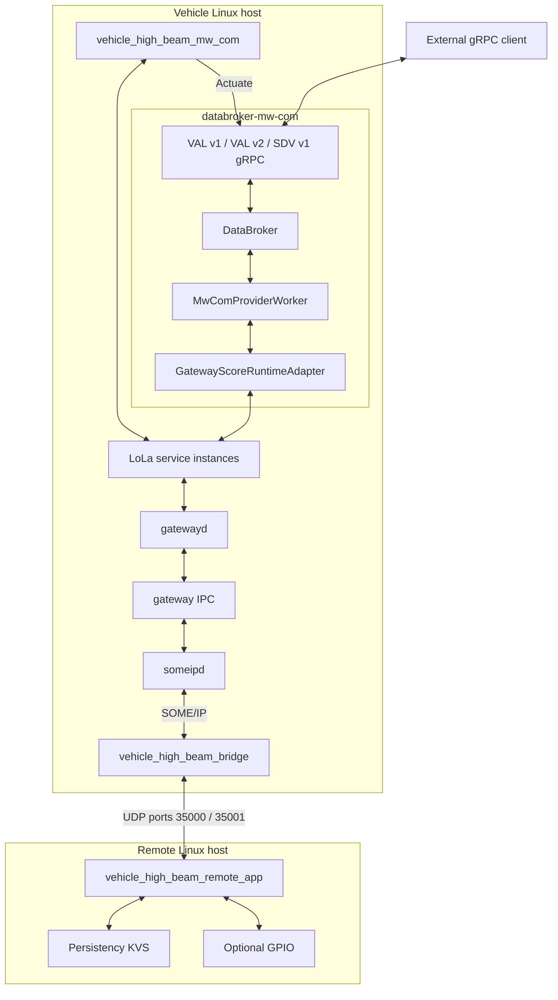
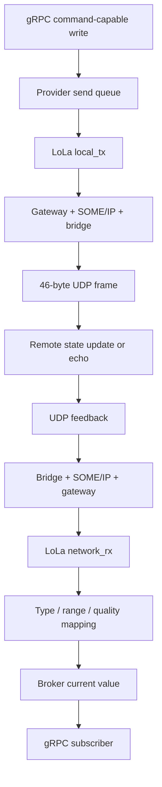
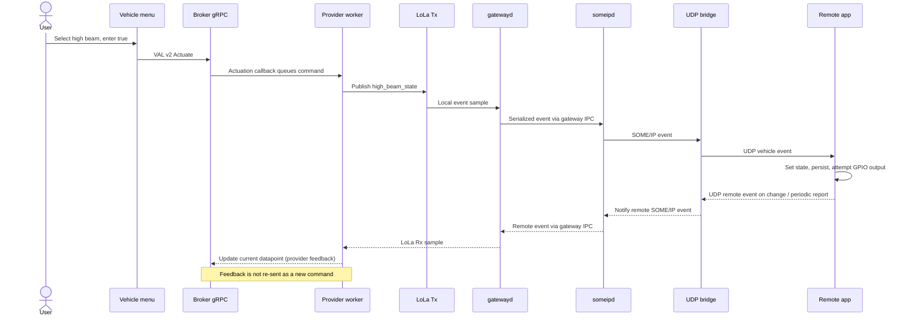

# Architecture

The main runtime is a chain of independent processes with explicit configuration, shared-memory and socket boundaries. The diagrams describe default combined mode; direct mode and all-signal testing intentionally change publisher ownership.

## Components and trust boundaries

Evidence: [composition `main`](../../kuksa-databroker/databroker-mw-com/src/main.rs) registers exactly the three illustrated APIs; [gatewayd](../../inc_someip_gateway/score/gatewayd/main.cpp) creates the IPC client; [someipd](../../inc_someip_gateway/score/someipd/main.cpp) creates the IPC server; [remote `main`](../../sdv-hack-demo/remote_app/main.cpp) opens the KVS and GPIO handles.

The composition server uses `Authorization::Disabled` and the launcher binds it to `0.0.0.0:55555`. Do not infer standalone broker TLS/JWT settings apply to this binary: [composition source](../../kuksa-databroker/databroker-mw-com/src/main.rs), `serve_tcp`; [launcher](../../sdv-hack-demo/deploy/start-vehicle.sh), `start_kuksa`.

## Data flow: feedback and commands

The mapping and feedback-loop boundaries are implemented by [provider.rs](../../kuksa-databroker/mw_com_provider/src/provider.rs), `start_command_forwarder`, `publish_message`, and [mapper.rs](../../kuksa-databroker/mw_com_provider/src/mapper.rs), `message_to_update`/`actuation_to_message`. The remote's high-beam feedback is a reported state; non-high-beam echo is not evidence of physical hardware actuation ([remote receive loop](../../sdv-hack-demo/remote_app/main.cpp)).

## Main sequence: high-beam command

Evidence: [vehicle `PublishLocalState`](../../sdv-hack-demo/vehicle_app/main.cc), [provider worker](../../kuksa-databroker/mw_com_provider/src/provider.rs), [gateway local service implementation](../../inc_someip_gateway/score/gatewayd/impl/local_service_instance.cpp), [bridge handlers](../../sdv-hack-demo/bridge/main.cpp), [remote `SetOutboundState`](../../sdv-hack-demo/remote_app/main.cpp).

## Startup and failure control

The [vehicle launcher](../../sdv-hack-demo/deploy/start-vehicle.sh) takes a lock, configures library paths, attempts stale-process/shared-memory cleanup, starts both daemons, retries their IPC connection, starts the bridge, waits for gateway resources and launches the selected app. Its KUKSA subprocess retries up to five times; broker-mode readiness probes use `VDB_ADDRESS`.

The [composition](../../kuksa-databroker/databroker-mw-com/src/main.rs) seeds broker metadata, rewrites model signal IDs to runtime IDs, starts a worker thread and serves gRPC. Its `tokio::select!` coordinates server failure, worker completion and Ctrl-C. The worker readiness signal follows registration; it does **not** prove remote hardware connectivity.

| Mode | Body Tx owner | Broker | Primary foreground process |
| --- | --- | --- | --- |
| `VEHICLE_APP_MODE=combined`, `HIGH_BEAM_COMMAND_MODE=kuksa` | Provider | Started | Vehicle menu |
| `combined`, `direct` | Vehicle application | Started with body actuation disabled | Vehicle menu |
| `signals` | Signal tester | Not started | `body_signal_test_app` |

Evidence: [launcher case statement](../../sdv-hack-demo/deploy/start-vehicle.sh), [vehicle `Run`](../../sdv-hack-demo/vehicle_app/main.cc), [adapter `connect`](../../kuksa-databroker/mw_com_provider/src/gateway_adapter.rs).

## Constraints

- UDP framing carries no command identifier, delivery acknowledgement protocol, checksum beyond transport, or sender authentication in its `Frame`; the receiver matches route IDs, not sender identity ([protocol](../../sdv-hack-demo/include/high_beam_udp_protocol.h), [bridge receive loop](../../sdv-hack-demo/bridge/main.cpp)).
- A source-language type name is not enough to establish shared-memory compatibility. Sample size, alignment and binding IDs must match ([gateway_samples.rs](../../kuksa-databroker/mw_com_provider/src/gateway_samples.rs), [generated binding metadata](../../kuksa-databroker/mw_com_provider/generated/gateway_bindings.rs)).
- **Unverified:** timing guarantees, packet-loss behavior under load, and physical-device behavior. No multi-device scenario was run while producing this handbook.

## Related pages

[Component Map](index.md) | [Signals](signals.md) | [KUKSA](kuksa.md) | [Build, Run and Deploy](build-run-deploy.md)
