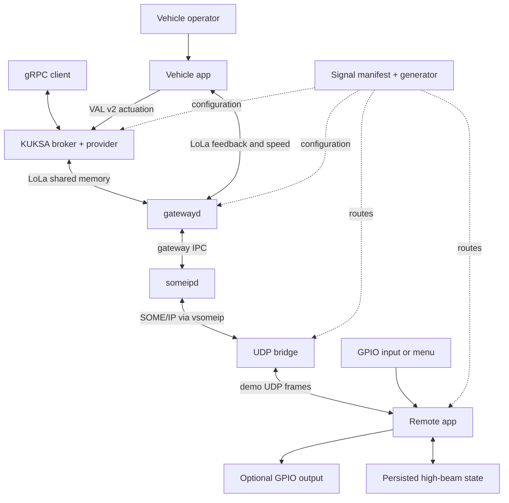

# Component Map

This handbook explains the checked-out `sdv-hackathon` integration workspace, not a hypothetical production vehicle platform. Start with the map, follow the command/feedback path, then use the component chapters when changing code; implementation evidence comes from local files at `0842972`.

## Read this first

**Source citations:** Markdown source links open local repository files in an editor. The site rewrites existing repository citations to pinned GitHub URLs without querying GitHub; those remote URLs have not been independently checked. New handbook support files are offered as local text downloads. Internal handbook navigation and source-file existence are checked locally by [handbook.py](../tools/handbook.py), `validate`/`validate_site`, and [site_hooks.py](../tools/site_hooks.py), `on_page_markdown`.

**Provenance:** “Inherited integration” means code already present at the shared ancestor with local `origin/main`, not proof of unchanged Eclipse upstream code. “Branch change” means a change after that ancestor. See [Changes in this Fork](fork-changes.md).

## Component map

| Component | Purpose | Location in repo | Key files / symbols | Depends on | Used by | Doc page link |
| --- | --- | --- | --- | --- | --- | --- |
| Integration workspace | Select build dependencies and toolchains | [root](../../MODULE.bazel), [bazel_common](../../bazel_common) | `MODULE.bazel`, `BUILD`, `known_good.json` | Bazel rules, module repositories | All builds | [Workspace](workspace.md) |
| Signal model | Generate aligned routes and bindings | [demo configuration](../../sdv-hack-demo/config) | `body_signals.json`; `configure_signals.py:configure` | JSON manifest, existing snapshots | Apps, gateway, provider | [Signals](signals.md) |
| Vehicle apps | Submit commands and inspect/test feedback | [vehicle_app](../../sdv-hack-demo/vehicle_app) | `VehicleHighBeamApplication`, `SignalTestApplication` | mw::com, gRPC, logging | Operator, signal test rig | [Vehicle Apps](vehicle.md) |
| Gateway | Bridge mw::com and SOME/IP | [gateway source](../../inc_someip_gateway/score) | `gatewayd/main.cpp`, `someipd/main.cpp` | Communication, IPC, vsomeip, serializer | Vehicle transport | [Gateway](gateway.md) |
| Serializer adapter | Canonicalize the dynamics Rx type name | [serializer](../../sdv-hack-demo/serializer) | `serializer_shim.cpp:CanonicalName` | Base serializer, `libdl` | gatewayd | [Serializer](serializer.md) |
| UDP bridge | Relay SOME/IP payloads to/from the remote | [bridge](../../sdv-hack-demo/bridge) | `main.cpp`, `RegisterServices`, `Encode`, `Decode` | vsomeip, route table, UDP sockets | someipd, remote app | [UDP Bridge](bridge.md) |
| Remote endpoint | Store/apply high-beam state; echo other routes | [remote_app](../../sdv-hack-demo/remote_app) | `main`, `GpioOutput`, `SetOutboundState` | Persistency, logging, GPIO, UDP | Bridge, operator | [Remote App](remote.md) |
| S-CORE foundations | Provide common libraries and LoLa transport | [baselibs](../../baselibs), [communication](../../communication) | `GenericProxy`, `GenericSkeleton`, Rust `score_com` | POSIX/shared memory, toolchains | Gateway, apps, provider | [S-CORE](score.md) |
| KUKSA integration | Expose signal state and commands through gRPC | [broker workspace](../../kuksa-databroker) | `databroker-mw-com/main.rs`, `MwComProviderWorker` | Tokio, tonic/protobuf, score_com | Vehicle menu, external clients | [KUKSA](kuksa.md) |
| Optional runtime patch | Connect container syncer to the external broker | [runtime patch](../../sdv-hack-demo/sdv-runtime/sdv-runtime-mw-com.patch) | Dockerfile, syncer, service supervisor hunks | Container runtime, broker, kit service | Optional playground integration | [SDV Runtime](runtime.md) |
| Platform integration | Package examples into platform images | [images](../../images), [runners](../../runners), [showcases](../../showcases) | `score_starter`, image `:run` targets | Docker/QEMU, platform SDKs | Integration demonstrations | [Platforms](platforms.md) |
| Engineering tooling | Manage pins, tests, reports and documentation | [scripts](../../scripts), [test harness](../../feature_integration_tests), [CI](../../.github/workflows) | `quality_runners.py`, `FitScenario`, workflow jobs | Bazel, Python, test frameworks | Contributors and CI | [Testing and CI](testing-ci.md) |

These are documentation boundaries, not claims that each directory is a separately deployable service. Build targets and source entry points are cited in each chapter.

## Architecture at a glance

Evidence: [vehicle `Run`](../../sdv-hack-demo/vehicle_app/main.cc), [provider worker](../../kuksa-databroker/mw_com_provider/src/provider.rs), [gateway entry points](../../inc_someip_gateway/score/gatewayd/main.cpp), [bridge `main`](../../sdv-hack-demo/bridge/main.cpp), [remote `main`](../../sdv-hack-demo/remote_app/main.cpp), [generator `configure`](../../sdv-hack-demo/configure_signals.py).

## How to use this handbook

1. Read [Overview](overview.md), [Architecture](architecture.md), and [Repository Tour](repository-tour.md).
2. Before running anything, read the side-effect warnings in [Build, Run and Deploy](build-run-deploy.md).
3. Before editing a signal, read [Signals](signals.md) and [Configuration](configuration.md).
4. Use [Verification](verification.md) to distinguish executed checks from source-derived expectations.

## Related pages

[Overview](overview.md) | [Architecture](architecture.md) | [Build, Run and Deploy](build-run-deploy.md) | [Verification](verification.md)
