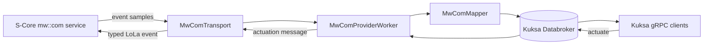

<!--
/********************************************************************************
 * Copyright (c) 2026 Contributors to the Eclipse Foundation
 *
 * See the NOTICE file(s) distributed with this work for additional
 * information regarding copyright ownership.
 *
 * This program and the accompanying materials are made available under the
 * terms of the Apache License Version 2.0 which is available at
 * https://www.apache.org/licenses/LICENSE-2.0
 *
 * SPDX-License-Identifier: Apache-2.0
 ********************************************************************************/
-->

# mw::com Provider for Kuksa Databroker

`mw_com_provider` is a Rust provider module that connects S-Core `mw::com` services to Kuksa Databroker VSS entries. It receives middleware samples, maps them to VSS datapoints, writes them into Databroker, and forwards Kuksa actuator requests back to `mw::com`.

The module is intentionally optional. Databroker core can run without it, and no Databroker core source changes are required for the provider. Projects that need S-Core integration can add this module and the `databroker-mw-com` composition binary; projects that do not need S-Core can ignore them.

## Functional Overview

The provider owns the Databroker-facing integration and the middleware abstraction. Its main responsibilities are:

- Register configured VSS datapoints and actuators with Databroker.
- Receive S-Core `mw::com` event samples through `MwComTransport`.
- Convert middleware values into Databroker `DataValue` updates.
- Validate data type, signal direction, quality, scaling, and min/max constraints.
- Write accepted samples into Databroker using `update_entries`.
- Receive actuator requests from Databroker and publish typed S-Core LoLa events.
- Bridge Kuksa `val.v1` actuator-target writes to the same actuation path used by `val.v2` actuation callbacks.
- Reconnect and clean up middleware subscriptions if the transport fails.

The default feature set uses an in-memory mock transport. This keeps provider unit tests and provider E2E tests independent from S-Core. The `score-lola` feature enables the generated S-Core LoLa adapter and local temporary S-Core Rust crate shims.

## Architecture



The provider is split into small layers:

| Layer | Purpose |
| --- | --- |
| `provider.rs` | Databroker registration, worker loop, receive publishing, actuation queue, v1 actuator-target bridge. |
| `mapper.rs` | O(1) mapping between `mw::com` messages and Databroker updates or actuation messages. |
| `transport.rs` | Transport trait plus mock transport used by tests. |
| `score_bindings.rs` | Generated binding lookup and `ScoreRuntimeAdapter` delegation. |
| `generated/` | Generated S-Core types, interfaces, metadata, runtime config, and LoLa adapter. |
| `templates/reference-codegen/` | Templates used to regenerate the checked-in generated provider artifacts. |

## Data Flow

Inbound datapoint flow:

```text
S-Core LoLa event sample
    -> generated LolaScoreRuntimeAdapter
    -> MwComTransport::recv
    -> MwComMapper::message_to_update
    -> DataBroker::update_entries
    -> Kuksa read/subscribe clients
```

Outbound actuation flow:

```text
Kuksa val.v2 Actuate or BatchActuate
    -> Databroker ActuationProvider callback
    -> MwComMapper::actuation_to_message
    -> MwComTransport::send_actuation
    -> generated LoLa producer event
    -> S-Core application
```

Kuksa `val.v1` CLI actuation writes the actuator target field instead of calling the `val.v2` actuation callback. To keep existing CLI demos working without Databroker core changes, the provider subscribes to actuator-target updates and forwards them into the same `send_actuation` path.

## Optional Databroker Composition

The provider can be used in two ways:

- Embedded by an application that already owns a Databroker instance and wants to register an `MwComProviderWorker`.
- Through `databroker-mw-com`, a composition binary that starts Databroker and the provider in the same process.

`databroker-mw-com` is the recommended integration binary for the current check-in. It:

- Creates the Databroker instance.
- Seeds VSS metadata from the provider config.
- Validates generated S-Core bindings.
- Starts the provider worker using `LolaScoreRuntimeAdapter`.
- Exposes Kuksa `val.v1` and `val.v2` gRPC APIs on `127.0.0.1:55555` by default.

The binary defaults to:

```text
provider config: mw_com_provider/generated/mw_com_provider_config.json
S-Core LoLa config: mw_com_provider/generated/vehicle_dynamics_lola_config.json
address: 127.0.0.1:55555
```

## Included Files

The current package keeps the S-Core generated artifacts locally because the required generated values and scripts are not yet available from the S-Core repository. These files should move to upstream S-Core ownership once that integration exists.

| Path | Purpose |
| --- | --- |
| `src/` | Provider runtime, mapper, lifecycle, transport abstractions, and score binding integration. |
| `tests/e2e_stubbed_score.rs` | Provider E2E test using Databroker plus mock `mw::com`, without S-Core. |
| `generated/` | Generated provider config, metadata, S-Core interfaces/types, LoLa adapter, and LoLa config. |
| `models/vehicle_dynamics.json` | Reference model used to generate the current vehicle dynamics provider artifacts. |
| `templates/reference-codegen/` | Reference generator templates for the provider artifacts. |
| `score_com_cargo/` | Temporary Cargo manifests/shims over S-Core runtime crates. |
| `docs/s-core-integration.md` | Practical integration guide for wiring this provider to S-Core applications. |

## Build And Test

Run these commands from the Kuksa Databroker workspace root.

Format check:

```sh
cargo fmt -p mw_com_provider --check
```

Provider unit tests:

```sh
cargo test -p mw_com_provider provider::tests
cargo test -p mw_com_provider score_bindings::tests
```

Provider E2E test without S-Core:

```sh
cargo test -p mw_com_provider --test e2e_stubbed_score
```

Normal provider build without S-Core:

```sh
cargo check -p mw_com_provider
```

S-Core LoLa adapter and composition binary checks:

```sh
cargo check -p mw_com_provider --features score-lola
cargo check -p databroker-mw-com
```

The S-Core checks require the local S-Core checkout and native artifacts. The build scripts auto-discover S-Core Bazel link params from the local Bazel cache when they are already available. For reproducible builds, CI, containers, or fresh developer machines, pass the artifact paths explicitly:

```sh
SCORE_COM_LINK_PARAMS=<path-to-vehicle-dynamics-example-0.params> \
SCORE_COM_BAZEL_BIN=<path-to-bazel-bin> \
cargo check -p databroker-mw-com
```

If the Bazel cache is outside the default cache location, set `SCORE_COM_BAZEL_CACHE_ROOTS` to one or more cache roots using the platform path separator.

## Development Container

The S-Core LoLa toolchain and generated native artifacts are validated with an Ubuntu 24.04 based development environment. If the host machine does not provide the required compiler, Bazel, Java, Rust, protobuf, and native library tooling, use a VS Code devcontainer for provider development.

A provider devcontainer should provide at least:

- Ubuntu 24.04 base image.
- `build-essential`, `clang`, `cmake`, `g++`, `gcc`, `gdb`, `lld`, `make`, `pkg-config`, `protobuf-compiler`, `python3`, `unzip`, and `zip`.
- OpenJDK 17 for Bazel repository rules and Java-based tooling.
- Bazelisk installed as `bazel`.
- Rust stable toolchain with `rustfmt` and `clippy`.
- CA certificates configured for both the OS trust store and the Java trust store used by Bazel.

If development happens behind a corporate TLS inspection proxy, install the corporate root certificates inside the container and run `update-ca-certificates`. Bazel also uses a JVM trust store, so configure `/etc/bazel.bazelrc` or an equivalent Bazel startup option to point Java to the updated trust store when needed.

## Regenerate Provider Artifacts

The checked-in generated files are kept until S-Core provides the generated artifacts directly. Regenerate them with:

```sh
cd mw_com_provider
bazel run //:generate_mw_com_provider_artifacts
bazel run //:verify_mw_com_provider_codegen
```

The generator reads `models/vehicle_dynamics.json`, applies `templates/reference-codegen/`, and writes `generated/`.

To generate from a custom model or write to a custom output directory, call `xtask` directly:

```sh
cargo run --manifest-path mw_com_provider/xtask/Cargo.toml -- codegen \
  --model /path/to/custom-model.json \
  --templates mw_com_provider/templates/reference-codegen \
  --out mw_com_provider/generated \
  --prefix mw_com
```

If the reference SCORE config code generator is not in the default relative location, pass it explicitly:

```sh
cargo run --manifest-path mw_com_provider/xtask/Cargo.toml -- codegen \
  --model /path/to/custom-model.json \
  --templates mw_com_provider/templates/reference-codegen \
  --out mw_com_provider/generated \
  --prefix mw_com \
  --codegen-root /path/to/vsps_sdk_score_config_codegen-main
```

## Complete Integration Test With S-Core

The three-terminal demo is the full integration test for the current S-Core vehicle dynamics setup. Detailed integration hints and troubleshooting are in [docs/s-core-integration.md](docs/s-core-integration.md).

Terminal 1 starts the S-Core vehicle dynamics application:

```sh
cd <s-core-communication>
rm -rf /tmp/mw_com_lola
bazel run //score/mw/com/example/vehicle-dynamics-example:vehicle-dynamics-example -- --run-mode both
```

Terminal 2 starts Databroker with the in-process mw::com provider:

```sh
cd <kuksa-databroker>
cargo run -p databroker-mw-com
```

Terminal 3 verifies the reception path by reading a VSS datapoint that is published by the S-Core application and forwarded by the provider into Databroker:

```sh
cd <kuksa-databroker>
cargo run -p databroker-cli -- get Vehicle.Speed
```

For a streaming check, subscribe to the same datapoint:

```sh
cd <kuksa-databroker>
cargo run -p databroker-cli -- subscribe Vehicle.Speed
```

Expected Terminal 3 output is a changing `Vehicle.Speed` value. This proves the receive path:

```text
S-Core VehicleDynamicsService.speed
  -> mw_com_provider
  -> Kuksa Databroker Vehicle.Speed
  -> databroker-cli get/subscribe
```

The same terminal can then verify the actuation path by sending a Kuksa actuator request:

```sh
cd <kuksa-databroker>
cargo run -p databroker-cli -- actuate Vehicle.ADAS.CruiseControl.TargetSpeed 88.0
```

Expected Terminal 1 output for actuation:

```text
1 target speed actuation samples received. target_speed=88
```

For repeated demo updates in bash:

```sh
speed=60
while true; do
  cargo run -p databroker-cli -- actuate Vehicle.ADAS.CruiseControl.TargetSpeed "$speed"
  speed=$((speed + 1))
  if [ "$speed" -gt 100 ]; then
    speed=60
  fi
  sleep 0.5
done
```

## LoLa Queue Tuning

The generated adapter defaults to the current vehicle dynamics demo limits:

```text
SCORE_SUBSCRIPTION_QUEUE_CAPACITY=3
SCORE_RECEIVE_BATCH_SIZE=min(16, SCORE_SUBSCRIPTION_QUEUE_CAPACITY)
```

For production LoLa configurations with larger event slots, raise both values together:

```sh
SCORE_SUBSCRIPTION_QUEUE_CAPACITY=32 \
SCORE_RECEIVE_BATCH_SIZE=16 \
cargo run -p databroker-mw-com
```

`SCORE_SUBSCRIPTION_QUEUE_CAPACITY` is per receive event subscription. It is not a global provider queue and it is not the actuator transmit queue.

## Production Notes

- The generated adapter stores receive subscriptions per exact binding, so repeated event names across different S-Core instances are supported.
- Lossless delivery of every high-rate middleware sample depends on S-Core LoLa queue sizing, producer rate, provider drain rate, Databroker subscriber behavior, and client speed.
- The local generated files and `score_com_cargo/` shims are temporary integration assets and should be replaced by S-Core-owned artifacts when available.
