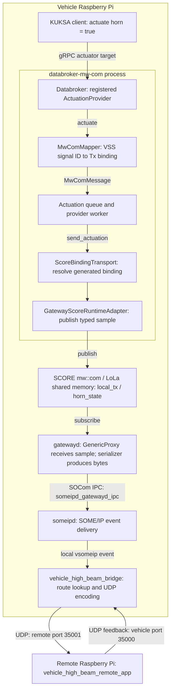

# SDV High-Beam Demo

## Overview

This project demonstrates a bidirectional vehicle high-beam signal across two
Edge Devices. It uses Eclipse S-CORE `mw::com` shared memory on the Rpi
side, a SOME/IP gateway, and a compact UDP transport between the vehicle and
remote device(now we are using RPi need to change to Ardino).

The signal is:

```text
Vehicle.Body.Lights.Beam.High.IsOn
```

The demo also carries the initial vehicle-dynamics signals from the LoLa
example:

```text
Vehicle.speed
Vehicle.speedAck
```

The standard vehicle application menu publishes the high-beam boolean and
`Vehicle.speed`; it is not a general-purpose selector for every VSS signal.
For all 44 configured body, door, and powertrain routes, the separate
`body_signal_test_app` publishes datatype-appropriate test values and checks
for their return samples when run in `VEHICLE_APP_MODE=signals`. That mode
skips KUKSA and is a transport test, not an interactive arbitrary-value
publisher. In the normal combined profile, high-beam commands use KUKSA VAL v2
actuation and the KUKSA provider owns the body Tx service. Only actuator or
bidirectional mappings accept KUKSA actuation; sensor-only mappings are
receive-only. Speed continues to use the existing VehicleDynamics mw::com
publisher, and the remote endpoint returns it as `speedAck`. New route entries
can be added to `signal_routes.json` without changing the UDP frame
implementation.

## Databroker to Bridge Signal Flow

The following describes the gateway profile started by
[start-vehicle.sh](deploy/start-vehicle.sh) with `VEHICLE_APP_MODE=combined`.
Everything inside the vehicle boundary runs on one Raspberry Pi, without VMs.
The `databroker-mw-com` executable contains both the Databroker and its mw::com provider;
the provider runs in a worker thread with its own async runtime, not in a
separate process and not through a localhost gRPC connection to the broker.
External clients use KUKSA gRPC to reach the broker.



The remote launcher [start-remote.sh](deploy/start-remote.sh) starts the remote
app directly. The remote app handles UDP receive/send itself; this deployment
does not start a second bridge or a remote `someipd` process.

### Concrete Example: Horn Actuation

Request `Vehicle.Body.Horn.IsActive = true` using the actuator-target API, for
example `databroker-cli actuate Vehicle.Body.Horn.IsActive true`. Updating only
the current datapoint is not equivalent to requesting outbound actuation.

1. The broker calls `QueuedActuationProvider::actuate()` in
  [provider.rs](../kuksa-databroker/mw_com_provider/src/provider.rs).
2. `MwComMapper::actuation_to_message()` in
  [mapper.rs](../kuksa-databroker/mw_com_provider/src/mapper.rs) selects the
  mapping's `actuation_binding`, rather than its feedback binding. It creates
  an `MwComMessage` containing `/body_control_module_tx`, `local_tx`,
  `horn_state`, and `MwComValue::Bool(true)`.
3. The callback queues that message. The worker calls `send_actuation()` on
  [ScoreBindingTransport](../kuksa-databroker/mw_com_provider/src/score_bindings.rs),
  which resolves the service/instance/member against generated metadata.
4. [GatewayScoreRuntimeAdapter](../kuksa-databroker/mw_com_provider/src/gateway_adapter.rs)
  uses the `HighBeamTxInterface` producer to publish a `HighBeamCommand` sample
  on `/body_control_module/local_tx`. SCORE mw::com supplies the LoLa runtime,
  discovery, publisher/subscriber API, and shared-memory sample storage.
5. `gatewayd` consumes `horn_state` with a generic proxy. Its serializer turns
  the pre-serialized sample into one payload byte, `0x01`. The native sample
  is 32 bytes including storage metadata/alignment; those 32 bytes are not
  sent as the horn's network payload.
6. `gatewayd` passes the event to `someipd` through SOCom IPC. `someipd` delivers
  the SOME/IP event to the local bridge via vsomeip.
7. The bridge matches the numeric event to the horn route, encodes a UDP frame,
  and sends it to the remote app. Receiving at the bridge does not by itself
  prove that the remote app received or applied the command.

### Event Names and IDs

These identifiers belong to different layers; they are mapped explicitly,
not derived from the Rust type name.

| Layer | Horn Command | Horn Feedback | Configuration |
| --- | --- | --- | --- |
| VSS path | `Vehicle.Body.Horn.IsActive` | Same path, current value | [gateway_provider_config.json](config/gateway_provider_config.json) |
| Provider signal ID | `2` | `2` | Same provider config; not a SOME/IP ID |
| Provider service / instance | `/body_control_module_tx` / `local_tx` | `/body_control_module_rx` / `network_rx` | Mapping's `actuation_binding` / receive binding |
| LoLa instance specifier | `/body_control_module/local_tx` | `/body_control_module/network_rx` | [mw_com_config.json](../inc_someip_gateway/score/gatewayd/etc/mw_com_config.json) |
| Event member | `horn_state` | `horn_state` | Generated bindings and gateway event names |
| LoLa event ID | `2119` | `2120` | Same LoLa manifest; independent of network IDs |
| SOME/IP service ID | `0x4300` (17152) | `0x4300` (17152) | [mw_someip_config.json](config/mw_someip_config.json) |
| SOME/IP instance ID | `0x1000` (4096) | `0x1001` (4097) | Same gateway config |
| SOME/IP event / eventgroup ID | `0x8434` (33844) | `0x8435` (33845) | [signal_routes.json](signal_routes.json) and gateway config |
| Payload | One byte: `0x01` or `0x00` | One byte: `0x01` or `0x00` | Tx `NullSerializerConfig`; Rx `BooleanSerializerConfig` |

`local_service_instances` tells gatewayd which local LoLa offers to consume
and forward outward. `remote_service_instances` tells it which incoming
network services to expose locally using generic skeletons. Separate Tx/Rx
service types avoid a connector ownership conflict. SOME/IP carries numeric
service, instance, and event IDs, not the text `body_control_module_tx`.
The BCM naming migration preserves existing event IDs and payload formats;
it does not replace the gateway samples with the standalone BCM typed model.

### Feedback into Databroker

```mermaid
flowchart LR
   Remote[Remote app] -->|UDP feedback| Bridge[Vehicle bridge]
   Bridge -->|SOME/IP: 0x4300 / 0x1001 / 0x8435| Someip[someipd]
   Someip -->|SOCom IPC| Gateway["gatewayd: deserialize and publish Rx"]
   Gateway -->|LoLa network_rx / horn_state| Adapter["GatewaySubscription::Bool: poll sample"]
   Adapter -->|MwComMessage| Mapper["message_to_update: validate and convert"]
   Mapper -->|update_entries_from_provider| Broker[Databroker current value]
   Broker -->|gRPC subscription update| Client[KUKSA client]
```



The provider polls its typed subscriptions; it does not receive these values
through a separate gRPC provider connection. Its mapper checks direction,
datatype, quality, age, and configured bounds before updating the broker.
An actuation request being queued is not the same as receiving feedback.
The provider and vehicle app can consume gateway Rx samples locally; gatewayd
offers the network Rx instance, rather than the vehicle app offering it.

### Vehicle-Dynamics Example and Speed

The [vehicle-dynamics example](../communication/score/mw/com/example/vehicle-dynamics-example/BUILD)
provides shared API definitions and build/link dependencies. Its
[vehicle_gen.h](../communication/score/mw/com/example/vehicle-dynamics-example/com-api-gen/vehicle_gen.h)
declares the C++ `HighBeamTx`, `VehicleHighBeamRx`, and `VehicleDynamicsService`
interfaces. The provider's generated Rust gateway interfaces use compatible
sample layouts, defined in
[gateway_samples.rs](../kuksa-databroker/mw_com_provider/src/gateway_samples.rs).

The standalone Rust [main.rs](../communication/score/mw/com/example/vehicle-dynamics-example/main.rs)
publishes and consumes speed at `/Vehicle/Service1/Instance`. Building/linking
against its dependencies does not run this executable inside the Databroker.
The combined launcher runs the legacy C++ vehicle app separately.

`Vehicle.Speed` remains an additional read-only provider mapping on
`VehicleDynamicsService`, `/Vehicle/Service2/Instance`, member `speed`.
`GatewaySubscription::Speed` holds a `Subscription<SpeedSample>` and decodes
both its `f64` value and quality field. This differs from generic body float
payloads. Its serializer uses a nine-byte wire payload (big-endian double plus
quality), while the native sample occupies 16 bytes. Outgoing vehicle speed
uses `/Vehicle/Service1/Instance`; incoming network speed uses Service2.

### Files Used by the Flow

| File | Responsibility |
| --- | --- |
| [body_signals.json](config/body_signals.json) | Source of truth for the 44 body signal paths, datatypes, names, and event IDs |
| [configure_signals.py](configure_signals.py) | Synchronizes gateway/LoLa/vsomeip configs, routes, and C++ event declarations |
| [gateway_provider_codegen.py](gateway_provider_codegen.py) | Generates provider mappings and Rust gateway interfaces/binding metadata, including speed |
| [gateway_runtime.rs](../kuksa-databroker/mw_com_provider/generated/gateway_runtime.rs) / [gateway_bindings.rs](../kuksa-databroker/mw_com_provider/generated/gateway_bindings.rs) | Typed Rust events and service/instance/member metadata |
| [composition main.rs](../kuksa-databroker/databroker-mw-com/src/main.rs) | Starts broker and provider worker; selects gateway adapter for this profile |
| [null_serializer.cpp](../inc_someip_gateway/score/serializer/null_serializer.cpp) / [serializer_shim.cpp](serializer/serializer_shim.cpp) | Converts native samples to/from wire payloads; shim aliases the speed Rx service name |
| [vsomeip-gateway-services.json](../inc_someip_gateway/tests/integration/vsomeip-gateway-services.json) | vsomeip routing/application configuration and eventgroups |
| [bridge main.cpp](bridge/main.cpp) | Receives local SOME/IP events and relays route payloads over UDP in both directions |
| [remote_app main.cpp](remote_app/main.cpp) | Remote UDP signal source/sink and feedback handling |
| [start-vehicle.sh](deploy/start-vehicle.sh) / [start-remote.sh](deploy/start-remote.sh) | Launch the respective physical Pi profiles |
| [package-aarch64.sh](package-aarch64.sh) | Copies binaries, generated configs, routes, and launchers into deployment archives |

The packaged launcher reads `mw_someip_config.bin`, compiled from the demo's
gateway JSON, and a packaged `mw_com_config.json`. Paths inside the archive
therefore differ from the source paths above. Regenerate, rebuild, package,
and redeploy matching artifacts together after changing the signal contract.

[start-body-control.sh](deploy/start-body-control.sh) is an isolated alternative:
it starts the broker/provider with `mw_com_provider_config.json` and
`bcm_config_lola_config.json`, plus `body-control-module-example`. It does not
start gatewayd, someipd, or the bridge and is not needed for the flow above.
Consolidating that standalone BCM profile into the gateway package remains
separate work. The generic `communication/score/mw/com/gateway` inter-domain
gateway is also not part of this launcher.

## Body and Door Signals

The 44 body, door, and powertrain signals in [config/body_signals.json](config/body_signals.json)
are registered in `someipd`, `gatewayd`, and the bridge. The last requested
`Vehicle.Cabin.Door.Row2.PassengerSide.IsOpenx` is normalized to `IsOpen`.
High-beam event IDs are unchanged; the remaining signals use event pairs
`0x8434/0x8435` through `0x8488/0x8489` on service `0x4300`.

From the workspace root, synchronize and check the configuration snapshots:

```bash
python3 sdv-hack-demo/configure_signals.py --write
python3 sdv-hack-demo/configure_signals.py
python3 sdv-hack-demo/configure_signals_test.py
```

Each route records its VSS `apiName`, MW::COM `eventName`, datatype, and wire IDs.
The same synchronizer updates the SCORE vehicle-dynamics example's MW::COM
config and C++ event declarations under `communication/score/mw/com/example/vehicle-dynamics-example`.
Its `HighBeamTx` and `VehicleHighBeamRx` interfaces expose all 44 body, door, and powertrain events.
All Tx events use `PreSerializedData<N>` as in the existing high-beam publisher.
Rx booleans use native `bool` with `BooleanSerializerConfig`. Rx numeric and
string events use `PreSerializedData<N>` with `NullSerializerConfig`:

| Datatype | Wire Payload | N |
| --- | --- | --- |
| `boolean` | One byte, `0` or `1` | 1 |
| `uint8` | One unsigned byte (positions/intensities/level are percentages) | 1 |
| `int16` | Two-byte signed integer, big-endian | 2 |
| `float` | IEEE-754 float32, big-endian | 4 |
| `float_array` | Packed IEEE-754 float32 values, big-endian; payload length is a multiple of 4, up to 8 values | 32 |
| `string` | UTF-8 text, without a terminating NUL | 32 |

The bridge forwards payload bytes unchanged in either direction. `float_array`
is bounded to eight values by the 32-byte UDP payload. The separate
`body_signal_test_app` exercises all 44 signals as described below. The legacy
vehicle menus and KUKSA mappings are unchanged. Rebuild and repackage before
deploying so the binary gateway config and both device route files agree.

### Test All 44 Signals

Use an isolated test rig only. This test sends horn, lighting, lock, window,
and wiper values. It does not restore the previous state if interrupted.

Rebuild and redeploy both archives using the build/package steps below. Start
the existing remote app first on the remote Pi:

```bash
~/sdv-demo/run/start-remote.sh
```

On the vehicle Pi, start the dedicated test mode:

```bash
VEHICLE_APP_MODE=signals ~/sdv-demo/run/start-vehicle.sh
```

This starts `someipd`, `gatewayd`, and the bridge, then runs the test app in
the foreground without KUKSA or the legacy vehicle publisher. Do not start
another publisher for `/vehicle_high_beam/local_tx` at the same time. Avoid
changing the remote switch or menu while the sweep is running.

The test loads the body routes from `signal_routes.json` and sends:

- Boolean values: `false`, `true`, `false`.
- Percentage values: `0`, `50`, `100`, `0`.
- Wiper modes: `OFF`, `FAST`, `OFF`.
- Transmission performance modes: `NORMAL`, `SPORT`, `NORMAL`.
- Oil-temperature values: `20`, `85`, `110`, `20` Celsius.
- Float and float-array samples for acceleration and cell voltage.

For each value it waits for a matching Rx value, retrying transmission every
500 ms for up to 3 seconds. Gateway discovery/subscription allows 20 seconds.
To increase those limits:

```bash
VEHICLE_APP_MODE=signals ~/sdv-demo/run/start-vehicle.sh \
  --timeout-ms 5000 --startup-timeout-ms 30000
```

Example output:

```text
TX Vehicle.Body.Horn.IsActive=true
RX Vehicle.Body.Horn.IsActive=true
PASS Vehicle.Body.Horn.IsActive
Summary: 44/44 signals passed; 0 failed.
```

Each signal passes only if every test value is received. A timeout, missing
event, or transport error produces `FAIL` and a nonzero exit code. Without
the remote app, subscriptions alone are not enough to pass. Non-high-beam
routes are echoed by the existing remote app; high beam uses its existing
state-reporting path. PASS verifies matching application-level payloads, not
physical actuator operation or uniquely correlated acknowledgements. Periodic
or delayed packets can carry the same value.

To list the routes without publishing anything on a deployed vehicle Pi:

```bash
cd ~/sdv-demo
./body_signal_test_app --routes signal_routes.json --list
```

On the build host, run the unit tests and non-publishing app check:

```bash
bazel test --config=sdv-demo //sdv-hack-demo/vehicle_app:signal_test_values_test
bazel run --config=sdv-demo //sdv-hack-demo/vehicle_app:body_signal_test_app -- \
  --routes "$PWD/sdv-hack-demo/signal_routes.json" --list
```

## Architecture

### KUKSA Gateway Compatibility

The demo launcher uses [config/gateway_provider_config.json](config/gateway_provider_config.json),
generated from the same 44-signal manifest as the gateway. Existing body controls
remain bidirectional; six added VSS sensors receive current values from
`/vehicle_high_beam/network_rx`, while `Vehicle.Powertrain.Transmission.PerformanceMode`
is an actuator mapped to `/vehicle_high_beam/local_tx`. `Vehicle.Speed`
receives the existing double-plus-quality sample from `/Vehicle/Service2/Instance`.
The launcher no longer filters the broker down to speed and high beam.

The new KUKSA checkout's standalone `BodyControlModuleService` profile is
retained, but is not used by this SOME/IP demo: its instance names, event
names, and native sample layouts differ from the working gateway contract.
The composition binary selects the gateway-compatible adapter when it loads
the gateway mappings. It checks the required instance paths before opening
the LoLa runtime.

All three generated files below are refreshed by `configure_signals.py`:

- `sdv-hack-demo/config/gateway_provider_config.json`
- `kuksa-databroker/mw_com_provider/generated/gateway_bindings.rs`
- `kuksa-databroker/mw_com_provider/generated/gateway_runtime.rs`

The ARM64 build script runs the synchronizer before building. Packaging
includes the separate gateway provider config, and the launcher supplies
the gateway's `mw_com_config.json` as the matching SCORE manifest.
Use the updated vehicle archive; do not substitute the standalone BCM config.

Default combined mode keeps KUKSA as the sole body-signal Tx publisher.
`HIGH_BEAM_COMMAND_MODE=direct` disables the gateway adapter's entire body Tx
offer and exposes those KUKSA mappings as read-only, because all body events
share one Tx instance with the legacy app. The standalone all-signal tester
still runs in `VEHICLE_APP_MODE=signals` without KUKSA.

```text
Vehicle RPi: 10.56.121.101
  vehicle_high_beam_mw_com
        -> mw::com SHM(accessed by mw::com proxy of gatewayd)
  gatewayd
        -> gateway IPC
  someipd
        -> SOME/IP event 0x8430
  vehicle_high_beam_bridge
      -> UDP 10.56.121.79:35001

Remote RPi: 10.56.121.79
  vehicle_high_beam_remote_app
        -> UDP 10.56.121.101:35000
```

### Forward Flow: Vehicle to Remote

```text
Vehicle app publishes High.IsOn
  -> mw::com GenericSkeleton and SHM
  -> gatewayd GenericProxy
  -> someipd
  -> SOME/IP service 0x4300, instance 0x1000, event 0x8430
  -> vehicle_high_beam_bridge
  -> UDP port 35001 on the Remote RPi
  -> remote sensor application
```

### Reverse Flow: Remote to Vehicle

```text
Remote sensor application
  -> UDP port 35000 on the Vehicle RPi
  -> vehicle_high_beam_bridge
  -> SOME/IP service 0x4300, instance 0x1001, event 0x8431
  -> someipd
  -> gatewayd GenericSkeleton
  -> mw::com SHM
  -> Vehicle app GenericProxy
```

### Component Roles

| Component | Role |
| --- | --- |
| `vehicle_high_beam_mw_com` | Vehicle-side publisher and subscriber using `mw::com`. |
| `gatewayd` | Uses `GenericProxy` for the local Tx service and `GenericSkeleton` for the local Rx service. |
| `someipd` | Owns the local SOME/IP/vSomeIP binding and gateway IPC connection. |
| `vehicle_high_beam_bridge` | Converts vehicle SOME/IP events to UDP and remote UDP frames to vehicle SOME/IP events. |
| `vehicle_high_beam_remote_app` | Remote sensor state machine; receives/sends UDP frames and publishes state every two seconds. |

## Prerequisites

### Build Host

- Linux x86_64 host
- Bazel/Bazelisk
- SSH and `scp`
- ARM64 build support configured in this workspace
- Raspberry Pi addresses reachable from the build host

The build scripts cross-compile with Bazel's `aarch64-linux` configuration.
The local `$HOME/aarch64_toolchain` is a build-host toolchain and is not copied
to the RPIs.

The demo also uses `--config=sdv-demo` to compile legacy host C dependencies
as GNU C11. This avoids GLib's `bool` field conflicting with GCC 15's C23
default without passing a C-only standard flag to C++ tools. For a native
bridge build from the workspace root:

```bash
bazel build --config=sdv-demo //sdv-hack-demo/bridge:vehicle_high_beam_bridge
```

### Raspberry Pis

Both devices must run a 64-bit Linux distribution:

```bash
uname -m
```

Expected output:

```text
aarch64
```

Install basic runtime and transfer dependencies on both Pis:

```bash
sudo apt update
sudo apt install -y rsync openssh-server ca-certificates libstdc++6 libgcc-s1 libc6 libatomic1
sudo systemctl enable --now ssh
```

## Build and Package

Run on the build host from the demo folder (all sources are included under `sdv-hack-demo`):

```bash
cd sdv-hack-demo
bash build-aarch64.sh
bash package-aarch64.sh
```

The scripts create these Git-ignored archives:

```text
dist/vehicle-aarch64.tar.gz
dist/remote-aarch64.tar.gz
dist/body-control-aarch64.tar.gz
```

`body-control-aarch64.tar.gz` is a separate KUKSA/BodyControl test package. It
contains the BCM LoLa producer/consumer, KUKSA broker and CLI, provider config,
and the matching LoLa manifests. It does not replace or alter the gateway
vehicle/remote archives.

The gateway configuration lives in this folder, not in `inc_someip_gateway`:
`sdv-hack-demo/config/mw_someip_config.json`, built by
`//sdv-hack-demo:gateway_config` and packaged as `mw_someip_config.bin`.
The gateway's generic example config is not used (it only declares window-control
and echo services). Packaging selects `bazel-out/aarch64-fastbuild/bin` in both
Bazel workspaces rather than the most recent `bazel-bin` link.

The gateway keys its SOCom connectors by service type name, so one type must
not have both a local and a remote instance. The demo config therefore uses
one type per direction: `body_control_module_tx`/`body_control_module_rx` and
`vehicle::VehicleDynamicsService` (Tx, `/Vehicle/Service1/Instance`) /
`vehicle::VehicleDynamicsService_rx` (Rx, `/Vehicle/Service2/Instance`). Both
vehicle-dynamics types share SOME/IP service ID `6433`, so the wire format and
`signal_routes.json` do not change.

The gateway's serializer only knows the original type names. gatewayd therefore
loads the demo plugin `score_com_serializer.so` (`sdv-hack-demo/serializer/`),
which maps `..._rx` onto the original name and forwards every call to the
gateway's own serializer, shipped next to it as `score_com_serializer_base.so`.
Both libraries must be in the vehicle directory (the launcher puts it first on
`LD_LIBRARY_PATH`).

`start-vehicle.sh` waits for the gateway's receive shared memory before starting
KUKSA, allows enough time (about two minutes) for the broker to listen, stops any
earlier `start_kuksa` retry loop so it cannot respawn a broker and hold port
`55555`, and aborts with the daemon's log tail if `gatewayd` or `someipd` is not
running. Repeated subscription attempts reuse the existing LoLa runtime and
high-beam Tx offer, avoiding a self-conflicting second skeleton.

`inc_someip_gateway` is upstream `eclipse-score/inc_someip_gateway` `main` (commit `32624b21`) plus the
local changes shown by `git -C inc_someip_gateway diff` (serializer/schema extensions for speed and
boolean events, `eventgroup_ids` handling and trace logging in `someipd`, and in `gatewayd` the
empty-handle guard, proxy-creation retry and `App->SOME/IP` trace line). Two upstream bumps are
deliberately **not** taken because they change the LoLa runtime that KUKSA also links
(`communication/`): `score_communication` stays `0.3.0` and `score_baselibs` stays `0.2.12` in
`inc_someip_gateway/MODULE.bazel`. As a consequence upstream's mw::com IPC binding
(`//score/gateway_ipc_binding:gateway_ipc_binding_mw_com`) and its aggregate test are disabled with
`target_compatible_with`; re-enable them only when `communication/` and the gateway are upgraded
together and the whole flow is re-validated.

The vehicle archive includes the gateway executables and runfiles, bridge,
`databroker-mw-com`, `databroker-cli`, the KUKSA provider configuration
files, legacy `vehicle_high_beam_mw_com` app and its runfiles, serializer, and
launch/configuration files. It excludes `kuksa_high_beam_udp_provider`, which
is separate from the bridge and unnecessary for the KUKSA-to-mw::com path. The
remote archive includes the remote app and its runfiles and
launch/configuration files. `start-vehicle.sh` runs KUKSA in the background
and the vehicle app in the foreground; both receive remote speed and high-beam
updates from the gateway.

Important build note:

- The `bash build-aarch64.sh` step performs cross-compilation using Bazel and
  requires the full workspace (not just the `sdv-hack-demo` folder) plus a
  configured aarch64 cross-toolchain on the build host. The build host must
  have the workspace root accessible so Bazel can build `someipd`, `gatewayd`,
  and other dependencies. By default this workspace expects a local toolchain
  at `$HOME/aarch64_toolchain` to satisfy cross-compilation.

- After `package-aarch64.sh` completes, the produced archives are self-contained
  for runtime on the RPis — you only need to extract the appropriate archive
  on each Pi and run the scripts in `~/sdv-demo/run/` (no Bazel or toolchain is
  required on the RPis).

- The BCM archive can be deployed independently to a Raspberry Pi guest. Extract
  it to `~/body-control-demo` and run `~/body-control-demo/run/start-body-control.sh`.
  In another shell on that Pi, use the bundled CLI to check datapoints and
  actuator feedback:

  ```sh
  cd ~/body-control-demo
  ./databroker-cli get Vehicle.Speed
  ./databroker-cli actuate Vehicle.Body.Horn.IsActive true
  ```

- If you want to avoid requiring the full workspace on the build host, you can
  either: (A) vendor prebuilt `someipd`/`gatewayd` and required libraries into
  `sdv-hack-demo/prebuilt/` and adjust the packaging script, or (B) add a
  standalone WORKSPACE and dependency fetching under `sdv-hack-demo` (larger
  effort). I can implement option A if you prefer a single-folder build flow.

- `build-aarch64.sh` rebuilds `someipd` and `gatewayd` from
  [inc_someip_gateway](../inc_someip_gateway) every time, so any change made
  there (for example to `mw_com_config.json`, `mw_someip_config.json`, or the
  gateway source) is picked up automatically the next time you run
  `bash build-aarch64.sh && bash package-aarch64.sh`. Always redeploy both
  archives after such a change — mixing an old daemon binary with a new
  `signal_routes.json`/`mw_com_config.json` is a common source of startup
  failures.

## Deploy

Transfer the archives from the build host. Enter the SSH password directly when
prompted.

```bash
scp dist/vehicle-aarch64.tar.gz <user>@10.56.121.101:/tmp/
scp dist/remote-aarch64.tar.gz <user>@10.56.121.79:/tmp/
```

On the Vehicle RPi:

```bash
rm -rf ~/sdv-demo
mkdir -p ~/sdv-demo
tar -xzf /tmp/vehicle-aarch64.tar.gz -C ~/sdv-demo
```

On the Remote RPi:

```bash
rm -rf ~/sdv-demo
mkdir -p ~/sdv-demo
tar -xzf /tmp/remote-aarch64.tar.gz -C ~/sdv-demo
```

Both archives include `~/sdv-demo/network.env`. Edit that file on either RPi
when the devices receive new IP addresses:

```bash
nano ~/sdv-demo/network.env
```

```bash
export HIGH_BEAM_VEHICLE_IP=10.56.121.101
export HIGH_BEAM_REMOTE_IP=10.56.121.79
export HIGH_BEAM_BRIDGE_UDP_PORT=35000
export HIGH_BEAM_REMOTE_UDP_PORT=35001
```

Verify that required libraries were extracted:

```bash
find ~/sdv-demo -name 'libvsomeip3.so.3' -type f -print
```

## Run the Demo

Both launchers automatically stop stale `someipd`/`gatewayd`/`vehicle_high_beam*`
processes and remove any leftover `/tmp/vsomeip*.lck` file before starting, and
they refuse to start if UDP port 35000/35001 is still in use. If you ever start
the apps manually (not via the launcher), clean up first:

```bash
pkill -TERM -f 'someipd|gatewayd|vehicle_high_beam' 2>/dev/null || true
sleep 1
pkill -KILL -f 'someipd|gatewayd|vehicle_high_beam' 2>/dev/null || true
rm -f /tmp/vsomeip*.lck
```

### 1. Start the Remote Sensor

On `10.56.121.79`:

```bash
~/sdv-demo/run/start-remote.sh
```

The remote app listens on UDP port `35001` and sends sensor frames to
`10.56.121.101:35000`.

The remote app has no hardware/software mode. It always reads the GPIO 17
switch (BCM GPIO 17; connect a momentary switch between physical pin 11 and a
ground pin such as physical pin 6), shows the keyboard menu, and drives the
GPIO 27 LED. The GPIO uses its internal pull-up, so pressing the switch means
`High.IsOn=true` and releasing it means `false`. Do not connect 5 V to a GPIO
pin. The input is debounced, and a changed state is sent to the vehicle
immediately over the existing UDP route. If GPIO cannot be opened (for example
off a Pi), the error is logged and the menu and vehicle commands keep working.

The remote menu is shown immediately; GPIO monitoring and LED command reception
continue in background workers while the menu accepts input. Option 1 sets
high-beam, option 2 sends speed, option 3 sets parking lights, and option 4
publishes sample values on all body signal routes. `q` exits the remote app and
stops its GPIO workers.

```text
Remote menu
1  High-beam (true/false)
2  Vehicle.speed (number)
3  Vehicle.Body.Lights.Parking.IsOn (true/false)
4  Publish test values for all 44 body signals
q  Quit remote app
```

#### Check Parking Lights in KUKSA

After deploying the updated remote archive, select option `3` and enter
`true` or `false`. The app publishes the existing `parking_lights` reverse
route immediately and repeats its last known state every two seconds.
It also accepts parking-light commands from the vehicle and reports their
value back. This is software state only; no parking-light GPIO is assigned.
Until a menu value or vehicle command is received, the app does not publish
an initial parking-light value.

Start the vehicle in its default combined mode (KUKSA plus vehicle app):

```bash
~/sdv-demo/run/start-vehicle.sh
```

In a second vehicle-Pi terminal, read the current value:

```bash
cd ~/sdv-demo
./databroker-cli --server http://127.0.0.1:55555 get Vehicle.Body.Lights.Parking.IsOn
```

The returned boolean should follow option `3` on the remote. Preserve the
correct IP addresses in both devices' `network.env` files when redeploying.
Option `4` publishes false/true/false for booleans, 0/50/100/0 for uint8
percentages, and OFF/FAST/OFF for strings, with five seconds between published
values. Run the vehicle in its normal
combined mode so the in-process databroker is listening. This is a publish
sweep; it does not wait for or verify databroker acknowledgments.

The remote app configures BCM GPIO 27 (physical pin 13) as an active-high LED
output for commands received from the vehicle side. Wire
GPIO 27 through a 330-1000 ohm resistor and LED to GND (LED cathode to GND).
Do not connect a headlight, motor, or relay coil directly to GPIO. The app
restores the last received vehicle command at startup and sets the output OFF
on normal exit, Ctrl-C, or SIGTERM; SIGKILL cannot perform cleanup.
`HIGH_BEAM_GPIO_OUTPUT_CHIP` and `HIGH_BEAM_GPIO_OUTPUT_LINE` override its
controller/line. Input and output must not share a GPIO line.

GPIO 17, the menu, and vehicle commands all set one shared `High.IsOn` state.
A change from any source drives the GPIO 27 LED, is saved, and is reported to
the vehicle immediately; a repeated value does nothing. The state is reported
back so KUKSA's current value follows the LED. The idle switch at startup does
not overwrite the restored state.

The app detects Raspberry Pi pin-controller chips by name or label (including
`pinctrl-rp1`). If startup reports a GPIO permission error, grant the runtime
user access to that device. The GPIO chip and line can be changed with
`HIGH_BEAM_GPIO_CHIP` and `HIGH_BEAM_GPIO_LINE` if the Pi exposes them
differently.

### 2. Start the Vehicle Stack

On `10.56.121.101`:

```bash
~/sdv-demo/run/start-vehicle.sh
```

This launcher:

1. Creates a vehicle SOME/IP configuration with unicast address `10.56.121.101`.
2. Starts `someipd` in the background.
3. Starts `gatewayd` in the background.
4. Starts the UDP bridge in the background.
5. Starts KUKSA and waits for its gRPC port in combined command mode.
6. Starts the vehicle application in the foreground.

The normal `VEHICLE_APP_MODE=combined` (also the default) starts KUKSA and the
vehicle application together. Default `HIGH_BEAM_COMMAND_MODE=kuksa` routes
vehicle high-beam menu commands to the local KUKSA broker
(`VDB_ADDRESS=127.0.0.1:55555`). The provider publishes them on
`/vehicle_high_beam/local_tx`; the vehicle app does not offer a competing
high-beam Tx instance. `HIGH_BEAM_COMMAND_MODE=direct` makes the vehicle app
own that Tx instance and disables KUKSA high-beam actuation. Never mix the two
Tx owners. `VEHICLE_APP_MODE=signals` is the separate all-signal test mode and
does not start KUKSA or the regular vehicle application.

KUKSA clients must use VAL v2 `Actuate` or Velocitas VDB `SetDatapoints` for
commands. Writing a VAL v1 current value is not an actuator command. The broker
contains one bidirectional High.IsOn entry: Rx updates its current value, and
actuation uses a separate Tx binding. API acceptance means queued for dispatch,
not confirmed physical output. UDP remains best-effort.

The vehicle application accepts:

```text
true
false
```

It also accepts this menu:

```text
1   Select high-beam and enter true or false
2   Select speed and enter a numeric value
q   Quit
```

The speed payload is the vehicle-dynamics example representation: an 8-byte
`double` followed by a 1-byte quality value (currently `3`).

The remote app provides a keyboard menu:

```text
1   Select high-beam and enter true or false
2   Send Vehicle.speedAck to the vehicle (enter a numeric value)
3   Set Vehicle.Body.Lights.Parking.IsOn (true or false)
q   Quit the remote app
```

The remote endpoint acknowledges incoming `Vehicle.speed` payloads as
`Vehicle.speedAck`. If you enter `12345` in the remote menu, it sends that
number on the reverse event; expect `Remote sent Vehicle.speedAck to
vehicle=12345` remotely and `Vehicle app received Vehicle.speedAck =
12345.000000` on the vehicle. Its high-beam state continues to send a UDP
update every two seconds.

## Expected Logs

In default combined mode the forward-command logs are:

```text
Vehicle menu requested High.IsOn=1 through KUKSA
KUKSA accepted vehicle command High.IsOn=1 (not remote output acknowledgement)
Command transmitted through mw::com Tx service=/body_control_module_tx value=Bool(true)
Remote received vehicle-side command High.IsOn=1
Remote GPIO output applied High.IsOn=1 line=27
```

The remote UDP frame cannot distinguish a KUKSA client from the vehicle menu;
both are logged as vehicle-side commands. In software mode the GPIO-apply line
is absent. Independent input changes are logged as `Remote GPIO BCM 17 input
set High.IsOn=...` or `Remote menu input set High.IsOn=...`, then received by the
vehicle app and KUKSA. The legacy logs below apply to direct publisher mode.

When `true` is entered in the vehicle application (menu option `1`), the
following messages show the forward path:

```text
Vehicle app published Vehicle.Body.Lights.Beam.High.IsOn=true
Bridge forwarded vehicle-to-remote High.IsOn=true
Remote app converted UDP to SOME/IP High.IsOn=true
```

When the remote app sends its state, the reverse path produces:

```text
Remote sensor converted SOME/IP to UDP High.IsOn=true
Bridge converted UDP to SOME/IP High.IsOn=true
Vehicle app received Vehicle.Body.Lights.Beam.High.IsOn=true
```

When a numeric value is entered in the vehicle application (menu option `2`),
the `Vehicle.speed` round trip produces:

```text
Vehicle app published Vehicle.speed = 55.000000
Bridge forwarded vehicle_dynamics vehicle-to-remote value=55
Remote received Vehicle.speed=55
Remote acknowledged Vehicle.speedAck=55
Bridge converted UDP to SOME/IP vehicle_dynamics value=55
Vehicle app received Vehicle.speedAck = 55.000000
```

This exact round trip has been confirmed live on hardware; the vehicle app
receives its own `Vehicle.speedAck` within about a second of publishing.

### Both directions share one acknowledgement channel

`vehicle::VehicleDynamicsService` only defines two events: `speed` (vehicle to
remote) and `speedAck` (remote to vehicle) — there is no separate "remote's own
speed" event in this example. This means:

- When the **vehicle** publishes `Vehicle.speed`, the remote decodes it,
  echoes it straight back, and the vehicle sees its own value arrive as
  `Vehicle.speedAck`.
- When you manually enter a value in the **remote** app's menu option `2`, it
  is sent on that same `speedAck` channel — the vehicle app will show it as
  `Vehicle app received Vehicle.speedAck=<value>`, not as a new `Vehicle.speed`.

Both directions work and are bidirectional, but they use the same wire event
in the reverse direction, so a remote-entered value and an echoed
acknowledgement are indistinguishable to the vehicle app. Adding a genuinely
independent "remote-originated speed" signal would require a third event in
`signal_routes.json`/`mw_com_config.json`/`mw_someip_config.json` (for example
`speedRemote`), which is not part of the current vehicle-dynamics example.

Vehicle-side background logs are stored in:

```text
~/sdv-demo/someipd.log
~/sdv-demo/gatewayd.log
~/sdv-demo/bridge.log
```

## Watch Logs Live

Run these on the Vehicle RPi while the demo is running to follow each
process's output as it happens.

Follow a single log:

```bash
tail -f ~/sdv-demo/someipd.log
tail -f ~/sdv-demo/gatewayd.log
tail -f ~/sdv-demo/bridge.log
```

Follow all three vehicle-side logs at once, each line prefixed with its source:

```bash
tail -f ~/sdv-demo/someipd.log ~/sdv-demo/gatewayd.log ~/sdv-demo/bridge.log
```

Follow only High.IsOn state changes across all logs:

```bash
tail -f ~/sdv-demo/someipd.log ~/sdv-demo/gatewayd.log ~/sdv-demo/bridge.log | grep --line-buffered 'High.IsOn'
```

The vehicle application and the remote sensor run in the foreground, so their
output appears directly in the terminal where you launched
`~/sdv-demo/run/start-vehicle.sh` or `~/sdv-demo/run/start-remote.sh`. To
capture that output to a file as well while still seeing it live, restart with
`tee`:

```bash
~/sdv-demo/run/start-vehicle.sh 2>&1 | tee ~/sdv-demo/vehicle_app.log
```

```bash
~/sdv-demo/run/start-remote.sh 2>&1 | tee ~/sdv-demo/remote_app.log
```

Check whether the background processes are still running:

```bash
pgrep -af 'someipd|gatewayd|vehicle_high_beam'
```

## Inspect and Troubleshoot

### Signal Test Timeouts

`Bridge converted UDP to SOME/IP` means the bridge called `notify()`, not that
`someipd` or the test app received the event. The bridge registers all Rx
events before offering each service once, avoiding partial service offers
while event groups are still being registered.

The bridge logs `Bridge subscription ACK` or `Bridge subscription NACK` for
its forward subscriptions. For the return direction, `someipd` logs
`Network received` when its SOME/IP handler runs and `Network->IPC` after
the IPC update succeeds. Payload-allocation failures are logged explicitly.

For a high-beam-switch timeout, inspect both directions on the vehicle Pi
(replace the deployment folder as needed):

```bash
grep -E 'high_beam_switch|8436|8437' \
  ~/sdv-demo/bridge.log ~/sdv-demo/someipd.log ~/sdv-demo/gatewayd.log | tail -n 80
```

The forward event is `0x8436`; the return event is `0x8437`. A bridge UDP
return with no `Network received` for `0x8437` points to local SOME/IP
delivery/subscription. `Network->IPC` without a test-app `RX` moves the
investigation to gatewayd's deserialization and MW::COM delivery. Startup
placeholder-event warnings alone do not prove a permanent subscription failure.

If `someipd` or `gatewayd` crash immediately with:

```text
Assertion `result && "Instance id exceeds fixed size"' failed.
```

a service/instance identifier used internally by the gateway exceeded its
32-character limit. This happens if a service-instance key is derived from a
long string (for example a full service type name) instead of the short
numeric instance ID. Rebuild `someipd`/`gatewayd` from
[inc_someip_gateway](../inc_someip_gateway) after fixing the identifier and
redeploy — the vehicle and remote apps do not need to change.

If gatewayd logs:

```text
[gatewayd] Failed to create RemoteServiceInstance for '<instance specifier>'
```

or someipd logs:

```text
[someipd] Dropping SOME/IP event: no IPC subscriber connected for event_id=...
```

repeatedly (not just once at startup), the gateway's IPC binding never
completed its handshake with someipd for that instance. Stop everything,
remove `/tmp/vsomeip*.lck`, and restart in the order remote first, then
vehicle.

Check UDP listeners on either Pi:

```bash
ss -lunp | grep -E ':35000|:35001' || true
```

Check connectivity:

```bash
ping -c 3 10.56.121.101
ping -c 3 10.56.121.79
```

If a firewall is active, allow UDP:

```bash
# Vehicle RPi
sudo ufw allow from 10.56.121.79 to any port 35000 proto udp

# Remote RPi
sudo ufw allow from 10.56.121.101 to any port 35001 proto udp
```

If a runtime library is missing, confirm the archive contains real files rather
than unresolved symlinks:

```bash
find ~/sdv-demo -name 'libvsomeip3.so.3' -type f -print
find ~/sdv-demo -name 'score_com_serializer.so' -type f -print
```

## Stop the Demo

On the Vehicle RPi:

```bash
pkill -TERM -f 'someipd|gatewayd|vehicle_high_beam' 2>/dev/null || true
sleep 1
pkill -KILL -f 'someipd|gatewayd|vehicle_high_beam' 2>/dev/null || true
rm -f /tmp/vsomeip*.lck
```

On the Remote RPi:

```bash
pkill -TERM -f vehicle_high_beam_remote_app 2>/dev/null || true
sleep 1
pkill -KILL -f vehicle_high_beam_remote_app 2>/dev/null || true
```

Always clear the lock file and stop both daemons before extracting a new
archive over an old one; a stale `/tmp/vsomeip.lck` or leftover `someipd`
process holding UDP port 35000/35001 is the most common cause of a failed
restart.

## Project Files

```text
sdv-hack-demo/
  build-aarch64.sh              Build all ARM64 demo targets
  package-aarch64.sh            Produce vehicle, remote, and BCM archives
  deploy/start-vehicle.sh       Launch vehicle stack on 10.56.121.101
  deploy/start-remote.sh        Launch remote sensor on 10.56.121.79
  deploy/network.env            Editable vehicle/remote address configuration
  signal_routes.json             Configured SOME/IP-to-UDP route mapping
  vehicle_app/                  Vehicle `mw::com` application source
  architecture.drawio           Editable architecture diagram
```

## Developer Guide: Add a SOME/IP Signal or Service

First decide whether the addition is **another event on the existing body
service** (`0x4300`) or a **new SOME/IP service** (a new service ID/type). The
body-signal generator only knows the existing service and its Tx/Rx instances;
adding a row to `body_signals.json` does not define an arbitrary new service.

### Add an Event to the Existing Body Service

This is the normal path for a new body, door, or powertrain VSS signal:

1. Add one entry to [config/body_signals.json](config/body_signals.json). Give
  it a unique `apiName`, `name`, and even `vehicleEvent`; set `datatype` to a
  supported value (`boolean`, `uint8`, `int16`, `float`, `float_array`, or
  `string`). `float_array` also needs `maxElements` from 1 to 8. `type` controls
  the Databroker direction: `sensor` is receive-only, `actuator` is commandable,
  and an omitted type is bidirectional.
2. From the workspace root, run the synchronizer and its regression checks:

  ```bash
  python3 sdv-hack-demo/configure_signals.py --write
  python3 sdv-hack-demo/configure_signals.py
  python3 sdv-hack-demo/configure_signals_test.py
  ```

  This regenerates the two demo/gateway SOME/IP JSON configs, gatewayd's
  LoLa manifest, vsomeip service/eventgroup registrations, `signal_routes.json`,
  the vehicle-dynamics example's body event declarations and LoLa config, the
  KUKSA `gateway_provider_config.json`, and Rust `gateway_bindings.rs` and
  `gateway_runtime.rs`. Treat these as generated outputs; update the source
  entry and generator when the data model changes.
3. If the datatype is one of the six supported types, check its existing payload
  codec/test values in `sdv-hack-demo/include/high_beam_udp_protocol.h`,
  `sdv-hack-demo/remote_app/`, and
  `sdv-hack-demo/vehicle_app/signal_test_values.h`. A genuinely new datatype
  needs matching encode/decode and test-value support on both endpoints, plus
  serializer configuration. UDP frames have a fixed 32-byte payload ceiling.
4. Choose direction deliberately. The generator emits Tx and Rx wire events,
  but the provider only registers KUKSA actuation for `actuator` and
  `bidirectional` mappings. Sensor mappings can update current VSS values but
  cannot be commanded through KUKSA.
5. Build, package, and redeploy both Pi archives together:

  ```bash
  cd sdv-hack-demo
  bash build-aarch64.sh
  bash package-aarch64.sh
  ```

  The route table, compiled `mw_someip_config.bin`, gatewayd manifest, and
  remote app route file must describe the same event IDs and payload format.

### Add a New SOME/IP Service

Do not put a new service into `body_signals.json` and expect the current script
to create it. The generator hardcodes service ID `17152` (`0x4300`), service
types `body_control_module_tx` / `body_control_module_rx`, instances `4096` /
`4097`, and the body's paired event-ID convention. A new service needs a
separate model/generator path or explicit coordinated edits to the following
modules.

| Module / owner | Files to update | What must agree |
| --- | --- | --- |
| Signal model and generator (`sdv-hack-demo`) | `config/` model, `configure_signals.py`, `gateway_provider_codegen.py` | New service ID, directional instances, event IDs, route metadata, payload limit, and optional KUKSA mapping. Keep generated outputs reproducible instead of hand-editing snapshots only. |
| SOME/IP gateway config (`sdv-hack-demo`) | `config/mw_someip_config.json`, `BUILD.bazel` | Define service type(s), service/version IDs, events, eventgroups, serializers, and local/remote instance bindings; compile the packaged binary config. |
| SOME/IP daemon and vsomeip (`inc_someip_gateway`) | `score/config/mw_someip_config.json`, `score/gatewayd/etc/mw_com_config.json`, `tests/integration/vsomeip-gateway-services.json` | gatewayd's SOME/IP event definitions must match someipd's service/instance/event/eventgroup registrations and serializer configuration. |
| LoLa service API (`communication`) | `score/mw/com/example/vehicle-dynamics-example/com-api-gen/`, `etc/mw_com_config.json`, app source/BUILD | Define the new mw::com interface and payload types, assign LoLa instance specifiers, and implement the producer/consumer. Keep distinct service types for gateway Tx and Rx roles; gateway connectors cannot use one type for both directions. |
| Databroker provider (`kuksa-databroker`) | `mw_com_provider` config/codegen, generated gateway bindings/runtime, `src/gateway_adapter.rs`, `src/gateway_samples.rs`, compatibility tests | Add VSS path/direction/type mappings if exposed to KUKSA, generated metadata, payload conversion, discovery/subscription/publish handling, and validation tests. The current gateway adapter has explicit body and speed handling, not arbitrary services. |
| Serializer (`inc_someip_gateway` / demo plugin) | `score/serializer/null_serializer.cpp`, `sdv-hack-demo/serializer/` | Use existing raw/boolean configs only if their byte representation fits. For a new structured payload, implement and test serialization/deserialization and keep native sample size distinct from on-wire payload size. Speed already has a special double-plus-quality path. |
| Vehicle bridge (`sdv-hack-demo/bridge`) | `main.cpp`, `service_registration.*`, UDP protocol header if needed | The bridge reads routes and registers events generically, so a supported service/event/payload may need only a route. Change bridge/protocol code for new frame semantics, payloads over 32 bytes, or different networking behavior. |
| Remote endpoint (`sdv-hack-demo/remote_app`) | `main.cpp`, payload helpers/tests, route config | Route lookup is generic, but application behavior and test publishing include signal-specific handling. Add the new service's producer/consumer behavior and tests; do not assume a route alone gives the remote app meaning for a new signal. |
| Build and deployment (`sdv-hack-demo`) | `build-aarch64.sh`, `package-aarch64.sh`, `deploy/*.sh`, tests | Build every changed binary/config, include new runtime files in the right archive, pass matching manifests at startup, and redeploy both Pis from the same build. |

For every event, keep the full chain consistent:

```text
VSS path and direction
  -> provider mapping (optional if Databroker is not involved)
  -> mw::com service type / instance specifier / event member
  -> gatewayd service type and event serialization
  -> SOME/IP service ID / instance ID / event ID / eventgroup
  -> signal_routes.json service / instance / event / datatype
  -> UDP payload and remote application behavior
```

IDs are not inferred from names. Allocate unused SOME/IP IDs within the chosen
service/instance, make eventgroup membership match the event config, and assign
valid LoLa IDs independently. For a distinct service, choose a service ID and
instance layout that do not collide with existing services. If the service is
also exposed through KUKSA, ensure its metadata and provider direction match
the VSS entry; `Actuate` is for actuator targets, while current-value updates
come from received provider samples.

After changes, run the config synchronizer/checks, focused unit tests for the
generator and payload codecs, build the affected host targets, then run
`bash build-aarch64.sh && bash package-aarch64.sh`. Test the end-to-end route on
both devices and verify the observed payload at the application boundary; a
bridge `notify()` or accepted KUKSA actuation alone is not proof of remote
receipt or physical actuation. The standalone
`BodyControlModuleService` package is a separate LoLa/KUKSA example and is not
automatically part of this SOME/IP gateway flow.

## Currently Supported VSS Signals

The gateway-compatible KUKSA provider currently has **45 VSS mappings**: the
44 body, door, and powertrain signals in
[body_signals.json](config/body_signals.json), plus `Vehicle.Speed`. The
body-signal direction and datatype below come from that manifest; `Vehicle.Speed`
comes from [gateway_provider_config.json](config/gateway_provider_config.json).

### Bidirectional Body Signals

These 37 signals can receive current values and accept KUKSA actuation targets.

| VSS path | Datatype |
| --- | --- |
| `Vehicle.Body.Lights.Beam.High.IsOn` | boolean |
| `Vehicle.Body.Horn.IsActive` | boolean |
| `Vehicle.Body.Lights.IsHighBeamSwitchOn` | boolean |
| `Vehicle.Body.Lights.Parking.IsOn` | boolean |
| `Vehicle.Body.Lights.Running.IsOn` | boolean |
| `Vehicle.Body.Lights.Fog.Front.IsOn` | boolean |
| `Vehicle.Body.Lights.Fog.Rear.IsOn` | boolean |
| `Vehicle.Body.Lights.Hazard.IsSignaling` | boolean |
| `Vehicle.Body.Lights.DirectionIndicator.Left.IsSignaling` | boolean |
| `Vehicle.Body.Lights.DirectionIndicator.Right.IsSignaling` | boolean |
| `Vehicle.Body.Lights.Brake.IsActive` | boolean |
| `Vehicle.Body.Hood.IsOpen` | boolean |
| `Vehicle.Body.Trunk.Rear.IsOpen` | boolean |
| `Vehicle.Body.Trunk.Rear.IsLocked` | boolean |
| `Vehicle.Body.Trunk.Rear.Position` | uint8 |
| `Vehicle.Body.Mirrors.DriverSide.IsFolded` | boolean |
| `Vehicle.Body.Mirrors.PassengerSide.IsFolded` | boolean |
| `Vehicle.Body.Mirrors.DriverSide.IsHeatingOn` | boolean |
| `Vehicle.Body.Mirrors.PassengerSide.IsHeatingOn` | boolean |
| `Vehicle.Body.Windshield.Front.Wiping.Mode` | string |
| `Vehicle.Body.Windshield.Front.Wiping.Intensity` | uint8 |
| `Vehicle.Body.Windshield.Front.WasherFluid.Level` | uint8 |
| `Vehicle.Body.Windshield.Front.WasherFluid.IsLevelLow` | boolean |
| `Vehicle.Body.Raindetection.Intensity` | uint8 |
| `Vehicle.Body.Windshield.Front.IsHeatingOn` | boolean |
| `Vehicle.Body.Windshield.Rear.IsHeatingOn` | boolean |
| `Vehicle.Cabin.Door.Row1.DriverSide.IsLocked` | boolean |
| `Vehicle.Cabin.Door.Row1.DriverSide.IsOpen` | boolean |
| `Vehicle.Cabin.Door.Row1.DriverSide.Window.Position` | uint8 |
| `Vehicle.Cabin.Door.Row1.DriverSide.IsChildLockActive` | boolean |
| `Vehicle.Cabin.Door.Row1.PassengerSide.IsLocked` | boolean |
| `Vehicle.Cabin.Door.Row1.PassengerSide.IsOpen` | boolean |
| `Vehicle.Cabin.Door.Row1.PassengerSide.Window.Position` | uint8 |
| `Vehicle.Cabin.Door.Row2.DriverSide.IsLocked` | boolean |
| `Vehicle.Cabin.Door.Row2.DriverSide.IsOpen` | boolean |
| `Vehicle.Cabin.Door.Row2.PassengerSide.IsLocked` | boolean |
| `Vehicle.Cabin.Door.Row2.PassengerSide.IsOpen` | boolean |

### Receive-Only Body Signals

These six sensor signals update their current VSS value from received samples;
they do not accept KUKSA actuation targets.

| VSS path | Datatype |
| --- | --- |
| `Vehicle.Powertrain.CombustionEngine.IsRunning` | boolean |
| `Vehicle.OBD.OilTemperature` | int16 |
| `Vehicle.Powertrain.TractionBattery.CellVoltage.CellVoltages` | float_array (up to 8 elements) |
| `Vehicle.Acceleration.Vertical` | float |
| `Vehicle.Chassis.Brake.PedalPosition` | uint8 |
| `Vehicle.Powertrain.FuelSystem.IsEngineStopStartEnabled` | boolean |

### Command-Only and Vehicle-Dynamics Signals

| VSS path | Datatype | Direction / binding |
| --- | --- | --- |
| `Vehicle.Powertrain.Transmission.PerformanceMode` | string | Actuator-only; KUKSA commands go to the body Tx event |
| `Vehicle.Speed` | double | Receive-only; `VehicleDynamicsService` / `network_rx` / `speed` |

`Vehicle.speedAck` is a VehicleDynamics mw::com acknowledgement event, not a
separate VSS mapping in the KUKSA provider configuration.
